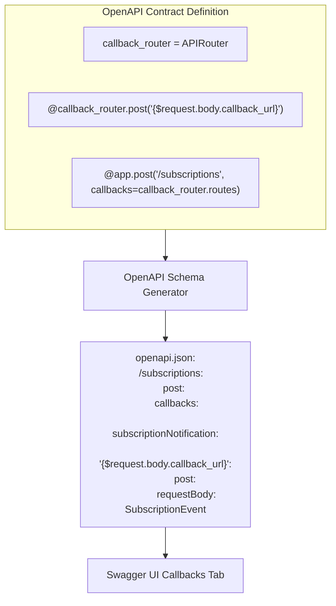

# FastAPI Path Operation Callbacks & Webhook Contracts

Modern distributed APIs do not merely receive HTTP requests; they dispatch asynchronous events back to client-provided callback URLs (Webhooks). FastAPI provides native support for OpenAPI 3.1 **Callbacks**, allowing backend engineers to formally specify and document the exact HTTP request payloads, headers, and expected response codes that the server will send to third-party endpoints.

---

## Conceptual Foundation & Mental Model

Consider a payment subscription API:
1. A client calls `POST /invoices` to create an invoice and provides a `callback_url: "https://client.com/webhook"`.
2. Hours or days later, when payment settles, your backend worker sends an HTTP `POST` to that `callback_url`.

Without OpenAPI Callbacks, third-party developers have no machine-readable specification of:
- What HTTP method will be used.
- What JSON payload the webhook will contain.
- What headers (e.g. `X-Signature-SHA256`) will be included.
- What response status code your server expects the client to return (e.g. `200 OK`).

FastAPI's `callbacks` parameter uses an `APIRouter` to model the outbound webhook contract, documenting it directly inside the main endpoint's Swagger UI / ReDoc specification.

```
1. Client Subscribes (Inbound Request):
Client ───► POST /invoices (callback_url="https://client.com/hook") ───► FastAPI
                                                                           │
                                                                           ▼
2. Asynchronous Event Occurs (Outbound Webhook):                       Event DB
FastAPI / Worker ───► POST https://client.com/hook ───────────────► Client Endpoint
   - Body: InvoicePaidEvent(invoice_id, amount)
   - Header: X-Webhook-Signature: sha256=...
   ◄─── Response: 200 OK
```

---

## Architecture & Internal Mechanics

When you attach a callback router to an endpoint:
1. **Callback Router Instantiation**: You instantiate an `APIRouter` to define callback routes. The path of the callback route contains an OpenAPI URL expression (e.g. `{$request.body.callback_url}` or `{$request.query.callback_url}`).
2. **OpenAPI Schema Compilation**: FastAPI does **not** register these routes into its internal ASGI request table (your server will not receive them). Instead, it compiles them into the `callbacks` object of the parent endpoint's OpenAPI operation.
3. **Interactive Documentation**: Swagger UI and ReDoc render a dedicated "Callbacks" tab showing clients exactly how to build their webhook receivers.



---

## Comprehensive Syntax & Core Mechanics

```python
from fastapi import FastAPI, APIRouter
from pydantic import BaseModel, HttpUrl

app = FastAPI()

# 1. Define callback router
invoices_callback_router = APIRouter()

# Event model sent TO client
class InvoiceNotification(BaseModel):
    invoice_id: str
    status: str
    amount_cents: int

# Expected client response
class InvoiceNotificationAck(BaseModel):
    received: bool

# 2. Register callback route using runtime OpenAPI expression
@invoices_callback_router.post(
    "{$request.body.callback_url}",
    response_model=InvoiceNotificationAck
)
def invoice_notification_callback(body: InvoiceNotification):
    """Client receiver endpoint for invoice events."""
    pass

# 3. Attach callback to parent endpoint
class SubscriptionRequest(BaseModel):
    plan_id: str
    callback_url: HttpUrl

@app.post(
    "/invoices/subscribe",
    callbacks=invoices_callback_router.routes
)
async def subscribe_invoices(body: SubscriptionRequest):
    return {"status": "subscription_active", "callback": body.callback_url}
```

---

## Practical Implementation (5 Complete Examples)

### Example 1: Payment Settlement Webhook Contract
```python
from fastapi import FastAPI, APIRouter, status
from pydantic import BaseModel, HttpUrl
import uuid

app = FastAPI(title="Fintech Payment Engine")

# Callback contract
payment_callbacks = APIRouter()

class PaymentSettledEvent(BaseModel):
    event_id: str
    payment_id: str
    amount: float
    currency: str
    settled_at: str

@payment_callbacks.post(
    "{$request.body.webhook_url}",
    response_model=dict,
    status_code=status.HTTP_200_OK,
    summary="Webhook invoked when payment settles"
)
def payment_settled_hook(event: PaymentSettledEvent):
    """The client's server should accept this POST request and return HTTP 200 OK."""
    pass

class PaymentRequest(BaseModel):
    amount: float
    currency: str
    webhook_url: HttpUrl

class PaymentResponse(BaseModel):
    payment_id: str
    status: str

@app.post(
    "/payments",
    response_model=PaymentResponse,
    callbacks=payment_callbacks.routes,
    tags=["Payments"]
)
async def create_payment(payload: PaymentRequest):
    return PaymentResponse(
        payment_id=f"pay_{uuid.uuid4().hex[:8]}",
        status="pending"
    )
```

### Example 2: Query-Parameter-Based Callback Expression
```python
from fastapi import FastAPI, APIRouter
from pydantic import BaseModel, HttpUrl

app = FastAPI()

job_callbacks = APIRouter()

class JobCompletePayload(BaseModel):
    job_id: str
    result_url: str
    duration_seconds: float

# Notice the expression: {$request.query.callback}
@job_callbacks.post("{$request.query.callback}")
def job_completion_notification(payload: JobCompletePayload):
    pass

@app.post("/jobs/async-render", callbacks=job_callbacks.routes)
async def trigger_async_render(job_name: str, callback: HttpUrl):
    return {"job_id": "job_99", "status": "queued"}
```

### Example 3: Multiple Callback Events on a Single Endpoint
```python
from fastapi import FastAPI, APIRouter
from pydantic import BaseModel, HttpUrl

app = FastAPI(title="CI/CD Pipeline Service")

pipeline_callbacks = APIRouter()

class BuildStartedEvent(BaseModel):
    build_id: str
    commit: str

class BuildFinishedEvent(BaseModel):
    build_id: str
    success: bool
    logs_url: str

# Two distinct callback paths or events documented for one subscription!
@pipeline_callbacks.post("{$request.body.events_url}/started")
def build_started_hook(event: BuildStartedEvent):
    pass

@pipeline_callbacks.post("{$request.body.events_url}/finished")
def build_finished_hook(event: BuildFinishedEvent):
    pass

class PipelineSubscription(BaseModel):
    repo_url: str
    events_url: HttpUrl

@app.post("/pipelines/listen", callbacks=pipeline_callbacks.routes)
async def subscribe_pipeline(sub: PipelineSubscription):
    return {"registered": True}
```

### Example 4: Documenting Webhook HMAC Security Headers
```python
from typing import Annotated
from fastapi import FastAPI, APIRouter, Header
from pydantic import BaseModel, HttpUrl

app = FastAPI()

secure_hooks = APIRouter()

class EventData(BaseModel):
    event: str
    timestamp: int

@secure_hooks.post("{$request.body.webhook_url}")
def signed_webhook_callback(
    event: EventData,
    x_hub_signature_256: Annotated[str, Header(description="HMAC-SHA256 signature generated with your webhook secret")]
):
    """The webhook delivery includes a cryptographic HMAC signature in the X-Hub-Signature-256 header."""
    pass

class WebhookRegistration(BaseModel):
    webhook_url: HttpUrl

@app.post("/webhooks/register", callbacks=secure_hooks.routes)
async def register_webhook(reg: WebhookRegistration):
    return {"webhook_registered": True}
```

### Example 5: Actually Dispatching the Webhook via Async HTTP Client
```python
import httpx
from fastapi import FastAPI, APIRouter, BackgroundTasks
from pydantic import BaseModel, HttpUrl

app = FastAPI()
hook_router = APIRouter()

class PingEvent(BaseModel):
    ping_id: str

@hook_router.post("{$request.body.target_url}")
def on_ping(event: PingEvent):
    pass

async def deliver_webhook_payload(url: str, ping_id: str):
    async with httpx.AsyncClient(timeout=5.0) as client:
        try:
            await client.post(url, json={"ping_id": ping_id})
        except httpx.HTTPError as err:
            print(f"Failed to deliver webhook to {url}: {err}")

class PingRequest(BaseModel):
    target_url: HttpUrl

@app.post("/ping-me-later", callbacks=hook_router.routes)
async def trigger_delayed_ping(req: PingRequest, bg: BackgroundTasks):
    bg.add_task(deliver_webhook_payload, url=str(req.target_url), ping_id="ping_12345")
    return {"status": "scheduled"}
```

---

## Anti-Patterns & Common Traps

| Anti-Pattern | Why It Breaks / Fails | Production Solution |
| :--- | :--- | :--- |
| **Writing hardcoded URLs in callback routes** (`@cb.post("https://...")`) | Breaks the OpenAPI specification; clients provide dynamic URLs per subscription. | Use standard OpenAPI runtime expressions: `{$request.body.callback_url}`. |
| **Including callback routers into `app.include_router()`** | Exposes the callback path as an incoming endpoint on your own server. | Pass routes directly to the endpoint: `callbacks=callback_router.routes`. |
| **Omitting expected client response schemas** | Clients don't know what status code (e.g. 200 vs 204) your server expects to acknowledge receipt. | Document `response_model` or `status_code` on the callback function. |
| **Sending unauthenticated webhooks** | Allows third-party endpoints to be spammed by unauthorized actors spoofing your service. | Always sign payloads with an HMAC header (`X-Signature-SHA256`) and document it. |

---

## Performance & Resource Characteristics

- **Zero Runtime Overhead**: Callback routers do not participate in ASGI request routing; they are inspected once during OpenAPI schema compilation.
- **Asynchronous Delivery**: In production, dispatching webhooks must never block the HTTP response; always delegate webhook delivery to asynchronous task workers (Celery, ARQ, Temporal, or `BackgroundTasks`).

---

## Edge Cases, Failure Modes & Gotchas

1. **OpenAPI Runtime Expressions**: The expression syntax requires exact braces: `{$request.body.target_url}`. Typos like `{request.body.url}` without the `$` sign are not compliant with OpenAPI 3.1.
2. **Body Path Navigation**: If the callback URL is nested inside a sub-object in the request body (e.g. `request_body.settings.webhook_url`), the expression must be `{$request.body.settings.webhook_url}`.

---

## Security Implications & OWASP Alignment

- **Server-Side Request Forgery (SSRF)**: When allowing clients to provide callback URLs, attackers might provide internal private IPs (`http://169.254.169.254` or `http://localhost:8000`). When implementing the dispatcher:
  1. Validate that the callback URL resolves only to public, non-private IP addresses.
  2. Forbid loopback and link-local address spaces.
- **Webhook Replay Protection**: Include timestamps and nonce fields in outbound payloads to prevent replay attacks against client endpoints.

---

## Modern Tooling Integration

- **Svix / Hookdeck**: Industry-standard webhook gateways that consume your OpenAPI callback specifications to automatically manage retries, rate limiting, and signature verification.
- **Swagger UI 5.x**: Renders interactive "Callbacks" documentation tabs detailing outbound event structures.

---

## Real-World Case Study / Production Incident

A crypto trading platform allowed users to subscribe to trade execution webhooks. A customer misconfigured their server, returning HTTP 500 on all webhooks. The trading platform's synchronous worker retried in an infinite loop, exhausting outbound connection sockets and causing trade processing delays.

**Remediation**:
1. Formally documented the callback contract in OpenAPI using FastAPI callbacks, requiring clients to return HTTP 200 within 3 seconds.
2. Implemented exponential backoff with a dead-letter queue (DLQ) after 5 failed attempts.
3. Added HMAC-SHA256 signatures so clients could verify message integrity.

---

## Hands-On Exercises & Challenge Problems

### Warmup (2 Exercises)
1. Create a callback router that documents a `POST` event with a `MessageDelivered` Pydantic payload.
2. Attach the callback router to a `/messages/send` endpoint and inspect the resulting `/openapi.json` to verify the `callbacks` field.

### Intermediate (2 Exercises)
3. Build a webhook registration endpoint that documents two distinct callback events: `order.created` and `order.cancelled`.
4. Document a required header `X-Webhook-Secret` in the callback route and verify it appears in Swagger UI.

### Production-Grade (2 Exercises)
5. Build a complete end-to-end webhook subscription and dispatching system using `BackgroundTasks` and `httpx`, complete with SSRF validation preventing deliveries to private IPv4/IPv6 ranges.
6. Create an automated test that validates an outgoing webhook payload against the Pydantic schema declared in the callback router.

---

## Interview Mastery (8 Q&As)

### Junior Level
**Q1: What are OpenAPI Callbacks in FastAPI?**
*Answer:* Callbacks allow an API to document the asynchronous HTTP requests (webhooks) that your server will send to client-provided URLs in response to events, specifying payload structures, headers, and expected response codes.

**Q2: How do you declare a callback URL expression in FastAPI?**
*Answer:* Using OpenAPI runtime expression syntax inside the callback route path, such as: `"{$request.body.callback_url}"`.

**Q3: Does a callback router handle incoming HTTP requests on your FastAPI server?**
*Answer:* No. Callback routers are not registered in the ASGI routing table; they exist solely to document outbound webhook contracts in the OpenAPI specification.

### Senior Level
**Q4: How do you attach a callback router to an endpoint?**
*Answer:* By passing the callback router's routes list to the `callbacks` parameter of the path operation decorator:
```python
@app.post("/subscribe", callbacks=callback_router.routes)
```

**Q5: What security risks must be mitigated when implementing a webhook delivery engine?**
*Answer:* Server-Side Request Forgery (SSRF) is the primary risk. The server must validate and resolve the target URL to ensure it does not point to internal private subnets, localhost, or cloud metadata endpoints (`169.254.169.254`).

**Q6: How can you document that a webhook includes an HMAC signature in its request header?**
*Answer:* Add an annotated parameter with `Header(description="...")` to the callback function signature:
```python
def webhook_callback(data: Event, x_signature: Annotated[str, Header()]): ...
```

### Staff / Architect Level
**Q7: How do you design an enterprise-grade webhook delivery infrastructure behind a FastAPI application?**
*Answer:*
1. **Contract First**: Formally document events, retry policies, and signature schemes using FastAPI OpenAPI callbacks.
2. **Decoupled Architecture**: Endpoints record subscription events in a transactional database; business events publish messages to a distributed queue (Kafka, RabbitMQ, SQS).
3. **Dedicated Workers**: Specialized webhook dispatch workers consume queue messages, sign payloads with HMAC-SHA256, enforce SSRF IP checks, and execute HTTP POST calls with strict timeouts (e.g. 5 seconds).
4. **Reliability**: Implement exponential backoff retry policies (e.g. 5 retries over 24 hours) and dead-letter queues (DLQ), with customer-facing webhook delivery logs and manual retry capabilities.

**Q8: What is the exact difference between `{$request.body.url}` and `{$request.query.url}` in OpenAPI callbacks?**
*Answer:*
- `{$request.body.url}` instructs OpenAPI that the callback URL will be extracted dynamically from the JSON body of the inbound HTTP request.
- `{$request.query.url}` instructs OpenAPI that the callback URL will be extracted from the query string parameter named `url` of the inbound request.
