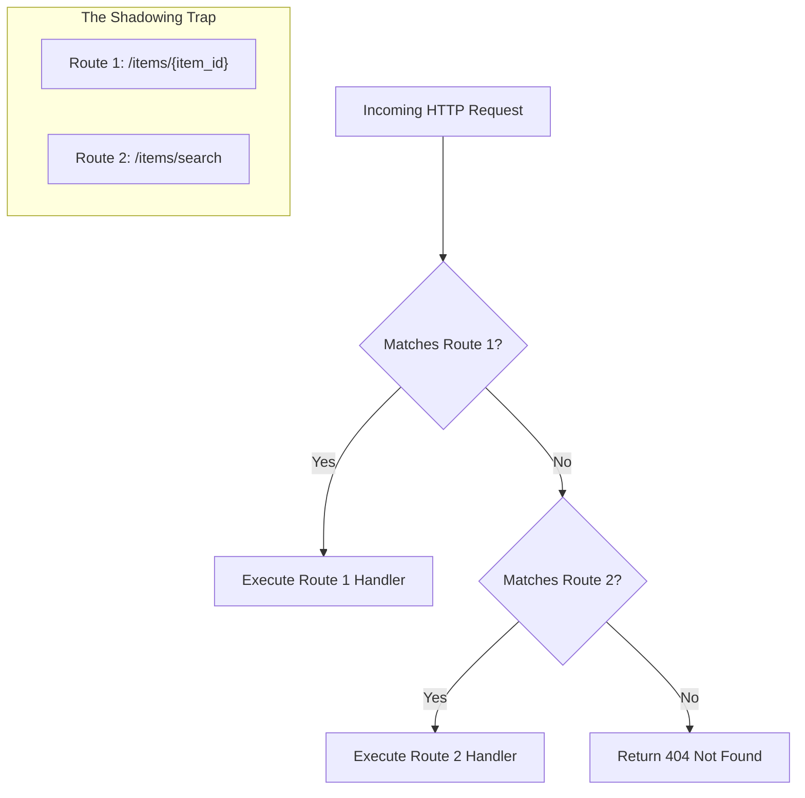

# Common FastAPI Routing Mistakes & Pitfalls

Routing in FastAPI is fast and expressive, but subtle misconfigurations—such as path operation declaration ordering, trailing slash mismatches causing POST payload drops, prefix concatenation errors, and wildcard shadowing—can cause baffling production bugs.

---

## Conceptual Foundation & Mental Model

FastAPI compiles registered routes into a sequential list of regular expression matchers evaluated from top to bottom. The most critical operational traps occur when:
1. **Route Shadowing**: A dynamic path wildcard (like `/users/{user_id}`) is registered *before* a static path (like `/users/me`). The wildcard captures `"me"` as a user ID, preventing the `/users/me` handler from ever running!
2. **Trailing Slash 307 Redirects**: Requesting `/items` when the route is defined as `/items/` triggers an HTTP 307 Temporary Redirect. If an HTTP client does not preserve the request body on redirects, POST/PUT bodies are silently dropped.
3. **Prefix Doubling**: Specifying `/api/v1` in `APIRouter(prefix="/api/v1")` and again in `app.include_router(router, prefix="/api/v1")` results in `/api/v1/api/v1/...`.
4. **Missing Leading Slash**: Writing `@app.get("items")` without a leading `/`.

```
Route Table Evaluation (Top to Bottom):
1. GET /users/{user_id}  <── Matches first! "me" is treated as user_id!
2. GET /users/me         <── DEAD CODE: Shadowed and unreachable!
```

---

## Architecture & Internal Mechanics

Starlette's routing engine evaluates routes in registration sequence:
- **First-Match Wins**: The router does not sort routes by specificity. Whichever pattern matches the incoming path string first handles the request.
- **Strict Slash Policy**:
  - Endpoint defined as `/items/`: A request to `/items` receives a `307 Temporary Redirect` pointing to `/items/`.
  - Endpoint defined as `/items`: A request to `/items/` receives a `307 Temporary Redirect` pointing to `/items`.
  - If a POST request is redirected via 307, compliant HTTP clients re-send the POST body, but older or misconfigured clients may downgrade to a GET or drop the body!



---

## Comprehensive Syntax & Core Mechanics

The table below summarizes the top routing pitfalls and immediate fixes:

| Pitfall | Root Cause | Symptom | Production Fix |
| :--- | :--- | :--- | :--- |
| **Wildcard Shadowing** | `@app.get("/{id}")` declared above `@app.get("/me")` | `/users/me` returns 422 (cannot cast `"me"` to `int`) | Declare static routes **above** parameterized routes. |
| **Trailing Slash 307** | Client sends `/api/resource`, route defined as `/api/resource/` | Unnecessary HTTP redirect roundtrip; client POST body dropped | Standardize on **no** trailing slashes across all endpoints. |
| **Double Prefix** | Defining prefix in both `APIRouter` and `include_router` | Endpoint path becomes `/api/v1/api/v1/users` | Define prefix in **one** place only. |
| **Missing Leading Slash** | `@router.get("users")` | `AssertionError: Path must start with '/'` | Always start paths with `/`: `@router.get("/users")`. |
| **Unescaped Path Params** | Passing file paths like `/files/{path}` with slashes | 404 Not Found when path contains `/` | Use path converter: `/files/{path:path}`. |

---

## Practical Implementation (5 Complete Examples of Bugs & Fixes)

### Example 1: Resolving Route Shadowing (Bug & Fix)
```python
from fastapi import FastAPI, HTTPException

app = FastAPI()

# ❌ BUG: Wildcard declared first shadows /users/me!
# @app.get("/users/{user_id}")
# def get_user_by_id(user_id: int):
#     return {"user_id": user_id}
#
# @app.get("/users/me")
# def get_my_profile():
#     return {"user": "current_user"}
# A request to GET /users/me fails with 422: "value is not a valid integer"!

# ✅ FIX: Declare static, specific routes FIRST!
@app.get("/users/me", tags=["Users"])
def get_my_profile():
    return {"user": "current_user", "email": "me@example.com"}

@app.get("/users/{user_id}", tags=["Users"])
def get_user_by_id(user_id: int):
    return {"user_id": user_id}
```

### Example 2: Handling Full File Paths with the `:path` Converter
```python
from fastapi import FastAPI, HTTPException

app = FastAPI()

# ❌ Standard parameter fails if client requests /files/reports/2026/q1.pdf (404)
# @app.get("/files/{filepath}")
# def get_file(filepath: str): ...

# ✅ FIX: Use :path to match entire sub-paths including forward slashes!
@app.get("/files/{filepath:path}")
def get_file(filepath: str):
    # Matches "reports/2026/q1.pdf" cleanly
    return {"filepath": filepath}
```

### Example 3: Eliminating Trailing Slash 307 Redirects
```python
from fastapi import FastAPI

app = FastAPI()

# Standardize across entire project: NO trailing slashes!
@app.post("/items")
async def create_item(name: str):
    return {"created": name}

# If both /items and /items/ must respond without redirects:
@app.get("/products")
@app.get("/products/")
async def list_products():
    return ["prod1", "prod2"]
```

### Example 4: Preventing Prefix Duplication in Modular Layouts
```python
# ❌ BUG: Double prefixing
# routers/orders.py:
# router = APIRouter(prefix="/api/v1/orders")
#
# main.py:
# app.include_router(orders_router, prefix="/api/v1")
# Result: /api/v1/api/v1/orders (404 when clients call /api/v1/orders!)

# ✅ FIX: Centralize prefixing in the mount/include location:
# routers/orders.py:
from fastapi import APIRouter
router = APIRouter(prefix="/orders", tags=["Orders"])

# main.py:
from fastapi import FastAPI
app = FastAPI()
app.include_router(router, prefix="/api/v1")
# Result: /api/v1/orders
```

### Example 5: Resolving Query Parameter and Path Parameter Conflicts
```python
from typing import Annotated
from fastapi import FastAPI, Path, Query

app = FastAPI()

# ❌ BUG: Parameter declared as Path but omitted from route string
# @app.get("/search")
# def search_item(item_id: Annotated[int, Path()]): ...
# Raises AssertionError on startup: "Path parameter 'item_id' not in path '/search'"

# ✅ FIX: Match path parameters to URL, query parameters to Query()
@app.get("/search/{category}")
def search_item(
    category: Annotated[str, Path(description="Category from URL path")],
    query: Annotated[str, Query(description="Search keyword from query string")]
):
    return {"category": category, "query": query}
```

---

## Anti-Patterns & Common Traps

| Anti-Pattern | Operational Risk | Recommended Standard |
| :--- | :--- | :--- |
| **Relying on client to follow 307 redirects on POST** | Mobile apps using HTTP libraries (like older OkHttp or custom curl scripts) fail on redirects. | Never define trailing slashes on POST/PUT mutation routes. |
| **Using generic regex paths without anchors** | Causes greedy regexes to hijack unrelated routes. | Use standard path parameters or specific regex patterns like `{id:regex(^[0-9]+$)}`. |
| **Inconsistent HTTP verbs** (e.g. `@app.get` for deletion) | Violates REST principles; allows web crawlers or browser pre-fetchers to trigger destructive actions. | Strictly adhere to HTTP methods: GET (idempotent read), POST (create), PUT (replace), PATCH (update), DELETE (delete). |
| **Defining routes after `app.mount()` without checking order** | Catch-all mounts can swallow requests intended for subsequently declared routes. | Register specific routes and routers *before* mounting static file catch-alls. |

---

## Performance & Resource Characteristics

- **Path Matching Engine**: Starlette uses compiled regular expressions. Route shadowing does not degrade performance, but silently returns incorrect data or 422 errors.
- **Redirect Penalty**: A 307 redirect costs a full extra network roundtrip (RTT), adding 20ms–150ms of latency per client call. Eliminating trailing slash redirects immediately improves API responsiveness.

---

## Edge Cases, Failure Modes & Gotchas

1. **Regex Path Converters**: FastAPI supports custom regex constraints directly in path strings: `/{user_id:regex(^[0-9a-f]{8}$)}`. If the regex contains syntax errors, FastAPI crashes during application startup.
2. **Mount Order with Catch-Alls**: If you mount `StaticFiles(directory="dist", html=True)` at `/`, it acts as a catch-all. Any routes registered **after** `app.mount("/", ...)` will be shadowed and unreachable!

---

## Security Implications & OWASP Alignment

- **Unintended Action Execution**: Path shadowing can cause admin routes like `/users/admin-reset` to be treated as `user_id="admin-reset"`, accidentally triggering standard user endpoints with corrupted input.
- **OWASP API7:2023 - Server-Side Request Forgery**: When using `:path` converters to serve files, never pass the matched path directly to `open()`. Always resolve and validate that the canonical path resides inside the designated sandbox directory to prevent Directory Traversal (`../../etc/passwd`).

---

## Modern Tooling Integration

- **FastAPI Startup Validation**: FastAPI validates route path parameters against function signatures at startup, raising helpful `AssertionError` exceptions if parameters don't match.
- **Pytest**: Write explicit test cases asserting that both `/resource` and `/resource/me` return expected 200 responses.

---

## Real-World Case Study / Production Incident

An international airline API had an endpoint `@router.get("/flights/{flight_id}")`. An engineer added `@router.get("/flights/status")` at the bottom of the file to provide an operational status dashboard.

**Production Incident**:
Shortly after release, monitoring reported a 100% failure rate on `/flights/status`. The endpoint was returning HTTP 422: `value is not a valid integer` because the flight ID route was matching first, attempting to parse `"status"` as an integer flight ID.

**Remediation**:
1. Re-ordered the route definitions, placing `/flights/status` before `/flights/{flight_id}`.
2. Added an automated CI linter test checking that static path segments under the same parent prefix precede parameterized wildcard siblings.

---

## Hands-On Exercises & Challenge Problems

### Warmup (2 Exercises)
1. Write two endpoints `/orders/recent` and `/orders/{order_id:int}` in the correct order so neither shadows the other.
2. Test requesting `/orders/recent` with `TestClient` and assert HTTP 200 is returned.

### Intermediate (2 Exercises)
3. Implement an endpoint `/documents/{doc_path:path}` that accepts nested paths (e.g. `legal/contracts/nda.pdf`) and safely validates that the path does not contain `..` directory traversal attempts.
4. Create an endpoint that handles a constrained regex parameter `/{sku:regex(^SKU-[0-9]{4}$)}` and test that `/SKU-1234` succeeds while `/SKU-ABCD` returns 404.

### Production-Grade (2 Exercises)
5. Build an AST linting script using Python's `ast` module that inspects all router files in a repository and fails if any `@router.get` with a wildcard `{param}` appears before a static route sharing the same prefix.
6. Design and implement a canonical URL middleware that strips trailing slashes from incoming requests without issuing 307 redirects, avoiding body drops on POST requests.

---

## Interview Mastery (8 Q&As)

### Junior Level
**Q1: Why does `@app.get("/items/me")` fail with a 422 error if defined after `@app.get("/items/{item_id:int}")`?**
*Answer:* FastAPI matches routes in order of declaration. The parameterized route matches first, capturing `"me"` as `item_id`, and Pydantic fails when attempting to validate `"me"` as an integer.

**Q2: How do you capture a full URL path including forward slashes in a path parameter?**
*Answer:* Use the `:path` converter: `@app.get("/files/{filepath:path}")`.

**Q3: What causes an HTTP 307 Temporary Redirect when calling a FastAPI endpoint?**
*Answer:* A trailing slash mismatch: requesting `/items` when the route is defined as `/items/` (or vice-versa).

### Senior Level
**Q4: Why are 307 redirects particularly dangerous for POST and PUT requests?**
*Answer:* While the HTTP specification states 307 redirects must preserve the request method and body, many HTTP clients (and proxies) misbehave by dropping the payload or converting the request to a GET, resulting in silent data loss.

**Q5: What happens if a parameter in `Path()` does not exist in the route's path string?**
*Answer:* FastAPI raises an `AssertionError` during application boot, preventing the server from starting with mismatched route parameters.

**Q6: What is the risk of mounting a static file handler at the root path (`app.mount("/", StaticFiles(...))`)?**
*Answer:* Mounting at `/` creates a catch-all route. Any FastAPI endpoints declared *after* the mount will never be reached because the static file handler intercepts all incoming paths.

### Staff / Architect Level
**Q7: How do you design an organization-wide routing standard that prevents route shadowing and trailing slash bugs across 100+ microservices?**
*Answer:*
1. **Routing Convention**: Mandate no trailing slashes on all API endpoints.
2. **Automated Linter**: Implement an automated AST check in CI that parses route decorators across all repositories, enforcing that static routes precede dynamic wildcard siblings.
3. **Gateway Normalization**: Configure edge reverse proxies (Kong, Traefik, Nginx) to normalize trailing slashes consistently before requests hit FastAPI.

**Q8: How does Starlette's routing regex engine compile and evaluate path parameters under the hood?**
*Answer:* Starlette parses route strings into regular expressions at startup. Standard parameters `{param}` compile to `[^/]+`, capturing any character except a forward slash. Path parameters with `:path` compile to `.*`, capturing across slashes. Custom regex converters `{param:regex(...)}` insert the user-supplied regex directly into the compiled pattern. Because routes are compiled into an ordered list, matching is linear first-match.
