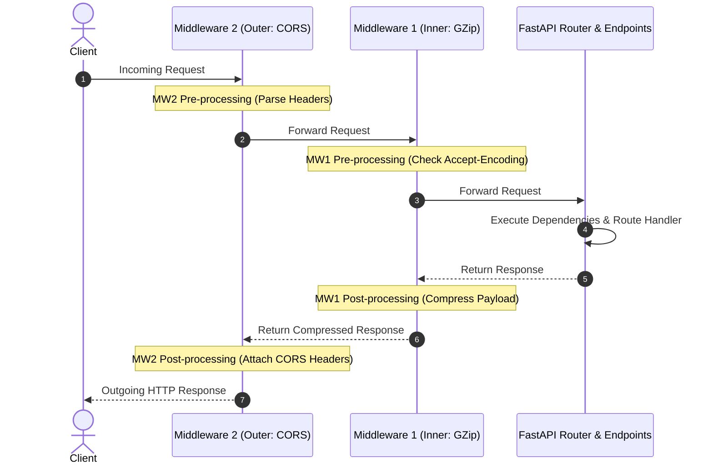

# FastAPI Middleware Concepts & Execution Order

Middleware in FastAPI operates at the perimeter of the application, wrapping every incoming HTTP request and outgoing HTTP response. Understanding the ASGI "Onion Model"—specifically how registration order dictates inbound execution versus outbound return order—is essential for implementing CORS, compression, tracing, authentication, and security headers correctly without introducing latency or subtle bugs.

---

## Conceptual Foundation & Mental Model

Think of middleware as concentric layers of an onion surrounding your FastAPI application:
1. An incoming HTTP request penetrates the layers from the **outside in** (First-In, First-Executed).
2. The core application processes the request and produces a response.
3. The outgoing HTTP response travels back out through the layers in **reverse order** (Last-In, First-Executed).

```
                      Incoming HTTP Request
                               │
                               ▼
            ┌─────────────────────────────────────┐
            │       Middleware 1 (Outer)          │
            │  ┌───────────────────────────────┐  │
            │  │     Middleware 2 (Inner)      │  │
            │  │  ┌─────────────────────────┐  │  │
            │  │  │   FastAPI Core Handler  │  │  │
            │  │  └─────────────────────────┘  │  │
            │  │     Response Phase 2          │  │
            │  └───────────────────────────────┘  │
            │       Response Phase 1              │
            └─────────────────────────────────────┘
                               │
                               ▼
                      Outgoing HTTP Response
```

### Order of Declaration vs Execution
In Starlette / FastAPI:
```python
app.add_middleware(MiddlewareA)
app.add_middleware(MiddlewareB)
```
- **Registration Order**: `MiddlewareA` is registered first, then `MiddlewareB`.
- **Inbound Request**: `MiddlewareB` executes **before** `MiddlewareA`! (Because `add_middleware` wraps the existing application, making the last added middleware the outermost layer).
- **Outbound Response**: `MiddlewareA` executes its post-processing before `MiddlewareB`.

---

## Architecture & Internal Mechanics

### ASGI Application Composition
In ASGI, an application is a callable: `async def app(scope, receive, send)`.
When you add middleware, FastAPI chains them:
$$\text{ASGI Stack} = \text{Middleware}_N(\text{Middleware}_{N-1}(...(\text{FastAPI App})))$$



---

## Comprehensive Syntax & Core Mechanics

### 1. Registering Middleware via `app.add_middleware()`
```python
from fastapi import FastAPI
from starlette.middleware.cors import CORSMiddleware
from starlette.middleware.gzip import GZipMiddleware

app = FastAPI()

# 1. Inner middleware (added first)
app.add_middleware(GZipMiddleware, minimum_size=1000)

# 2. Outer middleware (added second, runs first on inbound!)
app.add_middleware(
    CORSMiddleware,
    allow_origins=["*"],
    allow_methods=["*"],
    allow_headers=["*"]
)
```

### 2. Registering Middleware via `@app.middleware("http")`
The `@app.middleware("http")` decorator provides an ergonomic, function-based wrapper (internally powered by `BaseHTTPMiddleware`):

```python
import time
from fastapi import FastAPI, Request

app = FastAPI()

@app.middleware("http")
async def add_process_time_header(request: Request, call_next):
    start_time = time.perf_counter()
    response = await call_next(request)
    process_time = time.perf_counter() - start_time
    response.headers["X-Process-Time"] = f"{process_time:.4f}s"
    return response
```

### Middleware vs Dependencies: When to Use Which?
| Requirement | Middleware | Dependency Injection |
| :--- | :---: | :---: |
| Modify raw response headers for **all** responses | ✅ Yes | ❌ Awkward |
| Raw byte streaming / compression (GZip) | ✅ Yes | ❌ Impossible |
| Access route path parameters (`{user_id}`) | ❌ No (routing hasn't run) | ✅ Yes |
| OpenAPI schema documentation (tags, models) | ❌ No | ✅ Yes |
| Yield-based resource cleanup per route | ❌ Clunky | ✅ Native & clean |
| Selective execution on specific sub-routers | ❌ Global only | ✅ Hierarchical |

---

## Practical Implementation (5 Complete Examples)

### Example 1: Correlation ID / Request ID Injection Middleware
```python
import uuid
from fastapi import FastAPI, Request, Response

app = FastAPI(title="Traceable Gateway")

@app.middleware("http")
async def correlation_id_middleware(request: Request, call_next) -> Response:
    # 1. Read or generate correlation ID
    correlation_id = request.headers.get("X-Correlation-ID", str(uuid.uuid4()))
    # 2. Store on request state for endpoint access
    request.state.correlation_id = correlation_id
    
    # 3. Call downstream layers
    response = await call_next(request)
    
    # 4. Attach to outgoing response headers
    response.headers["X-Correlation-ID"] = correlation_id
    return response

@app.get("/status")
async def get_status(request: Request):
    return {"status": "ok", "cid": request.state.correlation_id}
```

### Example 2: Verifying Inbound & Outbound Execution Order
```python
from fastapi import FastAPI, Request

app = FastAPI()

@app.middleware("http")
async def middleware_outer(request: Request, call_next):
    print("1. Outer Middleware: INBOUND")
    response = await call_next(request)
    print("4. Outer Middleware: OUTBOUND")
    return response

@app.middleware("http")
async def middleware_inner(request: Request, call_next):
    print("2. Inner Middleware: INBOUND")
    response = await call_next(request)
    print("3. Inner Middleware: OUTBOUND")
    return response

@app.get("/ping")
def ping():
    print(" -> Route Handler Executing")
    return {"message": "pong"}

# Order of prints on GET /ping:
# 1. Outer Middleware: INBOUND
# 2. Inner Middleware: INBOUND
#  -> Route Handler Executing
# 3. Inner Middleware: OUTBOUND
# 4. Outer Middleware: OUTBOUND
```

### Example 3: Security Headers Enforcement Middleware
```python
from fastapi import FastAPI, Request, Response

app = FastAPI()

@app.middleware("http")
async def security_headers_middleware(request: Request, call_next) -> Response:
    response = await call_next(request)
    # Enforce modern browser defense-in-depth headers
    response.headers["X-Content-Type-Options"] = "nosniff"
    response.headers["X-Frame-Options"] = "DENY"
    response.headers["X-XSS-Protection"] = "1; mode=block"
    response.headers["Strict-Transport-Security"] = "max-age=31536000; includeSubDomains"
    response.headers["Content-Security-Policy"] = "default-src 'self'"
    return response

@app.get("/secure-page")
def secure_page():
    return {"content": "protected"}
```

### Example 4: Request Timing & Latency Logger
```python
import time
import logging
from fastapi import FastAPI, Request

logging.basicConfig(level=logging.INFO)
logger = logging.getLogger("api.access")

app = FastAPI()

@app.middleware("http")
async def access_log_middleware(request: Request, call_next):
    start = time.perf_counter()
    response = await call_next(request)
    latency_ms = (time.perf_counter() - start) * 1000
    
    logger.info(
        f"{request.method} {request.url.path} "
        f"status={response.status_code} "
        f"latency={latency_ms:.2f}ms"
    )
    return response
```

### Example 5: Blocking Suspicious User-Agents at the Perimeter
```python
from fastapi import FastAPI, Request, status
from fastapi.responses import JSONResponse

app = FastAPI()

BLOCKED_AGENTS = {"sqlmap", "nikto", "masscan"}

@app.middleware("http")
async def user_agent_firewall(request: Request, call_next):
    user_agent = request.headers.get("User-Agent", "").lower()
    if any(bot in user_agent for bot in BLOCKED_AGENTS):
        return JSONResponse(
            status_code=status.HTTP_403_FORBIDDEN,
            content={"error": "Access forbidden: Automated scanner detected"}
        )
    return await call_next(request)
```

---

## Anti-Patterns & Common Traps

| Anti-Pattern | Why It Breaks / Fails | Production Solution |
| :--- | :--- | :--- |
| **Confusing registration order** | Expecting the first `add_middleware()` call to execute first on inbound requests. | Remember LIFO: the *last* middleware added is the *outermost* layer. |
| **Attempting to read path parameters in middleware** | Routing occurs inside the application; `request.path_params` is empty in middleware. | Use FastAPI Dependencies for path-parameter-dependent logic. |
| **Using `BaseHTTPMiddleware` with Streaming Responses** | `BaseHTTPMiddleware` buffers responses in memory, breaking real-time SSE and chunked streaming. | Use pure ASGI middleware (`async def __call__(scope, receive, send)`). |
| **Catching exceptions in middleware and not re-raising** | Silently intercepts unhandled errors, preventing FastAPI's custom exception handlers from executing. | Let exceptions bubble or use pure ASGI exception handlers. |

---

## Performance & Resource Characteristics

- **`BaseHTTPMiddleware` Overhead**: Adds ~0.5ms of latency per request due to contextvars bridging and response streaming wrapping.
- **Pure ASGI Middleware**: Extremely fast, adding less than 0.01ms overhead.
- **Memory Consumption**: Beware of buffering middleware that reads `await request.body()` into RAM on multi-gigabyte file uploads.

---

## Edge Cases, Failure Modes & Gotchas

1. **Consumed Request Bodies**: If a middleware calls `await request.body()`, the stream is consumed. Subsequent handlers will see an empty stream unless you cache and re-inject the body into the receive callable.
2. **WebSockets and `BaseHTTPMiddleware`**: `@app.middleware("http")` only intercepts HTTP scopes; WebSocket connections (`scope["type"] == "websocket"`) bypass HTTP middlewares entirely! Use pure ASGI middleware to intercept WebSockets.

---

## Security Implications & OWASP Alignment

- **Perimeter Attack Surface Reduction**: Middlewares reject malformed headers, malicious user-agents, or prohibited origins before application routing or database connections occur.
- **OWASP API8:2023 - Security Misconfiguration**: Centralized security header injection ensures that all endpoints (including 404 and 500 error responses) return hardened HTTP headers.

---

## Modern Tooling Integration

- **OpenTelemetry ASGI Middleware**: Instruments incoming requests with distributed trace parent headers.
- **Prometheus FastAPIMiddleware**: Automatically collects request latency histograms and status code counters.

---

## Real-World Case Study / Production Incident

A SaaS platform experienced high memory usage and crashing worker pods during customer video uploads. Profiling revealed that a custom request logging middleware written with `@app.middleware("http")` was calling `body = await request.body()` to log payloads. When users uploaded 500MB videos, 20 concurrent requests consumed 10GB of RAM, triggering Linux OOM (Out Of Memory) kills.

**Remediation**:
1. Removed `await request.body()` from the global logging middleware.
2. Filtered logging to inspect only headers and query parameters, streaming large file bodies directly to disk via `UploadFile`. Memory usage stabilized below 200MB.

---

## Hands-On Exercises & Challenge Problems

### Warmup (2 Exercises)
1. Write a custom HTTP middleware that attaches an `X-Server-Name: api-worker-1` header to every response.
2. Verify using `TestClient` that requesting `/docs` includes the custom header.

### Intermediate (2 Exercises)
3. Implement two middlewares that print their names during inbound and outbound phases; verify the LIFO execution order via unit tests.
4. Build a middleware that inspects the `Content-Length` header and immediately rejects requests with payloads exceeding 10MB with HTTP 413 Payload Too Large.

### Production-Grade (2 Exercises)
5. Implement a robust request ID propagation middleware that extracts `X-Request-ID` or generates a UUID, binds it to a `contextvars.ContextVar`, attaches it to response headers, and injects it into all Python logging records via a custom `logging.Filter`.
6. Write a pure ASGI middleware (without `BaseHTTPMiddleware`) that intercepts WebSocket connection handshakes and verifies an authentication cookie before allowing the handshake to proceed.

---

## Interview Mastery (8 Q&As)

### Junior Level
**Q1: What is middleware in FastAPI?**
*Answer:* A function or class that wraps every incoming HTTP request and outgoing HTTP response, allowing cross-cutting operations like logging, timing, CORS, and header manipulation.

**Q2: How do you register an HTTP middleware using a decorator in FastAPI?**
*Answer:* Using `@app.middleware("http")`:
```python
@app.middleware("http")
async def my_middleware(request: Request, call_next):
    return await call_next(request)
```

**Q3: Can an HTTP middleware modify the response headers returned by an endpoint?**
*Answer:* Yes. The middleware awaits `response = await call_next(request)` and can add or mutate `response.headers[...]` before returning it.

### Senior Level
**Q4: In what order do middlewares execute when multiple middlewares are registered?**
*Answer:*
- On the inbound request: executed in reverse order of registration (LIFO - the last registered middleware runs first).
- On the outbound response: executed in forward order (the first registered middleware runs first on the way back out).

**Q5: Why is `request.path_params` empty inside middleware?**
*Answer:* Middlewares execute before Starlette's router has matched the URL path against route patterns. Path parameter extraction occurs inside the routing phase after middlewares have run.

**Q6: Why is `BaseHTTPMiddleware` problematic for Server-Sent Events (SSE) or streaming responses?**
*Answer:* `BaseHTTPMiddleware` wraps response bodies in an internal iterator that buffers chunks, which can delay or break real-time streaming connections. Pure ASGI middleware should be used for streaming.

### Staff / Architect Level
**Q7: How do you decide between implementing functionality in a Middleware versus a Dependency?**
*Answer:*
- Use **Middleware** when the functionality must execute for every single request across the entire application (including static files, docs, and 404s), requires altering raw response byte streams or headers, or handles connection-level protocol logic (CORS, gzip, proxy headers).
- Use **Dependencies** when the logic requires route path parameters, Pydantic type validation, fine-grained endpoint control, OpenAPI documentation integration, or dependency injection test overrides.

**Q8: What happens if a middleware raises an unhandled exception before calling `call_next(request)`?**
*Answer:* The request immediately terminates. The exception bubbles to Starlette's `ServerErrorMiddleware`, which catches it, logs a stack trace, and sends an HTTP 500 Internal Server Error response to the client. Subsequent middlewares and route handlers are never invoked.
