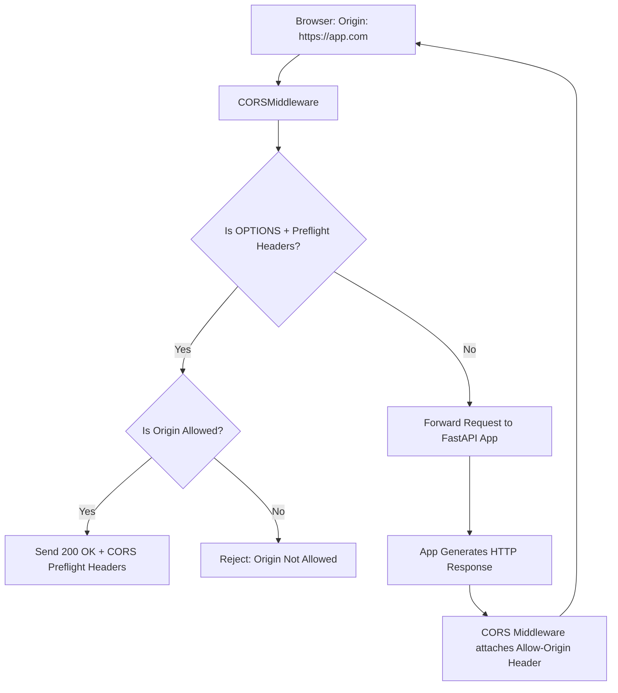

# FastAPI CORSMiddleware & Cross-Origin Security

Cross-Origin Resource Sharing (CORS) is a browser security mechanism that prevents malicious web applications on one domain from making unauthorized requests to an API on another domain. In FastAPI, `CORSMiddleware` manages CORS headers and preflight `OPTIONS` requests. Correct configuration is critical for enabling frontend clients (React, Vue, Next.js) while safeguarding protected user credentials.

---

## Conceptual Foundation & Mental Model

When a web browser executing code on `https://myfrontend.com` attempts an HTTP `fetch()` to `https://api.mybackend.com`:
1. **Same-Origin Policy**: By default, browsers block cross-origin requests unless the server explicitly grants permission via HTTP response headers.
2. **Simple Requests vs Preflight Requests**:
   - Simple requests (GET, POST with standard form types) execute directly, but the browser inspects response headers before releasing data to JavaScript.
   - Complex requests (PUT, DELETE, JSON `Content-Type`, custom headers like `Authorization`) trigger a preflight `OPTIONS` request first. The browser proceeds with the actual request only if the preflight returns matching `Access-Control-Allow-*` headers.

```
Browser (https://frontend.com)                       FastAPI (https://api.com)
            │                                                      │
            │─── 1. OPTIONS /items (Preflight) ───────────────────►│
            │    Origin: https://frontend.com                      │
            │    Access-Control-Request-Method: POST               │
            │    Access-Control-Request-Headers: Authorization     │
            │                                                      │
            │◄── 2. HTTP 200 OK ──────────────────────────────────│
            │    Access-Control-Allow-Origin: https://frontend.com │
            │    Access-Control-Allow-Methods: POST, GET, OPTIONS  │
            │    Access-Control-Allow-Headers: Authorization       │
            │                                                      │
            │─── 3. POST /items (Actual Request) ─────────────────►│
            │    Authorization: Bearer <token>                     │
            │                                                      │
            │◄── 4. HTTP 201 Created + Data ──────────────────────│
```

---

## Architecture & Internal Mechanics

### How `CORSMiddleware` Intercepts Requests
`CORSMiddleware` is a pure ASGI middleware positioned at the outermost layer of the application:
1. **Preflight Short-Circuiting**: When an incoming request matches `OPTIONS` with an `Origin` and `Access-Control-Request-Method` header:
   - It validates the origin against `allow_origins` and `allow_origin_regex`.
   - If valid, it returns an immediate HTTP 200 response with preflight headers. **Downstream endpoints and middlewares are bypassed completely!**
2. **Simple Request Processing**:
   - It forwards the request to downstream route handlers.
   - On the return journey, it appends `Access-Control-Allow-Origin: <origin>` and related headers to the response.



---

## Comprehensive Syntax & Core Mechanics

```python
from fastapi import FastAPI
from fastapi.middleware.cors import CORSMiddleware

app = FastAPI()

origins = [
    "http://localhost:3000",
    "http://localhost:5173",
    "https://staging.myapp.com",
    "https://myapp.com",
]

app.add_middleware(
    CORSMiddleware,
    allow_origins=origins,
    allow_origin_regex=r"https://.*\.myapp\.com",  # Allows all subdomains!
    allow_credentials=True,                         # Allows cookies & Authorization headers
    allow_methods=["GET", "POST", "PUT", "DELETE", "PATCH", "OPTIONS"],
    allow_headers=["*"],                            # Allowed request headers
    expose_headers=["X-Total-Count", "X-Request-ID"], # Headers browser JS can read
    max_age=86400,                                  # Cache preflight for 24 hours
)
```

### The Cardinal Rule of CORS Credentials
> [!CAUTION]
> If `allow_credentials=True`, **`allow_origins` CANNOT be `["*"]`!**
> Modern browsers reject responses that return `Access-Control-Allow-Origin: *` when `Access-Control-Allow-Credentials: true`. You must explicitly list specific origins or use `allow_origin_regex`.

---

## Practical Implementation (5 Complete Examples)

### Example 1: Standard Production Multi-Origin Setup
```python
from fastapi import FastAPI
from fastapi.middleware.cors import CORSMiddleware

app = FastAPI(title="Production Service")

ALLOWED_ORIGINS = [
    "https://dashboard.company.com",
    "https://admin.company.com",
    "http://localhost:3000"  # For local web development
]

app.add_middleware(
    CORSMiddleware,
    allow_origins=ALLOWED_ORIGINS,
    allow_credentials=True,
    allow_methods=["GET", "POST", "PUT", "DELETE", "OPTIONS"],
    allow_headers=["Authorization", "Content-Type", "X-Correlation-ID"],
    max_age=3600,
)

@app.get("/api/profile")
def get_profile():
    return {"user": "alice", "tier": "gold"}
```

### Example 2: Dynamic Wildcard Subdomain Regex
```python
from fastapi import FastAPI
from fastapi.middleware.cors import CORSMiddleware

app = FastAPI()

# Allow any preview deployment on Vercel or company subdomains
SUBDOMAIN_REGEX = r"https://(.*\.)?(company\.com|vercel\.app)"

app.add_middleware(
    CORSMiddleware,
    allow_origin_regex=SUBDOMAIN_REGEX,
    allow_credentials=True,
    allow_methods=["*"],
    allow_headers=["*"],
)

@app.get("/data")
def read_data():
    return {"message": "Accessible to all company subdomains and Vercel previews"}
```

### Example 3: Exposing Custom Response Headers to Frontend JavaScript
```python
from fastapi import FastAPI, Response
from fastapi.middleware.cors import CORSMiddleware

app = FastAPI()

app.add_middleware(
    CORSMiddleware,
    allow_origins=["https://client.com"],
    allow_credentials=True,
    allow_methods=["*"],
    allow_headers=["*"],
    # By default, browsers only expose simple headers (Cache-Control, Content-Type, etc.)
    # expose_headers makes custom metadata readable by JavaScript!
    expose_headers=["X-Pagination-Total", "X-Server-Execution-Time"]
)

@app.get("/users")
def list_users(response: Response):
    response.headers["X-Pagination-Total"] = "450"
    response.headers["X-Server-Execution-Time"] = "1.4ms"
    return [{"id": 1, "name": "Alice"}]
```

### Example 4: Testing CORS Preflight Requests with `TestClient`
```python
from fastapi import FastAPI
from fastapi.middleware.cors import CORSMiddleware
from fastapi.testclient import TestClient

app = FastAPI()
app.add_middleware(
    CORSMiddleware,
    allow_origins=["https://trusted.com"],
    allow_methods=["POST"],
    allow_headers=["X-Custom-Header"],
    allow_credentials=True
)

@app.post("/submit")
def submit():
    return {"status": "ok"}

def test_cors_preflight_success():
    client = TestClient(app)
    # Simulate browser preflight OPTIONS request
    headers = {
        "Origin": "https://trusted.com",
        "Access-Control-Request-Method": "POST",
        "Access-Control-Request-Headers": "X-Custom-Header",
    }
    response = client.options("/submit", headers=headers)
    assert response.status_code == 200
    assert response.headers["access-control-allow-origin"] == "https://trusted.com"
    assert response.headers["access-control-allow-credentials"] == "true"
    assert "POST" in response.headers["access-control-allow-methods"]

def test_cors_preflight_rejected():
    client = TestClient(app)
    # Untrusted origin
    headers = {
        "Origin": "https://malicious.com",
        "Access-Control-Request-Method": "POST",
    }
    response = client.options("/submit", headers=headers)
    # Untrusted origins do NOT receive access-control-allow-origin headers
    assert "access-control-allow-origin" not in response.headers
```

### Example 5: Public API with Zero Credentials (Permissive Mode)
```python
from fastapi import FastAPI
from fastapi.middleware.cors import CORSMiddleware

app = FastAPI(title="Public Weather API")

# Truly public read-only API: safe to use "*" because allow_credentials is False!
app.add_middleware(
    CORSMiddleware,
    allow_origins=["*"],
    allow_credentials=False,
    allow_methods=["GET"],
    allow_headers=["*"],
)

@app.get("/weather")
def get_weather(city: str):
    return {"city": city, "temp": 72, "condition": "sunny"}
```

---

## Anti-Patterns & Common Traps

| Anti-Pattern | Why It Breaks / Fails | Production Solution |
| :--- | :--- | :--- |
| **`allow_origins=["*"]` with `allow_credentials=True`** | Browser throws security exception: `The value of the 'Access-Control-Allow-Origin' header in the response must not be the wildcard '*' when credentials mode is 'include'`. | Explicitly list allowed origins or use `allow_origin_regex`. |
| **Registering `CORSMiddleware` *after* other middlewares** | If an inner middleware raises an exception or redirects, the CORS headers won't be attached to error responses, causing false CORS errors in browsers. | Always add `CORSMiddleware` as the outermost middleware layer. |
| **Trailing slash in origin strings** (`"https://domain.com/"`) | Origin headers never include trailing slashes; string equality check fails and origin is rejected. | Remove trailing slash: `"https://domain.com"`. |
| **Forgetting to list custom request headers** | Browser blocks complex requests if client sends headers not declared in `allow_headers`. | Add custom headers or use `allow_headers=["*"]`. |
| **Assuming CORS protects backend from curl / mobile apps** | CORS is purely a browser-enforced security model; curl, Postman, and native mobile apps bypass CORS completely. | Use authentication (JWT, API keys) for true backend protection. |

---

## Performance & Resource Characteristics

- **Preflight Caching (`max_age`)**: Setting `max_age=86400` instructs browsers to cache preflight responses for 24 hours, eliminating 50% of incoming HTTP requests for subsequent API calls.
- **Regex Evaluation**: `allow_origin_regex` is compiled once at startup via `re.compile()`, checking origins in microseconds.

---

## Edge Cases, Failure Modes & Gotchas

1. **Origin Header Casing**: While Starlette normalizes headers to lowercase, origins are case-sensitive regarding protocol and domain name.
2. **Error Responses (404 / 500)**: If your backend returns an unhandled 500 error, `CORSMiddleware` still attaches `Access-Control-Allow-Origin` so the browser console shows the actual HTTP 500 status rather than masking it as a generic "CORS Error".
3. **Localhost Port Matching**: `http://localhost:3000` and `http://localhost:8000` are considered **distinct origins** by browsers because ports differ.

---

## Security Implications & OWASP Alignment

- **Cross-Site Request Forgery (CSRF) & Data Theft**: Permissive CORS allows malicious third-party websites to read private user data via the victim's authenticated browser session.
- **Credential Protection**: Never enable `allow_credentials=True` on public endpoints that do not strictly require cookie/credential propagation.

---

## Modern Tooling Integration

- **Frontend Dev Servers (Vite / Next.js)**: Configure `http://localhost:5173` or `http://localhost:3000` in `allow_origins`.
- **Browser DevTools**: Inspect the Network tab for `OPTIONS` requests to debug preflight header mismatches.

---

## Real-World Case Study / Production Incident

A fintech startup noticed that users on a new feature branch were reporting: `Network Error: CORS policy failed`. The backend developers insisted CORS was enabled.

**Investigation**:
A newly deployed database query was timing out and throwing an unhandled exception inside a custom middleware registered *before* `CORSMiddleware`. The error occurred before CORS middleware could attach headers, causing the browser to report a CORS violation rather than an internal server error.

**Remediation**:
1. Moved `app.add_middleware(CORSMiddleware, ...)` to the bottom of `main.py` so it wrapped all other middlewares.
2. Implemented global exception handling. The browser immediately received the real HTTP 500 payload with valid CORS headers, exposing the SQL timeout.

---

## Hands-On Exercises & Challenge Problems

### Warmup (2 Exercises)
1. Configure `CORSMiddleware` on a FastAPI application allowing requests only from `http://localhost:3000`.
2. Write a test with `TestClient` verifying that a request with `Origin: http://localhost:3000` returns the matching `Access-Control-Allow-Origin` header.

### Intermediate (2 Exercises)
3. Configure `allow_origin_regex` to match any staging preview URL ending with `.preview.company.com` and test with two valid subdomains and one invalid domain.
4. Expose a custom pagination header `X-Total-Records` in `CORSMiddleware` and verify it appears in the preflight `access-control-expose-headers` response.

### Production-Grade (2 Exercises)
5. Build an environment-aware CORS configuration using `pydantic-settings` that automatically enables `http://localhost:*` in development, but strictly restricts origins to verified production domains when `ENVIRONMENT=production`.
6. Implement an integration test suite that simulates browser preflight requests across 10 distinct origins, asserting that allowed origins return 200 with credentials while disallowed origins return responses without CORS permissions.

---

## Interview Mastery (8 Q&As)

### Junior Level
**Q1: What is CORS and why is it necessary?**
*Answer:* Cross-Origin Resource Sharing is a browser-enforced security mechanism that prevents web applications running on one domain from making unauthorized requests to APIs on a different domain.

**Q2: What is an HTTP preflight request?**
*Answer:* An HTTP `OPTIONS` request sent automatically by a browser before sending the actual cross-origin request (like POST or PUT) to check if the server permits the origin, HTTP method, and custom headers.

**Q3: How do you add CORS support to a FastAPI application?**
*Answer:* Using `app.add_middleware(CORSMiddleware, allow_origins=[...], ...)` from `fastapi.middleware.cors`.

### Senior Level
**Q4: Why does the browser fail if you set `allow_origins=["*"]` and `allow_credentials=True`?**
*Answer:* The W3C/WHATWG CORS specification strictly forbids combining wildcard origins with credentials (`Access-Control-Allow-Credentials: true`) to prevent malicious websites from harvesting sensitive user session data across the internet.

**Q5: What is the purpose of `expose_headers` in `CORSMiddleware`?**
*Answer:* By default, browsers restrict frontend JavaScript from reading custom response headers (such as `X-Request-ID` or `X-Pagination-Count`). Declaring them in `expose_headers` instructs the browser to expose them to client JavaScript.

**Q6: Does CORS protect your FastAPI backend from automated attacks or scrapers?**
*Answer:* No. CORS is enforced exclusively by web browsers. Attackers using curl, Python `requests`, Postman, or native mobile apps do not enforce the same-origin policy and can send arbitrary requests. Backend APIs must be secured using authentication and rate limiting.

### Staff / Architect Level
**Q7: How do you architect CORS for a multi-tenant SaaS application where each customer has their own custom domain (e.g. `customer1.portal.com`, `client2.com`)?**
*Answer:*
1. Maintain an active registry or cache (Redis) of verified tenant custom domains.
2. Rather than using static `allow_origins`, implement a dynamic origin verification callable or pure ASGI middleware that checks the incoming `Origin` against the tenant cache.
3. If verified, echo back that exact origin in `Access-Control-Allow-Origin: <origin>` and set `Vary: Origin`.

**Q8: What is the performance impact of CORS preflight requests on high-traffic APIs, and how is it optimized?**
*Answer:* Preflight `OPTIONS` requests double the number of HTTP requests hitting your application, increasing server load and client latency. To optimize:
1. Set a high `max_age` (e.g. `86400` seconds / 24 hours) in `CORSMiddleware` so browsers cache preflight authorization.
2. Terminate CORS preflights at the edge (CDN or reverse proxy like Nginx/Cloudflare) so `OPTIONS` requests never reach the FastAPI application server.
