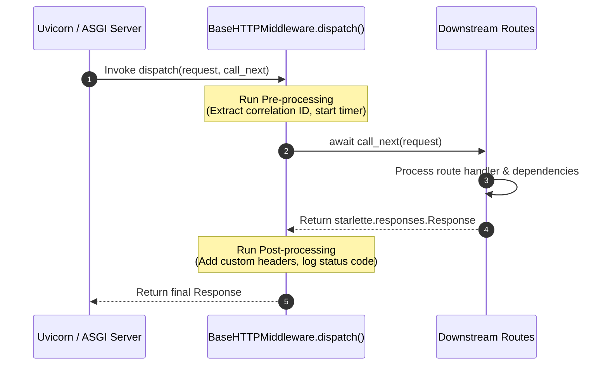

# FastAPI Custom BaseHTTPMiddleware

When developing custom cross-cutting HTTP logic—such as request timing, response header injection, body signature validation, or tenant context propagation—Starlette's `BaseHTTPMiddleware` provides a clean, object-oriented abstraction that hides low-level ASGI message loops behind an intuitive `dispatch(request, call_next)` method.

---

## Conceptual Foundation & Mental Model

In raw ASGI, intercepting a request requires managing raw tuples, parsing byte streams, and coordinating asynchronous `receive` and `send` channels. `BaseHTTPMiddleware` bridges this complexity by:
1. Converting the ASGI `scope` and `receive` stream into a high-level `starlette.requests.Request` instance.
2. Providing a `call_next(request)` callable that forwards execution down the middleware chain.
3. Returning a `starlette.responses.Response` instance whose headers, cookies, or body can be inspected and modified before transmission.

```
Incoming Request ──► BaseHTTPMiddleware.dispatch(request, call_next)
                              │
                              ├─► 1. Pre-Processing (Log request, check IP)
                              │
                              ▼
                     response = await call_next(request)
                              │
                              ├─► 2. Downstream Processing (FastAPI Handlers)
                              │
                              ▼
                              ├─► 3. Post-Processing (Inject headers, log duration)
                              │
Outgoing Response ◄───────────┘
```

---

## Architecture & Internal Mechanics

### How `BaseHTTPMiddleware` Operates Under the Hood
To provide a clean `Request -> Response` API, `BaseHTTPMiddleware`:
1. **Runs Downstream in a Background Task**: It executes `call_next()` inside an isolated `anyio` task group.
2. **ContextVars Bridging**: It copies the current Python `contextvars` context into the downstream task so context variables set before `call_next()` remain available downstream.
3. **Response Streaming Buffer**: It wraps the returned response body in an internal async generator.
   > [!WARNING]
   > Because `BaseHTTPMiddleware` wraps the response body generator, it can buffer chunks in memory. If your endpoint streams infinite events (Server-Sent Events) or huge files, `BaseHTTPMiddleware` can cause latency spikes, memory bloat, or context cancellation issues. For high-performance streaming, prefer **Pure ASGI Middleware**.



---

## Comprehensive Syntax & Core Mechanics

### Method 1: Subclassing `BaseHTTPMiddleware` (Recommended for complex state & reusability)
```python
from starlette.middleware.base import BaseHTTPMiddleware, RequestResponseEndpoint
from starlette.requests import Request
from starlette.responses import Response
from fastapi import FastAPI

class CustomTelemetryMiddleware(BaseHTTPMiddleware):
    def __init__(self, app, service_name: str):
        super().__init__(app)
        self.service_name = service_name

    async def dispatch(
        self, request: Request, call_next: RequestResponseEndpoint
    ) -> Response:
        # Pre-processing
        request.state.service = self.service_name
        
        # Invoke downstream
        response = await call_next(request)
        
        # Post-processing
        response.headers["X-Service-Name"] = self.service_name
        return response

app = FastAPI()
app.add_middleware(CustomTelemetryMiddleware, service_name="billing-engine")
```

### Method 2: The `@app.middleware("http")` Decorator (Quick, ad-hoc handlers)
```python
@app.middleware("http")
async def simple_timer_middleware(request: Request, call_next):
    # Functionally equivalent to BaseHTTPMiddleware subclass!
    response = await call_next(request)
    return response
```

---

## Practical Implementation (5 Complete Examples)

### Example 1: High-Precision Latency Profiling & Header Injection
```python
import time
from starlette.middleware.base import BaseHTTPMiddleware
from starlette.requests import Request
from starlette.responses import Response
from fastapi import FastAPI

class RequestLatencyMiddleware(BaseHTTPMiddleware):
    async def dispatch(self, request: Request, call_next) -> Response:
        start_time = time.perf_counter()
        
        response = await call_next(request)
        
        duration = time.perf_counter() - start_time
        # Format duration in milliseconds with 2 decimal precision
        response.headers["Server-Timing"] = f"total;dur={duration * 1000:.2f}"
        response.headers["X-Response-Time-Ms"] = f"{duration * 1000:.2f}"
        return response

app = FastAPI()
app.add_middleware(RequestLatencyMiddleware)

@app.get("/compute")
def compute():
    # Simulated work
    total = sum(i * i for i in range(100_000))
    return {"result": total}
```

### Example 2: API Maintenance Mode Gatekeeper
```python
import os
from starlette.middleware.base import BaseHTTPMiddleware
from starlette.requests import Request
from starlette.responses import Response, JSONResponse
from fastapi import FastAPI, status

class MaintenanceMiddleware(BaseHTTPMiddleware):
    def __init__(self, app, bypass_secret: str):
        super().__init__(app)
        self.bypass_secret = bypass_secret

    async def dispatch(self, request: Request, call_next) -> Response:
        is_maintenance = os.getenv("MAINTENANCE_ACTIVE", "false").lower() == "true"
        
        if is_maintenance:
            # Check for bypass header (allows internal QA / engineering staff)
            admin_header = request.headers.get("X-Maintenance-Bypass")
            if admin_header != self.bypass_secret:
                return JSONResponse(
                    status_code=status.HTTP_503_SERVICE_UNAVAILABLE,
                    content={
                        "error": "Service Temporarily Unavailable",
                        "message": "System is currently undergoing scheduled database maintenance."
                    },
                    headers={"Retry-After": "300"}
                )
        
        return await call_next(request)

app = FastAPI()
app.add_middleware(MaintenanceMiddleware, bypass_secret="qa-override-token-2026")

@app.get("/orders")
def get_orders():
    return [{"id": 101, "total": 59.99}]
```

### Example 3: ContextVar Binding Across Downstream Async Calls
```python
import contextvars
import uuid
from starlette.middleware.base import BaseHTTPMiddleware
from starlette.requests import Request
from starlette.responses import Response
from fastapi import FastAPI

request_id_var: contextvars.ContextVar[str] = contextvars.ContextVar("request_id", default="")

class CorrelationIdMiddleware(BaseHTTPMiddleware):
    async def dispatch(self, request: Request, call_next) -> Response:
        req_id = request.headers.get("X-Request-ID", str(uuid.uuid4()))
        token = request_id_var.set(req_id)
        
        try:
            response = await call_next(request)
            response.headers["X-Request-ID"] = req_id
            return response
        finally:
            request_id_var.reset(token)

app = FastAPI()
app.add_middleware(CorrelationIdMiddleware)

# Deep domain helper function that accesses context without parameter passing
def perform_audit_log(event: str):
    cid = request_id_var.get()
    print(f"[AUDIT] ID={cid}: {event}")

@app.post("/items")
def create_item():
    perform_audit_log("User created an item")
    return {"status": "ok"}
```

### Example 4: Intercepting and Transforming Response Error Statuses
```python
from starlette.middleware.base import BaseHTTPMiddleware
from starlette.requests import Request
from starlette.responses import Response, JSONResponse
from fastapi import FastAPI, HTTPException

class UniformErrorEnvelopeMiddleware(BaseHTTPMiddleware):
    async def dispatch(self, request: Request, call_next) -> Response:
        response = await call_next(request)
        
        # Intercept 404s that lack custom structured bodies
        if response.status_code == 404:
            response.headers["X-Error-Standard"] = "RFC-7807"
            
        return response

app = FastAPI()
app.add_middleware(UniformErrorEnvelopeMiddleware)
```

### Example 5: Testing `BaseHTTPMiddleware` with Exceptions
```python
from starlette.middleware.base import BaseHTTPMiddleware
from starlette.requests import Request
from starlette.responses import Response
from fastapi import FastAPI, HTTPException
from fastapi.testclient import TestClient

class CustomAuditMiddleware(BaseHTTPMiddleware):
    async def dispatch(self, request: Request, call_next) -> Response:
        try:
            response = await call_next(request)
            response.headers["X-Audit-Pass"] = "True"
            return response
        except Exception:
            # Let exceptions propagate to FastAPI error handlers!
            raise

app = FastAPI()
app.add_middleware(CustomAuditMiddleware)

@app.get("/error")
def throw_error():
    raise HTTPException(status_code=400, detail="Test Error")

def test_audit_middleware_with_error():
    client = TestClient(app)
    res = client.get("/error")
    assert res.status_code == 400
    assert res.headers["x-audit-pass"] == "True"
```

---

## Anti-Patterns & Common Traps

| Anti-Pattern | Why It Breaks / Fails | Production Solution |
| :--- | :--- | :--- |
| **Catching `Exception` and returning `JSONResponse(500)`** | Bypasses FastAPI's custom exception handlers (`@app.exception_handler`), obscuring tracebacks. | Let exceptions propagate out of `call_next()` or re-raise after logging. |
| **Attempting to read `request.body()` multiple times** | Consumes the request stream; subsequent route handlers see empty payloads. | If body inspection is required, read once and re-wrap in a custom receive stream, or use pure ASGI. |
| **Using `BaseHTTPMiddleware` for Server-Sent Events (SSE)** | Buffering behavior delays streaming events until connection close. | Use Pure ASGI Middleware for SSE and WebSockets. |
| **Slow synchronous blocking calls in `dispatch`** | Freezes the event loop for all concurrent requests. | Always use `async` non-blocking I/O or `anyio.to_thread.run_sync()`. |

---

## Performance & Resource Characteristics

- **Task Allocation**: Each request handled by `BaseHTTPMiddleware` spawns an asynchronous AnyIO task group, adding ~0.3ms to 0.5ms of latency overhead compared to pure ASGI.
- **ContextVars Overhead**: Context copying ensures isolation but introduces minor memory allocation per request.

---

## Edge Cases, Failure Modes & Gotchas

1. **Client Disconnects**: If a client disconnects while `call_next()` is awaiting, AnyIO cancels the downstream task. Ensure `finally` blocks handle `asyncio.CancelledError` cleanly.
2. **Streaming Response Headers**: Headers added to `response.headers` in post-processing are sent to the client immediately before the first chunk of a streaming body is transmitted.

---

## Security Implications & OWASP Alignment

- **Perimeter Defense**: Block malicious requests (e.g. invalid Host headers, forbidden IP addresses) before FastAPI initializes database connections or route dependencies.
- **OWASP API8:2023 - Security Misconfiguration**: Guarantee consistent security headers across all endpoints, including 404 Not Found and 500 Internal Server Error responses.

---

## Modern Tooling Integration

- **Uvicorn**: Dispatches incoming HTTP requests seamlessly into Starlette's middleware stack.
- **FastAPI TestClient**: Fully executes `BaseHTTPMiddleware` dispatch methods during automated tests.

---

## Real-World Case Study / Production Incident

An enterprise retail API migrated from Flask to FastAPI. An engineer created a logging middleware using `@app.middleware("http")` that read the response body to log outgoing payloads:
```python
response = await call_next(request)
body = [section async for section in response.body_iterator]
```
When endpoints returned large 20MB inventory catalogs or streamed CSV reports, this code consumed the iterator, leaving clients with empty 0-byte responses and doubling server RAM utilization.

**Remediation**:
Removed full response body logging from middleware. Detailed response logging was restricted to metadata and headers, while high-volume payload logging was delegated to OpenTelemetry trace spans.

---

## Hands-On Exercises & Challenge Problems

### Warmup (2 Exercises)
1. Write a custom `BaseHTTPMiddleware` subclass that adds a custom header `X-Environment: staging`.
2. Write a test asserting that `/docs` returns the `X-Environment` header.

### Intermediate (2 Exercises)
3. Implement a request timing middleware that records start time, measures duration, and logs an alert if duration exceeds 500ms.
4. Implement an IP filter middleware that inspects `request.client.host` against a blacklist and returns HTTP 403 Forbidden.

### Production-Grade (2 Exercises)
5. Build a multi-tenant resolution middleware that extracts the tenant slug from subdomains (`tenant1.api.com`), stores a `TenantConfig` object on `request.state.tenant`, and safely handles missing or unknown tenants.
6. Design an HMAC signature validation middleware that inspects the raw request body bytes and `X-Signature` header, verifying payload integrity before handing control to downstream routes.

---

## Interview Mastery (8 Q&As)

### Junior Level
**Q1: What is `BaseHTTPMiddleware` in FastAPI / Starlette?**
*Answer:* A base class providing a high-level `dispatch(request, call_next)` method to inspect and modify incoming HTTP requests and outgoing HTTP responses.

**Q2: How do you pass execution to the next middleware or route handler in `BaseHTTPMiddleware`?**
*Answer:* By awaiting `response = await call_next(request)`.

**Q3: Can `BaseHTTPMiddleware` be used to handle WebSocket connections?**
*Answer:* No. `BaseHTTPMiddleware` only intercepts HTTP scopes; WebSocket connections bypass it completely.

### Senior Level
**Q4: Why does `BaseHTTPMiddleware` have higher overhead than pure ASGI middleware?**
*Answer:* Because it manages background task groups, creates `Request` and `Response` wrapper objects, copies `contextvars`, and wraps response streaming iterators, adding ~0.5ms of latency per request.

**Q5: What happens if an unhandled exception occurs inside a route handler when using `BaseHTTPMiddleware`?**
*Answer:* The exception bubbles through `await call_next(request)`. Unless caught in the middleware, it propagates to Starlette's `ServerErrorMiddleware` which returns an HTTP 500 response.

**Q6: Why is reading `request.body()` inside `BaseHTTPMiddleware` dangerous?**
*Answer:* Reading the body consumes the asynchronous stream. If not properly cached and re-streamed, downstream endpoint handlers will encounter an empty request body.

### Staff / Architect Level
**Q7: When should you avoid `BaseHTTPMiddleware` in favor of Pure ASGI Middleware?**
*Answer:*
1. When streaming responses (Server-Sent Events, real-time chunked feeds, large file downloads) where `BaseHTTPMiddleware`'s buffer disrupts real-time delivery.
2. In ultra-high-throughput microservices where every microsecond of latency and task allocation overhead matters.
3. When intercepting WebSocket handshakes or custom ASGI protocols.

**Q8: How does `BaseHTTPMiddleware` preserve Python `contextvars` across the `call_next()` boundary?**
*Answer:* Starlette's `BaseHTTPMiddleware` explicitly captures the current `contextvars.copy_context()` and executes the downstream `call_next` task inside that copied context, ensuring context variables set prior to calling downstream handlers remain accessible.
