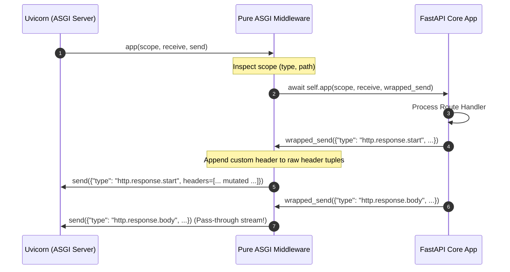

# FastAPI Pure ASGI Middleware Architecture

While `BaseHTTPMiddleware` offers an easy object-oriented API, its internal task-spawning and response-buffering mechanics make it unsuitable for high-throughput microservices, Server-Sent Events (SSE), and WebSockets. **Pure ASGI Middleware** interacts directly with the ASGI 3.0 specification via `(scope, receive, send)`, delivering maximum execution speed, zero memory buffering, and universal protocol compatibility.

---

## Conceptual Foundation & Mental Model

Under the ASGI (Asynchronous Server Gateway Interface) standard, every web application is simply an asynchronous callable with the signature:
```python
async def app(scope: dict, receive: Callable, send: Callable) -> None:
```

- **`scope`**: A mutable dictionary containing connection metadata (protocol type, path, headers, client IP).
- **`receive`**: An async function called to receive incoming events (`http.request`, `websocket.receive`).
- **`send`**: An async function called to send outgoing events (`http.response.start`, `http.response.body`, `websocket.send`).

A Pure ASGI Middleware wraps these primitives:
1. It inspects or mutates `scope`.
2. It wraps `receive` if it needs to intercept or duplicate the incoming request stream.
3. It wraps `send` if it needs to inspect status codes or inject headers into outgoing responses.

```
ASGI Server (Uvicorn)
         │
         ▼ scope, receive, send
┌──────────────────────────────────────────────┐
│            Pure ASGI Middleware              │
│  - Inspects scope["type"] (http, websocket)  │
│  - Wraps send() to inject response headers   │
│  - Calls await self.app(scope, rec, send_w) │
└──────────────────────┬───────────────────────┘
                       │
                       ▼ scope, receive, send_wrapped
┌──────────────────────────────────────────────┐
│           FastAPI Root Application           │
└──────────────────────────────────────────────┘
```

---

## Architecture & Internal Mechanics

### ASGI 3.0 Event Lifecycle for HTTP
For an HTTP request, ASGI operates via structured event dictionaries:

1. **Inbound**: Application calls `message = await receive()`.
   - Message type: `{"type": "http.request", "body": b"...", "more_body": False}`.
2. **Outbound Headers**: Application calls `await send(message)`.
   - Message type: `{"type": "http.response.start", "status": 200, "headers": [...]}`.
3. **Outbound Body**: Application calls `await send(message)` once or repeatedly.
   - Message type: `{"type": "http.response.body", "body": b"...", "more_body": False}`.

By intercepting `http.response.start`, a pure ASGI middleware can add or modify headers with **zero memory buffering of the body**, allowing SSE, WebSockets, and gigabyte-sized file streams to flow without disruption.



---

## Comprehensive Syntax & Core Mechanics

The canonical pattern for a Pure ASGI Middleware class:

```python
from fastapi import FastAPI

class PureASGITelemetryMiddleware:
    def __init__(self, app):
        self.app = app

    async def __call__(self, scope, receive, send):
        # 1. Ignore non-HTTP / non-WebSocket scopes (e.g. lifespan)
        if scope["type"] not in ("http", "websocket"):
            await self.app(scope, receive, send)
            return

        # 2. Intercept outgoing send events
        async def send_wrapper(message):
            if message["type"] == "http.response.start":
                # Raw headers are a list of [name: bytes, value: bytes]
                headers = list(message.get("headers", []))
                headers.append((b"x-pure-asgi", b"enabled"))
                message["headers"] = headers

            await send(message)

        # 3. Call downstream application
        await self.app(scope, receive, send_wrapper)

app = FastAPI()
app.add_middleware(PureASGITelemetryMiddleware)
```

---

## Practical Implementation (5 Complete Examples)

### Example 1: High-Performance Response Header Injection
```python
import time
from fastapi import FastAPI

class ServerTimingASGIMiddleware:
    def __init__(self, app):
        self.app = app

    async def __call__(self, scope, receive, send):
        if scope["type"] != "http":
            await self.app(scope, receive, send)
            return

        start_time = time.perf_counter()

        async def send_wrapper(message):
            if message["type"] == "http.response.start":
                duration_ms = (time.perf_counter() - start_time) * 1000
                timing_header = f"total;dur={duration_ms:.2f}".encode("latin-1")
                
                # Clone headers list and append
                headers = list(message.get("headers", []))
                headers.append((b"server-timing", timing_header))
                message["headers"] = headers

            await send(message)

        await self.app(scope, receive, send_wrapper)

app = FastAPI()
app.add_middleware(ServerTimingASGIMiddleware)

@app.get("/data")
def get_data():
    return {"message": "Ultra low latency header injection"}
```

### Example 2: Streaming-Safe Request Logger (Zero Buffering)
```python
from fastapi import FastAPI

class FastAuditLoggerMiddleware:
    def __init__(self, app):
        self.app = app

    async def __call__(self, scope, receive, send):
        if scope["type"] != "http":
            await self.app(scope, receive, send)
            return

        method = scope["method"]
        path = scope["path"]
        status_code = None

        async def send_wrapper(message):
            nonlocal status_code
            if message["type"] == "http.response.start":
                status_code = message["status"]
            await send(message)

        try:
            await self.app(scope, receive, send_wrapper)
        finally:
            # Emits access log without buffering any response body bytes!
            print(f"[PURE ASGI ACCESS] {method} {path} -> {status_code}")

app = FastAPI()
app.add_middleware(FastAuditLoggerMiddleware)

@app.get("/items")
def list_items():
    return ["item_1", "item_2"]
```

### Example 3: WebSocket Connection Interceptor
```python
from fastapi import FastAPI, WebSocket, WebSocketDisconnect

class WebSocketAuthGuardMiddleware:
    def __init__(self, app):
        self.app = app

    async def __call__(self, scope, receive, send):
        # Intercept WebSocket handshakes!
        if scope["type"] == "websocket":
            # Extract headers from raw scope
            headers = dict(scope.get("headers", []))
            token = headers.get(b"x-auth-token", b"").decode("latin-1")
            
            # Reject connection during handshake if token invalid!
            if token != "secret-ws-token":
                # Close WebSocket connection immediately
                await send({"type": "websocket.close", "code": 4401})
                return

        await self.app(scope, receive, send)

app = FastAPI()
app.add_middleware(WebSocketAuthGuardMiddleware)

@app.websocket("/ws/feed")
async def ws_feed(websocket: WebSocket):
    await websocket.accept()
    await websocket.send_text("Authenticated stream active")
    await websocket.close()
```

### Example 4: Non-Destructive Request Body Re-Streaming
```python
from fastapi import FastAPI, Request

class BodyDuplicateASGIMiddleware:
    def __init__(self, app):
        self.app = app

    async def __call__(self, scope, receive, send):
        if scope["type"] != "http" or scope["method"] not in ("POST", "PUT", "PATCH"):
            await self.app(scope, receive, send)
            return

        # Read body chunks from original receive
        body_chunks = []
        more_body = True
        while more_body:
            message = await receive()
            body_chunks.append(message.get("body", b""))
            more_body = message.get("more_body", False)

        full_body = b"".join(body_chunks)
        print(f"[DEBUG PURE ASGI] Intercepted body of length: {len(full_body)} bytes")

        # Create replayable receive callable for downstream application
        replay_index = 0
        messages_to_replay = [
            {"type": "http.request", "body": full_body, "more_body": False}
        ]

        async def receive_replay():
            nonlocal replay_index
            if replay_index < len(messages_to_replay):
                msg = messages_to_replay[replay_index]
                replay_index += 1
                return msg
            return {"type": "http.request", "body": b"", "more_body": False}

        await self.app(scope, receive_replay, send)

app = FastAPI()
app.add_middleware(BodyDuplicateASGIMiddleware)

@app.post("/submit")
async def submit(req: Request):
    data = await req.json()
    return {"received": data}
```

### Example 5: Path Prefix Stripping Middleware (Virtual Hosting)
```python
from fastapi import FastAPI

class SubpathNormalizerMiddleware:
    def __init__(self, app, prefix: str):
        self.app = app
        self.prefix = prefix

    async def __call__(self, scope, receive, send):
        if scope["type"] == "http":
            path = scope["path"]
            if path.startswith(self.prefix):
                # Mutate scope path in place before routing occurs!
                scope["path"] = path[len(self.prefix):] or "/"
                scope["root_path"] = self.prefix

        await self.app(scope, receive, send)

app = FastAPI()
app.add_middleware(SubpathNormalizerMiddleware, prefix="/v1/proxy")

@app.get("/health")
def health():
    return {"status": "ok"}
# Handles requests to /v1/proxy/health seamlessly!
```

---

## Anti-Patterns & Common Traps

| Anti-Pattern | Why It Breaks / Fails | Production Solution |
| :--- | :--- | :--- |
| **Passing string headers instead of raw bytes** | ASGI specification strictly requires `list[tuple[bytes, bytes]]`. Strings trigger `TypeError`. | Encode headers to bytes: `(b"x-key", b"value")`. |
| **Blocking on `receive()` for GET requests** | Calling `await receive()` when client has sent no body can cause the connection to hang indefinitely. | Check `scope["method"]` or check `more_body` before awaiting `receive()`. |
| **Swallowing lifespan scopes** | Failing to pass `scope["type"] == "lifespan"` breaks startup and shutdown lifecycle events in FastAPI. | Always forward non-HTTP scopes: `if scope["type"] not in ...: await self.app(...)`. |
| **Mutating response body without updating `Content-Length`** | Causes clients to hang or truncate responses due to length mismatch. | Recalculate and update `content-length` byte header if modifying payload bytes. |

---

## Performance & Resource Characteristics

- **Zero Micro-Task Allocation**: Executes directly in the caller's coroutine frame without AnyIO task group overhead.
- **Latency Overhead**: Less than 10 microseconds per request.
- **Streaming Performance**: 100% throughput pass-through for multi-gigabyte files and real-time SSE streams with zero memory buffering.

---

## Edge Cases, Failure Modes & Gotchas

1. **Header Name Casing**: HTTP/2 and HTTP/3 mandate lowercase header names. Always format header name bytes in lowercase: `b"x-request-id"`.
2. **Handling `http.disconnect`**: Clients can send an `http.disconnect` event over `receive()` while a long handler is processing. Pure ASGI middlewares can monitor `receive()` to cancel expensive queries early.

---

## Security Implications & OWASP Alignment

- **Protocol-Level Protection**: Drop malformed or dangerous HTTP requests at the raw ASGI socket layer before FastAPI constructs Python objects or parses JSON.
- **WebSocket Handshake Gatekeeping**: Reject unauthorized WebSocket connections during the initial handshake, preventing resource allocation for unauthorized socket pools.

---

## Modern Tooling Integration

- **Uvicorn / Hypercorn**: Industry-standard ASGI servers that run pure ASGI middleware directly.
- **Starlette / FastAPI**: Fully compatible with `app.add_middleware(PureASGIMiddleware)`.

---

## Real-World Case Study / Production Incident

An AI analytics platform streamed LLM token completions to frontend dashboards using Server-Sent Events (SSE). After an engineer added a global response timing middleware using `@app.middleware("http")`, customer dashboards broke: tokens arrived in massive 10-second bursts instead of smooth streaming.

**Root Cause**:
`BaseHTTPMiddleware` was buffering response chunks inside its internal `StreamingResponse` consumer.

**Remediation**:
Re-wrote the timing middleware as a **Pure ASGI Middleware**:
```python
async def send_wrapper(message):
    if message["type"] == "http.response.start":
        message["headers"].append((b"x-stream-started", b"true"))
    await send(message)
```
Tokens began streaming smoothly with 0ms buffering delay.

---

## Hands-On Exercises & Challenge Problems

### Warmup (2 Exercises)
1. Write a pure ASGI middleware that adds `(b"x-powered-by", b"pure-asgi")` to all HTTP responses.
2. Verify using `TestClient` that the header is returned on `/docs`.

### Intermediate (2 Exercises)
3. Implement a pure ASGI middleware that measures request duration and prints an access log on `http.response.start`.
4. Build a pure ASGI middleware that blocks requests where `scope["client"][0]` (client IP) matches a prohibited IP address.

### Production-Grade (2 Exercises)
5. Build a pure ASGI middleware that intercepts WebSocket handshakes, inspects cookie headers, decodes a JWT token, and injects `scope["user"] = decoded_user` for downstream WebSocket handlers.
6. Implement a streaming gzip response decompressor middleware at the pure ASGI layer that decompresses incoming `Content-Encoding: gzip` request streams on the fly without loading the full payload into memory.

---

## Interview Mastery (8 Q&As)

### Junior Level
**Q1: What are the three parameters in an ASGI 3.0 callable?**
*Answer:* `scope` (connection metadata dictionary), `receive` (async function to receive incoming event messages), and `send` (async function to send outgoing event messages).

**Q2: What data type must headers have in an ASGI message?**
*Answer:* A list of two-item tuples of raw bytes: `list[tuple[bytes, bytes]]` (e.g. `[(b"content-type", b"application/json")]`).

**Q3: How do you register a Pure ASGI Middleware on a FastAPI instance?**
*Answer:* Using `app.add_middleware(MyPureASGIMiddleware)`.

### Senior Level
**Q4: Why does Pure ASGI Middleware avoid the streaming issues present in `BaseHTTPMiddleware`?**
*Answer:* Because it does not buffer the response body in an intermediate async generator. In pure ASGI, `http.response.body` messages are streamed directly through `await send(message)` to the ASGI server without holding chunks in memory.

**Q5: How can a pure ASGI middleware intercept and change an HTTP response status code?**
*Answer:* By wrapping the `send` callable, intercepting the `message` when `message["type"] == "http.response.start"`, and modifying `message["status"] = new_code` before calling `await send(message)`.

**Q6: What happens if a pure ASGI middleware forgets to forward lifespan scopes?**
*Answer:* FastAPI's startup and shutdown lifespan handlers will never execute, preventing database connection pool initialization and cleanup. Always forward scopes where `scope["type"] == "lifespan"`.

### Staff / Architect Level
**Q7: How do you implement non-destructive request body reading in a pure ASGI middleware without breaking downstream Pydantic parsing?**
*Answer:* Intercept `receive()` calls to buffer incoming `http.request` chunks into memory. After inspecting the complete body, construct a replacement async `receive_replay()` function that returns the buffered message when downstream handlers call `await receive()`.

**Q8: In what scenarios is Pure ASGI Middleware mandatory over `BaseHTTPMiddleware`?**
*Answer:*
1. Applications serving Server-Sent Events (SSE) or chunked real-time streams where buffering delays events.
2. WebSockets (`scope["type"] == "websocket"`), which bypass `BaseHTTPMiddleware` completely.
3. Ultra-low-latency microservices where the task-group allocation overhead of `BaseHTTPMiddleware` degrades p99 response times.
