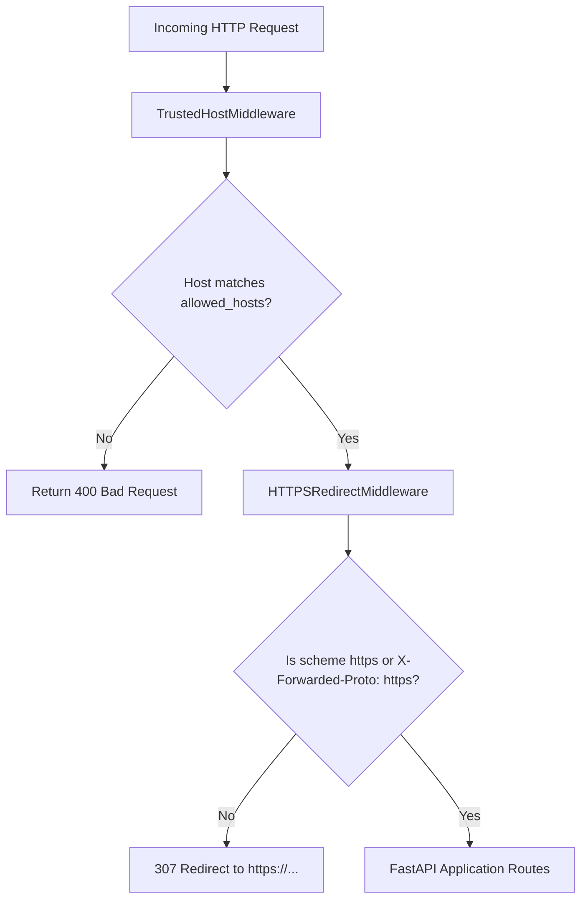

# FastAPI TrustedHost & HTTPSRedirect Middleware

Securing an API at the network perimeter requires validating that incoming requests target legitimate, authorized domain names and are transmitted over encrypted TLS channels. FastAPI provides `TrustedHostMiddleware` to prevent HTTP Host Header Poisoning and cache corruption, and `HTTPSRedirectMiddleware` to enforce strict HTTPS communication.

---

## Conceptual Foundation & Mental Model

### 1. HTTP Host Header Poisoning
The `Host` HTTP header is client-controlled. In a classic Host Header Poisoning attack:
- An attacker sends: `GET /password-reset HTTP/1.1\nHost: evil.com`.
- If the application uses the `Host` header to generate password reset links (`https://{request.headers['host']}/reset?token=...`), the user receives a link pointing to the attacker's server!
- Furthermore, web caches (CDNs, reverse proxies) can cache poisoned responses under the attacker's domain, hijacking traffic for other users.
- `TrustedHostMiddleware` validates the incoming `Host` header against a whitelist, immediately dropping or returning HTTP 400 for unauthorized hosts.

### 2. HTTPS Enforcement & Redirect Loops
`HTTPSRedirectMiddleware` ensures that any incoming plain `http://` request receives an immediate `307 Temporary Redirect` (or 301) to `https://`.
However, in cloud architectures where TLS terminates at an Application Load Balancer (AWS ALB, Cloudflare, Nginx), the load balancer forwards requests to FastAPI as plain HTTP. Without proper `X-Forwarded-Proto` inspection, this causes an **infinite redirect loop**!

```
Attacker's Request:
GET /reset-password
Host: evil-phishing-site.com
       │
       ▼
┌────────────────────────────────────────────────────────┐
│ TrustedHostMiddleware(allowed_hosts=["api.domain.com"]) │
└──────────────────────────┬─────────────────────────────┘
                           │ Host "evil-phishing-site.com" NOT allowed!
                           ▼
                  400 Bad Request: Invalid Host header
                  (Attack halted immediately!)
```

---

## Architecture & Internal Mechanics

### How `TrustedHostMiddleware` Validates Domains
1. **Header Extraction**: Inspects the raw `host` header in ASGI `scope["headers"]`.
2. **Wildcard & Exact Matching**: Compares the hostname (ignoring port numbers unless specified) against the compiled list of allowed host patterns.
   - Exact: `"api.company.com"`
   - Wildcard: `"*.company.com"` matches `sub.company.com` and `dev.company.com`.
3. **Rejection**: If no match is found, returns an HTTP 400 Bad Request response without invoking downstream middlewares or routes.



---

## Comprehensive Syntax & Core Mechanics

### 1. `TrustedHostMiddleware`
```python
from fastapi import FastAPI
from starlette.middleware.trustedhost import TrustedHostMiddleware

app = FastAPI()

app.add_middleware(
    TrustedHostMiddleware,
    allowed_hosts=[
        "api.company.com",
        "*.company.com",      # Wildcard subdomain support
        "localhost",          # Local testing
        "127.0.0.1",
        "testserver",         # Required for FastAPI TestClient!
    ]
)
```

### 2. `HTTPSRedirectMiddleware`
```python
from starlette.middleware.httpsredirect import HTTPSRedirectMiddleware

# Automatically redirects any http:// request to https://
app.add_middleware(HTTPSRedirectMiddleware)
```

---

## Practical Implementation (5 Complete Examples)

### Example 1: Standard Production Perimeter Hardening
```python
from fastapi import FastAPI
from starlette.middleware.trustedhost import TrustedHostMiddleware
from starlette.middleware.httpsredirect import HTTPSRedirectMiddleware

app = FastAPI(title="Hardened Perimeter API")

# 1. Enforce HTTPS (redirects plain HTTP to HTTPS)
app.add_middleware(HTTPSRedirectMiddleware)

# 2. Enforce Trusted Hosts (rejects host header poisoning)
app.add_middleware(
    TrustedHostMiddleware,
    allowed_hosts=[
        "api.fintech.com",
        "*.api.fintech.com",
        "testserver"  # Allows TestClient in test suites
    ]
)

@app.get("/health")
def health():
    return {"status": "healthy"}
```

### Example 2: Testing Trusted Host Enforcement with `TestClient`
```python
from fastapi import FastAPI
from starlette.middleware.trustedhost import TrustedHostMiddleware
from fastapi.testclient import TestClient

app = FastAPI()
app.add_middleware(
    TrustedHostMiddleware,
    allowed_hosts=["api.trusted.com", "testserver"]
)

@app.get("/profile")
def get_profile():
    return {"user": "alice"}

def test_trusted_host_allows_legitimate_traffic():
    client = TestClient(app)
    # testserver is allowed
    response = client.get("/profile")
    assert response.status_code == 200

    # Explicit allowed host header
    response = client.get("/profile", headers={"Host": "api.trusted.com"})
    assert response.status_code == 200

def test_trusted_host_rejects_poisoned_host():
    client = TestClient(app)
    # Poisoned Host header
    response = client.get("/profile", headers={"Host": "attacker.com"})
    assert response.status_code == 400
    assert response.text == "Invalid host header"
```

### Example 3: Preventing Infinite Redirect Loops Behind Reverse Proxies
```python
# When running behind Nginx, Cloudflare, or AWS ALB:
# The proxy terminates TLS and forwards plain HTTP with header:
# X-Forwarded-Proto: https
#
# If Uvicorn runs without --forwarded-allow-ips, FastAPI sees scheme as "http"
# and HTTPSRedirectMiddleware issues infinite 307 redirects!
#
# Solution: Configure Uvicorn proxy headers AND trusted proxy middleware:
from fastapi import FastAPI
from starlette.middleware.httpsredirect import HTTPSRedirectMiddleware

app = FastAPI()

# Only enable HTTPSRedirectMiddleware if TLS termination is handled in FastAPI
# OR if Uvicorn is properly configured with:
# uvicorn app.main:app --proxy-headers --forwarded-allow-ips='*'
app.add_middleware(HTTPSRedirectMiddleware)

@app.get("/account")
def get_account():
    return {"account": "active"}
```

### Example 4: Environment-Driven Host Configuration via Pydantic Settings
```python
from fastapi import FastAPI
from starlette.middleware.trustedhost import TrustedHostMiddleware
from pydantic_settings import BaseSettings

class SecuritySettings(BaseSettings):
    ALLOWED_HOSTS: list[str] = ["localhost", "127.0.0.1", "testserver"]
    ENFORCE_HTTPS: bool = False

settings = SecuritySettings()

app = FastAPI()

app.add_middleware(
    TrustedHostMiddleware,
    allowed_hosts=settings.ALLOWED_HOSTS
)

@app.get("/config-check")
def config_check():
    return {"allowed_hosts": settings.ALLOWED_HOSTS}
```

### Example 5: Adding HSTS (HTTP Strict Transport Security) Headers
```python
from fastapi import FastAPI, Request, Response

app = FastAPI()

# Enforce HSTS for 1 year including all subdomains
@app.middleware("http")
async def hsts_middleware(request: Request, call_next) -> Response:
    response = await call_next(request)
    # Instructs modern browsers to NEVER use plain HTTP for this domain
    response.headers["Strict-Transport-Security"] = (
        "max-age=31536000; includeSubDomains; preload"
    )
    return response

@app.get("/secure-data")
def secure_data():
    return {"confidential": True}
```

---

## Anti-Patterns & Common Traps

| Anti-Pattern | Operational Failure | Production Solution |
| :--- | :--- | :--- |
| **Omitting `"testserver"` from `allowed_hosts`** | All `pytest` and `TestClient` tests fail with HTTP 400 "Invalid host header". | Always include `"testserver"` in test environments. |
| **Enabling `HTTPSRedirectMiddleware` behind TLS-terminating proxy without `--proxy-headers`** | Server returns endless 307 redirects to `https://`, locking out all users. | Pass `--proxy-headers` to Uvicorn or terminate HTTPS at edge proxy only. |
| **Setting `allowed_hosts=["*"]` in production** | Defeats the entire security purpose of `TrustedHostMiddleware`. | Whitelist specific production domains and wildcards (`"*.company.com"`). |
| **Including scheme in `allowed_hosts`** (`"https://api.domain.com"`) | Host matching fails; Host header contains only domain and port, not scheme. | Use `"api.domain.com"`. |

---

## Performance & Resource Characteristics

- **Microsecond Host Matching**: `TrustedHostMiddleware` compiles host wildcards into regular expressions once during startup; inspection overhead is less than 5 microseconds per request.
- **Immediate Short-Circuiting**: Unauthorized requests are dropped before any route matching, database connection, or dependency resolution occurs.

---

## Edge Cases, Failure Modes & Gotchas

1. **Port Numbers in Host Header**: If a client sends `Host: api.company.com:8080`, `TrustedHostMiddleware` strips the `:8080` and matches `api.company.com` against the whitelist.
2. **Kubernetes Health Probes**: Kubernetes liveness probes often query pods using raw IP addresses (`http://10.244.0.15:8000/healthz`). If pod IPs are not in `allowed_hosts`, probes fail with 400 and pods crash!
   - Solution: Terminate Host checks on the Ingress controller or allow internal subnets.

---

## Security Implications & OWASP Alignment

- **OWASP API8:2023 - Security Misconfiguration**: Failing to validate Host headers exposes applications to password-reset poisoning, cache poisoning, and Server-Side Request Forgery.
- **Transport Layer Security**: HTTPSRedirectMiddleware enforces encrypted transmission, preventing man-in-the-middle (MITM) credential eavesdropping on public Wi-Fi networks.

---

## Modern Tooling Integration

- **Uvicorn**: Use `--proxy-headers` and `--forwarded-allow-ips='*'` to correctly populate `scope["scheme"]` behind load balancers.
- **Qualys SSL Labs**: Verifies A+ SSL ratings when combined with HSTS preload headers.

---

## Real-World Case Study / Production Incident

A password-reset feature in an enterprise HR platform constructed reset email links dynamically:
`reset_url = f"https://{request.headers['host']}/reset-password?token={token}"`
An external security researcher submitted a reset request for an executive's email, tampering with the HTTP header:
`Host: secure-hr-portal.attacker-controlled-site.com`

**The Vulnerability**:
The backend generated the reset email pointing to the attacker's domain. When the executive clicked the link, the secret reset token was submitted to the attacker's server.

**Remediation**:
1. Enabled `TrustedHostMiddleware` with explicit production domain whitelisting.
2. Refactored the application to read the canonical domain strictly from `settings.DOMAIN_NAME` rather than trusting client-provided `Host` headers.

---

## Hands-On Exercises & Challenge Problems

### Warmup (2 Exercises)
1. Configure `TrustedHostMiddleware` allowing `"api.example.com"` and `"testserver"`.
2. Write a test asserting that requests with `Host: evil.com` return HTTP 400.

### Intermediate (2 Exercises)
3. Configure `HTTPSRedirectMiddleware` and write a test verifying that an `http://` request receives an HTTP 307 redirect to `https://`.
4. Implement an HSTS middleware that attaches `Strict-Transport-Security` with a 1-year max age.

### Production-Grade (2 Exercises)
5. Build an automated test simulating an AWS ALB reverse proxy sending `X-Forwarded-Proto: https` to verify that `HTTPSRedirectMiddleware` does not trigger an infinite redirect loop.
6. Design a dynamic host validator that permits Kubernetes pod internal IPs alongside external customer domains, ensuring container liveness probes succeed while external traffic is strictly restricted.

---

## Interview Mastery (8 Q&As)

### Junior Level
**Q1: What attack does `TrustedHostMiddleware` prevent?**
*Answer:* HTTP Host Header Poisoning attacks, where an attacker manipulates the client-controlled `Host` header to poison password reset links or corrupt shared HTTP caches.

**Q2: What HTTP status code is returned when an invalid Host header is detected by `TrustedHostMiddleware`?**
*Answer:* `HTTP 400 Bad Request` with body `"Invalid host header"`.

**Q3: Why must `"testserver"` be included in `allowed_hosts` during unit testing?**
*Answer:* Starlette's `TestClient` uses `"testserver"` as its default Host header when sending simulated requests. If omitted, all tests will fail with 400 Bad Request.

### Senior Level
**Q4: What causes an infinite redirect loop when using `HTTPSRedirectMiddleware` behind an AWS ALB or Nginx reverse proxy?**
*Answer:* The load balancer terminates TLS and forwards the request to FastAPI over plain HTTP. If FastAPI/Uvicorn does not inspect the `X-Forwarded-Proto: https` header (due to missing `--proxy-headers`), FastAPI believes the request is insecure and continuously issues 307 redirects to `https://`.

**Q5: How do wildcards work in `TrustedHostMiddleware(allowed_hosts=[...])`?**
*Answer:* Prefixing a domain with `*` (e.g. `"*.example.com"`) allows any single subdomain level (e.g. `"api.example.com"`, `"dev.example.com"`).

**Q6: What is the HSTS header and why is it important?**
*Answer:* `Strict-Transport-Security` (HSTS) instructs compliant browsers to strictly communicate with the domain over HTTPS for a specified duration (`max-age`), preventing downgrade attacks and SSL-stripping.

### Staff / Architect Level
**Q7: In an enterprise cloud deployment with Kubernetes and AWS ALB, where should HTTPS redirection and Host header validation occur?**
*Answer:* Best practice is defense-in-depth:
1. **At the Edge (ALB / Cloudflare)**: Terminate TLS and redirect HTTP to HTTPS at the load balancer level to drop plain HTTP traffic before consuming cluster compute.
2. **At Ingress / Reverse Proxy (Nginx/Envoy)**: Validate Host headers and forward legitimate traffic to pods.
3. **At the Application (FastAPI)**: Keep `TrustedHostMiddleware` active as a zero-trust fallback in case internal routing misconfigurations expose the pod directly.

**Q8: Why does `HTTPSRedirectMiddleware` issue a 307 redirect instead of a 301 or 302?**
*Answer:* HTTP 307 (Temporary Redirect) guarantees that the client must preserve the original HTTP method (e.g. POST, PUT, DELETE) and request body when following the redirect to HTTPS, whereas 301/302 redirects historically permitted browsers to convert POST requests into GET requests.
