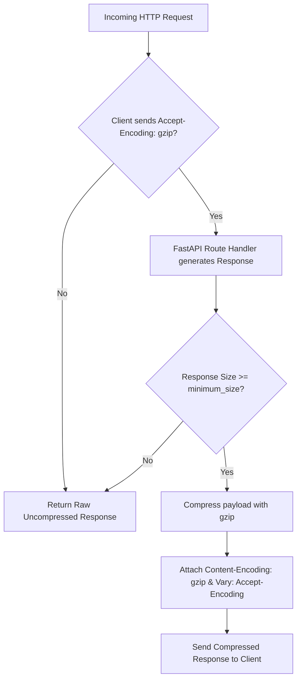

# FastAPI GZip & Brotli Compression Middleware

Transferring large JSON payloads, analytics datasets, or binary exports over mobile networks and distributed web connections introduces substantial network transfer latency. In FastAPI, compression middlewares—specifically Starlette's built-in `GZipMiddleware` and high-ratio Brotli compression—automatically compress responses that exceed a configurable byte threshold when the client supports it via `Accept-Encoding`.

---

## Conceptual Foundation & Mental Model

HTTP compression is negotiated dynamically between client and server:
1. The client sends: `Accept-Encoding: gzip, br, deflate`.
2. The middleware inspects the response generated by the endpoint:
   - If the response size is **smaller** than `minimum_size` (e.g. 500 bytes), compressing it would waste CPU cycles and could actually *increase* payload size due to compression headers. The response is sent uncompressed.
   - If the response size **exceeds** `minimum_size`, the middleware compresses the byte stream using GZip or Brotli, appends `Content-Encoding: gzip`, strips or recalculates `Content-Length`, and transmits the compressed bytes.
3. The client's browser or HTTP client transparently decompresses the payload upon arrival.

```
Client (Accept-Encoding: gzip)                   FastAPI Application
            │                                              │
            │─── GET /api/v1/analytics/large-report ──────►│
            │                                              │
            │                                     Endpoint generates
            │                                     5.2 MB raw JSON
            │                                              │
            │                                              ▼
            │                                     GZipMiddleware
            │                                     Compresses payload
            │                                     (5.2 MB ──► 380 KB!)
            │                                              │
            │◄── 200 OK (Content-Encoding: gzip, 380 KB) ──│
```

---

## Architecture & Internal Mechanics

### How `GZipMiddleware` Operates
1. **Inspection**: Checks `scope["type"] == "http"` and verifies that `b"gzip"` appears in the `accept-encoding` header.
2. **Buffer / Streaming Threshold**:
   - For standard responses, it checks the raw body length against `minimum_size`.
   - For `StreamingResponse`, it pipes output chunks through Python's standard `gzip.GzipFile` compressor in streaming mode, emitting compressed chunks with `transfer-encoding: chunked`.
3. **Header Modification**: Adds `Content-Encoding: gzip` and `Vary: Accept-Encoding` to ensure intermediate CDNs and caching proxies do not serve compressed responses to clients that do not support GZip.



---

## Comprehensive Syntax & Core Mechanics

### 1. Registering `GZipMiddleware`
```python
from fastapi import FastAPI
from starlette.middleware.gzip import GZipMiddleware

app = FastAPI()

# minimum_size defaults to 500 bytes
app.add_middleware(
    GZipMiddleware,
    minimum_size=1000,  # Only compress responses >= 1,000 bytes (1 KB)
    compresslevel=6     # GZip compression level (1 = fastest, 9 = maximum compression)
)
```

### 2. Brotli Compression (Alternative for higher compression ratio)
Brotli often achieves 15%–25% better compression ratios than GZip on JSON payloads:

```python
# pip install brotli-asgi
from fastapi import FastAPI
from brotli_asgi import BrotliMiddleware

app = FastAPI()
app.add_middleware(BrotliMiddleware, minimum_size=1000, quality=4)
```

---

## Practical Implementation (5 Complete Examples)

### Example 1: Standard GZip Setup with Size Threshold Tuning
```python
from fastapi import FastAPI
from starlette.middleware.gzip import GZipMiddleware

app = FastAPI(title="Optimized API")

# Responses smaller than 1KB bypass compression to save CPU
app.add_middleware(GZipMiddleware, minimum_size=1000)

@app.get("/tiny")
def get_tiny():
    # ~25 bytes: Sent uncompressed
    return {"status": "ok"}

@app.get("/large-dataset")
def get_large_dataset():
    # ~50,000 bytes: Automatically compressed with gzip!
    return {
        "users": [
            {"id": i, "name": f"User_{i}", "email": f"user{i}@example.com"}
            for i in range(1000)
        ]
    }
```

### Example 2: Testing GZip Compression with `TestClient`
```python
from fastapi import FastAPI
from starlette.middleware.gzip import GZipMiddleware
from fastapi.testclient import TestClient
import gzip

app = FastAPI()
app.add_middleware(GZipMiddleware, minimum_size=500)

@app.get("/test-payload")
def test_payload():
    return {"data": "A" * 2000}

def test_gzip_compression_active():
    client = TestClient(app)
    # 1. Request without Accept-Encoding: gzip
    resp_raw = client.get("/test-payload")
    assert "content-encoding" not in resp_raw.headers
    assert len(resp_raw.content) > 2000

    # 2. Request WITH Accept-Encoding: gzip
    resp_gz = client.get("/test-payload", headers={"Accept-Encoding": "gzip"})
    assert resp_gz.headers.get("content-encoding") == "gzip"
    # Verify client received smaller compressed byte stream
    assert len(resp_gz.content) < len(resp_raw.content)
```

### Example 3: Streaming Responses with Real-Time GZip Compression
```python
import asyncio
from typing import AsyncGenerator
from fastapi import FastAPI
from fastapi.responses import StreamingResponse
from starlette.middleware.gzip import GZipMiddleware

app = FastAPI()
app.add_middleware(GZipMiddleware, minimum_size=500)

async def line_generator() -> AsyncGenerator[str, None]:
    for i in range(500):
        yield f"Data log line {i}: metric_value={i*10.5}\n"
        await asyncio.sleep(0.001)

@app.get("/stream-logs")
def stream_logs():
    return StreamingResponse(
        line_generator(),
        media_type="text/plain"
    )
```

### Example 4: Dual Support: Brotli and GZip Priority Handling
```python
# Utilizing brotli-asgi for modern browsers while preserving gzip compatibility
from fastapi import FastAPI
from brotli_asgi import BrotliMiddleware

app = FastAPI()
# BrotliMiddleware automatically prioritizes 'br' if present, falling back to gzip
app.add_middleware(BrotliMiddleware, minimum_size=1000)

@app.get("/catalog")
def get_catalog():
    return [{"sku": f"SKU-{i}", "price": i * 1.5} for i in range(500)]
```

### Example 5: High-Compression Tuning for Slow Satellite Networks
```python
from fastapi import FastAPI
from starlette.middleware.gzip import GZipMiddleware

app = FastAPI(title="Edge Field Device Gateway")

# Maximizing compression ratio for constrained satellite/IoT downlinks
app.add_middleware(
    GZipMiddleware,
    minimum_size=200,   # Aggressive threshold
    compresslevel=9     # Maximum compression effort
)

@app.get("/firmware-manifest")
def get_manifest():
    return {"components": [{"name": f"driver_{i}.bin", "size": 4096} for i in range(200)]}
```

---

## Anti-Patterns & Common Traps

| Anti-Pattern | Operational Penalty | Production Solution |
| :--- | :--- | :--- |
| **Setting `minimum_size=0`** | Compressing tiny 20-byte payloads increases payload size and burns CPU. | Set `minimum_size=1000` (1 KB). |
| **Compressing already-compressed media** (JPEG, PNG, MP4, Zip) | Consumes heavy CPU cycles with 0% size reduction. | Only compress text-based media (`application/json`, `text/html`, `text/plain`). |
| **Missing `Vary: Accept-Encoding`** | Shared proxy caches (CDNs) serve compressed gzip responses to clients that don't support it. | Starlette's `GZipMiddleware` handles this automatically. |
| **Running compression in FastAPI behind a CDN that already compresses** | Double compression wastes application server CPU cycles. | Offload compression to Cloudflare/Nginx/AWS CloudFront when available. |

---

## Performance & Resource Characteristics

- **Bandwidth Savings**: JSON text typically achieves **70% to 85% size reduction** (e.g. 1MB JSON compresses to ~180KB).
- **CPU Trade-off**: Compression level 6 is the sweet spot. Level 9 uses 300% more CPU for only ~2% additional compression gain.
- **Throughput**: For payloads > 50KB, the network transfer time saved almost always drastically outweighs the microsecond CPU compression cost.

---

## Edge Cases, Failure Modes & Gotchas

1. **BREACH & CRIME Attacks**: Compressing HTTP responses that combine sensitive secret tokens (like CSRF tokens) with user-controlled input can theoretically expose tokens to side-channel length analysis. Avoid placing secrets in compressible pages that echo user input.
2. **Transfer-Encoding Chunked**: For streaming responses, GZip middleware strips the `Content-Length` header because the total compressed length cannot be known ahead of time.

---

## Security Implications & OWASP Alignment

- **Denial of Service via Compression (Zip Bombs)**: While `GZipMiddleware` compresses outgoing responses, beware of incoming compressed requests—never decompress untrusted incoming gzip payloads without limiting maximum decompressed byte size.
- **OWASP API4:2023 - Unrestricted Resource Consumption**: Use reasonable compression levels (4–6) to prevent CPU starvation attacks.

---

## Modern Tooling Integration

- **Curl**: Test compression using `curl -H "Accept-Encoding: gzip" --compressed -v http://localhost:8000/data`.
- **Cloudflare / AWS CloudFront**: Automatically terminates Brotli/Gzip at edge cache nodes.

---

## Real-World Case Study / Production Incident

A mobile banking app in Latin America experienced 4-second loading delays on user transaction lists. Network profiling revealed that the `/transactions` endpoint was transmitting a 1.8MB uncompressed JSON payload over 3G cellular connections.

**Remediation**:
1. Added `GZipMiddleware(minimum_size=1000, compresslevel=6)`.
2. The 1.8MB payload compressed down to **195 KB** (an 89% reduction).
3. Mobile response time dropped from **4.2 seconds to 450 milliseconds**, and backend egress bandwidth costs dropped by 80%.

---

## Hands-On Exercises & Challenge Problems

### Warmup (2 Exercises)
1. Add `GZipMiddleware` with `minimum_size=500` to an endpoint returning 100 items.
2. Verify using `TestClient` that requests without `Accept-Encoding` receive raw bytes, while requests with `Accept-Encoding: gzip` receive compressed bytes.

### Intermediate (2 Exercises)
3. Benchmark response times and payload sizes for an endpoint returning a 2MB JSON payload with GZip level 1 vs level 6 vs level 9.
4. Implement a custom middleware that disables compression for media types matching `image/*` or `application/octet-stream`.

### Production-Grade (2 Exercises)
5. Build an automated integration test verifying that a `StreamingResponse` emitting data chunks over 5 seconds correctly streams compressed chunks without buffering the entire stream.
6. Design an edge-detection utility that checks if the request was routed through Cloudflare (via `CF-Ray` header) and disables application-level compression to avoid redundant CPU usage.

---

## Interview Mastery (8 Q&As)

### Junior Level
**Q1: What header does a client send to indicate it supports GZip compression?**
*Answer:* `Accept-Encoding: gzip` (or `Accept-Encoding: gzip, br, deflate`).

**Q2: What is the purpose of `minimum_size` in `GZipMiddleware`?**
*Answer:* It defines the minimum byte threshold before compression is applied. Payloads smaller than this threshold are sent uncompressed to avoid wasting CPU and bloating small responses with compression headers.

**Q3: What header does the server attach to indicate the response is compressed?**
*Answer:* `Content-Encoding: gzip`.

### Senior Level
**Q4: How does Brotli compare to GZip for API response compression?**
*Answer:* Brotli typically achieves 15%–25% higher compression density than GZip on JSON and text formats due to a pre-defined static dictionary and larger sliding window, but uses slightly more CPU at higher compression levels.

**Q5: Why is `Vary: Accept-Encoding` mandatory when serving compressed responses?**
*Answer:* It instructs downstream HTTP caches and CDNs to store separate cached versions for clients that support GZip and clients that do not, preventing non-GZip clients from receiving compressed binary blobs.

**Q6: What happens when `GZipMiddleware` compresses a `StreamingResponse`?**
*Answer:* It compresses each yielded chunk on the fly and streams it using chunked transfer encoding (`Transfer-Encoding: chunked`), omitting the `Content-Length` header.

### Staff / Architect Level
**Q7: Where should response compression be handled in a modern production architecture: FastAPI or Reverse Proxy / CDN?**
*Answer:* Whenever possible, offload compression to the edge (CDN like Cloudflare/CloudFront or reverse proxy like Nginx/Envoy). Edge proxies have hardware-optimized compression engines, handle connection pooling, and prevent backend Python workers from burning valuable CPU cycles on gzip algorithms. Use FastAPI `GZipMiddleware` only when running without an edge proxy or in private service-to-service networks.

**Q8: What is the BREACH attack and how does it relate to HTTP compression?**
*Answer:* BREACH (Browser Reconnaissance and Exfiltration via Adaptive Compression of Hypertext) is a side-channel attack where an attacker observes the exact byte length of compressed responses containing reflected user input alongside secret tokens (like CSRF tokens). By measuring length changes across guesses, the attacker can extract secrets. Mitigation involves using per-request masked tokens or disabling compression on endpoints that combine secrets with echoed user input.
