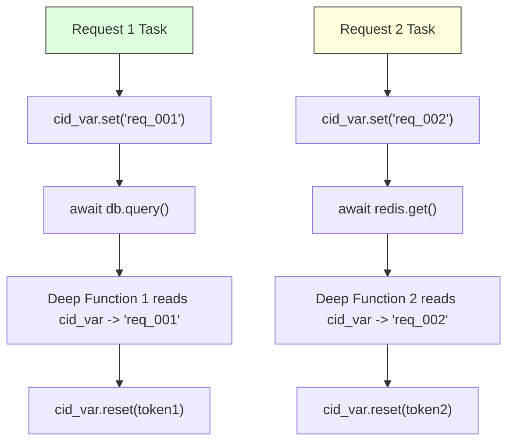

# FastAPI Request State & Async ContextVars

Propagating contextual metadata—such as correlation IDs, authenticated user entities, tenant boundaries, and telemetry spans—across middlewares, dependency trees, and deep domain services is a core architectural requirement. FastAPI provides two primary mechanisms: **`request.state`** for HTTP-scoped object binding and **`contextvars.ContextVar`** for framework-agnostic, task-safe context propagation across asynchronous call stacks.

---

## Conceptual Foundation & Mental Model

In synchronous frameworks (like traditional Flask or Django), developers often rely on thread-local storage (`threading.local()`). However, in an asynchronous framework like FastAPI where thousands of concurrent coroutines interleave on a single thread's event loop, thread-local storage is catastrophic: requests share the same thread, causing data to bleed between users!

### 1. `request.state` (HTTP-Bound)
- A dynamic, per-request namespace object attached to `starlette.requests.Request`.
- Ideal for sharing data between Middlewares, Dependencies, and Route Handlers when the `Request` instance is accessible.
- Bound strictly to the lifecycle of that specific HTTP request.

### 2. `contextvars.ContextVar` (Task-Local & Thread-Safe)
- Python's standard library solution (PEP 567) for asynchronous task-local state.
- Decouples domain logic from web frameworks: deep repository or service functions can access context **without needing the `request` object passed through 10 function signatures**.
- Thread-safe and task-isolated: child asyncio tasks inherit a copy of the context, preventing cross-request pollution.

```
Incoming Request
      │
      ▼
┌────────────────────────────────────────────────────────┐
│ Middleware:                                            │
│ 1. request.state.correlation_id = "req_123"            │
│ 2. correlation_var.set("req_123")                      │
└──────────────────────────┬─────────────────────────────┘
                           │
                           ▼
┌────────────────────────────────────────────────────────┐
│ Route Handler:                                         │
│ def endpoint(request: Request):                        │
│   # Can access via request.state.correlation_id        │
│   run_domain_logic()                                   │
└──────────────────────────┬─────────────────────────────┘
                           │
                           ▼
┌────────────────────────────────────────────────────────┐
│ Deep Domain Layer (Zero Web Framework Dependencies!):  │
│ def run_domain_logic():                                │
│   # Can access directly via correlation_var.get()!     │
└────────────────────────────────────────────────────────┘
```

---

## Architecture & Internal Mechanics

### How Python `contextvars` Isolates Concurrency
1. **Asyncio Task Contexts**: Each `asyncio.Task` maintains its own context map using an immutable Hash Array Mapped Trie (HAMT).
2. **Context Inheritance**: When a coroutine spawns a sub-task (`asyncio.create_task()`), the child task inherits an immutable snapshot of the parent's context.
3. **Reset Tokens**: Modifying a context variable (`token = my_var.set(val)`) returns a `Token`. Calling `my_var.reset(token)` restores the exact previous state, preventing context leaks in pooled threads.
4. **Thread-Pool Propagation**: In Python 3.12+, Starlette's `run_in_threadpool` automatically copies the current `contextvars` context into worker threads when running synchronous `def` endpoints.



---

## Comprehensive Syntax & Core Mechanics

### 1. Using `request.state`
```python
from fastapi import FastAPI, Request

app = FastAPI()

@app.middleware("http")
async def add_custom_state(request: Request, call_next):
    # Dynamically attach attributes to request.state
    request.state.tenant_id = request.headers.get("X-Tenant-ID", "default")
    request.state.start_time = 123456789.0
    return await call_next(request)

@app.get("/tenant")
async def get_tenant(request: Request):
    # Access state directly
    return {"tenant": getattr(request.state, "tenant_id", "unknown")}
```

### 2. Using `contextvars.ContextVar`
```python
import contextvars

# Global declaration (module-level)
current_user_id: contextvars.ContextVar[str] = contextvars.ContextVar("current_user_id", default="")

# Inside middleware / dependency:
token = current_user_id.set("usr_9988")
try:
    # Inside deep domain code:
    uid = current_user_id.get()
finally:
    current_user_id.reset(token)
```

---

## Practical Implementation (5 Complete Examples)

### Example 1: Full Request Tracing with ContextVars & Structured Logging
```python
import contextvars
import uuid
import logging
from fastapi import FastAPI, Request

# 1. Define ContextVar
correlation_id_ctx: contextvars.ContextVar[str] = contextvars.ContextVar("correlation_id", default="SYSTEM")

# 2. Custom Logging Filter that injects correlation_id automatically into all logs
class CorrelationLogFilter(logging.Filter):
    def filter(self, record):
        record.correlation_id = correlation_id_ctx.get()
        return True

logger = logging.getLogger("app")
handler = logging.StreamHandler()
handler.setFormatter(logging.Formatter("[%(correlation_id)s] %(levelname)s: %(message)s"))
logger.addHandler(handler)
logger.addFilter(CorrelationLogFilter())
logger.setLevel(logging.INFO)

app = FastAPI()

# 3. Middleware managing context boundary
@app.middleware("http")
async def logging_context_middleware(request: Request, call_next):
    cid = request.headers.get("X-Correlation-ID", str(uuid.uuid4()))
    token = correlation_id_ctx.set(cid)
    try:
        response = await call_next(request)
        response.headers["X-Correlation-ID"] = cid
        return response
    finally:
        correlation_id_ctx.reset(token)

# 4. Deep business function (no request parameter needed!)
def process_order_domain():
    logger.info("Executing inventory reservation logic...")

@app.post("/orders")
async def create_order():
    process_order_domain()
    return {"status": "created"}
```

### Example 2: Dynamic Tenant Resolution via `request.state`
```python
from typing import Annotated
from fastapi import FastAPI, Request, Depends, HTTPException

class TenantContext:
    def __init__(self, tenant_id: str, db_schema: str):
        self.tenant_id = tenant_id
        self.db_schema = db_schema

async def resolve_tenant_middleware(request: Request, call_next):
    host = request.headers.get("Host", "")
    tenant_slug = host.split(".")[0] if "." in host else "default"
    
    # Store complex domain object on request.state
    request.state.tenant = TenantContext(
        tenant_id=tenant_slug,
        db_schema=f"tenant_{tenant_slug}_db"
    )
    return await call_next(request)

app = FastAPI()
app.middleware("http")(resolve_tenant_middleware)

# Reusable dependency extracting from request.state
def get_tenant_context(request: Request) -> TenantContext:
    tenant = getattr(request.state, "tenant", None)
    if not tenant:
        raise HTTPException(status_code=500, detail="Tenant context missing")
    return tenant

@app.get("/workspace/info")
async def workspace_info(tenant: Annotated[TenantContext, Depends(get_tenant_context)]):
    return {"tenant": tenant.tenant_id, "schema": tenant.db_schema}
```

### Example 3: Threadpool Context Propagation in Synchronous Endpoints
```python
import contextvars
import time
from fastapi import FastAPI

audit_token_ctx: contextvars.ContextVar[str] = contextvars.ContextVar("audit_token", default="none")

app = FastAPI()

@app.middleware("http")
async def set_audit_ctx(request: Request, call_next):
    token = audit_token_ctx.set("auth_token_secret_123")
    try:
        return await call_next(request)
    finally:
        audit_token_ctx.reset(token)

# Notice: Synchronous def endpoint running in AnyIO threadpool!
@app.get("/sync-heavy-work")
def sync_heavy_work():
    # ContextVar is automatically copied to the worker thread!
    current_token = audit_token_ctx.get()
    time.sleep(0.01)
    return {"token_in_thread": current_token}
```

### Example 4: Database Unit of Work Binding via ContextVars
```python
import contextvars
from typing import AsyncGenerator
from fastapi import FastAPI, Depends

class MockDBSession:
    def __init__(self, session_id: str):
        self.session_id = session_id
    def execute_query(self, sql: str):
        return f"Executed {sql} on {self.session_id}"

# Task-isolated database session variable
db_session_ctx: contextvars.ContextVar[MockDBSession | None] = contextvars.ContextVar("db_session", default=None)

async def session_context_dependency() -> AsyncGenerator[MockDBSession, None]:
    session = MockDBSession(session_id="session_abc")
    token = db_session_ctx.set(session)
    try:
        yield session
    finally:
        db_session_ctx.reset(token)

app = FastAPI()

# Deep domain function reads session directly from context
def update_user_status(user_id: int):
    session = db_session_ctx.get()
    if not session:
        raise RuntimeError("No active database session in context!")
    return session.execute_query(f"UPDATE users SET active=1 WHERE id={user_id}")

@app.post("/users/{user_id}/activate")
async def activate_user(user_id: int, _db = Depends(session_context_dependency)):
    result = update_user_status(user_id)
    return {"result": result}
```

### Example 5: Testing `request.state` and `ContextVar` with Concurrency
```python
import pytest
import asyncio
from httpx import AsyncClient, ASGITransport

@pytest.mark.anyio
async def test_concurrent_contextvars_isolation():
    # Verify 100 concurrent requests never read each other's correlation IDs!
    transport = ASGITransport(app=app)
    async with AsyncClient(transport=transport, base_url="http://test") as client:
        async def hit_endpoint(i: int):
            resp = await client.post("/orders", headers={"X-Correlation-ID": f"corr_{i}"})
            assert resp.headers["x-correlation-id"] == f"corr_{i}"

        # Run 50 concurrent requests simultaneously
        await asyncio.gather(*(hit_endpoint(i) for i in range(50)))
```

---

## Anti-Patterns & Common Traps

| Anti-Pattern | Operational Hazard | Production Solution |
| :--- | :--- | :--- |
| **Using `threading.local()` in async FastAPI** | Requests on the same async thread share variables, leaking User A's data to User B. | Use `contextvars.ContextVar` (PEP 567). |
| **Using module-level global variables for request state** | Massive data corruption under concurrent load; variables are overwritten across requests. | Never store request state in module globals. |
| **Forgetting to call `var.reset(token)` in `finally`** | Context variable leaks into worker threads reused by AnyIO, causing state bleeding. | Always store the token returned by `.set()` and invoke `.reset(token)` in `finally`. |
| **Accessing non-existent attribute on `request.state` directly** | Raises `AttributeError: 'State' object has no attribute 'x'`. | Use `getattr(request.state, "x", default_value)`. |

---

## Performance & Resource Characteristics

- **`contextvars` Overhead**: Implemented directly in C; operations (`get()`, `set()`, `reset()`) execute in sub-microsecond timeframes ($O(1)$).
- **`request.state` Overhead**: Backed by a standard Python dictionary (`state._state`); attribute access is near-instantaneous.
- **Memory Footprint**: ContextVars use copy-on-write immutable data structures, avoiding memory duplication when child tasks are spawned.

---

## Edge Cases, Failure Modes & Gotchas

1. **Background Tasks and Context**: In `BackgroundTasks.add_task()`, FastAPI captures the current context and runs the task inside that context. However, `request.state` is destroyed when the request completes, so background tasks should rely on `ContextVars` or pass primitive parameters.
2. **Untyped `request.state`**: `request.state` has no static type definitions by default. Wrap access in typed getter dependencies or custom dataclasses.

---

## Security Implications & OWASP Alignment

- **Cross-Tenant Data Bleeding (OWASP API1:2023 - BOLA)**: Storing tenant IDs in global variables rather than `contextvars` or `request.state` causes concurrent queries to execute against the wrong tenant's database schema.
- **Zero-Trust Audit Trails**: Binding correlation IDs to `ContextVars` guarantees that every security event, database error, and external API call includes the exact client identifier for forensic compliance.

---

## Modern Tooling Integration

- **OpenTelemetry Python SDK**: Built entirely on `contextvars` to propagate trace spans and baggage across async functions.
- **Loguru / Structlog**: Automatically extracts context variables into JSON-formatted log entries.

---

## Real-World Case Study / Production Incident

A medical SaaS platform processed digital prescriptions. Under heavy load, patient prescriptions were occasionally saved with another patient's ID.

**Investigation**:
The engineering team had written an auth dependency:
```python
# BROKEN CODE:
CURRENT_PATIENT_ID = None  # Module-level global!

async def set_patient(patient_id: int):
    global CURRENT_PATIENT_ID
    CURRENT_PATIENT_ID = patient_id
```
When Patient A's request yielded control during `await db.check_insurance()`, Patient B's request set `CURRENT_PATIENT_ID = patient_b_id`. Patient A's coroutine resumed and issued the prescription under Patient B's record!

**Remediation**:
1. Completely removed module-level globals.
2. Replaced with `contextvars.ContextVar[int]`:
   ```python
   patient_ctx: contextvars.ContextVar[int] = contextvars.ContextVar("patient_id")
   ```
3. Concurrency testing confirmed zero cross-patient state leakage across 10,000 parallel requests.

---

## Hands-On Exercises & Challenge Problems

### Warmup (2 Exercises)
1. Write a middleware that sets `request.state.ip = request.client.host` and an endpoint returning it.
2. Create a module-level `contextvars.ContextVar[str]` with default `"guest"`, update it in a dependency, and read it in a route.

### Intermediate (2 Exercises)
3. Implement a custom logging filter that pulls a `trace_id` from a `ContextVar` and test that two concurrent async requests output logs with their respective distinct trace IDs.
4. Wrap `request.state` access in a typed Pydantic or dataclass dependency `get_request_metadata(request: Request) -> RequestMetadata`.

### Production-Grade (2 Exercises)
5. Build an automated stress test with `httpx` and `asyncio.gather` that issues 200 concurrent requests with random correlation IDs and asserts that no response ever receives a mismatched correlation ID.
6. Design and implement a multi-tenant database connection router that uses a `ContextVar` to dynamically direct SQLAlchemy queries to tenant-specific database read-replicas.

---

## Interview Mastery (8 Q&As)

### Junior Level
**Q1: What is `request.state` in FastAPI?**
*Answer:* A property on the `Request` object used to store arbitrary, per-request state and metadata that can be shared across middlewares, dependencies, and route handlers.

**Q2: Why should you avoid using global variables to store user data in FastAPI?**
*Answer:* FastAPI is an asynchronous framework where concurrent requests interleave on the same thread. Global variables are shared across all requests, causing race conditions and severe data leakage between users.

**Q3: What Python standard library module provides task-local storage for asyncio?**
*Answer:* The `contextvars` module (introduced in Python 3.7 via PEP 567).

### Senior Level
**Q4: How does `contextvars.ContextVar` differ from `threading.local()`?**
*Answer:* `threading.local()` isolates data per OS thread. In asyncio, multiple concurrent requests share the same thread, causing `threading.local()` to corrupt state across requests. `ContextVar` isolates state per `asyncio.Task`, correctly maintaining isolation across interleaved coroutines.

**Q5: Why is it critical to call `context_var.reset(token)` after setting a value?**
*Answer:* When worker threads or event loop tasks are pooled and reused for subsequent requests, failing to reset context variables causes stale state to leak into future, unrelated requests handled by that worker.

**Q6: Does a synchronous `def` endpoint have access to `contextvars` set in an async middleware?**
*Answer:* Yes. Starlette's `run_in_threadpool` automatically copies the current `contextvars` context into the worker thread before executing synchronous endpoint functions.

### Staff / Architect Level
**Q7: How do you architect a clean enterprise domain service layer that logs correlation IDs without coupling domain classes to FastAPI's `Request` object?**
*Answer:*
1. Initialize a `contextvars.ContextVar[str]` in a shared core platform module.
2. In FastAPI middleware, extract the correlation ID from incoming HTTP headers and bind it to the `ContextVar`.
3. In the domain layer (services, repositories), domain functions and logging formatters read from the `ContextVar` directly.
4. Domain code remains 100% pure Python with zero imports of FastAPI, Starlette, or HTTP request objects, allowing it to be used in CLI commands, Celery tasks, and unit tests without modification.

**Q8: How does Python 3.13 / 3.14 free-threading (no GIL) affect `contextvars` and `request.state`?**
*Answer:*
- `ContextVar` is fully thread-safe and immutable under free-threading; modifying a context variable updates the task-specific context trie without locking hazards.
- `request.state` is an object bound to a single request; under normal usage, a request is processed sequentially within its own coroutine stack, keeping it safe. However, if background worker threads attempt to mutate `request.state` concurrently, standard thread synchronization (or avoiding mutation) must be enforced.
