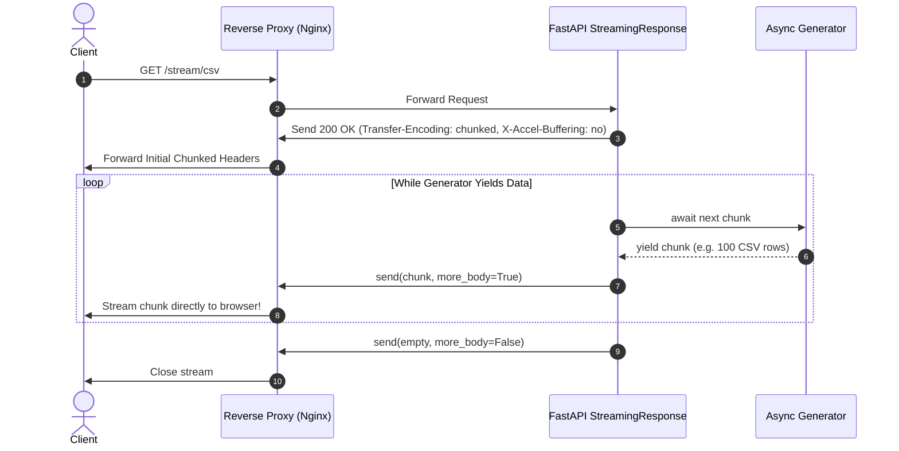

# FastAPI Streaming Responses & Chunked Encoding

Serving multi-gigabyte datasets, massive database CSV exports, real-time audio feeds, or Large Language Model (LLM) token completions requires streaming data incrementally. Loading entire payloads into memory before transmission exhausts server RAM and causes high client-perceived latency. In FastAPI, `StreamingResponse` combined with asynchronous generators streams byte chunks over standard HTTP using `Transfer-Encoding: chunked`.

---

## Conceptual Foundation & Mental Model

### Buffered Response vs Streaming Response
1. **Buffered Response (`JSONResponse`, standard return)**:
   - The entire payload is generated and held in memory.
   - The server computes `Content-Length: 10485760` (10 MB).
   - The client waits until all 10 MB are computed before receiving the first byte (high Time-To-First-Byte / TTFB).
2. **Streaming Response (`StreamingResponse`)**:
   - The endpoint yields small byte or text chunks as they become available.
   - The server omits `Content-Length` and sends `Transfer-Encoding: chunked`.
   - The client receives and renders data immediately (near-zero TTFB).
   - Server RAM usage remains bounded (e.g. constant 64KB buffer), regardless of whether the total payload is 10MB or 100GB.

```
Buffered Response:
[Compute all 100MB in RAM] ──► [Send 100MB at once] ──► Client waits 10s

Streaming Response:
[Yield 10KB] ──► Sent to client (Client renders instantly!)
[Yield 10KB] ──► Sent to client
[Yield 10KB] ──► Sent to client
(Server RAM used: only 10KB at any moment!)
```

---

## Architecture & Internal Mechanics

### How Starlette `StreamingResponse` Operates Under the Hood
1. **Async Iterator Consumption**: `StreamingResponse` accepts an async (or sync) generator.
2. **ASGI Message Sequence**:
   - Sends `{"type": "http.response.start", "status": 200, "headers": [...]}`.
   - For every chunk yielded by the generator, it calls `send({"type": "http.response.body", "body": chunk, "more_body": True})`.
   - When the generator finishes, it calls `send({"type": "http.response.body", "body": b"", "more_body": False})`.
3. **Reverse Proxy Buffering (Nginx / Cloudflare)**:
   - Reverse proxies often buffer responses by default, completely negating real-time streaming!
   - To disable proxy buffering, the server **must** return the header `X-Accel-Buffering: no` (for Nginx) or `Cache-Control: no-cache`.



---

## Comprehensive Syntax & Core Mechanics

```python
from typing import AsyncGenerator
from fastapi import FastAPI
from fastapi.responses import StreamingResponse
import asyncio

app = FastAPI()

async def generate_chunks() -> AsyncGenerator[bytes, None]:
    for i in range(10):
        # Yield bytes or strings
        yield f"Chunk {i}\n".encode("utf-8")
        await asyncio.sleep(0.1)

@app.get("/stream")
async def stream_endpoint():
    return StreamingResponse(
        generate_chunks(),
        media_type="text/plain",
        headers={
            "X-Accel-Buffering": "no",       # Disable Nginx buffering
            "Cache-Control": "no-cache",
        }
    )
```

---

## Practical Implementation (5 Complete Examples)

### Example 1: Memory-Efficient Large CSV Database Export
```python
import io
import csv
from typing import AsyncGenerator
from fastapi import FastAPI
from fastapi.responses import StreamingResponse

app = FastAPI(title="Data Export Service")

async def csv_row_generator() -> AsyncGenerator[str, None]:
    output = io.StringIO()
    writer = csv.writer(output)

    # 1. Yield CSV Header
    writer.writerow(["id", "username", "account_balance", "created_at"])
    yield output.getvalue()
    output.seek(0)
    output.truncate(0)

    # 2. Stream 100,000 rows in batches without loading all into RAM
    for batch_idx in range(100):
        # In production: query DB with cursor: SELECT * FROM users LIMIT 1000 OFFSET ...
        for row_idx in range(1000):
            user_id = batch_idx * 1000 + row_idx
            writer.writerow([user_id, f"user_{user_id}", 1500.50, "2026-03-30"])
        
        yield output.getvalue()
        output.seek(0)
        output.truncate(0)

@app.get("/export/users.csv")
async def export_users_csv():
    response = StreamingResponse(
        csv_row_generator(),
        media_type="text/csv",
        headers={
            "Content-Disposition": 'attachment; filename="users_export.csv"',
            "X-Accel-Buffering": "no"
        }
    )
    return response
```

### Example 2: LLM Token Streaming (OpenAI-Style Text Generation)
```python
import asyncio
from typing import AsyncGenerator
from fastapi import FastAPI
from fastapi.responses import StreamingResponse

app = FastAPI()

async def simulate_llm_stream(prompt: str) -> AsyncGenerator[str, None]:
    tokens = f"Thinking about: {prompt}. Here is your streaming AI response generated token by token.".split()
    for token in tokens:
        yield token + " "
        await asyncio.sleep(0.05)  # Simulate LLM generation latency

@app.get("/ai/stream-completion")
async def stream_llm(prompt: str):
    return StreamingResponse(
        simulate_llm_stream(prompt),
        media_type="text/plain",
        headers={"X-Accel-Buffering": "no"}
    )
```

### Example 3: Streaming Massive Local Disk Files
```python
import aiofiles
from typing import AsyncGenerator
from fastapi import FastAPI, HTTPException
from fastapi.responses import StreamingResponse
import os

app = FastAPI()
CHUNK_SIZE = 64 * 1024  # 64 KB per chunk

async def read_file_chunks(path: str) -> AsyncGenerator[bytes, None]:
    async with aiofiles.open(path, mode="rb") as f:
        while chunk := await f.read(CHUNK_SIZE):
            yield chunk

@app.get("/download/archive")
async def download_archive():
    file_path = "large_dataset.tar.gz"
    # Ensure file exists or create mock
    if not os.path.exists(file_path):
        with open(file_path, "wb") as f:
            f.write(b"0" * (1024 * 1024))  # 1MB mock

    file_size = os.path.getsize(file_path)
    return StreamingResponse(
        read_file_chunks(file_path),
        media_type="application/gzip",
        headers={
            "Content-Length": str(file_size),  # Known size allows download progress bars!
            "Content-Disposition": f'attachment; filename="{os.path.basename(file_path)}"'
        }
    )
```

### Example 4: Handling Client Disconnects During Streaming
```python
from fastapi import FastAPI, Request
from fastapi.responses import StreamingResponse
import asyncio

app = FastAPI()

@app.get("/long-running-stream")
async def long_stream(request: Request):
    async def event_publisher():
        try:
            for i in range(100):
                # Check if client disconnected!
                if await request.is_disconnected():
                    print(f"[STREAM CANCELLED] Client disconnected at step {i}")
                    break
                
                yield f"Event step {i}\n"
                await asyncio.sleep(0.5)
        finally:
            print("[CLEANUP] Stream generator completed teardown.")

    return StreamingResponse(event_publisher(), media_type="text/plain")
```

### Example 5: Testing `StreamingResponse` with `TestClient`
```python
from fastapi import FastAPI
from fastapi.responses import StreamingResponse
from fastapi.testclient import TestClient

app = FastAPI()

async def mock_stream():
    yield b"part1|"
    yield b"part2|"
    yield b"part3"

@app.get("/test-stream")
def test_stream_route():
    return StreamingResponse(mock_stream(), media_type="text/plain")

def test_streaming_endpoint():
    client = TestClient(app)
    response = client.get("/test-stream")
    assert response.status_code == 200
    assert response.text == "part1|part2|part3"
    assert response.headers["transfer-encoding"] == "chunked"
```

---

## Anti-Patterns & Common Traps

| Anti-Pattern | Operational Hazard | Production Solution |
| :--- | :--- | :--- |
| **Omitting `X-Accel-Buffering: no` behind Nginx** | Nginx buffers the entire stream until complete, destroying the real-time experience. | Always include `headers={"X-Accel-Buffering": "no"}`. |
| **Using synchronous generators (`def gen()`) for slow I/O** | Blocks worker threads or freezes the event loop between chunks. | Use asynchronous generators: `async def gen() -> AsyncGenerator[bytes, None]`. |
| **Ignoring client disconnects in infinite streams** | The generator continues executing and consuming database resources indefinitely. | Periodically check `await request.is_disconnected()`. |
| **Using `BaseHTTPMiddleware` on streaming routes** | `BaseHTTPMiddleware` buffers chunks in memory, breaking real-time streaming. | Use Pure ASGI Middleware when streaming is required. |
| **Yielding non-bytes / non-string objects** | Starlette throws `TypeError: ... is not bytes or string`. | Encode objects to UTF-8 bytes or JSON strings before yielding. |

---

## Performance & Resource Characteristics

- **Constant Memory Footprint ($O(1)$ RAM)**: Memory usage is bounded strictly by chunk size (e.g. 64KB) regardless of whether total data is 1GB or 100GB.
- **Latency to First Byte (TTFB)**: Drops from seconds down to single-digit milliseconds because data is emitted immediately upon initial chunk computation.

---

## Edge Cases, Failure Modes & Gotchas

1. **Mid-Stream Exceptions**: If an unhandled exception occurs after the stream has started, headers (`200 OK`) have already been sent to the client. The server cannot send a `500 Internal Server Error`; instead, the connection terminates abruptly. Clients must handle truncated streams.
2. **Content-Length vs Chunked**: If you provide `Content-Length`, Starlette sends standard HTTP. If you omit `Content-Length`, it automatically switches to `Transfer-Encoding: chunked`.

---

## Security Implications & OWASP Alignment

- **Denial of Service via Unbounded Streams**: Attackers can keep thousands of slow streaming connections open (Slowloris attack). Enforce connection timeouts and maximum stream duration guards.
- **Data Leakage in CSV Injection**: When exporting user-generated CSV data, escape leading formula characters (`=`, `+`, `-`, `@`) to prevent CSV injection attacks in Excel.

---

## Modern Tooling Integration

- **Curl**: Stream directly to terminal using `curl -N http://localhost:8000/stream` (`-N` disables curl's internal buffer).
- **Frontend Fetch API**: Consume chunks incrementally in the browser using `response.body.getReader()`.

---

## Real-World Case Study / Production Incident

An analytics platform had an endpoint `/reports/export` that loaded 2 million database records into a Python list of Pydantic models before returning a JSON payload. During month-end reporting, 15 concurrent users clicked "Export", causing the server to consume 24GB of RAM and triggering Linux Out-Of-Memory (OOM) kernel crashes.

**Remediation**:
1. Converted the endpoint to `StreamingResponse`.
2. Replaced the bulk query with an asynchronous SQLAlchemy server-side cursor (`stream_scalars()`).
3. Streamed CSV rows in 1,000-row chunks directly to the HTTP socket.
4. Memory usage dropped from **24GB to 35MB** with zero OOM crashes.

---

## Hands-On Exercises & Challenge Problems

### Warmup (2 Exercises)
1. Write a `StreamingResponse` endpoint that yields numbers `1` through `5` with a 0.2s delay between numbers.
2. Verify using `curl -N` that numbers appear sequentially in real time.

### Intermediate (2 Exercises)
3. Implement a streaming CSV exporter that streams 10,000 mock financial transactions in chunks of 500 rows.
4. Implement a client disconnect guard that breaks out of a generator when `request.is_disconnected()` returns True.

### Production-Grade (2 Exercises)
5. Build an asynchronous file proxy endpoint that streams a 500MB file from an external URL (via `httpx.AsyncClient.stream()`) directly to the client without buffering the file in FastAPI memory.
6. Design an LLM token streaming endpoint that yields Server-Sent Event (SSE) chunks formatted as `data: {"token": "..."}\n\n` with a complete JavaScript frontend snippet consuming the stream via `fetch()` and `ReadableStream`.

---

## Interview Mastery (8 Q&As)

### Junior Level
**Q1: What is `StreamingResponse` in FastAPI?**
*Answer:* A Starlette response class that accepts a generator and streams data to the client in real time using HTTP chunked transfer encoding, rather than buffering the entire payload in server memory.

**Q2: What is the benefit of `StreamingResponse` over standard `Response`?**
*Answer:* It maintains a constant, low memory footprint ($O(1)$) and dramatically reduces Time-To-First-Byte (TTFB) for large datasets or real-time feeds.

**Q3: What header is sent when `Content-Length` is omitted in a streaming response?**
*Answer:* `Transfer-Encoding: chunked`.

### Senior Level
**Q4: Why must you include `X-Accel-Buffering: no` when streaming behind Nginx?**
*Answer:* By default, Nginx buffers upstream responses until the connection closes. Setting `X-Accel-Buffering: no` instructs Nginx to disable proxy buffering and stream chunks immediately to the client.

**Q5: What happens if an exception is raised inside a generator *after* streaming has begun?**
*Answer:* Because HTTP response headers (`200 OK`) were already sent to the client, the server cannot change the status code to 500. The ASGI server closes the socket abruptly, signaling to the client that the stream was truncated.

**Q6: How can a streaming generator detect that the client closed their browser tab?**
*Answer:* By awaiting `await request.is_disconnected()`. If True, the generator should stop yielding and execute cleanup logic.

### Staff / Architect Level
**Q7: How do you design an export pipeline that streams millions of database records safely without exhausting database connection pools or server memory?**
*Answer:*
1. Use database server-side cursors (e.g. `await session.stream_scalars()`) to fetch records in batches (e.g. 1,000 at a time) from the database engine rather than loading all rows into RAM.
2. In the FastAPI endpoint, stream batches as CSV or JSON Lines through `StreamingResponse`.
3. Check `await request.is_disconnected()` in the generator loop to terminate expensive database cursors if the user cancels.
4. Set strict stream timeouts to prevent slow clients from holding open database cursors indefinitely.

**Q8: Why does `BaseHTTPMiddleware` break streaming responses, and what is the architectural alternative?**
*Answer:* `BaseHTTPMiddleware` wraps response bodies in an internal iterator that buffers chunks in memory, delaying real-time delivery until the stream closes. The architectural alternative is to use **Pure ASGI Middleware** (`scope, receive, send`), which streams chunks directly without buffering.
