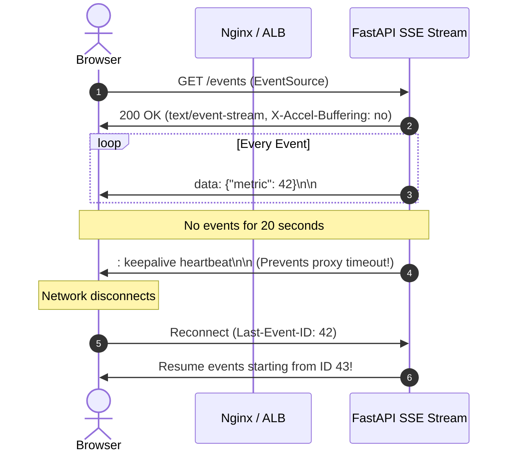

# FastAPI Server-Sent Events (SSE)

For real-time unidirectional communication—such as live dashboard metrics, AI token completions, stock tickers, or notification feeds—**Server-Sent Events (SSE)** offers a lightweight, standards-compliant alternative to WebSockets. SSE runs over standard HTTP, leverages the browser's native `EventSource` API, automatically handles reconnections, and traverses corporate proxies and firewalls without special protocol negotiation.

---

## Conceptual Foundation & Mental Model

### SSE vs WebSockets vs Long-Polling
| Feature | Server-Sent Events (SSE) | WebSockets | Long-Polling |
| :--- | :---: | :---: | :---: |
| **Directionality** | Unidirectional (Server $\rightarrow$ Client) | Full Duplex (Bidirectional) | Emulated via repeated requests |
| **Protocol** | Standard HTTP/1.1 or HTTP/2 | Custom `ws://` / `wss://` | Standard HTTP |
| **Browser API** | Native `EventSource` | Native `WebSocket` | Standard `fetch()` |
| **Auto-Reconnection** | Built-in by default | Must be implemented in JS | Handled by application loop |
| **Firewall / Proxy Traversal** | Seamless (Standard HTTP) | Can be blocked by strict firewalls | Seamless |
| **Best Use Cases** | LLM Streaming, Live Feeds, Stock Prices | Multiplayer Games, Collaborative Editing | Legacy fallbacks |

### The SSE Wire Protocol
The server sets `Content-Type: text/event-stream`. Data is pushed in plaintext blocks terminated by two consecutive newlines (`\n\n`):
```http
event: message
id: 101
retry: 5000
data: {"token": "hello"}

event: user_joined
id: 102
data: {"username": "Alice"}
```

```
Client (EventSource)                                FastAPI Server
        │                                                  │
        │─── GET /sse/feed (Accept: text/event-stream) ───►│
        │                                                  │
        │◄── 200 OK (Content-Type: text/event-stream) ─────│
        │                                                  │
        │◄── id: 1\ndata: {"temp": 72}\n\n ────────────────│ (Immediate)
        │                                                  │
        │◄── id: 2\ndata: {"temp": 73}\n\n ────────────────│ (3s later)
        │                                                  │
        │    [Network drops momentarily]                   │
        │                                                  │
        │─── GET /sse/feed (Last-Event-ID: 2) ────────────►│ (Auto-reconnects!)
```

---

## Architecture & Internal Mechanics

### Native `StreamingResponse` vs `sse-starlette`
FastAPI can implement SSE in two ways:
1. **Native `StreamingResponse`**: Yielding formatted strings conforming to `data: ...\n\n`.
2. **`sse-starlette` Library**: A production-grade wrapper that handles structured `ServerSentEvent` objects, ping/heartbeat keepalives, and `Last-Event-ID` parsing out of the box.

### Keepalive Heartbeats
Without periodic comments (`: ping\n\n`) sent every 15–30 seconds, intermediate reverse proxies, load balancers (AWS ALB), and firewalls will close "idle" streaming connections.



---

## Comprehensive Syntax & Core Mechanics

### 1. Pure Native Implementation
```python
from typing import AsyncGenerator
from fastapi import FastAPI
from fastapi.responses import StreamingResponse
import asyncio

app = FastAPI()

async def sse_generator() -> AsyncGenerator[str, None]:
    for i in range(10):
        # Format strictly: 'data: <content>\n\n'
        yield f"id: {i}\nevent: metric\ndata: {{\"count\": {i}}}\n\n"
        await asyncio.sleep(1.0)

@app.get("/events")
async def get_events():
    return StreamingResponse(
        sse_generator(),
        media_type="text/event-stream",
        headers={
            "Cache-Control": "no-cache",
            "Connection": "keep-alive",
            "X-Accel-Buffering": "no",
        }
    )
```

### 2. Using `sse-starlette` (`EventSourceResponse`)
```python
# pip install sse-starlette
from fastapi import FastAPI, Request
from sse_starlette.sse import EventSourceResponse, ServerSentEvent
import asyncio

app = FastAPI()

async def structured_events(request: Request):
    for i in range(5):
        if await request.is_disconnected():
            break
        yield ServerSentEvent(
            data=f"Token {i}",
            event="token_event",
            id=str(i),
            retry=3000  # Client retries after 3s if disconnected
        )
        await asyncio.sleep(0.5)

@app.get("/sse/structured")
async def structured_sse(request: Request):
    return EventSourceResponse(structured_events(request))
```

---

## Practical Implementation (5 Complete Examples)

### Example 1: Real-Time AI Token Stream (ChatGPT Style)
```python
import asyncio
from typing import AsyncGenerator
from fastapi import FastAPI
from fastapi.responses import StreamingResponse
import json

app = FastAPI(title="AI Streaming Engine")

async def generate_llm_tokens(prompt: str) -> AsyncGenerator[str, None]:
    message = f"Detailed analysis for prompt '{prompt}': Machine learning models require careful validation."
    tokens = message.split()
    
    for idx, token in enumerate(tokens):
        payload = json.dumps({"token": token, "index": idx})
        yield f"event: token\ndata: {payload}\n\n"
        await asyncio.sleep(0.08)

    # Signal completion
    yield "event: done\ndata: [DONE]\n\n"

@app.get("/ai/stream")
async def stream_ai(prompt: str):
    return StreamingResponse(
        generate_llm_tokens(prompt),
        media_type="text/event-stream",
        headers={"X-Accel-Buffering": "no"}
    )
```

### Example 2: Reconnection Recovery via `Last-Event-ID`
```python
from typing import Annotated
from fastapi import FastAPI, Header, Request
from fastapi.responses import StreamingResponse
import asyncio

app = FastAPI()

# Simulated event log in database
EVENT_LOG = [
    {"id": 1, "text": "Deployment initiated"},
    {"id": 2, "text": "Building container image"},
    {"id": 3, "text": "Running unit test suite"},
    {"id": 4, "text": "Deploying to Kubernetes"},
    {"id": 5, "text": "Deployment successful"},
]

async def event_recovery_generator(last_id: int):
    # Replay events missed during disconnection
    for event in EVENT_LOG:
        if event["id"] > last_id:
            yield f"id: {event['id']}\nevent: deploy_log\ndata: {event['text']}\n\n"
            await asyncio.sleep(0.2)

@app.get("/deployments/stream")
async def stream_deployment(
    request: Request,
    last_event_id: Annotated[str | None, Header(alias="Last-Event-ID")] = None
):
    start_from = int(last_event_id) if last_event_id and last_event_id.isdigit() else 0
    return StreamingResponse(
        event_recovery_generator(start_from),
        media_type="text/event-stream",
        headers={"X-Accel-Buffering": "no"}
    )
```

### Example 3: Periodic Heartbeat / Ping Generator
```python
import asyncio
import time
from typing import AsyncGenerator
from fastapi import FastAPI
from fastapi.responses import StreamingResponse

app = FastAPI()

async def feed_with_heartbeat() -> AsyncGenerator[str, None]:
    last_ping = time.time()
    count = 0
    while count < 20:
        now = time.time()
        
        # Emit real event every 3 seconds
        yield f"event: price_update\ndata: {{\"btc\": 65000 + count}}\n\n"
        count += 1
        
        # Emit SSE comment heartbeat every 15 seconds to prevent proxy drop
        if now - last_ping > 15:
            yield ": keepalive-heartbeat\n\n"
            last_ping = now
            
        await asyncio.sleep(3.0)

@app.get("/crypto/feed")
def crypto_feed():
    return StreamingResponse(feed_with_heartbeat(), media_type="text/event-stream")
```

### Example 4: Complete Frontend EventSource HTML Consumer
```python
from fastapi import FastAPI
from fastapi.responses import HTMLResponse

app = FastAPI()

HTML_CONTENT = """
<!DOCTYPE html>
<html>
<head><title>SSE Live Client</title></head>
<body>
    <h2>Live AI Completion</h2>
    <div id="output" style="font-family: monospace; font-size: 16px;"></div>

    <script>
        const evtSource = new EventSource('/ai/stream?prompt=fastapi');
        const outputDiv = document.getElementById('output');

        evtSource.addEventListener('token', function(event) {
            const data = JSON.parse(event.data);
            outputDiv.innerText += data.token + " ";
        });

        evtSource.addEventListener('done', function(event) {
            console.log("Stream finished.");
            evtSource.close();
        });

        evtSource.onerror = function(err) {
            console.error("EventSource failed:", err);
            evtSource.close();
        };
    </script>
</body>
</html>
"""

@app.get("/", response_class=HTMLResponse)
def index():
    return HTML_CONTENT
```

### Example 5: Testing SSE Endpoints with `httpx`
```python
import pytest
from httpx import AsyncClient, ASGITransport

@pytest.mark.anyio
async def test_sse_endpoint_stream():
    transport = ASGITransport(app=app)
    async with AsyncClient(transport=transport, base_url="http://test") as client:
        async with client.stream("GET", "/ai/stream?prompt=test") as response:
            assert response.status_code == 200
            assert "text/event-stream" in response.headers["content-type"]
            
            chunks = []
            async for line in response.aiter_lines():
                if line.startswith("data:"):
                    chunks.append(line)
                if len(chunks) >= 3:
                    break
            
            assert len(chunks) >= 3
```

---

## Anti-Patterns & Common Traps

| Anti-Pattern | Operational Hazard | Production Solution |
| :--- | :--- | :--- |
| **Missing double newline `\n\n` at end of event** | Browser `EventSource` waits indefinitely; no events are triggered in frontend. | Every SSE event must terminate with `\n\n`. |
| **Omitting heartbeats in long-running streams** | AWS ALB, Cloudflare, or Nginx terminates connection after 60s idle timeout. | Emit comment lines (`: ping\n\n`) every 15–20s. |
| **Using `BaseHTTPMiddleware` on SSE routes** | Middleware buffers chunks, destroying real-time streaming delivery. | Use Pure ASGI Middleware or bypass middleware on SSE paths. |
| **Choosing WebSockets when SSE is sufficient** | Adds complex handshake, custom reconnect logic, and load balancer sticky-session hurdles. | Use SSE for server-to-client unidirectional data flows. |

---

## Performance & Resource Characteristics

- **HTTP/2 Multiplexing**: Over HTTP/2, hundreds of SSE streams multiplex over a single TCP socket, overcoming the HTTP/1.1 6-connection-per-domain browser limit.
- **Low Memory Overhead**: Each connection holds an open async generator coroutine consuming less than 4KB of RAM.

---

## Edge Cases, Failure Modes & Gotchas

1. **HTTP/1.1 Connection Limits**: Browsers limit concurrent HTTP/1.1 connections to the same domain to 6. If a user opens 6 tabs with SSE over HTTP/1.1, the 7th tab hangs! Use HTTP/2 in production to allow unlimited multiplexed streams.
2. **CORS on EventSource**: When creating `new EventSource("https://api.com/sse", { withCredentials: true })`, the server must return matching CORS headers and `Access-Control-Allow-Credentials: true`.

---

## Security Implications & OWASP Alignment

- **Cross-Site Scripting (XSS)**: If raw user input is pushed over SSE without sanitization and inserted into the DOM via `innerHTML`, attackers can achieve XSS. Always use `innerText` or sanitize payloads.
- **Resource Exhaustion**: Limit concurrent SSE connections per authenticated user in Redis to prevent socket exhaustion.

---

## Modern Tooling Integration

- **`sse-starlette`**: High-level Starlette extension providing `EventSourceResponse` with automatic pings.
- **Browser DevTools**: The Network tab renders an interactive "EventStream" panel displaying live messages, IDs, and event types.

---

## Real-World Case Study / Production Incident

A financial dashboard pushed live stock updates using WebSockets. When deploying to a new Kubernetes cluster behind an AWS Application Load Balancer (ALB), 30% of corporate enterprise users could not connect: corporate enterprise proxy firewalls were stripping the `Upgrade: websocket` header.

**Remediation**:
Migrated stock tickers to **Server-Sent Events (SSE)**. Because SSE runs over standard `https://` with standard `GET` requests, corporate firewalls allowed the traffic seamlessly, and connection success jumped to **100%**.

---

## Hands-On Exercises & Challenge Problems

### Warmup (2 Exercises)
1. Write a native `StreamingResponse` endpoint returning `text/event-stream` that emits 3 timestamped events.
2. Test using `curl -N http://localhost:8000/events` and inspect the output formatting.

### Intermediate (2 Exercises)
3. Build an SSE endpoint that parses the `Last-Event-ID` request header and resumes streaming from that integer offset.
4. Implement a background keepalive ping that yields `: keepalive\n\n` every 5 seconds between data events.

### Production-Grade (2 Exercises)
5. Build an LLM streaming API using `sse-starlette` that emits structured JSON events (`token`, `usage`, `finish_reason`) and write an integration test with `httpx` validating every event type.
6. Design a multi-subscriber SSE broadcast system using `asyncio.Queue` where a `POST /broadcast` endpoint distributes messages in real time to 50 concurrent SSE listener connections.

---

## Interview Mastery (8 Q&As)

### Junior Level
**Q1: What is Server-Sent Events (SSE)?**
*Answer:* A standard web technology allowing a server to push real-time text data to a browser over a single persistent HTTP connection using the `text/event-stream` media type.

**Q2: What is the required wire format for an SSE event?**
*Answer:* One or more lines prefixed with `data: `, optionally preceded by `event: `, `id: `, or `retry: `, and terminated with two consecutive newlines (`\n\n`).

**Q3: Which browser JavaScript API is used to consume SSE streams?**
*Answer:* The native `EventSource` API (`const es = new EventSource("/events")`).

### Senior Level
**Q4: When should you choose SSE over WebSockets?**
*Answer:* Choose SSE when communication is strictly unidirectional (server-to-client), such as live feeds, notifications, and LLM text generation. SSE runs over standard HTTP, multiplexes over HTTP/2, traverses enterprise proxies, and includes native automatic reconnection.

**Q5: How does automatic reconnection work in SSE?**
*Answer:* When a connection drops, the browser's `EventSource` automatically attempts to reconnect after a delay (controlled by the `retry:` field). On reconnect, it automatically sends the `Last-Event-ID` header containing the ID of the last successfully received event, allowing the server to resume without data loss.

**Q6: What is the purpose of sending lines starting with a colon (`:`) in an SSE stream?**
*Answer:* In the SSE protocol, lines starting with `:` are treated as comments and ignored by client event listeners. They are used as keepalive heartbeats to prevent intermediate proxies from closing idle connections.

### Staff / Architect Level
**Q7: How do you overcome the HTTP/1.1 6-connection-per-domain browser limit when using SSE across multiple browser tabs?**
*Answer:*
1. **HTTP/2 or HTTP/3**: Enforce HTTP/2 on your reverse proxy (Cloudflare/Nginx/ALB). HTTP/2 multiplexes hundreds of streams over a single TCP connection.
2. **SharedWorker**: In the frontend, use a `SharedWorker` so multiple browser tabs share a single `EventSource` connection and broadcast data locally via `BroadcastChannel`.

**Q8: How do you scale SSE horizontally across multiple FastAPI backend pods?**
*Answer:* Use a Pub/Sub message broker (Redis Pub/Sub, Kafka, NATS):
1. Client connects to any FastAPI pod via SSE.
2. The pod subscribes to a Redis channel corresponding to that client's topic or tenant.
3. When another service publishes an event to Redis, the connected pod receives the message and immediately forwards it down the client's SSE socket.
