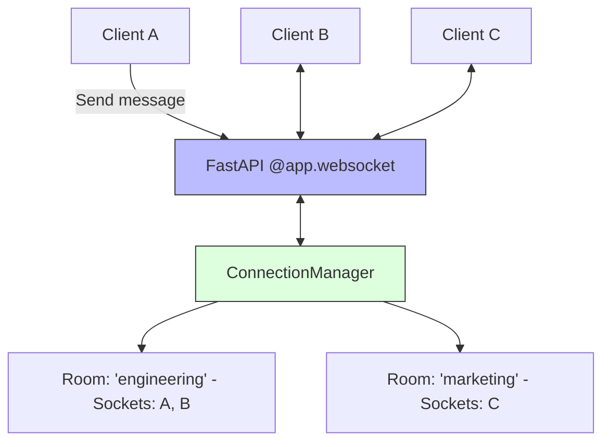

# FastAPI WebSockets & Full-Duplex Realtime

When web applications require bi-directional, low-latency, full-duplex communication—such as real-time collaborative whiteboards, multiplayer gaming, financial trading terminals, or instant messaging—**WebSockets** provide persistent TCP connections that bypass HTTP request-response overhead. FastAPI delivers first-class WebSocket support via `@app.websocket`, integrating seamlessly with asyncio and dependency injection.

---

## Conceptual Foundation & Mental Model

### The WebSocket Protocol Lifecycle
1. **HTTP Handshake Upgrade**:
   The client initiates a standard HTTP GET request with upgrade headers:
   `Connection: Upgrade\nUpgrade: websocket\nSec-WebSocket-Key: ...`.
2. **Accepting Connection**:
   FastAPI receives the request. The server calls `await websocket.accept()`, sending HTTP 101 Switching Protocols.
3. **Full-Duplex Data Framing**:
   Both client and server can send and receive binary or UTF-8 text frames at any time with minimal frame overhead (2 to 10 bytes).
4. **Disconnection**:
   Either party sends a close frame (e.g. Code 1000 Normal Closure, Code 1008 Policy Violation). FastAPI catches this via `WebSocketDisconnect`.

```
Client (Browser)                                    FastAPI Server
       │                                                    │
       │─── 1. GET /ws/chat (Upgrade: websocket) ──────────►│
       │                                                    │
       │◄── 2. HTTP 101 Switching Protocols ────────────────│ (await websocket.accept())
       │                                                    │
       │════════════════ Persistent WebSocket ══════════════│
       │                                                    │
       │─── 3. send_text("Hello from client") ─────────────►│
       │◄── 4. send_json({"user": "Bob", "msg": "Hi"}) ─────│
       │                                                    │
       │─── 5. Client Closes Connection ───────────────────►│
       │                                                    │ (raises WebSocketDisconnect)
```

---

## Architecture & Internal Mechanics

### Managing Active Sockets: The ConnectionManager Pattern
Because a single FastAPI pod may maintain thousands of concurrent persistent connections, connections are tracked in an in-memory `ConnectionManager`.
When broadcasting to a "Room" or "Channel":
- Connections register on connect (`manager.connect(websocket, room_id)`).
- Messages sent by one user are iterated across active sockets in that room.
- Disconnected sockets are pruned cleanly (`manager.disconnect(websocket, room_id)`).



---

## Comprehensive Syntax & Core Mechanics

```python
from fastapi import FastAPI, WebSocket, WebSocketDisconnect

app = FastAPI()

@app.websocket("/ws/echo")
async def websocket_echo(websocket: WebSocket):
    # 1. Accept the connection
    await websocket.accept()
    try:
        while True:
            # 2. Receive text or JSON
            data = await websocket.receive_text()
            # 3. Send response
            await websocket.send_text(f"Echo: {data}")
    except WebSocketDisconnect:
        # 4. Handle client disconnect gracefully
        print("Client disconnected normally.")
```

### WebSocket Handshake Authentication
Standard browser `WebSocket` APIs do **not** permit custom headers (like `Authorization: Bearer <token>`). Therefore, authentication must be passed via:
- **Query Parameters**: `ws://host/ws?token=jwt_here`
- **Cookies**: Browsers automatically send cookies during the handshake if on the same domain.
- **First Message Auth**: Accept connection, wait for an initial auth payload within 3 seconds, or close with code 4401.

---

## Practical Implementation (5 Complete Examples)

### Example 1: Multi-Room Chat Room `ConnectionManager`
```python
from fastapi import FastAPI, WebSocket, WebSocketDisconnect
from collections import defaultdict

app = FastAPI(title="Real-Time Chat Engine")

class ConnectionManager:
    def __init__(self):
        # Maps room_id -> set of active WebSockets
        self.rooms: dict[str, set[WebSocket]] = defaultdict(set)

    async def connect(self, websocket: WebSocket, room_id: str):
        await websocket.accept()
        self.rooms[room_id].add(websocket)

    def disconnect(self, websocket: WebSocket, room_id: str):
        self.rooms[room_id].discard(websocket)
        if not self.rooms[room_id]:
            del self.rooms[room_id]

    async def broadcast_to_room(self, message: str, room_id: str, sender: WebSocket):
        for connection in list(self.rooms.get(room_id, [])):
            if connection != sender:
                try:
                    await connection.send_text(message)
                except Exception:
                    self.disconnect(connection, room_id)

manager = ConnectionManager()

@app.websocket("/ws/{room_id}/{client_id}")
async def chat_endpoint(websocket: WebSocket, room_id: str, client_id: str):
    await manager.connect(websocket, room_id)
    await manager.broadcast_to_room(f"[SYSTEM] {client_id} joined the room.", room_id, websocket)
    try:
        while True:
            data = await websocket.receive_text()
            await manager.broadcast_to_room(f"{client_id}: {data}", room_id, websocket)
    except WebSocketDisconnect:
        manager.disconnect(websocket, room_id)
        await manager.broadcast_to_room(f"[SYSTEM] {client_id} left the room.", room_id, websocket)
```

### Example 2: Query-Parameter Token Authentication Guard
```python
from typing import Annotated
from fastapi import FastAPI, WebSocket, Query, status

app = FastAPI()

def verify_token(token: str) -> str | None:
    # Simulated JWT verification
    if token == "secret-token-123":
        return "user_alice"
    return None

@app.websocket("/ws/secure-feed")
async def secure_feed(
    websocket: WebSocket,
    token: Annotated[str | None, Query()] = None
):
    user = verify_token(token) if token else None
    if not user:
        # Reject connection with standard WebSocket policy violation code
        await websocket.close(code=status.WS_1008_POLICY_VIOLATION)
        return

    await websocket.accept()
    await websocket.send_text(f"Welcome to secure feed, {user}!")
    try:
        while True:
            msg = await websocket.receive_text()
            await websocket.send_text(f"Processed: {msg}")
    except WebSocketDisconnect:
        pass
```

### Example 3: Streaming JSON Messages with Pydantic Validation
```python
from fastapi import FastAPI, WebSocket, WebSocketDisconnect
from pydantic import BaseModel, ValidationError

app = FastAPI()

class TelemetryEvent(BaseModel):
    device_id: str
    temperature: float
    humidity: float

@app.websocket("/ws/telemetry")
async def telemetry_socket(websocket: WebSocket):
    await websocket.accept()
    try:
        while True:
            # 1. Receive JSON dictionary
            raw_data = await websocket.receive_json()
            
            # 2. Validate with Pydantic model
            try:
                event = TelemetryEvent.model_validate(raw_data)
                # 3. Send structured response
                await websocket.send_json({
                    "status": "ack",
                    "device": event.device_id,
                    "avg": (event.temperature + event.humidity) / 2
                })
            except ValidationError as err:
                await websocket.send_json({"status": "error", "errors": err.errors()})

    except WebSocketDisconnect:
        print("Telemetry device disconnected.")
```

### Example 4: Testing WebSockets with `TestClient`
```python
from fastapi import FastAPI, WebSocket
from fastapi.testclient import TestClient

app = FastAPI()

@app.websocket("/ws/pingpong")
async def pingpong(ws: WebSocket):
    await ws.accept()
    while True:
        text = await ws.receive_text()
        if text == "PING":
            await ws.send_text("PONG")
        else:
            await ws.send_text(f"UNKNOWN: {text}")

def test_websocket_pingpong():
    client = TestClient(app)
    # Open WebSocket context manager
    with client.websocket_connect("/ws/pingpong") as websocket:
        websocket.send_text("PING")
        data = websocket.receive_text()
        assert data == "PONG"

        websocket.send_text("HELLO")
        data = websocket.receive_text()
        assert data == "UNKNOWN: HELLO"
```

### Example 5: Horizontal Multi-Pod Scaling with Redis Pub/Sub
```python
# Conceptual architecture for multi-pod WebSocket synchronization
# Pod A receives message from User 1 -> Publishes to Redis channel ->
# Pod B receives Redis event -> Broadcasts to User 2 connected to Pod B!
import asyncio
from fastapi import FastAPI, WebSocket, WebSocketDisconnect

app = FastAPI()

# Simulated Redis PubSub Channel
class RedisMockPubSub:
    def __init__(self):
        self.subscribers = []
    async def publish(self, channel: str, message: str):
        for sub in self.subscribers:
            await sub.put(message)
    def subscribe(self) -> asyncio.Queue:
        q = asyncio.Queue()
        self.subscribers.append(q)
        return q

redis_bus = RedisMockPubSub()

@app.websocket("/ws/cluster-chat")
async def cluster_chat(websocket: WebSocket):
    await websocket.accept()
    queue = redis_bus.subscribe()

    async def listen_from_redis():
        try:
            while True:
                msg = await queue.get()
                await websocket.send_text(f"[REDIS]: {msg}")
        except Exception:
            pass

    async def listen_from_client():
        try:
            while True:
                client_msg = await websocket.receive_text()
                await redis_bus.publish("global_chat", client_msg)
        except WebSocketDisconnect:
            pass

    # Run client listener and Redis listener concurrently!
    consumer_task = asyncio.create_task(listen_from_redis())
    producer_task = asyncio.create_task(listen_from_client())
    
    done, pending = await asyncio.wait(
        [consumer_task, producer_task],
        return_when=asyncio.FIRST_COMPLETED
    )
    for task in pending:
        task.cancel()
```

---

## Anti-Patterns & Common Traps

| Anti-Pattern | Operational Hazard | Production Solution |
| :--- | :--- | :--- |
| **Sending messages to dead sockets without `try...except`** | Crashes the broadcasting loop for all other connected users. | Wrap `send_text()` in `try...except` and prune failed sockets from the manager. |
| **Using `BaseHTTPMiddleware` to intercept WebSockets** | WebSockets bypass `BaseHTTPMiddleware` completely; middleware never runs. | Use Pure ASGI Middleware (`scope["type"] == "websocket"`). |
| **Storing all active sockets in memory on multi-pod clusters** | Users on Pod 1 cannot see messages sent by users on Pod 2. | Connect all pods via a shared Redis / NATS Pub/Sub backbone. |
| **Calling `send_text()` before `await websocket.accept()`** | Raises `RuntimeError: WebSocket is not connected`. | Always call `await websocket.accept()` before sending data. |

---

## Performance & Resource Characteristics

- **Frame Overhead**: Minimal (2 to 10 bytes header per frame) compared to 500+ bytes of HTTP request headers.
- **Concurrency**: A single Uvicorn / FastAPI process on modern Linux handles 10,000+ idle WebSocket connections using under 100MB of RAM.

---

## Edge Cases, Failure Modes & Gotchas

1. **Close Codes**: Always use RFC 6455 close codes:
   - `1000`: Normal closure.
   - `1001`: Going away (server restarting).
   - `1008`: Policy violation (auth failure).
2. **Ping / Pong Heartbeats**: Uvicorn automatically handles WebSocket ping/pong control frames at the ASGI layer to detect dropped TCP connections.

---

## Security Implications & OWASP Alignment

- **Cross-Site WebSocket Hijacking (CSWSH)**: Browsers send cookies during the handshake. If an attacker's site opens `new WebSocket("wss://your-api.com/ws")`, the browser attaches authentication cookies. **Mitigation**: Strictly validate the `Origin` header during handshake!
- **Denial of Service via Huge Frames**: Enforce max message size limits (`max_size`) in Uvicorn / Starlette to prevent memory exhaustion attacks.

---

## Modern Tooling Integration

- **Uvicorn**: High-performance WebSocket support powered by `websockets` or `wsproto`.
- **FastAPI TestClient**: Provides native `client.websocket_connect("/path")` context manager.

---

## Real-World Case Study / Production Incident

A collaborative document editing startup scaled their FastAPI backend from 1 to 5 Kubernetes pods. Users immediately reported that document updates were intermittent: sometimes collaborators saw changes, and sometimes they didn't.

**Investigation**:
Each pod maintained an isolated in-memory `ConnectionManager`. When User A (on Pod 1) edited a paragraph, Pod 1 broadcasted only to sockets connected to Pod 1. Collaborator B (on Pod 2) never received the update.

**Remediation**:
Integrated Redis Pub/Sub:
1. When any pod receives an update, it publishes the diff to `redis.publish(doc_id, update)`.
2. All 5 pods listen to Redis and broadcast updates to their locally connected sockets.
Cross-pod synchronization was restored with sub-5ms latency.

---

## Hands-On Exercises & Challenge Problems

### Warmup (2 Exercises)
1. Write an echo WebSocket endpoint at `/ws/echo` that returns uppercase versions of client strings.
2. Write a test using `TestClient.websocket_connect()` verifying that sending `"hello"` receives `"HELLO"`.

### Intermediate (2 Exercises)
3. Implement a chat room `ConnectionManager` that supports joining and leaving named rooms, with automated disconnect cleanup.
4. Implement handshake origin validation that checks the `Origin` header and rejects unauthorized domains with close code 1008.

### Production-Grade (2 Exercises)
5. Build a multi-pod WebSocket synchronization architecture using `redis.asyncio` Pub/Sub, with automated reconnection to Redis on connection drops.
6. Design and implement a heartbeat ping-pong watchdog inside a WebSocket endpoint that automatically terminates connections if the client fails to send a heartbeat ping within 30 seconds.

---

## Interview Mastery (8 Q&As)

### Junior Level
**Q1: How do you declare a WebSocket route in FastAPI?**
*Answer:* Using the `@app.websocket("/path")` decorator, declaring the handler with `async def my_endpoint(websocket: WebSocket)`.

**Q2: What is the first method that must be awaited on a `WebSocket` instance?**
*Answer:* `await websocket.accept()`, which completes the handshake and sends HTTP 101 Switching Protocols to the client.

**Q3: Which exception is raised when a WebSocket client disconnects?**
*Answer:* `starlette.websockets.WebSocketDisconnect`.

### Senior Level
**Q4: Why can't frontend browsers send custom headers (like `Authorization: Bearer ...`) in standard `WebSocket` handshakes?**
*Answer:* The browser standard W3C `WebSocket` constructor (`new WebSocket(url)`) does not support setting custom HTTP headers. Authentication must be passed via query parameters, cookies, or an initial authentication message after connecting.

**Q5: What is Cross-Site WebSocket Hijacking (CSWSH) and how do you prevent it?**
*Answer:* CSWSH occurs when a malicious website uses JavaScript to initiate a WebSocket connection to your API. The browser automatically includes the user's cookies, authenticating the connection. Prevent it by validating that the `Origin` header matches your allowed frontend domains before calling `await websocket.accept()`.

**Q6: What happens if an exception is raised inside a WebSocket endpoint after `websocket.accept()`?**
*Answer:* The ASGI server catches the unhandled exception, logs a traceback, and abruptly terminates the WebSocket connection with close code 1011 (Internal Error).

### Staff / Architect Level
**Q7: How do you scale WebSockets horizontally across multiple auto-scaling Kubernetes pods?**
*Answer:*
1. **Decouple Message Routing**: Sockets stay connected to specific pods, but messages are published to a central distributed broker (Redis Pub/Sub, Kafka, NATS, or RabbitMQ).
2. **Fan-Out**: Each pod subscribes to the broker topics corresponding to its locally connected clients.
3. **Ingress Configuration**: Configure Kubernetes Ingress (Nginx/Traefik) with appropriate timeout settings (e.g. `proxy_read_timeout 3600s`) so idle connections aren't dropped prematurely.

**Q8: Why does `BaseHTTPMiddleware` fail to intercept WebSockets, and what must be used instead?**
*Answer:* `BaseHTTPMiddleware` checks `if scope["type"] != "http": return await self.app(...)`, intentionally ignoring non-HTTP scopes. To intercept, inspect, or authenticate WebSockets at the middleware layer, you must use **Pure ASGI Middleware** (`scope["type"] == "websocket"`).
