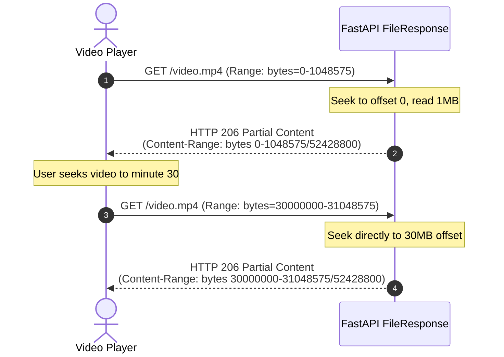

# FastAPI File Responses & Static Files

Serving files—such as dynamic PDF reports, user avatars, video media assets, or single-page frontend applications (SPAs)—requires more than dumping raw bytes into HTTP responses. FastAPI provides `FileResponse` for targeted file downloads and `StaticFiles` for mounting static directories, complete with native support for **HTTP Range Requests** (resumable downloads, video seeking) and **Conditional Caching** (`ETag`, `Last-Modified`).

---

## Conceptual Foundation & Mental Model

### 1. `FileResponse` (Targeted Single-File Delivery)
- Used inside route handlers: `return FileResponse(path, filename="report.pdf")`.
- Automatically calculates `Content-Length`, deduces `Content-Type` via the Python `mimetypes` library, and sets `Content-Disposition`.
- Supports HTTP Range headers (`bytes=0-1048575`), enabling browsers to stream videos smoothly and scrub forward without downloading the entire file.

### 2. `StaticFiles` (Mounted Directory Trees)
- Used via `app.mount("/static", StaticFiles(directory="dist"))`.
- Serves an entire directory of HTML, CSS, JavaScript, and images.
- Automatically handles directory index files (`index.html`), `304 Not Modified` cache validation, and 404 handling.

```
Incoming Request: GET /media/tutorial.mp4 (Range: bytes=0-1000000)
                              │
                              ▼
┌────────────────────────────────────────────────────────┐
│ FileResponse("media/tutorial.mp4")                      │
│ 1. Parses HTTP Range header                            │
│ 2. Reads exact 1MB byte slice from disk                │
│ 3. Sets Content-Range: bytes 0-1000000/50000000        │
└──────────────────────────┬─────────────────────────────┘
                           │
                           ▼
            HTTP 206 Partial Content (1 MB transmitted)
            (Browser video player buffers slice instantly!)
```

---

## Architecture & Internal Mechanics

### How Starlette Handles Range Requests & Conditional Caching
1. **Conditional Caching (`ETag` / `If-None-Match`)**:
   - `FileResponse` computes an `ETag` based on the file's size and last modified timestamp (`mtime`).
   - If the client sends `If-None-Match: "etag_val"`, Starlette returns **`HTTP 304 Not Modified` with zero body bytes**, saving bandwidth.
2. **HTTP Range Requests (RFC 7233)**:
   - When a client sends `Range: bytes=500-999`, Starlette seeks directly to offset 500 on disk.
   - It reads exactly 500 bytes and returns `HTTP 206 Partial Content`.
   - Headers sent: `Accept-Ranges: bytes`, `Content-Range: bytes 500-999/100000`.



---

## Comprehensive Syntax & Core Mechanics

### 1. `FileResponse`
```python
from fastapi import FastAPI
from fastapi.responses import FileResponse

app = FastAPI()

@app.get("/download/report")
async def download_report():
    return FileResponse(
        path="generated/financial_q1.pdf",
        media_type="application/pdf",
        filename="Q1_Financial_Report.pdf", # Sets Content-Disposition: attachment
        content_disposition_type="attachment" # "attachment" forces download; "inline" displays in browser
    )
```

### 2. Mounting `StaticFiles`
```python
from fastapi import FastAPI
from fastapi.staticfiles import StaticFiles

app = FastAPI()

app.mount(
    "/assets",
    StaticFiles(directory="static_assets", html=True),
    name="assets"
)
```

---

## Practical Implementation (5 Complete Examples)

### Example 1: Dynamic PDF Report Generator and Downloader
```python
import os
from fastapi import FastAPI, HTTPException
from fastapi.responses import FileResponse

app = FastAPI(title="Reporting Engine")

REPORTS_DIR = "storage/reports"
os.makedirs(REPORTS_DIR, exist_ok=True)

# Create a sample PDF file
sample_pdf_path = os.path.join(REPORTS_DIR, "report_101.pdf")
with open(sample_pdf_path, "wb") as f:
    f.write(b"%PDF-1.4 sample pdf content bytes...")

@app.get("/reports/{report_id}")
async def get_report_file(report_id: int):
    file_path = os.path.join(REPORTS_DIR, f"report_{report_id}.pdf")
    
    if not os.path.isfile(file_path):
        raise HTTPException(status_code=404, detail="Report file not found")

    return FileResponse(
        path=file_path,
        media_type="application/pdf",
        filename=f"Audit_Report_{report_id}.pdf",
        content_disposition_type="inline"  # Opens in browser viewer
    )
```

### Example 2: Hardened Secure Path Resolver (Preventing Directory Traversal)
```python
import os
from pathlib import Path
from fastapi import FastAPI, HTTPException, status
from fastapi.responses import FileResponse

app = FastAPI()

UPLOAD_SANDBOX_DIR = Path("safe_storage").resolve()
UPLOAD_SANDBOX_DIR.mkdir(exist_ok=True)

# Create a sample public file
(UPLOAD_SANDBOX_DIR / "readme.txt").write_text("Hello from safe storage!")

def resolve_safe_path(untrusted_filename: str) -> Path:
    # Resolve target canonical path
    target_path = (UPLOAD_SANDBOX_DIR / untrusted_filename).resolve()
    
    # 🛡️ SECURITY CHECK: Assert target is inside the sandbox!
    if not target_path.is_relative_to(UPLOAD_SANDBOX_DIR):
        raise HTTPException(
            status_code=status.HTTP_403_FORBIDDEN,
            detail="Access denied: Directory traversal detected."
        )
    
    if not target_path.is_file():
        raise HTTPException(status_code=status.HTTP_404_NOT_FOUND, detail="File not found")
        
    return target_path

@app.get("/files/{filename:path}")
async def serve_user_file(filename: str):
    safe_file = resolve_safe_path(filename)
    return FileResponse(safe_file)
```

### Example 3: Video Streaming with HTTP Range Requests
```python
import os
from fastapi import FastAPI
from fastapi.responses import FileResponse

app = FastAPI()

VIDEO_PATH = "media/demo_video.mp4"
os.makedirs("media", exist_ok=True)
if not os.path.exists(VIDEO_PATH):
    # Create 2MB dummy video file
    with open(VIDEO_PATH, "wb") as f:
        f.write(b"\x00" * (2 * 1024 * 1024))

@app.get("/video/watch")
async def watch_video():
    # FileResponse automatically handles HTTP 206 Range requests!
    return FileResponse(
        VIDEO_PATH,
        media_type="video/mp4"
    )
```

### Example 4: Single-Page Application (SPA) Fallback Server
```python
import os
from fastapi import FastAPI
from fastapi.staticfiles import StaticFiles
from fastapi.responses import FileResponse

app = FastAPI()

SPA_DIR = "frontend_dist"
os.makedirs(SPA_DIR, exist_ok=True)
with open(f"{SPA_DIR}/index.html", "w") as f:
    f.write("<html><body><h1>Single Page App Root</h1></body></html>")

# 1. Mount static assets (CSS, JS, images)
app.mount("/static", StaticFiles(directory=SPA_DIR), name="static")

# 2. Catch-all HTML fallback for client-side HTML5 pushState routers (React, Vue)
@app.get("/{full_path:path}")
async def spa_catch_all(full_path: str):
    file_path = os.path.join(SPA_DIR, full_path)
    if os.path.isfile(file_path):
        return FileResponse(file_path)
    # Fallback to index.html for client-side routes like /dashboard/settings
    return FileResponse(os.path.join(SPA_DIR, "index.html"))
```

### Example 5: Testing `FileResponse` Range Requests with `TestClient`
```python
from fastapi import FastAPI
from fastapi.responses import FileResponse
from fastapi.testclient import TestClient
import os

app = FastAPI()

TEST_FILE = "test_bytes.txt"
with open(TEST_FILE, "wb") as f:
    f.write(b"0123456789ABCDEF")  # 16 bytes

@app.get("/test-file")
def get_test_file():
    return FileResponse(TEST_FILE, media_type="text/plain")

def test_http_range_request():
    client = TestClient(app)
    # Request bytes 0 through 4 (first 5 bytes)
    headers = {"Range": "bytes=0-4"}
    response = client.get("/test-file", headers=headers)
    
    assert response.status_code == 206  # Partial Content
    assert response.content == b"01234"
    assert response.headers["content-range"] == "bytes 0-4/16"
    assert response.headers["accept-ranges"] == "bytes"

    # Cleanup
    if os.path.exists(TEST_FILE):
        os.remove(TEST_FILE)
```

---

## Anti-Patterns & Common Traps

| Anti-Pattern | Security / Operational Hazard | Production Solution |
| :--- | :--- | :--- |
| **Concatenating user input directly into paths** (`open(f"files/{filename}")`) | **Path Traversal Vulnerability**: Attackers send `../../etc/passwd` to read server secrets. | Use `Path(untrusted).resolve()` and assert `.is_relative_to(SANDBOX)`. |
| **Reading whole file into memory before returning** (`Response(content=f.read())`) | High memory usage; crashes server on 100MB+ files; disables video seeking. | Always use `FileResponse` or `StreamingResponse`. |
| **Mounting `StaticFiles` at `/` before defining API routes** | `StaticFiles` acts as a catch-all route, shadowing all subsequently declared API endpoints. | Mount `StaticFiles` *after* registering all API routes. |
| **Missing `media_type` on uncommon binary files** | Browser defaults to `text/plain`, potentially executing untrusted files or rendering garbage text. | Explicitly pass `media_type` or rely on standard file extensions. |

---

## Performance & Resource Characteristics

- **Zero-Copy File Streaming**: Starlette uses asynchronous thread-pooled file reads or `os.sendfile` (on supported OS platforms) to stream file descriptors directly to sockets without Python-layer memory copying.
- **Cache Efficiency**: Native `ETag` and `Last-Modified` support eliminates 95% of bandwidth on repeat asset views via `304 Not Modified`.

---

## Edge Cases, Failure Modes & Gotchas

1. **Deleted Files**: If a file is deleted from disk after `FileResponse` is initialized but before the stream completes, Starlette raises a `FileNotFoundError` resulting in an abrupt connection closure.
2. **Symlink Traversal**: If an attacker uploads a symbolic link pointing to `/etc/passwd`, resolving the path via `Path.resolve()` follows the symlink outside the directory. Disable symlink creation or check `os.path.islink()`.

---

## Security Implications & OWASP Alignment

- **OWASP API7:2023 - Server-Side Request Forgery & Directory Traversal**: Never trust client-supplied filenames. Always canonicalize paths and verify they reside within the designated sandbox.
- **MIME Sniffing Prevention**: Ensure static files return `X-Content-Type-Options: nosniff` so browsers do not execute HTML/JS hidden inside uploaded image files.

---

## Modern Tooling Integration

- **Nginx / Caddy**: In production, consider offloading static asset serving to Nginx (`try_files $uri @fastapi`) while using FastAPI purely for dynamic API routes.
- **AWS S3 / Cloudflare R2**: For user-uploaded media, generate presigned S3 URLs rather than routing multi-gigabyte files through your FastAPI application containers.

---

## Real-World Case Study / Production Incident

An educational learning platform allowed instructors to upload slide decks. The download endpoint was implemented as:
```python
@app.get("/download")
def download(file: str):
    return FileResponse(f"uploads/{file}")
```
A security researcher submitted:
`GET /download?file=../../../../etc/shadow`
The application resolved the path, bypassed the `uploads/` folder, and served the operating system shadow password file, exposing server credentials.

**Remediation**:
1. Replaced raw string concatenation with `pathlib.Path.resolve()` boundary validation:
   ```python
   target = (BASE_DIR / file).resolve()
   if not target.is_relative_to(BASE_DIR):
       raise HTTPException(status_code=403, detail="Forbidden")
   ```
2. Migrated uploaded assets to an isolated Amazon S3 bucket with random UUID filenames.

---

## Hands-On Exercises & Challenge Problems

### Warmup (2 Exercises)
1. Write a route returning a `FileResponse` for a text file with `Content-Disposition: attachment`.
2. Verify with `TestClient` that requesting the file returns the expected byte content and headers.

### Intermediate (2 Exercises)
3. Write a test asserting that requesting bytes `5-10` of a file via HTTP `Range` returns HTTP 206 with exactly 6 bytes.
4. Implement a secure path resolution dependency that checks against directory traversal and returns a 403 error when `../` is detected.

### Production-Grade (2 Exercises)
5. Build a complete Single-Page Application (SPA) static server that serves a Vue/React build directory with `304 Not Modified` caching, serving `index.html` on unmatched client routes.
6. Design and implement an authenticated video streaming service with `FileResponse` that validates a temporary signed token before permitting byte-range video streaming.

---

## Interview Mastery (8 Q&As)

### Junior Level
**Q1: What is `FileResponse` in FastAPI?**
*Answer:* A specialized Starlette response class that streams a file directly from the local filesystem to the client, automatically determining content type, content length, and handling caching headers.

**Q2: How do you mount a directory of static assets in FastAPI?**
*Answer:* Using `app.mount("/prefix", StaticFiles(directory="folder_name"))`.

**Q3: What HTTP status code is returned for a successful byte-range request?**
*Answer:* `HTTP 206 Partial Content`.

### Senior Level
**Q4: How does `FileResponse` handle HTTP Range requests for video streaming?**
*Answer:* It inspects the `Range` request header (e.g. `bytes=0-1000`), seeks to that offset on disk, reads the specified number of bytes, and returns them with status 206 and headers `Content-Range` and `Accept-Ranges: bytes`.

**Q5: What is a Directory Traversal attack and how do you prevent it when serving files?**
*Answer:* An attack where a user supplies `../` in a filename parameter to access files outside the intended directory. Prevent it by converting paths to absolute canonical paths with `Path.resolve()` and asserting that `resolved_path.is_relative_to(allowed_directory)`.

**Q6: What is the difference between `content_disposition_type="inline"` and `"attachment"`?**
*Answer:* `"inline"` instructs the browser to render the file directly inside the browser window (e.g. viewing a PDF or image), while `"attachment"` prompts the user to download and save the file to their local disk.

### Staff / Architect Level
**Q7: In high-scale production systems, why is serving static assets directly through FastAPI considered an anti-pattern?**
*Answer:* Python ASGI worker processes are optimized for dynamic API business logic. Serving static assets (CSS, JS, images, videos) through Python consumes event loop capacity, worker threads, and memory bandwidth. In production, static assets should be served directly by edge CDNs (Cloudflare), reverse proxies (Nginx), or object storage (AWS S3) to achieve maximum caching and zero compute load on backend application pods.

**Q8: How does conditional caching with `ETag` work in `FileResponse`?**
*Answer:* `FileResponse` generates an `ETag` hash based on file size and last-modified timestamp. When a browser visits the URL again, it sends `If-None-Match: <etag>`. If the file on disk has not changed, Starlette short-circuits and returns `HTTP 304 Not Modified` with an empty body, saving bandwidth and rendering the cached client copy instantly.
