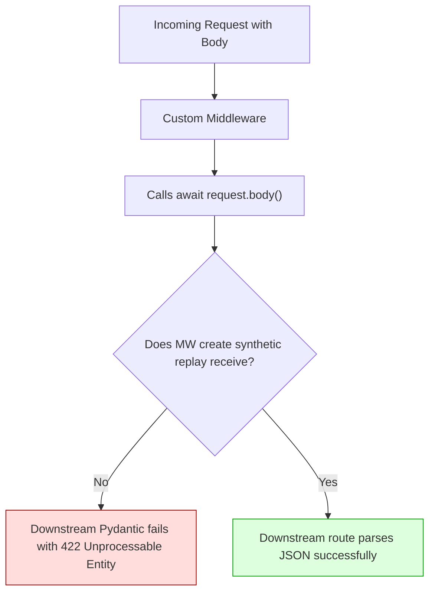

# Common FastAPI Middleware Mistakes & Pitfalls

Middleware sits at the critical boundary of every HTTP transaction. Because it executes on every incoming request and outgoing response, a single bug in middleware can freeze the entire application, consume gigabytes of memory, leak security contexts between users, or silently drop request bodies.

---

## Conceptual Foundation & Mental Model

The most devastating middleware bugs fall into five architectural categories:
1. **The Consumed Stream Trap**: Reading `await request.body()` in a middleware without re-streaming it, causing downstream route handlers and Pydantic models to encounter an empty body.
2. **The Inverted Registration Order Bug**: Adding `CORSMiddleware` before internal middlewares, causing error responses (like 500s) to omit CORS headers and trigger false "CORS errors" in client browsers.
3. **The Event Loop Freezing Bug**: Executing synchronous, blocking I/O (like `time.sleep()`, synchronous `requests.get()`, or blocking database queries) inside an `async def dispatch()` function.
4. **The Response Buffering Trap**: Using `BaseHTTPMiddleware` on Server-Sent Events (SSE) or streaming endpoints, inadvertently buffering chunks in memory and destroying real-time delivery.
5. **The Leaked Context Bug**: Modifying a `contextvars.ContextVar` without resetting the token in a `finally` block, causing state to leak across pooled AnyIO threads.

```
Request Timeline & The Consumed Stream Disaster:
0ms   ──► Request arrives with body: {"user": "Alice"}
5ms   ──► Middleware executes: body = await request.body() (STREAM CONSUMED!)
10ms  ──► Route handler executes with Pydantic model
11ms  ──► Pydantic reads request body ──► EMPTY STREAM (b"")
12ms  ──► CRASH: HTTP 422 Unprocessable Entity ("field required")!
```

---

## Architecture & Internal Mechanics

Understanding how ASGI request and response streams operate highlights why these bugs happen:
- **`request.body()` is a Generator Stream**: ASGI streams chunks from the socket over `receive()`. Once read, the socket cannot be rewound unless the middleware explicitly stores the bytes in memory and provides a synthetic `receive` function that replays them.
- **LIFO Execution on Inbound**: Middlewares execute in reverse order of addition. The last `app.add_middleware()` wraps all previous ones.
- **Worker Thread Re-use**: In asynchronous servers, worker threads in AnyIO threadpools are pooled. Storing data in thread-local storage or failing to reset `contextvars` pollutes subsequent requests handled by the same worker thread.



---

## Comprehensive Syntax & Core Mechanics

The table below catalogs the top 5 middleware traps and their production remediations:

| Pitfall | Root Cause | Observable Symptom | Production Remediation |
| :--- | :--- | :--- | :--- |
| **Stream Consumption** | Calling `await request.body()` in middleware | Endpoints fail with 422 or empty payload | Wrap in pure ASGI replay receiver or use `request.state`. |
| **CORS Order Bug** | `CORSMiddleware` added *before* failing middlewares | Browser console reports generic "CORS Error" on 500s | Add `CORSMiddleware` **last** so it wraps everything. |
| **Event Loop Blocking** | Synchronous blocking calls in `async def dispatch` | Global throughput drops to 1 req/s; server freezes | Use non-blocking async calls (`httpx`) or `to_thread`. |
| **Streaming Buffering** | `BaseHTTPMiddleware` on SSE / chunked streams | Chunks buffered in RAM; real-time streaming broken | Use **Pure ASGI Middleware** for streaming routes. |
| **ContextVar Bleeding** | Setting `ContextVar` without `.reset(token)` | Request B sees user ID or tenant of Request A | Always use `try ... finally: var.reset(token)`. |

---

## Practical Implementation (5 Complete Bug & Fix Examples)

### Example 1: The Consumed Body Trap (Bug & Safe Re-Streaming Fix)
```python
from fastapi import FastAPI, Request
from pydantic import BaseModel

app = FastAPI()

class UserPayload(BaseModel):
    username: str

# ❌ BUG: Consumes stream; downstream Pydantic sees empty body!
# @app.middleware("http")
# async def bad_body_logger(request: Request, call_next):
#     body = await request.body()  # Consumes the stream!
#     print(f"Body: {body}")
#     return await call_next(request)

# ✅ FIX: Use Pure ASGI Middleware to buffer and re-inject receive callable!
class SafeBodyLoggerASGIMiddleware:
    def __init__(self, app):
        self.app = app

    async def __call__(self, scope, receive, send):
        if scope["type"] != "http" or scope["method"] not in ("POST", "PUT", "PATCH"):
            await self.app(scope, receive, send)
            return

        # Read and buffer original body chunks
        chunks = []
        more_body = True
        while more_body:
            message = await receive()
            chunks.append(message.get("body", b""))
            more_body = message.get("more_body", False)

        full_body = b"".join(chunks)
        print(f"[AUDIT LOG] Payload: {full_body.decode('utf-8', errors='ignore')}")

        # Synthetic replay receiver
        sent = False
        async def replay_receive():
            nonlocal sent
            if not sent:
                sent = True
                return {"type": "http.request", "body": full_body, "more_body": False}
            return {"type": "http.request", "body": b"", "more_body": False}

        await self.app(scope, replay_receive, send)

app.add_middleware(SafeBodyLoggerASGIMiddleware)

@app.post("/users")
async def create_user(payload: UserPayload):
    # Pydantic successfully reads the replayed stream!
    return {"created": payload.username}
```

### Example 2: The Inverted Registration Order Bug
```python
from fastapi import FastAPI
from starlette.middleware.cors import CORSMiddleware
from starlette.middleware.base import BaseHTTPMiddleware
from starlette.responses import JSONResponse

app = FastAPI()

class CustomErrorMiddleware(BaseHTTPMiddleware):
    async def dispatch(self, request, call_next):
        if request.url.path == "/crash":
            # Returns an error directly from middleware
            return JSONResponse(status_code=500, content={"error": "Database down"})
        return await call_next(request)

# ❌ BUGGY ORDER: CORSMiddleware registered first, CustomErrorMiddleware registered second.
# Because of LIFO, CustomErrorMiddleware runs FIRST on inbound, intercepts /crash,
# and returns 500 BEFORE CORSMiddleware can attach CORS headers!
# Browser throws: "Access to fetch at ... blocked by CORS policy"!

# ✅ CORRECT ORDER:
# 1. Register internal logic FIRST (runs inner)
app.add_middleware(CustomErrorMiddleware)

# 2. Register CORSMiddleware LAST (runs outer, wrapping everything!)
app.add_middleware(
    CORSMiddleware,
    allow_origins=["https://myfrontend.com"],
    allow_credentials=True,
    allow_methods=["*"],
    allow_headers=["*"],
)
```

### Example 3: Blocking Synchronous Code in Async Middleware
```python
import time
import requests  # Blocking library!
from fastapi import FastAPI, Request
import anyio

app = FastAPI()

# ❌ BUG: Blocks the entire asyncio event loop!
# @app.middleware("http")
# async def bad_blocking_middleware(request: Request, call_next):
#     time.sleep(0.5)  # FREEZES SERVER FOR ALL CONCURRENT USERS!
#     return await call_next(request)

# ✅ FIX A: Use non-blocking async equivalents (httpx, asyncio.sleep)
import httpx
import asyncio

@app.middleware("http")
async def good_async_middleware(request: Request, call_next):
    await asyncio.sleep(0.001)  # Non-blocking cooperative yield
    return await call_next(request)

# ✅ FIX B: If blocking library is unavoidable, offload to worker threadpool!
def synchronous_legacy_check():
    time.sleep(0.05)

@app.middleware("http")
async def safe_offload_middleware(request: Request, call_next):
    # Offload blocking work to threadpool!
    await anyio.to_thread.run_sync(synchronous_legacy_check)
    return await call_next(request)
```

### Example 4: ContextVar Leak Across Requests
```python
import contextvars
from fastapi import FastAPI, Request

user_ctx: contextvars.ContextVar[str] = contextvars.ContextVar("user", default="anonymous")

app = FastAPI()

# ❌ BUG: Forgetting .reset(token) leaves state in reused worker threads!
# @app.middleware("http")
# async def leaky_middleware(request: Request, call_next):
#     user = request.headers.get("X-User", "anonymous")
#     user_ctx.set(user)  # Token discarded! If user header is missing next time, stale user persists!
#     return await call_next(request)

# ✅ FIX: Always store token and call .reset() in a finally block!
@app.middleware("http")
async def safe_context_middleware(request: Request, call_next):
    user = request.headers.get("X-User", "anonymous")
    token = user_ctx.set(user)
    try:
        return await call_next(request)
    finally:
        user_ctx.reset(token)  # Guaranteed cleanup!

@app.get("/whoami")
def whoami():
    return {"current_user": user_ctx.get()}
```

### Example 5: Corrupting Response Headers by Writing After Send
```python
# In Pure ASGI Middleware:
# ❌ BUG: Modifying headers after send({"type": "http.response.start"}) has already run!
# Once http.response.start is sent, headers are transmitted across the socket;
# attempting to send headers again raises RuntimeError: Response already started.

# ✅ FIX: Intercept http.response.start and mutate the header list BEFORE calling send()!
class SafeHeaderModifierASGIMiddleware:
    def __init__(self, app):
        self.app = app

    async def __call__(self, scope, receive, send):
        if scope["type"] != "http":
            await self.app(scope, receive, send)
            return

        async def send_wrapper(message):
            if message["type"] == "http.response.start":
                # Safely mutate headers BEFORE transmitting
                headers = list(message.get("headers", []))
                headers.append((b"x-safe-header", b"true"))
                message["headers"] = headers

            await send(message)

        await self.app(scope, receive, send_wrapper)
```

---

## Anti-Patterns & Common Traps

| Anti-Pattern | Why It Breaks / Fails | Production Solution |
| :--- | :--- | :--- |
| **Buffering streaming responses in `BaseHTTPMiddleware`** | SSE chunks arrive in delayed bursts; large downloads exhaust RAM. | Use Pure ASGI Middleware for streaming routes. |
| **Catching `Exception` in middleware without re-raising** | Silently swallows errors, preventing FastAPI's `@app.exception_handler` from formatting custom responses. | Always re-raise unhandled exceptions or let them bubble. |
| **Parsing JSON manually in middleware** | Bypasses Pydantic validation, error formatting, and OpenAPI schema generation. | Parse JSON in route handlers using Pydantic models. |
| **Using `request.state` across thread boundaries** | Thread workers can race on mutable state dictionaries. | Store request-scoped state in `contextvars.ContextVar`. |

---

## Performance & Resource Characteristics

- **Event Loop Stall Impact**: A 100ms synchronous call in an async middleware reduces a single Uvicorn worker process from 5,000 req/s to a maximum of 10 req/s.
- **Memory Spikes**: Buffering full request/response bodies in middleware turns a 10MB file upload across 100 concurrent users into 1GB of sudden RAM allocation.

---

## Edge Cases, Failure Modes & Gotchas

1. **Client Disconnect Mid-Stream**: If a client disconnects while a middleware is awaiting `call_next()`, Starlette raises an `asyncio.CancelledError`. Ensure `finally` blocks handle cancellation without suppressing it.
2. **Double Calling `call_next()`**: Calling `await call_next(request)` more than once within a single request causes catastrophic ASGI state corruption. `call_next()` must be awaited **exactly once**.

---

## Security Implications & OWASP Alignment

- **CORS Leakage on Errors**: Placing `CORSMiddleware` in the wrong order causes browsers to drop responses on 500 errors, masking backend crashes from legitimate frontend clients while leaking information.
- **State Pollution Across Sessions (OWASP API2:2023 - Broken Authentication)**: Failing to reset context variables can allow User B's request to inherit User A's authorization context.

---

## Modern Tooling Integration

- **Pytest-Asyncio**: Write concurrent tests with `asyncio.gather` to verify that middlewares do not leak context across tasks.
- **Ruff / Flake8-Async**: Statically detects blocking calls (`time.sleep`) inside coroutines.

---

## Real-World Case Study / Production Incident

A financial dashboard API experienced intermittent 422 errors on their `/transfers` endpoint. Approximately 1% of transactions failed with `field required: recipient_account_id`, even though client logs proved the payload was sent.

**Investigation**:
An engineer had added an audit middleware to inspect request bodies:
```python
body = await request.body()
if b"transfer" in body:
    log_audit_event(body)
```
When requests arrived in multiple TCP packets (`more_body=True`), awaiting `request.body()` consumed the first packet. When downstream Pydantic attempted to parse the body, only trailing fragments remained, resulting in 422 Unprocessable Entity errors.

**Remediation**:
Replaced the body-inspecting middleware with a Pure ASGI replay receiver. Payload corruption was completely eradicated.

---

## Hands-On Exercises & Challenge Problems

### Warmup (2 Exercises)
1. Write a buggy middleware that calls `await request.body()` and demonstrate that a downstream POST endpoint fails with a 422 error.
2. Fix the endpoint using a synthetic replay receiver.

### Intermediate (2 Exercises)
3. Set up two middlewares in the wrong order (CORS first, error-throwing middleware second) and write a test showing that the error response lacks CORS headers; then correct the order.
4. Implement a `ContextVar` middleware with a simulated exception in the route handler, and verify via unit tests that the context variable is still properly reset in the `finally` block.

### Production-Grade (2 Exercises)
5. Build a pure ASGI middleware that safely computes an SHA-256 checksum of incoming request bodies without consuming the stream, passing the unconsumed stream to downstream handlers and attaching the checksum to `scope["state"]["body_hash"]`.
6. Design an automated CI integration test that runs 100 concurrent requests with random headers through your middleware stack, asserting that zero context variable leaks or cross-request corruptions occur.

---

## Interview Mastery (8 Q&As)

### Junior Level
**Q1: What happens if a middleware calls `await request.body()` before calling `call_next(request)`?**
*Answer:* The request byte stream is consumed. Downstream route handlers and Pydantic models will receive an empty body, typically failing with an HTTP 422 Unprocessable Entity error.

**Q2: In what order do middlewares execute in FastAPI?**
*Answer:* In reverse order of registration (LIFO) on the inbound request, and in forward order of registration on the outbound response.

**Q3: Can you call `call_next(request)` twice in a single middleware dispatch?**
*Answer:* No. An HTTP request represents a single transaction. Calling `call_next()` twice will cause ASGI protocol violations and runtime errors.

### Senior Level
**Q4: Why should `CORSMiddleware` always be added last in `app.add_middleware()`?**
*Answer:* Because the last added middleware becomes the outermost layer on inbound requests and the last layer on outbound responses. Placing CORS outermost ensures that even if inner middlewares or route handlers raise exceptions or return error responses, CORS headers are still attached before sending the response to the browser.

**Q5: Why is `time.sleep()` in an async middleware fatal to FastAPI performance?**
*Answer:* `async def dispatch` runs on the main asyncio event loop. Calling synchronous `time.sleep()` blocks the event loop thread, preventing all other concurrent requests for all users from executing.

**Q6: What causes memory buffering issues when using `BaseHTTPMiddleware` with `StreamingResponse`?**
*Answer:* `BaseHTTPMiddleware` wraps response bodies in an internal generator task that consumes chunks into memory, delaying streaming delivery and bloating server RAM on large payloads.

### Staff / Architect Level
**Q7: How do you safely log request bodies across all endpoints without causing memory exhaustion on large file uploads?**
*Answer:*
1. Inspect `Content-Length` and `Content-Type` headers in a Pure ASGI middleware before reading the body.
2. If `Content-Type` is `multipart/form-data` or `Content-Length` exceeds a safe threshold (e.g. 64KB), skip body logging entirely.
3. For small JSON payloads, buffer and replay the stream using an ASGI replay wrapper.
4. Truncate logged payload strings to a maximum character length to prevent logging systems from overflowing.

**Q8: How do you ensure complete thread-safety and context isolation in middlewares when running on Python 3.13 / 3.14 free-threading?**
*Answer:*
1. Avoid mutating shared module-level state, lists, or dictionaries without explicit locks.
2. Rely strictly on `contextvars.ContextVar` for request-scoped context, as ContextVars use immutable copy-on-write data structures that are inherently thread-safe across parallel execution threads.
3. Always store the token returned by `ContextVar.set()` and execute `ContextVar.reset(token)` in a `finally` block to prevent task leakage.
