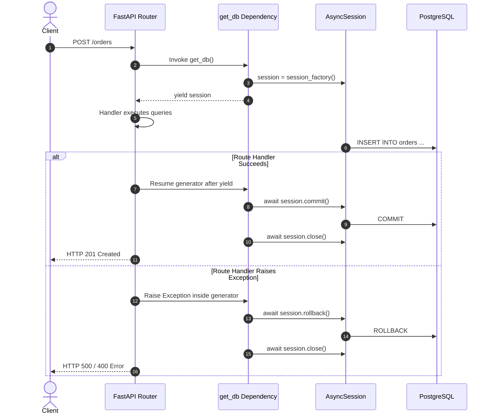

# FastAPI Async Session Management & Lifecycles

In asynchronous web services, an `AsyncSession` represents a single conversational Unit of Work with the database. Managing the lifecycle of this session—ensuring it opens per HTTP request, shares state across sub-dependencies, commits atomically on success, rolls back on exceptions, and closes deterministically without connection leaks—is essential for database stability and data integrity.

---

## Conceptual Foundation & Mental Model

An `AsyncSession` is **not thread-safe and not task-safe across concurrent requests**. Each incoming HTTP request must receive its own isolated session:
1. **Request Arrives**: A dependency yields a fresh `AsyncSession` from the sessionmaker.
2. **Sub-Dependencies / Handler Execute**: All repositories, services, and endpoints in that request share the **exact same session** via FastAPI's dependency caching (`use_cache=True`).
3. **Transaction Commit**: If the handler completes successfully without error, the session commits transactions.
4. **Automatic Rollback on Exception**: If an unhandled exception or `HTTPException` occurs, the session rolls back any uncommitted mutations.
5. **Deterministic Teardown**: The session is closed (`await session.close()`), returning the underlying physical TCP connection back to the engine's connection pool.

```
Incoming Request
       │
       ▼
┌────────────────────────────────────────────────────────┐
│ Dependency: async def get_db() -> AsyncSession:        │
│ 1. session = async_session_factory()                   │
│ 2. try: yield session                                  │
└──────────────────────────┬─────────────────────────────┘
                           │ Injected into Handler & Services
                           ▼
┌────────────────────────────────────────────────────────┐
│ Route Handler:                                         │
│ - user_repo.create(user, session)                      │
│ - order_repo.create(order, session)                    │
│ (All operations share the same active transaction!)    │
└──────────────────────────┬─────────────────────────────┘
                           │
             ┌─────────────┴─────────────┐
             ▼                           ▼
        [Success]                    [Error]
     await session.commit()       await session.rollback()
             │                           │
             └─────────────┬─────────────┘
                           ▼
                 await session.close()
           (Connection returned to pool!)
```

---

## Architecture & Internal Mechanics

### How FastAPI Coordinates the Yield Dependency Lifecycle
1. **Pre-Yield Initialization**: When an endpoint declares `db: AsyncSession = Depends(get_db)`, FastAPI evaluates `get_db()`. The code runs up to the `yield session` statement.
2. **DAG Deduplication**: If multiple dependencies declare `Depends(get_db)` (e.g. `user_service: UserService = Depends(get_user_service)`, which itself depends on `get_db`), FastAPI's `use_cache=True` reuses the single session instance created for that request.
3. **Exception Propagation**: If the handler raises an error, the exception is re-thrown inside the generator at the `yield` point, allowing `except Exception:` blocks to trigger `await session.rollback()`.
4. **Post-Yield Cleanup**: FastAPI executes the `finally:` block immediately after response streaming commences, closing the session.



---

## Comprehensive Syntax & Core Mechanics

### The Two Canonical Session Management Patterns

#### Pattern A: Explicit Commit in Route Handlers / Services
```python
async def get_db() -> AsyncGenerator[AsyncSession, None]:
    async with async_session_factory() as session:
        try:
            yield session
        finally:
            await session.close()
```
*When to use*: Microservice architectures where services decide explicitly when and where to commit transactions.

#### Pattern B: Automatic Commit/Rollback Dependency (Unit of Work)
```python
async def get_db_autocommit() -> AsyncGenerator[AsyncSession, None]:
    async with async_session_factory() as session:
        try:
            yield session
            await session.commit()
        except Exception:
            await session.rollback()
            raise
        finally:
            await session.close()
```
*When to use*: High-velocity CRUD APIs where any successful response should commit automatically, and any exception should rollback.

---

## Practical Implementation (5 Complete Examples)

### Example 1: Robust Auto-Rollback Session Dependency
```python
from typing import AsyncGenerator
from fastapi import FastAPI, Depends, HTTPException, status
from sqlalchemy.ext.asyncio import create_async_engine, async_sessionmaker, AsyncSession
from sqlalchemy.orm import DeclarativeBase, Mapped, mapped_column
from sqlalchemy import select, String

class Base(DeclarativeBase):
    pass

class Item(Base):
    __tablename__ = "items"
    id: Mapped[int] = mapped_column(primary_key=True)
    name: Mapped[str] = mapped_column(String(50))

engine = create_async_engine("sqlite+aiosqlite:///:memory:", echo=False)
session_factory = async_sessionmaker(engine, expire_on_commit=False)

app = FastAPI()

@app.on_event("startup")
async def startup():
    async with engine.begin() as conn:
        await conn.run_sync(Base.metadata.create_all)

# The canonical safe session dependency
async def get_session() -> AsyncGenerator[AsyncSession, None]:
    async with session_factory() as session:
        try:
            yield session
            await session.commit()
        except Exception:
            await session.rollback()
            raise
        finally:
            await session.close()

@app.post("/items")
async def create_item(name: str, db: AsyncSession = Depends(get_session)):
    if name == "invalid":
        # Raises HTTPException: session will rollback automatically!
        raise HTTPException(status_code=400, detail="Invalid item name")
    item = Item(name=name)
    db.add(item)
    # No explicit commit needed: get_session commits on exit!
    return {"status": "created", "name": name}
```

### Example 2: Explicit Sub-Transactions with `session.begin_nested()` (Savepoints)
```python
from fastapi import FastAPI, Depends, HTTPException
from sqlalchemy.ext.asyncio import AsyncSession

# When you want to attempt an operation, and if it fails, rollback ONLY that operation
# without aborting the entire HTTP transaction:
@app.post("/users/{user_id}/process-batch")
async def process_batch(user_id: int, db: AsyncSession = Depends(get_session)):
    # Outer transaction is active
    
    # Savepoint 1: Non-critical analytics record
    try:
        async with db.begin_nested():  # SAVEPOINT savepoint_1
            db.add(AnalyticsLog(user_id=user_id))
            await db.flush()
    except Exception:
        # Automatically rolls back to savepoint_1 without rolling back the whole session!
        print("Failed to record analytics; continuing main workflow.")

    # Main critical transaction continues
    db.add(AccountAudit(user_id=user_id, status="verified"))
    return {"status": "success"}
```

### Example 3: Reusing Session Across Service and Repository Dependencies
```python
from typing import Annotated
from fastapi import FastAPI, Depends
from sqlalchemy.ext.asyncio import AsyncSession

class UserRepository:
    def __init__(self, session: AsyncSession):
        self.session = session

class BillingRepository:
    def __init__(self, session: AsyncSession):
        self.session = session

class AccountService:
    def __init__(self, user_repo: UserRepository, billing_repo: BillingRepository):
        self.user_repo = user_repo
        self.billing_repo = billing_repo

def get_user_repo(db: Annotated[AsyncSession, Depends(get_session)]) -> UserRepository:
    return UserRepository(db)

def get_billing_repo(db: Annotated[AsyncSession, Depends(get_session)]) -> BillingRepository:
    return BillingRepository(db)

def get_account_service(
    user_repo: Annotated[UserRepository, Depends(get_user_repo)],
    billing_repo: Annotated[BillingRepository, Depends(get_billing_repo)]
) -> AccountService:
    # Both repositories share the EXACT SAME AsyncSession instance!
    return AccountService(user_repo, billing_repo)

@app.post("/register")
async def register(service: Annotated[AccountService, Depends(get_account_service)]):
    assert service.user_repo.session is service.billing_repo.session
    return {"status": "shared session verified"}
```

### Example 4: Testing Session Rollback on Failure
```python
from fastapi.testclient import TestClient

def test_session_rollback_on_http_exception():
    client = TestClient(app)
    
    # 1. Trigger error
    res = client.post("/items?name=invalid")
    assert res.status_code == 400

    # 2. Verify nothing was committed to DB
    res_list = client.get("/items")
    assert "invalid" not in [i["name"] for i in res_list.json()]
```

### Example 5: Preventing Leaks in BackgroundTasks
```python
from fastapi import FastAPI, Depends, BackgroundTasks
from sqlalchemy.ext.asyncio import AsyncSession

app = FastAPI()

# Background tasks run AFTER the response is sent and AFTER get_session closes!
# Never pass the request-scoped session into a background task!

async def background_worker_task(user_id: int):
    # Create an INDEPENDENT session exclusively for the background task!
    async with session_factory() as session:
        async with session.begin():
            # Perform DB mutation
            print(f"Background task finished for user {user_id}")

@app.post("/checkout")
async def checkout(
    bg: BackgroundTasks,
    session: AsyncSession = Depends(get_session)
):
    # Pass only primitive IDs to the background task!
    bg.add_task(background_worker_task, user_id=42)
    return {"status": "enqueued"}
```

---

## Anti-Patterns & Common Traps

| Anti-Pattern | Fatal Consequence | Production Solution |
| :--- | :--- | :--- |
| **Passing request session to `BackgroundTasks`** | Crashes with `InterfaceError: Connection is closed` when task runs. | Background task must create its own independent session from `session_factory()`. |
| **Missing `try ... finally: await session.close()`** | Leaks active connection back to pool; exhausts database connections under load. | Always use `async with session_factory() as session:` context managers. |
| **Using `session.commit()` inside repository methods** | Breaks atomicity; prevents outer service from coordinating multi-repository transactions. | Commit at the Unit of Work or dependency layer; repositories should only flush (`flush()`). |
| **Setting `use_cache=False` on `Depends(get_db)`** | Multiple dependencies receive distinct sessions, splitting operations into separate database transactions. | Leave `use_cache=True` (default) so the entire request shares one transaction. |

---

## Performance & Resource Characteristics

- **Session Allocation Speed**: Instantiating an `AsyncSession` is an in-memory operation taking less than 5 microseconds.
- **Lazy Connection Acquisition**: SQLAlchemy does not checkout a physical socket from the pool until the first query (`execute()`, `commit()`, or `flush()`) is called. Endpoints that return early without querying never consume pool connections!

---

## Edge Cases, Failure Modes & Gotchas

1. **Flush vs Commit**:
   - `await session.flush()` sends SQL to the database to populate auto-increment IDs (`item.id`) without finalizing the transaction.
   - `await session.commit()` writes changes permanently and closes the transaction.
2. **Session Sharing in `asyncio.gather()`**: Running multiple coroutines concurrently using `asyncio.gather(*(db.execute(q) for q in queries))` on the **same** `AsyncSession` is illegal and raises `InvalidRequestError: Concurrent execution on session`. Execute sequentially or use distinct sessions.

---

## Security Implications & OWASP Alignment

- **Atomic Integrity & Race Conditions (OWASP API4:2023)**: Multi-step financial transactions (e.g. debit account A, credit account B) must execute in a single atomic transaction. Automatic rollback ensures that if credit fails, debit is never persisted.
- **Connection Starvation Prevention**: Enforcing deterministic session closure prevents denial-of-service (DoS) attacks caused by leaking connection slots.

---

## Modern Tooling Integration

- **SQLAlchemy 2.0**: Native `async_sessionmaker` and `AsyncSession`.
- **FastAPI Dependency Injection**: Automatic cache management and LIFO teardown execution.

---

## Real-World Case Study / Production Incident

An e-commerce API experienced inventory corruption where stock was decremented for failed credit card payments.

**The Bug**:
The route handler was written as:
```python
@app.post("/buy")
async def buy(db = Depends(get_db)):
    await inventory_service.decrement_stock(db)
    await payment_service.charge_card() # Raised HTTPException(402)
    await db.commit()
```
The developer assumed that because `await db.commit()` was skipped, the changes wouldn't save. However, the database session dependency lacked an `except: await session.rollback()` handler, and when the connection was returned to the pool, the database driver's autocommit configuration committed the un-rolled-back decrement!

**Remediation**:
Wrapped the session dependency in strict rollback error handling:
```python
except Exception:
    await session.rollback()
    raise
```
Inventory corruption was immediately resolved.

---

## Hands-On Exercises & Challenge Problems

### Warmup (2 Exercises)
1. Write a `get_db` dependency using `async with async_session_factory() as session:` and verify it closes after endpoint completion.
2. Verify that two dependencies injected into the same route receive the exact same session instance using `assert db1 is db2`.

### Intermediate (2 Exercises)
3. Implement a route that uses `session.begin_nested()` to attempt saving an optional avatar; verify that an avatar failure rolls back without failing the primary user creation.
4. Write a unit test simulating an unhandled `RuntimeError` in an endpoint and assert that `session.rollback()` was called.

### Production-Grade (2 Exercises)
5. Design and implement a Unit of Work context manager class that encapsulates `AsyncSession`, exposing `commit()`, `rollback()`, and repository properties (`uow.users`, `uow.orders`), integrated with FastAPI dependencies.
6. Build a background task dispatcher that safely processes 50 asynchronous database jobs concurrently, each using isolated short-lived sessions created from a shared engine factory without pool starvation.

---

## Interview Mastery (8 Q&As)

### Junior Level
**Q1: How do you provide a database session to a FastAPI route handler?**
*Answer:* Using FastAPI's dependency injection system with a generator function that yields an `AsyncSession`:
```python
async def get_db():
    async with session_factory() as session:
        yield session
```

**Q2: Can multiple dependencies in the same request share the same database session?**
*Answer:* Yes. FastAPI's dependency injection solver caches dependency results per request by default (`use_cache=True`), ensuring all sub-dependencies receive the same session instance.

**Q3: What method should be called on `AsyncSession` to undo changes if an error occurs?**
*Answer:* `await session.rollback()`.

### Senior Level
**Q4: Why must an `AsyncSession` never be passed to a `BackgroundTask`?**
*Answer:* The request-scoped session is closed immediately after the HTTP response is sent. `BackgroundTasks` execute *after* response delivery, meaning the background task would attempt to use an already-closed or invalid database connection.

**Q5: What is the difference between `session.flush()` and `session.commit()`?**
*Answer:* `flush()` issues SQL operations (INSERT, UPDATE) to the database transaction buffer, generating primary keys and checking constraints, but does not finalize the transaction. `commit()` flushes any remaining changes, permanently writes the transaction to disk, and closes the transaction.

**Q6: Can you run concurrent queries on the same `AsyncSession` using `asyncio.gather()`?**
*Answer:* No. SQLAlchemy's `AsyncSession` is deliberately non-reentrant and does not support concurrent query execution on a single session instance; attempting to do so raises an `InvalidRequestError`.

### Staff / Architect Level
**Q7: How do you design an enterprise transaction boundary policy across repositories and services?**
*Answer:*
1. **Repositories**: Strictly read, insert, update, or flush. Repositories must **never** call `commit()` or `rollback()`.
2. **Services / Unit of Work**: Coordinate multi-repository operations within an explicit transaction context manager (`async with uow:`), managing commit and rollback.
3. **API / Transport Layer**: Catches domain exceptions and translates them to HTTP error codes without handling raw SQL.

**Q8: What happens if a database connection in the pool is terminated by the network while an `AsyncSession` is idle?**
*Answer:* If `pool_pre_ping=True` is enabled, the engine tests the connection with `SELECT 1` when the session checks it out, recycling broken sockets before user queries fail. If the connection drops mid-query, an `OperationalError` or `ConnectionResetError` is raised, triggering the session dependency's `except:` block to rollback and close the broken connection cleanly.
