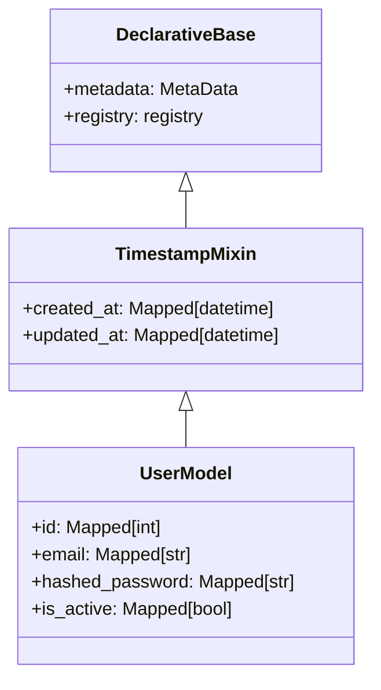

# FastAPI SQLAlchemy 2.0 Declarative Models & Mapped Columns

In SQLAlchemy 2.0, model declaration has been completely modernized to embrace native Python type hinting (PEP 484 and PEP 681). By combining `DeclarativeBase` with the `Mapped[T]` type constructor and `mapped_column()`, developers achieve strict static type checking with Mypy/Pyright, rich IDE autocompletion, and precise database DDL generation without repetitive column typing.

---

## Conceptual Foundation & Mental Model

In legacy SQLAlchemy 1.x:
```python
# Legacy 1.x Syntax: Untyped, repetitive, returns Any in static analyzers
class User(Base):
    __tablename__ = "users"
    id = Column(Integer, primary_key=True)
    name = Column(String(50), nullable=False)
```

In modern SQLAlchemy 2.0:
```python
# Modern 2.0 Syntax: Fully typed with Mapped[T]
class User(Base):
    __tablename__ = "users"
    id: Mapped[int] = mapped_column(primary_key=True)
    name: Mapped[str] = mapped_column(String(50))
    bio: Mapped[str | None] = mapped_column(default=None) # Automatically nullable!
```

- **`Mapped[T]`**: Tells Python type checkers that `user.id` is an `int`, `user.name` is a `str`, and `user.bio` is `str | None`.
- **Automatic Nullability**: If `Mapped[str]` is specified, SQLAlchemy infers `nullable=False`. If `Mapped[str | None]` is specified, SQLAlchemy automatically infers `nullable=True`.
- **Python Default vs Server Default**:
  - `default=datetime.now`: Computed in Python before issuing `INSERT`.
  - `server_default=text("now()")`: Evaluated by the PostgreSQL database engine during SQL execution.

```
Python Type System                 SQLAlchemy 2.0 Engine               Database DDL
Mapped[int]               ──►  mapped_column(primary_key=True)  ──►  id INTEGER PRIMARY KEY
Mapped[str]               ──►  mapped_column(String(100))       ──►  name VARCHAR(100) NOT NULL
Mapped[str | None]        ──►  mapped_column(default=None)      ──►  bio TEXT NULL
Mapped[datetime]          ──►  server_default=func.now()        ──►  created_at TIMESTAMPTZ DEFAULT now()
```

---

## Architecture & Internal Mechanics

### How `DeclarativeBase` Compiles Metadata
1. **Class Decorators & Metaclasses**: Subclassing `DeclarativeBase` equips the base class with an internal `MetaData` collection.
2. **Type Introspection**: At module load time, SQLAlchemy inspects `__annotations__`. It parses `Mapped[T]` to determine the Python type and maps it to default SQL dialect types (e.g. `int -> Integer`, `str -> String/Text`, `datetime -> DateTime`, `bool -> Boolean`).
3. **Table Construction**: It constructs a core `Table` object stored in `Base.metadata.tables[__tablename__]`, which Alembic reads to generate automated database migrations.



---

## Comprehensive Syntax & Core Mechanics

### The Base Class Definition
```python
from datetime import datetime, timezone
from sqlalchemy.orm import DeclarativeBase, Mapped, mapped_column
from sqlalchemy import func, DateTime

class Base(DeclarativeBase):
    pass

# Reusable Timestamp Mixin
class TimestampMixin:
    created_at: Mapped[datetime] = mapped_column(
        DateTime(timezone=True),
        server_default=func.now(),
        nullable=False
    )
    updated_at: Mapped[datetime] = mapped_column(
        DateTime(timezone=True),
        server_default=func.now(),
        onupdate=func.now(),
        nullable=False
    )
```

---

## Practical Implementation (5 Complete Examples)

### Example 1: Full User & Profile Domain Models
```python
import enum
import uuid
from typing import Optional
from sqlalchemy.orm import DeclarativeBase, Mapped, mapped_column
from sqlalchemy import String, Enum, text, Uuid
from datetime import datetime, timezone

class Base(DeclarativeBase):
    pass

class UserRole(str, enum.Enum):
    ADMIN = "admin"
    MEMBER = "member"
    VIEWER = "viewer"

class UserModel(Base):
    __tablename__ = "users"

    # UUID Primary Key generated by database
    id: Mapped[uuid.UUID] = mapped_column(
        Uuid(as_uuid=True),
        primary_key=True,
        default=uuid.uuid4,
        server_default=text("gen_random_uuid()")
    )
    email: Mapped[str] = mapped_column(String(255), unique=True, index=True, nullable=False)
    hashed_password: Mapped[str] = mapped_column(String(255), nullable=False)
    role: Mapped[UserRole] = mapped_column(
        Enum(UserRole, native_enum=False),
        default=UserRole.MEMBER,
        nullable=False
    )
    bio: Mapped[Optional[str]] = mapped_column(String(500), default=None)
    is_active: Mapped[bool] = mapped_column(default=True, server_default=text("true"))
```

### Example 2: Composite Primary Keys and Check Constraints
```python
from sqlalchemy.orm import DeclarativeBase, Mapped, mapped_column
from sqlalchemy import CheckConstraint, UniqueConstraint, Numeric

class Base(DeclarativeBase):
    pass

class ProductInventory(Base):
    __tablename__ = "product_inventory"

    # Composite Primary Key (store_id + sku)
    store_id: Mapped[int] = mapped_column(primary_key=True)
    sku: Mapped[str] = mapped_column(primary_key=True)
    
    quantity: Mapped[int] = mapped_column(default=0)
    unit_price: Mapped[float] = mapped_column(Numeric(10, 2))

    __table_args__ = (
        # Ensure quantity is never negative
        CheckConstraint("quantity >= 0", name="check_positive_quantity"),
        CheckConstraint("unit_price > 0", name="check_positive_price"),
    )
```

### Example 3: Decoupling SQLAlchemy Models from Pydantic Schemas
```python
# 1. SQLAlchemy ORM Model (Database layer)
from sqlalchemy.orm import DeclarativeBase, Mapped, mapped_column
from sqlalchemy import String

class Base(DeclarativeBase):
    pass

class Article(Base):
    __tablename__ = "articles"
    id: Mapped[int] = mapped_column(primary_key=True)
    title: Mapped[str] = mapped_column(String(200))
    content: Mapped[str]
    author_secret_token: Mapped[str]  # Must NEVER be exposed via API!

# 2. Pydantic Response Schema (Presentation layer)
from pydantic import BaseModel, ConfigDict

class ArticleRead(BaseModel):
    model_config = ConfigDict(from_attributes=True) # Enables ORM loading!

    id: int
    title: str
    content: str
    # Notice: author_secret_token is excluded completely!
```

### Example 4: Custom Annotated Types for Common Column Patterns
```python
from typing import Annotated
from sqlalchemy.orm import DeclarativeBase, mapped_column, Mapped
from sqlalchemy import String

class Base(DeclarativeBase):
    pass

# Type aliases for common schema definitions (DRY)
str_50 = Annotated[str, mapped_column(String(50))]
str_255 = Annotated[str, mapped_column(String(255))]
int_pk = Annotated[int, mapped_column(primary_key=True, autoincrement=True)]

class Company(Base):
    __tablename__ = "companies"

    id: Mapped[int_pk]
    name: Mapped[str_255]
    ticker: Mapped[str_50]
```

### Example 5: JSONB and Array Support for PostgreSQL
```python
from sqlalchemy.orm import DeclarativeBase, Mapped, mapped_column
from sqlalchemy.dialects.postgresql import JSONB, ARRAY
from sqlalchemy import Integer

class Base(DeclarativeBase):
    pass

class CustomerPreferences(Base):
    __tablename__ = "customer_preferences"

    id: Mapped[int] = mapped_column(primary_key=True)
    # Native PostgreSQL JSONB document column
    metadata_json: Mapped[dict] = mapped_column(JSONB, default=dict)
    # Native PostgreSQL Array of Integers
    favorite_tags: Mapped[list[int]] = mapped_column(ARRAY(Integer), default=list)
```

---

## Anti-Patterns & Common Traps

| Anti-Pattern | Fatal Consequence | Production Solution |
| :--- | :--- | :--- |
| **Using legacy `Column(...)` in SQLAlchemy 2.0** | Loses static type checking; Mypy and IDEs treat model attributes as `Any`. | Use `Mapped[T] = mapped_column(...)`. |
| **Using mutable objects as Python defaults** (`default={}`) | Shared across all model instances; causes state corruption across rows. | Use factory or lambda: `default=dict` or `default=list`. |
| **Returning SQLAlchemy models directly from endpoints** | Serializer crashes on lazy-loaded relationships; leaks internal secrets. | Serialize through explicit Pydantic `response_model` with `from_attributes=True`. |
| **Mixing `server_default` with Python types inconsistently** | Setting `server_default="true"` with non-boolean column causes DB type mismatches. | Align database SQL literal strings with the column data type. |

---

## Performance & Resource Characteristics

- **Model Instantiation Speed**: Creating model instances takes less than 1 microsecond; `Mapped` introduces zero runtime introspection overhead because annotations are parsed once at startup.
- **Index Optimization**: Explicitly declare `index=True` on columns frequently used in `WHERE`, `ORDER BY`, or `JOIN` clauses to prevent table scans.

---

## Edge Cases, Failure Modes & Gotchas

1. **`Optional[T]` vs `T`**: In SQLAlchemy 2.0, `Mapped[str]` produces `NOT NULL` in DDL. `Mapped[str | None]` produces `NULL` in DDL. Omitting `| None` on an optional field causes Alembic migrations to generate `nullable=False`.
2. **String Columns Without Length in PostgreSQL vs MySQL**: PostgreSQL supports unbounded `VARCHAR` or `TEXT` natively. MySQL strictly requires lengths: `String(255)`. Always specify lengths for cross-database compatibility.

---

## Security Implications & OWASP Alignment

- **Mass Assignment Vulnerabilities (OWASP API3:2023)**: Never update SQLAlchemy models using `for k, v in request.dict().items(): setattr(model, k, v)`. Always validate updates through specific Pydantic `UserUpdate` schemas to prevent updating unauthorized columns (e.g. `is_admin`, `balance`).
- **Data Exposure**: Model decoupling guarantees internal audit columns or password hashes are never serialized into JSON responses.

---

## Modern Tooling Integration

- **Mypy with `sqlalchemy.ext.mypy.plugin`**: Catches column type mismatches and invalid query parameters at compile time.
- **Alembic**: Reads `Base.metadata` to automatically detect added, modified, or dropped columns in `alembic revision --autogenerate`.

---

## Real-World Case Study / Production Incident

A financial billing system stored transaction balances using Python's `float`:
`balance: Mapped[float] = mapped_column()`
Under PostgreSQL, this mapped to a `DOUBLE PRECISION` column. Due to IEEE 754 floating-point inaccuracies, adding \$0.10 and \$0.20 stored `$0.30000000000000004`, causing reconciliation errors and month-end ledger audits to fail by fractional cents.

**Remediation**:
Migrated currency columns to strict fixed-point `Numeric`:
```python
from decimal import Decimal
from sqlalchemy import Numeric

balance: Mapped[Decimal] = mapped_column(Numeric(precision=12, scale=2), default=Decimal("0.00"))
```
Ledger discrepancies were permanently eliminated.

---

## Hands-On Exercises & Challenge Problems

### Warmup (2 Exercises)
1. Declare a `DeclarativeBase` and define a `Product` model with `id: Mapped[int]` and `name: Mapped[str]`.
2. Create tables in an in-memory SQLite database using `Base.metadata.create_all`.

### Intermediate (2 Exercises)
3. Implement a reusable `TimestampMixin` with `created_at` and `updated_at` using `DateTime(timezone=True)` and `server_default=func.now()`.
4. Create an `Account` model with a `CheckConstraint("balance >= 0")` and verify that inserting a negative balance raises an `IntegrityError`.

### Production-Grade (2 Exercises)
5. Build a complete User and Role schema using Python `Enum`, UUID primary keys, and JSONB settings, and write a Pydantic `UserRead` response schema that converts the model cleanly using `from_attributes=True`.
6. Configure Mypy with SQLAlchemy 2.0 type checking and write a test script verifying that attempting to assign an integer to a `Mapped[str]` attribute raises a static type check error.

---

## Interview Mastery (8 Q&As)

### Junior Level
**Q1: How do you declare a model class in SQLAlchemy 2.0?**
*Answer:* By subclassing `DeclarativeBase` and using type annotations with `Mapped[T]` and `mapped_column()`:
```python
class Base(DeclarativeBase): pass
class User(Base):
    __tablename__ = "users"
    id: Mapped[int] = mapped_column(primary_key=True)
```

**Q2: What is the difference between `default` and `server_default` in `mapped_column`?**
*Answer:* `default` is evaluated by Python on the application server before the INSERT statement is sent. `server_default` is evaluated by the database engine (e.g. `DEFAULT now()`) when executing the SQL statement.

**Q3: How do you tell a Pydantic model to serialize data from a SQLAlchemy model?**
*Answer:* By configuring `model_config = ConfigDict(from_attributes=True)` on the Pydantic schema and using `MySchema.model_validate(orm_object)`.

### Senior Level
**Q4: How does nullability inference work with `Mapped[T]` in SQLAlchemy 2.0?**
*Answer:* SQLAlchemy 2.0 inspects the type argument of `Mapped[T]`. If `T` includes `None` (e.g. `Mapped[str | None]`), the column defaults to `nullable=True`. If `None` is absent (e.g. `Mapped[str]`), the column defaults to `nullable=False`.

**Q5: Why should monetary values never be stored using `Mapped[float]`?**
*Answer:* Floating-point numbers (`float` / `DOUBLE PRECISION`) suffer from IEEE 754 binary rounding errors. Financial applications must always use fixed-point `Numeric(precision, scale)` mapped to Python's `decimal.Decimal`.

**Q6: What is the purpose of mixin classes in SQLAlchemy declarative models?**
*Answer:* Mixins (like `TimestampMixin`) allow developers to encapsulate common columns, audit fields, and constraints in a reusable class that multiple models can inherit, eliminating repetitive boilerplate.

### Staff / Architect Level
**Q7: How do you prevent Mass Assignment vulnerabilities when mapping Pydantic update schemas to SQLAlchemy models?**
*Answer:*
1. Define strict, explicit Pydantic schemas (e.g. `UserUpdate`) containing only fields that the client is authorized to modify (excluding `id`, `role`, `is_verified`).
2. Update attributes using explicit model assignment or validated schema filtering:
   ```python
   update_data = payload.model_dump(exclude_unset=True)
   for key, val in update_data.items():
       setattr(db_user, key, val)
   ```
3. Never accept arbitrary dictionaries from clients or map raw request bodies directly to models.

**Q8: How does PEP 681 (Data Class Transforms) empower SQLAlchemy 2.0 declarative models?**
*Answer:* PEP 681 allows library authors to annotate classes so static type checkers (Mypy, Pyright) recognize them as having dataclass-like constructor signatures. In SQLAlchemy 2.0, models can be mapped as dataclasses via `MappedAsDataclass`, generating type-checked `__init__` methods that reject invalid keyword arguments at compile time.
