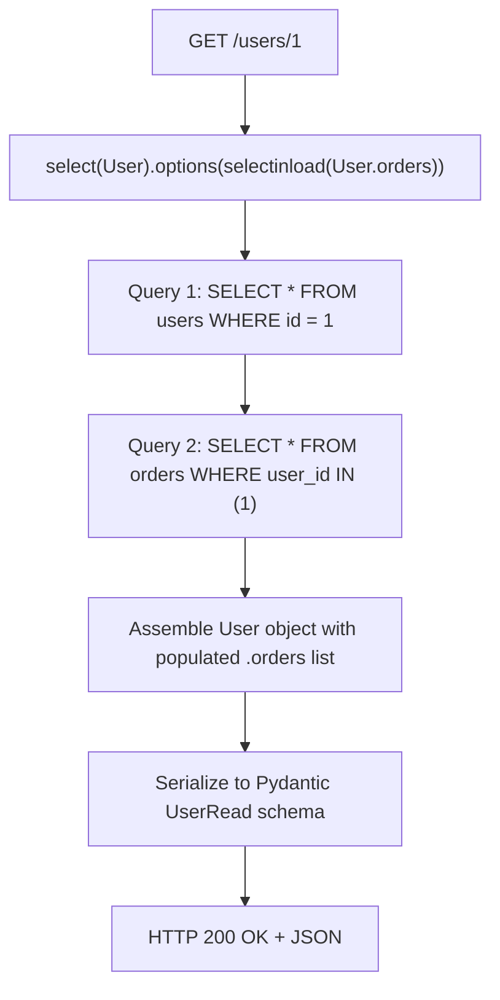

# FastAPI SQLAlchemy Relationships & Async Eager Loading

Managing relational associations (one-to-one, one-to-many, many-to-many) in asynchronous SQLAlchemy requires understanding how database I/O is scheduled. In traditional synchronous code, reading a relationship (`user.orders`) triggers an automatic "lazy" SQL query. In asynchronous code, this implicit query is fatal, throwing the infamous **`MissingGreenlet`** error. Mastering **Eager Loading strategies** (`selectinload`, `joinedload`) is mandatory for writing reliable async FastAPI applications.

---

## Conceptual Foundation & Mental Model

### The Async Lazy-Loading Paradox
In Python, attribute access (`user.orders`) is synchronous; you cannot write `await user.orders`.
- In synchronous SQLAlchemy, the ORM intercepts the attribute access, halts execution, issues a synchronous `SELECT * FROM orders WHERE user_id = ...`, and populates the list.
- In asynchronous SQLAlchemy, doing this would block the thread! Because the driver is async, it refuses to issue synchronous network calls, raising:
  `sqlalchemy.exc.MissingGreenlet: greenlet_spawn has not been called; can't call a await-only function in a sync context`.

### The Solution: Explicit Eager Loading
You must instruct SQLAlchemy to load related entities **upfront during the initial query** using query options:
1. **`selectinload(User.orders)`**: Issues a second query using `IN (...)`. Ideal for **one-to-many** and **many-to-many** collections.
2. **`joinedload(Order.user)`**: Issues an SQL `LEFT OUTER JOIN` in a single query. Ideal for **many-to-one** and **one-to-one** parent references.

```
Lazy Loading (❌ Broken in Async):
user = await session.get(User, 1)
print(user.orders)  ──► CRASH: MissingGreenlet!

Eager Loading (✅ Production Async):
query = select(User).options(selectinload(User.orders)).where(User.id == 1)
user = (await session.execute(query)).scalar_one()
print(user.orders)  ──► [Order(id=101), Order(id=102)] (Already in RAM!)
```

---

## Architecture & Internal Mechanics

### Eager Loading Execution Strategies Compared

| Strategy | SQL Generated | Queries Issued | Best Used For | Caveats |
| :--- | :--- | :---: | :--- | :--- |
| **`selectinload`** | `SELECT ... FROM users;`<br>`SELECT ... FROM orders WHERE user_id IN (1, 2, 3);` | 2 | **One-to-Many**,<br>**Many-to-Many** | Two roundtrips; scales cleanly with collections. |
| **`joinedload`** | `SELECT ... FROM orders LEFT JOIN users ON ...;` | 1 | **Many-to-One**,<br>**One-to-One** | Cartesian product if used on collections; do not combine with `LIMIT/OFFSET`. |
| **`contains_eager`** | Reuses an explicit `.join()` clause | 1 | Filtered eager loads | Requires manual join definition. |
| **`subqueryload`** | `SELECT ... WHERE user_id IN (SELECT id FROM ...)` | 2 | Legacy 1.x strategy | Poor query planner performance on Postgres; prefer `selectinload`. |



---

## Comprehensive Syntax & Core Mechanics

### 1. Declaring One-to-Many Relationships
```python
from sqlalchemy.orm import DeclarativeBase, Mapped, mapped_column, relationship
from sqlalchemy import ForeignKey, String

class Base(DeclarativeBase):
    pass

class Author(Base):
    __tablename__ = "authors"

    id: Mapped[int] = mapped_column(primary_key=True)
    name: Mapped[str] = mapped_column(String(100))

    # One-to-Many: An author has many books
    books: Mapped[list["Book"]] = relationship(
        back_populates="author",
        cascade="all, delete-orphan", # Deleting author deletes their books!
        lazy="raise"                  # CRITICAL: Fails fast if lazy-loaded!
    )

class Book(Base):
    __tablename__ = "books"

    id: Mapped[int] = mapped_column(primary_key=True)
    title: Mapped[str] = mapped_column(String(200))
    author_id: Mapped[int] = mapped_column(ForeignKey("authors.id"), nullable=False)

    # Many-to-One: A book belongs to one author
    author: Mapped["Author"] = relationship(
        back_populates="books",
        lazy="raise"
    )
```

> [!TIP]
> Setting `lazy="raise"` on all `relationship()` declarations is an industry best practice in async SQLAlchemy! If a developer forgets to eager-load a relationship, SQLAlchemy immediately throws a descriptive `InvalidRequestError` pointing directly to the query, rather than an obscure `MissingGreenlet` error during serialization.

---

## Practical Implementation (5 Complete Examples)

### Example 1: One-to-Many Eager Querying with `selectinload`
```python
from fastapi import FastAPI, Depends, HTTPException
from sqlalchemy.ext.asyncio import AsyncSession
from sqlalchemy.orm import selectinload
from sqlalchemy import select
from pydantic import BaseModel, ConfigDict

# --- Pydantic Schemas ---
class BookRead(BaseModel):
    model_config = ConfigDict(from_attributes=True)
    id: int
    title: str

class AuthorRead(BaseModel):
    model_config = ConfigDict(from_attributes=True)
    id: int
    name: str
    books: list[BookRead] = []

app = FastAPI()

@app.get("/authors/{author_id}", response_model=AuthorRead)
async def get_author(author_id: int, db: AsyncSession = Depends(get_db)):
    # Explicitly eager-load the books relationship!
    query = (
        select(Author)
        .options(selectinload(Author.books))
        .where(Author.id == author_id)
    )
    result = await db.execute(query)
    author = result.scalar_one_or_none()

    if not author:
        raise HTTPException(status_code=404, detail="Author not found")

    # Pydantic serializes author.books safely without MissingGreenlet!
    return author
```

### Example 2: Many-to-One Eager Loading with `joinedload`
```python
class BookWithAuthorRead(BaseModel):
    model_config = ConfigDict(from_attributes=True)
    id: int
    title: str
    author: AuthorRead

@app.get("/books/{book_id}", response_model=BookWithAuthorRead)
async def get_book(book_id: int, db: AsyncSession = Depends(get_db)):
    # joinedload performs an efficient single SQL LEFT JOIN
    from sqlalchemy.orm import joinedload
    query = (
        select(Book)
        .options(joinedload(Book.author))
        .where(Book.id == book_id)
    )
    result = await db.execute(query)
    book = result.scalar_one_or_none()
    
    if not book:
        raise HTTPException(status_code=404, detail="Book not found")
        
    return book
```

### Example 3: Many-to-Many Relationship via Association Table
```python
from sqlalchemy import Table, Column, Integer, ForeignKey
from sqlalchemy.orm import relationship, Mapped, mapped_column

# Explicit Association Table
user_roles = Table(
    "user_roles",
    Base.metadata,
    Column("user_id", Integer, ForeignKey("users.id", ondelete="CASCADE"), primary_key=True),
    Column("role_id", Integer, ForeignKey("roles.id", ondelete="CASCADE"), primary_key=True),
)

class User(Base):
    __tablename__ = "users"
    id: Mapped[int] = mapped_column(primary_key=True)
    username: Mapped[str]

    # Many-to-Many
    roles: Mapped[list["Role"]] = relationship(
        secondary=user_roles,
        back_populates="users",
        lazy="raise"
    )

class Role(Base):
    __tablename__ = "roles"
    id: Mapped[int] = mapped_column(primary_key=True)
    name: Mapped[str]

    users: Mapped[list["User"]] = relationship(
        secondary=user_roles,
        back_populates="roles",
        lazy="raise"
    )
```

### Example 4: Nested Eager Loading across 3 Levels
```python
# Organization -> Projects -> Tasks
# Loading all 3 levels in a single operation:
from sqlalchemy.orm import selectinload

async def get_organization_hierarchy(org_id: int, db: AsyncSession):
    query = (
        select(Organization)
        .options(
            selectinload(Organization.projects)
            .selectinload(Project.tasks)
        )
        .where(Organization.id == org_id)
    )
    result = await db.execute(query)
    return result.scalar_one_or_none()
```

### Example 5: Testing Cascade Delete Behavior
```python
import pytest
from sqlalchemy import select

@pytest.mark.anyio
async def test_cascade_delete_orphan(db_session: AsyncSession):
    # 1. Create Author with 2 Books
    author = Author(name="Tolkien", books=[Book(title="The Hobbit"), Book(title="LOTR")])
    db_session.add(author)
    await db_session.commit()
    author_id = author.id

    # 2. Delete Author
    await db_session.delete(author)
    await db_session.commit()

    # 3. Assert Books were deleted by cascade
    books = (await db_session.execute(select(Book).where(Book.author_id == author_id))).scalars().all()
    assert len(books) == 0
```

---

## Anti-Patterns & Common Traps

| Anti-Pattern | Fatal Consequence | Production Solution |
| :--- | :--- | :--- |
| **Relying on default `lazy="select"` in async** | Triggers `MissingGreenlet` error during Pydantic serialization. | Set `lazy="raise"` on all relationships and use `selectinload()` in queries. |
| **Using `joinedload` on One-to-Many with `LIMIT / OFFSET`** | Cartesian product breaks pagination; `LIMIT 10` limits *joined rows*, not distinct parent entities! | Always use `selectinload()` when paginating One-to-Many collections. |
| **Forgetting `unique()` after `joinedload`** | Returns duplicate parent objects if multiple children match. | Call `result.unique().scalars().all()` when using `joinedload`. |
| **Omitting `cascade="all, delete-orphan"` on child collections** | Deleting parent leaves orphaned child rows with foreign key violations. | Configure explicit cascade rules on `relationship()`. |

---

## Performance & Resource Characteristics

- **The N+1 Problem Prevention**: Loading 100 users and their orders with lazy loading would issue 101 queries (N+1). With `selectinload()`, it issues **exactly 2 queries** regardless of whether there are 10 or 10,000 orders.
- **Cartesian Product Warning**: A parent with 10 child records and 10 tags loaded via two `joinedload` calls produces $1 \times 10 \times 10 = 100$ duplicate rows over the wire. Use `selectinload` for multi-collection loads.

---

## Edge Cases, Failure Modes & Gotchas

1. **Filtering on Eagerly Loaded Relationships**: Calling `.options(selectinload(Author.books))` loads **all** books. If you want to load only published books, use `contains_eager` with an explicit `.join()` or define a custom filtered relationship.
2. **Back Populates vs Backref**: In SQLAlchemy 2.0, legacy `backref` is deprecated in favor of explicit `back_populates="name"` on both sides of the relationship, guaranteeing full static type checking.

---

## Security Implications & OWASP Alignment

- **Unrestricted Data Exposure (OWASP API3:2023)**: If an entity has a relationship to sensitive models (`User.api_keys`), never eager load and serialize the entire user model blindly. Always map through strict Pydantic response schemas that exclude sensitive collections.

---

## Modern Tooling Integration

- **SQLAlchemy 2.0**: Native `relationship(lazy="raise")` for fail-fast async safety.
- **Pydantic v2**: `ConfigDict(from_attributes=True)` extracts eager-loaded relationship attributes cleanly.

---

## Real-World Case Study / Production Incident

A social media API deployed a new endpoint `GET /posts` that returned 50 posts. The developer wrote:
`posts = (await db.execute(select(Post).limit(50))).scalars().all()`
The Pydantic schema included `author: UserRead`. In development with 1 post, it worked. In staging with 50 posts, the endpoint threw `MissingGreenlet` 100% of the time because the author was not eagerly loaded.

**Remediation**:
1. Added `.options(joinedload(Post.author))` to the query.
2. Configured `lazy="raise"` on `Post.author` across the entire codebase.
3. Added automated unit tests verifying that all API endpoints serialize without `MissingGreenlet` errors.

---

## Hands-On Exercises & Challenge Problems

### Warmup (2 Exercises)
1. Define a `Department` and `Employee` one-to-many relationship using `Mapped` and `relationship(back_populates=...)`.
2. Write a query that fetches a department with `selectinload(Department.employees)`.

### Intermediate (2 Exercises)
3. Build a many-to-many relationship between `Student` and `Course` via an association table; write a test creating and fetching a student with their enrolled courses.
4. Demonstrate that attempting to access an un-loaded relationship configured with `lazy="raise"` immediately raises `InvalidRequestError`.

### Production-Grade (2 Exercises)
5. Build an e-commerce order query that paginates orders (`LIMIT 20 OFFSET 0`), eager-loads `order.items` via `selectinload` and `order.customer` via `joinedload`, verifying that pagination count is accurate and no duplicate orders are returned.
6. Implement a filtered eager load using `contains_eager` that fetches authors joined only with their *active* published books.

---

## Interview Mastery (8 Q&As)

### Junior Level
**Q1: What is the cause of the `MissingGreenlet` error in asynchronous SQLAlchemy?**
*Answer:* It occurs when synchronous code attempts to access a relationship attribute that has not been eagerly loaded. The ORM tries to issue an implicit lazy-loading query, which cannot be executed in an async context without `await`.

**Q2: What is the recommended eager loading strategy for a One-to-Many collection in async SQLAlchemy?**
*Answer:* `selectinload()` (e.g. `select(User).options(selectinload(User.orders))`).

**Q3: What is the recommended eager loading strategy for a Many-to-One parent reference?**
*Answer:* `joinedload()` (e.g. `select(Order).options(joinedload(Order.user))`).

### Senior Level
**Q4: Why should you avoid using `joinedload` on One-to-Many collections when paginating with `LIMIT` and `OFFSET`?**
*Answer:* `joinedload` uses an SQL `LEFT OUTER JOIN`. If a user has 5 orders, joining produces 5 rows for that single user. An SQL `LIMIT 10` limits the joined rows, not the distinct users, completely corrupting pagination. `selectinload` must be used because it issues a separate query for collections, preserving parent pagination.

**Q5: Why is `lazy="raise"` recommended on all relationship definitions in async codebases?**
*Answer:* Setting `lazy="raise"` forces SQLAlchemy to raise an immediate, informative error at the exact moment a relationship is accessed without eager loading, preventing silent performance bugs and obscure serialization errors.

**Q6: What is the difference between `delete` and `delete-orphan` in relationship cascades?**
*Answer:* `delete` deletes child records when the parent record is deleted. `delete-orphan` also deletes child records if they are simply removed from the parent's collection in Python (`parent.children.remove(child)`), preventing orphaned rows.

### Staff / Architect Level
**Q7: How do you design an enterprise query architecture that prevents junior developers from triggering N+1 queries across complex entity graphs?**
*Answer:*
1. Enforce `lazy="raise"` as a strict policy across all model relationships.
2. Implement Repository or Query Service methods (e.g. `UserRepository.get_with_orders()`) that encapsulate pre-configured eager loading options.
3. Write integration tests that assert the exact count of SQL queries issued per endpoint using SQLAlchemy event listeners (e.g. verifying that `GET /users` issues exactly 2 queries regardless of page size).

**Q8: When would you use `contains_eager` instead of `joinedload`?**
*Answer:* `joinedload` creates an anonymous outer join purely for data loading and cannot be filtered with `where()`. If your query already has an explicit `.join()` that filters child rows (e.g. `.join(User.orders).where(Order.status == 'shipped')`), use `contains_eager(User.orders)` to instruct SQLAlchemy to populate the `user.orders` relationship directly from the joined rows without re-querying.
