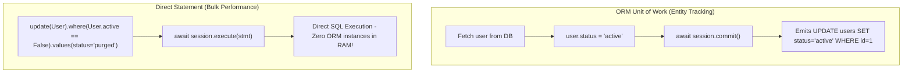

# FastAPI Asynchronous CRUD Operations in SQLAlchemy 2.0

SQLAlchemy 2.0 completely replaced legacy 1.x `Query` objects (`session.query(User)...`) with modern, SQL-standard statement constructs (`select(User)...`). In FastAPI, executing asynchronous Create, Read, Update, and Delete (CRUD) operations requires mastering 2.0 `execute()`, `scalars()`, bulk statements, `returning()` clauses, and high-performance pagination patterns.

---

## Conceptual Foundation & Mental Model

In SQLAlchemy 2.0, all queries follow a uniform, two-step pipeline:
1. **Construct Statement**: Build an immutable, type-safe SQL statement (`select()`, `insert()`, `update()`, `delete()`).
2. **Execute on AsyncSession**: Pass the statement to `await session.execute(stmt)` and process the returned `Result` stream using `scalar_one_or_none()`, `scalars().all()`, or `mappings()`.

```
Construct Statement                        Execute Asynchronously               Process Result
select(User).where(User.id == 1)   ──►  result = await session.execute(stmt) ──►  user = result.scalar_one_or_none()
insert(User).values(...)          ──►  result = await session.execute(stmt) ──►  new_id = result.scalar_one()
```

### Result Processing Cheat-Sheet
- **`result.scalar_one()`**: Returns exactly one scalar object; raises an exception if 0 or $>1$ rows exist.
- **`result.scalar_one_or_none()`**: Returns one object, or `None` if 0 rows exist; raises if $>1$ rows exist.
- **`result.scalars().all()`**: Returns a `list` of primary model instances.
- **`result.scalars().first()`**: Returns the first object, or `None`.
- **`result.mappings().all()`**: Returns rows as dictionary-like key-value mappings.

---

## Architecture & Internal Mechanics

### Object State Lifecycle vs Bulk Core Statements
SQLAlchemy 2.0 offers two distinct mutation paradigms:
1. **Unit of Work (ORM State Machine)**:
   - `session.add(user)` / `user.email = "new@mail.com"` / `await session.delete(user)`.
   - The ORM tracks entity states (Transient $\rightarrow$ Pending $\rightarrow$ Persistent $\rightarrow$ Detached). Emits SQL during `flush()`. Best for transactional business logic.
2. **Direct DML Statements (Bulk Operations)**:
   - `update(User).where(...).values(...)` / `delete(User).where(...)`.
   - Issues raw SQL directly to the database without loading entities into Python memory. Orders of magnitude faster for bulk updates (e.g. updating 10,000 users at once).



---

## Comprehensive Syntax & Core Mechanics

### Standard CRUD Method Signatures
```python
from sqlalchemy import select, insert, update, delete
from sqlalchemy.ext.asyncio import AsyncSession

# 1. CREATE
async def create_user(session: AsyncSession, name: str, email: str) -> User:
    user = User(name=name, email=email)
    session.add(user)
    await session.flush() # Populates user.id
    return user

# 2. READ ONE
async def get_user_by_id(session: AsyncSession, user_id: int) -> User | None:
    stmt = select(User).where(User.id == user_id)
    result = await session.execute(stmt)
    return result.scalar_one_or_none()

# 3. READ LIST (With Filtering & Pagination)
async def list_users(session: AsyncSession, limit: int = 20, offset: int = 0) -> list[User]:
    stmt = select(User).order_by(User.id.desc()).limit(limit).offset(offset)
    result = await session.execute(stmt)
    return list(result.scalars().all())

# 4. UPDATE
async def update_user_email(session: AsyncSession, user_id: int, new_email: str) -> bool:
    user = await get_user_by_id(session, user_id)
    if not user:
        return False
    user.email = new_email
    await session.flush()
    return True

# 5. DELETE
async def delete_user(session: AsyncSession, user_id: int) -> bool:
    user = await get_user_by_id(session, user_id)
    if not user:
        return False
    await session.delete(user)
    await session.flush()
    return True
```

---

## Practical Implementation (5 Complete Examples)

### Example 1: Full Async CRUD Router with Pydantic Validation
```python
from fastapi import FastAPI, Depends, HTTPException, status
from sqlalchemy.ext.asyncio import AsyncSession
from sqlalchemy import select
from pydantic import BaseModel, ConfigDict, EmailStr

# Schemas
class UserCreate(BaseModel):
    name: str
    email: EmailStr

class UserUpdate(BaseModel):
    name: str | None = None
    email: EmailStr | None = None

class UserRead(BaseModel):
    model_config = ConfigDict(from_attributes=True)
    id: int
    name: str
    email: str

app = FastAPI(title="User CRUD API")

@app.post("/users", response_model=UserRead, status_code=status.HTTP_201_CREATED)
async def create_user_endpoint(payload: UserCreate, db: AsyncSession = Depends(get_db)):
    # Check duplicate
    existing = await db.execute(select(User).where(User.email == payload.email))
    if existing.scalar_one_or_none():
        raise HTTPException(status_code=400, detail="Email already registered")

    user = User(name=payload.name, email=payload.email)
    db.add(user)
    await db.commit()
    await db.refresh(user) # Reload generated database values
    return user

@app.get("/users/{user_id}", response_model=UserRead)
async def read_user_endpoint(user_id: int, db: AsyncSession = Depends(get_db)):
    result = await db.execute(select(User).where(User.id == user_id))
    user = result.scalar_one_or_none()
    if not user:
        raise HTTPException(status_code=404, detail="User not found")
    return user

@app.patch("/users/{user_id}", response_model=UserRead)
async def update_user_endpoint(user_id: int, payload: UserUpdate, db: AsyncSession = Depends(get_db)):
    result = await db.execute(select(User).where(User.id == user_id))
    user = result.scalar_one_or_none()
    if not user:
        raise HTTPException(status_code=404, detail="User not found")

    update_data = payload.model_dump(exclude_unset=True)
    for field, value in update_data.items():
        setattr(user, field, value)

    await db.commit()
    return user

@app.delete("/users/{user_id}", status_code=status.HTTP_204_NO_CONTENT)
async def delete_user_endpoint(user_id: int, db: AsyncSession = Depends(get_db)):
    result = await db.execute(select(User).where(User.id == user_id))
    user = result.scalar_one_or_none()
    if not user:
        raise HTTPException(status_code=404, detail="User not found")

    await db.delete(user)
    await db.commit()
```

### Example 2: High-Performance Bulk Insert with `insert().returning()`
```python
from sqlalchemy import insert
from sqlalchemy.ext.asyncio import AsyncSession

# Fast bulk insertion of 1,000 records in a single database roundtrip!
async def bulk_create_products(session: AsyncSession, product_dicts: list[dict]):
    stmt = (
        insert(Product)
        .returning(Product.id, Product.sku)
    )
    result = await session.execute(stmt, product_dicts)
    created_records = result.all()
    await session.commit()
    return created_records
```

### Example 3: Atomic Increment / Decrement Queries
```python
from sqlalchemy import update
from sqlalchemy.ext.asyncio import AsyncSession

# Atomic concurrency-safe inventory deduction
async def deduct_inventory_stock(session: AsyncSession, product_id: int, quantity: int) -> bool:
    stmt = (
        update(Product)
        .where(Product.id == product_id, Product.stock >= quantity)
        .values(stock=Product.stock - quantity)
        .returning(Product.stock)
    )
    result = await session.execute(stmt)
    new_stock = result.scalar_one_or_none()
    await session.commit()
    return new_stock is not None
```

### Example 4: Keyset (Cursor) Pagination vs Offset Pagination
```python
from sqlalchemy import select
from sqlalchemy.ext.asyncio import AsyncSession

# Keyset / Cursor Pagination (High-Performance for large tables):
# Instead of OFFSET 100000 (which performs full table scan),
# filter by WHERE id > last_seen_id LIMIT 20!
async def get_users_cursor(
    session: AsyncSession,
    limit: int = 20,
    last_seen_id: int | None = None
) -> list[User]:
    stmt = select(User).order_by(User.id.asc()).limit(limit)
    if last_seen_id is not None:
        stmt = stmt.where(User.id > last_seen_id)
        
    result = await session.execute(stmt)
    return list(result.scalars().all())
```

### Example 5: Direct Bulk Delete with Filters
```python
from sqlalchemy import delete
from sqlalchemy.ext.asyncio import AsyncSession
from datetime import datetime, timezone, timedelta

async def purge_expired_sessions(session: AsyncSession) -> int:
    cutoff = datetime.now(timezone.utc) - timedelta(days=30)
    stmt = (
        delete(UserSession)
        .where(UserSession.last_active < cutoff)
    )
    result = await session.execute(stmt)
    await session.commit()
    return result.rowcount  # Returns number of deleted rows
```

---

## Anti-Patterns & Common Traps

| Anti-Pattern | Fatal Consequence | Production Solution |
| :--- | :--- | :--- |
| **Using `session.query()` in async SQLAlchemy 2.0** | Legacy 1.x syntax; triggers deprecation warnings and lacks async support. | Use `select()`, `insert()`, `update()`, `delete()`. |
| **Using `result.scalars().all()` on a tuple query** | Discards all selected columns except the first one. | Use `result.all()` when selecting multiple columns (`select(User.id, User.name)`). |
| **Using `OFFSET 100000` on 10M row tables** | Degrades query latency from 2ms to 12s as Postgres scans all 100k rows. | Use keyset (cursor) pagination: `WHERE id > last_seen_id`. |
| **Calling `await session.refresh(obj)` inside bulk loops** | Generates an extra `SELECT` statement per object, triggering an N+1 performance disaster. | Use `.returning()` to fetch database-generated values in the same query. |

---

## Performance & Resource Characteristics

- **Returning Clause Advantage**: Using `insert().returning(Model)` in PostgreSQL and SQLite 3.35+ eliminates the need to call `await session.refresh(obj)`, cutting database roundtrips in half.
- **Bulk Statement Execution**: `session.execute(insert(Model), list_of_dicts)` utilizes batch database protocol execution, inserting 10,000 rows in ~80ms compared to 4,000ms using sequential `session.add()`.

---

## Edge Cases, Failure Modes & Gotchas

1. **`scalar_one()` on Missing Row**: Raises `NoResultFound`. Always use `scalar_one_or_none()` when fetching by optional filters or user-provided IDs.
2. **`scalar_one()` on Duplicate Rows**: Raises `MultipleResultsFound`. Ensure unique columns (e.g. `email`) have database-level unique constraints.

---

## Security Implications & OWASP Alignment

- **SQL Injection Prevention**: SQLAlchemy 2.0 statement objects compile all variables into positional or named SQL parameters (`$1, $2` or `:name`). Raw strings are never interpolated, ensuring 100% defense against SQL injection.
- **Atomic Concurrency Protection**: Use SQL-level mathematical expressions (`values(stock = Model.stock - qty)`) rather than reading into Python, computing, and saving, preventing race-condition double-spends.

---

## Modern Tooling Integration

- **SQLAlchemy 2.0**: Native async execution model.
- **FastAPI / Pydantic v2**: Direct mapping via `UserRead.model_validate(user)`.

---

## Real-World Case Study / Production Incident

An online gaming backend updated user coins after completing a quest:
```python
user = await db.get(User, user_id)
user.coins += reward # In-memory update
await db.commit()
```
Under high concurrency, when a user rapidly completed two quests simultaneously on two devices, both requests read `coins = 100`, added 50, and wrote back 150. The user was credited 50 coins instead of 100.

**Remediation**:
Migrated to an atomic update statement:
```python
await db.execute(
    update(User)
    .where(User.id == user_id)
    .values(coins=User.coins + reward)
)
await db.commit()
```
The database atomic addition eliminated race conditions completely.

---

## Hands-On Exercises & Challenge Problems

### Warmup (2 Exercises)
1. Write a function that creates a new `Product` and returns it using `session.add()` and `await session.flush()`.
2. Write a query that fetches the product by ID using `select(Product).where(...)` and `scalar_one_or_none()`.

### Intermediate (2 Exercises)
3. Implement a bulk update function that sets `is_active=False` for all users whose `last_login` is older than 90 days, returning the count of modified rows.
4. Build a keyset pagination endpoint that accepts `limit: int = 20` and `cursor_id: int | None = None` and test that page transitions are seamless.

### Production-Grade (2 Exercises)
5. Build an atomic balance transfer function `transfer_funds(from_id, to_id, amount)` that executes within a single transaction, verifies sufficient balance, updates both accounts using atomic SQL expressions, and rolls back if an error occurs.
6. Implement a complete async CRUD repository class `BaseRepository[ModelType, CreateSchema, UpdateSchema]` that provides generic `create`, `get`, `list`, `update`, and `delete` methods with full type hints.

---

## Interview Mastery (8 Q&As)

### Junior Level
**Q1: How do you query a single object by ID in SQLAlchemy 2.0?**
*Answer:*
```python
stmt = select(User).where(User.id == user_id)
user = (await session.execute(stmt)).scalar_one_or_none()
```

**Q2: What is the difference between `scalar_one()` and `scalar_one_or_none()`?**
*Answer:* `scalar_one()` raises `NoResultFound` if no matching row exists, whereas `scalar_one_or_none()` returns `None`. Both raise `MultipleResultsFound` if more than one row matches.

**Q3: How do you delete an object in async SQLAlchemy?**
*Answer:* Fetch or instantiate the entity and call `await session.delete(instance)`, followed by `await session.commit()`.

### Senior Level
**Q4: Why is keyset (cursor) pagination superior to offset pagination for large tables?**
*Answer:* Offset pagination (`OFFSET N`) forces the database engine to scan and discard $N$ rows before returning results, causing $O(N)$ execution time and slow queries on deep pages. Keyset pagination (`WHERE id > last_seen_id ORDER BY id LIMIT N`) uses a B-tree index lookup directly, running in constant $O(\log M)$ time regardless of depth.

**Q5: What is the purpose of the `.returning()` clause in modern SQL?**
*Answer:* It instructs the database to return generated column values (such as auto-increment IDs or server timestamps) immediately in the response to an `INSERT`, `UPDATE`, or `DELETE` statement, eliminating the need for a separate `SELECT` query.

**Q6: What is the difference between calling `await session.refresh(obj)` and querying with `.returning()`?**
*Answer:* `session.refresh(obj)` issues a separate, follow-up `SELECT` statement to reload attributes. `.returning()` retrieves the values directly within the original DML statement in a single database roundtrip.

### Staff / Architect Level
**Q7: How do you prevent lost updates and race conditions during high-concurrency read-modify-write operations?**
*Answer:* Two primary strategies:
1. **Atomic In-Database Expressions**: Use SQL-level mutations: `update(Account).values(balance=Account.balance - amount)`.
2. **Pessimistic Locking**: Lock the row during the read phase using `with_for_update()`:
   `select(Account).where(Account.id == acc_id).with_for_update()`.
   This forces concurrent transactions to wait until the active transaction commits.
3. **Optimistic Locking**: Add a `version_id` column that increments on update, failing if the version changed between read and write.

**Q8: Why does SQLAlchemy 2.0 deprecate `session.query(Model)` in favor of `select(Model)`?**
*Answer:* The legacy `Query` API was a custom ORM abstraction with non-standard syntax, poor composability, and lack of alignment with modern SQL standards. The 2.0 `select()` statement aligns ORM queries with Core SQL expressions, works identically across sync and async engines, and provides superior static type analysis and query compilation optimization.
