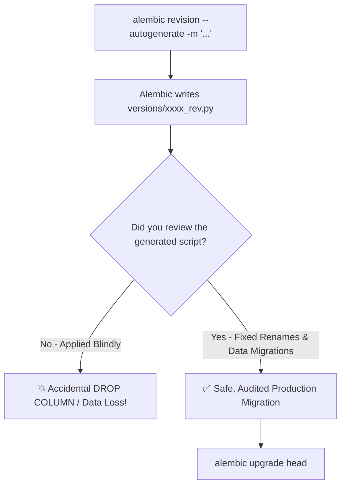

# FastAPI Alembic Autogenerate & Schema Migration Workflows

Alembic's `--autogenerate` feature inspects the difference between your SQLAlchemy models (`target_metadata`) and the live database schema, generating migration scripts automatically. However, relying blindly on autogenerate without understanding what it detects—and more importantly, **what it cannot detect**—is a primary cause of accidental data loss in production.

---

## Conceptual Foundation & Mental Model

When you run:
```bash
alembic revision --autogenerate -m "add user phone number"
```
Alembic executes an introspective comparison:
1. Connects to the database and inspects existing tables, columns, indexes, and foreign keys.
2. Compares this live state against the Python models registered on `target_metadata`.
3. Synthesizes an AST diff and writes an operational script using `op.create_table`, `op.add_column`, `op.drop_column`, etc.

```
Live Database Schema                   Python Models (target_metadata)
┌─────────────────────────┐            ┌─────────────────────────┐
│ users:                  │            │ class User(Base):       │
│ - id: int               │   DIFF     │   id: Mapped[int]       │
│ - email: str            │ ────────►  │   email: Mapped[str]    │
│                         │            │   phone: Mapped[str]    │ <── NEW!
└─────────────────────────┘            └─────────────────────────┘
                                   │
                                   ▼
             alembic/versions/20260330_add_user_phone.py:
             def upgrade(): op.add_column('users', sa.Column('phone', ...))
             def downgrade(): op.drop_column('users', 'phone')
```

---

## Architecture & Internal Mechanics

### What Autogenerate Detects vs What It Misses

| Autogenerate CAN Detect | Autogenerate CANNOT Detect (Requires Manual Editing!) |
| :--- | :--- |
| Table additions & drops | **Column renames** (Detects as `drop_column` + `add_column` $\rightarrow$ **DATA LOSS!**) |
| Column additions & drops | **Table renames** (Detects as `drop_table` + `create_table` $\rightarrow$ **DATA LOSS!**) |
| Nullability changes | Custom CHECK constraints (dialect-specific) |
| Basic column type changes (`compare_type=True`) | Special PostgreSQL extensions (e.g. `CREATE EXTENSION pgvector`) |
| Unique constraints & Indexes | Data migrations / row transformations |
| Foreign key constraints | Sequences and trigger functions |



---

## Comprehensive Syntax & Core Mechanics

### 1. Generating a Revision
```bash
alembic revision --autogenerate -m "create users and orders tables"
```

### 2. Inspecting and Applying
```bash
# Check current database revision
alembic current

# Show migration history
alembic history --verbose

# Apply pending migrations
alembic upgrade head

# Rollback the last migration
alembic downgrade -1
```

### 3. Merging Conflicting Branches (Resolving Multiple Heads)
When two developers commit migrations independently:
```bash
alembic merge -m "merge auth and billing heads" head1 head2
```

---

## Practical Implementation (5 Complete Examples)

### Example 1: Handling a Column Rename Safely (Preventing Data Loss)
```python
"""rename user full_name to display_name

Revision ID: 20260330_rename_col
Revises: 20260329_init
"""
from alembic import op
import sqlalchemy as sa

revision = '20260330_rename_col'
down_revision = '20260329_init'

def upgrade():
    # ❌ AUTOGENERATE PRODUCED:
    # op.drop_column('users', 'full_name')  <--- WIPES ALL USER NAMES!
    # op.add_column('users', sa.Column('display_name', sa.String(100)))

    # ✅ CORRECT MANUAL EDIT:
    op.alter_column('users', 'full_name', new_column_name='display_name')

def downgrade():
    op.alter_column('users', 'display_name', new_column_name='full_name')
```

### Example 2: Schema Migration + Data Backfill Migration
```python
"""add user status and backfill default

Revision ID: 20260330_data_migration
"""
from alembic import op
import sqlalchemy as sa

revision = '20260330_data_migration'
down_revision = '20260330_rename_col'

def upgrade():
    # Step 1: Add new column as nullable
    op.add_column('users', sa.Column('status', sa.String(20), nullable=True))

    # Step 2: Execute raw SQL data migration to backfill existing rows
    op.execute("UPDATE users SET status = 'active' WHERE status IS NULL")

    # Step 3: Now alter column to enforce NOT NULL constraint
    op.alter_column('users', 'status', nullable=False)

def downgrade():
    op.drop_column('users', 'status')
```

### Example 3: Adding PostgreSQL Extension (`pgvector` or `uuid-ossp`)
```python
"""enable pgvector extension

Revision ID: 20260330_enable_pgvector
"""
from alembic import op

revision = '20260330_enable_pgvector'
down_revision = '20260330_data_migration'

def upgrade():
    # Autogenerate cannot detect database extensions; add manually!
    op.execute("CREATE EXTENSION IF NOT EXISTS vector")

def downgrade():
    op.execute("DROP EXTENSION IF EXISTS vector")
```

### Example 4: Creating a Partial Index (Filtered Index)
```python
"""add partial index for active users

Revision ID: 20260330_partial_index
"""
from alembic import op
import sqlalchemy as sa

revision = '20260330_partial_index'
down_revision = '20260330_enable_pgvector'

def upgrade():
    # Partial index: only index emails of active users
    op.create_index(
        'ix_users_active_email',
        'users',
        ['email'],
        unique=True,
        postgresql_where=sa.text("status = 'active'")
    )

def downgrade():
    op.drop_index('ix_users_active_email', table_name='users')
```

### Example 5: Resolving Multiple Heads via Merge Migration
```bash
# Developer A created migration "add_billing_table" (rev: a1b2c3d4)
# Developer B created migration "add_audit_table"   (rev: e5f6g7h8)
# Running 'alembic upgrade head' returns: CommandError: Multiple head revisions!

# Create merge revision:
alembic merge -m "merge billing and audit heads" a1b2c3d4 e5f6g7h8

# Generates:
# revision = 'merge_123'
# down_revision = ('a1b2c3d4', 'e5f6g7h8')  # Merges two parents into a single HEAD!

# Now upgrade head succeeds cleanly:
alembic upgrade head
```

---

## Anti-Patterns & Common Traps

| Anti-Pattern | Fatal Consequence | Production Solution |
| :--- | :--- | :--- |
| **Applying autogenerated scripts without manual review** | Silent `drop_column` on column renames destroys production data. | Always review and edit generated files before committing. |
| **Adding `NOT NULL` columns without default on non-empty tables** | Migration fails in production: `column contains null values`. | Add column as nullable, backfill data with `op.execute()`, then alter to NOT NULL. |
| **Modifying already-applied migration files in git** | Desynchronizes team databases; checksums and revision history break. | Never edit old revisions; always create a new forward migration. |
| **Creating large indexes on multi-million row tables synchronously** | Locks table for writes for minutes or hours, causing full API downtime. | Use `create_index(..., postgresql_concurrently=True)`. |

---

## Performance & Resource Characteristics

- **Concurrent Index Creation (`CONCURRENTLY`)**: In PostgreSQL, creating an index on large production tables acquires a table write lock. Adding `postgresql_concurrently=True` and disabling transactions (`commit=True`) creates indexes without blocking writes.
- **Migration Execution Duration**: Migrations that alter table structures with simple DDL execute in milliseconds. Data backfill migrations should be chunked if updating > 1M rows.

---

## Edge Cases, Failure Modes & Gotchas

1. **Foreign Key Naming**: Autogenerate may fail to drop unnamed foreign keys in SQLite or MySQL. Always explicitly name constraints in your models (`ForeignKey("users.id", name="fk_orders_user_id")`).
2. **Boolean Defaults in SQLite vs PostgreSQL**: SQLite uses `0` and `1`; PostgreSQL uses `true` and `false`. Ensure `server_default` works across your test and production dialects.

---

## Security Implications & OWASP Alignment

- **Data Integrity (OWASP API10:2023 - Unsafe Consumption of APIs)**: Irreversible DDL drops destroy audit compliance records. Always verify that `downgrade()` functions cleanly restore previous schema states.
- **Zero Data Loss Policy**: Automated CI checks should scan generated migration files for `drop_column` or `drop_table` and require secondary architect sign-off.

---

## Modern Tooling Integration

- **`git diff`**: Always inspect `git diff alembic/versions/` during pull requests.
- **pre-commit hooks**: Run `alembic check` in git pre-commit to verify models match migrations.

---

## Real-World Case Study / Production Incident

A developer renamed `phone_number` to `contact_phone` in their SQLAlchemy model and ran `alembic revision --autogenerate`. The developer did not inspect the file and deployed to production.

**The Incident**:
Alembic executed:
1. `op.drop_column('users', 'phone_number')` $\rightarrow$ Wiped 850,000 phone numbers!
2. `op.add_column('users', sa.Column('contact_phone', ...))` $\rightarrow$ Created empty column.
Two-Factor Authentication (SMS 2FA) immediately broke for all 850,000 users, halting logins.

**Remediation**:
1. Restored phone numbers from point-in-time PostgreSQL WAL backups.
2. Implemented mandatory PR review policy: any migration script containing `drop_column` triggers a security review block in GitHub Actions.
3. Trained engineering staff to replace `drop_column + add_column` with `op.alter_column(new_column_name=...)`.

---

## Hands-On Exercises & Challenge Problems

### Warmup (2 Exercises)
1. Generate an autogenerated migration for an added `is_verified` boolean column.
2. Inspect the generated file and verify the `upgrade()` and `downgrade()` logic.

### Intermediate (2 Exercises)
3. Simulate a column rename in a model; generate the migration, observe the generated `drop_column`, and manually fix it to use `op.alter_column(..., new_column_name=...)`.
4. Create a data migration that populates default values for an existing column using `op.execute()`.

### Production-Grade (2 Exercises)
5. Build a migration that creates a PostgreSQL partial index concurrently (`postgresql_concurrently=True`), setting `isolation_level="AUTOCOMMIT"` to prevent transaction blocks.
6. Design an automated CI pipeline script using `alembic check` that fails builds if a developer modified SQLAlchemy models without committing a corresponding Alembic migration.

---

## Interview Mastery (8 Q&As)

### Junior Level
**Q1: What command generates a migration automatically by inspecting SQLAlchemy models?**
*Answer:* `alembic revision --autogenerate -m "description"`.

**Q2: What happens if you rename a column in a model and run autogenerate?**
*Answer:* Autogenerate does not recognize renames. It generates a `drop_column` for the old name (destroying all data in that column) and an `add_column` for the new name.

**Q3: How do you manually edit an autogenerated migration script to handle a column rename safely?**
*Answer:* Replace `drop_column` and `add_column` with `op.alter_column('table', 'old_name', new_column_name='new_name')`.

### Senior Level
**Q4: How do you safely add a `NOT NULL` column to a table with 5 million existing rows without causing migration failures or downtime?**
*Answer:* In three steps:
1. Add the column as nullable: `op.add_column('table', sa.Column('col', sa.String, nullable=True))`.
2. Backfill existing rows with default data in batches using `op.execute()`.
3. Alter the column to enforce the non-null constraint: `op.alter_column('table', 'col', nullable=False)`.

**Q5: How do you create an index on a multi-million row table in production without locking writes?**
*Answer:* In PostgreSQL, create the index concurrently using `op.create_index(..., postgresql_concurrently=True)` inside a non-transactional migration (`autocommit_block()` or outside a transaction block).

**Q6: What command is used to combine two diverging migration branches into a single head?**
*Answer:* `alembic merge -m "merge branches" <rev1> <rev2>`.

### Staff / Architect Level
**Q7: How do you enforce a "Zero-Downtime Migration Policy" in high-throughput enterprise architectures?**
*Answer:*
1. **Never make breaking changes in a single release**: Follow the Expand-Contract pattern.
2. **Forbid destructive DDL in deploy scripts**: Disallow `DROP COLUMN` and `DROP TABLE` until at least one release cycle after the code has stopped reading/writing to them.
3. **CI Validation**: Run `alembic check` in CI to guarantee that no un-migrated model changes reach staging.
4. **Pre-Deployment Execution**: Run migrations via automated CI/CD jobs before traffic is shifted to new application containers.

**Q8: What is `alembic check` and how does it prevent deployment drift?**
*Answer:* `alembic check` (introduced in Alembic 1.9+) compares the current state of models with the latest migration scripts and database schema. If a developer modified a SQLAlchemy model but forgot to generate or commit a migration, `alembic check` exits with a non-zero status code, failing the CI build before deployment.
