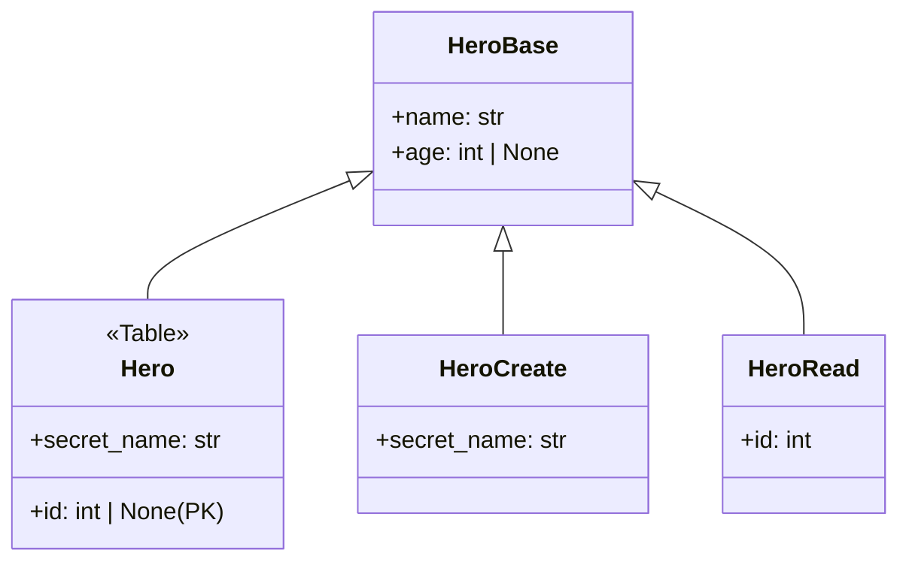

# FastAPI SQLModel: Unified Models & Async Workflows

In standard FastAPI and SQLAlchemy architectures, developers often write two separate class definitions for every entity: a **SQLAlchemy Model** for database storage and multiple **Pydantic Schemas** for API request/response validation. **SQLModel** (created by Sebastián Ramírez, the creator of FastAPI) bridges this gap by unifying Pydantic v2 and SQLAlchemy into a single class definition, eliminating field duplication and accelerating rapid API development.

---

## Conceptual Foundation & Mental Model

### The Problem: Schema Duplication
Without SQLModel:
```python
# 1. SQLAlchemy Database Model
class User(Base):
    __tablename__ = "users"
    id: Mapped[int] = mapped_column(primary_key=True)
    name: Mapped[str] = mapped_column(String(50))
    email: Mapped[str] = mapped_column(String(100), unique=True)

# 2. Pydantic API Validation Schemas (Repeats the exact same fields!)
class UserBase(BaseModel):
    name: str
    email: EmailStr
class UserCreate(UserBase): pass
class UserRead(UserBase):
    id: int
    model_config = ConfigDict(from_attributes=True)
```

### The SQLModel Solution
SQLModel uses metaclasses to inherit from both `pydantic.BaseModel` and SQLAlchemy's `DeclarativeBase`:
- Classes declared with `table=True` become both **SQLAlchemy Database Tables** and **Pydantic Validation Models**.
- Classes declared without `table=True` act as pure Pydantic schemas (e.g. `UserCreate`, `UserUpdate`).

```
                              SQLModel Base
                                    │
            ┌───────────────────────┴───────────────────────┐
            ▼                                               ▼
       Pydantic v2                                     SQLAlchemy 2.0
  (Validation, Serialization,                      (ORM Mapping, DDL,
    OpenAPI JSON Schemas)                            Tables, SQL Queries)
            │                                               │
            └───────────────────────┬───────────────────────┘
                                    │
                                    ▼
                      class Hero(SQLModel, table=True):
                          id: int | None = Field(primary_key=True)
                          name: str
                          secret_name: str
```

---

## Architecture & Internal Mechanics

### How SQLModel Coordinates Pydantic and SQLAlchemy Metaclasses
1. **Field Transformation**: When `Field(primary_key=True)` is used, SQLModel's metaclass transforms it into an underlying SQLAlchemy `Column` while keeping Pydantic's validation hooks intact.
2. **Inheritance-Based Schema Slicing**: By creating a base class (`HeroBase`), developers derive database models (`Hero(HeroBase, table=True)`) and API schemas (`HeroCreate(HeroBase)`, `HeroRead(HeroBase)`) with zero duplicated field definitions.
3. **Async Support**: SQLModel wraps SQLAlchemy's async engine and sessionmaker: `sqlmodel.ext.asyncio.session.AsyncSession`.



---

## Comprehensive Syntax & Core Mechanics

### 1. Declaring Reusable Schema Hierarchies
```python
from sqlmodel import SQLModel, Field

# 1. Base schema containing shared attributes
class TeamBase(SQLModel):
    name: str = Field(index=True)
    headquarters: str

# 2. Database table model
class Team(TeamBase, table=True):
    id: int | None = Field(default=None, primary_key=True)

# 3. Create schema (Input validation)
class TeamCreate(TeamBase):
    pass

# 4. Read schema (Public output)
class TeamRead(TeamBase):
    id: int
```

### 2. Async Engine and Session in SQLModel
```python
from sqlmodel.ext.asyncio.session import AsyncSession
from sqlalchemy.ext.asyncio import create_async_engine, async_sessionmaker

DATABASE_URL = "sqlite+aiosqlite:///:memory:"

engine = create_async_engine(DATABASE_URL, echo=False)
async_session_factory = async_sessionmaker(
    bind=engine,
    class_=AsyncSession,
    expire_on_commit=False
)

async def get_session():
    async with async_session_factory() as session:
        yield session
```

---

## Practical Implementation (5 Complete Examples)

### Example 1: Full CRUD API with SQLModel Hierarchy
```python
from typing import Annotated
from fastapi import FastAPI, Depends, HTTPException, status
from sqlmodel import SQLModel, Field, select
from sqlmodel.ext.asyncio.session import AsyncSession
from sqlalchemy.ext.asyncio import create_async_engine, async_sessionmaker

# --- Models & Schemas ---
class HeroBase(SQLModel):
    name: str = Field(index=True)
    secret_name: str
    age: int | None = Field(default=None, index=True)

class Hero(HeroBase, table=True):
    id: int | None = Field(default=None, primary_key=True)

class HeroCreate(HeroBase):
    pass

class HeroRead(HeroBase):
    id: int

class HeroUpdate(SQLModel):
    name: str | None = None
    secret_name: str | None = None
    age: int | None = None

# --- App & Database ---
engine = create_async_engine("sqlite+aiosqlite:///:memory:", echo=False)
async_session = async_sessionmaker(engine, class_=AsyncSession, expire_on_commit=False)

app = FastAPI(title="Heroes API with SQLModel")

@app.on_event("startup")
async def on_startup():
    async with engine.begin() as conn:
        await conn.run_sync(SQLModel.metadata.create_all)

async def get_db_session() -> AsyncSession:
    async with async_session() as session:
        yield session

@app.post("/heroes", response_model=HeroRead, status_code=status.HTTP_201_CREATED)
async def create_hero(
    hero_in: HeroCreate,
    session: Annotated[AsyncSession, Depends(get_db_session)]
):
    # Convert Pydantic Create schema into SQLModel Table instance
    hero = Hero.model_validate(hero_in)
    session.add(hero)
    await session.commit()
    await session.refresh(hero)
    return hero

@app.get("/heroes", response_model=list[HeroRead])
async def list_heroes(
    session: Annotated[AsyncSession, Depends(get_db_session)],
    offset: int = 0,
    limit: int = 20
):
    stmt = select(Hero).offset(offset).limit(limit)
    result = await session.execute(stmt)
    return result.scalars().all()

@app.get("/heroes/{hero_id}", response_model=HeroRead)
async def read_hero(
    hero_id: int,
    session: Annotated[AsyncSession, Depends(get_db_session)]
):
    hero = await session.get(Hero, hero_id)
    if not hero:
        raise HTTPException(status_code=404, detail="Hero not found")
    return hero

@app.patch("/heroes/{hero_id}", response_model=HeroRead)
async def update_hero(
    hero_id: int,
    hero_in: HeroUpdate,
    session: Annotated[AsyncSession, Depends(get_db_session)]
):
    hero = await session.get(Hero, hero_id)
    if not hero:
        raise HTTPException(status_code=404, detail="Hero not found")

    update_dict = hero_in.model_dump(exclude_unset=True)
    hero.sqlmodel_update(update_dict)

    session.add(hero)
    await session.commit()
    await session.refresh(hero)
    return hero
```

### Example 2: Relationships in SQLModel
```python
from sqlmodel import SQLModel, Field, Relationship

class Team(SQLModel, table=True):
    id: int | None = Field(default=None, primary_key=True)
    name: str

    # One-to-Many
    heroes: list["Hero"] = Relationship(back_populates="team")

class Hero(SQLModel, table=True):
    id: int | None = Field(default=None, primary_key=True)
    name: str
    team_id: int | None = Field(default=None, foreign_key="team.id")

    # Many-to-One
    team: Team | None = Relationship(back_populates="heroes")
```

### Example 3: Many-to-Many Association Links in SQLModel
```python
from sqlmodel import SQLModel, Field, Relationship

# Link Table
class HeroMissionLink(SQLModel, table=True):
    hero_id: int | None = Field(default=None, foreign_key="hero.id", primary_key=True)
    mission_id: int | None = Field(default=None, foreign_key="mission.id", primary_key=True)

class Mission(SQLModel, table=True):
    id: int | None = Field(default=None, primary_key=True)
    codename: str

    heroes: list["Hero"] = Relationship(back_populates="missions", link_model=HeroMissionLink)

class Hero(SQLModel, table=True):
    id: int | None = Field(default=None, primary_key=True)
    name: str

    missions: list[Mission] = Relationship(back_populates="heroes", link_model=HeroMissionLink)
```

### Example 4: Testing SQLModel Endpoints with `TestClient`
```python
from fastapi.testclient import TestClient

def test_create_and_read_hero():
    client = TestClient(app)
    
    # 1. Create Hero
    res = client.post("/heroes", json={"name": "Spider-Man", "secret_name": "Peter Parker", "age": 20})
    assert res.status_code == 201
    hero_data = res.json()
    assert hero_data["name"] == "Spider-Man"
    assert "id" in hero_data

    # 2. Read Hero
    hero_id = hero_data["id"]
    get_res = client.get(f"/heroes/{hero_id}")
    assert get_res.status_code == 200
    assert get_res.json()["secret_name"] == "Peter Parker"
```

### Example 5: Alembic Migration Support with SQLModel
```python
# In alembic/env.py:
from sqlmodel import SQLModel
# Import all model files
import app.models

# Point target_metadata directly to SQLModel.metadata!
target_metadata = SQLModel.metadata
```

---

## Anti-Patterns & Common Traps

| Anti-Pattern | Fatal Consequence | Production Solution |
| :--- | :--- | :--- |
| **Using `Hero(table=True)` directly as `response_model`** | Leaks secret fields (`hashed_password`) and breaks on un-loaded relationships. | Slice models into `HeroRead` schemas without secret fields. |
| **Calling `hero.dict()` instead of Pydantic v2 methods** | In SQLModel with Pydantic v2, legacy `.dict()` is deprecated. | Use `hero.model_dump()` and `hero.sqlmodel_update(dict)`. |
| **Assuming SQLModel handles complex query constructs better than SQLAlchemy** | SQLModel wraps SQLAlchemy; advanced CTEs or window functions still require raw SQLAlchemy expressions. | Fall back to pure SQLAlchemy 2.0 Core expressions when building complex analytical queries. |
| **Omitting `sa_column` when advanced SQL dialect constraints are required** | Basic `Field()` arguments don't cover specialized dialect parameters (e.g. Postgres JSONB). | Pass explicit SQLAlchemy columns: `Field(sa_column=Column(JSONB))`. |

---

## Performance & Resource Characteristics

- **Memory Footprint**: SQLModel instances combine Pydantic validation overhead with SQLAlchemy state tracking, slightly increasing instance memory by ~15% compared to pure SQLAlchemy 2.0 models.
- **Execution Speed**: Identical to SQLAlchemy 2.0 under asyncpg, as SQLModel dispatches raw SQL through SQLAlchemy's compiled statement engine.

---

## Edge Cases, Failure Modes & Gotchas

1. **Pydantic v2 Migration Status**: SQLModel version 0.0.14+ natively supports Pydantic v2. Ensure your environment has compatible versions.
2. **Circular String Relationships**: When defining models in separate files, forward string references (`Relationship(back_populates="hero")`) require importing models and calling `SQLModel.metadata.create_all` after all modules are loaded.

---

## Security Implications & OWASP Alignment

- **Decoupling Secrets**: The inheritance pattern (`HeroBase -> Hero(table=True)`) guarantees that sensitive fields declared only on the database model (`hashed_password`, `totp_secret`) are never present on public read schemas (`HeroRead`).
- **Mass Assignment Defense**: `HeroUpdate` schemas strictly define allowlisted fields for partial updates via `hero.sqlmodel_update()`.

---

## Modern Tooling Integration

- **FastAPI**: First-class citizen; designed specifically for seamless integration with FastAPI.
- **Alembic**: Reads `SQLModel.metadata` directly for automated schema migrations.

---

## Real-World Case Study / Production Incident

A startup developed 40 CRUD endpoints in pure SQLAlchemy 2.0, maintaining 80 separate class definitions (40 ORM models and 40 Pydantic schemas). Every time a developer added a database column, they had to modify 3 separate files. During a critical billing update, an engineer added `stripe_customer_id` to the SQLAlchemy model but forgot the Pydantic schema, breaking automated subscription webhooks.

**Remediation**:
Migrated the service to **SQLModel**:
1. Merged redundant classes into base schemas (`CustomerBase`).
2. Reduced total lines of boilerplate model code by **55%**.
3. Schema desynchronization errors were completely eliminated.

---

## Hands-On Exercises & Challenge Problems

### Warmup (2 Exercises)
1. Define a `Vehicle` model with `SQLModel, table=True` with `id: int | None = Field(primary_key=True)` and `model: str`.
2. Create an endpoint that saves and returns a `Vehicle` instance using async sessions.

### Intermediate (2 Exercises)
3. Implement a one-to-many relationship in SQLModel between `Author` and `Book` and verify that fetching an author with eager loading returns their books.
4. Use `sqlmodel_update()` to implement a partial PATCH endpoint for updating user profiles.

### Production-Grade (2 Exercises)
5. Build a complete multi-entity inventory system (Supplier, Product, Warehouse) using SQLModel inheritance patterns, complete with Pydantic validation rules, composite unique constraints, and automated pytest fixtures.
6. Configure Alembic to autogenerate migration revisions against `SQLModel.metadata` and verify bidirectional `upgrade` and `downgrade` execution against PostgreSQL.

---

## Interview Mastery (8 Q&As)

### Junior Level
**Q1: What is SQLModel?**
*Answer:* A Python library created by Sebastián Ramírez that unifies Pydantic validation schemas and SQLAlchemy ORM database models into single class definitions.

**Q2: What is the significance of `table=True` in a SQLModel class?**
*Answer:* `table=True` tells SQLModel to register the class as a database table in SQLAlchemy's metadata. Classes without `table=True` act as standard Pydantic validation models.

**Q3: How do you declare a primary key in SQLModel?**
*Answer:* `id: int | None = Field(default=None, primary_key=True)`.

### Senior Level
**Q4: Compare SQLModel with pure SQLAlchemy 2.0. When would you choose pure SQLAlchemy 2.0 instead?**
*Answer:* SQLModel is ideal for rapid CRUD development, reducing code duplication by 50%. However, pure SQLAlchemy 2.0 is preferred for large enterprise architectures with complex domain models (Domain-Driven Design), intricate relational mappings, specialized PostgreSQL features (JSONB/Array indexing), or where business domain models must remain decoupled from database schemas.

**Q5: How does SQLModel handle partial updates (HTTP PATCH)?**
*Answer:* By taking a partial Pydantic schema (with optional fields), dumping unset fields via `update_data = payload.model_dump(exclude_unset=True)`, and applying the dictionary to the database entity using `db_entity.sqlmodel_update(update_data)`.

**Q6: Does SQLModel support asynchronous database operations?**
*Answer:* Yes. SQLModel provides an asynchronous session wrapper via `sqlmodel.ext.asyncio.session.AsyncSession` built directly on SQLAlchemy's async engine.

### Staff / Architect Level
**Q7: How does SQLModel's class inheritance pattern (`Base -> Model / Create / Read`) enforce clean architecture?**
*Answer:*
- `EntityBase(SQLModel)`: Defines shared fields (validation rules, common properties).
- `Entity(EntityBase, table=True)`: Adds database-specific metadata (primary keys, foreign keys, relationships, secret credentials).
- `EntityCreate(EntityBase)`: Adds fields required only during creation (e.g. plaintext password).
- `EntityRead(EntityBase)`: Adds fields generated by the database (e.g. auto-increment `id`, `created_at`) while excluding secrets.
This ensures strict data hiding and prevents mass assignment vulnerabilities while maintaining DRY principles.

**Q8: How does Alembic interact with SQLModel in production migrations?**
*Answer:* Because SQLModel is built on SQLAlchemy, it exposes a standard `SQLModel.metadata` collection. In `alembic/env.py`, developers set `target_metadata = SQLModel.metadata`. Alembic inspects SQLModel classes identically to native SQLAlchemy declarative models, autogenerating standard migrations.
