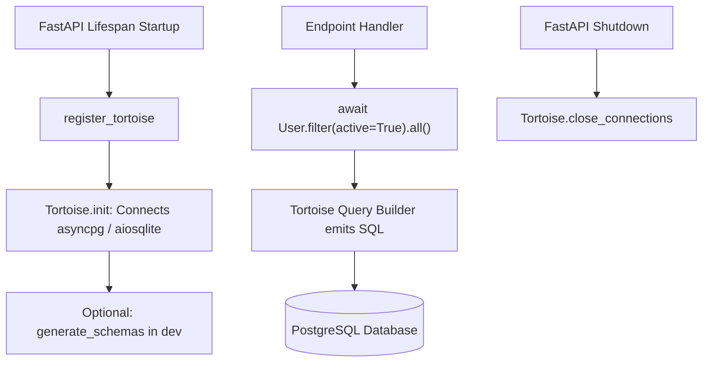

# FastAPI Tortoise-ORM: Django-Style Async ORM

For developers coming from the Django ecosystem, SQLAlchemy's Data Mapper pattern and explicit session management can feel verbose. **Tortoise-ORM** is a native asynchronous ORM inspired by the Django ORM, bringing the **Active Record** pattern (`await User.filter(...).first()`, `await user.save()`) to asyncio, complete with seamless FastAPI integration via `register_tortoise` and automated Pydantic schema generation with `pydantic_model_creator`.

---

## Conceptual Foundation & Mental Model

### Active Record (Tortoise-ORM) vs Data Mapper (SQLAlchemy)
- **Data Mapper (SQLAlchemy)**: Database entities are decoupled from the session. Operations require an explicit `session` object: `session.add(user)`, `await session.commit()`.
- **Active Record (Tortoise-ORM)**: The entity class itself contains data access logic. Database operations are called directly on the model or query set: `user = await User.create(...)`, `await user.delete()`. No session objects to manage or inject!

```
Data Mapper (SQLAlchemy):
session = async_session()
session.add(user)
await session.commit()

Active Record (Tortoise-ORM):
user = await User.create(username="alice", email="alice@example.com")
user.email = "new@example.com"
await user.save()
```

---

## Architecture & Internal Mechanics

### How `register_tortoise` Wires into FastAPI
1. **Lifespan Integration**: `register_tortoise(app, db_url=...)` hooks into FastAPI's startup and shutdown lifecycle.
2. **Connection Initialization**: On startup, it initializes connection pools (`Tortoise.init(...)`) and optionally generates DDL schemas (`generate_schemas=True`).
3. **Graceful Teardown**: On shutdown, it terminates all database connections cleanly (`Tortoise.close_connections()`).
4. **Pydantic Model Generator**: Tortoise inspects model metadata and dynamically builds Pydantic schemas using `pydantic_model_creator()`, eliminating manual schema definitions.



---

## Comprehensive Syntax & Core Mechanics

### 1. Model Definition in Tortoise
```python
from tortoise.models import Model
from tortoise import fields

class User(Model):
    id = fields.IntField(pk=True)
    username = fields.CharField(max_length=50, unique=True, index=True)
    email = fields.CharField(max_length=100, unique=True)
    is_active = fields.BooleanField(default=True)
    created_at = fields.DatetimeField(auto_now_add=True)

    class Meta:
        table = "users"

    def __str__(self):
        return self.username
```

### 2. Automated Pydantic Schema Creation
```python
from tortoise.contrib.pydantic import pydantic_model_creator

# Generates Pydantic schema for response output (excludes sensitive fields)
User_Pydantic = pydantic_model_creator(User, name="UserRead")

# Generates Pydantic schema for request creation (excludes auto-increment PKs)
UserIn_Pydantic = pydantic_model_creator(User, name="UserCreate", exclude_readonly=True)
```

---

## Practical Implementation (5 Complete Examples)

### Example 1: Full CRUD API with `register_tortoise`
```python
from fastapi import FastAPI, HTTPException, status
from tortoise.models import Model
from tortoise import fields
from tortoise.contrib.fastapi import register_tortoise
from tortoise.contrib.pydantic import pydantic_model_creator

app = FastAPI(title="Tortoise-ORM API")

# 1. Model
class Product(Model):
    id = fields.IntField(pk=True)
    name = fields.CharField(max_length=100)
    price = fields.DecimalField(max_digits=10, decimal_places=2)
    stock = fields.IntField(default=0)

    class Meta:
        table = "products"

# 2. Pydantic Schemas
ProductRead = pydantic_model_creator(Product, name="ProductRead")
ProductCreate = pydantic_model_creator(Product, name="ProductCreate", exclude_readonly=True)

# 3. Endpoints (Pure Active Record!)
@app.post("/products", response_model=ProductRead, status_code=status.HTTP_201_CREATED)
async def create_product(product_in: ProductCreate):
    # Direct model creation
    product_obj = await Product.create(**product_in.model_dump())
    return await ProductRead.from_tortoise_orm(product_obj)

@app.get("/products", response_model=list[ProductRead])
async def list_products():
    # Django-style query chaining
    return await ProductRead.from_queryset(Product.all().order_by("-id"))

@app.get("/products/{product_id}", response_model=ProductRead)
async def get_product(product_id: int):
    product = await Product.get_or_none(id=product_id)
    if not product:
        raise HTTPException(status_code=404, detail="Product not found")
    return await ProductRead.from_tortoise_orm(product)

@app.delete("/products/{product_id}", status_code=status.HTTP_204_NO_CONTENT)
async def delete_product(product_id: int):
    deleted_count = await Product.filter(id=product_id).delete()
    if not deleted_count:
        raise HTTPException(status_code=404, detail="Product not found")

# 4. Lifespan Registration
register_tortoise(
    app,
    db_url="sqlite://:memory:",
    modules={"models": ["__main__"]}, # In production: ["app.models"]
    generate_schemas=True,
    add_exception_handlers=True
)
```

### Example 2: Relationships and Foreign Keys in Tortoise
```python
from tortoise.models import Model
from tortoise import fields

class Author(Model):
    id = fields.IntField(pk=True)
    name = fields.CharField(max_length=100)
    
    # Reverse relation: author.books
    books: fields.ReverseRelation["Book"]

class Book(Model):
    id = fields.IntField(pk=True)
    title = fields.CharField(max_length=200)
    author: fields.ForeignKeyRelation[Author] = fields.ForeignKeyField(
        "models.Author",
        related_name="books",
        on_delete=fields.CASCADE
    )

# Querying with prefetch_related (Eager Loading):
# books = await Book.all().prefetch_related("author")
```

### Example 3: Atomic Transactions in Tortoise (`in_transaction`)
```python
from tortoise.transactions import in_transaction

async def transfer_credits(sender_id: int, recipient_id: int, amount: float):
    # Atomic transaction block
    async with in_transaction() as connection:
        sender = await User.filter(id=sender_id).using_db(connection).select_for_update().first()
        recipient = await User.filter(id=recipient_id).using_db(connection).select_for_update().first()

        if sender.credits < amount:
            raise ValueError("Insufficient funds")

        sender.credits -= amount
        recipient.credits += amount

        await sender.save(using_db=connection)
        await recipient.save(using_db=connection)
```

### Example 4: Testing Tortoise-ORM with Pytest
```python
import pytest
from tortoise.contrib.test import initializer, finalizer

@pytest.fixture(scope="session", autouse=True)
def initialize_tests():
    # Setup test DB
    initializer(["__main__"], db_url="sqlite://:memory:")
    yield
    # Teardown
    finalizer()

@pytest.mark.anyio
async def test_create_user_active_record():
    user = await User.create(username="test_user", email="test@example.com")
    assert user.id is not None
    
    fetched = await User.get(username="test_user")
    assert fetched.email == "test@example.com"
```

### Example 5: Aerich Migration Configuration (`aerich.ini`)
```ini
# Tortoise uses Aerich (similar to Alembic) for database migrations
# aerich.ini:
[aerich]
tortoise_orm = app.core.database.TORTOISE_ORM
location = ./migrations
src_folder = ./src

# CLI Commands:
# aerich init -t app.core.database.TORTOISE_ORM
# aerich init-db
# aerich migrate --name "add user phone"
# aerich upgrade
```

---

## Anti-Patterns & Common Traps

| Anti-Pattern | Fatal Consequence | Production Solution |
| :--- | :--- | :--- |
| **Using `generate_schemas=True` in production** | Can overwrite or alter live tables on container restart without migrations. | Use `Aerich` for production migrations; set `generate_schemas=False`. |
| **Forgetting `await` on Active Record operations** | Returns an un-awaited coroutine; database mutations are never sent. | Always `await` Tortoise queries: `await User.create(...)`. |
| **Direct property access on related models without `prefetch_related`** | Triggers `OperationalError` because related models must be fetched asynchronously. | Use `await model.fetch_related("author")` or `.prefetch_related(...)`. |
| **Using Tortoise for complex analytical window functions** | Query expression builder is limited compared to SQLAlchemy Core. | Fall back to raw SQL via `Tortoise.get_connection("default").execute_query(...)`. |

---

## Performance & Resource Characteristics

- **Query Speed**: High throughput; uses native `asyncpg` for PostgreSQL and `aiosqlite` for SQLite.
- **Active Record Overhead**: Slightly higher memory overhead than SQLAlchemy 2.0 Core due to dynamic Pydantic schema generation and Active Record introspection.

---

## Edge Cases, Failure Modes & Gotchas

1. **Circular Import in `pydantic_model_creator`**: If Model A references Model B and Model B references Model A, calling `pydantic_model_creator` before all models are loaded causes recursion errors. Call `Tortoise.init_models(["app.models"], "models")` first.
2. **Connection Context in Background Tasks**: If a background task runs after FastAPI shutdown, connections are closed. Ensure background tasks finish before application shutdown.

---

## Security Implications & OWASP Alignment

- **SQL Injection Defense**: Tortoise compiles all `.filter()` expressions into parameterized queries (`$1, $2`), preventing SQL injection attacks.
- **Hidden Password Fields**: When using `pydantic_model_creator`, explicitly declare `exclude=("password_hash",)` to guarantee credentials are not leaked in generated API schemas.

---

## Modern Tooling Integration

- **Aerich**: Official database migration tool for Tortoise-ORM.
- **FastAPI**: Direct integration via `tortoise.contrib.fastapi.register_tortoise`.

---

## Real-World Case Study / Production Incident

A rapid-prototyping team built an internal inventory portal using Tortoise-ORM. During early development, `register_tortoise(..., generate_schemas=True)` was active. When deploying to production on AWS ECS with 4 containers, the containers started simultaneously, and all 4 containers executed `CREATE TABLE IF NOT EXISTS` concurrently, creating table lock contention and triggering database initialization errors.

**Remediation**:
1. Disabled `generate_schemas=True` in production (`generate_schemas=settings.DEBUG`).
2. Adopted **Aerich** for version-controlled database migrations, running `aerich upgrade` as a pre-deploy pipeline step.

---

## Hands-On Exercises & Challenge Problems

### Warmup (2 Exercises)
1. Define a `Customer` model in Tortoise with `name` and `email` fields.
2. Register Tortoise on a FastAPI app using `sqlite://:memory:` with `generate_schemas=True`.

### Intermediate (2 Exercises)
3. Generate a Pydantic read schema using `pydantic_model_creator` excluding the `id` field.
4. Implement an endpoint that updates a customer's email using Active Record: `customer = await Customer.get(id=...); customer.email = ...; await customer.save()`.

### Production-Grade (2 Exercises)
5. Build an atomic transaction workflow using `in_transaction()` that debits an account balance and creates an audit record, rolling back both if an error occurs.
6. Initialize an Aerich migration repository, generate an initial migration revision for two related models, and execute the migration against PostgreSQL.

---

## Interview Mastery (8 Q&As)

### Junior Level
**Q1: What paradigm does Tortoise-ORM follow?**
*Answer:* The Active Record pattern (inspired by Django ORM), where models encapsulate both data and database query logic.

**Q2: How do you integrate Tortoise-ORM with FastAPI?**
*Answer:* Using `register_tortoise(app, db_url=..., modules=..., generate_schemas=...)` from `tortoise.contrib.fastapi`.

**Q3: What utility automatically generates Pydantic models from Tortoise models?**
*Answer:* `pydantic_model_creator(MyModel, name="MyModelSchema")`.

### Senior Level
**Q4: Compare Tortoise-ORM with SQLAlchemy 2.0. When would you choose Tortoise-ORM?**
*Answer:* Choose Tortoise-ORM when developers have strong Django backgrounds, prefer Active Record simplicity, and want rapid prototyping without managing explicit session objects or separate Pydantic schemas. Choose SQLAlchemy 2.0 for enterprise applications requiring Data Mapper decoupling, complex relational joins, or advanced database-specific features.

**Q5: How does Tortoise handle eager loading of relationships?**
*Answer:* Using `.prefetch_related("relation_name")` in queries or calling `await instance.fetch_related("relation_name")` on an existing model instance.

**Q6: What migration tool is used with Tortoise-ORM?**
*Answer:* **Aerich**, a dedicated migration tool built specifically for Tortoise-ORM (similar to Alembic for SQLAlchemy).

### Staff / Architect Level
**Q7: What are the architectural disadvantages of the Active Record pattern in large microservice codebases?**
*Answer:* Active Record tightly couples business domain entities with database persistence. Models cannot easily be tested without a database connection, business logic becomes intertwined with SQL queries, and domain entities cannot be reused across different persistence engines (violating the Single Responsibility Principle and Hexagonal Architecture).

**Q8: How does transaction management work in Tortoise-ORM without explicit session objects?**
*Answer:* Tortoise uses `async with in_transaction() as connection:` context managers. Within the block, operations must be bound to the connection (or use `using_db(connection)`), ensuring all queries run within the same database transaction and commit/rollback atomically.
