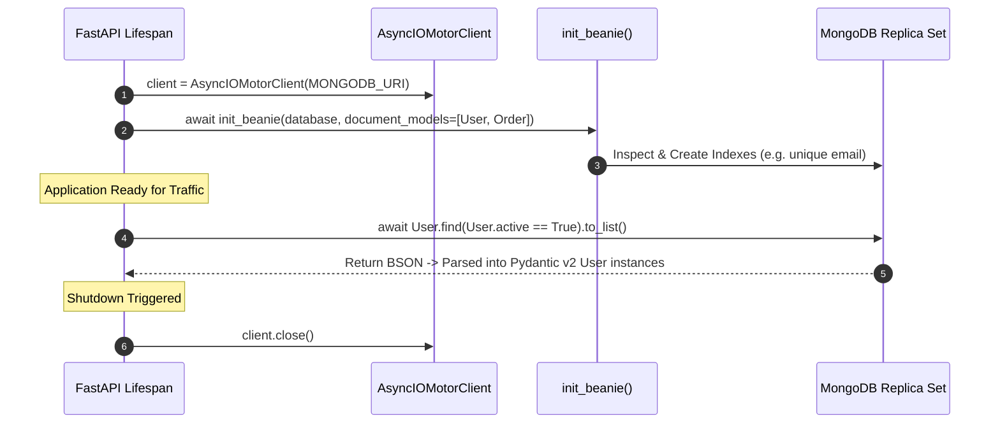

# FastAPI MongoDB with Motor & Beanie ODM

When applications require dynamic schemas, hierarchical JSON/BSON document storage, high-throughput write ingestion, or horizontal sharding, **MongoDB** is an industry standard NoSQL database. In FastAPI, pairing the asynchronous **Motor** driver with **Beanie**—a modern Object-Document Mapper (ODM) built directly on **Pydantic v2**—enables native data validation, type-safe queries, and rich aggregation pipelines with zero impedance mismatch.

---

## Conceptual Foundation & Mental Model

In traditional Python MongoDB workflows using raw `pymongo` or `motor`:
- Queries return untyped Python dictionaries (`dict`).
- Developers must manually validate documents using Pydantic, convert between MongoDB's `_id` (`ObjectId`) and string IDs, and write error-prone string queries (`{"$set": {"user.name": "Alice"}}`).

### The Beanie Advantage
Beanie subclasses Pydantic v2's `BaseModel`:
- Every Beanie `Document` **is** a Pydantic model. It validates incoming JSON payloads automatically.
- Database operations are called directly on the model: `await user.insert()`, `await User.find_one(User.email == "alice@example.com")`.
- Native support for Python comparison operators (`==`, `>`, `<`, `in_`) translates directly to MongoDB query syntax (`$eq`, `$gt`, `$in`).

```
Pydantic v2 Model                  Beanie ODM                        MongoDB Cluster
class User(Document):     ──►  Validates schema & types  ──►  Stores as BSON Document
  email: EmailStr              Provides async queries          Collection: 'users'
  tags: list[str]              Serializes ObjectId <-> str     _id: ObjectId('660...')
```

---

## Architecture & Internal Mechanics

### How Motor and Beanie Initialize in FastAPI
1. **Motor Client Creation**: An `AsyncIOMotorClient` is instantiated during FastAPI's `lifespan` startup.
2. **Beanie Schema Inspection**: `init_beanie(database, document_models=[...])` inspects all registered `Document` subclasses.
3. **Automated Index Synchronization**: Beanie connects to MongoDB and creates any declared unique indexes, compound indexes, or text search indexes automatically.
4. **Connection Teardown**: On application shutdown, the Motor client connection pool is cleanly closed.



---

## Comprehensive Syntax & Core Mechanics

### 1. Defining a Beanie Document Model
```python
from beanie import Document, Indexed
from pydantic import Field, EmailStr
from datetime import datetime, timezone

class User(Document):
    # Indexed creates single-field or unique indexes in MongoDB automatically!
    email: Indexed(EmailStr, unique=True)
    username: str = Field(min_length=3, max_length=50)
    preferences: dict[str, str] = Field(default_factory=dict)
    is_active: bool = True
    created_at: datetime = Field(default_factory=lambda: datetime.now(timezone.utc))

    class Settings:
        name = "users" # MongoDB collection name
        use_state_management = True # Enables tracking changed fields for optimized saves
```

### 2. Lifespan Registration
```python
from contextlib import asynccontextmanager
from fastapi import FastAPI
from motor.motor_asyncio import AsyncIOMotorClient
from beanie import init_beanie

MONGODB_URL = "mongodb://localhost:27017"

@asynccontextmanager
async def lifespan(app: FastAPI):
    client = AsyncIOMotorClient(MONGODB_URL)
    database = client["production_catalog"]
    
    # Initialize Beanie with document classes
    await init_beanie(database=database, document_models=[User])
    print("[MONGODB] Connected and indexes synchronized.")
    
    yield
    client.close()
    print("[MONGODB] Connection pool closed.")

app = FastAPI(lifespan=lifespan)
```

---

## Practical Implementation (5 Complete Examples)

### Example 1: Full CRUD API with Beanie
```python
from fastapi import FastAPI, HTTPException, status
from beanie import Document, PydanticObjectId
from pydantic import BaseModel, Field

# --- Document Model ---
class Article(Document):
    title: str = Field(min_length=1, max_length=200)
    content: str
    views: int = 0
    tags: list[str] = Field(default_factory=list)

    class Settings:
        name = "articles"

# --- Request / Response Schemas ---
class ArticleCreate(BaseModel):
    title: str
    content: str
    tags: list[str] = []

class ArticleUpdate(BaseModel):
    title: str | None = None
    content: str | None = None
    tags: list[str] | None = None

app = FastAPI(title="Articles MongoDB API", lifespan=lifespan)

@app.post("/articles", response_model=Article, status_code=status.HTTP_201_CREATED)
async def create_article(payload: ArticleCreate):
    # Instantiate Beanie document from validated Pydantic data
    article = Article(**payload.model_dump())
    await article.insert()
    return article

@app.get("/articles", response_model=list[Article])
async def list_articles(tag: str | None = None, limit: int = 20):
    query = Article.all()
    if tag:
        # Array containment query: tag in Article.tags
        query = Article.find({"tags": tag})
    return await query.limit(limit).to_list()

@app.get("/articles/{article_id}", response_model=Article)
async def get_article(article_id: PydanticObjectId):
    article = await Article.get(article_id)
    if not article:
        raise HTTPException(status_code=404, detail="Article not found")
    
    # Increment view count atomically
    article.views += 1
    await article.save()
    return article

@app.patch("/articles/{article_id}", response_model=Article)
async def update_article(article_id: PydanticObjectId, payload: ArticleUpdate):
    article = await Article.get(article_id)
    if not article:
        raise HTTPException(status_code=404, detail="Article not found")

    update_dict = payload.model_dump(exclude_unset=True)
    await article.set(update_dict)
    return article

@app.delete("/articles/{article_id}", status_code=status.HTTP_204_NO_CONTENT)
async def delete_article(article_id: PydanticObjectId):
    article = await Article.get(article_id)
    if not article:
        raise HTTPException(status_code=404, detail="Article not found")
    await article.delete()
```

### Example 2: MongoDB Aggregation Pipelines in Beanie
```python
from beanie import Document
from pydantic import BaseModel

class Order(Document):
    customer_id: str
    total_amount: float
    status: str

    class Settings:
        name = "orders"

class CustomerSpendingSummary(BaseModel):
    id: str  # Customer ID from $group
    total_spent: float
    order_count: int

# Aggregation pipeline executed asynchronously:
async def get_top_spending_customers(min_spend: float = 1000.0) -> list[CustomerSpendingSummary]:
    pipeline = [
        {"$match": {"status": "completed"}},
        {
            "$group": {
                "_id": "$customer_id",
                "total_spent": {"$sum": "$total_amount"},
                "order_count": {"$sum": 1}
            }
        },
        {"$match": {"total_spent": {"$gte": min_spend}}},
        {"$sort": {"total_spent": -1}},
        {"$limit": 10}
    ]
    # Beanie maps aggregation results directly into Pydantic models!
    return await Order.aggregate(pipeline, projection_model=CustomerSpendingSummary).to_list()
```

### Example 3: Compound and Text Search Indexes
```python
from beanie import Document
from pymongo import IndexModel, TEXT, ASCENDING

class ProductCatalog(Document):
    sku: str
    name: str
    category: str
    description: str

    class Settings:
        name = "product_catalog"
        indexes = [
            # Compound index on category + sku
            IndexModel([("category", ASCENDING), ("sku", ASCENDING)], unique=True),
            # Full-text search index across name and description
            IndexModel([("name", TEXT), ("description", TEXT)], name="text_search_idx")
        ]

# Full-text search query in Beanie:
# results = await ProductCatalog.find({"$text": {"$search": "wireless headphones"}}).to_list()
```

### Example 4: Testing Beanie Endpoints with `mongomock_motor`
```python
import pytest
from mongomock_motor import AsyncMongoMockClient
from beanie import init_beanie

@pytest.fixture(autouse=True)
async def init_mock_mongodb():
    # Spin up in-memory MongoDB mock client for fast unit tests
    mock_client = AsyncMongoMockClient()
    mock_db = mock_client["test_database"]
    await init_beanie(database=mock_db, document_models=[Article])
    yield
    mock_client.close()

@pytest.mark.anyio
async def test_beanie_article_crud():
    article = Article(title="Test Post", content="Unit test content")
    await article.insert()
    assert article.id is not None

    found = await Article.find_one(Article.title == "Test Post")
    assert found is not None
    assert found.content == "Unit test content"
```

### Example 5: Multi-Document ACID Transactions in MongoDB
```python
from motor.motor_asyncio import AsyncIOMotorClient

async def transfer_credits_mongo(client: AsyncIOMotorClient, sender_id: str, receiver_id: str, amount: float):
    # MongoDB replica sets support multi-document ACID transactions!
    async with await client.start_session() as session:
        async with session.start_transaction():
            sender = await User.find_one(User.id == sender_id, session=session)
            if sender.credits < amount:
                raise ValueError("Insufficient balance")
            
            receiver = await User.find_one(User.id == receiver_id, session=session)
            
            sender.credits -= amount
            receiver.credits += amount
            
            await sender.save(session=session)
            await receiver.save(session=session)
```

---

## Anti-Patterns & Common Traps

| Anti-Pattern | Fatal Consequence | Production Solution |
| :--- | :--- | :--- |
| **Using synchronous `pymongo` in async route** | Freezes the central event loop during network calls. | Use `motor.motor_asyncio` and `beanie`. |
| **Passing raw string IDs instead of `PydanticObjectId`** | MongoDB fails to match `_id`; queries return 404 for valid documents. | Type path parameters as `article_id: PydanticObjectId`. |
| **Calling `.to_list()` without a `limit()` on large collections** | Loads 1,000,000 documents into RAM; triggers Linux OOM crash. | Always specify a `limit()` or use async cursor iteration. |
| **Attempting multi-document transactions on standalone MongoDB** | Standalone instances do not support transactions; raises `OperationFailure`. | Transactions require a MongoDB Replica Set (or Atlas cluster). |

---

## Performance & Resource Characteristics

- **High Write Throughput**: MongoDB's memory-mapped storage engine (WiredTiger) achieves up to 50,000+ document writes per second under async Motor.
- **Pydantic Validation Speed**: Beanie utilizes Pydantic v2's compiled Rust core (`pydantic-core`) for parsing BSON into Python models, delivering 5x–10x faster deserialization than legacy v1 ODMs.

---

## Edge Cases, Failure Modes & Gotchas

1. **`ObjectId` vs String in JSON**: MongoDB's primary key is an `ObjectId` (e.g. `ObjectId("6607f2...")`), which is not native JSON. Beanie's `PydanticObjectId` automatically serializes to a clean 24-character hexadecimal string in API responses.
2. **Index Creation Timeouts**: If a table has 10M documents, `init_beanie` will block startup while creating indexes unless indexes are created in the background or managed via DevOps pipelines.

---

## Security Implications & OWASP Alignment

- **NoSQL Injection (OWASP API3:2023)**: If user-supplied JSON containing query operators (e.g. `{"username": {"$gt": ""}}`) is passed directly to `.find()`, attackers can bypass password checks. Beanie's strict Pydantic typing rejects raw operator dictionaries automatically.

---

## Modern Tooling Integration

- **MongoDB Atlas**: Managed enterprise cloud cluster.
- **Compass**: GUI desktop tool for inspecting collections, documents, and index performance.

---

## Real-World Case Study / Production Incident

An IoT telemetry ingestion API was receiving 10,000 sensor readings per second. The developers used a raw Motor query with `User.find().to_list()` without a limit on their historical readings endpoint.

**The Incident**:
A sensor with 2.5 million stored readings was queried. Motor loaded 2.5 million documents into memory, consuming 8GB of RAM and crashing the container pod.

**Remediation**:
1. Enforced a maximum `limit(1000)` in API schemas.
2. Implemented time-bucketed cursor streaming for large exports:
   ```python
   async for doc in SensorReading.find(...).batch_size(100):
       yield doc.to_json()
   ```
Memory usage dropped to a flat 40MB.

---

## Hands-On Exercises & Challenge Problems

### Warmup (2 Exercises)
1. Define a Beanie `LogEntry` document with `level: str`, `message: str`, and a timestamp.
2. Initialize Beanie with `AsyncMongoMockClient` and insert a sample log record.

### Intermediate (2 Exercises)
3. Implement a full text search endpoint using a Beanie text index and test searching for keywords.
4. Build a customer aggregation pipeline that calculates total revenue grouped by order status.

### Production-Grade (2 Exercises)
5. Build an atomic multi-document transaction with Motor and Beanie that transfers account balances between two users, asserting that failure during recipient update rolls back the sender debit.
6. Design and implement a polymorphic document collection (e.g. `Notification` base class with `EmailNotification` and `SMSNotification` subclasses) in Beanie with clean FastAPI routing.

---

## Interview Mastery (8 Q&As)

### Junior Level
**Q1: What is Beanie in the FastAPI ecosystem?**
*Answer:* An asynchronous Object-Document Mapper (ODM) for MongoDB built on the Motor async driver and Pydantic v2, allowing developers to define MongoDB documents as Pydantic models.

**Q2: What is `PydanticObjectId`?**
*Answer:* A custom Beanie type that wraps MongoDB's 12-byte BSON `ObjectId`, validating and serializing it transparently as a standard 24-character string in API requests and responses.

**Q3: Which function initializes Beanie on FastAPI startup?**
*Answer:* `await init_beanie(database=..., document_models=[...])` inside the FastAPI `lifespan` context manager.

### Senior Level
**Q4: How does Beanie prevent NoSQL injection attacks?**
*Answer:* Because Beanie models are strict Pydantic v2 schemas, incoming client requests are parsed against declared primitive types (e.g. `str`, `int`). Malicious operator dictionaries (like `{"$gt": ""}`) fail Pydantic validation before reaching the MongoDB query builder.

**Q5: What is the difference between `model.insert()` and `model.save()` in Beanie?**
*Answer:* `insert()` creates a brand-new document in the collection (generating a new `_id`). `save()` creates the document if it doesn't exist, or replaces/updates it if an `_id` is already present.

**Q6: Can MongoDB execute multi-document ACID transactions?**
*Answer:* Yes, starting in MongoDB 4.0+, multi-document ACID transactions are fully supported on replica sets using `async with await client.start_session() as session: async with session.start_transaction():`.

### Staff / Architect Level
**Q7: When should an enterprise architect choose MongoDB + Beanie over PostgreSQL + SQLAlchemy?**
*Answer:* Choose MongoDB + Beanie when:
1. Data models are deeply hierarchical (nested objects/arrays) and updated as single document aggregates.
2. The domain requires highly dynamic, polymorphous schemas (e.g. CMS, product catalogs with variable attributes).
3. The workload demands horizontal sharding across terabytes of data with high write volumes.
4. Choose PostgreSQL when the domain is heavily relational, requires strict multi-table foreign keys, or involves financial ledgers with complex joins.

**Q8: How does Beanie optimize document updates using `use_state_management=True`?**
*Answer:* When `use_state_management = True` is enabled in `Settings`, Beanie tracks which attributes were modified in Python memory after the document was fetched. When `await doc.save()` is called, it emits a targeted `$set` query updating only the changed fields, rather than overwriting the entire document over the network.
