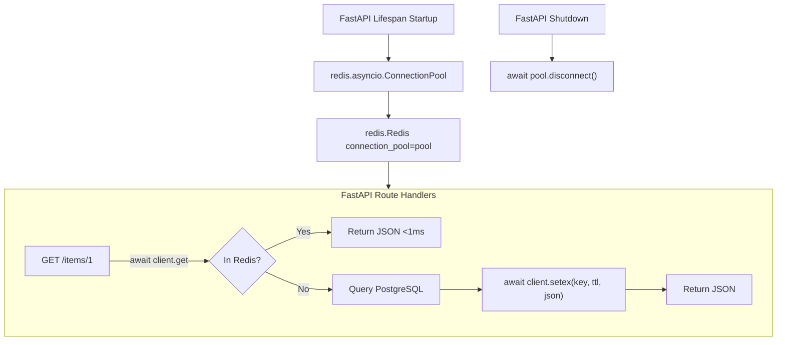

# FastAPI Redis: Async Caching, Sessions & Distributed Locks

In high-throughput systems, querying a relational database for every HTTP request is an anti-pattern. **Redis** is an in-memory key-value data store capable of sub-millisecond read/write latencies. By integrating `redis.asyncio` into FastAPI, backend architectures unlock high-speed **Cache-Aside** layers, distributed session stores, atomic rate limiters, and cross-pod **Distributed Locks**.

---

## Conceptual Foundation & Mental Model

### The Cache-Aside (Lazy Loading) Pattern
1. **Client requests data**: `GET /products/101`.
2. **Check Cache**: Application checks Redis key `product:101`.
   - **Cache Hit**: Data found in Redis; return immediately (0.3ms latency). Database is bypassed.
   - **Cache Miss**: Key does not exist; query primary PostgreSQL database (15ms latency).
3. **Populate Cache**: Write data into Redis with an explicit **Time-To-Live (TTL)** (e.g. `EX 3600` = 1 hour).
4. **Return Response**: Return data to client. Subsequent requests hit Redis.

```
Client Request
      │
      ▼
┌──────────────┐       1. Cache Hit (0.3ms)       ┌──────────────┐
│ FastAPI API  │ ◄─────────────────────────────── │ Redis Cache  │
└──────┬───────┘                                  └──────┬───────┘
       │                                                 │
       │ 2. Cache Miss                                   │ 3. Populate Cache
       ▼                                                 │    (with TTL)
┌──────────────┐                                         │
│  PostgreSQL  │ ────────────────────────────────────────┘
└──────────────┘
```

---

## Architecture & Internal Mechanics

### Connection Pooling in `redis.asyncio`
In `redis-py` 5.x+, `redis.asyncio` provides native asynchronous connection pooling:
- `ConnectionPool.from_url()` manages an async pool of persistent TCP connections to Redis.
- A single Redis client instance (`redis.Redis(connection_pool=pool)`) is shared globally across all FastAPI endpoints via dependency injection.
- Commands (`GET`, `SET`, `INCR`, `HSET`) are non-blocking coroutines running on the asyncio event loop.



---

## Comprehensive Syntax & Core Mechanics

### 1. Lifespan Client Registration
```python
from contextlib import asynccontextmanager
from fastapi import FastAPI
import redis.asyncio as aioredis

REDIS_URL = "redis://localhost:6379/0"
redis_client: aioredis.Redis | None = None

@asynccontextmanager
async def lifespan(app: FastAPI):
    global redis_client
    # Initialize connection pool
    pool = aioredis.ConnectionPool.from_url(
        REDIS_URL,
        max_connections=50,
        decode_responses=True # Automatically decodes bytes to UTF-8 strings!
    )
    redis_client = aioredis.Redis(connection_pool=pool)
    await redis_client.ping()
    print("[REDIS] Connected successfully.")
    
    yield
    
    # Graceful shutdown
    await pool.disconnect()
    print("[REDIS] Disconnected.")

app = FastAPI(lifespan=lifespan)

# Dependency
async def get_redis() -> aioredis.Redis:
    return redis_client
```

---

## Practical Implementation (5 Complete Examples)

### Example 1: Full Cache-Aside Decorator Pattern
```python
import functools
import json
from typing import Annotated
from fastapi import FastAPI, Depends, HTTPException
import redis.asyncio as aioredis
from pydantic import BaseModel

app = FastAPI(lifespan=lifespan)

class Product(BaseModel):
    id: int
    name: str
    price: float

@app.get("/products/{product_id}", response_model=Product)
async def get_product(
    product_id: int,
    redis: Annotated[aioredis.Redis, Depends(get_redis)]
):
    cache_key = f"cache:product:{product_id}"

    # 1. Attempt Cache Read
    cached_json = await redis.get(cache_key)
    if cached_json:
        return Product.model_validate_json(cached_json)

    # 2. Database Lookup (Simulated)
    if product_id == 999:
        raise HTTPException(status_code=404, detail="Product not found")
    
    product = Product(id=product_id, name="Mechanical Keyboard", price=129.99)

    # 3. Cache Write with 10-minute TTL (600 seconds)
    await redis.setex(cache_key, 600, product.model_dump_json())
    return product

@app.post("/products/{product_id}/invalidate")
async def invalidate_product_cache(
    product_id: int,
    redis: Annotated[aioredis.Redis, Depends(get_redis)]
):
    # Invalidate cache on update
    cache_key = f"cache:product:{product_id}"
    await redis.delete(cache_key)
    return {"status": "cache_invalidated"}
```

### Example 2: Distributed Locking (Preventing Race Conditions)
```python
import asyncio
from typing import Annotated
from fastapi import FastAPI, Depends, HTTPException, status
import redis.asyncio as aioredis

app = FastAPI()

# Distributed Lock: Guarantees that only ONE worker processes a critical section!
@app.post("/inventory/{sku}/restock")
async def restock_inventory(
    sku: str,
    amount: int,
    redis: Annotated[aioredis.Redis, Depends(get_redis)]
):
    lock_key = f"lock:restock:{sku}"
    
    # Acquire distributed lock with a 5-second automatic safety release timeout
    async with redis.lock(lock_key, timeout=5.0, blocking_timeout=2.0) as lock:
        # Critical section: exactly one worker executes this at any instant
        print(f"Acquired exclusive lock for SKU {sku}. Restocking...")
        await asyncio.sleep(0.5) # Simulated DB update
        return {"status": "restocked", "sku": sku, "amount": amount}
```

### Example 3: Sliding-Window Rate Limiting via Redis Sorted Sets (`ZADD`)
```python
import time
from typing import Annotated
from fastapi import FastAPI, Depends, HTTPException, Request, status
import redis.asyncio as aioredis

app = FastAPI()

async def sliding_window_rate_limiter(
    request: Request,
    redis: Annotated[aioredis.Redis, Depends(get_redis)],
    limit: int = 10,
    window_seconds: int = 60
):
    client_ip = request.client.host if request.client else "unknown"
    key = f"ratelimit:{client_ip}"
    now = time.time()
    clear_before = now - window_seconds

    # Pipeline executes atomic batch commands in a single network roundtrip!
    async with redis.pipeline(transaction=True) as pipe:
        # 1. Remove timestamps older than window
        pipe.zremrangebyscore(key, 0, clear_before)
        # 2. Add current timestamp
        pipe.zadd(key, {str(now): now})
        # 3. Count remaining elements in window
        pipe.zcard(key)
        # 4. Set expiry to clean up memory
        pipe.expire(key, window_seconds)
        
        _, _, request_count, _ = await pipe.execute()

    if request_count > limit:
        raise HTTPException(
            status_code=status.HTTP_429_TOO_MANY_REQUESTS,
            detail=f"Rate limit exceeded: max {limit} requests per {window_seconds}s.",
            headers={"Retry-After": str(window_seconds)}
        )

@app.get("/expensive-ai-task", dependencies=[Depends(sliding_window_rate_limiter)])
async def expensive_task():
    return {"result": "Computed result"}
```

### Example 4: Redis Pub/Sub for Real-Time Notification Broadcast
```python
import asyncio
from fastapi import FastAPI, WebSocket, WebSocketDisconnect
import redis.asyncio as aioredis

app = FastAPI()

@app.websocket("/ws/notifications/{channel_name}")
async def notification_stream(
    websocket: WebSocket,
    channel_name: str,
    redis: aioredis.Redis = Depends(get_redis)
):
    await websocket.accept()
    pubsub = redis.pubsub()
    await pubsub.subscribe(channel_name)

    async def reader():
        try:
            async for message in pubsub.listen():
                if message["type"] == "message":
                    await websocket.send_text(message["data"])
        except Exception:
            pass

    task = asyncio.create_task(reader())
    try:
        while True:
            # Keep connection open
            await websocket.receive_text()
    except WebSocketDisconnect:
        await pubsub.unsubscribe(channel_name)
        task.cancel()
```

### Example 5: Testing Redis Endpoints with `fakeredis`
```python
import pytest
import fakeredis.aioredis
from fastapi.testclient import TestClient

@pytest.fixture
def mock_redis_dependency():
    # In-memory mock Redis for fast, isolated unit tests without Docker!
    fake_client = fakeredis.aioredis.FakeRedis(decode_responses=True)
    app.dependency_overrides[get_redis] = lambda: fake_client
    yield fake_client
    app.dependency_overrides.clear()

def test_cache_aside_with_fakeredis(mock_redis_dependency):
    client = TestClient(app)
    # 1. First call: populates cache
    res1 = client.get("/products/101")
    assert res1.status_code == 200

    # 2. Assert key is present in fake Redis
    assert mock_redis_dependency.exists("cache:product:101") == 1
```

---

## Anti-Patterns & Common Traps

| Anti-Pattern | Fatal Consequence | Production Solution |
| :--- | :--- | :--- |
| **Omitting TTL on cache keys (`SET` without `EX`)** | Redis RAM fills up indefinitely; crashes with OOM (Out Of Memory). | Always configure an explicit expiration (`setex(key, ttl, val)`). |
| **Cache Stampede / Dog-Piling** | When a popular key expires, 1,000 concurrent requests all query the DB at once. | Use probabilistic early expiration (XFetch) or distributed mutex locks. |
| **Serializing complex objects without schemas** | Storing pickled Python objects breaks when class definitions change across deploys. | Always serialize to standard JSON strings using Pydantic `model_dump_json()`. |
| **Using `KEYS *` in production code** | Freezes single-threaded Redis while scanning millions of keys. | Use `SCAN` or use structured Hash sets (`HGETALL`). |

---

## Performance & Resource Characteristics

- **Sub-Millisecond Read Latency**: A local or VPC Redis hit responds in **0.2ms to 0.5ms**, compared to 10ms–50ms for PostgreSQL queries.
- **Pipelining Advantage**: Executing 10 commands in a `redis.pipeline()` executes in 1 network roundtrip instead of 10 roundtrips, reducing latency by 90%.

---

## Edge Cases, Failure Modes & Gotchas

1. **Redis Eviction Policies**: If Redis memory reaches `maxmemory`, it begins evicting keys according to its policy (e.g. `allkeys-lru` vs `volatile-lru`). Ensure transient cache keys have TTLs so critical session keys are not evicted prematurely.
2. **Cluster Sharding Keys**: In Redis Cluster, multi-key operations (like MGET or Lua scripts) fail unless all keys hash to the same slot using hash tags: `{user:101}:profile` and `{user:101}:orders`.

---

## Security Implications & OWASP Alignment

- **Unrestricted Resource Consumption (OWASP API4:2023)**: Redis sliding-window rate limiters prevent brute-force credential stuffing and DoS scraping attacks.
- **Network Isolation**: Never expose Redis port 6379 to the public internet without authentication (`requirepass`) and TLS encryption.

---

## Modern Tooling Integration

- **Dragonfly / KeyDB**: Modern multi-threaded drop-in replacements for Redis.
- **fakeredis**: Essential mocking library for unit testing.

---

## Real-World Case Study / Production Incident

An international news website covered an election event. Their home page article query was cached with `TTL = 60 seconds`.
At the exact second the cache expired, **8,000 concurrent users** refreshed the page.

**The Incident (Cache Stampede)**:
All 8,000 requests observed a cache miss simultaneously. All 8,000 requests hit the PostgreSQL database with the heavy analytical query at the exact same millisecond. The database CPU spiked to 100%, connection pools exhausted, and the website crashed.

**Remediation**:
Implemented **Mutex Lock Cache-Aside**:
```python
cached = await redis.get(key)
if not cached:
    async with redis.lock(f"lock:{key}", timeout=5):
        # Double-check cache inside lock
        cached = await redis.get(key)
        if not cached:
            cached = await query_db()
            await redis.setex(key, 60, cached)
```
Only 1 request was allowed to query the database and rebuild the cache; the other 7,999 waited for the lock and served the freshly cached result.

---

## Hands-On Exercises & Challenge Problems

### Warmup (2 Exercises)
1. Initialize an async Redis client and verify connectivity using `await redis.ping()`.
2. Write an endpoint `/cache-test` that sets a key with a 10-second TTL and retrieves it.

### Intermediate (2 Exercises)
3. Implement a cache-aside endpoint for user profiles that deletes the cached key when a PATCH update occurs.
4. Build a sliding-window rate limiter using Redis sorted sets that restricts an endpoint to 5 requests per 10 seconds per IP.

### Production-Grade (2 Exercises)
5. Build an atomic distributed lock context manager using `redis.lock()` that coordinates a simulated financial inventory settlement across 10 concurrent requests without race conditions.
6. Design and implement a Redis Pub/Sub broadcast manager that bridges Redis channel messages into FastAPI WebSockets, tested with `fakeredis`.

---

## Interview Mastery (8 Q&As)

### Junior Level
**Q1: What is the Cache-Aside pattern?**
*Answer:* An application pattern where the server checks the cache first. On a hit, it returns cached data. On a miss, it queries the database, writes the result to the cache with a TTL, and returns the data.

**Q2: What is the purpose of a TTL (Time-To-Live) on a Redis key?**
*Answer:* It defines an expiration duration after which Redis automatically deletes the key, freeing memory and ensuring stale data does not persist indefinitely.

**Q3: Which library is standard for asynchronous Redis access in modern Python?**
*Answer:* `redis.asyncio` (included in the official `redis-py` package).

### Senior Level
**Q4: What is a Cache Stampede (Dog-Piling) and how do you prevent it?**
*Answer:* A cache stampede occurs when a high-traffic cache key expires, causing thousands of concurrent requests to experience a cache miss simultaneously and hammer the primary database. It is prevented using distributed mutex locks (only one worker regenerates the cache while others wait) or probabilistic early expiration (XFetch).

**Q5: How does a sliding-window rate limiter work in Redis?**
*Answer:* By storing request timestamps in a Redis Sorted Set (`ZADD`) keyed by client IP. When a request arrives, old timestamps are purged using `ZREMRANGEBYSCORE`. If the count of remaining elements (`ZCARD`) exceeds the limit, the request is rejected.

**Q6: What is a Redis Pipeline and why does it improve performance?**
*Answer:* A pipeline batches multiple Redis commands together and sends them to the Redis server in a single TCP network roundtrip, significantly reducing network latency and context-switching overhead.

### Staff / Architect Level
**Q7: How does a Redis Distributed Lock (Redlock) ensure mutual exclusion across a distributed cluster?**
*Answer:* By executing an atomic `SET key uuid NX PX timeout` command (Set if Not eXists with millisecond expiration). Only the client that successfully sets the key acquires the lock. Releasing the lock requires a Lua script that checks if `GET key == uuid` before calling `DEL key`, preventing a slow worker from deleting a lock that has already expired and been acquired by another worker.

**Q8: What are the trade-offs between Redis `allkeys-lru` and `volatile-lru` memory eviction policies in FastAPI architectures?**
*Answer:*
- `volatile-lru`: Evicts the least recently used keys among those with an explicit TTL. Best when Redis stores both permanent state (sessions, persistent counters) and ephemeral cache, ensuring keys without TTL are never dropped.
- `allkeys-lru`: Evicts least recently used keys across all keys in the database. Best when Redis is used purely as a transient cache, guaranteeing that memory limits are never exceeded regardless of TTL presence.
