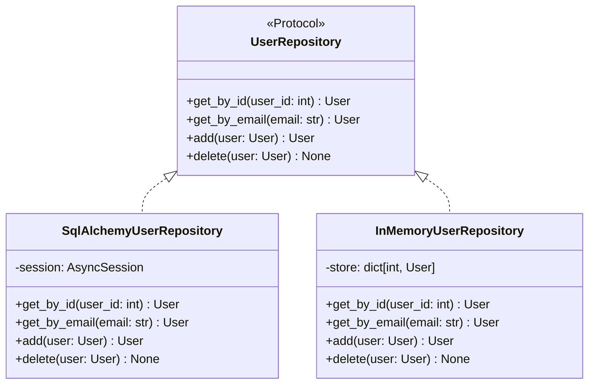

# FastAPI Repository Pattern & Data Access Decoupling

In enterprise architectures, scattering raw SQLAlchemy queries (`select()`, `where()`, `join()`) across route handlers and service classes creates tight coupling, hinders refactoring, and makes unit testing difficult. The **Repository Pattern** abstracts the data persistence layer behind a clean collection-like interface, allowing domain logic to interact with entities without knowledge of the underlying database technology.

---

## Conceptual Foundation & Mental Model

Think of a Repository as an in-memory collection of domain entities:
- It mediates between the domain/service layer and the data mapping layer (SQLAlchemy, Motor, Redis).
- The service asks: `repo.get_by_id(101)` or `repo.find_active_subscribers()`.
- The service **does not know or care** whether the data comes from PostgreSQL, an in-memory test list, or an external microservice.
- All SQL statement construction, filtering, pagination, and eager loading options are encapsulated entirely inside the repository implementation.

```
┌──────────────────────────────────────────────┐
│ FastAPI Route Handler / Controller           │
└──────────────────────┬───────────────────────┘
                       │ Input Schemas (Pydantic)
                       ▼
┌──────────────────────────────────────────────┐
│ Domain Service Layer (Pure Business Logic)   │
│ - Calculates discounts, validates workflows  │
└──────────────────────┬───────────────────────┘
                       │ Calls abstract methods (get, save)
                       ▼
┌──────────────────────────────────────────────┐
│ Repository Interface (Python Protocol / ABC) │
└──────────────────────┬───────────────────────┘
                       │ Implemented by:
                       ▼
┌──────────────────────────────────────────────┐
│ SqlAlchemyUserRepository (Concrete Adapter)  │
│ - Issues select(), flush(), joins, SQL DDL   │
└──────────────────────────────────────────────┘
```

---

## Architecture & Internal Mechanics

### Separation of Concerns: Services vs Repositories
1. **Repository Responsibility**:
   - Translate domain requests into database queries.
   - Map database rows into domain/ORM entities.
   - Provide atomic CRUD primitives (`get`, `list`, `add`, `remove`).
   - **Crucial Rule**: A repository should **never** call `session.commit()`. It only reads or flushes (`flush()`). The transaction boundary belongs to the Service or Unit of Work layer.
2. **Service Responsibility**:
   - Enforce business invariants (e.g. verifying credit limits, hashing passwords).
   - Coordinate multiple repositories (e.g. `UserRepository` and `BillingRepository`).
   - Manage the transaction commit/rollback lifecycle.



---

## Comprehensive Syntax & Core Mechanics

### 1. Abstract Generic Repository Protocol
```python
from typing import Protocol, TypeVar, Generic

T = TypeVar("T")

class BaseRepository(Protocol[T]):
    async def get_by_id(self, entity_id: int) -> T | None: ...
    async def list_all(self, limit: int = 20, offset: int = 0) -> list[T]: ...
    async def add(self, entity: T) -> T: ...
    async def delete(self, entity: T) -> None: ...
```

### 2. Concrete SQLAlchemy Generic Implementation
```python
from typing import TypeVar, Generic, Type
from sqlalchemy.ext.asyncio import AsyncSession
from sqlalchemy import select

ModelType = TypeVar("ModelType")

class SqlAlchemyGenericRepository(Generic[ModelType]):
    def __init__(self, model: Type[ModelType], session: AsyncSession):
        self.model = model
        self.session = session

    async def get_by_id(self, entity_id: int) -> ModelType | None:
        stmt = select(self.model).where(self.model.id == entity_id)
        result = await self.session.execute(stmt)
        return result.scalar_one_or_none()

    async def list_all(self, limit: int = 20, offset: int = 0) -> list[ModelType]:
        stmt = select(self.model).limit(limit).offset(offset)
        result = await self.session.execute(stmt)
        return list(result.scalars().all())

    async def add(self, entity: ModelType) -> ModelType:
        self.session.add(entity)
        await self.session.flush()
        return entity

    async def delete(self, entity: ModelType) -> None:
        await self.session.delete(entity)
        await self.session.flush()
```

---

## Practical Implementation (5 Complete Examples)

### Example 1: Domain-Specific User Repository
```python
from sqlalchemy.ext.asyncio import AsyncSession
from sqlalchemy import select
from app.models.user import User

class UserRepository(SqlAlchemyGenericRepository[User]):
    def __init__(self, session: AsyncSession):
        super().__init__(User, session)

    async def get_by_email(self, email: str) -> User | None:
        stmt = select(User).where(User.email == email)
        result = await self.session.execute(stmt)
        return result.scalar_one_or_none()

    async def list_active_members(self, limit: int = 50) -> list[User]:
        stmt = select(User).where(User.is_active == True).limit(limit)
        result = await self.session.execute(stmt)
        return list(result.scalars().all())
```

### Example 2: Decoupled Service Layer Consuming the Repository
```python
from app.repositories.user_repo import UserRepository
from app.schemas.user import UserCreate
from app.models.user import User

class UserService:
    def __init__(self, user_repo: UserRepository):
        self.user_repo = user_repo

    async def register_user(self, payload: UserCreate) -> User:
        # 1. Business invariant check
        existing = await self.user_repo.get_by_email(payload.email)
        if existing:
            raise ValueError(f"User with email {payload.email} already exists.")

        # 2. Hash password & instantiate entity
        user = User(
            name=payload.name,
            email=payload.email,
            hashed_password=f"hashed_{payload.password}"
        )

        # 3. Save via repository
        return await self.user_repo.add(user)
```

### Example 3: FastAPI Dependency Injection Wiring
```python
from typing import Annotated
from fastapi import FastAPI, Depends, HTTPException, status
from sqlalchemy.ext.asyncio import AsyncSession

app = FastAPI(title="Clean Architecture API")

# 1. Database Session Dependency
async def get_db_session() -> AsyncSession:
    async with async_session_factory() as session:
        try:
            yield session
            await session.commit()
        except Exception:
            await session.rollback()
            raise
        finally:
            await session.close()

# 2. Repository Dependency
def get_user_repository(
    session: Annotated[AsyncSession, Depends(get_db_session)]
) -> UserRepository:
    return UserRepository(session)

# 3. Service Dependency
def get_user_service(
    repo: Annotated[UserRepository, Depends(get_user_repository)]
) -> UserService:
    return UserService(repo)

# 4. Route Handler (Zero knowledge of SQL or database sessions!)
@app.post("/users", response_model=UserRead, status_code=status.HTTP_201_CREATED)
async def create_user(
    payload: UserCreate,
    service: Annotated[UserService, Depends(get_user_service)]
):
    try:
        return await service.register_user(payload)
    except ValueError as err:
        raise HTTPException(status_code=400, detail=str(err))
```

### Example 4: In-Memory Mock Repository for Lightning-Fast Unit Testing
```python
# Zero database, zero Docker, zero PostgreSQL needed to test business logic!
class InMemoryUserRepository:
    def __init__(self):
        self.users: dict[int, User] = {}
        self.next_id = 1

    async def get_by_id(self, user_id: int) -> User | None:
        return self.users.get(user_id)

    async def get_by_email(self, email: str) -> User | None:
        for u in self.users.values():
            if u.email == email:
                return u
        return None

    async def add(self, user: User) -> User:
        user.id = self.next_id
        self.users[self.next_id] = user
        self.next_id += 1
        return user

# Pure Unit Test running in 2 milliseconds:
import pytest

@pytest.mark.anyio
async def test_user_registration_duplicate_error():
    mock_repo = InMemoryUserRepository()
    service = UserService(user_repo=mock_repo)

    # 1. Register first user
    await service.register_user(UserCreate(name="Alice", email="alice@test.com", password="pwd"))

    # 2. Attempt duplicate registration -> Raises ValueError
    with pytest.raises(ValueError, match="already exists"):
        await service.register_user(UserCreate(name="Alice 2", email="alice@test.com", password="pwd"))
```

### Example 5: Encapsulating Complex Eager Loads in Repositories
```python
from sqlalchemy.orm import selectinload, joinedload
from sqlalchemy import select

class OrderRepository(SqlAlchemyGenericRepository[Order]):
    async def get_detailed_order(self, order_id: int) -> Order | None:
        # Complex eager loading details completely hidden from Service layer!
        stmt = (
            select(Order)
            .options(
                joinedload(Order.customer),
                selectinload(Order.items).joinedload(OrderItem.product)
            )
            .where(Order.id == order_id)
        )
        result = await self.session.execute(stmt)
        return result.scalar_one_or_none()
```

---

## Anti-Patterns & Common Traps

| Anti-Pattern | Fatal Consequence | Production Solution |
| :--- | :--- | :--- |
| **Calling `await session.commit()` in repository** | Breaks atomicity; prevents outer service from coordinating multiple repositories. | Repositories only call `session.add()` and `session.flush()`. Commits belong to the Unit of Work or Service. |
| **Leaking SQLAlchemy types (`Select`, `Result`) to service** | Violates abstraction; service layer becomes tightly coupled to SQLAlchemy. | Return evaluated domain models, lists, or primitive values. |
| **Over-engineering simple CRUD with 5 abstract layers** | Slows development on small, simple microservices. | Use Repository pattern for complex business domains; simple CRUD can query directly. |
| **Creating an anemic repository that only wraps `session.execute`** | Adds boilerplate with zero value. | Add domain-specific query methods (`find_unpaid_invoices`, `get_active_subscribers`). |

---

## Performance & Resource Characteristics

- **Zero Runtime Overhead**: Modern Python class method dispatches take less than 1 microsecond.
- **Query Optimization Hub**: When a query needs index hints or query optimization, you modify a single repository method rather than hunting down 20 scattered route functions.

---

## Edge Cases, Failure Modes & Gotchas

1. **Detached Instances**: If a repository queries an object and closes the session immediately, accessing un-loaded relationships later triggers errors. Ensure eager loading is configured within the repository query.
2. **Identity Map Synchronization**: Because repositories share the same `AsyncSession` within a request, querying an entity modified earlier in the request returns the updated instance from the session cache.

---

## Security Implications & OWASP Alignment

- **Centralized Parameter Validation**: Concentrating queries in repositories ensures that all database operations use parameterized statements, preventing SQL injection vulnerabilities.
- **Tenant Scoping Enforcement**: Implement base multi-tenant repositories that automatically append `WHERE tenant_id = active_tenant_id` to every query, preventing unauthorized cross-tenant data access.

---

## Modern Tooling Integration

- **Pytest**: Instant unit testing by swapping repositories via `app.dependency_overrides`.
- **Mypy**: Full generic type safety across `BaseRepository[ModelType]`.

---

## Real-World Case Study / Production Incident

A large SaaS company had 120 endpoints where SQLAlchemy queries were written directly inside route functions. When migrating their core database from MySQL to PostgreSQL, they discovered that developers had written dozens of raw SQL strings with MySQL-specific functions (`NOW()`, `IFNULL()`).

**The Refactoring**:
1. Extracted all queries into domain repositories (`UserRepository`, `BillingRepository`).
2. The route handlers and business services remained 100% untouched.
3. Repositories were adapted to standard ANSI SQL and PostgreSQL dialect constructs.
The migration completed 2 months ahead of schedule with zero route regressions.

---

## Hands-On Exercises & Challenge Problems

### Warmup (2 Exercises)
1. Define a generic `BaseRepository` protocol declaring `get_by_id`, `add`, and `delete`.
2. Implement a concrete `SqlAlchemyUserRepository` subclassing the generic repository.

### Intermediate (2 Exercises)
3. Build an `InMemoryUserRepository` using a Python dictionary and write a unit test for a service class using only the mock repository.
4. Implement a repository method `get_user_with_orders(user_id: int)` that encapsulates `selectinload(User.orders)`.

### Production-Grade (2 Exercises)
5. Design and implement a Multi-Tenant Repository base class that automatically filters all queries by the active tenant ID extracted from `contextvars.ContextVar`.
6. Build a complete FastAPI application with separated layers (`routers -> services -> repositories -> models`), wiring dependencies cleanly via `Depends()` and proving that swapping the repository in tests requires zero changes to route handlers.

---

## Interview Mastery (8 Q&As)

### Junior Level
**Q1: What is the Repository Pattern?**
*Answer:* An architectural pattern that encapsulates data access logic behind an abstract interface, separating domain business logic from database query implementations.

**Q2: Why should a repository method not call `session.commit()`?**
*Answer:* Calling commit inside a repository finalizes the database transaction prematurely, preventing a service from coordinating multiple operations across different repositories within a single atomic transaction.

**Q3: How do repositories improve unit testing?**
*Answer:* By allowing services to be tested against fast in-memory mock repositories (e.g. backed by dictionaries) without needing a real database connection or Docker container.

### Senior Level
**Q4: What is the difference between a Repository and a Service?**
*Answer:* A **Repository** is responsible purely for data access and querying (CRUD, joins, filters). A **Service** is responsible for business logic, workflows, domain validation, and orchestrating multiple repositories within a transaction.

**Q5: How does the Repository Pattern support Hexagonal Architecture (Ports and Adapters)?**
*Answer:* The abstract repository interface serves as the **Port** (the boundary contract defined by the core domain). The concrete SQLAlchemy or Mongo repository serves as the **Adapter** (the infrastructure implementation). The domain core depends only on the Port, making the infrastructure swappable.

**Q6: What is an Anemic Repository and why is it considered an anti-pattern?**
*Answer:* An anemic repository is a wrapper that merely duplicates basic ORM functions (`repo.save(obj)`, `repo.delete(obj)`) without providing any domain-specific query methods or encapsulation, adding layer overhead with zero architectural benefit.

### Staff / Architect Level
**Q7: How do you enforce tenant isolation across hundreds of queries using the Repository Pattern?**
*Answer:*
1. Create a `TenantAwareRepository` base class that requires a `tenant_id` (injected via `contextvars`).
2. In the base query builder, automatically append `.where(self.model.tenant_id == self.tenant_id)` to every `select`, `update`, and `delete` statement.
3. In insert statements, automatically assign `entity.tenant_id = self.tenant_id`.
This guarantees that developers cannot accidentally omit tenant filters, closing BOLA vulnerabilities at the architectural level.

**Q8: How does the Repository Pattern interact with the Unit of Work pattern in Python?**
*Answer:* The Repository abstracts *what* data is retrieved or staged, while the Unit of Work abstracts the *transaction boundary* (`commit`, `rollback`). Typically, the Unit of Work manages the database session and exposes repository instances as properties (`uow.users`, `uow.orders`). When the unit of work context exits, it commits all changes staged across all its repositories simultaneously.
