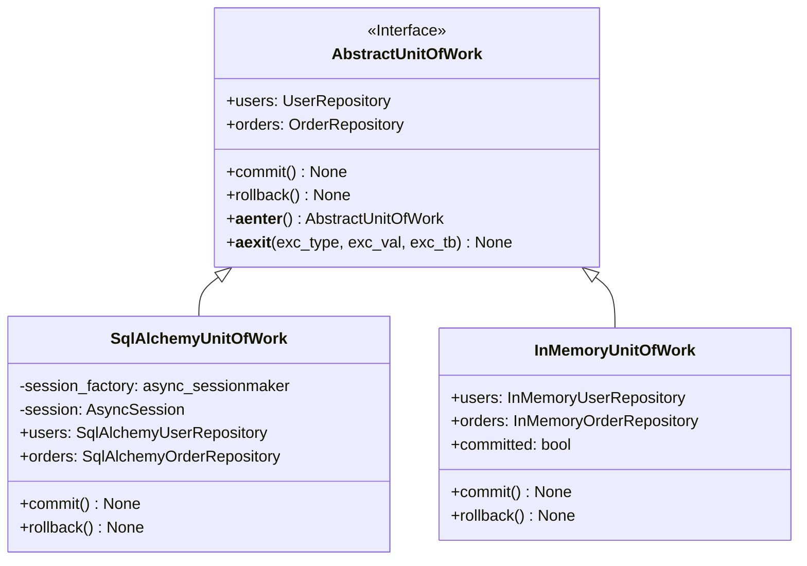

# FastAPI Unit of Work Pattern & Transaction Orchestration

While the **Repository Pattern** abstracts data access for individual entities, real-world business workflows frequently require updating multiple distinct entities across separate repositories in a single atomic transaction. The **Unit of Work (UoW)** pattern maintains a list of objects affected by a business transaction, coordinates the writing of changes, and resolves concurrency issues by managing the atomic `commit` and `rollback` lifecycle within clean asynchronous context managers.

---

## Conceptual Foundation & Mental Model

Consider an e-commerce order checkout:
1. `UserRepository`: Deducts loyalty reward points from the customer.
2. `OrderRepository`: Inserts a new `Order` and associated `OrderItems`.
3. `InventoryRepository`: Decrements available warehouse stock.

If step 3 fails (e.g. stock went out of stock concurrently):
- Steps 1 and 2 **must not commit**!
- If repositories managed their own commits, the customer would lose points for an order that was never placed.

The **Unit of Work** encapsulates the database session, exposes repositories as properties, and acts as the sole authority on committing or rolling back the transaction:

```
FastAPI Handler / Service
           │
           ▼ async with uow:
┌────────────────────────────────────────────────────────┐
│ UnitOfWork Context Manager                             │
│ 1. Initializes shared AsyncSession                     │
│ 2. Exposes uow.users, uow.orders, uow.inventory        │
└──────────────────────────┬─────────────────────────────┘
                           │
             ┌─────────────┼─────────────┐
             ▼             ▼             ▼
       uow.users      uow.orders    uow.inventory
       .deduct()      .create()      .decrement()
             │             │             │
             └─────────────┬─────────────┘
                           │ (All operations flush into same session)
                           ▼
               [Exit Context Manager]
        - If clean:  await uow.commit() (Atomically writes all 3!)
        - If error:  await uow.rollback() (Zero partial changes!)
```

---

## Architecture & Internal Mechanics

### Interface Decoupling via Abstract Unit of Work
To adhere to Clean / Hexagonal Architecture:
1. **`AbstractUnitOfWork`**: Defines the contract using Python's `abc.ABC` or `typing.Protocol`. It mandates `__aenter__`, `__aexit__`, `commit()`, and `rollback()`, and declares repository properties.
2. **`SqlAlchemyUnitOfWork`**: The concrete infrastructure implementation. In `__aenter__`, it creates an `AsyncSession`, instantiates concrete repositories with that session, and begins a transaction.
3. **`InMemoryUnitOfWork`**: Used in unit tests, managing mock in-memory repositories with zero database connections.



---

## Comprehensive Syntax & Core Mechanics

### 1. Abstract Base Unit of Work
```python
from abc import ABC, abstractmethod
from app.repositories.user_repo import AbstractUserRepository
from app.repositories.order_repo import AbstractOrderRepository

class AbstractUnitOfWork(ABC):
    users: AbstractUserRepository
    orders: AbstractOrderRepository

    async def __aenter__(self) -> "AbstractUnitOfWork":
        return self

    async def __aexit__(self, exc_type, exc_val, exc_tb) -> None:
        if exc_type is not None:
            await self.rollback()
        else:
            await self.commit()

    @abstractmethod
    async def commit(self) -> None:
        raise NotImplementedError

    @abstractmethod
    async def rollback(self) -> None:
        raise NotImplementedError
```

### 2. Concrete SQLAlchemy Implementation
```python
from sqlalchemy.ext.asyncio import async_sessionmaker, AsyncSession
from app.repositories.user_repo import SqlAlchemyUserRepository
from app.repositories.order_repo import SqlAlchemyOrderRepository

class SqlAlchemyUnitOfWork(AbstractUnitOfWork):
    def __init__(self, session_factory: async_sessionmaker[AsyncSession]):
        self.session_factory = session_factory

    async def __aenter__(self):
        self.session: AsyncSession = self.session_factory()
        # Wire repositories with the active session
        self.users = SqlAlchemyUserRepository(self.session)
        self.orders = SqlAlchemyOrderRepository(self.session)
        return await super().__aenter__()

    async def __aexit__(self, exc_type, exc_val, exc_tb):
        try:
            await super().__aexit__(exc_type, exc_val, exc_tb)
        finally:
            await self.session.close()

    async def commit(self):
        await self.session.commit()

    async def rollback(self):
        await self.session.rollback()
```

---

## Practical Implementation (5 Complete Examples)

### Example 1: Multi-Repository Order Checkout Workflow
```python
from fastapi import FastAPI, Depends, HTTPException, status
from pydantic import BaseModel

class CheckoutPayload(BaseModel):
    user_id: int
    product_sku: str
    price: float

# Domain Service relying strictly on AbstractUnitOfWork
class CheckoutService:
    def __init__(self, uow: AbstractUnitOfWork):
        self.uow = uow

    async def execute_checkout(self, payload: CheckoutPayload):
        # Transaction boundary is managed exclusively by the UoW context manager!
        async with self.uow:
            # 1. Fetch user & check points
            user = await self.uow.users.get_by_id(payload.user_id)
            if not user:
                raise ValueError("User not found")

            # 2. Check & decrement inventory
            stock = await self.uow.inventory.get_stock(payload.product_sku)
            if stock < 1:
                raise ValueError(f"Product {payload.product_sku} is out of stock")
            
            await self.uow.inventory.decrement_stock(payload.product_sku, 1)

            # 3. Create order
            order = await self.uow.orders.create_order(
                user_id=user.id,
                sku=payload.product_sku,
                amount=payload.price
            )

            # 4. Deduct loyalty points
            user.loyalty_points -= 10
            await self.uow.users.save(user)

            # Reaching the end of the block automatically triggers await uow.commit()!
            return order
```

### Example 2: FastAPI Dependency Injection Wiring for UoW
```python
from typing import Annotated
from fastapi import FastAPI, Depends, HTTPException, status

app = FastAPI(title="Unit of Work Enterprise API")

# Dependency providing the concrete UoW
def get_uow() -> AbstractUnitOfWork:
    return SqlAlchemyUnitOfWork(session_factory=async_session_factory)

# Dependency providing the service configured with UoW
def get_checkout_service(
    uow: Annotated[AbstractUnitOfWork, Depends(get_uow)]
) -> CheckoutService:
    return CheckoutService(uow)

@app.post("/checkout", status_code=status.HTTP_201_CREATED)
async def checkout_endpoint(
    payload: CheckoutPayload,
    service: Annotated[CheckoutService, Depends(get_checkout_service)]
):
    try:
        order = await service.execute_checkout(payload)
        return {"status": "success", "order_id": order.id}
    except ValueError as err:
        # If ValueError is raised, UoW __aexit__ rolls back everything automatically!
        raise HTTPException(status_code=400, detail=str(err))
```

### Example 3: In-Memory Mock Unit of Work for Pure Unit Tests
```python
import pytest

class InMemoryUnitOfWork(AbstractUnitOfWork):
    def __init__(self):
        self.users = InMemoryUserRepository()
        self.orders = InMemoryOrderRepository()
        self.inventory = InMemoryInventoryRepository()
        self.committed = False
        self.rolled_back = False

    async def commit(self):
        self.committed = True

    async def rollback(self):
        self.rolled_back = True

@pytest.mark.anyio
async def test_checkout_service_out_of_stock_rolls_back():
    mock_uow = InMemoryUnitOfWork()
    # Seed mock user and 0 stock
    await mock_uow.users.add(User(id=1, loyalty_points=100))
    await mock_uow.inventory.set_stock("SKU-99", 0)

    service = CheckoutService(uow=mock_uow)

    # Attempt checkout -> fails due to 0 stock
    with pytest.raises(ValueError, match="out of stock"):
        await service.execute_checkout(CheckoutPayload(user_id=1, product_sku="SKU-99", price=50.0))

    # Assert transaction rolled back cleanly!
    assert mock_uow.rolled_back is True
    assert mock_uow.committed is False
    # Verify user points were NOT deducted
    user = await mock_uow.users.get_by_id(1)
    assert user.loyalty_points == 100
```

### Example 4: Manual Mid-Transaction Rollback
```python
# When a business condition demands aborting midway through the block:
async with uow:
    await uow.users.add(user)
    if not is_fraud_check_passed(user):
        await uow.rollback()
        raise ValueError("Fraud check failed")
    # If passed, continues normally to commit on exit
```

### Example 5: Testing `SqlAlchemyUnitOfWork` Rollback with Real SQLite
```python
@pytest.mark.anyio
async def test_sqlalchemy_uow_rollback_on_exception(async_session_factory):
    uow = SqlAlchemyUnitOfWork(async_session_factory)

    try:
        async with uow:
            await uow.users.add(User(name="Temporary User"))
            # Force unhandled exception
            raise RuntimeError("Database error")
    except RuntimeError:
        pass

    # Verify user was NOT committed to the live database
    async with async_session_factory() as session:
        result = await session.execute(select(User).where(User.name == "Temporary User"))
        assert result.scalar_one_or_none() is None
```

---

## Anti-Patterns & Common Traps

| Anti-Pattern | Fatal Consequence | Production Solution |
| :--- | :--- | :--- |
| **Instantiating a new session per repository inside UoW** | Each repository runs on a separate transaction; atomic multi-repository rollback is impossible. | All repositories in the UoW **must share the exact same `AsyncSession`**. |
| **Calling `await uow.commit()` inside repository methods** | Prematurely commits before other repositories finish their work. | Only the Unit of Work context manager may commit transactions. |
| **Reusing the same UoW instance across multiple HTTP requests** | Concurrently running requests race on the same database session, causing state corruption. | Create a fresh UoW per request via FastAPI dependency injection. |
| **Forgetting to close the session in `__aexit__` `finally:`** | Database connection is leaked; exhausts the connection pool. | Always close `self.session` inside `__aexit__` in a `finally` block. |

---

## Performance & Resource Characteristics

- **Zero Added Latency**: The UoW introduces zero database query overhead; it merely organizes the lifecycle of the `AsyncSession`.
- **Atomic Network Batching**: Multiple repository modifications are accumulated in SQLAlchemy's identity map and flushed in a single batch, reducing network chatter.

---

## Edge Cases, Failure Modes & Gotchas

1. **Async Context Manager Exceptions**: If an exception occurs inside the `async with uow:` block, Python passes the exception arguments to `__aexit__`. If `__aexit__` does not return `True`, Python re-raises the exception automatically after executing `rollback()`.
2. **Double Commit Calls**: If you explicitly call `await uow.commit()` inside the block, ensure `__aexit__` does not call `commit()` a second time on an inactive transaction.

---

## Security Implications & OWASP Alignment

- **Financial Ledger Invariants (OWASP API4:2023)**: Guarantee that multi-step state mutations (e.g. transfer fees, wallet balances, transaction records) are committed atomically, eliminating partial-state security exploits.
- **Audit Consistency**: Guarantees that sensitive actions are only committed if their corresponding audit trail records are also committed.

---

## Modern Tooling Integration

- **SQLAlchemy 2.0**: Native `AsyncSession` integration.
- **FastAPI / Pytest**: Simple substitution via dependency overrides.

---

## Real-World Case Study / Production Incident

A crypto exchange processed user withdrawals using separate services: `WalletService` decremented user balances, and `BlockchainTxService` recorded outbound transactions. Because each service managed its own database session and committed independently, a network failure occurred after `WalletService.commit()` but before `BlockchainTxService.commit()`.

**The Disaster**:
The user's funds were deducted from their database balance, but the blockchain withdrawal transaction was never created. Customer support was inundated with missing funds tickets.

**Remediation**:
Unified both operations under a single `ExchangeUnitOfWork`:
```python
async with uow:
    await uow.wallets.decrement(user_id, amount)
    await uow.transactions.create(tx_data)
```
If the transaction record failed, the balance decrement rolled back automatically. Inconsistencies dropped to zero.

---

## Hands-On Exercises & Challenge Problems

### Warmup (2 Exercises)
1. Define an `AbstractUnitOfWork` declaring `commit()`, `rollback()`, and context manager hooks.
2. Implement an `InMemoryUnitOfWork` with a mock repository and verify `commit()` is called upon clean block exit.

### Intermediate (2 Exercises)
3. Implement `SqlAlchemyUnitOfWork` wrapping two repositories (`UserRepository`, `PostRepository`) with automated rollback on exception.
4. Wire the Unit of Work into a FastAPI dependency and create a route that uses it to save a user and their initial post atomically.

### Production-Grade (2 Exercises)
5. Build an atomic wallet transfer service using the Unit of Work pattern that coordinates `WalletRepository` and `LedgerRepository`, asserting via unit tests that any unexpected exception rolls back all ledger modifications.
6. Design an event-driven Unit of Work that collects domain events (`uow.collect_events()`) emitted by entities during the transaction and dispatches them to a message bus only *after* the database transaction commits successfully.

---

## Interview Mastery (8 Q&As)

### Junior Level
**Q1: What is the Unit of Work pattern?**
*Answer:* A design pattern that maintains a list of business objects affected by a transaction and coordinates writing out changes and resolving concurrency problems by managing atomic commit and rollback boundaries.

**Q2: How does the Unit of Work differ from the Repository pattern?**
*Answer:* The Repository pattern abstracts data access for individual entity collections (queries, inserts). The Unit of Work pattern manages the transaction lifecycle (`commit`, `rollback`) across multiple repositories simultaneously.

**Q3: In Python, what language construct is ideal for implementing a Unit of Work?**
*Answer:* Asynchronous context managers (`async with uow:` via `__aenter__` and `__aexit__`).

### Senior Level
**Q4: How do multiple repositories in a Unit of Work ensure they participate in the same database transaction?**
*Answer:* The Unit of Work instantiates a single `AsyncSession` in `__aenter__` and injects that **exact same session** into all repository instances (`uow.users = UserRepository(self.session)`), ensuring all SQL operations execute within the same transaction.

**Q5: What happens in a Unit of Work if an unhandled exception is raised inside the `async with uow:` block?**
*Answer:* The exception is caught by `__aexit__`, which invokes `await self.rollback()`, ensuring that any changes made prior to the exception are completely undone in the database.

**Q6: Why is an `InMemoryUnitOfWork` valuable for testing?**
*Answer:* It allows complex domain services coordinating multiple repositories to be thoroughly tested in milliseconds without a live database, asserting that `commit()` or `rollback()` was called and that entities were modified in memory.

### Staff / Architect Level
**Q7: How do you implement the "Outbox Pattern" using the Unit of Work?**
*Answer:*
1. Inside the `async with uow:` block, the service performs business entity mutations (e.g. `uow.orders.add(order)`).
2. In the same transaction, the service writes an event message to an `Outbox` database table (e.g. `uow.outbox.add(OrderCreatedEvent)`).
3. The UoW commits both the business entity and the outbox event atomically.
4. An asynchronous background poller or CDC tool (Debezium) reads from the Outbox table and publishes events to Kafka/RabbitMQ. This guarantees at-least-once message delivery without distributed 2PC transactions.

**Q8: How does the Unit of Work pattern fit into Clean Architecture and Domain-Driven Design (DDD)?**
*Answer:* In DDD, business logic resides inside domain entities and domain services that must remain completely pure and decoupled from infrastructure. The domain defines an abstract `UnitOfWork` interface (Port). The infrastructure layer implements `SqlAlchemyUnitOfWork` (Adapter). The application service layer uses the Unit of Work to enforce transactional consistency across Aggregates without depending directly on SQLAlchemy, database connections, or ORM frameworks.
