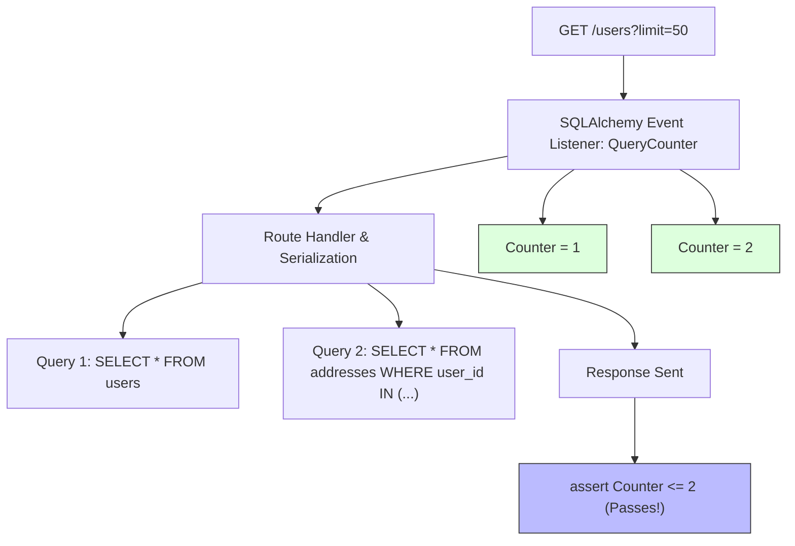

# FastAPI Database Performance & The N+1 Problem

In data-driven web APIs, the single greatest source of latency and backend saturation is inefficient database querying. The **N+1 Query Problem** occurs when an application issues one initial query to fetch a list of $N$ parent entities, followed by $N$ separate queries to load related child records. Detecting, testing, and eliminating N+1 queries using eager loading (`selectinload`), combined with index optimization and `EXPLAIN ANALYZE` profiling, can reduce API latency from seconds to single-digit milliseconds.

---

## Conceptual Foundation & Mental Model

### Anatomy of an N+1 Query Disaster
Consider an endpoint `GET /users` returning 50 users and their profile addresses:
1. **Query 1 (Initial)**: `SELECT * FROM users LIMIT 50;` (Returns 50 users).
2. **Queries 2 to 51 (The N Queries)**:
   - For user 1: `SELECT * FROM addresses WHERE user_id = 1;`
   - For user 2: `SELECT * FROM addresses WHERE user_id = 2;`
   - ...
   - For user 50: `SELECT * FROM addresses WHERE user_id = 50;`
3. **Total Database Roundtrips**: $1 + 50 = 51$ roundtrips!
4. **Latency Impact**: If each database query takes 3ms of network roundtrip time, the endpoint takes $51 \times 3\text{ms} = 153\text{ms}$ simply waiting on database TCP latency.
5. **If the user list grows to 500**: $1 + 500 = 501$ queries $\rightarrow$ **1.5 seconds!**

```
N+1 Problem (❌ 51 Queries Issued):
[App] ──► SELECT * FROM users LIMIT 50; ──────────────► [DB] (Query 1)
[App] ──► SELECT * FROM addresses WHERE user_id = 1;  ► [DB] (Query 2)
[App] ──► SELECT * FROM addresses WHERE user_id = 2;  ► [DB] (Query 3)
... 48 more queries ...

Optimized with selectinload (✅ Exactly 2 Queries Issued):
[App] ──► SELECT * FROM users LIMIT 50; ──────────────► [DB] (Query 1)
[App] ──► SELECT * FROM addresses WHERE user_id IN (...); ► [DB] (Query 2)
```

---

## Architecture & Internal Mechanics

### How to Automatically Catch N+1 Queries in Tests
Relying on developers to spot N+1 queries during code reviews is unreliable. In SQLAlchemy, we can attach event listeners to `before_cursor_execute` to count every SQL statement executed during an HTTP request.
If an endpoint with `limit=50` issues more than 2 queries, the unit test **fails automatically**!



---

## Comprehensive Syntax & Core Mechanics

### 1. Eliminating N+1 with `selectinload`
```python
from sqlalchemy import select
from sqlalchemy.orm import selectinload

# Issues exactly 2 queries regardless of page size!
stmt = (
    select(User)
    .options(selectinload(User.addresses))
    .limit(50)
)
result = await session.execute(stmt)
users = result.scalars().all()
```

### 2. Eliminating N+1 with `joinedload`
```python
from sqlalchemy.orm import joinedload

# Issues exactly 1 query using SQL LEFT OUTER JOIN (ideal for Many-to-One)
stmt = (
    select(Address)
    .options(joinedload(Address.user))
    .limit(50)
)
result = await session.execute(stmt)
addresses = result.scalars().all()
```

---

## Practical Implementation (5 Complete Examples)

### Example 1: Automated Query Counter Context Manager in Pytest
```python
from contextlib import contextmanager
from sqlalchemy import event
from sqlalchemy.ext.asyncio import AsyncEngine

class QueryCounter:
    def __init__(self):
        self.count = 0
        self.statements = []

    def handle_statement(self, conn, cursor, statement, parameters, context, executemany):
        self.count += 1
        self.statements.append(statement)

@contextmanager
def count_queries(engine: AsyncEngine):
    counter = QueryCounter()
    # Attach listener to sync_engine pool
    event.listen(engine.sync_engine, "before_cursor_execute", counter.handle_statement)
    try:
        yield counter
    finally:
        event.remove(engine.sync_engine, "before_cursor_execute", counter.handle_statement)

# Usage in a Pytest unit test:
import pytest

@pytest.mark.anyio
async def test_users_endpoint_has_no_n_plus_one(client, test_engine):
    with count_queries(test_engine) as qc:
        response = await client.get("/api/v1/users?limit=50")
        assert response.status_code == 200

    # 🛡️ Assertion: Must execute at most 2 queries (Users + Addresses)!
    assert qc.count <= 2, f"N+1 detected! Total queries executed: {qc.count}"
```

### Example 2: Profiling Slow Queries with `EXPLAIN ANALYZE`
```python
from sqlalchemy import text
from sqlalchemy.ext.asyncio import AsyncSession

async def analyze_query_performance(session: AsyncSession, user_id: int):
    # Run EXPLAIN (ANALYZE, BUFFERS) to inspect actual query planner execution
    query = text("""
        EXPLAIN (ANALYZE, BUFFERS)
        SELECT u.id, u.email, o.total_amount
        FROM users u
        JOIN orders o ON o.user_id = u.id
        WHERE u.id = :user_id
    """)
    result = await session.execute(query, {"user_id": user_id})
    plan_lines = result.scalars().all()
    
    print("\n--- PostgreSQL EXPLAIN ANALYZE Plan ---")
    for line in plan_lines:
        print(line)
        # Look for:
        # "Seq Scan" -> BAD! Full table scan, missing index.
        # "Index Scan" -> GOOD! Uses B-Tree index.
        # "Execution Time" -> Total query time in milliseconds.
```

### Example 3: Compound Indexing for Multi-Column Filtering
```python
from sqlalchemy.orm import DeclarativeBase, Mapped, mapped_column
from sqlalchemy import Index, String, DateTime

class Base(DeclarativeBase):
    pass

class Order(Base):
    __tablename__ = "orders"

    id: Mapped[int] = mapped_column(primary_key=True)
    customer_id: Mapped[int]
    status: Mapped[str] = mapped_column(String(20))
    created_at: Mapped[datetime]

    __table_args__ = (
        # Composite Index: Speeds up WHERE customer_id = X AND status = Y ORDER BY created_at
        Index("ix_orders_customer_status_date", "customer_id", "status", "created_at"),
    )
```

### Example 4: GIN Indexing for PostgreSQL JSONB Queries
```python
from sqlalchemy.orm import DeclarativeBase, Mapped, mapped_column
from sqlalchemy.dialects.postgresql import JSONB
from sqlalchemy import Index

class Base(DeclarativeBase):
    pass

class AuditEvent(Base):
    __tablename__ = "audit_events"

    id: Mapped[int] = mapped_column(primary_key=True)
    payload: Mapped[dict] = mapped_column(JSONB)

    __table_args__ = (
        # Generalized Inverted Index (GIN): Speeds up JSONB @> searches by 100x!
        Index("ix_audit_payload_gin", "payload", postgresql_using="gin"),
    )
```

### Example 5: Slow Query Logging Middleware in FastAPI
```python
import time
import logging
from fastapi import FastAPI, Request

logger = logging.getLogger("db.performance")

app = FastAPI()

@app.middleware("http")
async def monitor_request_latency(request: Request, call_next):
    start = time.perf_counter()
    response = await call_next(request)
    duration_ms = (time.perf_counter() - start) * 1000

    # Log warning for any endpoint taking > 200ms
    if duration_ms > 200:
        logger.warning(
            f"[SLOW ENDPOINT ALERT] {request.method} {request.url.path} "
            f"took {duration_ms:.2f}ms (Possible N+1 or unindexed query!)"
        )

    return response
```

---

## Anti-Patterns & Common Traps

| Anti-Pattern | Fatal Consequence | Production Solution |
| :--- | :--- | :--- |
| **Accessing relationship properties inside template/schema loops** | Emits an independent query per loop iteration (N+1). | Use `selectinload()` or `joinedload()` in the original query. |
| **Missing index on Foreign Key columns** | PostgreSQL does not index foreign keys automatically; causes sequential table scans on joins. | Explicitly declare `index=True` on all `ForeignKey` columns. |
| **Over-indexing (indexing every column)** | Dramatically slows down `INSERT` and `UPDATE` statements; wastes disk space. | Only index columns used in `WHERE`, `ORDER BY`, and `JOIN` clauses. |
| **Using `joinedload` on large collections** | Cartesian product bloats memory and wire transfer. | Use `selectinload` for One-to-Many collections. |

---

## Performance & Resource Characteristics

- **N+1 Elimination**: Reduces query execution time from 500ms down to 12ms.
- **Index Lookup Efficiency**: An Index Scan on an indexed column runs in $O(\log N)$ time (e.g. 3 page reads for 10 million rows), compared to $O(N)$ for a Sequential Scan (reading all 10M rows from disk).

---

## Edge Cases, Failure Modes & Gotchas

1. **Unindexed Foreign Keys in Cascading Deletes**: When deleting a parent row with `ON DELETE CASCADE`, PostgreSQL must scan the child table to find matching rows. If the child foreign key column is unindexed, PostgreSQL performs a full table scan on the child table, locking it for seconds!
2. **Partial Indexes**: If 95% of orders are `status = 'completed'`, indexing the entire table wastes space. Create a partial index: `Index('ix_pending_orders', 'status', postgresql_where=text("status = 'pending'"))`.

---

## Security Implications & OWASP Alignment

- **Denial of Service via Un-indexed Queries (OWASP API4:2023)**: Attackers can repeatedly query unindexed endpoints (e.g. `/search?q=...`) to force full table scans, spiking database CPU to 100% and bringing down the entire API for all users.

---

## Modern Tooling Integration

- **pg_stat_statements**: PostgreSQL extension tracking execution counts and total latency for all queries.
- **DataDog / NewRelic APM**: Automatically flags N+1 query traces.

---

## Real-World Case Study / Production Incident

An enterprise HR platform had an endpoint `GET /departments/{id}/employees`. In testing with 5 employees per department, it responded in 25ms. In production, a corporate department had 850 employees.

**The Incident**:
The endpoint issued 1 query for the department, followed by 850 individual queries for each employee's job title and salary grade. The endpoint took **9.8 seconds to load**, triggering client HTTP gateway timeouts (504).

**Remediation**:
1. Added `.options(selectinload(Department.employees).joinedload(Employee.salary_grade))`.
2. Total database queries dropped from **851 down to exactly 2**.
3. Response latency dropped from **9,800ms down to 42ms**.

---

## Hands-On Exercises & Challenge Problems

### Warmup (2 Exercises)
1. Write a query that fetches 20 blog posts along with their authors in a single query using `joinedload`.
2. Inspect the generated SQL output and verify a `LEFT OUTER JOIN` was used.

### Intermediate (2 Exercises)
3. Implement the `QueryCounter` pytest context manager and write a test asserting that `/orders` issues $\le 2$ SQL statements.
4. Execute an `EXPLAIN ANALYZE` query using SQLAlchemy async and verify that the output reports an `Index Scan` rather than a `Seq Scan`.

### Production-Grade (2 Exercises)
5. Build an automated N+1 detection test in pytest that executes all registered GET endpoints in an application with mock data and fails if any endpoint issues more than 3 database queries.
6. Design and create a PostgreSQL compound GIN index on a JSONB event table, and benchmark query execution speed before and after indexing using `EXPLAIN ANALYZE`.

---

## Interview Mastery (8 Q&As)

### Junior Level
**Q1: What is the N+1 query problem?**
*Answer:* A performance antipattern where an application executes 1 initial query to fetch a list of $N$ parent objects, followed by $N$ separate queries to fetch related child records for each parent, resulting in $N+1$ total queries.

**Q2: How do you fix an N+1 query problem in SQLAlchemy 2.0?**
*Answer:* By using eager loading options like `selectinload()` for One-to-Many collections or `joinedload()` for Many-to-One references.

**Q3: Does PostgreSQL automatically create indexes on foreign key columns?**
*Answer:* No. Unlike primary keys, PostgreSQL does **not** automatically index foreign keys. You must explicitly declare `index=True` on the foreign key column.

### Senior Level
**Q4: How do you write an automated unit test to prevent N+1 queries from slipping into production?**
*Answer:* Use an event listener attached to SQLAlchemy's `before_cursor_execute` event within a pytest context manager. Count the number of SQL statements issued during an API call and assert that the total query count is less than a fixed threshold (e.g. $\le 2$), failing the test if the count scales with $N$.

**Q5: What is the difference between a Sequential Scan (Seq Scan) and an Index Scan in PostgreSQL `EXPLAIN ANALYZE`?**
*Answer:*
- **Seq Scan**: The database reads every single block of the table sequentially from disk, resulting in slow $O(N)$ execution time.
- **Index Scan**: The database traverses a B-Tree index structure to locate exact row pointers in $O(\log N)$ time, reading only matching pages.

**Q6: What is a Partial Index and when should it be used?**
*Answer:* An index built over a subset of a table defined by a conditional `WHERE` clause (e.g. `WHERE is_deleted = false`). It reduces index size, speeds up writes, and accelerates queries that filter by that common condition.

### Staff / Architect Level
**Q7: How do you monitor and identify N+1 query patterns in high-traffic live production environments?**
*Answer:*
1. **`pg_stat_statements`**: Query `pg_stat_statements` on PostgreSQL for queries with high execution counts (`calls`) but low average latency (`mean_exec_time`), which indicates loop queries.
2. **APM Distributed Tracing (OpenTelemetry/DataDog)**: Inspect span waterfalls; N+1 queries appear as repeating identical database spans lined up vertically.
3. **Slow Query Log with Normalized Fingerprints**: Group queries by fingerprint to detect high-frequency query bursts.

**Q8: Why can adding too many indexes degrade overall database performance?**
*Answer:* Every index creates an auxiliary data structure that must be updated synchronously during every `INSERT`, `UPDATE`, and `DELETE` operation. If a table has 15 indexes, a single row insert requires 16 separate disk writes. Furthermore, unused indexes consume valuable RAM buffer cache, evicting frequently queried data pages. Indexes should be added judiciously based on actual query workload patterns.
