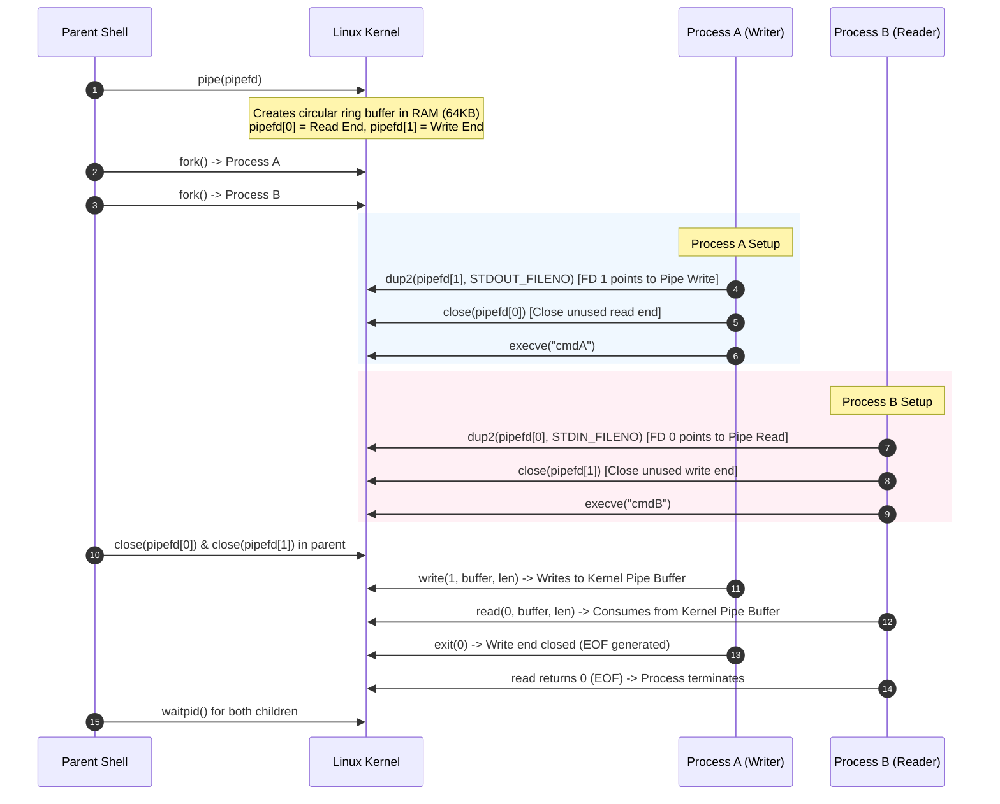

<!--
================================================================================
Metadata:
  Title: Pipes, Redirection & File Descriptors
  Track: Linux & Systems Engineering / DevOps
  Difficulty: Intermediate
  Estimated Time: 55 minutes
  Prerequisites: 02-shell/01-shell-basics.md
  Key Terminology: File Descriptor (FD), stdin (0), stdout (1), stderr (2), dup2(), pipe(), /dev/null, tee, HereDoc (<<), HereString (<<<), Named Pipe (FIFO)
================================================================================
-->

# Pipes, Redirection & File Descriptors

[<- 01-shell-basics.md](./01-shell-basics.md) | [Back to Module Overview](./README.md) | [03-globbing-quoting-and-expansion.md ->](./03-globbing-quoting-and-expansion.md)

---

## Table of Contents
- [1. What & Why](#1-what--why)
- [2. Core Concepts](#2-core-concepts)
- [3. How It Works Internally](#3-how-it-works-internally)
- [4. Syntax & Usage](#4-syntax--usage)
- [5. Practical Examples](#5-practical-examples)
- [6. Best Practices](#6-best-practices)
- [7. Common Mistakes & Troubleshooting](#7-common-mistakes--troubleshooting)
- [8. Performance, Security & Cost Implications](#8-performance-security--cost-implications)
- [9. Comparison Table](#9-comparison-table)
- [10. Real-World Interview Questions](#10-real-world-interview-questions)
- [11. Practice Exercises](#11-practice-exercises)
- [12. Summary & Quick Reference Cheat Sheet](#12-summary--quick-reference-cheat-sheet)
- [13. Further Reading & Official Documentation](#13-further-reading--official-documentation)

---

## 1. What & Why

In Unix-like operating systems, the foundational design tenet coined by Doug McIlroy states: *"Write programs that do one thing and do it well. Write programs to work together. Write programs to handle text streams, because that is a universal interface."*

The mechanism that enables this composition is the **file descriptor redirection and inter-process pipe architecture**. Every container engine, logging agent, daemon supervisor, and CI/CD pipeline relies on file descriptors to route diagnostics, ingest configurations, and stream application payloads:
- Without redirection, diagnostic error logs (`stderr`) would pollute human-facing output streams (`stdout`), breaking downstream parsers such as `jq` or `awk`.
- Without kernel pipes (`|`), processing a multi-gigabyte log file would require writing massive intermediate files to disk, creating severe I/O bottlenecks and disk wear.
- Modern observability tools (Prometheus node collectors, Fluentbit, Vector) capture system metrics and logs by hooking directly into process file descriptors via Linux `/proc/<PID>/fd/`.

Understanding file descriptors and stream manipulation is fundamental to building high-performance, fault-tolerant Linux automation.

---

## 2. Core Concepts

### Standard File Descriptors (0, 1, 2)
In Linux, everything is treated as a file descriptor—an integer index in the kernel's per-process Open File Table. When any process initializes, the runtime automatically assigns three standard streams:

| FD Index | Stream Name | Default Source / Target | Standard POSIX Macro | C Stream Pointer |
| :---: | :--- | :--- | :--- | :--- |
| **0** | `stdin` | Keyboard / Terminal Input | `STDIN_FILENO` | `stdin` |
| **1** | `stdout` | Terminal Screen (Normal Output) | `STDOUT_FILENO` | `stdout` |
| **2** | `stderr` | Terminal Screen (Diagnostics / Errors) | `STDERR_FILENO` | `stderr` |

```
+--------------------------------------------------------------------------+
| PROCESS FILE DESCRIPTOR TABLE (Linux Kernel task_struct->files)          |
|                                                                          |
|   FD Index    Open File Description Pointer         Underlying Device    |
|   +-------+   +-------------------------------+     +------------------+ |
|   |   0   |-->| flags: O_RDONLY, offset: 0    |---->| /dev/pts/1 (PTY) | |
|   +-------+   +-------------------------------+     +------------------+ |
|   |   1   |-->| flags: O_WRONLY, offset: 1204 |---->| /dev/pts/1 (PTY) | |
|   +-------+   +-------------------------------+     +------------------+ |
|   |   2   |-->| flags: O_WRONLY, offset: 400  |---->| /dev/pts/1 (PTY) | |
|   +-------+   +-------------------------------+     +------------------+ |
|   |   3   |-->| flags: O_RDWR,   offset: 0    |---->| /tmp/app.lock    | |
|   +-------+   +-------------------------------+     +------------------+ |
+--------------------------------------------------------------------------+
```

### Stream Redirection Operators
- **`<` (Input Redirection)**: Connects a file to `stdin` (FD 0). The command reads from the file instead of the keyboard.
- **`>` (Output Redirection)**: Connects `stdout` (FD 1) to a file. Truncates existing file content to 0 bytes before writing.
- **`>>` (Append Redirection)**: Connects `stdout` (FD 1) to a file in append mode (`O_APPEND`), preserving existing contents.
- **`2>` (Error Redirection)**: Connects `stderr` (FD 2) to a file or stream.
- **`2>&1` (Descriptor Duplication)**: Redirects file descriptor 2 (`stderr`) to whatever target file descriptor 1 (`stdout`) is currently pointing to.
- **`&>` or `>&` (Combined Redirection)**: Bash shorthand to redirect both `stdout` and `stderr` to the same destination simultaneously.
- **`|` (Anonymous Pipe)**: Connects the `stdout` (FD 1) of the command on the left to the `stdin` (FD 0) of the command on the right via an in-memory kernel ring buffer.

### Custom File Descriptors (3 through 9)
Beyond 0, 1, and 2, Bash allows operators to open custom file descriptors (FD 3–9) for fine-grained I/O control, logging channels, or reading from multiple input streams simultaneously:
```bash
# Open FD 3 for writing to a log file
exec 3> /var/log/custom.log
echo "Log message" >&3
# Close FD 3
exec 3>&-
```

---

## 3. How It Works Internally

When you execute a pipeline such as `cmdA | cmdB`, the shell does not create files on disk. It configures kernel data structures using system calls:



### The Anonymous Pipe Buffer
- In Linux, an anonymous pipe is backed by an in-memory ring buffer (default **64 KB** since Linux 2.6.35).
- If the writer produces data faster than the reader consumes it, the pipe buffer fills. Once full, any subsequent `write()` call automatically **blocks** (sleeps in state `S`) until the reader consumes data.
- If the reader attempts to read from an empty pipe, the `read()` call blocks until the writer writes data or closes the write descriptor.
- If the reader terminates prematurely while the writer is still writing, the kernel sends a `SIGPIPE` signal (signal 13) to the writer, terminating it immediately unless handled.

---

## 4. Syntax & Usage

### Redirection Syntax Patterns
```bash
# 1. Truncate and write stdout to file
echo "data" > output.txt

# 2. Append stdout to file
echo "more data" >> output.txt

# 3. Discard standard error completely
grep "pattern" /etc/* 2> /dev/null

# 4. Redirect stdout to file, and redirect stderr to stdout (order matters!)
./build.sh > build.log 2>&1

# 5. Modern Bash shortcut for redirecting both stdout and stderr
./build.sh &> build.log

# 6. Read input from file
sort < unsorted.txt

# 7. Discard all output (quiet execution)
command > /dev/null 2>&1
```

### Here Documents (Heredocs) and Here Strings
Heredocs allow multi-line strings to be fed directly into a command's `stdin`:
```bash
# Standard Heredoc (performs variable expansion)
cat <<EOF > /etc/docker/daemon.json
{
  "log-driver": "json-file",
  "log-opts": {
    "max-size": "100m"
  }
}
EOF

# Quoted Heredoc (disables variable expansion - literal string)
cat <<'EOF' > script.sh
echo "Current PID is: $$" # $$ will NOT expand at file creation time
EOF

# Here String (feeds a single string directly to stdin)
base64 -d <<< "SGVsbG8gV29ybGQK"
```

### Process Substitution: `<(cmd)` and `>(cmd)`
Process substitution creates a temporary named pipe (`/dev/fd/N` or FIFO) representing the output of a command, allowing tools that expect filenames to accept stream output:
```bash
# Compare the output of two commands without writing to temporary disk files
diff -u <(curl -s https://api.prod.local/v1/config) <(curl -s https://api.stage.local/v1/config)

# Send output simultaneously to a compressor and a checksum calculator
tar -cf - /var/log | tee >(gzip > logs.tar.gz) | sha256sum > logs.tar.sha256
```

---

## 5. Practical Examples

### 1. Basic: Splitting Normal Output and Error Logs
Run a system maintenance command where successes and warnings are segregated into distinct audit files:
```bash
find /var/log -type f -name "*.gz" -mtime +30 -print > /tmp/deleted_files.log 2> /tmp/permission_denied.log
```

### 2. Real-World: Tee Multiplexing in Automated Deployments
During production deployments, operators need terminal feedback in real time while concurrently capturing complete execution history to a persistent log file:
```bash
# 'tee' duplicates stdin to stdout AND one or more files
terraform apply -auto-approve 2>&1 | tee -a /var/log/terraform-deploy.log
```
*Note*: Using `2>&1 | tee` ensures that error traces appear in proper chronological sequence alongside standard output logs.

### 3. Edge Case: Order of Redirection Operations
The order of redirection in bash is evaluated strictly **from left to right**:
```bash
# CASE A: Correct Combined Redirection
command > output.log 2>&1
# 1. FD 1 is redirected to output.log
# 2. FD 2 is duplicated to point to where FD 1 currently points (output.log)
# Result: Both stdout and stderr go to output.log.

# CASE B: INCORRECT Combined Redirection
command 2>&1 > output.log
# 1. FD 2 is duplicated to point to where FD 1 currently points (the Terminal screen!)
# 2. FD 1 is redirected to output.log
# Result: stdout goes to output.log, but stderr continues printing to the terminal!
```

### 4. Failure Case: Truncating a File While Reading from It (The Clobber Trap)
A devastating mistake is attempting to clean or filter a file by redirecting output back onto itself:
```bash
# DANGEROUS: Destroys file contents!
grep -v "DEBUG" /var/log/app.log > /var/log/app.log
```
*Why this fails*: The shell initializes the output redirection `>` **before** launching `grep`. Opening the file with `>` truncates `/var/log/app.log` to **0 bytes** immediately. When `grep` starts reading, the file is already empty.  
*Production Solution*: Use a temporary file or `sponge` from `moreutils`:
```bash
grep -v "DEBUG" /var/log/app.log > /var/log/app.log.tmp && mv /var/log/app.log.tmp /var/log/app.log
# OR with sponge:
grep -v "DEBUG" /var/log/app.log | sponge /var/log/app.log
```

### 5. Production-Grade: Managing Custom File Descriptors with Error Recovery
A production logging wrapper using custom file descriptors (FD 3 for audit logging, FD 4 for metrics) with atomic cleanup:
```bash
#!/usr/bin/env bash
set -euo pipefail

LOG_FILE="/tmp/app_deployment.log"
AUDIT_FILE="/tmp/audit.log"

# Open custom file descriptors: FD 3 -> LOG_FILE, FD 4 -> AUDIT_FILE
exec 3>> "$LOG_FILE"
exec 4>> "$AUDIT_FILE"

# Close custom descriptors on exit
cleanup() {
  exec 3>&-
  exec 4>&-
  echo "[INFO] File descriptors 3 and 4 closed."
}
trap cleanup EXIT

log_info() {
  local msg="$1"
  echo "[$(date -u +'%Y-%m-%dT%H:%M:%SZ')] [INFO] ${msg}" >&3
}

log_audit() {
  local event="$1"
  echo "[$(date -u +'%Y-%m-%dT%H:%M:%SZ')] [AUDIT] user=${USER} event=${event}" >&4
}

log_info "Initializing database schema migration..."
log_audit "SCHEMA_MIGRATION_START"
# Simulate workload
log_info "Schema migration applied 4 migrations successfully."
log_audit "SCHEMA_MIGRATION_SUCCESS"
```

---

## 6. Best Practices

1. **Explicitly Order Redirections**: Always write `> file 2>&1` rather than `2>&1 > file`. Remember that redirection targets are evaluated left-to-right.
2. **Never Overwrite Input Files In-Place**: Never pipe a file into a redirection targeting the same file (`cmd < file > file`). Always write to an atomic temporary file and `mv`.
3. **Use `set -o pipefail` in Automation**: Standard shells return the exit code of the rightmost command in a pipeline, masking upstream failures. `set -o pipefail` guarantees that the exit code of the pipeline is non-zero if *any* command in the chain fails.
4. **Use Heredocs with Quotes for Literal Configs**: When generating Nginx configs or Kubernetes manifests in bash, use `<<'EOF'` (with quotes) to prevent accidental expansion of `$host`, `$uri`, or other application variables.
5. **Inspect Open FDs via `/proc`**: When debugging file descriptor leaks in production services, inspect `/proc/<PID>/fd/` to verify which files and sockets remain open.

---

## 7. Common Mistakes & Troubleshooting

| Mistake / Antipattern | Underlying Cause | Consequence | Production Solution |
| :--- | :--- | :--- | :--- |
| `cmd 2>&1 > file.log` | Evaluating redirection left-to-right binds FD 2 to terminal before FD 1 binds to file. | `stderr` prints to screen; only `stdout` goes to `file.log`. | Reverse the order: `cmd > file.log 2>&1` or use `cmd &> file.log`. |
| `cmd < file > file` | Shell executes open with `O_TRUNC` before spawning reader. | File is instantly wiped to 0 bytes; zero data processed. | Use temporary file or `sponge`: `cmd < file \| sponge file`. |
| Unchecked pipeline errors | Bash default behavior reports `$?` from the last command only. | Failed data extraction in step 1 is masked if step 3 (`wc -l`) succeeds. | Place `set -o pipefail` at script start; inspect `${PIPESTATUS[@]}`. |
| Forgetting to close custom FDs | Leaving FDs open across long-running loops or daemon invocations. | Hits process `ulimit -n` file descriptor limits; "Too many open files". | Explicitly close FDs via `exec 3>&-` or configure an `EXIT` trap. |
| Inadvertent variable expansion in heredocs | Using unquoted heredoc delimiter (`<<EOF`). | Shell expands `$variables` and `$(commands)` immediately at creation time. | Quote the delimiter: `<<'EOF'`. |
| Sudo redirection permission denied: `sudo echo "text" > /etc/privileged.conf` | The redirection `>` is executed by the unprivileged parent shell, not `sudo`. | Shell emits "Permission denied" error before `sudo` runs. | Use `tee`: `echo "text" \| sudo tee /etc/privileged.conf > /dev/null`. |

---

## 8. Performance, Security & Cost Implications

### Performance
- **Zero Disk Overhead**: Linux kernel pipes (`|`) operate entirely within kernel RAM (64KB ring buffers). Data passes from writer to reader via CPU cache and memory copies without touching block storage controllers or filesystems.
- **Buffer Bloat and Context Switching**: Small pipe writes ($< 4\text{ KB}$) trigger high context switching rates between processes. Writing in larger chunks (64KB–128KB) saturates CPU throughput.

### Security
- **Sudo Redirection Leak**: Running `sudo command > file` creates the output file as the **invoking user**, not root. Conversely, `sudo sh -c 'command > file'` creates the file owned by **root**. Be conscious of file ownership and permissions when redirecting.
- **Sensitive Data in `/proc/<PID>/fd`**: Any file descriptor opened by a process is exposed under `/proc/<PID>/fd/`. If a script opens a file containing secrets, other processes owned by the same user can read that stream.

### Cost
- In cloud environments, dumping unchecked verbose logs to stdout/stderr in containerized workloads (AWS Fargate, Google Cloud Run) directly increases cloud logging ingestion fees (e.g., AWS CloudWatch Logs costs $0.50 per GB ingested). Filter stdout/stderr at source.

---

## 9. Comparison Table

| Feature / Mechanism | Anonymous Pipe (`|`) | Named Pipe (`FIFO`) | Temporary File (`/tmp`) | Process Substitution (`<()`) |
| :--- | :--- | :--- | :--- | :--- |
| **Disk Storage** | None (RAM ring buffer) | Filesystem directory node only | Consumes block storage | None (Virtual `/dev/fd/N`) |
| **Persistence** | Lifetime of pipeline | Persists until deleted (`rm`) | Persists until deleted | Lifetime of command |
| **Process Relationship**| Related (parent/child) | Unrelated (any system process)| Unrelated | Sibling processes |
| **Buffer Size** | 64 KB (kernel default) | 64 KB (kernel default) | Limited only by disk space | 64 KB |
| **Bidirectional?** | No (Simplex: one-way) | No (Simplex: one-way) | Yes (Random read/write) | No (Simplex) |
| **Ideal Use Case** | Streaming linear filters | Inter-daemon asynchronous IPC | Multi-pass analysis algorithms | Feeding multiple streams into tools expecting file paths |

---

## 10. Real-World Interview Questions

### Q1: Why does `sudo echo "nameserver 1.1.1.1" > /etc/resolv.conf` result in "Permission denied", and how do you fix it?
<details>
<summary>Answer</summary>
When a command line containing redirection is executed, the shell parses and establishes redirections **before** invoking the command. In this example, the unprivileged user shell attempts to open `/etc/resolv.conf` for writing with `O_WRONLY | O_CREAT | O_TRUNC`. Because `/etc/resolv.conf` is owned by root and has permissions `0644`, the kernel rejects the open call, returning `EACCES` (Permission denied). The `sudo` binary is never even executed.
To fix this, the process performing the write operation must possess root privileges:
1. Using `tee`:
   ```bash
   echo "nameserver 1.1.1.1" | sudo tee /etc/resolv.conf > /dev/null
   ```
2. Spawning a subshell with `sudo`:
   ```bash
   sudo sh -c 'echo "nameserver 1.1.1.1" > /etc/resolv.conf'
   ```
</details>

### Q2: What is the exact sequence of system calls executed when Bash runs `cat input.txt > output.txt`?
<details>
<summary>Answer</summary>
1. The shell calls `fork()` to create a child process.
2. Inside the child process:
   - It opens `input.txt` with `openat(AT_FDCWD, "input.txt", O_RDONLY)`. Suppose this returns FD 3.
   - It calls `dup2(3, STDIN_FILENO)` to duplicate FD 3 onto file descriptor 0. It then calls `close(3)`.
   - It opens `output.txt` with `openat(AT_FDCWD, "output.txt", O_WRONLY|O_CREAT|O_TRUNC, 0666)`. Suppose this returns FD 4.
   - It calls `dup2(4, STDOUT_FILENO)` to duplicate FD 4 onto file descriptor 1. It then calls `close(4)`.
   - It calls `execve("/usr/bin/cat", ["cat"], environ)`.
3. Inside the parent shell:
   - It calls `wait4(child_pid, &status, 0, NULL)` to await child termination and retrieve its exit status.
</details>

### Q3: What happens when a process writes to a pipe whose read end has been closed?
<details>
<summary>Answer</summary>
When a process writes to a pipe with no active read descriptors, the Linux kernel generates a `SIGPIPE` signal (Signal 13) and delivers it to the writing process. By default, the disposition of `SIGPIPE` is to terminate the process abnormally. If the process ignores or handles `SIGPIPE`, the `write()` system call fails with error code `EPIPE` ("Broken pipe"). This mechanism prevents producer processes from endlessly burning CPU cycles generating data that no consumer can read.
</details>

### Q4: Explain the difference between `command > file 2>&1` and `command 2>&1 > file`.
<details>
<summary>Answer</summary>
Redirections are evaluated strictly from left to right:
- **`command > file 2>&1`**:
  1. `> file`: File descriptor 1 (`stdout`) is redirected to point to the open file description of `file`.
  2. `2>&1`: File descriptor 2 (`stderr`) is duplicated to point to the same open file description as file descriptor 1.
  *Result*: Both standard output and standard error are written to `file`.
- **`command 2>&1 > file`**:
  1. `2>&1`: File descriptor 2 (`stderr`) is duplicated to point to whatever file descriptor 1 is currently pointing to (which is the terminal screen).
  2. `> file`: File descriptor 1 (`stdout`) is redirected to `file`.
  *Result*: Standard output goes to `file`, but standard error continues to display on the terminal.
</details>

### Q5: How does process substitution (`<(cmd)`) work under the hood?
<details>
<summary>Answer</summary>
When Bash encounters `<(cmd)`, it creates a pipe or opens a descriptor in the virtual filesystem `/dev/fd/<N>`. It forks a child process to run `cmd`, with the child's `stdout` wired to the write end of that pipe. The shell replaces `<(cmd)` on the parent's command line with the string `/dev/fd/<N>` (or a temporary FIFO path). The receiving command (e.g., `diff` or `tar`) opens this path like a standard file, reading the streamed output of `cmd` without any intermediate disk writes.
</details>

### Q6: What is a Named Pipe (FIFO), and when would you use it instead of an anonymous pipe?
<details>
<summary>Answer</summary>
A Named Pipe (FIFO) is a special file on the filesystem created via `mkfifo <path>`. Unlike anonymous pipes which only exist between processes sharing a common parent/ancestor, a FIFO has a filesystem entry and can connect completely unrelated, independent processes running under different users or terminals.
A common production use case is decoupling log producers from log forwarders: a legacy application writes to `/var/log/app.pipe`, and a standalone Fluentbit or Vector daemon reads from `/var/log/app.pipe` and streams it to Elasticsearch.
</details>

### Q7: What is the purpose of `exec 3>&-` in Bash?
<details>
<summary>Answer</summary>
The syntax `exec 3>&-` closes file descriptor 3 in the current shell process. In Bash, `exec` without a command argument modifies the shell's own file descriptor table. The operator `>&-` means "close output descriptor" (and `<&-` means "close input descriptor"). Closing custom or redirected file descriptors is essential to release file locks, flush I/O buffers, and prevent hitting the `RLIMIT_NOFILE` limit.
</details>

### Q8: How can you inspect all open file descriptors of a running process without using `lsof`?
<details>
<summary>Answer</summary>
You can inspect the Linux `/proc` virtual filesystem directly:
```bash
ls -l /proc/<PID>/fd/
```
Each entry in this directory is a symbolic link named after the file descriptor number (0, 1, 2, 3...) pointing to the actual target file, socket, pipe, or character device:
```text
lrwx------ 1 user user 64 Nov 25 10:00 0 -> /dev/pts/1
l-wx------ 1 user user 64 Nov 25 10:00 1 -> /var/log/app.log
lr-x------ 1 user user 64 Nov 25 10:00 2 -> pipe:[184920]
```
You can also inspect descriptor flags and offsets in `/proc/<PID>/fdinfo/<FD>`.
</details>

---

## 11. Practice Exercises

### Exercise 1: Isolating Output Streams (Easy)
**Task**: Author a command that searches `/etc/` for all files containing the word "root", redirecting matching lines to `root_matches.txt` and sending all "Permission denied" errors to `/dev/null`.

<details>
<summary>Solution</summary>

```bash
grep -rn "root" /etc/ 1> root_matches.txt 2> /dev/null
```
*Verification*: Check `wc -l root_matches.txt` and confirm no error lines leaked onto the terminal.
</details>

### Exercise 2: Real-time Multi-Stream Logging with Tee (Easy)
**Task**: Run a bash command that prints 5 numbers with a 1-second delay, printing them to the screen while appending them to `/tmp/counter.log` without overwriting prior log runs.

<details>
<summary>Solution</summary>

```bash
for i in {1..5}; do
  echo "[$(date +%T)] Count: $i"
  sleep 1
done | tee -a /tmp/counter.log
```
</details>

### Exercise 3: Comparing Remote API Responses with Process Substitution (Medium)
**Task**: Use `curl` and `diff` to compare the HTTP response headers of two websites (or two endpoints) directly in memory without writing any files to disk.

<details>
<summary>Solution</summary>

```bash
diff -u <(curl -sI https://httpbin.org/status/200) <(curl -sI https://httpbin.org/status/201)
```
*Explanation*: Process substitution passes two virtual `/dev/fd/N` file descriptors directly to `diff`.
</details>

### Exercise 4: Inter-Process Communication via Named Pipe (FIFO) (Medium)
**Task**: Create a FIFO named `/tmp/metrics.fifo`. Write a background reader loop that reads from this FIFO and prefixes each line with `[METRIC-INGEST]`. Send three messages into the FIFO from the foreground and verify processing. Clean up the FIFO afterwards.

<details>
<summary>Solution</summary>

```bash
#!/usr/bin/env bash
FIFO="/tmp/metrics.fifo"
rm -f "$FIFO"
mkfifo "$FIFO"

# Start background listener
(
  while read -r line; do
    echo "[METRIC-INGEST] ${line}"
  done < "$FIFO"
) &
LISTENER_PID=$!

# Send messages into the FIFO
echo "cpu.usage.percent 45.2" > "$FIFO"
echo "memory.free.mb 1024" > "$FIFO"
echo "disk.io.iops 350" > "$FIFO"

# Clean up
sleep 0.5
kill "$LISTENER_PID" 2>/dev/null || true
rm -f "$FIFO"
```
</details>

### Exercise 5: Atomic In-Place File Filter (Hard)
**Task**: Write a shell function `clean_comments <file>` that removes all blank lines and lines starting with `#` from `<file>`. It must NOT truncate the file on startup, must preserve original file permissions and ownership, and must abort cleanly without data loss if any error occurs.

<details>
<summary>Solution</summary>

```bash
#!/usr/bin/env bash
clean_comments() {
  local target="$1"
  if [[ ! -f "$target" ]]; then
    echo "[ERROR] File '$target' does not exist." >&2
    return 1
  fi

  local tmp_file
  tmp_file=$(mktemp "${target}.tmp.XXXXXX")

  # Preserve file permissions
  chmod --reference="$target" "$tmp_file"

  # Filter content into temporary file
  if grep -E -v '^[[:space:]]*(#|$)' "$target" > "$tmp_file"; then
    # Atomic replace
    mv -f "$tmp_file" "$target"
    echo "[SUCCESS] '$target' cleaned successfully."
  else
    rm -f "$tmp_file"
    echo "[ERROR] Failed to clean '$target'. Original file preserved." >&2
    return 1
  fi
}
```
</details>

### Exercise 6: Duplicating Streams to Multiple Custom FDs (Hard)
**Task**: Construct a script that opens FD 3 for writing to `audit.log` and FD 4 for writing to `metrics.log`. Redirect all subsequent standard output to both the console and FD 3, while routing standard error exclusively to FD 4. Conclude by closing all custom file descriptors.

<details>
<summary>Solution</summary>

```bash
#!/usr/bin/env bash
set -euo pipefail

# Open FDs
exec 3> /tmp/audit.log
exec 4> /tmp/metrics.log

# Save original stdout
exec 5>&1

# Redirect stdout to tee (which writes to FD 5 and FD 3)
# Redirect stderr to FD 4
exec 1> >(tee /dev/fd/3)
exec 2>&4

# Test messages
echo "This message appears on screen AND in /tmp/audit.log"
echo "This error message goes exclusively to /tmp/metrics.log" >&2

# Restore stdout and close custom descriptors
sleep 0.5
exec 1>&5 5>&-
exec 3>&-
exec 4>&-

echo "File descriptors successfully restored and closed."
```
</details>

---

## 12. Summary & Quick Reference Cheat Sheet

| Redirection Operator | Functionality | POSIX System Call Analogue |
| :--- | :--- | :--- |
| `< file` | Redirect standard input from file | `open(..., O_RDONLY)` + `dup2(fd, 0)` |
| `> file` | Redirect standard output (truncate) | `open(..., O_WRONLY\|O_CREAT\|O_TRUNC)` + `dup2(fd, 1)` |
| `>> file` | Redirect standard output (append) | `open(..., O_WRONLY\|O_CREAT\|O_APPEND)` + `dup2(fd, 1)` |
| `2> file` | Redirect standard error | `open(..., O_WRONLY...)` + `dup2(fd, 2)` |
| `2>&1` | Duplicate `stderr` to `stdout` destination | `dup2(1, 2)` |
| `&> file` / `>& file`| Redirect both `stdout` and `stderr` to file | Duplicates FD 1 and FD 2 to open file description |
| `|` | Create anonymous kernel pipe between processes | `pipe(pipefd)` + `dup2` in both children |
| `<<< "string"` | Here String: feed string to `stdin` | In-memory pipe / temp descriptor write |
| `<<EOF ... EOF` | Here Document: feed multi-line text to `stdin`| In-memory pipe / temp descriptor write |
| `<(command)` | Process Substitution: read command output as file | Anonymous pipe exposed as `/dev/fd/<N>` |
| `exec N> file` | Open custom file descriptor `N` for writing | `open()` placed in shell open file table |
| `exec N>&-` | Close file descriptor `N` | `close(N)` |

---

## 13. Further Reading & Official Documentation

- [GNU Bash Manual: Redirections](https://www.gnu.org/software/bash/manual/html_node/Redirections.html)
- [Linux Man Pages: pipe(2)](https://man7.org/linux/man-pages/man2/pipe.2.html)
- [Linux Man Pages: dup(2) / dup2(2)](https://man7.org/linux/man-pages/man2/dup.2.html)
- [Linux Man Pages: fifo(7) - First-In First-Out Special Files](https://man7.org/linux/man-pages/man7/fifo.7.html)
- [Advanced Bash-Scripting Guide: I/O Redirection](https://tldp.org/LDP/abs/html/io-redirection.html)

---

[<- 01-shell-basics.md](./01-shell-basics.md) | [Back to Module Overview](./README.md) | [03-globbing-quoting-and-expansion.md ->](./03-globbing-quoting-and-expansion.md)
