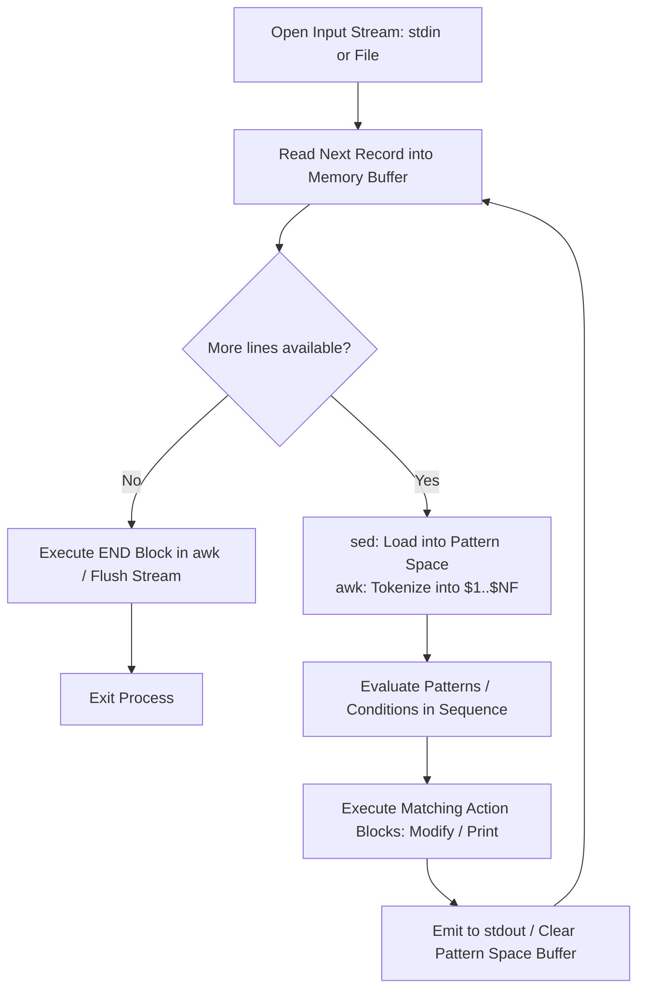

<!--
================================================================================
Metadata:
  Title: Text Processing: Grep, Sed, Awk, Cut, Sort & Tr
  Track: Linux & Systems Engineering / DevOps
  Difficulty: Intermediate
  Estimated Time: 60 minutes
  Prerequisites: 02-shell/02-pipes-redirection-and-file-descriptors.md, 02-shell/03-globbing-quoting-and-expansion.md
  Key Terminology: grep, sed, awk, cut, sort, uniq, tr, stream editor, pattern matching, field separator (FS/OFS), record separator (RS/ORS)
================================================================================
-->

# Text Processing: Grep, Sed, Awk, Cut, Sort & Tr

[<- 03-globbing-quoting-and-expansion.md](./03-globbing-quoting-and-expansion.md) | [Back to Module Overview](./README.md) | [05-regular-expressions.md ->](./05-regular-expressions.md)

---

## Table of Contents
- [1. What & Why](#1-what--why)
- [2. Core Concepts](#2-core-concepts)
- [3. How It Works Internally](#3-how-it-works-internally)
- [4. Syntax & Usage](#4-syntax--usage)
- [5. Practical Examples](#5-practical-examples)
- [6. Best Practices](#6-best-practices)
- [7. Common Mistakes & Troubleshooting](#7-common-mistakes--troubleshooting)
- [8. Performance, Security & Cost Implications](#8-performance-security--cost-implications)
- [9. Comparison Table](#9-comparison-table)
- [10. Real-World Interview Questions](#10-real-world-interview-questions)
- [11. Practice Exercises](#11-practice-exercises)
- [12. Summary & Quick Reference Cheat Sheet](#12-summary--quick-reference-cheat-sheet)
- [13. Further Reading & Official Documentation](#13-further-reading--official-documentation)

---

## 1. What & Why

In Linux systems engineering, text is the universal interface. System logs (`/var/log/syslog`), kernel diagnostics (`dmesg`), configuration files (`/etc/ssh/sshd_config`), `/proc` performance statistics, and container output streams are all plain-text streams.

The classical Unix toolkit provides specialized text filters designed to be combined through pipelines:
- **`grep`**: Fast pattern searching and line selection.
- **`sed` (Stream Editor)**: Non-interactive stream transformation, substitution, and deletion.
- **`awk`**: A full pattern-directed data-driven programming language optimized for structured columnar data.
- **`cut`**, **`sort`**, **`uniq`**, **`tr`**: Fast single-purpose primitives for slicing, ordering, deduplication, and byte translation.

Mastering these text processing tools allows systems engineers to triage multi-gigabyte log spikes, extract critical audit trails, and calculate error rates directly on production servers in seconds—without installing heavy external runtimes like Python or Node.js.

---

## 2. Core Concepts

### The Unix Filter Philosophy
Each tool is engineered for a specific role in stream transformations:

```
+-------------------------------------------------------------------------+
| CLASSICAL TEXT PROCESSING TOOL ROLES & PIPELINE FLOW                    |
|                                                                         |
|  Raw Stream Input (/var/log/nginx/access.log)                           |
|        │                                                                |
|        v                                                                |
|  [ grep -E "50[0-9]" ]            --> Filters: Selects lines matching   |
|        │                              HTTP 5xx server errors            |
|        v                                                                |
|  [ sed 's/\"//g' ]                --> Transforms: Cleans quotes or      |
|        │                              substitutes delimiters            |
|        v                                                                |
|  [ awk '{print $1, $7, $9}' ]     --> Extracts & Aggregates: Pulls IP,  |
|        │                              URI, and Status Code columns      |
|        v                                                                |
|  [ sort | uniq -c | sort -nr ]    --> Summarizes: Tallies frequency,    |
|        │                              sorts descending by occurrence    |
|        v                                                                |
|  Final Analytical Output (Top 10 abusive IPs causing 500 errors)        |
+-------------------------------------------------------------------------+
```

### The Three Powerhouses: Grep, Sed, and Awk
1. **`grep` (Global Regular Expression Print)**:
   - Evaluates regular expressions line-by-line.
   - Emits matching lines, non-matching lines (`-v`), match counts (`-c`), or byte offsets (`-b`).
   - Specialized variants: `grep -F` (Fixed strings: ultra-fast Boyer-Moore-Horspool algorithm), `grep -E` (Extended Regular Expressions), `grep -P` (Perl-Compatible Regular Expressions).
2. **`sed` (Stream Editor)**:
   - Operates on a continuous stream of text using an internal **Pattern Space** and optional **Hold Space**.
   - Applies editing scripts (`s/pattern/replacement/g`, `d`, `p`) line-by-line.
   - Can perform atomic in-place file modifications (`sed -i`).
3. **`awk` (Aho, Weinberger, and Kernighan)**:
   - Treats input as a succession of **records** (lines, separated by `RS`) split into **fields** (columns `$1`, `$2`... separated by `FS`).
   - Executes program blocks governed by patterns: `pattern { action }`.
   - Supports associative arrays, arithmetic calculations, formatting (`printf`), and built-in variables (`NR`, `NF`, `FILENAME`).

---

## 3. How It Works Internally

Understanding the internal execution loop of `sed` and `awk` reveals why they operate in constant memory regardless of whether the input file is 10 KB or 100 GB:



### Memory Efficiency: Streaming vs In-Memory Slurping
- Unlike GUI editors or scripting scripts that load entire files into RAM (`array = file.readlines()`), `grep`, `sed`, and `awk` read chunks via POSIX `read()` system calls into a fixed ring buffer (typically 4KB–64KB).
- **Constant Memory Footprint**: A 50 GB log file processed via `awk '{print $1}'` consumes only ~2 MB to 8 MB of resident set size (RSS) memory, making it immune to Out-Of-Memory (OOM) crashes on constrained VMs.

---

## 4. Syntax & Usage

### 1. Grep Syntax Patterns
```bash
# Basic case-insensitive search
grep -i "database connection failed" /var/log/app.log

# Invert match (show lines that DO NOT contain pattern)
grep -v "DEBUG" /var/log/app.log

# Recursive search with line numbers and file names
grep -rnE "TODO|FIXME" ./src/

# Fixed string match (fastest search: bypasses regex compilation)
grep -F "192.168.1.15" /var/log/nginx/access.log

# Print only the matching substring, not the whole line
grep -oE "[0-9]{1,3}\.[0-9]{1,3}\.[0-9]{1,3}\.[0-9]{1,3}" /var/log/auth.log

# Print 3 lines of context around match (After: -A, Before: -B, Both: -C)
grep -C 3 "NullPointerException" /var/log/app.log
```

### 2. Sed Syntax Patterns
```bash
# Global search and replace on stdout
sed 's/localhost/127.0.0.1/g' config.yaml

# In-place file modification with atomic backup
sed -i.bak 's/DEBUG=true/DEBUG=false/g' .env

# Delete lines matching a pattern
sed '/^#/d' nginx.conf             # Delete comment lines starting with #
sed '/^$/d' nginx.conf             # Delete blank lines

# Print only a specific line range (e.g., lines 50 to 100)
sed -n '50,100p' /var/log/syslog

# Using alternate delimiters (avoids escaping slashes in URLs and paths)
sed -i 's|https://old.domain.com|https://new.domain.com|g' app.json
```

### 3. Awk Syntax Patterns
```bash
# Print specific columns ($1, $3) with custom output delimiter
awk -F':' '{print $1, $3}' /etc/passwd

# Filter lines where column 9 (HTTP status) equals 500
awk '$9 == 500 {print $1, $7}' access.log

# Calculate sum and average of column 3
awk '{sum += $3; count++} END {printf "Total: %.2f | Avg: %.2f\n", sum, sum/count}' metrics.txt

# Associative array aggregation: Count occurrences per IP address
awk '{ip_count[$1]++} END {for (ip in ip_count) print ip_count[ip], ip}' access.log | sort -rn
```

### 4. Cut, Sort, Uniq & Tr
```bash
# Cut: Extract delimiter-separated fields or character positions
cut -d':' -f1,7 /etc/passwd       # Fields 1 and 7 (username and shell)
cut -c1-10 audit.log              # First 10 characters of each line

# Sort: Numerical (-n), human-readable sizes (-h), reverse (-r), by column (-k)
sort -k2,2nr data.txt             # Sort numerically descending on column 2

# Uniq: Deduplicate adjacent lines; count occurrences (-c)
# Note: Input MUST be sorted before piping into uniq!
sort ips.txt | uniq -c | sort -nr

# Tr: Translate or delete characters
tr '[:lower:]' '[:upper:]' < input.txt  # Uppercase conversion
tr -d '\r' < windows.txt > unix.txt     # Strip Windows CRLF line endings
```

---

## 5. Practical Examples

### 1. Basic: Stripping Comments and Blank Lines from Configurations
Inspect the actual active configuration of a complex service (e.g., SSH, Nginx, or Redis) without wading through hundreds of explanatory comments:
```bash
grep -vE '^[[:space:]]*(#|$)' /etc/ssh/sshd_config
# Or with sed:
sed -E '/^[[:space:]]*(#|$)/d' /etc/ssh/sshd_config
```

### 2. Real-World: Web Server Access Log Triage
Identify the top 10 IP addresses generating HTTP 404 (Not Found) errors in an Nginx access log, formatted in a clean analytical report:
```bash
awk '$9 == 404 {print $1}' /var/log/nginx/access.log | sort | uniq -c | sort -nr | head -n 10
```
**Sample Output**:
```text
   1420 198.51.100.42
    892 203.0.113.19
    410 192.0.2.88
     75 198.51.100.12
```

### 3. Edge Case: Multi-Character and Variable Whitespace Delimiters
A common trap with `cut` is dealing with multiple consecutive spaces:
```bash
# Output of 'ps aux' has arbitrary numbers of spaces between columns
ps aux | cut -d' ' -f2 # FAILS! Returns empty fields due to consecutive spaces

# Correct Solution with Awk (Awk collapses whitespace by default):
ps aux | awk '$3 > 50.0 {print "High CPU PID:", $2, "CPU%:", $3, "Command:", $11}'
```

### 4. Failure Case: In-Place Editing Symlinks with `sed -i`
When modifying configuration files managed by tools or containers via symlinks, naive `sed -i` breaks the symlink:
```bash
# Given: /etc/nginx/sites-enabled/default -> /etc/nginx/sites-available/default
sed -i 's/80/8080/g' /etc/nginx/sites-enabled/default
# Consequence: sed unlinks the symlink and creates a regular file in its place!
# The original target file remains UNMODIFIED!

# Production Solution: Use --follow-symlinks
sed -i --follow-symlinks 's/80/8080/g' /etc/nginx/sites-enabled/default
```

### 5. Production-Grade: Real-Time Latency Percentile Calculator in Pure Awk
Calculate the 95th and 99th percentile response times from an Nginx log streaming on `stdin`:
```bash
#!/usr/bin/env bash
# Processes Nginx access logs where column 10 is response_time in milliseconds
awk '
  {
    latencies[NR] = $10
  }
  END {
    if (NR == 0) {
      print "No records processed."
      exit 0
    }
    # Sort array values numerically
    n = asort(latencies)
    
    p50_idx = int(n * 0.50 + 0.5)
    p95_idx = int(n * 0.95 + 0.5)
    p99_idx = int(n * 0.99 + 0.5)
    
    printf "========================================\n"
    printf "  Latency Metrics (Total Requests: %d)\n", n
    printf "========================================\n"
    printf "  p50 (Median):  %.2f ms\n", latencies[p50_idx]
    printf "  p95:           %.2f ms\n", latencies[p95_idx]
    printf "  p99:           %.2f ms\n", latencies[p99_idx]
    printf "========================================\n"
  }
' /var/log/nginx/access.log
```

---

## 6. Best Practices

1. **Use `grep -F` for Plain Strings**: When searching for IP addresses, domain names, or UUIDs without regular expressions, always use `grep -F`. It bypasses the regex engine and uses hardware-optimized substring matchers, running up to 10x faster.
2. **Sort Before `uniq`**: `uniq` only detects adjacent duplicate lines. Always pipe through `sort` prior to invoking `uniq`.
3. **Use Explicit Delimiters in Sed**: When working with URLs, paths, or filesystem locations, change the `sed` delimiter to pipe `|` or hash `#` (e.g., `sed 's|/var/www|/srv/www|g'`) to eliminate leaning toothpick syndrome (`\/var\/www`).
4. **Use Awk for Multi-Column Data**: Do not chain `cut | tr | sed` when `awk` can accomplish extraction, filtering, formatting, and calculation in a single invocation.
5. **Protect In-Place Edits**: Always provide a backup extension when executing `sed -i` on production servers (`sed -i.bak '...' file`), and clean up the backup after verification.

---

## 7. Common Mistakes & Troubleshooting

| Mistake / Antipattern | Underlying Cause | Consequence | Production Solution |
| :--- | :--- | :--- | :--- |
| `uniq file.txt` without `sort` | `uniq` only filters consecutive duplicate lines. | Duplicate lines dispersed across the file remain unmerged. | Pipe through sort: `sort file.txt \| uniq`. |
| `cut -d' '` on whitespace-padded output | `cut` treats every single space character as a separate field delimiter. | Multiple contiguous spaces generate empty fields; column extraction is skewed. | Use `awk '{print $N}'` which natively collapses whitespace. |
| Chaining `grep | awk` | Using `grep` to filter lines before passing to `awk`. | Spawns redundant process and pipe buffer. | Use Awk's native pattern filter: `awk '/pattern/ {print $1}'`. |
| Chaining `cat file | grep pattern` | Useless Use of Cat (UUOC). | Spawns unnecessary `cat` process, degrading pipeline performance. | Pass file directly: `grep pattern file`. |
| Forgetting `-i` backup on Mac vs Linux | GNU `sed` allows bare `sed -i`; BSD `sed` (macOS) requires explicit `sed -i ''`. | Script fails with syntax error on macOS CI runners. | Use `sed -i.bak '...' && rm file.bak` for portable compatibility. |
| `sed` replaces only first match on line | Omission of the global `g` flag in `s/foo/bar/`. | Only the first occurrence per line is substituted; remaining instances persist. | Append `g`: `sed 's/foo/bar/g'`. |

---

## 8. Performance, Security & Cost Implications

### Performance
- **Fixed String Searching**:
  - `grep "10.0.0.1"` compiles a regex state machine.
  - `grep -F "10.0.0.1"` uses Boyer-Moore string search algorithms. On a 10 GB log file, `-F` finishes in ~2.8 seconds compared to ~14.2 seconds for basic regex.
- **Single-Pass Processing**: Running 5 separate `sed` and `grep` passes over a 20 GB file reads 100 GB of data from storage. Consolidating into a single `awk` script reads the 20 GB file once.

### Security
- **Command Injection via Awk `system()`**: If an `awk` script takes untrusted input and passes it to `system($1)` or pipes to `| getline`, an adversary can execute arbitrary shell commands.
- **Denial of Service via ReDoS**: Complex nested regexes in `grep -P` or `sed` can trigger catastrophic backtracking, pegging a CPU core at 100% indefinitely.

### Cost
- In Kubernetes clusters, deploying lightweight text processing containers (`alpine` or `busybox` running `awk`) for sidecar log shippers consumes < 15 MB RAM, avoiding the costly memory overhead of Python/Ruby log forwarders.

---

## 9. Comparison Table

| Tool | Strengths | Weaknesses | Best Suited For |
| :--- | :--- | :--- | :--- |
| **`grep`** | Unrivaled throughput for pattern matching; context lines (`-A`, `-B`, `-C`). | Cannot modify streams or extract specific field indices. | Finding lines, counting occurrences, filtering logs. |
| **`sed`** | Stream substitution; line range slicing; memory-efficient text editing. | Cumbersome for multi-column math or associative lookups. | Search-and-replace, deleting lines, in-place file edits. |
| **`awk`** | Full programming language; column awareness; math & associative arrays. | Slightly higher learning curve than `grep` or `cut`. | Column reporting, tabular data, log aggregation, math. |
| **`cut`** | Simplest syntax; low overhead for single-character delimiters (e.g. CSV). | Cannot collapse consecutive spaces; strictly character/field slicing. | Slicing `/etc/passwd` or strictly formatted CSV files. |
| **`tr`** | Single-byte character replacement, deletion, and squeeze operations. | Operates purely on single bytes, not multicharacter words or regex. | Case conversion, stripping `\r`, squeezing whitespace (`-s`). |

---

## 10. Real-World Interview Questions

### Q1: What is the difference between `grep -E`, `grep -F`, and `grep -P`?
<details>
<summary>Answer</summary>
- **`grep -E` (Extended Regular Expressions)**: Enables POSIX ERE syntax, supporting metacharacters like `+`, `?`, `|`, and `()` without backslash escaping.
- **`grep -F` (Fixed Strings)**: Disables regular expression parsing completely. Treats all characters (including `.`, `*`, `[`, `]`) as literal text. Uses highly optimized Boyer-Moore or Aho-Corasick algorithms for maximum search throughput.
- **`grep -P` (Perl-Compatible Regular Expressions)**: Uses the PCRE library, providing advanced capabilities such as non-greedy matching (`.*?`), lookahead/lookbehind assertions (`(?<=...)`), and character classes like `\d`, `\w`, `\s`.
</details>

### Q2: How does `awk` handle whitespace delimiters by default compared to `cut -d' '`?
<details>
<summary>Answer</summary>
By default, `awk` sets `FS=" "` (a single space). In Awk, this special value does not mean a literal single space; it means **any run of contiguous whitespace** (spaces, tabs, and newlines). Furthermore, leading and trailing whitespace on each line is automatically trimmed.
Conversely, `cut -d' '` treats **every individual space** as a distinct delimiter. If a line begins with three spaces, `cut` sees fields 1, 2, and 3 as empty strings. Therefore, `cut` fails on commands with column padding like `ps aux` or `df -h`, whereas `awk` handles them seamlessly.
</details>

### Q3: Explain how the `sed` Pattern Space and Hold Space interact.
<details>
<summary>Answer</summary>
`sed` maintains two memory buffers:
1. **Pattern Space**: The primary working buffer where the currently read line is stored and transformed by commands. It is overwritten on every cycle unless suppressed.
2. **Hold Space**: A secondary auxiliary storage buffer that persists across cycles.
Operators exchange data between them using commands:
- `h` (hold): Overwrite Hold Space with Pattern Space.
- `H`: Append Pattern Space to Hold Space.
- `g` (get): Overwrite Pattern Space with Hold Space.
- `G`: Append Hold Space to Pattern Space.
- `x` (exchange): Swap the contents of Pattern Space and Hold Space.
This mechanism allows complex multi-line transformations, such as reversing the order of lines in a file.
</details>

### Q4: How can you count unique IP addresses in an access log using pure `awk` without calling `sort` and `uniq`?
<details>
<summary>Answer</summary>
You can use Awk's built-in **associative arrays**:
```bash
awk '{ips[$1]++} END {for (ip in ips) print ips[ip], ip}' access.log
```
Awk maintains a hash table in memory where keys are IP addresses and values are visit counts. In the `END` block, it iterates over all keys and prints the counts. This eliminates the need to pipe millions of lines across external `sort` and `uniq` processes, reducing runtime substantially.
</details>

### Q5: What is the risk of using `sed -i` on a file that has multiple hard links?
<details>
<summary>Answer</summary>
By default, GNU `sed -i` creates a temporary file (e.g., `sedXXXXXX`), writes the transformed stream to it, and then renames it over the original file using the `rename()` system call. Because `rename()` assigns the new file a brand-new inode, **the hard link is broken**. The other hard links on the filesystem continue pointing to the original, unmodified inode, while the path edited with `sed -i` now points to a completely separate inode.
</details>

### Q6: How do you extract lines between two matching delimiters (e.g., an SSL certificate block) using `sed` or `awk`?
<details>
<summary>Answer</summary>
Using range addresses:
- **`sed`**:
  ```bash
  sed -n '/-----BEGIN CERTIFICATE-----/,/-----END CERTIFICATE-----/p' bundle.crt
  ```
- **`awk`**:
  ```bash
  awk '/-----BEGIN CERTIFICATE-----/,/-----END CERTIFICATE-----/' bundle.crt
  ```
Both tools turn on printing when the first regex matches and turn off printing after the closing regex matches.
</details>

### Q7: Why is `awk 'NR==FNR'` commonly used when processing multiple files?
<details>
<summary>Answer</summary>
In `awk`:
- `NR` is the total number of records read across **all** files so far.
- `FNR` is the record number in the **current** file being read.
When `NR == FNR`, `awk` is currently processing the **first file** passed on the command line. This idiom allows loading lookup tables, dictionaries, or reference mappings into memory from File 1 before evaluating and transforming records in File 2:
```bash
awk 'NR==FNR {blocked[$1]=1; next} !($1 in blocked)' blocklist.txt access.log
```
</details>

### Q8: What does the command `tr -s ' '` do?
<details>
<summary>Answer</summary>
The `-s` (`--squeeze-repeats`) flag in `tr` replaces sequences of repeated occurrences of the specified character with a single occurrence. Therefore, `tr -s ' '` compresses multiple consecutive spaces into a single space across the entire text stream.
</details>

---

## 11. Practice Exercises

### Exercise 1: Extract System Users with Login Shells (Easy)
**Task**: Parse `/etc/passwd` using `awk` or `grep` to list all usernames whose login shell is NOT `/usr/sbin/nologin` and NOT `/bin/false`. Output format: `User: <username> | Shell: <shell>`.

<details>
<summary>Solution</summary>

```bash
awk -F':' '$7 !~ /(nologin|false)$/ {printf "User: %-15s | Shell: %s\n", $1, $7}' /etc/passwd
```
</details>

### Exercise 2: Strip Carriage Returns from Windows Files (Easy)
**Task**: Convert a Windows-formatted file (`sample.txt` with CRLF `\r\n` line endings) to Unix format (LF `\n`) using `tr` or `sed` without installing `dos2unix`.

<details>
<summary>Solution</summary>

```bash
# Using tr:
tr -d '\r' < sample.txt > sample_unix.txt

# Or using sed:
sed -i 's/\r$//' sample.txt
```
</details>

### Exercise 3: Summing Memory Usage by Process Name (Medium)
**Task**: Using `ps aux` and `awk`, calculate the total RSS (Resident Set Size) memory in megabytes consumed by all processes matching `nginx`.

<details>
<summary>Solution</summary>

```bash
ps aux | awk '
  /nginx/ && !/awk/ {
    sum_kb += $6
  }
  END {
    printf "Total Nginx RSS Memory: %.2f MB\n", sum_kb / 1024
  }
'
```
</details>

### Exercise 4: Parsing Key-Value Configuration into Clean JSON (Medium)
**Task**: Take an `/etc/os-release` file with format `KEY="VALUE"` or `KEY=VALUE` and transform it using `sed` and `awk` into valid JSON key-value pairs wrapped in curly braces.

<details>
<summary>Solution</summary>

```bash
awk -F'=' '
  BEGIN { print "{" }
  /^[A-Za-z_]/ {
    gsub(/"/, "", $2)
    if (count > 0) printf ",\n"
    printf "  \"%s\": \"%s\"", $1, $2
    count++
  }
  END { print "\n}" }
' /etc/os-release
```
</details>

### Exercise 5: High-Performance IP Blocklist Filter (Hard)
**Task**: Given a blocklist file `blocked_ips.txt` containing 10,000 IP addresses (one per line) and a 1 GB Nginx log `access.log`, output only the log lines from `access.log` whose client IP ($1) is present in `blocked_ips.txt`. Do this in a single pass without subshells.

<details>
<summary>Solution</summary>

```bash
awk '
  # Process first file (blocklist): populate hash set
  NR == FNR {
    blocked[$1] = 1
    next
  }
  # Process second file (access log): check hash set
  ($1 in blocked) {
    print $0
  }
' blocked_ips.txt /var/log/nginx/access.log
```
*Why this is optimal*: Loading 10,000 IPs into an Awk hash table consumes ~1 MB of RAM and provides $O(1)$ lookup time per log line, completing in seconds.
</details>

### Exercise 6: Extract Failed SSH Login Attempts with IP Counts (Hard)
**Task**: Parse `/var/log/auth.log` (or output of `journalctl -u ssh`) to identify all failed SSH authentication attempts, extract the offending IP addresses and targeted usernames, and print the top 5 attackers with attack counts.

<details>
<summary>Solution</summary>

```bash
grep "Failed password" /var/log/auth.log | awk '
  {
    # Determine position of user and IP
    for (i = 1; i <= NF; i++) {
      if ($i == "for" && $(i+1) == "invalid" && $(i+2) == "user") {
        user = $(i+3)
      } else if ($i == "for") {
        user = $(i+1)
      }
      if ($i == "from") {
        ip = $(i+1)
      }
    }
    if (ip != "") {
      attack_count[ip " (" user ")"]++
    }
  }
  END {
    for (entry in attack_count) {
      printf "%5d attacks from %s\n", attack_count[entry], entry
    }
  }
' | sort -rn | head -n 5
```
</details>

---

## 12. Summary & Quick Reference Cheat Sheet

| Task | Tool & Command Example | Notes |
| :--- | :--- | :--- |
| **Search Plain Text** | `grep -F "error" file.log` | Fast fixed-string search (no regex overhead) |
| **Invert Search** | `grep -v "DEBUG" file.log` | Emits lines that do not match |
| **Recursive Regex Search** | `grep -rnE "pattern" ./` | Searches directory recursively with line numbers |
| **Replace Globally in Stream**| `sed 's/foo/bar/g' file.txt` | Modifies output stream without mutating file |
| **In-place File Replace** | `sed -i.bak 's/foo/bar/g' file` | Modifies file in place, saving backup copy |
| **Delete Matching Lines** | `sed '/pattern/d' file.txt` | Removes lines matching pattern |
| **Extract Specific Columns** | `awk '{print $1, $3}' file.txt` | Collapses variable whitespace automatically |
| **Custom Column Separator** | `awk -F':' '{print $1}' /etc/passwd`| Sets field separator to colon |
| **Summing Column Values** | `awk '{s+=$1} END {print s}'` | Accumulates numerical sum in constant memory |
| **Filter by Column Value** | `awk '$9 >= 500' access.log` | Evaluates arithmetic conditions on fields |
| **Sort Descending Numerically**| `sort -rn file.txt` | Sorts lines by numerical value descending |
| **Count Unique Items** | `sort file.txt \| uniq -c \| sort -nr`| Input MUST be sorted before piping to `uniq` |
| **Translate / Delete Chars** | `tr -d '\r' < win.txt > unix.txt` | Removes Windows CRLF carriage returns |

---

## 13. Further Reading & Official Documentation

- [The GNU Awk User's Guide (Gawk)](https://www.gnu.org/software/gawk/manual/gawk.html)
- [GNU Sed Manual](https://www.gnu.org/software/sed/manual/sed.html)
- [GNU Grep Manual](https://www.gnu.org/software/grep/manual/grep.html)
- [POSIX.1-2017: Awk Utility Standard](https://pubs.opengroup.org/onlinepubs/9699919799/utilities/awk.html)
- [Arnold Robbins: Effective awk Programming (O'Reilly)](https://www.oreilly.com/library/view/effective-awk-programming/9781491904923/)

---

[<- 03-globbing-quoting-and-expansion.md](./03-globbing-quoting-and-expansion.md) | [Back to Module Overview](./README.md) | [05-regular-expressions.md ->](./05-regular-expressions.md)
