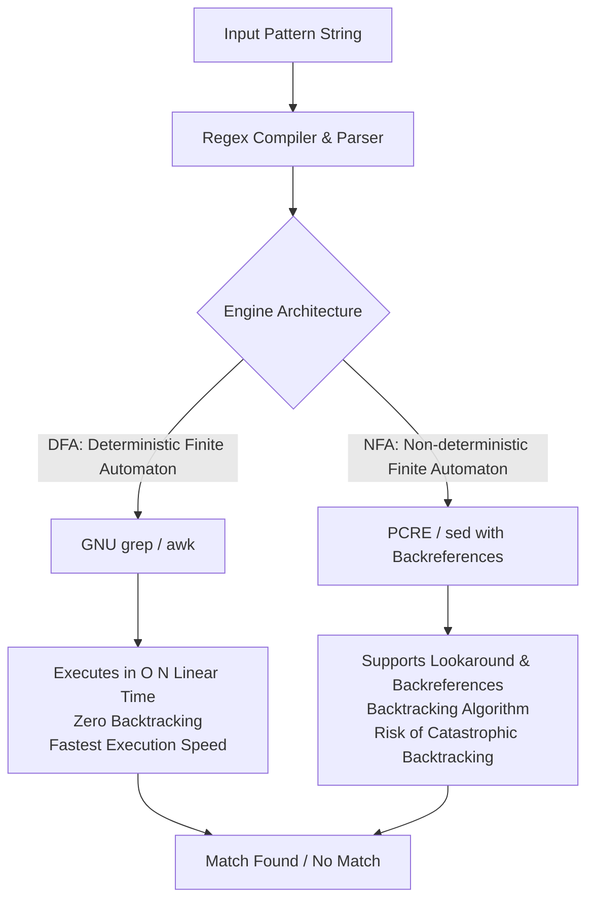

<!--
================================================================================
Metadata:
  Title: Regular Expressions in Linux: BRE vs ERE vs PCRE
  Track: Linux & Systems Engineering / DevOps
  Difficulty: Intermediate
  Estimated Time: 50 minutes
  Prerequisites: 02-shell/04-text-processing.md
  Key Terminology: Regular Expressions, BRE, ERE, PCRE, Deterministic Finite Automaton (DFA), Non-deterministic Finite Automaton (NFA), Backreferences, Lookaround Assertions, Greedy vs Non-Greedy
================================================================================
-->

# Regular Expressions in Linux: BRE vs ERE vs PCRE

[<- 04-text-processing.md](./04-text-processing.md) | [Back to Module Overview](./README.md) | [06-jq-and-structured-data.md ->](./06-jq-and-structured-data.md)

---

## Table of Contents
- [1. What & Why](#1-what--why)
- [2. Core Concepts](#2-core-concepts)
- [3. How It Works Internally](#3-how-it-works-internally)
- [4. Syntax & Usage](#4-syntax--usage)
- [5. Practical Examples](#5-practical-examples)
- [6. Best Practices](#6-best-practices)
- [7. Common Mistakes & Troubleshooting](#7-common-mistakes--troubleshooting)
- [8. Performance, Security & Cost Implications](#8-performance-security--cost-implications)
- [9. Comparison Table](#9-comparison-table)
- [10. Real-World Interview Questions](#10-real-world-interview-questions)
- [11. Practice Exercises](#11-practice-exercises)
- [12. Summary & Quick Reference Cheat Sheet](#12-summary--quick-reference-cheat-sheet)
- [13. Further Reading & Official Documentation](#13-further-reading--official-documentation)

---

## 1. What & Why

In Linux systems engineering, pattern matching is at the heart of log parsing, intrusion detection, configuration verification, and text transformation. Whether filtering kernel error spikes in `dmesg`, configuring routing rewrites in Nginx, or authoring Fail2ban detection filters, engineers rely on regular expressions.

However, one of the most persistent sources of confusion in the Linux command line is the coexistence of **three competing regular expression dialects**:
1. **Basic Regular Expressions (BRE)**: The historical POSIX standard used by default in `grep` and `sed`.
2. **Extended Regular Expressions (ERE)**: The modernized POSIX standard used by `grep -E` (`egrep`) and `awk`.
3. **Perl-Compatible Regular Expressions (PCRE)**: The high-powered engine supported by `grep -P`, Nginx location blocks, and programming language runtimes.

Understanding the syntactical differences, engine mechanics, and catastrophic backtracking risks across these dialects is essential for constructing robust, high-performance Linux text filters.

---

## 2. Core Concepts

### The Dialect Divide: Escaping Inversion
The most striking difference between BRE and ERE is the inverted use of the backslash (`\`) for structural metacharacters:

- In **BRE (Basic)**: Characters like `(`, `)`, `{`, `}`, `?`, `+`, and `|` are treated as **literal characters** by default. To unlock their special metacharacter behavior, they **must be escaped with a backslash**: `\(`, `\)`, `\{`, `\}`, `\+`, `\?`, `\|`.
- In **ERE (Extended)**: Characters like `(`, `)`, `{`, `}`, `?`, `+`, and `|` are treated as **metacharacters** by default. To match them literally, you escape them: `\(`, `\)`.

```
+-------------------------------------------------------------------------+
| REGEX DIALECT COMPARISON: THE ESCAPING MATRIX                            |
|                                                                         |
|  Feature                     BRE (grep / sed)        ERE (grep -E / awk)|
|  -------------------------   --------------------    ------------------ |
|  One or more (+)             a\+b                    a+b                |
|  Zero or one (?)             a\?b                    a?b                |
|  Alternation (OR)            cat\|dog                cat|dog            |
|  Grouping                    \(abc\)\+               (abc)+             |
|  Interval Quantifier         a\{1,3\}                a{1,3}             |
|  Literal Parenthesis         (abc)                   \(abc\)            |
+-------------------------------------------------------------------------+
```

### Character Classes: POSIX vs PCRE Shorthands
Standard POSIX regex does not natively recognize shorthands like `\d` (digit) or `\w` (word character). Instead, POSIX defines portable bracketed character classes:

| POSIX Character Class | ASCII Equivalent | PCRE / Modern Shorthand | Description |
| :--- | :--- | :---: | :--- |
| `[[:digit:]]` | `[0-9]` | `\d` | Decimal digits |
| `[[:alpha:]]` | `[a-zA-Z]` | - | Alphabetic characters |
| `[[:alnum:]]` | `[a-zA-Z0-9]` | - | Alphanumeric characters |
| `[[:space:]]` | `[ \t\r\n\v\f]` | `\s` | Whitespace characters |
| `[[:word:]]` | `[a-zA-Z0-9_]` | `\w` | Word characters (alnum + underscore) |
| `[[:xdigit:]]` | `[0-9a-fA-F]` | - | Hexadecimal digits |
| `[[:punct:]]` | Punctuation symbols | - | Graphical punctuation marks |

---

## 3. How It Works Internally

Under the hood, Linux regular expression engines compile patterns into finite state machines:



### DFA (Deterministic Finite Automaton) vs NFA (Non-deterministic Finite Automaton)
1. **DFA Engines (GNU Grep default, Awk)**:
   - At each character in the input string, the engine is in exactly one deterministic state.
   - It **never backtracks**.
   - Time complexity is strictly $O(N)$ with respect to the input length $N$.
   - *Limitation*: Cannot support backreferences (`\1`) or lookaround assertions because state machines with no backtracking cannot "remember" arbitrary prior substrings.
2. **NFA Engines (PCRE, Python, JavaScript)**:
   - Evaluates characters by exploring multiple branches, backtracking when a branch fails.
   - Supports advanced constructs: capture groups, backreferences, positive/negative lookaheads (`(?=...)`), non-greedy quantifiers (`.*?`).
   - *Vulnerability*: Poorly written patterns with nested quantifiers (e.g., `(a+)+$`) cause exponential backtracking ($O(2^N)$), causing **Catastrophic Backtracking (ReDoS)** that locks a CPU core at 100%.

---

## 4. Syntax & Usage

### 1. Anchors and Boundaries
```bash
# Line anchors: ^ (start of line), $ (end of line)
grep "^[[:space:]]*server" nginx.conf   # Lines beginning with optional space and 'server'
grep "404$" access.log                 # Lines ending with 404

# Word boundaries: \< and \> (in BRE) or \b (in PCRE / ERE)
grep -E "\badmin\b" /var/log/auth.log   # Matches 'admin' but not 'administrator'
```

### 2. Quantifiers
```bash
# Asterisk (*): Zero or more occurrences
grep -E "colou*r" file.txt       # Matches color, colour, colouur

# Plus (+): One or more occurrences
grep -E "https?://[a-z]+" file.txt

# Question mark (?): Zero or one occurrence (optional)
grep -E "https?://" file.txt      # Matches http:// and https://

# Explicit intervals ({min,max})
grep -E "[0-9]{1,3}\.[0-9]{1,3}\.[0-9]{1,3}\.[0-9]{1,3}" access.log
```

### 3. PCRE Advanced Features (`grep -P`)
```bash
# Non-greedy matching (.*?)
# Extracts text between first pair of quotes rather than expanding to the line's end
grep -Po '"(.*?)"' config.json

# Positive Lookbehind (?<=...)
# Matches text preceded by pattern, without including the pattern in match
grep -Po '(?<=DB_PASSWORD=)\w+' .env

# Positive Lookahead (?=...)
# Matches text followed by pattern
grep -Po '\d+(?=ms)' benchmark.log

# Negative Lookahead (?!...)
# Matches lines containing 'ERROR' that are NOT followed by 'Timeout'
grep -P 'ERROR(?!.*Timeout)' app.log
```

---

## 5. Practical Examples

### 1. Basic: Extracting IPv4 Addresses
Extract all distinct IPv4 addresses from an authentication log:
```bash
grep -oE '([0-9]{1,3}\.){3}[0-9]{1,3}' /var/log/auth.log | sort -u
```

### 2. Real-World: Validating and Slicing ISO-8601 Timestamps
Search for timestamped errors matching `YYYY-MM-DDTHH:MM:SS` format:
```bash
grep -E '^[0-9]{4}-[0-9]{2}-[0-9]{2}T[0-9]{2}:[0-9]{2}:[0-9]{2}\.[0-9]{3}Z (ERROR|FATAL)' /var/log/app.log
```

### 3. Edge Case: Hyphen Placement in Bracketed Character Classes
In regular expressions, the hyphen `-` defines character ranges (e.g., `[a-z]`, `[0-9]`). If you need to match a literal hyphen, it **must** be placed at the very beginning or very end of the character class:
```bash
# INCORRECT: Treats a-z and _-@ as ranges; triggers regex compile error
grep "[a-z_-$]" file.txt

# CORRECT: Hyphen placed at the end or escaped
grep "[a-z_$-]" file.txt
grep "[-a-z_$]" file.txt
```

### 4. Failure Case: Catastrophic Backtracking (ReDoS)
Demonstrating catastrophic backtracking using PCRE:
```bash
# DANGEROUS PATTERN: Nested quantifiers (a+)+
# An input string of 25 'a' characters followed by 'X' triggers 33,554,432 backtracking steps!
echo "aaaaaaaaaaaaaaaaaaaaaaaaaX" | grep -P "^(a+)+$"
# Consequence: Process hangs, pegging 100% CPU on that core.

# SAFE PATTERN: Atomic grouping or non-nested unrolled loops
echo "aaaaaaaaaaaaaaaaaaaaaaaaaX" | grep -P "^a+$"
```

### 5. Production-Grade: Robust Log Sanitizer with Sed and Regex
A production sanitization script that redacts sensitive credentials (passwords, authorization bearer tokens, API keys) from raw application log streams:
```bash
#!/usr/bin/env bash
set -euo pipefail

# Redacts:
# 1. Bearer tokens: "Bearer <alphanumeric>" -> "Bearer [REDACTED]"
# 2. Key-value secrets: password="...", api_key="..." -> key="[REDACTED]"
# 3. Credit card / 16-digit sequences -> "****-****-****-****"

sed -E \
  -e 's/(Bearer[[:space:]]+)[A-Za-z0-9._~+/-]{10,}/\1[REDACTED]/g' \
  -e 's/((password|secret|token|api_key)[[:space:]]*=[[:space:]]*["'\''])[A-Za-z0-9!@#$%^&*()_+=-]+(["'\''])/\1[REDACTED]\3/gI' \
  -e 's/\b[0-9]{4}[- ]?[0-9]{4}[- ]?[0-9]{4}[- ]?[0-9]{4}\b/****-****-****-****/g' \
  /var/log/app_raw.log > /var/log/app_sanitized.log

echo "[SUCCESS] Sensitive tokens redacted."
```

---

## 6. Best Practices

1. **Default to `grep -E` for Scripts**: Extended Regular Expressions (ERE) provide clean syntax without the confusing `\(` and `\+` escaping inversions of BRE.
2. **Use POSIX Character Classes for Portability**: Use `[[:space:]]` and `[[:digit:]]` in portable shell scripts. Some platforms (e.g., standard BSD `sed` on macOS) do not support `\s` or `\d` out of the box.
3. **Anchor Patterns Whenever Possible**: Always use `^` (start) and `$` (end) if matching full lines. Anchored searches allow the regex engine to reject non-matching lines immediately at character index 0 without scanning the rest of the line.
4. **Beware of Regex Greedy Matching**: In expressions like `<.*>`, the `.*` quantifier matches as much text as possible up to the *last* `>` on the line. Use negated classes `[^>]*` in ERE or non-greedy `.*?` in PCRE to match the shortest string.
5. **Quote All Regex Arguments**: Always encapsulate regular expressions in single quotes (`'...'`) on the command line to prevent Bash from interpreting `$`, `*`, `?`, `[`, or `\` before the regex tool receives them.

---

## 7. Common Mistakes & Troubleshooting

| Mistake / Antipattern | Underlying Cause | Consequence | Production Solution |
| :--- | :--- | :--- | :--- |
| `grep "(foo|bar)" file` without `-E` | Default `grep` uses BRE where `(` and `\|` are treated as literal text. | Zero matches returned; searches literally for `(foo|bar)`. | Use `grep -E "(foo|bar)"` or `grep "\(foo\|bar\)"`. |
| Unquoted regex: `grep [0-9]* file` | Shell globbing expands `[0-9]*` against filenames in the current directory. | Regex is corrupted by local filenames before `grep` runs. | Wrap in single quotes: `grep '[0-9]*' file`. |
| `sed 's/\d+/[NUM]/g'` | Standard POSIX `sed` does not recognize `\d` as digits or unescaped `+`. | Replaces literal letter `d` followed by `+`. | Use `sed -E 's/[0-9]+/[NUM]/g'`. |
| Greedy wildcard: `s/<.*>//g` on `<b>x</b> <i>y</i>` | `.*` matches from the first `<` to the very last `>` on the line. | Wipes out entire middle block: outputs empty string. | Use negated character class: `s/<[^>]*>//g`. |
| Misplaced hyphen: `[a-z-0-9]` | Hyphen between `z` and `0` specifies an invalid ASCII character range. | Regex compilation fails with "Invalid range end". | Place hyphen at boundary: `[a-z0-9-]`. |
| Expecting `\b` in Basic Sed | POSIX BRE does not mandate `\b` for word boundaries. | Regex fails or matches literal `b`. | Use POSIX classes or GNU sed word boundaries `\<` and `\>`. |

---

## 8. Performance, Security & Cost Implications

### Performance
- **Engine Selection**: `grep -F` (no regex) > `grep -E` (DFA engine, linear time) > `grep -P` (NFA engine with backtracking).
- **Benchmark Comparison**: On a 1 GB syslog file:
  - `grep -F "systemd"`: ~0.24 seconds.
  - `grep -E "^[A-Z][a-z]{2} [0-9]+ [0-9:]+.*systemd"`: ~1.10 seconds.
  - `grep -P "^(?=.*systemd).*"`: ~4.80 seconds.

### Security
- **Regular Expression Denial of Service (ReDoS)**: In internet-facing services (e.g., Nginx URI regex rewrites or WAF rules), an unanchored, catastrophically backtracking pattern allows attackers to consume 100% CPU on worker processes with tiny payloads.

### Cost
- In AWS CloudWatch or Datadog log parsing pipelines, inefficient regex parsing rules increase CPU consumption on log-shipper agents, requiring higher VM instance sizes and inflating infrastructure costs.

---

## 9. Comparison Table

| Attribute | Basic RegEx (BRE) | Extended RegEx (ERE) | Perl-Compatible (PCRE) |
| :--- | :--- | :--- | :--- |
| **Standard Commands** | `grep`, `sed` | `grep -E`, `awk` | `grep -P`, `perl` |
| **Engine Model** | DFA / Hybrid | DFA (Fast linear time) | NFA (Backtracking) |
| **Alternation (OR)** | `\|` | `|` | `|` |
| **Grouping** | `\(` ... `\)` | `(` ... `)` | `(` ... `)` |
| **Quantifiers (+, ?)** | `\+`, `\?` | `+`, `?` | `+`, `?` |
| **Non-Greedy Match (`.*?`)**| Not supported | Not supported | **Supported** |
| **Lookaround Assertions** | Not supported | Not supported | **Supported (`(?=...)`, `(?<=...)`)** |
| **POSIX Classes (`[[:digit:]]`)**| Supported | Supported | Supported |
| **Shorthand Classes (`\d`, `\w`)**| No (Implementation specific)| No | **Supported** |

---

## 10. Real-World Interview Questions

### Q1: Why does `grep "error|warning" file.txt` fail to match either word by default?
<details>
<summary>Answer</summary>
By default, GNU `grep` parses regular expressions using **POSIX Basic Regular Expressions (BRE)**. In BRE, the pipe character `|` is treated as a **literal character**. To perform alternation in BRE, the pipe must be escaped with a backslash: `grep "error\|warning" file.txt`. Alternatively, one can invoke `grep` in Extended mode using `grep -E "error|warning" file.txt`, where `|` is recognized as a metacharacter natively.
</details>

### Q2: What is the mechanical difference between a DFA regex engine and an NFA regex engine?
<details>
<summary>Answer</summary>
- **DFA (Deterministic Finite Automaton)**:
  - Tracks all possible active states concurrently as it steps through the input string character by character.
  - It visits each character in the input string exactly once.
  - **Guarantees linear time complexity $O(N)$** regardless of pattern complexity.
  - Cannot support features requiring backtracking, such as backreferences (`\1`) or lookaround assertions.
- **NFA (Non-deterministic Finite Automaton)**:
  - Explores matching paths one at a time, guessing transitions and backtracking when it encounters a dead end.
  - Rich feature support: capture groups, backreferences, non-greedy matching, lookahead/lookbehind.
  - Vulnerable to exponential time complexity ($O(2^N)$) during catastrophic backtracking.
</details>

### Q3: What is "Catastrophic Backtracking", and how can it be mitigated?
<details>
<summary>Answer</summary>
Catastrophic backtracking occurs in NFA regex engines when a pattern contains nested, overlapping quantifiers (such as `(a+)+$` or `(x|y+)+`) and is evaluated against an input string that matches partially but fails at the end (e.g., `"aaaaaaaX"`).
The engine attempts every permutation of dividing the input characters among the nested quantifiers before finally declaring a non-match. For $N$ characters, the permutations scale exponentially ($2^N$).
**Mitigation**:
1. Avoid nested quantifiers: unroll loops so that tokens are mutually exclusive.
2. Use atomic grouping `(?>...)` or possessive quantifiers `a++` in PCRE, which discard backtracking history once a sub-expression matches.
3. Enforce maximum input length limits before applying regex checks.
</details>

### Q4: Explain the difference between `grep -o` and standard `grep`.
<details>
<summary>Answer</summary>
Standard `grep` outputs the **entire line** containing any occurrence that matches the pattern.
`grep -o` (`--only-matching`) instructs `grep` to print **only the exact matching substring**, with each match placed on its own separate line. If a single line contains three distinct IP addresses, `grep -oE '([0-9]{1,3}\.){3}[0-9]{1,3}'` outputs three distinct lines, each holding one IP.
</details>

### Q5: How does a Lookbehind assertion `(?<=...)` work in `grep -P`?
<details>
<summary>Answer</summary>
A positive lookbehind assertion `(?<=pattern)` is a zero-width assertion. It verifies that the text preceding the current position matches `pattern`, but it does **not consume characters** or include `pattern` in the final matched result.
For example, to extract only the numerical value from lines formatted as `cost=499USD`:
```bash
grep -Po '(?<=cost=)\d+' billing.txt
# Output: 499 (the string "cost=" is excluded from output)
```
</details>

### Q6: Why is `.*` dangerous when parsing HTML or XML in shell scripts?
<details>
<summary>Answer</summary>
In regular expressions, the `*` quantifier is **greedy**: it matches as many characters as possible. When evaluated against `<div>first</div> <div>second</div>`, the pattern `<.*>` matches from the first `<` all the way to the **very last** `>` on the line, consuming both elements as a single match.
To match individual tags, one must either use a negated character class (`<[^>]*>`) in ERE, or non-greedy matching (`<.*?>`) in PCRE.
</details>

### Q7: What does `\b` represent in regular expressions, and where does it fail?
<details>
<summary>Answer</summary>
`\b` denotes a **word boundary**: a zero-width assertion occurring between a word character (typically `[a-zA-Z0-9_]`) and a non-word character (or start/end of line).
It fails when searching for tokens that contain non-word characters (e.g., punctuation). For instance, `\bC++\b` will not match `C++` because `+` is not a word character; the boundary is asserted after `C`, not after `++`.
</details>

### Q8: How can you write a regex that matches lines containing BOTH "alpha" and "beta" in any order?
<details>
<summary>Answer</summary>
In POSIX ERE (`grep -E`):
```bash
grep -E '(alpha.*beta|beta.*alpha)' file.txt
```
In PCRE (`grep -P`) using lookaheads:
```bash
grep -P '^(?=.*alpha)(?=.*beta)' file.txt
```
Alternatively, in shell automation, it is often faster and cleaner to pipe two `grep` calls:
```bash
grep "alpha" file.txt | grep "beta"
```
</details>

---

## 11. Practice Exercises

### Exercise 1: Extract All Email Addresses from Text (Easy)
**Task**: Use `grep -E` to find and extract all standard email addresses (`user@domain.tld`) from a log file, outputting only the email strings.

<details>
<summary>Solution</summary>

```bash
grep -oE '\b[A-Za-z0-9._%+-]+@[A-Za-z0-9.-]+\.[A-Za-z]{2,}\b' /var/log/mail.log
```
</details>

### Exercise 2: Identify Non-ASCII Characters in Source Code (Easy)
**Task**: Write a command that scans source code files in `./src/` and flags any lines containing non-ASCII characters (e.g., smart quotes, non-standard hyphens, Unicode emojis).

<details>
<summary>Solution</summary>

```bash
grep -rnP '[^\x00-\x7F]' ./src/
```
</details>

### Exercise 3: Validating Semantic Versioning Strings (Medium)
**Task**: Author a bash test function `validate_semver <version_string>` using the `[[ $var =~ regex ]]` operator to return 0 if the string strictly adheres to Semantic Versioning 2.0 (e.g., `1.2.3`, `2.0.0-beta.1`, `1.0.0+20130313`), and 1 otherwise.

<details>
<summary>Solution</summary>

```bash
#!/usr/bin/env bash
validate_semver() {
  local ver="$1"
  local semver_regex='^(0|[1-9][0-9]*)\.(0|[1-9][0-9]*)\.(0|[1-9][0-9]*)(-([0-9A-Za-z-]+(\.[0-9A-Za-z-]+)*))?(\+([0-9A-Za-z-]+(\.[0-9A-Za-z-]+)*))?$'
  
  if [[ "$ver" =~ $semver_regex ]]; then
    echo "[VALID] $ver"
    return 0
  else
    echo "[INVALID] $ver" >&2
    return 1
  fi
}

validate_semver "1.0.0"
validate_semver "2.1.0-alpha.1"
validate_semver "v1.2" # Invalid (starts with v)
```
</details>

### Exercise 4: Extract Key-Value Pairs with PCRE Lookaheads (Medium)
**Task**: Given a structured key-value log line `level=INFO caller=server.go:42 msg="User logged in" uid=9841 latency=12ms`, extract the exact value of `uid` using `grep -P`.

<details>
<summary>Solution</summary>

```bash
echo 'level=INFO caller=server.go:42 msg="User logged in" uid=9841 latency=12ms' | \
  grep -Po '(?<=\buid=)\d+'
# Output: 9841
```
</details>

### Exercise 5: Fast MAC Address Extractor and Formatter (Hard)
**Task**: Author a pipeline that reads `ip link` or `dmesg`, extracts all hardware MAC addresses (`XX:XX:XX:XX:XX:XX`), normalizes any lowercase hexadecimal characters to uppercase, and removes duplicates.

<details>
<summary>Solution</summary>

```bash
ip link | grep -oE '([0-9a-fA-F]{2}:){5}[0-9a-fA-F]{2}' | tr '[:lower:]' '[:upper:]' | sort -u
```
</details>

### Exercise 6: Reverting Malicious CamelCase Token Inversion (Hard)
**Task**: Using `sed -E`, write a transformation that finds CamelCase variables in code (e.g., `orderDatabaseConnection`) and converts them to snake_case (`order_database_connection`).

<details>
<summary>Solution</summary>

```bash
echo "orderDatabaseConnection and paymentGatewayClient" | \
  sed -E 's/([a-z])([A-Z])/\1_\2/g' | \
  tr '[:upper:]' '[:lower:]'
# Output: order_database_connection and payment_gateway_client
```
</details>

---

## 12. Summary & Quick Reference Cheat Sheet

| Metacharacter | BRE Syntax | ERE Syntax | PCRE Syntax | Meaning |
| :--- | :--- | :--- | :--- | :--- |
| **Dot (`.`)** | `.` | `.` | `.` | Any single character except newline |
| **Zero or more** | `*` | `*` | `*` | Matches $\ge 0$ times |
| **One or more** | `\+` | `+` | `+` | Matches $\ge 1$ times |
| **Zero or one** | `\?` | `?` | `?` | Matches 0 or 1 time (optional) |
| **Exact count** | `\{N\}` | `{N}` | `{N}` | Matches exactly $N$ times |
| **Range count** | `\{min,max\}`| `{min,max}` | `{min,max}` | Matches between min and max times |
| **Grouping** | `\(...\)` | `(...)` | `(...)` | Capturing group |
| **Alternation** | `\|` | `|` | `|` | Logical OR |
| **Line Start / End**| `^` / `$` | `^` / `$` | `^` / `$` | Line anchors |
| **Word Boundary** | `\<` / `\>` | `\b` | `\b` | Boundary between word and non-word |
| **Digits** | `[0-9]`, `[[:digit:]]` | `[[:digit:]]` | `\d` | Decimal digits |
| **Whitespace** | `[ \t]`, `[[:space:]]` | `[[:space:]]` | `\s` | Spaces, tabs, newlines |
| **Non-Greedy** | Not supported | Not supported | `*?`, `+?` | Matches shortest possible span |
| **Lookaround** | Not supported | Not supported | `(?=...)`, `(?<=...)` | Zero-width lookahead/lookbehind |

---

## 13. Further Reading & Official Documentation

- [POSIX.1-2017: Regular Expressions Specification](https://pubs.opengroup.org/onlinepubs/9699919799/basedefs/V1_chap09.html)
- [PCRE - Perl Compatible Regular Expressions Documentation](http://www.pcre.org/current/doc/html/)
- [GNU Grep Manual - Regular Expressions](https://www.gnu.org/software/grep/manual/html_node/Regular-Expressions.html)
- [Jeffrey Friedl: Mastering Regular Expressions (O'Reilly)](https://www.oreilly.com/library/view/mastering-regular-expressions/0596528124/)

---

[<- 04-text-processing.md](./04-text-processing.md) | [Back to Module Overview](./README.md) | [06-jq-and-structured-data.md ->](./06-jq-and-structured-data.md)
