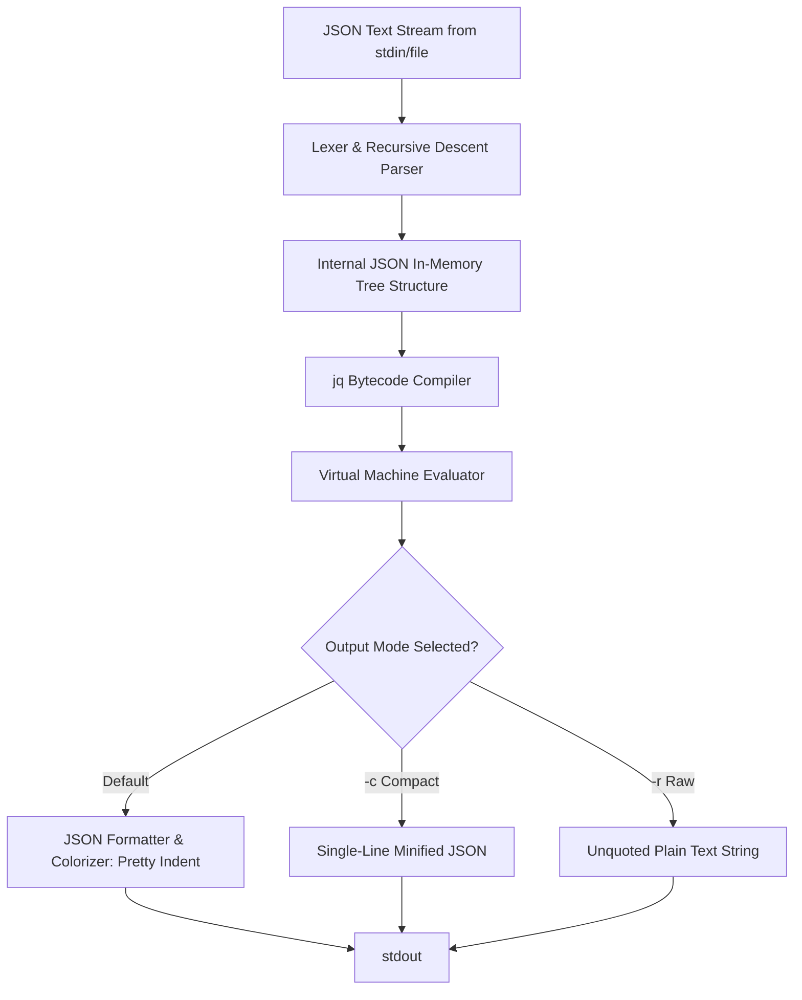

<!--
================================================================================
Metadata:
  Title: JSON & Structured Data with jq
  Track: Linux & Systems Engineering / DevOps
  Difficulty: Intermediate
  Estimated Time: 50 minutes
  Prerequisites: 02-shell/02-pipes-redirection-and-file-descriptors.md
  Key Terminology: JSON, jq, Streaming Filter, Identity Filter (.), Object Identifier, Array Iterator (.[ ]), map(), select(), reduce, slurp (-s), raw-output (-r), compact-output (-c)
================================================================================
-->

# JSON & Structured Data with jq

[<- 05-regular-expressions.md](./05-regular-expressions.md) | [Back to Module Overview](./README.md) | [07-bash-scripting.md ->](./07-bash-scripting.md)

---

## Table of Contents
- [1. What & Why](#1-what--why)
- [2. Core Concepts](#2-core-concepts)
- [3. How It Works Internally](#3-how-it-works-internally)
- [4. Syntax & Usage](#4-syntax--usage)
- [5. Practical Examples](#5-practical-examples)
- [6. Best Practices](#6-best-practices)
- [7. Common Mistakes & Troubleshooting](#7-common-mistakes--troubleshooting)
- [8. Performance, Security & Cost Implications](#8-performance-security--cost-implications)
- [9. Comparison Table](#9-comparison-table)
- [10. Real-World Interview Questions](#10-real-world-interview-questions)
- [11. Practice Exercises](#11-practice-exercises)
- [12. Summary & Quick Reference Cheat Sheet](#12-summary--quick-reference-cheat-sheet)
- [13. Further Reading & Official Documentation](#13-further-reading--official-documentation)

---

## 1. What & Why

In modern cloud, container, and microservice infrastructure, unstructured plain text has largely been superseded by structured JSON. Container runtime descriptors (`docker inspect`), Kubernetes manifests (`kubectl get -o json`), cloud provider APIs (AWS CLI, GCP `gcloud`), and enterprise application log forwarders (Elasticsearch, Loki) all emit JSON.

Attempting to parse JSON using line-oriented Unix tools like `grep`, `sed`, or `awk` is inherently fragile:
- Keys and values may span multiple lines or vary in indentation.
- Array elements are unordered, and string values can contain escaped characters, commas, and nested quotation marks that fool regular expressions.

**`jq`** is the de facto standard command-line JSON processor in Linux systems engineering. Like `sed` for plain text streams, `jq` is a lightweight, zero-dependency, C-based functional query language designed specifically to slice, filter, map, transform, and aggregate structured JSON data.

---

## 2. Core Concepts

### The Stream Transformation Model
In `jq`, every program is a filter that accepts a stream of JSON values on input and produces a stream of JSON values on output. Multiple filters are chained together using pipes (`|`), mirroring classical Unix shell pipelines:

```
+-------------------------------------------------------------------------+
| JQ STREAM PROCESSING PIPELINE                                           |
|                                                                         |
|  Raw JSON Input Stream (e.g. Docker inspect output)                     |
|  [ {"Id": "abc", "State": {"Running": true, "Health": "healthy"}} ]     |
|         │                                                               |
|         v                                                               |
|  [ .[] ]                --> Array Iterator: Unpacks array into stream   |
|         │                   of individual JSON objects                  |
|         v                                                               |
|  [ select(.State.Running == true) ] --> Filter: Emits only running objs |
|         │                                                               |
|         v                                                               |
|  [ {id: .Id, status: .State.Health} ] --> Constructor: Reshapes schema  |
|         │                                                               |
|         v                                                               |
|  [ -r (raw-output) ]   --> Emitter: Emits plain strings without quotes   |
|         │                                                               |
|         v                                                               |
|  Downstream Shell Pipeline (xargs, bash arrays, audit logs)             |
+-------------------------------------------------------------------------+
```

### Essential `jq` Filter Primitives
1. **The Identity Filter (`.`)**: Accepts input and outputs it unchanged, formatted with syntax highlighting and pretty indentation.
2. **Object Identifier-Index (`.field`)**: Extracts the value associated with `"field"`. If nested, chained as `.parent.child.subchild`.
3. **Array Index & Iterator (`.[0]`, `.[]`)**:
   - `.[0]`: Returns the first element of an array.
   - `.[]`: Unpacks an array into a stream of discrete elements.
4. **Constructors (`[...]`, `{...}`)**:
   - `[...]`: Collects an output stream back into a JSON array.
   - `{key: .val}`: Assembles new JSON objects dynamically.
5. **Functional Transformations**:
   - `map(filter)`: Applies a filter to each element of an input array.
   - `select(boolean_expression)`: Emits input if condition evaluates to `true`; discards otherwise.

---

## 3. How It Works Internally

When `jq` processes data, it compiles query expressions into an internal bytecode Abstract Syntax Tree (AST):



### In-Memory vs Streaming Mode
- **Standard Mode**: By default, `jq` reads each complete JSON document into memory before executing filters. For a 500 MB JSON array, `jq` may allocate 1.5 GB to 2.5 GB of RAM to maintain the in-memory C object tree.
- **Streaming Mode (`--stream`)**: For massive multi-gigabyte JSON files, `jq --stream` operates as a low-memory parser, emitting streaming `[path, leaf_value]` tuples as bytes arrive from disk without building the full in-memory tree.

---

## 4. Syntax & Usage

### Common CLI Command Flags
```bash
# Pretty-print formatted JSON
cat raw.json | jq '.'

# -r (Raw output): Strips quotes from string results (essential for shell variables)
CLUSTER_ID=$(aws ecs describe-clusters | jq -r '.clusters[0].clusterArn')

# -c (Compact output): Emits each result on a single minified line (ideal for log forwarding)
jq -c '.' /var/log/app.json

# -e (Exit status): Sets exit status to 1 if the output filter evaluates to false or null
if jq -e '.is_healthy' status.json > /dev/null; then
  echo "Node is healthy"
fi

# -s (Slurp): Reads multiple distinct JSON documents from input into a single array
jq -s '.' file1.json file2.json file3.json

# --arg name value: Safely passes a shell variable into jq as a typed string
ENV_NAME="staging"
jq --arg env "$ENV_NAME" '.[] | select(.environment == $env)' clusters.json
```

### Essential Filter Operations
```bash
# Extract nested property with optional chaining (? prevents crash if null)
jq '.data.attributes.network.ip_address?' payload.json

# Slice an array (first 3 elements)
jq '.items[0:3]' inventory.json

# Filter array items based on condition
jq '.users[] | select(.age >= 18 and .is_active == true)' users.json

# Transform every element using map()
jq '.instances | map({id: .InstanceId, type: .InstanceType})' ec2.json

# Length of strings, arrays, or object keys
jq '.users | length' database.json

# Get list of all object keys
jq 'keys' metadata.json
```

---

## 5. Practical Examples

### 1. Basic: Extracting Docker Container IP Addresses
Inspect running Docker containers and extract their private IP addresses:
```bash
docker inspect my-nginx-container | jq -r '.[0].NetworkSettings.Networks[].IPAddress'
```
**Output**:
```text
172.17.0.2
```

### 2. Real-World: Filtering Cloud Infrastructure Inventory (AWS EC2)
Query a list of cloud virtual machines and output a TSV (Tab-Separated Values) report containing only running production instances:
```bash
aws ec2 describe-instances | jq -r '
  .Reservations[].Instances[]
  | select(.State.Name == "running" and (.Tags[]? | select(.Key == "Environment" and .Value == "Production")))
  | [.InstanceId, .InstanceType, .PrivateIpAddress, (.Tags[] | select(.Key == "Name").Value)]
  | @tsv
'
```
**Output**:
```text
i-0a1b2c3d4e5f6g7h8    t3.large    10.0.1.45    api-gateway-prod-01
i-0f9e8d7c6b5a41234    m5.xlarge   10.0.2.112   db-replica-prod-01
```

### 3. Edge Case: Handling Missing or Null Keys Safely
If an object lacks an expected nested key, naive lookups emit errors or pollute pipelines with `null`:
```bash
# Given: {"user": "alice"} (no "email" key)
# Problematic:
jq -r '.user, .email' data.json
# Output:
# alice
# null

# Production Solution: Provide safe fallback defaults using // operator
jq -r '"User: \(.user) | Email: \(.email // "NOT_CONFIGURED")"' data.json
# Output:
# User: alice | Email: NOT_CONFIGURED
```

### 4. Failure Case: Injection Vulnerability with String Interpolation
A dangerous mistake is using Bash string interpolation to inject variables into `jq`:
```bash
USER_INPUT='admin"; .secret_token = "INJECTED'

# VULNERABLE: Direct bash variable expansion inside jq string
jq ".users[] | select(.role == \"$USER_INPUT\")" database.json
# The shell expansion corrupts the jq program syntax and allows query injection!

# SECURE PRODUCTION SOLUTION: Always use --arg or --argjson
jq --arg input "$USER_INPUT" '.users[] | select(.role == $input)' database.json
```

### 5. Production-Grade: Transforming Log Streams into Metric Aggregates
A shell script that reads a stream of newline-delimited JSON (NDJSON) application logs from `stdin`, filters HTTP errors, groups them by status code, and calculates total error counts and average execution latencies:
```bash
#!/usr/bin/env bash
set -euo pipefail

# Ingests JSON log lines like:
# {"timestamp":"2026-11-25T10:00:00Z","status":502,"duration_ms":120.5,"path":"/checkout"}
jq -s '
  # Group all log lines by HTTP status code
  map(select(.status >= 400))
  | group_by(.status)
  | map({
      status_code: .[0].status,
      error_count: length,
      avg_latency_ms: ((map(.duration_ms) | add) / length | round)
    })
' /var/log/application.ndjson
```
**Sample Output**:
```json
[
  {
    "status_code": 404,
    "error_count": 142,
    "avg_latency_ms": 12
  },
  {
    "status_code": 502,
    "error_count": 18,
    "avg_latency_ms": 350
  }
]
```

---

## 6. Best Practices

1. **Always Use `-r` When Passing Output to Shell Variables**: By default, `jq` outputs strings enclosed in double quotes (`"10.0.0.1"`). Use `-r` to emit raw unquoted strings (`10.0.0.1`) that can be safely consumed by bash arrays and downstream tools.
2. **Never Interpolate Shell Variables Directly**: Never write `jq ".field == \"$VAR\""`. Always use `--arg name "$VAR"` or `--argjson name "$VAR"` to avoid code injection and syntax breakage from quotes or slashes.
3. **Use the Null-Coalescing Operator (`//`)**: Guard against `null` or missing fields by specifying fallback values: `.region // "us-east-1"`.
4. **Use `select(...)` to Filter Early**: Discard irrelevant records as early as possible in your pipeline to reduce CPU memory consumption when filtering large datasets.
5. **Format Tabular Data with `@tsv` or `@csv`**: Avoid complex string concatenation with commas or tabs. Construct an array `[.field1, .field2]` and pipe to `@tsv` or `@csv` for deterministic escaping.

---

## 7. Common Mistakes & Troubleshooting

| Mistake / Antipattern | Underlying Cause | Consequence | Production Solution |
| :--- | :--- | :--- | :--- |
| Forgetting `-r` for shell variables | Default `jq` serializes output as valid JSON (including quotes). | Shell variable contains literal quotes: `IP='"10.0.0.1"'`; `curl "$IP"` fails. | Pass `-r` flag: `jq -r '.ip'`. |
| `jq '.items.id'` on an array | Attempting to access an object property directly on an array without iterating. | `jq: error: Cannot index array with string "id"`. | Iterate first: `jq '.items[].id'`. |
| Slurping giant files with `-s` | `-s` buffers the entire input stream into RAM as an in-memory array. | Triggers Out-Of-Memory (OOM) killer on multi-gigabyte log files. | Process line-by-line using NDJSON streaming or `--stream`. |
| Missing `?` operator on nullable fields | Navigating deeper into a path that resolves to `null`. | `jq: error: Cannot index null with string "..."`. | Use optional traversal: `.data?.profile?.email`. |
| String injection into query string | Embedding `$VAR` directly inside the single-quoted `jq` expression. | Corrupts `jq` parser or introduces query injection vulnerabilities. | Pass variable via `--arg var "$VAR"`. |
| `jq` fails on NDJSON with `-s` missing | Input is multiple JSON objects concatenated together, and program expects one array. | Filters run once per line instead of aggregating across lines. | Use `-s` for aggregation, or handle as NDJSON stream. |

---

## 8. Performance, Security & Cost Implications

### Performance
- **Streaming Speed**: `jq` is written in highly optimized portable C. It can parse and transform JSON at throughputs of **80–120 MB/s** per CPU core.
- **`slurp` (`-s`) Memory Penalty**: Slurping loads the entire dataset into memory. Slurping a 1 GB JSON file requires up to 3 GB of RAM. Always prefer streaming line-by-line processing for NDJSON log streams.

### Security
- **Command Injection via Shell Expansion**: As demonstrated, interpolating unvalidated user input into `jq` script parameters allows adversaries to alter filter expressions.
- **Handling Sensitive Secrets**: When parsing secret bundles (e.g., Vault or AWS Secrets Manager responses), using `jq -r '.secret'` passes plaintext across process memory. Ensure that bash history tracking and diagnostic trace logging (`set -x`) are disabled around sensitive extractions.

### Cost
- In automated CI/CD runners (GitHub Actions, GitLab CI), extracting release artifacts or build parameters with lightweight `jq` one-liners finishes in milliseconds, eliminating the multi-second startup latency and disk consumption of Node.js/Python scripts.

---

## 9. Comparison Table

| Tool | Processing Model | Strengths | Weaknesses | Ideal Use Case |
| :--- | :--- | :--- | :--- | :--- |
| **`jq`** | Stream & In-Memory AST | Purpose-built for JSON; robust formatting; rich functional library. | Inefficient for multi-gigabyte monolithic arrays without streaming mode. | CLI JSON manipulation, AWS/K8s/Docker API output parsing. |
| **`yq`** | Wrapper / Go port | Directly handles YAML, XML, and JSON with `jq`-like syntax. | Slower startup than native C `jq`; binary size is larger (~30 MB). | Kubernetes YAML manifests, CI/CD pipeline configs. |
| **`awk`** | Line & Field oriented | Ultra-low memory; ubiquitous on all Unix systems. | Cannot safely handle nested arrays, multi-line JSON, or string escapes. | Columnar plain-text and CSV processing. |
| **`python -m json.tool`**| Standard Library | Built into Python; no extra installation required. | Slow startup (~50ms); formatting only (no query or filtering capabilities). | Basic pretty-printing when `jq` is not installed on the system. |

---

## 10. Real-World Interview Questions

### Q1: What is the difference between `jq '.[]'` and `jq '.'` when applied to a JSON array?
<details>
<summary>Answer</summary>
- **`jq '.'`**: Emits the entire array as a **single JSON value** (a single array containing all its elements).
- **`jq '.[]'`**: The array iterator. It unrolls the array, emitting each element as an **individual, independent JSON value** in the output stream.
For example, for `["a", "b"]`:
`jq '.'` outputs `["a", "b"]`.
`jq '.[]'` outputs `"a"` followed by `"b"` on separate lines.
</details>

### Q2: How do you safely pass a dynamic Bash variable into a `jq` filter?
<details>
<summary>Answer</summary>
Use the `--arg` or `--argjson` CLI options:
```bash
TARGET_ENV="production"
jq --arg env "$TARGET_ENV" '.deployments[] | select(.env == $env)' app.json
```
- `--arg name value`: Injects the shell value as a **string** variable named `$name` inside `jq`.
- `--argjson name value`: Parses the shell value as **valid JSON** (numbers, booleans, arrays, or objects) rather than treating it as a literal string.
Never interpolate variables directly into the query string (`jq ".env == \"$TARGET_ENV\""`), as this invites syntax errors and query injection.
</details>

### Q3: What is the purpose of the `select()` function in `jq`?
<details>
<summary>Answer</summary>
The `select(boolean_expression)` function acts as a predicate filter. For each item in the input stream, it evaluates the boolean expression. If the expression evaluates to `true`, the item is emitted unchanged; if it evaluates to `false` or `null`, the item is completely discarded from the output stream.
Example:
```bash
jq '.[] | select(.active == true and .score >= 90)' students.json
```
</details>

### Q4: Explain the difference between `jq` output flags `-r` and `-c`.
<details>
<summary>Answer</summary>
- **`-r` (`--raw-output`)**: When the filter output is a string, `jq` emits the characters directly to `stdout` without surrounding double quotes and without JSON string escaping. Non-string results (numbers, objects) are unaffected.
- **`-c` (`--compact-output`)**: Instead of pretty-printing with indentation and newlines, `jq` formats each resulting JSON object/array on a single compact line. This is the required format when piping data to newline-delimited JSON (NDJSON) consumers.
</details>

### Q5: How can you update a value in a JSON document and write the result back to disk?
<details>
<summary>Answer</summary>
Using the update operator `|=` or assignment `=`:
```bash
jq '.database.port = 5433' config.json > config.json.tmp && mv config.json.tmp config.json
```
Remember that `jq` cannot edit files in place like `sed -i`; you must write to a temporary file or use `sponge` (`jq '.database.port = 5433' config.json | sponge config.json`) to avoid truncating the input file.
</details>

### Q6: How does the null-coalescing operator `//` work in `jq`?
<details>
<summary>Answer</summary>
The operator `a // b` returns `a` if `a` is neither `false` nor `null`; otherwise, it returns `b`.
It is standard practice for providing fallback defaults:
```bash
jq '.timeout // 30' settings.json
```
If `.timeout` is null or missing from `settings.json`, `30` is returned.
</details>

### Q7: What does `jq -s` (`--slurp`) do, and why should you be cautious when using it on large datasets?
<details>
<summary>Answer</summary>
By default, `jq` reads input documents sequentially one by one. The `-s` (`--slurp`) flag forces `jq` to read all individual JSON documents from the entire input stream into memory and wrap them into a **single giant array**.
While this enables multi-document sorting, aggregation, and cross-document joins, it requires buffering the entire input in RAM. On large files (e.g., a 5 GB log stream), `--slurp` will consume massive amounts of memory, potentially triggering an OOM kill.
</details>

### Q8: How do you generate CSV or TSV output from a JSON array using `jq`?
<details>
<summary>Answer</summary>
Construct an array of the required columns for each record and pipe that array into `@csv` or `@tsv` with the `-r` flag:
```bash
jq -r '.users[] | [.id, .name, .email] | @csv' users.json
```
The `@csv` filter properly handles quotation marks, commas within string fields, and escaping in strict compliance with RFC 4180.
</details>

---

## 11. Practice Exercises

### Exercise 1: Extract Git Commit Authors and Messages (Easy)
**Task**: Given a GitHub API JSON response representing commits, extract each commit's author name and message formatted as: `[<Author>] <Message>`.

<details>
<summary>Solution</summary>

```bash
curl -s https://api.github.com/repos/torvalds/linux/commits?per_page=5 | \
  jq -r '.[] | "[\(.commit.author.name)] \(.commit.message | split("\n")[0])"'
```
</details>

### Exercise 2: Find Inactive Cloud Users (Easy)
**Task**: From a user roster `users.json`, filter and emit only users who have `enabled == true` but have not logged in for more than 90 days (`days_since_last_login > 90`).

<details>
<summary>Solution</summary>

```bash
jq '.[] | select(.enabled == true and .days_since_last_login > 90)' users.json
```
</details>

### Exercise 3: Reshaping Kubernetes Pod Container Specifications (Medium)
**Task**: Given a Kubernetes Pod manifest, extract all container names along with their allocated CPU and memory requests into a clean, flat JSON array.

<details>
<summary>Solution</summary>

```bash
jq '
  .spec.containers | map({
    name: .name,
    cpu_request: .resources.requests.cpu // "none",
    mem_request: .resources.requests.memory // "none"
  })
' pod.json
```
</details>

### Exercise 4: Convert JSON Array to Formatted Markdown Table (Medium)
**Task**: Transform an array of server objects `[{"hostname": "srv-1", "ip": "10.0.0.1", "role": "web"}, ...]` into a valid Markdown table.

<details>
<summary>Solution</summary>

```bash
jq -r '
  ["Hostname", "IP Address", "Role"],
  ["---", "---", "---"],
  (.[] | [.hostname, .ip, .role])
  | "| " + join(" | ") + " |"
' servers.json
```
</details>

### Exercise 5: Joining Two JSON Files on a Common Key (Hard)
**Task**: Given `users.json` (`[{"id": 1, "name": "Alice"}, ...]`) and `orders.json` (`[{"order_id": 101, "user_id": 1, "total": 59.99}, ...]`), combine them using `jq -s` so that each user object contains an `orders` array of their matching purchases.

<details>
<summary>Solution</summary>

```bash
jq -s '
  # Input 0: users array, Input 1: orders array
  .[0] as $users | .[1] as $orders |
  $users | map(
    . as $u |
    $u + {
      orders: ($orders | map(select(.user_id == $u.id)))
    }
  )
' users.json orders.json
```
</details>

### Exercise 6: Calculating Median and Standard Deviation (Hard)
**Task**: Given a stream of numerical metrics `{"response_time": 124}`, calculate the median and average response times directly in `jq`.

<details>
<summary>Solution</summary>

```bash
jq -s '
  map(.response_time) | sort as $sorted |
  ($sorted | length) as $len |
  {
    count: $len,
    average: (add / $len),
    median: (
      if $len % 2 == 0 then
        ($sorted[$len/2 - 1] + $sorted[$len/2]) / 2
      else
        $sorted[($len - 1) / 2]
      end
    )
  }
' metrics.ndjson
```
</details>

---

## 12. Summary & Quick Reference Cheat Sheet

| Operation | `jq` Syntax | Explanation |
| :--- | :--- | :--- |
| **Identity / Pretty Print** | `jq '.'` | Formats and colorizes JSON |
| **Raw String Output** | `jq -r '.field'` | Strips enclosing quotes |
| **Compact Output** | `jq -c '.'` | Emits single-line minified JSON |
| **Object Key Lookup** | `jq '.user.address.city'` | Traverses nested hierarchy |
| **Safe Key Lookup** | `jq '.profile?.email'` | Does not crash if parent is null |
| **Array Iterator** | `jq '.items[]'` | Unrolls array into discrete stream elements |
| **Filter by Condition** | `jq '.[] \| select(.status == 200)'` | Emits only elements matching predicate |
| **Map Over Array** | `jq '.users \| map(.email)'` | Transforms all array elements |
| **Construct New Object** | `jq '{id: .Id, name: .Name}'` | Reshapes schema into new JSON object |
| **Count Items / Length** | `jq 'length'` | Number of elements in array/keys in object |
| **List Object Keys** | `jq 'keys'` | Returns array of object property names |
| **Provide Fallback Default** | `jq '.timeout // 30'` | Uses 30 if `.timeout` is null or missing |
| **Pass Shell Variable** | `jq --arg env "$E" '.env == $env'`| Safely passes variable as typed string |
| **Export to CSV / TSV** | `jq -r '[.a, .b] \| @tsv'` | Generates tab-separated text |

---

## 13. Further Reading & Official Documentation

- [Official jq Manual](https://jqlang.github.io/jq/manual/)
- [jq Cookbook (GitHub Wiki)](https://github.com/jqlang/jq/wiki/Cookbook)
- [RFC 8259: The JavaScript Object Notation (JSON) Data Interchange Format](https://datatracker.ietf.org/doc/html/rfc8259)
- [Stephen Dolan: jq - Command-line JSON processor](https://github.com/jqlang/jq)

---

[<- 05-regular-expressions.md](./05-regular-expressions.md) | [Back to Module Overview](./README.md) | [07-bash-scripting.md ->](./07-bash-scripting.md)
