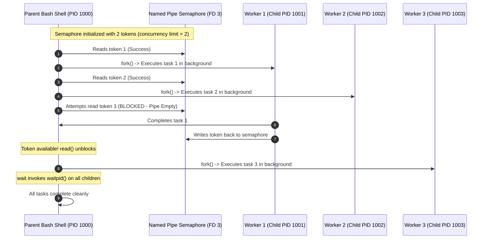

<!--
================================================================================
Metadata:
  Title: Advanced Bash: Parameter Expansion, Arrays & Concurrency
  Track: Linux & Systems Engineering / DevOps
  Difficulty: Advanced
  Estimated Time: 65 minutes
  Prerequisites: 02-shell/07-bash-scripting.md
  Key Terminology: Indexed Arrays, Associative Arrays (declare -A), Namerefs (declare -n), Coprocesses (coproc), Concurrency, xargs -P, GNU parallel, Subshell Process Table, Semaphores in Bash
================================================================================
-->

# Advanced Bash: Parameter Expansion, Arrays & Concurrency

[<- 07-bash-scripting.md](./07-bash-scripting.md) | [Back to Module Overview](./README.md) | [09-shellcheck-and-script-quality.md ->](./09-shellcheck-and-script-quality.md)

---

## Table of Contents
- [1. What & Why](#1-what--why)
- [2. Core Concepts](#2-core-concepts)
- [3. How It Works Internally](#3-how-it-works-internally)
- [4. Syntax & Usage](#4-syntax--usage)
- [5. Practical Examples](#5-practical-examples)
- [6. Best Practices](#6-best-practices)
- [7. Common Mistakes & Troubleshooting](#7-common-mistakes--troubleshooting)
- [8. Performance, Security & Cost Implications](#8-performance-security--cost-implications)
- [9. Comparison Table](#9-comparison-table)
- [10. Real-World Interview Questions](#10-real-world-interview-questions)
- [11. Practice Exercises](#11-practice-exercises)
- [12. Summary & Quick Reference Cheat Sheet](#12-summary--quick-reference-cheat-sheet)
- [13. Further Reading & Official Documentation](#13-further-reading--official-documentation)

---

## 1. What & Why

As Linux infrastructure grows in scale, system scripts often transition from simple linear sequences into high-throughput automation engines. An SRE must frequently orchestrate parallel health checks across hundreds of cloud nodes, manipulate structured data matrices in memory, or implement concurrent worker queues without introducing heavy external dependencies like Python, Go, or Ruby.

Advanced Bash unlocks enterprise-grade programming patterns:
- **Indexed and Associative Arrays**: In-memory data structures (`declare -A`) allow hash table lookups ($O(1)$) directly within the shell.
- **Reference Passing (`declare -n`)**: Pass-by-reference enables modular library functions that mutate caller data structures without incurring subshell fork penalties.
- **Asynchronous Concurrency & Worker Pools**: Managing parallel background child processes with throttle semaphores or tools like `xargs -P` transforms slow, sequential loops that take hours into parallel pipelines that complete in seconds.

Mastering these advanced constructs bridges the gap between basic scripting and robust systems engineering.

---

## 2. Core Concepts

### Array Types in Bash
Bash (version 4.0+) natively supports two distinct array types:
1. **Indexed Arrays**: Contiguous or sparse lists of values indexed by non-negative integers (`0, 1, 2...`). Declared implicitly or via `declare -a`.
2. **Associative Arrays**: Key-value hash tables where keys are arbitrary arbitrary strings (similar to dictionaries or maps in Python/Go). Must be explicitly declared via `declare -A`.

```
+-------------------------------------------------------------------------+
| BASH ARRAY ARCHITECTURES                                                |
|                                                                         |
|  [ Indexed Array: declare -a SERVERS ]                                  |
|  Index:    [0]            [1]            [2]            [3]             |
|  Value:  "web-01"       "web-02"       "api-01"       "db-01"           |
|                                                                         |
|  [ Associative Array (Hash Map): declare -A NODE_ROLES ]                |
|  Key:    "10.0.1.15"       "10.0.1.28"       "10.0.2.5"                 |
|  Value:  "kubernetes-cp"   "worker-node"     "ingress-controller"       |
+-------------------------------------------------------------------------+
```

### Nameref Variables (`declare -n`)
Introduced in Bash 4.3, namerefs create an alias or symbolic pointer to another variable. When a function receives the name of an array as an argument, a nameref allows direct traversal and modification of the original array:
```bash
modify_config() {
  local -n cfg_ref="$1"
  cfg_ref["timeout"]="60"
}

declare -A APP_CONFIG=( ["timeout"]="30" )
modify_config APP_CONFIG
echo "${APP_CONFIG["timeout"]}" # Outputs: 60
```

### Concurrency Primitives: Backgrounding, Coprocesses & Semaphores
- **Background Operator (`&`)**: Detaches process execution, assigning an asynchronous PID ($!).
- **Process Barrier (`wait`)**: Halts parent execution until specified background PIDs (or all active children) exit.
- **Coprocesses (`coproc`)**: Creates a bidirectional asynchronous background process wired to the parent shell via dedicated file descriptors.
- **Worker Pools / Semaphores**: Throttling concurrency using anonymous pipes or FIFO queues to prevent overwhelming system resources (e.g., limiting parallel tasks to $N$ concurrent workers).

---

## 3. How It Works Internally

Understanding how Bash manages background child processes reveals the mechanical distinction between sequential and concurrent execution:



### Process Table and Zombie Harvesting
When a child process finishes executing in the background, its termination state remains in the kernel's process table as a **Zombie** (`Z` state) until the parent shell calls `wait` (which invokes the `wait4()` or `waitpid()` system call). If a script spawns thousands of background tasks without ever calling `wait`, it risks exhausting the system's PID table (`/proc/sys/kernel/pid_max`).

---

## 4. Syntax & Usage

### 1. Indexed Array Operations
```bash
# Declaration and initialization
SERVERS=("api-prod-01" "api-prod-02" "api-prod-03")

# Accessing elements (0-indexed)
echo "${SERVERS[0]}"

# Total element count (${#ARRAY[@]})
echo "Total servers: ${#SERVERS[@]}"

# All elements as separate words ("${ARRAY[@]}")
for srv in "${SERVERS[@]}"; do
  echo "Checking: $srv"
done

# Array slicing: ${ARRAY[@]:offset:length}
echo "First two: ${SERVERS[@]:0:2}"

# Appending elements
SERVERS+=("api-prod-04" "api-prod-05")

# Deleting an element by index
unset "SERVERS[1]"
```

### 2. Associative Array Operations (`declare -A`)
```bash
# Explicit declaration is MANDATORY
declare -A NODE_STATUS

# Assignment
NODE_STATUS["192.168.1.10"]="HEALTHY"
NODE_STATUS["192.168.1.11"]="DEGRADED"
NODE_STATUS["192.168.1.12"]="HEALTHY"

# Accessing value by key
echo "Node 1.11 status: ${NODE_STATUS["192.168.1.11"]}"

# Iterating over all KEYS (${!ARRAY[@]})
for ip in "${!NODE_STATUS[@]}"; do
  echo "Node IP: $ip -> State: ${NODE_STATUS[$ip]}"
done

# Checking if a key exists
if [[ -v NODE_STATUS["192.168.1.15"] ]]; then
  echo "Key exists."
else
  echo "Node not found in registry."
fi
```

### 3. Coprocesses (`coproc`)
```bash
# Spawns a background coprocess named 'CALC'
coproc CALC {
  bc -l
}

# Write input to coprocess stdin (${CALC[1]})
echo "scale=4; 355/113" >&"${CALC[1]}"

# Read output from coprocess stdout (${CALC[0]})
read -r PI_APPROX <&"${CALC[0]}"
echo "Calculated Pi: $PI_APPROX"

# Terminate coprocess
exec {CALC[1]}>&-
```

---

## 5. Practical Examples

### 1. Basic: Transforming and Mapping Data with Associative Arrays
Maintain an in-memory routing table mapping environment aliases to database endpoints:
```bash
#!/usr/bin/env bash
set -euo pipefail

declare -A DB_ROUTING=(
  ["prod-us"]="postgres-master.us-east-1.internal:5432"
  ["prod-eu"]="postgres-master.eu-central-1.internal:5432"
  ["staging"]="postgres-staging.internal:5432"
  ["dev"]="127.0.0.1:5432"
)

TARGET_ENV="${1:-dev}"

if [[ -v DB_ROUTING["$TARGET_ENV"] ]]; then
  echo "Routing traffic to: ${DB_ROUTING["$TARGET_ENV"]}"
else
  echo "Unknown environment: $TARGET_ENV" >&2
  exit 1
fi
```

### 2. Real-World: High-Speed Parallel Port Scanner via `xargs -P`
Scan a range of IP addresses concurrently without third-party binary dependencies:
```bash
#!/usr/bin/env bash
set -euo pipefail

PORT=443
CONCURRENCY=16

# Generate list of 254 IP addresses
generate_ips() {
  for i in {1..254}; do
    echo "192.168.1.${i}"
  done
}

# Scan single host
scan_host() {
  local ip="$1"
  local port="$2"
  if nc -z -w 1 "$ip" "$port" 2>/dev/null; then
    echo "[OPEN] ${ip}:${port}"
  fi
}
export -f scan_host

# Stream IPs into xargs running 16 parallel processes
generate_ips | xargs -n 1 -P "$CONCURRENCY" -I {} bash -c "scan_host '{}' '$PORT'"
```

### 3. Edge Case: Sparse Arrays and Element Unset
In Bash indexed arrays, unsetting an element does not re-index the array:
```bash
ARR=("zero" "one" "two" "three")
unset "ARR[1]"

# The indices are now: 0, 2, 3 (Index 1 is missing!)
echo "Length: ${#ARR[@]}" # 3 elements
echo "Indices: ${!ARR[@]}" # 0 2 3

# WRONG: Iterating by C-style loop assuming contiguous indices
for ((i=0; i<${#ARR[@]}; i++)); do
  echo "Index $i: ${ARR[$i]}" # FAILS at index 1 (empty string) and misses index 3!
done

# CORRECT: Iterate over actual keys/elements
for i in "${!ARR[@]}"; do
  echo "Index $i: ${ARR[$i]}"
done
```

### 4. Failure Case: Subshell Loss in While Loops Revisited
A frequent failure pattern when aggregating array data from commands:
```bash
# BUGGY IMPLEMENTATION:
declare -a ACTIVE_IPS
docker ps -q | while read -r cid; do
  ip=$(docker inspect "$cid" | jq -r '.[0].NetworkSettings.IPAddress')
  ACTIVE_IPS+=("$ip") # Mutates array in SUBSHELL!
done

echo "Found: ${#ACTIVE_IPS[@]} IPs" # OUTPUTS 0!

# PRODUCTION SOLUTION: Process substitution keeps while loop in parent shell
declare -a ACTIVE_IPS
while read -r cid; do
  ip=$(docker inspect "$cid" | jq -r '.[0].NetworkSettings.IPAddress')
  ACTIVE_IPS+=("$ip")
done < <(docker ps -q)

echo "Found: ${#ACTIVE_IPS[@]} IPs" # Correctly populated!
```

### 5. Production-Grade: Worker Pool Semaphore in Pure Bash
Execute 100 batch tasks throttled to exactly 4 parallel background workers using a FIFO semaphore:
```bash
#!/usr/bin/env bash
set -euo pipefail

MAX_JOBS=4
SEMAPHORE="/tmp/job_semaphore.$$"

# Setup FIFO semaphore
mkfifo "$SEMAPHORE"
exec 3<>"$SEMAPHORE"
rm -f "$SEMAPHORE"

# Populate semaphore with MAX_JOBS tokens
for ((i=0; i<MAX_JOBS; i++)); do
  echo >&3
done

cleanup() {
  exec 3>&-
  wait
  echo "[INFO] Worker pool completed and cleaned up."
}
trap cleanup EXIT INT TERM

# Heavy worker task
process_payload() {
  local task_id="$1"
  local duration=$(( 1 + RANDOM % 3 ))
  echo "[START] Task $task_id running on worker (PID: $$, duration: ${duration}s)..."
  sleep "$duration"
  echo "[DONE]  Task $task_id finished."
}

# Dispatch 20 tasks
for task_id in {1..20}; do
  read -u 3 # Read a token from semaphore (blocks if all 4 workers are busy)
  
  (
    process_payload "$task_id"
    echo >&3 # Return token to semaphore when job completes
  ) &
done

wait # Wait for remaining background jobs to finish
```

---

## 6. Best Practices

1. **Always Declare Associative Arrays with `declare -A`**: Failing to declare an associative array treats all string keys as integer `0`, corrupting data.
2. **Use `"${ARRAY[@]}"` for Clean Expansion**: Never use `$ARRAY` (which accesses only index 0) or `"${ARRAY[*]}"` (which joins elements into a single word) when iterating.
3. **Use Namerefs (`declare -n`) for Functions Operating on Arrays**: Pass the name of an array and reference it directly rather than serializing arrays into strings or subshell outputs.
4. **Throttle Background Concurrency**: Never launch an unbounded `for item in ...; do cmd & done` loop in production. Unbounded concurrency exhausts file descriptors, memory, and kernel task structures.
5. **Reap Children with `wait`**: Always call `wait` after launching background jobs to ensure all exit codes are collected and zombie processes are harvested.

---

## 7. Common Mistakes & Troubleshooting

| Mistake / Antipattern | Underlying Cause | Consequence | Production Solution |
| :--- | :--- | :--- | :--- |
| Omitting `declare -A` | Shell treats undeclared array as indexed; evaluates string keys as arithmetic `0`. | Every assignment overwrites key `0`; dictionary holds only 1 value. | Always explicitly declare: `declare -A MAP`. |
| `$ARRAY` instead of `"${ARRAY[@]}"` | Plain `$ARRAY` references only the first element (index 0). | Loops process only index 0; remaining array entries ignored. | Use `"${ARRAY[@]}"`. |
| Unbounded background loops: `for x in *; do cmd & done` | Spawns thousands of concurrent child processes at once. | Triggers kernel fork-bomb protection or OOM panic. | Throttle using `xargs -P` or FIFO semaphores. |
| Checking array keys via `[[ -n "${MAP[$key]}" ]]` | If key exists but holds an empty string, the test evaluates to false. | False negative; fails to detect valid empty entries. | Use key existence test: `[[ -v MAP["$key"] ]]`. |
| Array corruption from unquoted `$*` | Expanding `$*` concatenates all elements into a single string. | Element boundaries are destroyed. | Expand with quotes and `@`: `"${ARRAY[@]}"`. |
| Forgetting `wait` before exiting | Parent shell terminates while child background jobs are still running. | Children are re-parented to PID 1 (systemd); errors are lost. | Invoke `wait` before script exit. |

---

## 8. Performance, Security & Cost Implications

### Performance
- **Associative Arrays vs Grep Lookups**: Searching for a key in a Bash associative array (`${MAP["key"]}`) is an in-memory hash table lookup operating in $O(1)$ time (< 2 microseconds). Searching for a key via `grep "^key=" config.txt` requires an external binary fork and disk scan operating in milliseconds.
- **Concurrency Throughput**: Replacing a sequential loop processing 100 HTTP endpoints with a 10-worker parallel pool yields an immediate **~10x reduction in total wall-clock runtime**.

### Security
- **Dynamic Variable Injection via Namerefs**: If a nameref (`declare -n ref="$1"`) receives unvalidated user input, an attacker can specify arbitrary system variable names (e.g., `PATH` or `LD_PRELOAD`), mutating privileged shell state. Validate all nameref variable names against an allowlist pattern.

### Cost
- In cloud automation (e.g., building AMI images, running Packer/Terraform scripts), optimizing batch configuration routines using parallel bash workers cuts VM provisioning time in half, reducing compute charges on high-cost build runners.

---

## 9. Comparison Table

| Concurrency Method | Implementation Complexity | Portability | Resource Control | Best Suited For |
| :--- | :--- | :--- | :--- | :--- |
| **`cmd &` + `wait`** | Low | Native Bash | Poor (Unbounded concurrency) | Small fixed batch tasks (2–5 jobs) |
| **FIFO Semaphore** | Moderate | Pure POSIX / Bash | **Precise (Configurable pool size)**| Custom internal scripts without dependencies |
| **`xargs -P <N>`** | Low | Requires `findutils` | **Precise** | Processing large lists of files or inputs |
| **`coproc`** | Advanced | Bash 4.0+ only | Single persistent process | Interactive bidirectional stream filters |
| **GNU `parallel`** | Very Low | External tool | **Advanced (CPU/load aware)** | Complex cluster/multi-core scientific workloads |

---

## 10. Real-World Interview Questions

### Q1: What is the difference between indexed arrays and associative arrays in Bash, and how are they declared?
<details>
<summary>Answer</summary>
- **Indexed Arrays**: Elements are indexed by integers starting at 0. They can be sparse (non-contiguous indices). Declared explicitly via `declare -a arr` or implicitly via `arr=("a" "b")`.
- **Associative Arrays**: Elements are indexed by arbitrary string keys (hash tables). Introduced in Bash 4.0. **Must be declared explicitly** using `declare -A map` before any assignment. If assigned without `declare -A`, Bash treats the string keys as arithmetic expressions, resolving them to index `0`, thereby overwriting the same element repeatedly.
</details>

### Q2: How does a nameref (`declare -n`) work in Bash, and what is its primary use case?
<details>
<summary>Answer</summary>
A nameref variable acts as a reference or pointer to another variable. Any reference to or mutation of the nameref variable directly accesses or modifies the target variable.
Primary use case: **Passing arrays by reference to functions**. Prior to namerefs, passing arrays to functions required complex string serialization or `eval` hacks. With namerefs:
```bash
print_first() {
  local -n arr_ref="$1"
  echo "First item: ${arr_ref[0]}"
}
MY_LIST=("alpha" "beta")
print_first MY_LIST
```
</details>

### Q3: What happens to background processes if a parent shell exits without calling `wait`?
<details>
<summary>Answer</summary>
If the parent shell terminates before its background child processes finish:
1. The child processes become **orphans**.
2. The Linux kernel re-parents orphan processes to **PID 1** (usually `systemd`).
3. The parent cannot capture the exit codes of those children.
4. If the parent shell was running inside a container whose entrypoint exited, the container runtime may immediately send `SIGKILL` to all remaining processes in the container cgroup, terminating the orphaned children mid-execution.
</details>

### Q4: How do you verify whether an associative array contains a specific key without triggering `nounset` (`set -u`) errors?
<details>
<summary>Answer</summary>
Use the `-v` operator inside the `[[ ... ]]` compound command (Bash 4.2+):
```bash
declare -A SERVERS=( ["web-01"]="10.0.0.1" )

if [[ -v SERVERS["web-02"] ]]; then
  echo "Key exists"
else
  echo "Key does not exist"
fi
```
This cleanly checks if the variable or array key has been set without expanding the value, avoiding `unbound variable` errors when `set -u` is active.
</details>

### Q5: How does a FIFO (named pipe) semaphore regulate worker concurrency?
<details>
<summary>Answer</summary>
A FIFO queue functions as a token bucket.
1. A named pipe is created, and $N$ tokens (newlines) are written into it, representing the maximum concurrency limit.
2. Before launching a background job, the parent executes `read -u 3`, which consumes one token from the pipe.
3. If all $N$ tokens are currently checked out, the pipe buffer is empty, and `read` **blocks** (sleeps), preventing new jobs from spawning.
4. When a background worker finishes, it writes a token back into the pipe (`echo >&3`).
5. This unblocks the parent `read`, allowing the next job to be dispatched.
</details>

### Q6: What is the limitation of returning data from background child processes?
<details>
<summary>Answer</summary>
Child processes run in isolated memory spaces created via `fork()`. Any variable assignment or array modification made inside a background child (`cmd &`) exists only in the child's address space and **cannot modify the parent's memory**.
To return data from background child workers back to the parent, the workers must use Inter-Process Communication (IPC):
- Writing results to temporary files.
- Emitting structured lines to a shared named pipe (FIFO).
- Returning a numerical status code (0–255) harvested by the parent via `wait <PID>`.
</details>

### Q7: Explain the difference between `${!ARRAY[@]}` and `${ARRAY[@]}`.
<details>
<summary>Answer</summary>
- **`${ARRAY[@]}`**: Expands to all the **values** stored in the array.
- **`${!ARRAY[@]}`**: The leading exclamation point (`!`) causes Bash to expand to all the **keys or indices** of the array. For indexed arrays, it emits the integer indices (`0 1 2...`); for associative arrays, it emits the string keys.
</details>

### Q8: What is the difference between `xargs -P` and GNU `parallel`?
<details>
<summary>Answer</summary>
- **`xargs -P <N>`**: Ubiquitous on nearly all Unix systems as part of standard `findutils`. Lightweight and fast. Splices input tokens into parallel invocations of a command. Does not offer advanced process queuing, progress bars, load balancing, or grouped output management (outputs from parallel jobs can interleave and collide).
- **GNU `parallel`**: A powerful third-party utility. Provides comprehensive concurrency controls: CPU load-aware throttling, output buffering (guaranteeing non-interleaved logs), progress metrics, remote execution over SSH across clusters, and robust resume capabilities.
</details>

---

## 11. Practice Exercises

### Exercise 1: In-Memory Hostname Lookup Table (Easy)
**Task**: Create an associative array `HOST_IPS` mapping 3 server hostnames to their private IP addresses. Write a function that takes a hostname as an argument and prints its IP, or prints "NOT_FOUND" with return code 1 if missing.

<details>
<summary>Solution</summary>

```bash
#!/usr/bin/env bash
set -euo pipefail

declare -A HOST_IPS=(
  ["web-prod-01"]="10.0.1.10"
  ["db-prod-01"]="10.0.2.50"
  ["cache-prod-01"]="10.0.3.15"
)

lookup_ip() {
  local host="$1"
  if [[ -v HOST_IPS["$host"] ]]; then
    echo "${HOST_IPS["$host"]}"
    return 0
  else
    echo "NOT_FOUND" >&2
    return 1
  fi
}

lookup_ip "db-prod-01"
# lookup_ip "unknown-host" # Returns 1
```
</details>

### Exercise 2: Array Reversal Without External Tools (Easy)
**Task**: Given an indexed array of strings, write a pure Bash function that reverses the array in place without using `rev`, `tac`, or `awk`.

<details>
<summary>Solution</summary>

```bash
#!/usr/bin/env bash
reverse_array() {
  local -n arr="$1"
  local len=${#arr[@]}
  local temp

  for ((i=0; i<len/2; i++)); do
    temp="${arr[i]}"
    arr[i]="${arr[len-i-1]}"
    arr[len-i-1]="$temp"
  done
}

ITEMS=("first" "second" "third" "fourth")
reverse_array ITEMS
echo "Reversed: ${ITEMS[*]}"
# Output: fourth third second first
```
</details>

### Exercise 3: Passing Associative Arrays to Functions (Medium)
**Task**: Write a function `audit_permissions` that takes an associative array of `["filename"]="expected_octal"` passed via nameref, inspects each file's actual permissions using `stat -c "%a"`, and reports compliance.

<details>
<summary>Solution</summary>

```bash
#!/usr/bin/env bash
audit_permissions() {
  local -n rules="$1"

  for file in "${!rules[@]}"; do
    local expected="${rules[$file]}"
    if [[ ! -e "$file" ]]; then
      echo "[MISSING] $file does not exist."
      continue
    fi

    local actual
    actual=$(stat -c "%a" "$file")
    if [[ "$actual" == "$expected" ]]; then
      echo "[PASS] $file has permissions $actual"
    else
      echo "[FAIL] $file has permissions $actual (Expected: $expected)"
    fi
  done
}

declare -A SYSTEM_RULES=(
  ["/etc/passwd"]="644"
  ["/etc/shadow"]="640"
)
audit_permissions SYSTEM_RULES
```
</details>

### Exercise 4: Parallel Image Resizer with Xargs (Medium)
**Task**: Using `find` and `xargs -P 4`, write a one-liner command that converts all `.png` files in `/tmp/images/` to compressed `.webp` format in parallel using 4 worker threads.

<details>
<summary>Solution</summary>

```bash
find /tmp/images/ -type f -name "*.png" -print0 | \
  xargs -0 -n 1 -P 4 -I {} bash -c 'cwebp -q 80 "{}" -o "${0%.png}.webp" >/dev/null 2>&1' {}
```
*Note*: Using `-print0` and `xargs -0` safely handles files with spaces.
</details>

### Exercise 5: Generic Parallel Dispatcher with Status Aggregation (Hard)
**Task**: Build a function `parallel_run` that accepts a concurrency limit $N$ and an array of commands. It must execute the commands concurrently up to $N$ at a time, collect all exit codes, and print a final summary showing which commands succeeded and which failed.

<details>
<summary>Solution</summary>

```bash
#!/usr/bin/env bash
set -euo pipefail

parallel_run() {
  local max_jobs="$1"
  shift
  local -a commands=("$@")
  local -a pids=()
  local -A cmd_map=()
  local running=0

  for cmd in "${commands[@]}"; do
    # Launch in background
    bash -c "$cmd" &
    local pid=$!
    pids+=("$pid")
    cmd_map["$pid"]="$cmd"
    ((running++))

    if (( running >= max_jobs )); then
      wait -n # Wait for ANY single job to finish
      ((running--))
    fi
  done

  # Harvest all remaining
  echo "--- Execution Results ---"
  local failures=0
  for pid in "${pids[@]}"; do
    if wait "$pid"; then
      echo "[SUCCESS] PID $pid: ${cmd_map[$pid]}"
    else
      echo "[FAILED]  PID $pid: ${cmd_map[$pid]}"
      ((failures++))
    fi
  done
  echo "Total failures: $failures"
  return "$failures"
}

TEST_COMMANDS=(
  "sleep 1; true"
  "sleep 2; false"
  "sleep 1; true"
  "sleep 2; true"
)
parallel_run 2 "${TEST_COMMANDS[@]}" || true
```
</details>

### Exercise 6: Asynchronous Inter-Process Coprocess Pipe (Hard)
**Task**: Use `coproc` to start a persistent background `openssl` session that calculates SHA-256 digests on demand. Feed three different strings into the coprocess and read back the calculated hashes in the parent shell without restarting `openssl` for each string.

<details>
<summary>Solution</summary>

```bash
#!/usr/bin/env bash
set -euo pipefail

# Start a long-running awk coprocess as a computational service
coproc COMPUTE {
  while read -r num; do
    awk -v n="$num" 'BEGIN { print "Square:", n*n; fflush() }'
  done
}

calculate_square() {
  local input="$1"
  # Write to coprocess stdin
  echo "$input" >&"${COMPUTE[1]}"
  # Read from coprocess stdout
  local response
  read -r response <&"${COMPUTE[0]}"
  echo "Input: $input -> Response: $response"
}

calculate_square 12
calculate_square 25
calculate_square 99

# Terminate coprocess
exec {COMPUTE[1]}>&-
```
</details>

---

## 12. Summary & Quick Reference Cheat Sheet

| Operation | Syntax | Description |
| :--- | :--- | :--- |
| **Declare Indexed Array** | `declare -a ARR` | Optional explicit indexed array declaration |
| **Declare Associative Array**| `declare -A MAP` | **Mandatory** hash table declaration |
| **Declare Nameref** | `declare -n REF=target` | Creates symbolic reference / pointer to target variable |
| **Array Element Access** | `"${ARR[0]}"` / `"${MAP["k"]}"` | Access element by index or string key |
| **All Elements** | `"${ARR[@]}"` | Expands all elements as separate words |
| **All Keys / Indices** | `"${!ARR[@]}"` | Expands all array indices or associative keys |
| **Array Element Count** | `"${#ARR[@]}"` | Returns total number of stored elements |
| **Check Key Existence** | `[[ -v MAP["key"] ]]` | True if key exists in associative array |
| **Append to Array** | `ARR+=("val1" "val2")` | Appends elements to indexed array |
| **Slice Array** | `"${ARR[@]:offset:len}"` | Slices array by start position and length |
| **Spawn Coprocess** | `coproc NAME { cmd; }` | Asynchronous bidirectional child process |
| **Wait for Any Child** | `wait -n` | Waits for the next single background job to terminate |
| **Wait for All Children** | `wait` | Blocks until all active child processes exit |

---

## 13. Further Reading & Official Documentation

- [GNU Bash Reference Manual: Arrays](https://www.gnu.org/software/bash/manual/html_node/Arrays.html)
- [GNU Bash Reference Manual: Coprocesses](https://www.gnu.org/software/bash/manual/html_node/Coprocesses.html)
- [Bash Hackers Wiki: Namerefs](https://wiki.bash-hackers.org/scripting/nameref)
- [Chet Ramey: Bash 4.4 / 5.0 Release Notes and Array Architectures](https://tiswww.case.edu/php/chet/bash/NEWS)

---

[<- 07-bash-scripting.md](./07-bash-scripting.md) | [Back to Module Overview](./README.md) | [09-shellcheck-and-script-quality.md ->](./09-shellcheck-and-script-quality.md)
