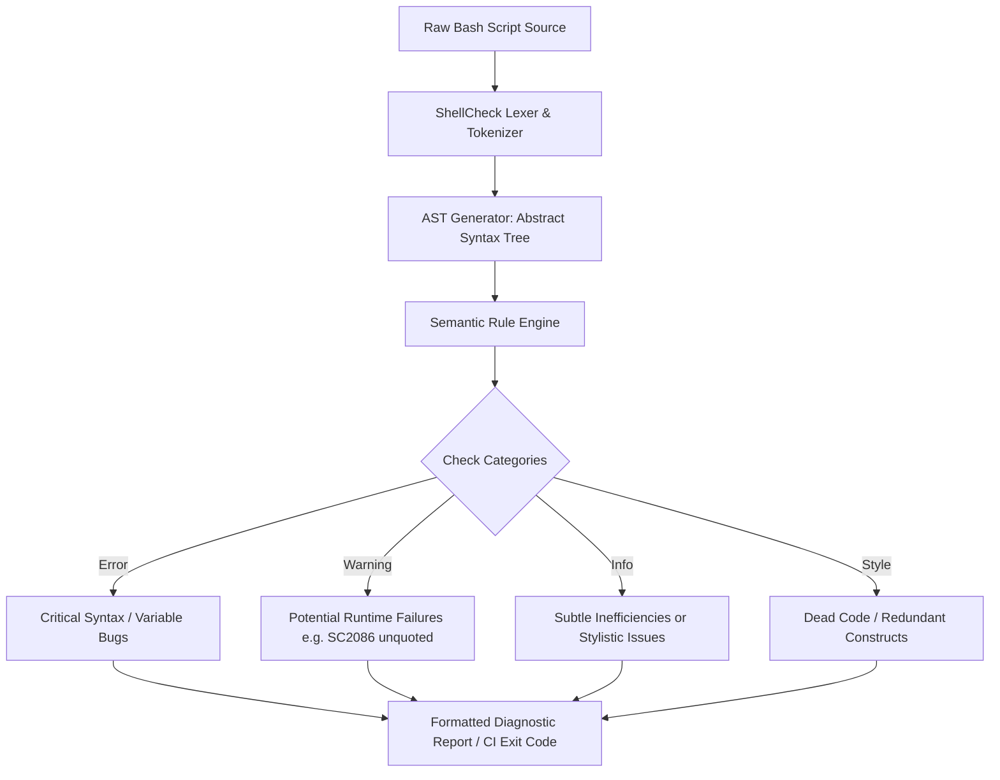

<!--
================================================================================
Metadata:
  Title: ShellCheck, Static Analysis & Defensive Scripting
  Track: Linux & Systems Engineering / DevOps
  Difficulty: Advanced
  Estimated Time: 50 minutes
  Prerequisites: 02-shell/07-bash-scripting.md
  Key Terminology: ShellCheck, Static Analysis, AST, SC Rules (SC2086, SC2181, SC2155), Defensive Header (set -euo pipefail), CI/CD Gates, shunit2, BATS, Exit Traps, Linting
================================================================================
-->

# ShellCheck, Static Analysis & Defensive Scripting

[<- 08-bash-scripting-advanced.md](./08-bash-scripting-advanced.md) | [Back to Module Overview](./README.md) | [10-vim-and-tmux.md ->](./10-vim-and-tmux.md)

---

## Table of Contents
- [1. What & Why](#1-what--why)
- [2. Core Concepts](#2-core-concepts)
- [3. How It Works Internally](#3-how-it-works-internally)
- [4. Syntax & Usage](#4-syntax--usage)
- [5. Practical Examples](#5-practical-examples)
- [6. Best Practices](#6-best-practices)
- [7. Common Mistakes & Troubleshooting](#7-common-mistakes--troubleshooting)
- [8. Performance, Security & Cost Implications](#8-performance-security--cost-implications)
- [9. Comparison Table](#9-comparison-table)
- [10. Real-World Interview Questions](#10-real-world-interview-questions)
- [11. Practice Exercises](#11-practice-exercises)
- [12. Summary & Quick Reference Cheat Sheet](#12-summary--quick-reference-cheat-sheet)
- [13. Further Reading & Official Documentation](#13-further-reading--official-documentation)

---

## 1. What & Why

Shell scripts are notoriously prone to subtle, silent runtime bugs. Unlike compiled languages (Go, Rust, C) which validate type signatures and syntax at build time, and unlike modern interpreted runtimes (Python, Node.js) which raise explicit exceptions, a standard shell script executes line-by-line, continuing unabated through catastrophic errors unless explicitly instructed otherwise.

In enterprise infrastructure and GitOps workflows, an uncaught shell error in an infrastructure provisioning script can corrupt databases, leak credentials, or delete production directories.

**ShellCheck** is the industry-standard static analysis tool for shell scripts (Bash, sh, ksh, dash). Written in Haskell, ShellCheck parses shell scripts into an Abstract Syntax Tree (AST) to detect syntax errors, semantic bugs, portability pitfalls, and dangerous anti-patterns *before* the script is ever executed. Integrating ShellCheck and defensive scripting headers (`set -euo pipefail`) into CI/CD quality gates is mandatory for production reliability.

---

## 2. Core Concepts

### The Defensive Header: `set -euo pipefail`
Every production-grade shell script should begin with the canonical defensive configuration:
```bash
#!/usr/bin/env bash
set -euo pipefail
```
Each flag addresses a fundamental design flaw in traditional Unix shells:
1. **`-e` (`errexit`)**: Immediately aborts the script if any command exits with a non-zero status code. Prevents cascading failures.
2. **`-u` (`nounset`)**: Treats uninitialized or unbound variables as fatal errors, terminating immediately. Prevents bugs like `rm -rf "$MNT_PATH/*"` where `MNT_PATH` was unset.
3. **`-o pipefail`**: By default, the exit code of a pipeline (`cmd1 | cmd2 | cmd3`) is determined solely by the last command (`cmd3`). With `pipefail`, the pipeline as a whole fails if *any* command in the chain fails.
4. **`-E` (`errtrace`)** *(Optional but recommended)*: Ensures that `ERR` traps are inherited by shell functions, subshells, and command substitutions.

```
+-------------------------------------------------------------------------+
| DEFENSIVE SCRIPTING ERROR ARREST PIPELINE                               |
|                                                                         |
|  [ Command 1: download_artifacts ]  --> Exit Status 0 (Pass)            |
|         │                                                               |
|         v                                                               |
|  [ Command 2: untar_files ]         --> Exit Status 2 (Failed / Disk)   |
|         │                                                               |
|         ├─── WITHOUT set -e: Ignores failure! Continues to Step 3       |
|         │                    (Deploys corrupt or missing binaries!)     |
|         │                                                               |
|         └─── WITH set -euo pipefail:                                    |
|              ├── Kernel catches non-zero exit code                      |
|              ├── Execution halts IMMEDIATELY                            |
|              ├── Registered trap cleanup EXIT runs                      |
|              └── Process terminates with non-zero code to CI/CD runner  |
+-------------------------------------------------------------------------+
```

### Static Analysis vs Dynamic Testing
- **Static Analysis (ShellCheck)**: Analyzes the source code text without running it. Catches quoting bugs (SC2086), subshell variable leaks, and deprecated syntax.
- **Unit Testing (BATS / shunit2)**: Executes test fixtures dynamically to assert command outputs, exit codes, and filesystem mutations under controlled conditions.

---

## 3. How It Works Internally

ShellCheck parses source code into a high-level AST and applies hundreds of linting rules:



### Key Severity Levels in ShellCheck
- **Error (Code: SC1xxx)**: Severe syntax problems that will cause the shell to fail or produce syntax crashes immediately.
- **Warning (Code: SC2xxx)**: Highly likely bugs, race conditions, or unhandled failures (e.g., word splitting, glob expansion traps).
- **Info (Code: SC2xxx-SC3xxx)**: Portability warnings or edge-case suggestions.
- **Style (Code: SC2xxx)**: Stylistic recommendations, redundant subshells, or dead code.

---

## 4. Syntax & Usage

### Running ShellCheck
```bash
# Run against a single script
shellcheck deploy.sh

# Output formats: gcc, checkstyle, json, diff
shellcheck -f json deploy.sh
shellcheck -f diff deploy.sh # Generates a patch file showing suggested fixes!

# Specify target shell dialect explicitly (bash, sh, ksh, dash)
shellcheck -s bash setup.sh

# Exclude specific non-critical warnings
shellcheck -e SC2086,SC2181 deploy.sh
```

### In-Code Directives (Annotations)
When a specific rule violation is intentional, annotate the code directly rather than disabling the check globally:
```bash
# Disable rule SC2086 for the immediately following line only
# shellcheck disable=SC2086
grep $SEARCH_PATTERN /var/log/app.log

# Specify why rule was disabled
# shellcheck disable=SC2034 # Variable appears unused because it is consumed by a sourced script
EXPORTED_SECRET="prod-token"

# Instruct ShellCheck to trace sourced files
# shellcheck source=/etc/default/app_env
source /etc/default/app_env
```

---

## 5. Practical Examples

### 1. Basic: SC2086 (Double Quote to Prevent Globbing and Word Splitting)
The most common ShellCheck warning across all shell codebases:
```bash
# BAD CODE: Triggers SC2086
FILENAME="annual financial report.pdf"
rm $FILENAME
# ShellCheck warning: Double quote to prevent globbing and word splitting.

# FIXED CODE:
rm "$FILENAME"
```

### 2. Real-World: SC2155 (Masking Return Values with `local`)
A subtle bug where declaring a local variable alongside command substitution destroys the command's exit code:
```bash
# BAD CODE: Triggers SC2155
get_cluster_id() {
  local cluster_id=$(aws ecs describe-clusters --cluster non-existent)
  echo "$cluster_id"
}
# WHY THIS IS DANGEROUS:
# 'local' is a builtin command. Even if 'aws' crashes with exit code 255,
# the exit status of the line is the exit status of 'local' (which is ALWAYS 0!).
# With 'set -e', the script fails to catch the AWS failure!

# FIXED CODE:
get_cluster_id() {
  local cluster_id
  cluster_id=$(aws ecs describe-clusters --cluster non-existent)
  echo "$cluster_id"
}
```

### 3. Edge Case: SC2181 (Direct Condition Evaluation vs `$?`)
Checking `$?` explicitly is an antipattern that can easily break if any command is inserted between:
```bash
# BAD CODE: Triggers SC2181
ping -c 1 8.8.8.8 > /dev/null 2>&1
if [ $? -eq 0 ]; then
  echo "Internet reachable"
fi

# FIXED CODE: Test the command directly in the conditional
if ping -c 1 8.8.8.8 > /dev/null 2>&1; then
  echo "Internet reachable"
fi
```

### 4. Failure Case: SC2164 (Unchecked `cd` Directory Traversal)
If `cd` fails (e.g., target directory does not exist or permissions are denied), subsequent commands execute in the wrong working directory:
```bash
# CATASTROPHIC CODE: Triggers SC2164
cd "$BACKUP_DIR"
rm -rf *
# If BACKUP_DIR does not exist, 'cd' fails, and 'rm -rf *' executes in whatever
# directory the script started in (often /root or home)!

# FIXED CODE:
cd "$BACKUP_DIR" || exit 1
rm -rf ./*
```

### 5. Production-Grade: Automated CI/CD Shell Quality Gate
A production GitHub Actions or GitLab CI pipeline step that lints all shell scripts, formats diffs, and enforces unit test execution:
```bash
#!/usr/bin/env bash
# ==============================================================================
# CI/CD Shell Script Quality Gate
# ==============================================================================
set -euo pipefail

echo "[INFO] Commencing ShellCheck static analysis across repository..."

# Find all files with .sh extension or with bash shebang
mapfile -t SCRIPTS < <(find . -type f \( -name "*.sh" -o -perm -111 \) -not -path "*/.git/*" -not -path "*/node_modules/*")

FAILURES=0

for script in "${SCRIPTS[@]}"; do
  # Verify if file is a shell script via head
  if [[ "$script" =~ \.sh$ ]] || grep -qE '^#!\s*/bin/(bash|sh)|env (bash|sh)' "$script" 2>/dev/null; then
    echo "Scanning: $script"
    if ! shellcheck --severity=style "$script"; then
      echo "[ERROR] ShellCheck violations detected in $script" >&2
      ((FAILURES++))
    fi
  fi
done

if (( FAILURES > 0 )); then
  echo "[FATAL] ShellCheck quality gate failed with ${FAILURES} non-compliant script(s)." >&2
  exit 1
fi

echo "[SUCCESS] All shell automation scripts comply with quality standards."
```

---

## 6. Best Practices

1. **Always Use `set -euo pipefail`**: Place this at the top of every script immediately following the shebang.
2. **Quote All Variable References**: Eliminate SC2086 by default. If word splitting is deliberately required, document it: `# shellcheck disable=SC2086`.
3. **Split `local` Declarations from Assignments**: Write `local var; var=$(cmd)` instead of `local var=$(cmd)` to preserve exit codes.
4. **Never Use Unchecked `cd`**: Always append `|| exit 1` or check `cd "$DIR" || { echo "Failed cd" >&2; exit 1; }`.
5. **Run ShellCheck in Pre-Commit Hooks**: Enforce linting locally via Git `pre-commit` hooks so bugs are blocked before code is pushed to remote repositories.

---

## 7. Common Mistakes & Troubleshooting

| Mistake / Antipattern | Underlying Cause | Consequence | Production Solution |
| :--- | :--- | :--- | :--- |
| `local x=$(cmd)` (SC2155) | `local` builtin exit status (0) overwrites the return code of `$(cmd)`. | Fatal errors inside command substitution are masked; `set -e` fails to trigger. | Separate declaration: `local x; x=$(cmd)`. |
| `cd $DIR; rm -rf *` (SC2164) | Failure of `cd` leaves process in previous directory. | Deletes files in root, home, or project root directory. | Use `cd "$DIR" \|\| exit 1`. |
| `if [ $? -eq 0 ]` (SC2181) | Inspecting `$?` after intermediate commands is fragile and verbose. | An inserted debug statement resets `$?` to 0, breaking logic. | Evaluate command directly: `if cmd; then`. |
| Unquoted array expansion `${ARR[*]}` | Concatenates all array items into one single string word. | Array elements containing spaces lose their distinct boundaries. | Use `"${ARR[@]}"`. |
| `echo $VAR` for multiline text | `echo` without quotes collapses newlines and multiple spaces into single spaces. | Formatting and tabular alignments are completely destroyed. | Use `printf '%s\n' "$VAR"` or `echo "$VAR"`. |
| Sourcing scripts without path check (SC1090) | Sourcing a dynamically calculated path that ShellCheck cannot follow. | ShellCheck cannot verify variables or functions in sourced files. | Add `# shellcheck source=...` directive. |

---

## 8. Performance, Security & Cost Implications

### Performance
- **Static Analysis Execution**: ShellCheck is compiled Haskell; it analyzes thousands of lines of shell code in **< 50 milliseconds**. Running it in CI adds virtually zero build latency.

### Security
- **Eliminating Shell Injections**: ShellCheck flags insecure `eval` calls, unquoted variable expansions in `curl | bash`, and unescaped variables in `find -exec`.
- **Preventing Accidental Data Wipes**: Catching unquoted paths before deployment eliminates catastrophic `rm -rf /` occurrences caused by empty variables.

### Cost
- In automated cloud infrastructure (Terraform, AWS CloudFormation custom resources), an uncaught shell script error that hangs indefinitely or applies misconfigured network routes can cause hours of cloud downtime and expensive engineer incident response rotations.

---

## 9. Comparison Table

| Tool / Framework | Type | Strengths | Weaknesses | Best Suited For |
| :--- | :--- | :--- | :--- | :--- |
| **ShellCheck** | Static Linter / AST | Ultra-fast; catches hundreds of bug patterns; zero execution risk. | Cannot verify dynamic logic that requires runtime state. | Pre-commit hooks, CI/CD linting gates. |
| **BATS (Bash Automated Testing System)** | Dynamic Unit Test Framework | TAP-compliant; tests real command outputs and exit codes. | Slower than static analysis; requires test fixtures. | Unit testing shell libraries and CLI utilities. |
| **shfmt** | Auto-Formatter | Enforces uniform indentation, tabs/spaces, and POSIX syntax. | Formatting only; does not analyze semantic bugs. | Code style standardization. |
| **`bash -n`** | Built-in Syntax Checker | Built into Bash (`bash -n script.sh`); zero installation required. | Checks syntax only; misses semantic bugs (SC2086, SC2155). | Basic syntax validation in minimal container images. |

---

## 10. Real-World Interview Questions

### Q1: What does each component of `set -euo pipefail` do, and why is it critical?
<details>
<summary>Answer</summary>
1. **`-e` (`errexit`)**: Causes the shell to immediately exit if any command returns a non-zero exit status, stopping the script before corrupt state can propagate.
2. **`-u` (`nounset`)**: Forces the shell to raise an error and exit if any uninitialized variable is referenced, preventing bugs where an unset variable acts as an empty string.
3. **`-o pipefail`**: Changes the exit status of a pipeline to the value of the last (rightmost) command that exited with a non-zero status (or zero if all succeeded). Without this, an error in `cmd1 | cmd2` is masked if `cmd2` succeeds.
Together, these settings convert Bash from a permissive, fault-tolerant interactive prompt into a strict, fail-fast programming environment.
</details>

### Q2: Why does ShellCheck flag `local var=$(cmd)` (SC2155), and how do you resolve it?
<details>
<summary>Answer</summary>
`local` is a shell builtin command that returns its own exit status (which is almost always `0`). When combined on a single line (`local var=$(cmd)`), the exit status of the command substitution `$(cmd)` is masked by the return status of `local`. If `cmd` fails (returns a non-zero exit code), `set -e` will not abort the script because the overall command line returned `0`.
**Resolution**: Separate the declaration from the assignment:
```bash
local var
var=$(cmd)
```
</details>

### Q3: What is ShellCheck rule SC2086, and when is it safe to ignore?
<details>
<summary>Answer</summary>
SC2086 flags unquoted parameter expansions (e.g., `cmd $var`). The shell expands unquoted variables and subjects them to **Word Splitting** (splitting on spaces/tabs/newlines) and **Pathname Expansion** (globbing). If `$var` contains spaces or `*`, unexpected arguments are passed to `cmd`.
**When safe to ignore**: Only when you explicitly intend for the variable string to undergo word splitting—for example, when a variable holds a space-separated list of flags:
```bash
# shellcheck disable=SC2086
git log $EXTRA_FLAGS
```
Even in this case, using an array (`EXTRA_FLAGS=("--oneline" "--graph")` and `"${EXTRA_FLAGS[@]}"`) is cleaner and safer.
</details>

### Q4: How do you handle intentional command failures when `set -e` is active?
<details>
<summary>Answer</summary>
When a command is expected to return non-zero (such as `grep` finding no matches), `set -e` will terminate the script unless the command is part of a conditional test:
1. Append `|| true`:
   ```bash
   grep "optional_string" file.txt || true
   ```
2. Wrap in an `if` block:
   ```bash
   if grep "optional_string" file.txt; then
     echo "Found"
   fi
   ```
3. Temporarily disable `errexit`:
   ```bash
   set +e
   risky_command
   STATUS=$?
   set -e
   ```
</details>

### Q5: What does ShellCheck rule SC2046 ("Quote this to prevent word splitting") warn against?
<details>
<summary>Answer</summary>
SC2046 flags unquoted command substitutions: `cmd $(find . -name "*.txt")`.
The output of the command substitution undergoes word splitting. If any filename produced by `find` contains a space, it will be chopped into multiple arguments. Furthermore, if the output contains wildcards, they will undergo unintended globbing.
Fix: Use `while read` loops with process substitution, or read into arrays using `mapfile -t`.
</details>

### Q6: How does `mapfile` (or `readarray`) prevent SC2207 ("Prefer mapfile or read -a to split command output")?
<details>
<summary>Answer</summary>
Assigning command output to an array via `ARR=($(cmd))` (SC2207) splits the output by spaces and expands wildcards. If any output line contains a space or `*`, array indices are scrambled.
`mapfile -t ARR < <(cmd)` reads lines from the stream without word splitting on internal spaces and without glob expansion, populating each array index with exactly one clean line of input.
</details>

### Q7: What is the purpose of `BATS` in shell development?
<details>
<summary>Answer</summary>
BATS (Bash Automated Testing System) is a TAP-compliant (Test Anything Protocol) testing framework for Bash. It allows developers to author declarative test cases:
```bash
@test "addition using bc" {
  result="$(echo 2+2 | bc)"
  [ "$result" -eq 4 ]
}
```
BATS isolates test runs, verifies exit codes, inspects `stdout`/`stderr` lines (`${lines[0]}`), and provides clean pass/fail reports suitable for CI/CD pipelines.
</details>

### Q8: How can you write a pre-commit Git hook that enforces ShellCheck across modified files?
<details>
<summary>Answer</summary>
Place the following in `.git/hooks/pre-commit`:
```bash
#!/usr/bin/env bash
set -euo pipefail

# Find all staged shell scripts
STAGED_SCRIPTS=$(git diff --cached --name-only --diff-filter=ACMR | grep -E '\.sh$' || true)

if [[ -n "$STAGED_SCRIPTS" ]]; then
  echo "[PRE-COMMIT] Running ShellCheck on staged scripts..."
  for file in $STAGED_SCRIPTS; do
    if [[ -f "$file" ]]; then
      shellcheck "$file"
    fi
  done
fi
```
If ShellCheck finds any violations, it returns non-zero, and Git cancels the commit.
</details>

---

## 11. Practice Exercises

### Exercise 1: Identify and Fix SC2086 and SC2164 (Easy)
**Task**: Inspect the following buggy script, identify the ShellCheck violations, and produce a fully compliant version:
```bash
#!/usr/bin/env bash
TARGET_DIR=$1
cd $TARGET_DIR
rm -rf *.tmp
```

<details>
<summary>Solution</summary>

```bash
#!/usr/bin/env bash
set -euo pipefail

TARGET_DIR="${1:?Error: Target directory argument is required.}"

# Fixed SC2164 (Check cd failure) and SC2086 (Quote variables)
cd "$TARGET_DIR" || exit 1

# Fixed SC2086 and ensured glob safety
rm -f ./*.tmp
```
</details>

### Exercise 2: Refactoring Unsafe Local Declarations (SC2155) (Easy)
**Task**: Refactor this function so that command failures are not masked by the `local` declaration:
```bash
fetch_token() {
  local token=$(curl -sf https://api.internal/auth/token)
  echo "$token"
}
```

<details>
<summary>Solution</summary>

```bash
fetch_token() {
  local token
  token=$(curl -sf https://api.internal/auth/token)
  echo "$token"
}
```
*Verification*: If `curl` fails, `set -e` will now catch the failure immediately.
</details>

### Exercise 3: Safe Array Loading with Mapfile (Medium)
**Task**: Rewrite `USERS=($(cat /etc/passwd | cut -d: -f1))` to eliminate ShellCheck SC2002 (Useless use of cat) and SC2207 (Prefer mapfile).

<details>
<summary>Solution</summary>

```bash
#!/usr/bin/env bash
set -euo pipefail

declare -a USERS
mapfile -t USERS < <(cut -d':' -f1 /etc/passwd)

echo "Loaded ${#USERS[@]} users safely into array."
```
</details>

### Exercise 4: Unit Testing a Shell Function with BATS (Medium)
**Task**: Write a BATS test file `test_math.bats` that tests a shell function `add <num1> <num2>`, verifying both valid sums and that non-numeric inputs return exit status 1.

<details>
<summary>Solution</summary>

```bash
# Contents of test_math.bats
setup() {
  add() {
    local a="$1"
    local b="$2"
    if [[ ! "$a" =~ ^[0-9]+$ || ! "$b" =~ ^[0-9]+$ ]]; then
      return 1
    fi
    echo $(( a + b ))
  }
}

@test "add adds two positive integers" {
  run add 5 7
  [ "$status" -eq 0 ]
  [ "$output" -eq 12 ]
}

@test "add fails on non-numeric inputs" {
  run add 5 "banana"
  [ "$status" -eq 1 ]
}
```
</details>

### Exercise 5: Automated Pre-Receive Git Quality Hook (Hard)
**Task**: Author a server-side Git `pre-receive` hook that scans every incoming commit in a push. If any pushed `.sh` file contains ShellCheck errors of severity `error` or `warning`, reject the push and emit a diagnostic message.

<details>
<summary>Solution</summary>

```bash
#!/usr/bin/env bash
set -euo pipefail

while read -r oldrev newrev refname; do
  # Skip branch deletion
  [[ "$newrev" =~ ^0+$ ]] && continue

  # List all changed files
  FILES=$(git diff --name-only "$oldrev" "$newrev" | grep -E '\.sh$' || true)

  for file in $FILES; do
    # Extract file contents from git object database into temporary file
    TMP_SCRIPT=$(mktemp)
    git show "${newrev}:${file}" > "$TMP_SCRIPT"
    
    if ! shellcheck --severity=warning "$TMP_SCRIPT"; then
      echo "[GIT QUALITY GATE] Push rejected! ShellCheck violations found in $file" >&2
      rm -f "$TMP_SCRIPT"
      exit 1
    fi
    rm -f "$TMP_SCRIPT"
  done
done
exit 0
```
</details>

### Exercise 6: Comprehensive Defensive Script Template (Hard)
**Task**: Author a reusable, hardened production script template containing: `set -euo pipefail`, signal traps for cleanup, structured JSON logging, standard CLI option parsing via `getopts`, and pass-through ShellCheck validation with zero warnings.

<details>
<summary>Solution</summary>

```bash
#!/usr/bin/env bash
# ==============================================================================
# Hardened Production Automation Template
# ==============================================================================
set -euo pipefail
IFS=$'\n\t'

# Global constants
readonly SCRIPT_NAME="${0##*/}"
readonly SCRIPT_DIR="$(cd "$(dirname "${BASH_SOURCE[0]}")" && pwd)"

# Global mutable state
WORK_DIR=""

log_json() {
  local level="$1"
  local message="$2"
  printf '{"timestamp":"%s","script":"%s","level":"%s","message":"%s"}\n' \
    "$(date -u +'%Y-%m-%dT%H:%M:%SZ')" "$SCRIPT_NAME" "$level" "$message"
}

cleanup() {
  local exit_code=$?
  if [[ -n "$WORK_DIR" && -d "$WORK_DIR" ]]; then
    rm -rf "$WORK_DIR"
    log_json "DEBUG" "Purged temporary workspace $WORK_DIR"
  fi
  exit "$exit_code"
}
trap cleanup EXIT INT TERM

main() {
  WORK_DIR=$(mktemp -d /tmp/app_work.XXXXXX)
  log_json "INFO" "Initialized workspace at $WORK_DIR"
  
  # Business logic executes here
  log_json "INFO" "Script completed successfully."
}

main "$@"
```
</details>

---

## 12. Summary & Quick Reference Cheat Sheet

| Directive / Code | Meaning | Recommended Action |
| :--- | :--- | :--- |
| `set -e` | Exit immediately if a command fails | Always enable in scripts |
| `set -u` | Exit on uninitialized variables | Always enable in scripts |
| `set -o pipefail` | Fail pipeline on any stage error | Always enable in scripts |
| **SC2086** | Unquoted variable expansion | Wrap variable in double quotes: `"$VAR"` |
| **SC2155** | Masking return value with `local` | Declare first, assign second: `local x; x=$(cmd)` |
| **SC2181** | Check exit code directly, not `$?` | Use `if cmd; then` rather than `if [ $? -eq 0 ]` |
| **SC2164** | Unchecked `cd` failure | Append `|| exit 1` to all `cd` calls |
| **SC2002** | Useless use of cat (UUOC) | Pass file directly: `cmd < file` or `cmd file` |
| **SC2207** | Unsafe array assignment `ARR=($(cmd))` | Use `mapfile -t ARR < <(cmd)` |
| `# shellcheck disable=SCxxxx` | Suppress specific rule for next line | Annotate intentional idioms with justification |

---

## 13. Further Reading & Official Documentation

- [ShellCheck Official Repository & Wiki](https://github.com/koalaman/shellcheck)
- [ShellCheck Gallery of All SC Rules](https://www.shellcheck.net/wiki/)
- [BATS-core: Bash Automated Testing System](https://github.com/bats-core/bats-core)
- [Google Shell Style Guide](https://google.github.io/styleguide/shellguide.html)
- [Defensive BASH Programming (Kfir Lavi)](https://kvz.io/bash-best-practices.html)

---

[<- 08-bash-scripting-advanced.md](./08-bash-scripting-advanced.md) | [Back to Module Overview](./README.md) | [10-vim-and-tmux.md ->](./10-vim-and-tmux.md)
