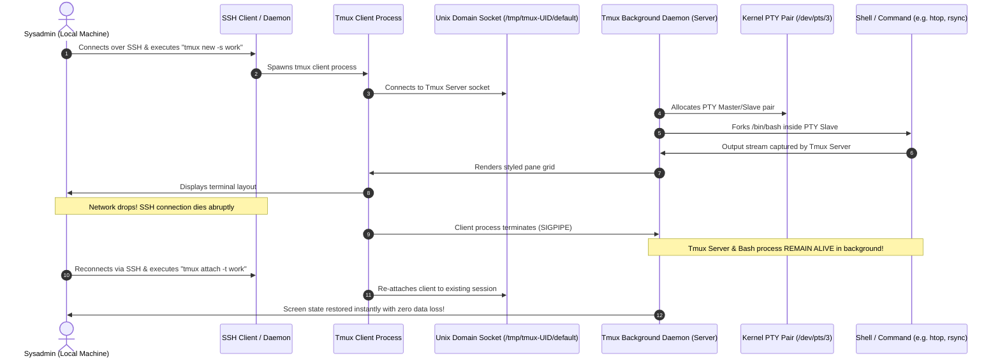

<!--
================================================================================
Metadata:
  Title: Terminal Productivity: Vim & Tmux
  Track: Linux & Systems Engineering / DevOps
  Difficulty: Beginner-Intermediate
  Estimated Time: 50 minutes
  Prerequisites: 02-shell/01-shell-basics.md
  Key Terminology: Vim, Modal Editing (Normal, Insert, Visual, Command-Line), Buffers, Registers, .vimrc, Tmux, Terminal Multiplexer, Daemon Architecture, Sessions, Windows, Panes, Detach/Attach, PTY
================================================================================
-->

# Terminal Productivity: Vim & Tmux

[<- 09-shellcheck-and-script-quality.md](./09-shellcheck-and-script-quality.md) | [Back to Module Overview](./README.md) | [11-dotfiles-and-productivity.md ->](./11-dotfiles-and-productivity.md)

---

## Table of Contents
- [1. What & Why](#1-what--why)
- [2. Core Concepts](#2-core-concepts)
- [3. How It Works Internally](#3-how-it-works-internally)
- [4. Syntax & Usage](#4-syntax--usage)
- [5. Practical Examples](#5-practical-examples)
- [6. Best Practices](#6-best-practices)
- [7. Common Mistakes & Troubleshooting](#7-common-mistakes--troubleshooting)
- [8. Performance, Security & Cost Implications](#8-performance-security--cost-implications)
- [9. Comparison Table](#9-comparison-table)
- [10. Real-World Interview Questions](#10-real-world-interview-questions)
- [11. Practice Exercises](#11-practice-exercises)
- [12. Summary & Quick Reference Cheat Sheet](#12-summary--quick-reference-cheat-sheet)
- [13. Further Reading & Official Documentation](#13-further-reading--official-documentation)

---

## 1. What & Why

In production environments, systems engineers and SREs rarely have access to graphical user interfaces (GUIs), IDEs like VS Code, or web-based dashboards. Remote incident triage, configuration tuning, and log analysis occur over SSH connections directly within the terminal console.

Two tools form the bedrock of remote Linux operational competence:
1. **Vim (Vi IMproved)**: The ubiquitous terminal text editor found on virtually every Unix server. Vim's modal editing model allows rapid in-place configuration editing, macro recording, search-and-replace, and file manipulation without touching a mouse.
2. **Tmux (Terminal Multiplexer)**: A background daemon that decouples terminal sessions from the underlying network connection. If an SSH connection drops during a multi-hour database migration or kernel upgrade, Tmux keeps the processes running on the server. Furthermore, Tmux multiplexes a single terminal window into multiple persistent windows and split panes.

Mastering Vim and Tmux ensures operational continuity and high-speed debugging on headless production servers.

---

## 2. Core Concepts

### Vim: The Modal Editing Model
Unlike standard text editors where typing immediately inserts characters onto the page, Vim operates in distinct **Modes**:

```
+-------------------------------------------------------------------------+
| VIM MODAL STATE MACHINE                                                 |
|                                                                         |
|                [ Normal Mode ]  <--- (Default / Base State)             |
|                  │    │    │                                            |
|        Press 'i' │    │    │ Press ':'                                  |
|        or 'a'    │    │    v                                            |
|                  │    │  [ Command-Line Mode ]                          |
|                  │    │  (:w, :q, :wq!, :s/foo/bar/g, :set number)      |
|                  │    │    │ Press Enter or Esc                         |
|                  │    v    v                                            |
|                  │  [ Visual Mode ] (v: char, V: line, Ctrl+v: block)   |
|                  │    │ Press Esc                                       |
|                  v    v                                                 |
|               [ Insert Mode ] (Typing text directly into file)          |
|                  │ Press Esc                                            |
|                  v                                                      |
|               [ Normal Mode ]                                           |
+-------------------------------------------------------------------------+
```

- **Normal Mode**: The default state. Every keystroke is an editing verb or motion (e.g., `dd` to delete line, `yy` to copy, `u` to undo, `G` to jump to end of file).
- **Insert Mode**: Typing emits literal characters into the text buffer. Entered via `i` (insert before cursor), `a` (append after cursor), or `o` (open new line below). Exited via `Esc`.
- **Visual Mode**: Selects contiguous ranges of text. Entered via `v` (character-wise), `V` (line-wise), or `Ctrl+V` (columnar block selection).
- **Command-Line Mode**: Executes bottom-bar commands. Entered by typing `:` from Normal mode. Used for saving (`:w`), quitting (`:q`), and global substitutions.

### Tmux: The Client-Server Multiplexing Model
Tmux operates as a background daemon:
- **Server**: Manages all active terminal sessions, persistent window states, and running processes independently of any user connection.
- **Session**: A collection of one or more windows managed by the server.
- **Window**: A full-screen terminal view inside a session (analogous to tabs in a browser).
- **Pane**: A subdivision of a window created by splitting vertically or horizontally.
- **Client**: The active terminal emulator connected to a Tmux session over a Unix domain socket.

---

## 3. How It Works Internally

When you use Tmux, it allocates a dedicated Pseudo-Terminal (PTY) pair for every pane:



---

## 4. Syntax & Usage

### 1. Essential Vim Navigation and Commands

#### Navigation (Normal Mode)
- `h`, `j`, `k`, `l`: Left, Down, Up, Right.
- `w` / `b`: Jump forward / backward by word.
- `0` / `$`: Jump to beginning / end of line.
- `gg` / `G`: Jump to first line / last line of file.
- `:N`: Jump to line number `N` (e.g., `:45`).
- `/pattern`: Search forward (`n` for next match, `N` for previous).

#### Editing Verbs
- `i` / `a`: Enter Insert mode before / after cursor.
- `o` / `O`: Open new line below / above cursor and enter Insert mode.
- `x`: Delete single character under cursor.
- `dd`: Delete (cut) current line.
- `dw`: Delete word.
- `yy`: Yank (copy) current line.
- `p` / `P`: Paste after / before cursor.
- `u` / `Ctrl+r`: Undo / Redo.
- `.` (dot): Repeat last editing operation.

#### File Saving and Exiting (Command-Line Mode)
- `:w`: Write (save) buffer to disk.
- `:q`: Quit (fails if unsaved changes exist).
- `:q!`: Force quit without saving changes.
- `:wq` or `ZZ`: Save and exit.
- `:%s/old/new/g`: Global search-and-replace across all lines in file.

### 2. Essential Tmux Commands & Keybindings
All default Tmux commands begin with the **Prefix key**: `Ctrl+b` (written as `C-b`).

#### Session Management (From Shell Prompt)
```bash
# Start a new named session
tmux new -s deploy

# List all active background sessions
tmux ls

# Attach to an existing session
tmux attach -t deploy
# Shorthand:
tmux a -t deploy

# Kill a session completely
tmux kill-session -t deploy
```

#### Pane & Window Operations (Inside Tmux)
- `C-b d`: **Detach** from session (leaves everything running in background).
- `C-b %`: Split current pane **vertically** into left/right halves.
- `C-b "`: Split current pane **horizontally** into top/bottom halves.
- `C-b <Arrow Key>`: Move cursor focus between panes.
- `C-b z`: **Zoom** toggle: expands current pane to full screen (press again to restore).
- `C-b x`: Kill current pane (prompts for confirmation).
- `C-b c`: Create a brand-new **Window** (tab).
- `C-b n` / `C-b p`: Switch to **Next** / **Previous** window.
- `C-b 0`..`9`: Jump directly to window by index number.
- `C-b [`: Enter **Copy Mode** (scroll back through terminal history using arrows; press `q` to exit).

---

## 5. Practical Examples

### 1. Basic: Quick Production Config Edit in Vim
Open `/etc/nginx/nginx.conf`, jump directly to line 24, change `worker_processes 1;` to `worker_processes auto;`, and save cleanly:
```bash
sudo vim +24 /etc/nginx/nginx.conf
```
*In Vim*:
1. Type `cw` (change word) while on the word `1`.
2. Type `auto`.
3. Press `Esc` to return to Normal mode.
4. Type `:wq` and press `Enter`.

### 2. Real-World: Surviving Unstable Network Connections with Tmux
Running a lengthy database backup or package upgrade over a flaky mobile hotspot or VPN:
```bash
# 1. SSH into the server
ssh ubuntu@prod-database.internal

# 2. Immediately launch or attach to a persistent tmux session
tmux new -A -s maintenance
# Note: '-A' means "attach if already exists, else create new"

# 3. Start a 2-hour database backup stream
pg_dump -Fc production_db > /mnt/backups/production_db_$(date +%F).dump

# 4. If your network disconnects abruptly, the dump CONTINUES running!
# When reconnected, simply run:
ssh ubuntu@prod-database.internal -t "tmux a -t maintenance"
```

### 3. Edge Case: Columnar Block Editing in Vim (Visual Block Mode)
Uncommenting a block of 20 configuration directives in `/etc/ssh/sshd_config` simultaneously:
1. Move cursor to the `#` symbol on the first line of the block.
2. Press `Ctrl+v` to enter **Visual Block mode**.
3. Press `19j` to extend the rectangular selection down across 20 lines.
4. Press `x` to delete the `#` column across all 20 lines instantly!
5. Save with `:w`.

### 4. Failure Case: Unsaved Read-Only Files in Vim ("Sudo Write Trap")
Editing a system configuration file (e.g., `/etc/hosts`) as a standard user without `sudo`, only to discover at `:w` that writing is denied (`E45: 'readonly' option is set`):
*Solution*: Save without losing your edits using the famous Vim `sudo tee` trick:
```text
:w !sudo tee % > /dev/null
```
*Explanation*:
- `:w !cmd`: Feeds the Vim buffer as `stdin` into the external command `cmd`.
- `sudo tee %`: Runs `tee` as root, with `%` expanding to the current file path (`/etc/hosts`).
- After saving, reload the file into Vim via `:e!`.

### 5. Production-Grade: Custom `.tmux.conf` for SRE Workstations
A battle-tested `~/.tmux.conf` that changes the awkward `C-b` prefix to `C-a` (like GNU Screen), enables mouse scrolling, sets 50,000 lines of history buffer, and uses Vim keybindings:
```tmux
# ==============================================================================
# Production ~/.tmux.conf
# ==============================================================================

# Remap prefix from 'C-b' to 'C-a'
unbind C-b
set -g prefix C-a
bind C-a send-prefix

# Increase scrollback buffer history limit to 50,000 lines
set -g history-limit 50000

# Enable 256-color and truecolor terminal support
set -g default-terminal "screen-256color"
set -ga terminal-overrides ",xterm-256color:Tc"

# Split panes using | and - (intuitive layout)
bind | split-window -h -c "#{pane_current_path}"
bind - split-window -v -c "#{pane_current_path}"
unbind '"'
unbind %

# Switch panes using Alt-arrow without prefix
bind -n M-Left select-pane -L
bind -n M-Right select-pane -R
bind -n M-Up select-pane -U
bind -n M-Down select-pane -D

# Use Vim keybindings in Copy Mode
setw -g mode-keys vi
bind -T copy-mode-vi v send -X begin-selection
bind -T copy-mode-vi y send -X copy-selection-and-cancel

# Enable mouse support for easy pane resizing and scrolling
set -g mouse on
```

---

## 6. Best Practices

1. **Always Use Tmux for Destructive / Long Operations**: Never initiate database migrations, storage rebalancing (`btrfs balance`), or large file transfers (`rsync`) directly in an interactive SSH session. Always run them inside Tmux.
2. **Configure a Minimal `~/.vimrc`**: Set fundamental defaults in `~/.vimrc`: `set number`, `set expandtab`, `set shiftwidth=2`, `syntax on`, `set ruler`.
3. **Use Vim Macros for Repetitive Batch Edits**: Record a sequence of keystrokes with `qa`, perform editing on one line, press `q` to stop, then replay across 50 lines with `50@a`.
4. **Name Your Tmux Sessions**: Avoid anonymous numbered sessions (`0`, `1`, `2`). Always launch with explicit names: `tmux new -s staging-k8s`.
5. **Use Zoom (`C-b z`) in Tmux**: When working with split panes, rather than resizing windows, toggle zoom (`C-b z`) to maximize the active pane for reading long logs, and press `C-b z` again to restore the layout.

---

## 7. Common Mistakes & Troubleshooting

| Mistake / Antipattern | Underlying Cause | Consequence | Production Solution |
| :--- | :--- | :--- | :--- |
| Trapped in Vim Insert Mode | Attempting to execute commands while still in Insert mode. | Words like `:wq` are typed directly into the text file as content. | Press `Esc` (or `Ctrl+[`) to return to Normal mode first. |
| Accidental `Ctrl+s` freezing terminal | Flow control signal `XOFF` transmitted to terminal. | Terminal freezes completely; appears locked up. | Press `Ctrl+q` (`XON`) to unfreeze input flow. |
| Lost SSH connection kills migration | Running long process directly in raw SSH terminal. | SSH drop delivers `SIGHUP` to shell; process terminates abruptly. | Always wrap in `tmux` or `nohup`. |
| Nested Tmux Prefix Collisions | Opening Tmux inside an SSH session that is already inside Tmux. | `Ctrl-b` hits only the outer host Tmux session. | Send prefix to inner session by pressing prefix twice (`C-b C-b`). |
| Swp file collisions in Vim | Editing a file that was previously left open during a crash. | Vim emits `ATTENTION: Found a swap file`. | Inspect differences with `vim -r file` or delete the hidden `.file.swp`. |
| Running out of Tmux Scrollback | Default Tmux scrollback buffer is limited to only 2,000 lines. | Fast log streams wrap around and older entries are lost forever. | Set `set -g history-limit 50000` in `~/.tmux.conf`. |

---

## 8. Performance, Security & Cost Implications

### Performance
- **Resource Footprint**: Both Vim and Tmux are written in C with minimal dependencies. A background Tmux server managing 10 windows consumes < 15 MB of RAM and 0.0% CPU when idle.
- **Scrollback Buffer Memory**: A history limit of 100,000 lines across 50 panes can consume ~500 MB of RAM on memory-constrained micro VMs. Balance history depth based on instance size.

### Security
- **Tmux Session Hijacking**: The Tmux socket lives in `/tmp/tmux-<UID>/` or `/run/user/<UID>/tmux/`. If permissions on `/tmp` are misconfigured or users share credentials, other users on the system could attach to your active Tmux sessions and read commands or credentials.
- **Clear Text in Vim Swap Files**: Vim creates `.filename.swp` in the directory of the file being edited. If you edit `/etc/ssl/private/key.pem`, the unencrypted swap file may have looser permissions. Use `set noswapfile` when editing sensitive secrets.

### Cost
- In cloud engineering, accidental disconnections that abort long-running data syncs or backup jobs waste costly compute hours and database throughput. Tmux eliminates redundant data transfers caused by dropped connections.

---

## 9. Comparison Table

| Tool | Category | Modern Alternatives | Ubiquity on Minimal Linux | Key Advantage |
| :--- | :--- | :--- | :--- | :--- |
| **Vim** | Modal Text Editor | Neovim, Nano, Micro | Installed on 99%+ of distros (as `vi` or `vim-tiny`) | Zero latency; powerful regex and macros; universally available |
| **Nano** | Non-modal Text Editor | Micro | Common on Ubuntu desktops | Simple modeless editing with bottom hotkey hints |
| **Neovim** | Modernized Vim fork | Vim | Rarely pre-installed; requires manual setup | Lua scripting, asynchronous plugins, built-in LSP client |
| **Tmux** | Terminal Multiplexer | GNU Screen, Zellij | Pre-installed or 1-command install (`apt/dnf install tmux`) | Robust client-server architecture; highly scriptable |
| **GNU Screen** | Legacy Multiplexer | Tmux | Legacy standard (RHEL 6/7) | Found on older legacy servers; simpler single-binary model |

---

## 10. Real-World Interview Questions

### Q1: What happens to processes running inside a Tmux session when an SSH connection drops?
<details>
<summary>Answer</summary>
When an SSH connection drops, the operating system kernel detects socket closure and sends a `SIGHUP` (Hangup) signal to the foreground process in that SSH session—which is the **Tmux Client** process. The Tmux Client terminates cleanly.
However, the **Tmux Server** daemon and the child processes running inside its windows (e.g., shells, compilers, database dumps) are running under completely separate kernel PTYs allocated by the Tmux Server. They never receive the `SIGHUP` signal. They continue executing uninterrupted in background memory. When the administrator re-establishes SSH and runs `tmux attach`, a new Tmux Client connects to the server daemon over its Unix domain socket, re-rendering the active terminal screen.
</details>

### Q2: How do you save a file in Vim when you forgot to open it with `sudo`?
<details>
<summary>Answer</summary>
From Command-Line mode in Vim:
```text
:w !sudo tee % > /dev/null
```
- `:w !`: Directs Vim to pipe the current buffer contents into an external shell command's `stdin`.
- `sudo tee %`: Runs `tee` with root privileges. In Vim, `%` expands to the filename of the current buffer. `tee` writes the streamed input into that file.
- `> /dev/null`: Discards standard output to prevent `tee` from echoing the file contents back to the screen.
- After saving, type `:e!` to reload the buffer from disk.
</details>

### Q3: Explain Vim's four primary modes and how to transition between them.
<details>
<summary>Answer</summary>
1. **Normal Mode**: The navigation and command hub. Keystrokes execute verbs/motions. Accessible from any other mode by pressing `Esc`.
2. **Insert Mode**: For entering text. Entered from Normal mode via `i`, `a`, `o`, `I`, `A`, or `O`.
3. **Visual Mode**: For selecting text blocks. Entered from Normal mode via `v` (character-wise), `V` (line-wise), or `Ctrl+v` (block-rectangular).
4. **Command-Line Mode**: For global actions, saving, quitting, and settings. Entered from Normal mode by pressing `:`, `/` (search forward), or `?` (search backward).
</details>

### Q4: How do you split a window and navigate panes in default Tmux?
<details>
<summary>Answer</summary>
- **Split vertically** (left and right panes): `Ctrl+b` followed by `%`.
- **Split horizontally** (top and bottom panes): `Ctrl+b` followed by `"`.
- **Navigate between panes**: `Ctrl+b` followed by an arrow key (Up, Down, Left, Right).
- **Maximize / restore active pane**: `Ctrl+b` followed by `z` (zoom).
- **Close active pane**: `Ctrl+b` followed by `x` (and confirm with `y`).
</details>

### Q5: What is the purpose of Vim Swap files (`.swp`), and how do you resolve a swap file collision?
<details>
<summary>Answer</summary>
Vim writes changes periodically to a hidden swap file (e.g., `.app.conf.swp`) in the same directory as the target file. It serves two purposes:
1. Crash recovery if the server or terminal crashes before saving.
2. Concurrency lock to warn users if another user/process is currently editing the same file.
**Resolving a collision**:
- Check if another process is actively editing: run `lsof .app.conf.swp` or `ps aux | grep vim`.
- If an older session crashed, open with `vim -r app.conf` to recover unsaved changes, save the file, and then manually delete the `.app.conf.swp` file (`rm .app.conf.swp`).
</details>

### Q6: How can you enter scrollback mode in Tmux and copy text without a mouse?
<details>
<summary>Answer</summary>
1. Press `Ctrl+b` followed by `[` to enter **Copy Mode**.
2. Navigate up and down through the scrollback buffer using the arrow keys, `PageUp`/`PageDown`, or standard Vim keys (`h`, `j`, `k`, `l`, `Ctrl+u`, `Ctrl+d` if vi-mode is enabled).
3. Move cursor to start of text, press `Space` (or `v` in vi-mode) to begin selection, move to end of text, and press `Enter` (or `y`) to copy to the Tmux clipboard.
4. Paste the copied text in any Tmux pane using `Ctrl+b` followed by `]`.
5. Press `q` to exit Copy Mode.
</details>

### Q7: What does the `.` (dot) command do in Vim?
<details>
<summary>Answer</summary>
The dot (`.`) command repeats the last small change made in Normal or Insert mode. For example, if you executed `cwauto<Esc>` (change word to "auto"), moving to another word and pressing `.` will immediately change that word to "auto" as well. Combined with search (`/pattern` followed by `n` and `.`), it enables rapid semi-automated text refactoring.
</details>

### Q8: How can you script Tmux to launch a pre-configured multi-pane dashboard automatically?
<details>
<summary>Answer</summary>
Tmux provides a full CLI API that allows scripting session creation:
```bash
#!/usr/bin/env bash
SESSION="monitoring"
tmux new-session -d -s "$SESSION" -n "metrics"
# Split top pane horizontally into top and bottom
tmux split-window -v -t "${SESSION}:metrics"
# Split top pane vertically
tmux split-window -h -t "${SESSION}:metrics.0"
# Send commands to specific panes
tmux send-keys -t "${SESSION}:metrics.0" "htop" C-m
tmux send-keys -t "${SESSION}:metrics.1" "tail -f /var/log/nginx/access.log" C-m
tmux send-keys -t "${SESSION}:metrics.2" "journalctl -f -u docker" C-m
# Attach
tmux attach -t "$SESSION"
```
</details>

---

## 11. Practice Exercises

### Exercise 1: Search and Replace Across File in Vim (Easy)
**Task**: Open a configuration file in Vim and globally replace all occurrences of `http://` with `https://` across all lines without prompting, then save and quit.

<details>
<summary>Solution</summary>

*In Vim Command-Line Mode*:
```text
:%s|http://|https://|g
:wq
```
*Note*: Using pipe `|` as the delimiter avoids leaning toothpick syndrome (`http:\/\/`).
</details>

### Exercise 2: Session Creation and Detachment in Tmux (Easy)
**Task**: Create a background Tmux session named `worker-1`, run `top` inside it, cleanly detach from the session, verify with `tmux ls`, and re-attach.

<details>
<summary>Solution</summary>

```bash
# 1. Create and enter session
tmux new -s worker-1

# 2. Inside tmux, run top
top

# 3. Detach from session
# Press: Ctrl+b, then release and press 'd'

# 4. Verify session is running in background
tmux ls

# 5. Re-attach to session
tmux attach -t worker-1
```
</details>

### Exercise 3: Columnar Text Alignment with Visual Block (Medium)
**Task**: Given a file containing a list of 5 server names, enter Vim Visual Block mode (`Ctrl+v`), prepend `srv-` to the beginning of all 5 lines in a single edit, and save.

<details>
<summary>Solution</summary>

1. Place cursor on column 1, row 1.
2. Press `Ctrl+v` to enter Visual Block mode.
3. Press `4j` to highlight column 1 across all 5 rows.
4. Press `Shift+i` (`I`) to enter Insert mode before the block.
5. Type `srv-`.
6. Press `Esc`.
*Result*: Vim automatically replicates the typed prefix across all 5 lines!
</details>

### Exercise 4: Synchronizing Panes in Tmux (Medium)
**Task**: Split a Tmux window into three panes. Enable pane synchronization so that any command typed in one pane is replicated simultaneously across all three panes (useful for multi-server cluster orchestration).

<details>
<summary>Solution</summary>

1. Create 3 panes: `Ctrl+b %` and `Ctrl+b "`.
2. Press `Ctrl+b` followed by `:` to open the Tmux command prompt.
3. Type:
   ```text
   setw synchronize-panes on
   ```
4. Now type any command (e.g., `uptime`); it executes across all three panes simultaneously!
5. To disable: `Ctrl+b :` then `setw synchronize-panes off`.
</details>

### Exercise 5: Macro Recording in Vim for JSON Formatting (Hard)
**Task**: Given 20 lines of plain strings, record a Vim macro into register `a` that wraps each line in quotes and appends a trailing comma (`"string",`), and apply it across all lines.

<details>
<summary>Solution</summary>

1. Move cursor to the beginning of line 1 (`0`).
2. Type `qa` to begin recording into register `a`.
3. Type `i"` (insert quote at start of line), press `Esc`.
4. Type `$` (jump to end of line), type `a",` (append quote and comma), press `Esc`.
5. Type `j0` (move to start of next line).
6. Type `q` to stop recording.
7. Replay the macro across the remaining 19 lines: `19@a`.
</details>

### Exercise 6: Automated Monitoring Workspace Script (Hard)
**Task**: Write an executable shell script `start_sre_workspace.sh` that checks if a Tmux session named `sre` exists. If not, it creates a 4-pane layout displaying system metrics (`vmstat 1`), network sockets (`ss -tulpn`), kernel logs (`dmesg -w`), and an open bash prompt.

<details>
<summary>Solution</summary>

```bash
#!/usr/bin/env bash
set -euo pipefail

SESSION="sre"

if tmux has-session -t "$SESSION" 2>/dev/null; then
  echo "[INFO] Session '$SESSION' already active. Attaching..."
  exec tmux attach -t "$SESSION"
fi

echo "[INFO] Provisioning SRE diagnostic workspace..."

# Create session with window named 'triage'
tmux new-session -d -s "$SESSION" -n "triage"

# Split into 4 quadrants
tmux split-window -h -t "${SESSION}:triage"
tmux split-window -v -t "${SESSION}:triage.0"
tmux split-window -v -t "${SESSION}:triage.2"

# Assign workloads to panes
tmux send-keys -t "${SESSION}:triage.0" "vmstat 2" C-m
tmux send-keys -t "${SESSION}:triage.1" "watch -n 2 'ss -s; echo; ss -tulpn'" C-m
tmux send-keys -t "${SESSION}:triage.2" "sudo dmesg -w --level=err,warn" C-m
tmux send-keys -t "${SESSION}:triage.3" "clear; echo 'Interactive Shell Ready'" C-m

# Select interactive pane and attach
tmux select-pane -t "${SESSION}:triage.3"
exec tmux attach -t "$SESSION"
```
</details>

---

## 12. Summary & Quick Reference Cheat Sheet

| Category | Shortcut / Command | Action |
| :--- | :--- | :--- |
| **Vim Mode** | `i` / `a` | Enter Insert mode before / after cursor |
| **Vim Mode** | `Esc` | Return to Normal mode |
| **Vim Mode** | `:` | Enter Command-Line mode |
| **Vim Edit** | `dd` / `yy` / `p` | Delete line / Yank (copy) line / Paste |
| **Vim Search** | `/pattern` (`n`/`N`) | Search forward (next / previous match) |
| **Vim Replace**| `:%s/old/new/g` | Global search-and-replace |
| **Vim Save** | `:wq` / `:q!` | Save & quit / Force quit without saving |
| **Tmux CLI** | `tmux new -s <name>` | Launch new named session |
| **Tmux CLI** | `tmux a -t <name>` | Attach to existing session |
| **Tmux CLI** | `tmux ls` | List active sessions |
| **Tmux Prefix**| `Ctrl+b d` | Detach from session (leaves running) |
| **Tmux Panes** | `Ctrl+b %` / `Ctrl+b "` | Split pane vertically / horizontally |
| **Tmux Panes** | `Ctrl+b <Arrow>` | Navigate between panes |
| **Tmux Panes** | `Ctrl+b z` | Toggle pane zoom (maximize/restore) |
| **Tmux Panes** | `Ctrl+b [` | Enter scrollback / copy mode (`q` to exit) |

---

## 13. Further Reading & Official Documentation

- [Vim Official Documentation: Online Help](https://vimhelp.org/)
- [Vim Tutor](https://www.freecodecamp.org/news/vim-tutor-how-to-use-the-built-in-vim-tutorial/) (Run `vimtutor` in any Linux terminal)
- [Tmux Official GitHub & Wiki](https://github.com/tmux/tmux/wiki)
- [OpenBSD Man Pages: tmux(1)](https://man.openbsd.org/tmux.1)
- [Drew Neil: Practical Vim (Pragmatic Bookshelf)](https://pragprog.com/titles/dnvim2/practical-vim-second-edition/)

---

[<- 09-shellcheck-and-script-quality.md](./09-shellcheck-and-script-quality.md) | [Back to Module Overview](./README.md) | [11-dotfiles-and-productivity.md ->](./11-dotfiles-and-productivity.md)
