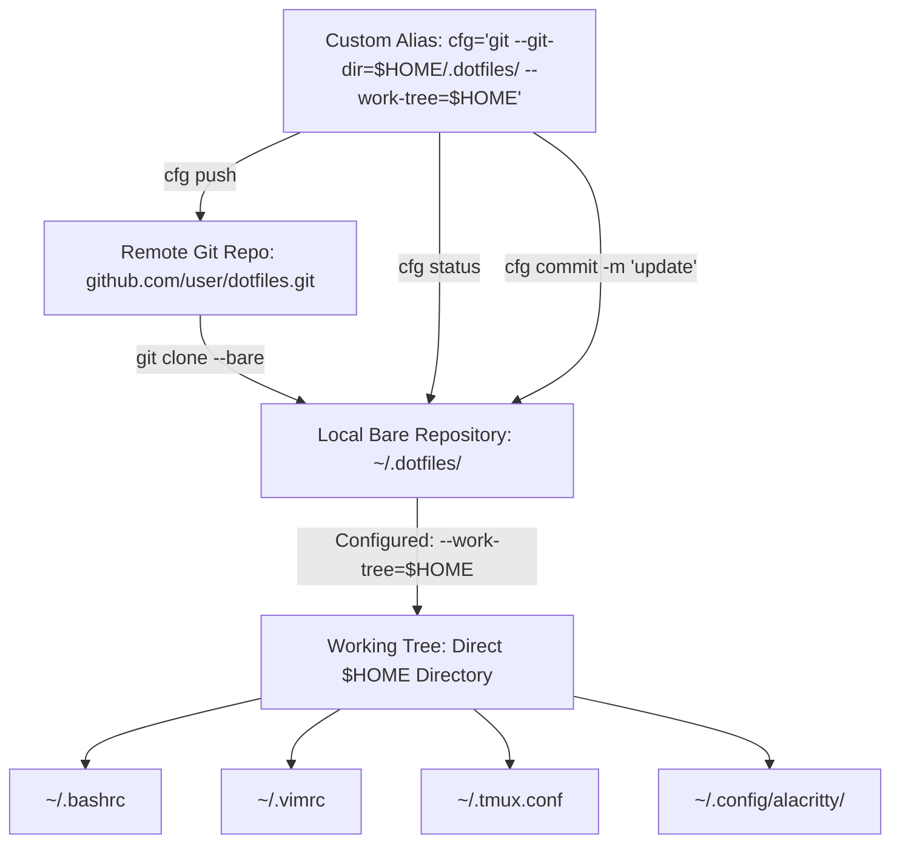

<!--
================================================================================
Metadata:
  Title: Dotfiles & Shell Customization
  Track: Linux & Systems Engineering / DevOps
  Difficulty: Intermediate
  Estimated Time: 45 minutes
  Prerequisites: 02-shell/01-shell-basics.md, 02-shell/10-vim-and-tmux.md
  Key Terminology: Dotfiles, .bashrc, .bash_profile, /etc/profile, PS1 Prompt, Aliases, Shell Functions, Bare Git Repository, GNU Stow, Chezmoi, XDG Base Directory Specification
================================================================================
-->

# Dotfiles & Shell Customization

[<- 10-vim-and-tmux.md](./10-vim-and-tmux.md) | [Back to Module Overview](./README.md) | [Next Module: 03-system ->](../03-system/README.md)

---

## Table of Contents
- [1. What & Why](#1-what--why)
- [2. Core Concepts](#2-core-concepts)
- [3. How It Works Internally](#3-how-it-works-internally)
- [4. Syntax & Usage](#4-syntax--usage)
- [5. Practical Examples](#5-practical-examples)
- [6. Best Practices](#6-best-practices)
- [7. Common Mistakes & Troubleshooting](#7-common-mistakes--troubleshooting)
- [8. Performance, Security & Cost Implications](#8-performance-security--cost-implications)
- [9. Comparison Table](#9-comparison-table)
- [10. Real-World Interview Questions](#10-real-world-interview-questions)
- [11. Practice Exercises](#11-practice-exercises)
- [12. Summary & Quick Reference Cheat Sheet](#12-summary--quick-reference-cheat-sheet)
- [13. Further Reading & Official Documentation](#13-further-reading--official-documentation)

---

## 1. What & Why

In Linux systems engineering, an engineer's operational agility depends heavily on their command-line environment. The terminal prompt, custom shortcuts, history retention parameters, and tool configs represent years of accumulated workflow optimization.

These user-level configuration files—traditionally hidden files prefixed with a dot (e.g., `~/.bashrc`, `~/.vimrc`, `~/.tmux.conf`, `~/.gitconfig`)—are collectively known as **Dotfiles**:
- A well-architected dotfiles setup allows an engineer to provision a fully customized, productive terminal environment on a brand-new cloud VM or development container in under 30 seconds.
- Understanding the shell startup file hierarchy (`/etc/profile` vs `~/.bash_profile` vs `~/.bashrc`) resolves frequent production mysteries, such as why environment variables configured for interactive logins fail to load during automated SSH commands or cron jobs.
- Applying modern version control patterns (such as bare Git repositories or GNU Stow) ensures dotfiles can be synchronized across machines without exposing private SSH keys or API tokens.

---

## 2. Core Concepts

### The Shell Startup File Hierarchy
When Bash initializes, it inspects whether it is running as a **Login Shell** or an **Interactive Non-Login Shell**:

```
+-------------------------------------------------------------------------+
| BASH STARTUP CONFIGURATION HIERARCHY                                    |
|                                                                         |
|  [ Type A: Login Shell (SSH Login / Console Login) ]                    |
|         │                                                               |
|         ├──> 1. Reads & executes /etc/profile                           |
|         │         └── Sources all files in /etc/profile.d/*.sh          |
|         │                                                               |
|         └──> 2. Searches user home for FIRST found of:                  |
|                   ├── ~/.bash_profile                                   |
|                   ├── ~/.bash_login                                     |
|                   └── ~/.profile                                        |
|                             │                                           |
|                             └── (Standard convention sources ~/.bashrc)|
|                                                                         |
|  [ Type B: Interactive Non-Login Shell (Opening New Terminal Tab / Subshell) ]
|         │                                                               |
|         ├──> 1. Reads & executes /etc/bash.bashrc                       |
|         └──> 2. Reads & executes ~/.bashrc                              |
|                                                                         |
|  [ Type C: Non-Interactive Script (./deploy.sh / Cron / CI Runner) ]    |
|         └──> Does NOT read profile or bashrc!                           |
|              Inherits exported variables from parent process            |
+-------------------------------------------------------------------------+
```

### The XDG Base Directory Specification
Modern Linux tools adhere to the XDG Base Directory Specification to prevent cluttering the user's `$HOME` root directory:
- **`$XDG_CONFIG_HOME`** (Default: `~/.config`): Where application configurations reside (e.g., `~/.config/nvim/`, `~/.config/tmux/`).
- **`$XDG_DATA_HOME`** (Default: `~/.local/share`): Persistent user data files.
- **`$XDG_STATE_HOME`** (Default: `~/.local/state`): Logs, command history, and session state.
- **`$XDG_CACHE_HOME`** (Default: `~/.cache`): Non-essential cached files.

### Custom Prompts (`$PS1`)
The primary shell prompt is controlled by the `$PS1` environment variable. Special escape sequences display real-time context:
- `\u`: Current username
- `\h`: Hostname (up to the first '.')
- `\w`: Current working directory (with `~` for home)
- `\t`: Current time (24-hour HH:MM:SS)
- `\$`: Displays `#` if UID 0 (root), else `$`

---

## 3. How It Works Internally

Managing dotfiles using a **Bare Git Repository** is the industry standard for cloud engineers who wish to track configurations without third-party dependencies:



### Why the Bare Git Repo Method Works
- A bare repository contains the Git database (`objects/`, `refs/`, `HEAD`) without an embedded `.git` folder in your home directory.
- By binding `--work-tree=$HOME`, Git tracks files directly in `$HOME` (like `~/.bashrc`) without moving them or creating symlinks.
- Setting `status.showUntrackedFiles no` ensures that running `git status` ignores the thousands of untracked files in your home directory, reporting only changes to your explicitly tracked dotfiles.

---

## 4. Syntax & Usage

### 1. Setting Up the Bare Git Repository Dotfile Manager
```bash
# Initialize bare git repository in home directory
git init --bare "$HOME/.dotfiles"

# Define dedicated management alias
alias config='git --git-dir="$HOME/.dotfiles/" --work-tree="$HOME"'

# Instruct Git to hide all untracked home files
config config --local status.showUntrackedFiles no

# Add, commit, and push your first dotfile
config add ~/.bashrc
config commit -m "feat(bash): add initial production .bashrc"
# config push origin main
```

### 2. Crafting an Informative, Performant `$PS1` Prompt
```bash
# ANSI Color Codes
RED="\[\033[01;31m\]"
GREEN="\[\033[01;32m\]"
BLUE="\[\033[01;34m\]"
YELLOW="\[\033[01;33m\]"
RESET="\[\033[00m\]"

# Displays: [user@hostname: /current/dir] (git-branch)$
parse_git_branch() {
  git branch 2> /dev/null | sed -e '/^[^*]/d' -e 's/* \(.*\)/ (\1)/'
}

export PS1="${GREEN}\u@\h${RESET}:${BLUE}\w${YELLOW}\$(parse_git_branch)${RESET}\$ "
```

### 3. Production Aliases and Navigational Helpers
```bash
# Safety guards on destructive commands
alias rm='rm -i'
alias cp='cp -i'
alias mv='mv -i'

# Modern command defaults
alias grep='grep --color=auto'
alias ls='ls --color=auto -F'
alias ll='ls -lah'

# Network inspection shortcuts
alias ports='ss -tulpn'
alias myip='curl -s ifconfig.me; echo'

# Fast directory jumping
alias ..='cd ..'
alias ...='cd ../..'
alias ....='cd ../../..'
```

### 4. Tuning History Retention Settings in `~/.bashrc`
Default Bash history settings discard commands or overwrite history across concurrent terminal tabs. Fix this with:
```bash
# Append to history instead of overwriting on shell exit
shopt -s histappend

# Enormous history buffers (100,000 commands)
HISTSIZE=100000
HISTFILESIZE=100000

# Ignore duplicate entries and commands starting with space
HISTCONTROL=ignoreboth

# Include full ISO-8601 timestamps with each history command
HISTTIMEFORMAT="%Y-%m-%d %H:%M:%S  "

# Sync history across open terminal tabs immediately
PROMPT_COMMAND="history -a; history -c; history -r; ${PROMPT_COMMAND:-}"
```

---

## 5. Practical Examples

### 1. Basic: Sourcing New Configuration in an Active Shell
When you modify `~/.bashrc`, the changes do not automatically apply to currently open terminal windows:
```bash
# Reload ~/.bashrc without opening a new terminal session
source ~/.bashrc
# Or using POSIX dot operator:
. ~/.bashrc
```

### 2. Real-World: Bootstrapping Dotfiles on a Fresh Cloud Instance
A 1-liner bootstrapping routine executed via SSH to clone your private dotfiles onto a newly spun up Ubuntu server:
```bash
#!/usr/bin/env bash
# Clone bare repo
git clone --bare https://github.com/myuser/dotfiles.git "$HOME/.dotfiles"

# Define checkout function
function config {
   git --git-dir="$HOME/.dotfiles/" --work-tree="$HOME" "$@"
}

# Checkout files into $HOME
mkdir -p "$HOME/.dotfiles-backup"
if config checkout 2>/dev/null; then
  echo "[SUCCESS] Checked out dotfiles."
else
  echo "[WARN] Backing up conflicting pre-existing dotfiles..."
  config checkout 2>&1 | grep -E "^\s+" | awk '{print $1}' | while read -r file; do
    mkdir -p "$HOME/.dotfiles-backup/$(dirname "$file")"
    mv "$HOME/$file" "$HOME/.dotfiles-backup/$file"
  done
  config checkout
fi

config config --local status.showUntrackedFiles no
source ~/.bashrc
```

### 3. Edge Case: Preserving Secrets Outside Git Tracking
Never store API keys, SSH private keys, or database credentials in a Git-tracked dotfile repo:
```bash
# At the bottom of your ~/.bashrc:
if [[ -f "$HOME/.bashrc.local" ]]; then
  # Source machine-specific secrets (which is in .gitignore!)
  source "$HOME/.bashrc.local"
fi
```
Add `.bashrc.local` to `.gitignore` so secrets remain strictly local to that specific machine.

### 4. Failure Case: Emitting Output from `~/.bashrc` Breaks SFTP/SCP
A subtle bug occurs when engineers add an `echo` statement (e.g., `echo "Welcome back!"`) to `~/.bashrc`:
```bash
# Consequence: When an automation tool or client connects via SFTP or SCP:
scp file.txt user@server:/tmp/
# Error: Received message too long 1416128883 / protocol error!
```
*Why this fails*: SFTP/SCP initializes a non-interactive shell and expects pure protocol binary frames. The `echo` statement pollutes the stream with ASCII characters.  
*Remediation*: Wrap interactive elements inside `~/.bashrc` with a check for interactive mode:
```bash
# Exit early if not running interactively
[[ $- != *i* ]] && return
```

### 5. Production-Grade: Clean Modular `~/.bashrc` Architecture
A modular dotfiles layout where configurations are partitioned into focused, independently maintainable files:
```text
~/.bashrc.d/
├── 00-environment.sh
├── 10-history.sh
├── 20-prompt.sh
├── 30-aliases.sh
└── 40-functions.sh
```
In `~/.bashrc`:
```bash
# Load all modular configuration drop-ins
if [[ -d "$HOME/.bashrc.d" ]]; then
  for conf in "$HOME/.bashrc.d/"*.sh; do
    [[ -r "$conf" ]] && source "$conf"
  done
  unset conf
fi
```

---

## 6. Best Practices

1. **Keep `~/.bashrc` Strictly Interactive**: Place environment variables that must be visible to non-interactive scripts in `~/.profile` or `/etc/environment`. Guard `~/.bashrc` with `[[ $- != *i* ]] && return`.
2. **Never Commit Secrets to Dotfile Repos**: Keep AWS keys, GitHub tokens, and private keys in `~/.bashrc.local` or a password manager (e.g., `pass`, `1Password CLI`).
3. **Use `PROMPT_COMMAND` with Care**: Heavy commands in `PROMPT_COMMAND` (like calling external APIs or deep git queries) execute on **every single command press**, making the terminal feel sluggish. Keep prompt functions in pure Bash memory.
4. **Use Explicit Function Overrides**: When creating complex aliases that accept arguments, use **Bash functions** rather than aliases (aliases do not accept positional parameters `$1`, `$2`).
5. **Standardize on XDG Directories**: Place tool configurations in `~/.config/` instead of littering the home directory with arbitrary dot directories (`~/.tool/`).

---

## 7. Common Mistakes & Troubleshooting

| Mistake / Antipattern | Underlying Cause | Consequence | Production Solution |
| :--- | :--- | :--- | :--- |
| `echo` statements in `~/.bashrc` | Emits stdout during non-interactive SSH sessions. | Breaks `scp`, `sftp`, and Ansible automated deployments. | Add `[[ $- != *i* ]] && return` at top of `~/.bashrc`. |
| Setting `$PATH` in `~/.bashrc` only | `~/.bashrc` is not sourced by non-interactive shells or systemd daemons. | Cron jobs, systemd services, or SSH commands fail with "command not found". | Set system-wide `$PATH` in `/etc/environment` or `/etc/profile`. |
| Committing `.dotfiles` with untracked clutter | Bare repo without untracked filter scans all files in `$HOME`. | `git status` lists hundreds of downloads, caches, and desktop files. | Run `config config --local status.showUntrackedFiles no`. |
| Slow prompt lag on large git repositories | `parse_git_branch` calls `git status` on massive repos with millions of files. | Hitting Enter takes 2–5 seconds every time. | Use `git branch` or `git rev-parse`, or disable git prompts in large repos. |
| Overwriting history across tabs | Default bash flushes history only on shell exit. | The last closed terminal tab overwrites commands from earlier tabs. | Set `shopt -s histappend` and `history -a` in `PROMPT_COMMAND`. |
| Alias with parameters: `alias mkcd='mkdir $1 && cd $1'` | Aliases cannot accept arguments; `$1` expands at declaration time. | Fails completely or targets current shell's `$1`. | Use a function: `mkcd() { mkdir -p "$1" && cd "$1"; }`. |

---

## 8. Performance, Security & Cost Implications

### Performance
- **Terminal Startup Latency**: Every command executed in `~/.bashrc` adds to terminal startup time. Spawning 10 external processes (`nvm`, `rvm`, `pyenv`, `git`) can increase shell launch latency from 5ms to over 800ms. Measure your shell startup time with:
  ```bash
  time bash -i -c exit
  ```
  Target startup times should remain **< 50 milliseconds**.

### Security
- **Public Git Exposure**: Accidental commits of `~/.ssh/id_rsa`, `~/.aws/credentials`, or `~/.netrc` to public GitHub dotfiles repositories account for thousands of enterprise credential breaches annually. Use pre-commit hooks and explicit secret exclusion.

### Cost
- Standardizing dotfiles across an engineering team eliminates hours wasted per engineer setting up local development virtual machines or debugging shell-specific syntax discrepancies.

---

## 9. Comparison Table

| Dotfile Management Strategy | Overhead | Dependencies | Handles Conflicts? | Best Suited For |
| :--- | :--- | :--- | :--- | :--- |
| **Bare Git Repository** | **Zero** | Git only | Manual backup | Minimalist cloud SREs; zero-dependency servers |
| **GNU Stow** | Low | Perl / `stow` binary | Symlinks directories | Desktop Linux with multiple sub-packages |
| **Chezmoi** | Low | Go binary | Built-in secret management | Multi-machine environments with password manager integration |
| **Home-Grown Symlink Script** | Variable | Custom bash | Fragile | Legacy setups |

---

## 10. Real-World Interview Questions

### Q1: What is the difference between `/etc/profile`, `~/.bash_profile`, and `~/.bashrc`?
<details>
<summary>Answer</summary>
- **`/etc/profile`**: The system-wide configuration script executed for all users when starting a **Login Shell**. It establishes global environment variables (e.g., standard `$PATH`, `$MAIL`) and sources files in `/etc/profile.d/*.sh`.
- **`~/.bash_profile`** (or `~/.profile`): The user-specific configuration file executed only when starting a **Login Shell** (e.g., SSH authentication or console login). It is typically used for heavy environment variables that should only be initialized once per session.
- **`~/.bashrc`**: The user-specific configuration file executed for **Interactive Non-Login Shells** (e.g., opening a new terminal tab, running `bash`, or entering a subshell). It contains aliases, shell functions, prompts (`$PS1`), and interactive settings.
Standard convention dictates that `~/.bash_profile` explicitly sources `~/.bashrc` so that interactive login sessions receive all aliases and prompt settings.
</details>

### Q2: Why does `scp` fail with "Received message too long" when `~/.bashrc` contains an `echo` statement?
<details>
<summary>Answer</summary>
When a remote client invokes `scp` or `sftp`, it connects via SSH and spawns a non-interactive shell on the remote host to run the remote `scp` or `sftp-server` binary. The protocol expects clean, unpolluted binary protocol messages across `stdin` and `stdout`.
If `~/.bashrc` prints ASCII text (such as `echo "Welcome!"`), that output is injected into `stdout` before the protocol binary stream starts. The client receives the ASCII text, interprets the characters as the header of a protocol packet, calculates an absurdly large packet length, and aborts with "Received message too long".
</details>

### Q3: How do you prevent commands from being saved in Bash history?
<details>
<summary>Answer</summary>
1. **Leading Space**: By configuring `HISTCONTROL=ignorespace` (or `ignoreboth`), any command entered with a **leading space character** (e.g., ` mysql -u root -p'password'`) will be omitted from the in-memory history and will not be written to `~/.bash_history`.
2. **Session Disabling**: Temporarily disable history recording in the active terminal:
   ```bash
   set +o history
   # run sensitive command
   set -o history
   ```
3. **Clear History**: Wipe the current session's history before exiting: `history -c`.
</details>

### Q4: Why can't you pass arguments to a Bash alias, and what should you use instead?
<details>
<summary>Answer</summary>
Aliases perform simple literal text substitution on the first word of a command line before the rest of the arguments are parsed. Aliases have no concept of positional parameters (`$1`, `$2`). If you define `alias mkcd='mkdir $1 && cd $1'`, the shell substitutes `$1` with whatever `$1` was in the parent environment at definition time, and appends the argument to the end: `mkdir && cd dirname`.
**Solution**: Use a **Shell Function**, which fully supports positional parameters and local variables:
```bash
mkcd() {
  mkdir -p "$1" && cd "$1"
}
```
</details>

### Q5: What is the XDG Base Directory Specification, and why is it preferred over dotfiles in `$HOME`?
<details>
<summary>Answer</summary>
The XDG Base Directory Specification (defined by freedesktop.org) establishes standard directory locations for user files:
- `$XDG_CONFIG_HOME`: `~/.config`
- `$XDG_DATA_HOME`: `~/.local/share`
- `$XDG_CACHE_HOME`: `~/.cache`
- `$XDG_STATE_HOME`: `~/.local/state`
Prior to XDG, every tool dumped hidden dotfiles and folders directly into `$HOME` (`~/.vim/`, `~/.aws/`, `~/.docker/`, `~/.bash_history`), cluttering the user directory and making clean backups difficult. XDG cleanly separates configuration (which should be version-controlled in Git) from volatile caches, state, and logs.
</details>

### Q6: How does `PROMPT_COMMAND` work in Bash?
<details>
<summary>Answer</summary>
`PROMPT_COMMAND` is an environment variable containing a command or shell function that Bash executes **immediately before issuing each primary prompt (`$PS1`)**.
It is commonly used to:
- Dynamically recalculate prompt metadata (e.g., active Kubernetes context or AWS profile).
- Append recent history to disk immediately: `PROMPT_COMMAND="history -a"`.
- Update terminal window title bars with current directory and running program.
</details>

### Q7: Explain how to manage dotfiles using a bare Git repository.
<details>
<summary>Answer</summary>
1. Create a bare git repo: `git init --bare $HOME/.dotfiles`.
2. Create an alias that explicitly specifies the Git directory and working tree:
   ```bash
   alias config='git --git-dir=$HOME/.dotfiles/ --work-tree=$HOME'
   ```
3. Prevent untracked files from appearing in status: `config config --local status.showUntrackedFiles no`.
4. Add and commit files directly from `$HOME`: `config add ~/.bashrc; config commit -m "add bashrc"`.
This eliminates the need for symlinks or third-party tools while maintaining full Git versioning.
</details>

### Q8: What does the test `[[ $- != *i* ]] && return` at the top of `~/.bashrc` do?
<details>
<summary>Answer</summary>
The special parameter `$-` contains the current shell invocation flags. When a shell is interactive, the flag `i` is present in `$-`.
The condition `[[ $- != *i* ]]` checks if the current shell is **not** interactive. If it is non-interactive (e.g., running a script, an automated SSH command, or an SFTP connection), `return` terminates the execution of `~/.bashrc` immediately. This guards against running terminal-only settings or emitting stdout in non-interactive contexts.
</details>

---

## 11. Practice Exercises

### Exercise 1: Build a `mkcd` Helper Function (Easy)
**Task**: Author a shell function `mkcd` in `~/.bashrc` that creates a directory (including any missing parent directories) and immediately changes directory into it.

<details>
<summary>Solution</summary>

```bash
mkcd() {
  if [[ -z "${1:-}" ]]; then
    echo "Usage: mkcd <directory_path>" >&2
    return 1
  fi
  mkdir -p "$1" && cd "$1"
}
```
</details>

### Exercise 2: Terminal Title Bar Updater (Easy)
**Task**: Configure `PROMPT_COMMAND` in `~/.bashrc` to update the terminal window title bar dynamically with format: `[user@host: current_directory]`.

<details>
<summary>Solution</summary>

```bash
update_title() {
  # Escape sequence for setting window title: \033]0;TITLE\007
  printf "\033]0;%s@%s: %s\007" "$USER" "${HOSTNAME%%.*}" "${PWD/#$HOME/~}"
}
PROMPT_COMMAND="update_title; ${PROMPT_COMMAND:-}"
```
</details>

### Exercise 3: Profiling Shell Startup Latency (Medium)
**Task**: Write a benchmark script that launches 20 subshells in interactive mode (`bash -i -c exit`) and calculates the average startup latency in milliseconds.

<details>
<summary>Solution</summary>

```bash
#!/usr/bin/env bash
set -euo pipefail

TOTAL_TIME=0
RUNS=20

echo "[INFO] Benchmarking interactive shell startup time across $RUNS runs..."

for ((i=1; i<=RUNS; i++)); do
  START=$(date +%s%N)
  bash -i -c exit > /dev/null 2>&1
  END=$(date +%s%N)
  DIFF=$(( (END - START) / 1000000 )) # Milliseconds
  TOTAL_TIME=$(( TOTAL_TIME + DIFF ))
done

AVG=$(( TOTAL_TIME / RUNS ))
echo "Average shell startup latency: ${AVG} ms"
```
</details>

### Exercise 4: Fast Git Status Branch Parser (Medium)
**Task**: Write a pure Bash function `git_prompt_info` that returns the current Git branch and adds an asterisk `*` if there are uncommitted changes, running in < 15ms.

<details>
<summary>Solution</summary>

```bash
git_prompt_info() {
  # Fast branch resolution via symbolic-ref
  local branch
  branch=$(git symbolic-ref --short HEAD 2>/dev/null) || return 0
  
  # Check if dirty without running full status
  local dirty=""
  if ! git diff --quiet --ignore-submodules HEAD 2>/dev/null; then
    dirty="*"
  fi
  echo " (${branch}${dirty})"
}
```
</details>

### Exercise 5: Automated Secret-Scrubbing Pre-Commit Hook for Dotfiles (Hard)
**Task**: In your bare dotfiles repository, write a `pre-commit` hook that scans staged files for potential API keys, AWS credentials, or private SSH keys, blocking the commit if found.

<details>
<summary>Solution</summary>

```bash
#!/usr/bin/env bash
set -euo pipefail

# Patterns indicative of leaked secrets
SECRET_PATTERNS=(
  "AKIA[0-9A-Z]{16}"                    # AWS Access Key ID
  "-----BEGIN (RSA|OPENSSH|EC) PRIVATE" # Private Keys
  "ghp_[A-Za-z0-9]{36}"                 # GitHub Personal Access Token
  "xox[baprs]-[0-9A-Za-z-]+"            # Slack Token
)

STAGED_FILES=$(git --git-dir="$HOME/.dotfiles/" --work-tree="$HOME" diff --cached --name-only)

for file in $STAGED_FILES; do
  TARGET="$HOME/$file"
  [[ ! -f "$TARGET" ]] && continue

  for pattern in "${SECRET_PATTERNS[@]}"; do
    if grep -E -q "$pattern" "$TARGET"; then
      echo "[SECURITY ALERT] Potential secret matching pattern '$pattern' detected in $file!" >&2
      echo "Commit aborted to prevent credential leak." >&2
      exit 1
    fi
  done
done
exit 0
```
</details>

### Exercise 6: Complete Automated Dotfile Bootstrapper (Hard)
**Task**: Author an idempotent bash script `bootstrap_dotfiles.sh` that checks out a bare git dotfiles repository from GitHub, backs up any pre-existing colliding files to `~/.dotfiles-backup/<timestamp>/`, clones required Vim plugins, and loads the environment.

<details>
<summary>Solution</summary>

```bash
#!/usr/bin/env bash
set -euo pipefail

DOTFILES_REPO="https://github.com/example/dotfiles.git"
BARE_DIR="$HOME/.dotfiles"
BACKUP_DIR="$HOME/.dotfiles-backup/$(date +%Y%m%d_%H%M%S)"

config() {
  git --git-dir="$BARE_DIR" --work-tree="$HOME" "$@"
}

if [[ ! -d "$BARE_DIR" ]]; then
  echo "[INFO] Cloning bare dotfiles repository..."
  git clone --bare "$DOTFILES_REPO" "$BARE_DIR"
fi

config config --local status.showUntrackedFiles no

echo "[INFO] Checking out dotfiles into $HOME..."
if ! config checkout 2>/dev/null; then
  echo "[WARN] Conflicting files detected. Creating backup at $BACKUP_DIR..."
  mkdir -p "$BACKUP_DIR"
  
  # Extract list of colliding files
  config checkout 2>&1 | grep -E "^\s+" | awk '{print $1}' | while read -r conflict; do
    mkdir -p "$BACKUP_DIR/$(dirname "$conflict")"
    mv "$HOME/$conflict" "$BACKUP_DIR/$conflict"
    echo "Backed up: $conflict"
  done
  
  config checkout
fi

echo "[SUCCESS] Dotfiles successfully deployed!"
```
</details>

---

## 12. Summary & Quick Reference Cheat Sheet

| File / Variable | Scope | Primary Purpose |
| :--- | :--- | :--- |
| **`/etc/profile`** | System-Wide | Executed on Login Shells for all users |
| **`~/.bash_profile`**| User-Specific | Executed on Login Shells; initializes environment |
| **`~/.bashrc`** | User-Specific | Executed on Interactive Non-Login Shells; aliases & prompts |
| **`~/.bash_logout`** | User-Specific | Executed when a login shell exits; screen clearing |
| **`$PS1`** | Shell Variable | Primary command prompt string format |
| **`$HISTSIZE`** | Shell Variable | Max lines stored in memory buffer |
| **`$HISTFILESIZE`**| Shell Variable | Max lines preserved in `~/.bash_history` |
| **`HISTCONTROL`** | Shell Variable | `ignoreboth`: suppresses duplicates and leading-space commands |
| **`PROMPT_COMMAND`**| Shell Variable | Command executed prior to displaying each prompt |
| **`$XDG_CONFIG_HOME`**| Environment | Standard location for application configs (`~/.config`) |

---

## 13. Further Reading & Official Documentation

- [GNU Bash Reference Manual: Bash Startup Files](https://www.gnu.org/software/bash/manual/html_node/Bash-Startup-Files.html)
- [XDG Base Directory Specification (freedesktop.org)](https://specifications.freedesktop.org/basedir-spec/basedir-spec-latest.html)
- [Atlassian: Dotfiles - Best Way to Store in Git (Bare Repo Pattern)](https://www.atlassian.com/git/tutorials/dotfiles)
- [Chezmoi: Modern Dotfile Manager](https://www.chezmoi.io/)
- [GNU Stow Manual](https://www.gnu.org/software/stow/manual/stow.html)

---

[<- 10-vim-and-tmux.md](./10-vim-and-tmux.md) | [Back to Module Overview](./README.md) | [Next Module: 03-system ->](../03-system/README.md)
