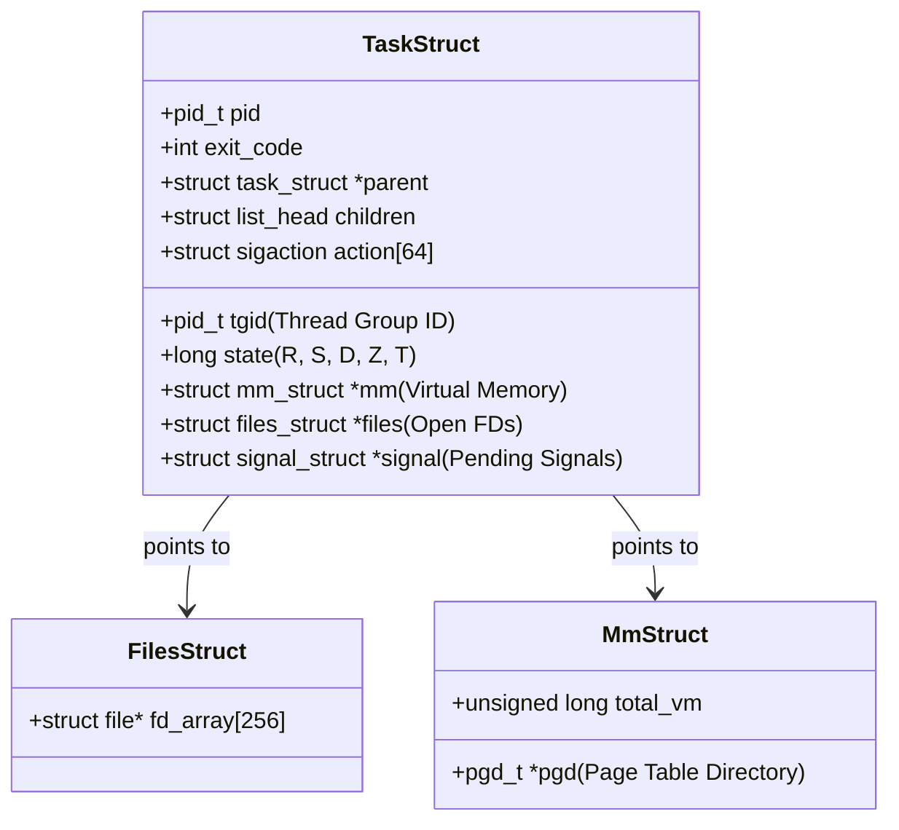

<!--
================================================================================
Metadata:
  Title: Processes, Signals & Lifecycle Management
  Track: Linux & Systems Engineering / DevOps
  Difficulty: Intermediate
  Estimated Time: 55 minutes
  Prerequisites: 01-fundamentals/02-linux-architecture.md, 02-shell/01-shell-basics.md
  Key Terminology: Process, Thread, PID, PPID, task_struct, Process States (R, S, D, Z, T), Signals (SIGTERM, SIGKILL, SIGHUP, SIGINT, SIGCHLD), Zombie Process, Orphan Process, kill, pkill, pgrep, ps, top
================================================================================
-->

# Processes, Signals & Lifecycle Management

[Back to DevOps Track Overview](../README.md) | [Back to Module Overview](./README.md) | [02-job-control-and-nice.md ->](./02-job-control-and-nice.md)

---

## Table of Contents
- [1. What & Why](#1-what--why)
- [2. Core Concepts](#2-core-concepts)
- [3. How It Works Internally](#3-how-it-works-internally)
- [4. Syntax & Usage](#4-syntax--usage)
- [5. Practical Examples](#5-practical-examples)
- [6. Best Practices](#6-best-practices)
- [7. Common Mistakes & Troubleshooting](#7-common-mistakes--troubleshooting)
- [8. Performance, Security & Cost Implications](#8-performance-security--cost-implications)
- [9. Comparison Table](#9-comparison-table)
- [10. Real-World Interview Questions](#10-real-world-interview-questions)
- [11. Practice Exercises](#11-practice-exercises)
- [12. Summary & Quick Reference Cheat Sheet](#12-summary--quick-reference-cheat-sheet)
- [13. Further Reading & Official Documentation](#13-further-reading--official-documentation)

---

## 1. What & Why

In the Linux operating system, a **process** is the fundamental execution unit of compute. Every web server (Nginx), database engine (PostgreSQL), background cron job, and container runtime process exists as an isolated kernel task with its own virtual address space, file descriptor table, and security credentials.

Systems administrators, DevOps engineers, and SREs interact with process lifecycles constantly:
- When a service stops responding to network traffic, an engineer must determine whether the process is CPU-starved (State `R`), waiting on disk I/O (State `D`), or stuck in an unkillable deadlock.
- During rolling application upgrades or autoscaling scale-down events, Kubernetes and systemd rely on POSIX **Signals** (specifically `SIGTERM` and `SIGKILL`) to initiate graceful connection draining and data flushing.
- If child processes terminate without their parent reaping them, the kernel process table fills with **Zombie processes** (`Z`), potentially blocking new processes from spawning when the kernel hits its system-wide PID limit (`pid_max`).

Mastering process mechanics, signal propagation, and triage utilities (`ps`, `pgrep`, `kill`, `top`) is non-negotiable for reliable systems engineering.

---

## 2. Core Concepts

### Process Hierarchy & Identifiers
Every process in Linux is assigned unique identifiers:
- **PID (Process ID)**: A positive integer uniquely identifying the active process in the current PID namespace.
- **PPID (Parent Process ID)**: The PID of the parent process that spawned this process via `fork()` or `clone()`.
- **UID / GID**: The user and group under whose security context the process runs.

The process tree originates at **PID 1** (`systemd` in modern distributions), which is initialized directly by the Linux kernel during boot. All processes descend from PID 1.

### Linux Process States
At any microsecond, a Linux process occupies one of five primary states tracked in the kernel `task_struct`:

```
+-------------------------------------------------------------------------+
| LINUX KERNEL PROCESS STATE TRANSITIONS                                   |
|                                                                         |
|            fork()                                                       |
|   Parent ─────────> [ Created / Ready ]                                 |
|                            │                                            |
|                  Scheduled │   Preempted / Quantum expired              |
|                     by CFS v   ┌─────────┐                              |
|                   [ Running / Runnable (R) ] <─────────┐                |
|                            │                           │ Event arrives  |
|            Needs I/O / Lock│                           │ (Data ready)   |
|                            v                           │                |
|              [ Interruptible Sleep (S) ] ──────────────┘                |
|                            │                                            |
|              Disk I/O Wait │ (Waiting on uninterruptible hardware)      |
|                            v                                            |
|             [ Uninterruptible Sleep (D) ]                               |
|                            │                                            |
|                     SIGSTOP│                                            |
|                            v                                            |
|                 [ Stopped / Traced (T) ]                                |
|                            │                                            |
|                 exit() runs│                                            |
|                            v                                            |
|                  [ Zombie / Defunct (Z) ]                               |
|                            │                                            |
|            Parent calls    │ waitpid()                                  |
|                            v                                            |
|                  [ Process Destroyed ]                                  |
+-------------------------------------------------------------------------+
```

| State Code | State Name | Operational Meaning | Can Be Killed with `SIGKILL`? |
| :---: | :--- | :--- | :---: |
| **R** | Running or Runnable | Actively executing on a CPU core or queued in CFS runqueue. | Yes |
| **S** | Interruptible Sleep | Waiting for an event (network packet, timer, pipe write). Wakes on signals. | Yes |
| **D** | Uninterruptible Sleep | Blocked waiting on hardware I/O (NFS, disk controller, kernel lock). | **NO** (Ignores all signals) |
| **T** | Stopped | Suspended by a signal (`SIGSTOP`, `SIGTSTP` via `Ctrl+Z`) or debugger (`ptrace`). | Yes |
| **Z** | Zombie / Defunct | Process has terminated via `exit()`, but parent has not yet harvested exit status. | N/A (Already dead) |

### POSIX Signals
Signals are asynchronous notifications sent to a process to notify it of a system event. Linux supports 64 signals (standard POSIX signals 1–31 and real-time signals 32–64):

| Number | Name | Default Action | Catchable? | Purpose / Production Context |
| :---: | :--- | :--- | :---: | :--- |
| **1** | `SIGHUP` | Terminate | Yes | Hangup detected on controlling terminal; used by daemons (Nginx) to reload configuration without dropping connections. |
| **2** | `SIGINT` | Terminate | Yes | Interrupt from keyboard (`Ctrl+C`). Graceful terminal stop. |
| **3** | `SIGQUIT` | Core Dump | Yes | Quit from keyboard (`Ctrl+\`). Generates core dump file. |
| **9** | `SIGKILL` | Terminate | **NO** | Unconditional immediate kernel execution termination. Process has zero opportunity to clean up or flush buffers. |
| **15** | `SIGTERM` | Terminate | Yes | Standard termination signal sent by `kill`, `systemctl stop`, and Kubernetes pod evictions. Allows clean shutdown. |
| **18** | `SIGCONT` | Continue | Yes | Resumes a process stopped by `SIGSTOP` or `SIGTSTP`. |
| **19** | `SIGSTOP` | Stop | **NO** | Unconditionally suspends process execution (pauses scheduling). |
| **20** | `SIGTSTP` | Stop | Yes | Terminal stop signal issued by pressing `Ctrl+Z`. |

---

## 3. How It Works Internally

Inside the Linux kernel, every process and thread is represented by a C structure called `struct task_struct` defined in `<linux/sched.h>`.



### The Zombie Lifecycle
1. When a process finishes executing (or calls `exit()`), the kernel tears down its memory space (`mm_struct`), closes all open file descriptors, and releases its CPU allocations.
2. However, the kernel **cannot** destroy the process control block (`task_struct`) immediately because the parent process might need to read its child's exit status (`exit_code`) via `waitpid()`.
3. The process enters the **Zombie** (`Z`) state. A zombie consumes **0 bytes of RAM** and **0% CPU**—it is literally dead. It only consumes a single 4-byte PID slot in the kernel PID table.
4. If the parent process calls `wait()` or `waitpid()`, the kernel reaps the zombie and frees the PID.
5. If the parent dies without reaping the child, the zombie becomes an **Orphan** and is adopted by **PID 1** (`systemd`), which automatically reaps it.

---

## 4. Syntax & Usage

### 1. Process Inspection with `ps`
The `ps` utility supports two distinct syntax traditions: BSD syntax (no leading dash, e.g., `ps aux`) and standard UNIX/POSIX syntax (with leading dash, e.g., `ps -ef`):
```bash
# Standard BSD view: User, PID, %CPU, %MEM, VSZ, RSS, TTY, STAT, START, TIME, COMMAND
ps aux

# Standard UNIX view: UID, PID, PPID, C, STIME, TTY, TIME, CMD
ps -ef

# Show full process tree hierarchy
ps auxf
# Or with pstree:
pstree -p

# Custom output columns: Show PID, PPID, State, User, RSS memory, and Command
ps -eo pid,ppid,stat,user,rss,comm --sort=-rss | head -n 15

# Show all threads belonging to a process
ps -T -p <PID>
```

### 2. Finding Processes: `pgrep` and `pidof`
Avoid piping `ps aux | grep name | grep -v grep`:
```bash
# Find PIDs of all processes named 'nginx'
pgrep nginx

# Find PIDs with full command-line matching and display command string
pgrep -fa "python3 app.py"

# Find processes owned by user 'www-data'
pgrep -u www-data

# Fast lookup for binary name
pidof nginx
```

### 3. Terminating Processes: `kill`, `pkill`, `killall`
```bash
# Send standard graceful termination signal (SIGTERM, 15)
kill <PID>

# Send configuration reload signal (SIGHUP, 1)
kill -HUP <PID>
kill -1 <PID>

# Send immediate uncatchable kill signal (SIGKILL, 9)
kill -9 <PID>
kill -KILL <PID>

# Terminate processes matching a pattern (sends SIGTERM by default)
pkill -f "node server.js"

# Terminate all processes matching exact binary name
killall -SIGTERM redis-server
```

### 4. Interactive Monitoring: `top` and `htop`
```bash
# Standard top
top

# Within 'top':
#   'k': Prompt to kill a PID
#   'M': Sort by memory utilization (%MEM)
#   'P': Sort by CPU utilization (%CPU)
#   '1': Toggle display of individual CPU cores
#   'q': Quit

# Modern visual process viewer (supports color, mouse clicks, tree views)
htop
```

---

## 5. Practical Examples

### 1. Basic: Graceful vs Forced Termination
Stop a misbehaving application cleanly without data corruption:
```bash
TARGET_PID=$(pgrep -f "worker_queue")

if [[ -n "$TARGET_PID" ]]; then
  echo "[INFO] Sending SIGTERM to PID ${TARGET_PID}..."
  kill -TERM "$TARGET_PID"

  # Wait up to 5 seconds for graceful shutdown
  COUNT=0
  while kill -0 "$TARGET_PID" 2>/dev/null; do
    sleep 1
    ((COUNT++))
    if (( COUNT >= 5 )); then
      echo "[WARN] Process refused to terminate. Escalating to SIGKILL..."
      kill -KILL "$TARGET_PID"
      break
    fi
  done
  echo "[SUCCESS] Process terminated."
fi
```
*Note*: `kill -0 <PID>` is a special check: it sends no actual signal, but checks if the process exists and whether you have permission to signal it.

### 2. Real-World: Hunting and Reaping Zombie Processes
Diagnose why system monitoring alerts report hundreds of defunct processes:
```bash
# Find all zombie processes (STAT starts with 'Z')
ps -eo pid,ppid,stat,user,comm | awk '$3 ~ /^Z/'
```
**Sample Output**:
```text
  14982  14800 Z    app-user <defunct>
  14985  14800 Z    app-user <defunct>
```
*Triage*:
- Notice the `PPID` is `14800`.
- Zombies cannot be killed directly (`kill -9 14982` does nothing because the process is already dead).
- You must prompt the parent to reap them by sending `kill -CHLD 14800`.
- If the parent process is broken or ignores `SIGCHLD`, terminating the parent (`kill -TERM 14800`) forces the kernel to re-parent the zombies to PID 1, which instantly reaps them.

### 3. Edge Case: Investigating State `D` (Uninterruptible Sleep)
When a process is in state `D`, it cannot be killed—even by `kill -9`:
```bash
ps -eo pid,stat,wchan:20,comm | grep -E "^[[:space:]]*[0-9]+[[:space:]]+D"
```
*Explanation*:
- The `wchan` column reveals the **kernel function** where the process is sleeping (e.g., `nfs_wait_on_request`, `btrfs_wait_ordered_extents`, `down_read`).
- Processes in state `D` are waiting for hardware responses (e.g., a hanging NFS mount or a failing hard drive block). The only way to remove a stuck `D` state process is to restore the underlying hardware/network resource or reboot the server.

### 4. Failure Case: The Accidental `killall -9` Catastrophe
A junior engineer intends to terminate a specific background Python worker named `app.py`:
```bash
# DANGEROUS: Kills ALL Python processes on the entire machine!
killall -9 python3
# Consequence: Terminates unrelated system services, cloud monitoring agents,
# and Ansible management runners!

# PRODUCTION SOLUTION: Match exact command arguments or check PID first
pgrep -fa "python3 /srv/app/app.py"
# Verify matches, then kill precisely:
pkill -f "python3 /srv/app/app.py"
```

### 5. Production-Grade: Automated Deadlock Detector & Memory Killer
A production daemon script that monitors a backend Java or Node.js process, checks if it is consuming > 90% memory or stuck in state `D`, captures thread diagnostics via `/proc`, and recycles the process:
```bash
#!/usr/bin/env bash
set -euo pipefail

APP_NAME="orders-service"
MEM_THRESHOLD_MB=2048

PID=$(pgrep -f "$APP_NAME" || true)

if [[ -z "$PID" ]]; then
  echo "[INFO] Service $APP_NAME is not currently running."
  exit 0
fi

# Extract RSS memory in Kilobytes from /proc/<PID>/status
RSS_KB=$(awk '/VmRSS:/ {print $2}' "/proc/$PID/status")
RSS_MB=$(( RSS_KB / 1024 ))
PROCESS_STATE=$(awk '/State:/ {print $2}' "/proc/$PID/status")

echo "[STATUS] PID: $PID | State: $PROCESS_STATE | Memory RSS: ${RSS_MB}MB"

if (( RSS_MB > MEM_THRESHOLD_MB )) || [[ "$PROCESS_STATE" == "D" ]]; then
  echo "[ALERT] Process $PID exceeded threshold or is unresponsive! Capturing diagnostics..."
  
  # Dump stack trace if available
  if [[ -f "/proc/$PID/stack" ]]; then
    cat "/proc/$PID/stack" > "/var/log/${APP_NAME}_crash_stack.log" || true
  fi

  echo "[INFO] Initiating graceful recycling..."
  kill -TERM "$PID"
  sleep 5
  if kill -0 "$PID" 2>/dev/null; then
    kill -KILL "$PID"
  fi
  echo "[RECOVERED] Process terminated. Systemd will restart service."
fi
```

---

## 6. Best Practices

1. **Always Send `SIGTERM` Before `SIGKILL`**: Never jump straight to `kill -9`. `SIGTERM` (15) allows databases and servers to close TCP connections, flush dirty disk buffers, and remove lockfiles.
2. **Never Execute `killall` on Solaris or AIX Environments**: On some Unix platforms (Solaris), `killall` kills **all processes on the entire operating system**! On Linux, use `pkill` for consistent cross-platform behavior.
3. **Use `pgrep` Instead of Grepping `ps`**: Avoid `ps aux | grep foo | grep -v grep`. Use `pgrep -fa "pattern"`.
4. **Monitor `/proc/<PID>/status` for Accurate Metrics**: Tools like `ps` parse `/proc/<PID>/stat`. Reading `/proc/<PID>/status` directly in scripts gives exact VmRSS, VmSize, and state details without subshell forks.
5. **Reap Children in Container Entrypoints**: If your container runs multiple processes, ensure PID 1 is an init system (like `tini` or `dumb-init`) to prevent zombie PID exhaustion inside the container.

---

## 7. Common Mistakes & Troubleshooting

| Mistake / Antipattern | Underlying Cause | Consequence | Production Solution |
| :--- | :--- | :--- | :--- |
| Attempting `kill -9 <ZOMBIE_PID>` | A zombie process is already dead; it has no execution thread to receive signals. | Nothing happens; zombie persists in process table. | Signal the parent (`kill -CHLD <PPID>`) or kill the parent process. |
| Expecting `kill -9` to kill State `D` | State `D` processes sleep in the kernel waiting on hardware I/O; signal delivery is deferred. | Process cannot be killed; remains stuck indefinitely. | Fix underlying I/O / NFS server, or reboot the node. |
| Immediate `kill -9` on databases | Bypasses SQLite, PostgreSQL, or Redis write-ahead log (WAL) flushing. | Database files suffer corruption; lengthy crash recovery on reboot. | Always send `SIGTERM` (15) and allow grace period. |
| `ps aux \| grep app` race conditions | `grep` matches its own command line in the `ps` process table. | Script captures the PID of the `grep` command itself and kills it. | Use `pgrep -f app` or `grep "[a]pp"`. |
| Unbounded PID exhaustion in containers | Container applications spawning un-reaped subprocesses. | Host or container reaches `pid_max`; fails with `fork: retry: Resource temporarily unavailable`. | Use `tini` as container entrypoint: `ENTRYPOINT ["/tini", "--", "app"]`. |
| Missing permissions when signaling | Unprivileged user attempting to kill root or another user's processes. | `kill: (<PID>) - Operation not permitted` (EPERM). | Run with appropriate user credentials or `sudo`. |

---

## 8. Performance, Security & Cost Implications

### Performance
- **PID Max Tuning**: On high-density container hosts running thousands of microservices, default PID limits (e.g., 32,768) can be exhausted. System administrators increase this via:
  ```bash
  sysctl -w kernel.pid_max=4194304
  ```
- **Context Switching**: Having too many active runnable processes (`R` state) exceeding the physical CPU core count forces the Completely Fair Scheduler (CFS) to perform excessive context switches, burning CPU cycles on kernel register swaps rather than application code.

### Security
- **PID Recycling & Signal Spoofing**: PIDs are recycled by the kernel. If a script captures a PID, sleeps for 10 seconds, and then issues `kill <PID>`, that process may have exited and a completely different service may now hold that PID!
  - *Remediation*: Check process start time or command identity before sending signals to aged PIDs.
- **Process Privilege Drops**: Daemons starting as root must bind privileged ports (< 1024) and immediately drop privileges to an unprivileged service account using `setuid()` / `setgid()`.

### Cost
- Zombie processes consume negligible RAM, but orphan worker processes stuck in CPU busy-loops (`R` state) saturate virtual CPU cores on cloud VMs, triggering autoscaling groups to spin up redundant, expensive cloud instances.

---

## 9. Comparison Table

| Attribute | State `S` (Interruptible Sleep) | State `D` (Uninterruptible Sleep) | State `Z` (Zombie / Defunct) | State `T` (Stopped) |
| :--- | :--- | :--- | :--- | :--- |
| **CPU Usage** | 0.0% | 0.0% | 0.0% | 0.0% |
| **Memory Usage** | Full RSS resident | Full RSS resident | **0 Bytes** (task_struct only)| Full RSS resident |
| **Waiting On** | Sockets, timers, pipes | Storage I/O, NFS, kernel mutex | Parent process `waitpid()` | `SIGSTOP`, `Ctrl+Z`, `ptrace` |
| **Responds to Signals?**| **Yes** (Immediate) | **No** (Deferred until I/O done)| **No** (Already dead) | Responds to `SIGCONT` / `SIGKILL` |
| **Remediation Action** | Normal operating state | Investigate disk/NFS health | Kill or restart parent process | Send `kill -CONT <PID>` to resume |

---

## 10. Real-World Interview Questions

### Q1: What is the exact difference between a Zombie process and an Orphan process?
<details>
<summary>Answer</summary>
- **Zombie Process**: A process that has finished execution (called `exit()`), released its memory and file descriptors, but still has an entry in the kernel process table because its parent has not yet read its exit status via `wait()` or `waitpid()`. A zombie has an active parent.
- **Orphan Process**: A process that is still running, but whose parent process terminated before it did. The kernel immediately re-parents all orphan processes to **PID 1** (`systemd`). PID 1 automatically monitors its children and calls `wait()` when they terminate, preventing orphans from permanently remaining zombies.
</details>

### Q2: Why can a process in state `D` (Uninterruptible Sleep) not be killed by `kill -9`?
<details>
<summary>Answer</summary>
A process enters state `D` when it makes a system call that blocks on low-level hardware I/O (such as waiting for a physical disk read or an NFS network response) and the driver places the task into `TASK_UNINTERRUPTIBLE`.
In this state, the kernel explicitly **disables signal delivery** to protect system consistency: if the kernel allowed a process to be terminated mid-operation while hardware DMA or a filesystem driver was writing to its memory buffers, the kernel or filesystem could suffer severe corruption. The process will only process pending signals (including `SIGKILL`) **after** the hardware system call completes and the task returns to state `S` or `R`.
</details>

### Q3: What happens when you send `kill -0 <PID>`?
<details>
<summary>Answer</summary>
Signal number 0 is the null signal. No actual signal is delivered to the target process. However, the kernel still performs normal error checking:
1. It verifies whether a process with that PID exists.
2. It verifies whether the calling user has permission to send signals to it.
If the process exists and is accessible, `kill -0` returns exit code `0`. If the process does not exist, it returns `1` (`ESRCH: No such process`). If it exists but belongs to another user, it returns `1` (`EPERM: Operation not permitted`). It is the standard idiom in shell scripts to check if a PID is alive.
</details>

### Q4: Explain the difference between `SIGTERM` and `SIGKILL`.
<details>
<summary>Answer</summary>
- **`SIGTERM` (Signal 15)**: The standard termination signal. It is delivered to the process's user space signal handler. The application can catch, block, or handle it, allowing it to complete active database transactions, notify connected clients, clean up temporary files, and exit gracefully.
- **`SIGKILL` (Signal 9)**: Cannot be caught, blocked, or ignored. The signal is handled directly by the kernel scheduler, which instantly destroys the process's address space. The application has zero opportunity to clean up or run shutdown logic.
</details>

### Q5: How do you kill a zombie process?
<details>
<summary>Answer</summary>
You **cannot kill a zombie process** directly because a zombie process is already dead.
To remove a zombie from the process table, its parent process must read its exit status.
1. Send `SIGCHLD` to the parent process: `kill -s SIGCHLD <PPID>`, alerting it to reap its dead children.
2. If the parent is buggy or unresponsive, terminate the parent process: `kill -TERM <PPID>`.
3. When the parent dies, the kernel re-parents the zombie children to **PID 1** (`systemd`), which immediately reaps them.
</details>

### Q6: What is the Completely Fair Scheduler (CFS) in Linux?
<details>
<summary>Answer</summary>
CFS is the default CPU scheduling algorithm for standard (non-realtime) processes in Linux. Instead of traditional fixed time slices, CFS models an ideal multi-tasking CPU on hardware.
- It tracks the **virtual runtime (`vruntime`)** of each task, representing the amount of execution time the task has consumed, scaled by its priority (`nice` level).
- Tasks are stored in a time-ordered **Red-Black Tree**.
- The scheduler always picks the task with the smallest `vruntime` (leftmost node in the tree) to execute next, ensuring mathematically fair CPU distribution among competing processes.
</details>

### Q7: What is the meaning of the columns in `ps aux`?
<details>
<summary>Answer</summary>
- `USER`: Username owning the process.
- `PID`: Process ID.
- `%CPU`: Percentage of CPU time consumed since process start.
- `%MEM`: Percentage of physical RAM consumed (based on RSS).
- `VSZ`: Virtual Memory Size in KB (total address space, including mapped files and shared libraries).
- `RSS`: Resident Set Size in KB (actual physical RAM currently occupied).
- `TTY`: Controlling terminal (`?` if background daemon).
- `STAT`: Current process state code (`R`, `S`, `D`, `Z`, `T`) with modifiers (`+` foreground, `<` high priority, `N` low priority, `s` session leader).
- `START`: Time or date the process launched.
- `TIME`: Cumulative CPU execution time consumed.
- `COMMAND`: Executable name and arguments.
</details>

### Q8: How can you inspect open files and network sockets for a specific PID without `lsof`?
<details>
<summary>Answer</summary>
Inspect the `/proc/<PID>/fd/` virtual directory directly:
```bash
ls -l /proc/<PID>/fd/
```
Each entry is a symbolic link pointing to the open file, pipe, or network socket descriptor:
```text
0 -> /dev/null
1 -> /var/log/app.log
3 -> socket:[289145]
```
To check network sockets specifically, grep the socket inode against `/proc/net/tcp` or use `ss -p | grep <PID>`.
</details>

---

## 11. Practice Exercises

### Exercise 1: Finding High-Memory Processes (Easy)
**Task**: Use `ps` to display the top 5 memory-consuming processes on the system, showing only their PID, Username, Resident Memory in Megabytes, and Command name.

<details>
<summary>Solution</summary>

```bash
ps -eo pid,user,rss,comm --sort=-rss | awk 'NR==1 {print $1, $2, "RSS_MB", $4; next} NR<=6 {printf "%-8s %-12s %-10.2f %s\n", $1, $2, $3/1024, $4}'
```
</details>

### Exercise 2: Safe Process Termination Wrapper (Easy)
**Task**: Write a bash one-liner that checks if a process named `dummy_service` is running. If running, send `SIGTERM`, wait 3 seconds, and if still alive, send `SIGKILL`.

<details>
<summary>Solution</summary>

```bash
pkill -TERM dummy_service && sleep 3 && pkill -KILL dummy_service || true
```
</details>

### Exercise 3: Creating and Inspecting a Real Zombie Process (Medium)
**Task**: Write a minimal Python or C script (or pure Bash snippet) that creates a child process which exits immediately while the parent sleeps for 30 seconds without calling `wait()`. Confirm the zombie state using `ps`.

<details>
<summary>Solution</summary>

```bash
#!/usr/bin/env bash
# Spawn a child in background that terminates instantly, while parent sleeps
(
  # Child process
  ( exit 0 ) &
  CHILD_PID=$!
  echo "[PARENT] Created child PID $CHILD_PID. Child has exited. Parent sleeping..."
  # Sleep without reaping child
  sleep 20
) &
PARENT_PID=$!

sleep 1
echo "[INFO] Inspecting process table for zombie:"
ps -eo pid,ppid,stat,comm | grep -E "Z" | grep -v grep

wait "$PARENT_PID" 2>/dev/null || true
```
</details>

### Exercise 4: Simulating Process Suspension with SIGSTOP and SIGCONT (Medium)
**Task**: Start a background process that continuously prints timestamps. Send `SIGSTOP` to pause execution, verify that output halts and state changes to `T`, then send `SIGCONT` to resume.

<details>
<summary>Solution</summary>

```bash
#!/usr/bin/env bash
# Start worker
( while true; do echo "[TICK] $(date +%T)"; sleep 1; done ) &
WORKER_PID=$!

sleep 3
echo "[INFO] Sending SIGSTOP to pause process..."
kill -STOP "$WORKER_PID"
sleep 2

echo "[INFO] Current process state:"
ps -o pid,stat,comm -p "$WORKER_PID"

echo "[INFO] Sending SIGCONT to resume process..."
kill -CONT "$WORKER_PID"
sleep 3

kill -KILL "$WORKER_PID" 2>/dev/null || true
wait "$WORKER_PID" 2>/dev/null || true
```
</details>

### Exercise 5: Automated Orphan Adoption Verification (Hard)
**Task**: Write a script demonstrating that when a parent process dies before its child, the Linux kernel automatically re-parents the running child process to PID 1 (`systemd`).

<details>
<summary>Solution</summary>

```bash
#!/usr/bin/env bash
set -euo pipefail

# Launch subshell that spawns child and exits immediately
bash -c '
  (
    echo "[CHILD] Started with PPID: $PPID"
    sleep 2
    echo "[CHILD] After parent death, my new PPID is: $(ps -o ppid= -p $$)"
  ) &
  echo "[PARENT] Parent PID $$ exiting now..."
  exit 0
'

sleep 3
```
*Expected Output*:
```text
[PARENT] Parent PID 21450 exiting now...
[CHILD] Started with PPID: 21450
[CHILD] After parent death, my new PPID is: 1
```
</details>

### Exercise 6: Real-time Thread and Socket Profiler (Hard)
**Task**: Author a shell diagnostic script `profile_pid.sh <PID>` that inspects any running process, extracts its thread count, open socket count, file descriptor count, memory RSS, and prints its active kernel wait channel (`wchan`).

<details>
<summary>Solution</summary>

```bash
#!/usr/bin/env bash
set -euo pipefail

PID="${1:?Usage: $0 <PID>}"

if [[ ! -d "/proc/$PID" ]]; then
  echo "[ERROR] PID $PID does not exist." >&2
  exit 1
fi

NAME=$(awk '/Name:/ {print $2}' "/proc/$PID/status")
STATE=$(awk '/State:/ {print $2, $3}' "/proc/$PID/status")
THREADS=$(awk '/Threads:/ {print $2}' "/proc/$PID/status")
RSS_KB=$(awk '/VmRSS:/ {print $2}' "/proc/$PID/status")
WCHAN=$(cat "/proc/$PID/wchan" 2>/dev/null || echo "unknown")
FD_COUNT=$(ls -1 "/proc/$PID/fd" 2>/dev/null | wc -l)
SOCKET_COUNT=$(ls -l "/proc/$PID/fd" 2>/dev/null | grep -c "socket:" || true)

printf "===============================================\n"
printf "  PROCESS PROFILE: %s (PID: %s)\n" "$NAME" "$PID"
printf "===============================================\n"
printf "  State:           %s\n" "$STATE"
printf "  Kernel Wchan:    %s\n" "$WCHAN"
printf "  Thread Count:    %s\n" "$THREADS"
printf "  Resident Memory: %.2f MB\n" "$(( RSS_KB / 1024 ))"
printf "  Open FDs:        %s\n" "$FD_COUNT"
printf "  Open Sockets:    %s\n" "$SOCKET_COUNT"
printf "===============================================\n"
```
</details>

---

## 12. Summary & Quick Reference Cheat Sheet

| Command / File | Purpose | Operational Context |
| :--- | :--- | :--- |
| `ps aux` | View all running processes | Snapshot of CPU, memory, and states |
| `ps -ef` | View parent-child relationships | Shows exact PPID hierarchy |
| `pgrep -fa <pattern>`| Find PIDs matching string | Matches full command arguments safely |
| `kill -15 <PID>` | Send `SIGTERM` | Standard graceful termination |
| `kill -9 <PID>` | Send `SIGKILL` | Immediate uncatchable kill |
| `kill -1 <PID>` | Send `SIGHUP` | Configuration reload signal |
| `kill -0 <PID>` | Check process existence | Returns 0 if alive, non-zero if dead |
| `pkill -f <pattern>`| Signal processes matching pattern | Kills all matching instances |
| `pstree -p` | Display visual tree | Visualizes process parenthood |
| `/proc/<PID>/status`| Detailed process metadata | VmRSS, VmSize, Threads, UIDs |
| `/proc/<PID>/fd/` | Directory of open descriptors | Sockets, pipes, and open files |
| `/proc/<PID>/wchan` | Kernel wait channel | Identifies kernel function during sleep |

---

## 13. Further Reading & Official Documentation

- [Linux Man Pages: ps(1)](https://man7.org/linux/man-pages/man1/ps.1.html)
- [Linux Man Pages: signal(7) - Overview of Signals](https://man7.org/linux/man-pages/man7/signal.7.html)
- [Linux Man Pages: proc(5) - Process Virtual Filesystem](https://man7.org/linux/man-pages/man5/proc.5.html)
- [Robert Love: Linux Kernel Development (Chapter 3: Process Management)](https://www.oreilly.com/library/view/linux-kernel-development/9780764549083/)
- [Brendan Gregg: Linux Performance Tools](https://www.brendangregg.com/linuxperf.html)

---

[Back to DevOps Track Overview](../README.md) | [Back to Module Overview](./README.md) | [02-job-control-and-nice.md ->](./02-job-control-and-nice.md)
