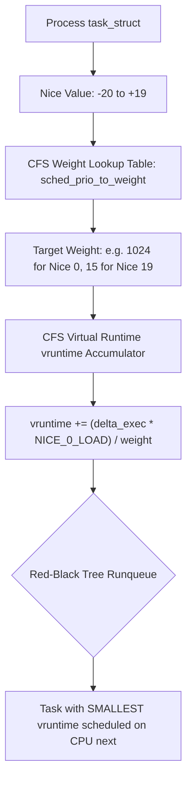

<!--
================================================================================
Metadata:
  Title: Job Control, Priorities & Nice Levels
  Track: Linux & Systems Engineering / DevOps
  Difficulty: Intermediate
  Estimated Time: 45 minutes
  Prerequisites: 03-system/01-processes-and-signals.md
  Key Terminology: Job Control, Foreground, Background (&), fg, bg, jobs, Ctrl+Z, nohup, disown, Nice Value (-20 to 19), renice, CFS Scheduler Weights, ionice, Real-Time Scheduling (chrt, SCHED_FIFO, SCHED_RR)
================================================================================
-->

# Job Control, Priorities & Nice Levels

[<- 01-processes-and-signals.md](./01-processes-and-signals.md) | [Back to Module Overview](./README.md) | [03-package-management.md ->](./03-package-management.md)

---

## Table of Contents
- [1. What & Why](#1-what--why)
- [2. Core Concepts](#2-core-concepts)
- [3. How It Works Internally](#3-how-it-works-internally)
- [4. Syntax & Usage](#4-syntax--usage)
- [5. Practical Examples](#5-practical-examples)
- [6. Best Practices](#6-best-practices)
- [7. Common Mistakes & Troubleshooting](#7-common-mistakes--troubleshooting)
- [8. Performance, Security & Cost Implications](#8-performance-security--cost-implications)
- [9. Comparison Table](#9-comparison-table)
- [10. Real-World Interview Questions](#10-real-world-interview-questions)
- [11. Practice Exercises](#11-practice-exercises)
- [12. Summary & Quick Reference Cheat Sheet](#12-summary--quick-reference-cheat-sheet)
- [13. Further Reading & Official Documentation](#13-further-reading--official-documentation)

---

## 1. What & Why

In multi-tenant Linux servers, cloud virtual machines, and container worker nodes, dozens or hundreds of processes contend for finite physical CPU cores and storage I/O bandwidth. A heavy batch job (e.g., nightly database index rebuilds, log compression, video transcoding) can inadvertently monopolize CPU cores, causing latency spikes in customer-facing web services or API endpoints.

Linux provides two intertwined mechanisms to manage execution focus and resource fairness:
1. **Shell Job Control**: The capability of a single shell session to manage multiple concurrent tasks—moving tasks between the interactive foreground and the asynchronous background (`&`, `fg`, `bg`, `jobs`), detaching tasks from controlling terminals (`nohup`, `disown`), and suspending tasks on the fly (`Ctrl+Z`).
2. **Process Priorities & Nice Levels**: The scheduling hints passed to the Linux kernel's Completely Fair Scheduler (CFS) to bias CPU distribution. By adjusting a process's **Nice value** (from `-20` highest priority to `+19` lowest priority) and I/O scheduling class (`ionice`), engineers ensure that background maintenance scripts yield hardware gracefully to critical real-time application daemons.

---

## 2. Core Concepts

### Foreground vs. Background vs. Detached Jobs
- **Foreground Process**: Occupies the terminal window's standard input (`stdin`) and output (`stdout`). The shell prompt blocks until the foreground process completes or is suspended.
- **Background Process (`&`)**: Runs asynchronously within the current shell session. It does not block the shell prompt, but it still shares the controlling terminal's stdout/stderr and receives a `SIGHUP` (Hangup) signal if the terminal window or SSH connection closes.
- **Detached Process (`nohup` / `disown`)**: Decoupled from the terminal's controlling session. Immune to `SIGHUP`, allowing long jobs to persist after the user logs out.

### Nice Values and CFS Scheduler Weights
In Linux, process priority for standard non-realtime tasks is represented by the **Nice value**, which ranges from **`-20`** (highest priority / least "nice" to others) to **`+19`** (lowest priority / most "nice" to others). The default nice value for any standard spawned process is **`0`**.

```
+-------------------------------------------------------------------------+
| NICE VALUES TO CFS CPU WEIGHT SCALING                                   |
|                                                                         |
|  Nice Level:     -20  ...   -5    ...     0    ...    +5   ...    +19   |
|  Priority:     Highest                  Default                 Lowest  |
|  CFS Weight:    88,761 ...  3,121 ...   1,024  ...    335  ...     15   |
|                                                                         |
|  CPU Allocation Proportion:                                             |
|  Two competing CPU-bound tasks: Task A (Nice 0) vs Task B (Nice 5)      |
|  Weight ratio = 1024 / 335 ≈ 3.05 : 1                                   |
|  Task A receives ~75% of CPU time; Task B receives ~25% of CPU time.    |
+-------------------------------------------------------------------------+
```

### I/O Scheduling Classes (`ionice`)
CPU priority alone does not govern disk read/write throughput. The `ionice` utility sets the I/O scheduling class for block devices:
1. **Class 1 (Realtime)**: First access to disk; can easily starve all other processes. Requires root.
2. **Class 2 (Best-Effort)**: Default class. Priority levels 0 (highest) to 7 (lowest).
3. **Class 3 (Idle)**: Only granted disk access when no other process on the system has requested disk I/O. Ideal for background backups and `find` indexing.

---

## 3. How It Works Internally

The Linux kernel Completely Fair Scheduler (CFS) manages CPU distribution through geometric weight mapping:



### The Mathematics of Nice Scaling
- CFS enforces a geometric scale factor of **~1.25** between adjacent nice levels.
- Each reduction of 1 in the nice value grants roughly **10% more CPU time** relative to competing processes.
- A task with nice `-20` has a weight of **88,761**, while nice `+19` has a weight of **15**. When competing at 100% saturation, the nice `-20` task receives **~5,900 times more CPU time** than the nice `+19` task.

---

## 4. Syntax & Usage

### 1. Shell Job Control Commands
```bash
# Launch a command in the background
sleep 100 &

# List all active background jobs in the current shell
jobs -l

# Bring background job 1 to the foreground
fg %1

# Suspend a running foreground job: Press Ctrl+Z
# Resume suspended job in the background
bg %1

# Kill job 1 directly via job specification
kill %1
```

### 2. Detaching Jobs from Terminals (`nohup` and `disown`)
```bash
# Run command immune to SIGHUP with output redirected to nohup.out
nohup ./long_task.sh &

# Disown an already-running background job so it survives terminal exit
./backup.sh &
disown -h %1

# Disown all jobs currently managed by the shell
disown -a
```

### 3. Setting Priorities: `nice` and `renice`
```bash
# Launch a new process with custom nice value (e.g., +10 for low priority)
nice -n 10 tar -czf backup.tar.gz /var/log/

# Launch with high priority (requires root / sudo)
sudo nice -n -10 ./critical_worker

# Change the nice priority of a running process (renice)
renice -n 15 -p 4821

# Renice all processes owned by user 'developer'
sudo renice -n 5 -u developer
```

### 4. I/O Scheduling with `ionice`
```bash
# Run a backup strictly in the IDLE I/O class (never slows down web traffic)
ionice -c 3 tar -czf archive.tar.gz /data/

# Run with Realtime I/O priority (requires root)
sudo ionice -c 1 -n 0 ./database_engine
```

### 5. Real-Time Scheduling with `chrt`
For latency-critical audio, telecommunications, or high-frequency trading applications, standard CFS scheduling is bypassed in favor of POSIX Real-Time schedulers (`SCHED_FIFO` or `SCHED_RR`):
```bash
# Query the scheduling policy and priority of a process
chrt -p 1204

# Launch a process with Real-Time Round-Robin policy (priority 1 to 99)
sudo chrt -r 50 ./realtime_audio_daemon
```

---

## 5. Practical Examples

### 1. Basic: Suspending and Backgrounding a Running Job
An engineer accidentally launches a lengthy `grep` search across a 50 GB disk mount in the foreground:
1. Press **`Ctrl+Z`** to suspend the process.
   ```text
   [1]+  Stopped                 grep -rn "error_token" /mnt/storage/
   ```
2. Resume execution in the background:
   ```bash
   bg %1
   # [1]+ grep -rn "error_token" /mnt/storage/ &
   ```
3. Continue using the interactive shell while the search completes.

### 2. Real-World: Non-Intrusive Nightly Backup Script
Run an intensive nightly compression job that consumes zero noticeable CPU or disk bandwidth from competing live web servers:
```bash
#!/usr/bin/env bash
set -euo pipefail

BACKUP_SRC="/var/www/uploads"
BACKUP_DEST="/mnt/backups/uploads_$(date +%F).tar.zst"

echo "[INFO] Commencing low-priority background archive..."

# nice -n 19: Lowest CPU priority (yields to any web request)
# ionice -c 3: Idle I/O class (reads disk only when heads are idle)
nice -n 19 ionice -c 3 tar --zstd -cf "$BACKUP_DEST" "$BACKUP_SRC"

echo "[SUCCESS] Archive generated without impacting production latency."
```

### 3. Edge Case: Elevating Priority as an Unprivileged User
In Linux, standard unprivileged users can only **increase** the nice value (make processes *nicer* / lower priority). They cannot decrease nice values or set negative values:
```bash
# As standard user:
nice -n 5 sleep 10 &       # Succeeded: Priority lowered to +5
renice -n 10 -p $!         # Succeeded: Priority lowered to +10
renice -n 5 -p $!          # FAILS: Operation not permitted!
# Error: renice: failed to set priority for 14210 (process ID): Permission denied
```
*Why*: Allowing unprivileged users to lower nice values would allow any user to starve system services. Only `root` (or a process with `CAP_SYS_NICE`) can lower nice values.

### 4. Failure Case: The Accidental Terminal Closure (`SIGHUP` Loss)
A sysadmin connects over SSH, starts a 3-hour data migration with `python migrate.py &`, and closes the terminal window:
```text
Connection to 10.0.1.15 closed.
```
*Consequence*: When SSH closes, the kernel sends `SIGHUP` to the controlling process group. `python migrate.py` terminates mid-migration, leaving a partially populated database!  
*Remediation*: Always wrap unmanaged background tasks with `nohup` or `disown -h`:
```bash
nohup python migrate.py > migrate.log 2>&1 &
```

### 5. Production-Grade: Background Worker Supervisor with CPU Throttling
A production script that executes a batch of CPU-intensive compilation or data conversion jobs, ensuring they execute at low priority with explicit process accounting:
```bash
#!/usr/bin/env bash
set -euo pipefail

JOBS=(
  "ffmpeg -i raw1.mov out1.mp4"
  "ffmpeg -i raw2.mov out2.mp4"
  "ffmpeg -i raw3.mov out3.mp4"
)

PIDS=()

cleanup() {
  echo "[CLEANUP] Terminating active background workers..."
  for pid in "${PIDS[@]:-}"; do
    kill -TERM "$pid" 2>/dev/null || true
  done
  wait
}
trap cleanup EXIT INT TERM

echo "[INFO] Launching background transcoding workers with CPU & I/O throttling..."

for job in "${JOBS[@]}"; do
  # Execute with lowest CPU priority (+19) and idle I/O priority (class 3)
  nice -n 19 ionice -c 3 bash -c "$job >/dev/null 2>&1" &
  worker_pid=$!
  PIDS+=("$worker_pid")
  echo "[DISPATCH] Spawned worker PID $worker_pid (Nice: 19, Class: Idle)"
done

echo "[INFO] Awaiting worker completion..."
wait "${PIDS[@]}"
echo "[SUCCESS] All batch transcoding jobs completed successfully."
```

---

## 6. Best Practices

1. **Always Use `nice -n 19` for Batch Maintenance**: Cron jobs, log pruning, database dumps, and anti-virus scans should always run with nice `19` and `ionice -c 3` to protect interactive users.
2. **Never Grant Real-Time Priorities (`SCHED_FIFO`) Carelessly**: A runaway infinite loop in a `SCHED_FIFO` real-time process will starve the entire operating system, freezing the mouse, network stack, and SSH daemon.
3. **Use `nohup` or `tmux` for Critical Remote Tasks**: Never rely on a raw background `&` for operations that cannot tolerate sudden termination when SSH drops.
4. **Inspect Priorities via `ps -eo pid,ni,pri,comm`**: Use the `ni` (nice) and `pri` (kernel priority) columns in `ps` to verify scheduling behavior.
5. **Adjust Limits via `/etc/security/limits.conf`**: Configure the `nice` and `rtprio` resource limits per user/group rather than granting raw root access.

---

## 7. Common Mistakes & Troubleshooting

| Mistake / Antipattern | Underlying Cause | Consequence | Production Solution |
| :--- | :--- | :--- | :--- |
| Closing SSH after `cmd &` | Background jobs still belong to the terminal session group; receives `SIGHUP`. | Process terminates immediately upon SSH disconnect. | Run via `nohup cmd &` or use `disown -h`. |
| Unprivileged user trying to raise priority | Linux security policy prohibits non-root users from lowering nice values. | `Permission denied` error. | Use `sudo renice` or grant `CAP_SYS_NICE` capability. |
| Neglecting disk I/O when tuning CPU nice | Process is I/O-bound, not CPU-bound; setting nice `19` has zero effect on disk contention. | Server storage queues remain pegged; database latency spikes. | Apply I/O throttling via `ionice -c 3`. |
| `nohup` without output redirection | `nohup` creates a file named `nohup.out` in the current working directory. | Disk fills up in read-only or permission-restricted folders. | Explicitly redirect output: `nohup cmd > /var/log/app.log 2>&1 &`. |
| Assuming `kill %1` works across terminal sessions | Job IDs (`%1`, `%2`) are private internal constructs of that specific shell process. | Command fails with `No such job` in other windows. | Use PIDs instead of job IDs when operating across terminals. |
| Real-time priority lockup (`SCHED_FIFO`) | Real-time process executes infinite loop without sleeping or yielding. | Kernel lockup; host becomes completely unresponsive. | Ensure kernel watchdog `kernel.sched_rt_runtime_us` is active. |

---

## 8. Performance, Security & Cost Implications

### Performance
- **Weight Proportions**: Setting a process to nice `19` does **not** slow it down if the CPU is otherwise idle! If no other processes want CPU time, a nice `19` process receives 100% of the core. It only yields CPU time when competing against tasks with higher priorities.
- **I/O Starvation with `ionice -c 3`**: If a database is writing continuous logs to disk, a process running with `ionice -c 3` (Idle class) may experience starvation, making virtually zero progress. In high-traffic systems, prefer `ionice -c 2 -n 7` (lowest Best-Effort priority) over class 3.

### Security
- **Privilege Limits in `/etc/security/limits.conf`**: System administrators restrict how high unprivileged users can raise priorities:
  ```text
  developer  hard  nice    -5
  audio-grp  hard  rtprio  50
  ```
- **Denial of Service via Negative Nice Values**: An unprivileged daemon compromised by an adversary could attempt to hog CPU cores if granted `CAP_SYS_NICE`. Restrict capabilities in systemd units.

### Cost
- In cloud autoscaling groups, running background data aggregations with nice `19` prevents CPU metric spikes from triggering unnecessary horizontal pod autoscaler (HPA) or VM scale-out events, directly reducing monthly cloud bills.

---

## 9. Comparison Table

| Tool / Mechanism | Primary Target | Value Range | Default | Requires Root to Lower / Elevate? |
| :--- | :--- | :--- | :---: | :---: |
| **`nice`** | CPU Scheduling Priority | `-20` to `+19` | `0` | Yes (Negative values require root) |
| **`renice`** | CPU Priority of Running PID | `-20` to `+19` | Current | Yes (Decreasing nice requires root) |
| **`ionice`** | Block Storage I/O Priority | Classes 1, 2, 3 (Levels 0–7) | Class 2, Level 4 | Class 1 (Realtime) requires root |
| **`chrt`** | Real-Time Scheduling Policy | `SCHED_FIFO`, `SCHED_RR` (1–99) | `SCHED_OTHER` | **Yes (Root required)** |
| **`nohup`** | Signal Immunity | Traps `SIGHUP` | N/A | No |

---

## 10. Real-World Interview Questions

### Q1: What is the exact difference between `nice` and `renice`?
<details>
<summary>Answer</summary>
- **`nice`**: Used at **process launch time** to set the initial scheduling priority of a new command: `nice -n 10 ./script.sh`.
- **`renice`**: Used to alter the scheduling priority of an **already running process** dynamically by PID, process group, or user: `renice -n 15 -p 4810`.
Additionally, `nice` takes relative values or offsets by default, whereas `renice` sets absolute nice values.
</details>

### Q2: What happens when you press `Ctrl+Z` in a terminal, and how do you resume execution?
<details>
<summary>Answer</summary>
Pressing `Ctrl+Z` causes the terminal line discipline to send a **`SIGTSTP`** (Terminal Stop) signal to the active foreground process group.
- The process halts execution and transitions into the **Stopped** (`T`) state.
- The shell reclaims control of the terminal and outputs a job ID: `[1]+ Stopped <command>`.
- To resume the process in the **foreground**, run `fg %1`.
- To resume the process in the **background** (so it continues running while you use the shell), run `bg %1` (which sends `SIGCONT` to the process).
</details>

### Q3: Why does setting a nice value of `+19` not slow down a process on an idle server?
<details>
<summary>Answer</summary>
The Linux Completely Fair Scheduler (CFS) does not throttle or limit CPU frequency based on nice levels. The nice level only dictates the **relative weight** when multiple processes are actively competing for CPU time in the runqueue. If a process is the only runnable task on a CPU core, CFS allocates 100% of available CPU cycles to it, regardless of whether its nice value is `-20`, `0`, or `+19`. The process only yields CPU time when another higher-priority task enters the runnable state.
</details>

### Q4: Explain what `disown` does and how it differs from `nohup`.
<details>
<summary>Answer</summary>
- **`nohup`**: A wrapper utility executed before launching a command. It redirects `stdin` from `/dev/null` and stdout/stderr to `nohup.out` (if unredirected), and sets the signal disposition of `SIGHUP` to ignored (`SIG_IGN`).
- **`disown`**: A shell builtin that operates on **already running background jobs**. It removes the specified job from the shell's active job table. When the shell terminates, it iterates through its job table to deliver `SIGHUP` to all children; disowned jobs are not in the table, so they receive no `SIGHUP` and continue running. With `disown -h %1`, the job remains in the table but is marked to ignore `SIGHUP`.
</details>

### Q5: What is the relationship between the `NI` column and the `PRI` column in `top` or `ps`?
<details>
<summary>Answer</summary>
- **`NI`**: The user-space **Nice value**, ranging from `-20` to `+19`.
- **`PRI`**: The internal **Kernel Priority** utilized directly by the CPU scheduler.
For standard non-realtime tasks scheduled under CFS, the kernel priority is calculated mathematically as:
$$\text{PRI} = 20 + \text{NI}$$
- A nice value of `0` maps to kernel priority `20`.
- A nice value of `-20` (highest priority) maps to kernel priority `0`.
- A nice value of `+19` (lowest priority) maps to kernel priority `39`.
For real-time processes (e.g., `SCHED_FIFO`), `top` displays negative numbers or `rt` in the `PRI` column.
</details>

### Q6: What are the three scheduling classes in `ionice`, and when should each be used?
<details>
<summary>Answer</summary>
1. **Realtime (Class 1)**: Grants immediate, uninhibited access to disk hardware. If misused, it can easily freeze the operating system. Used only for ultra-low latency database transaction logging engines.
2. **Best-Effort (Class 2)**: The default class. Provides 8 priority levels (0 to 7). It balances requests fairly using the kernel CFQ/BFQ I/O schedulers.
3. **Idle (Class 3)**: Provides access to storage bandwidth **only when no other process has requested I/O** within a certain window. Used for maintenance tasks like disk indexing, file integrity checking, and background backups.
</details>

### Q7: How does CFS prevent a process with nice `-20` from completely starving other processes forever?
<details>
<summary>Answer</summary>
CFS operates on virtual runtime (`vruntime`). Even though a task with nice `-20` accumulates `vruntime` at a much slower rate than a task with nice `+19`, its `vruntime` still steadily increases over time. Eventually, the `vruntime` of the nice `-20` task will exceed the `vruntime` of other waiting tasks, prompting the scheduler to preempt it and grant CPU slices to lower-priority tasks. This mathematical formulation guarantees that even lowest-priority tasks receive at least a small quantum of CPU time, preventing complete starvation.
</details>

### Q8: What is `SCHED_DEADLINE` in Linux?
<details>
<summary>Answer</summary>
`SCHED_DEADLINE` is an advanced real-time scheduling policy implemented in the Linux kernel based on the Earliest Deadline First (EDF) algorithm and Constant Bandwidth Server (CBS). Each task specifies three parameters: Runtime, Period, and Deadline. The kernel guarantees that the task will receive its requested execution runtime within every period before its deadline, making it ideal for deterministic hard-realtime constraints like industrial robotics and telecommunication signal processing.
</details>

---

## 11. Practice Exercises

### Exercise 1: Backgrounding and Inspecting Jobs (Easy)
**Task**: Start three background `sleep` processes for 60, 120, and 180 seconds. Use `jobs -l` to view their PIDs and job IDs, bring the second job to the foreground, and terminate it with `Ctrl+C`.

<details>
<summary>Solution</summary>

```bash
# 1. Launch 3 jobs
sleep 60 &
sleep 120 &
sleep 180 &

# 2. Inspect active jobs
jobs -l

# 3. Bring job 2 to foreground
fg %2

# 4. Press Ctrl+C to terminate it
# Clean up remaining jobs
kill %1 %3 2>/dev/null || true
```
</details>

### Exercise 2: Launching a Low-Priority CPU Intensive Task (Easy)
**Task**: Launch a compression command with nice value `+15` using the `nice` command, verify its nice value using `ps`, and then renice it to `+19`.

<details>
<summary>Solution</summary>

```bash
# Launch with nice 15 in background
nice -n 15 gzip -c /dev/zero > /dev/null &
PID=$!

# Verify nice value
ps -o pid,ni,comm -p "$PID"

# Renice to 19
renice -n 19 -p "$PID"

# Clean up
kill "$PID" 2>/dev/null || true
```
</details>

### Exercise 3: Profiling CPU Starvation Between Competing Tasks (Medium)
**Task**: Write a bash script that launches two identical CPU-bound infinite loops simultaneously—one with nice `0` and one with nice `19`. Let them run for 10 seconds, monitor their CPU consumption via `ps`, and terminate both.

<details>
<summary>Solution</summary>

```bash
#!/usr/bin/env bash
set -euo pipefail

# Launch high priority (nice 0)
( while true; do :; done ) &
PID_HIGH=$!

# Launch low priority (nice 19)
nice -n 19 bash -c "while true; do :; done" &
PID_LOW=$!

echo "[INFO] Running benchmark for 8 seconds (PIDs: $PID_HIGH, $PID_LOW)..."
sleep 8

echo "[RESULTS] CPU utilization breakdown:"
ps -o pid,ni,%cpu,time,comm -p "$PID_HIGH,$PID_LOW"

kill -9 "$PID_HIGH" "$PID_LOW" 2>/dev/null || true
wait "$PID_HIGH" "$PID_LOW" 2>/dev/null || true
```
</details>

### Exercise 4: Detaching a Live Job from a Terminal Session (Medium)
**Task**: Start a continuous background ping command writing to `/tmp/ping.log`. Without stopping the command, disown it from the current shell so that closing the terminal does not terminate it. Verify with `jobs`.

<details>
<summary>Solution</summary>

```bash
# Start background command
ping -i 1 127.0.0.1 > /tmp/ping.log 2>&1 &
JOB_ID="%1"

# Disown the job
disown -h "$JOB_ID"

# Verify job is no longer listed in active shell job table
jobs

# Notice the process is STILL running in the OS process table!
pgrep -fa "ping -i 1 127.0.0.1"

# Clean up
pkill -f "ping -i 1 127.0.0.1"
rm -f /tmp/ping.log
```
</details>

### Exercise 5: Automated I/O Throttling Benchmark (Hard)
**Task**: Create a script that writes a 1 GB dummy file to disk using `dd` in the Realtime I/O class (`ionice -c 2 -n 0`) vs the Idle I/O class (`ionice -c 3`), measuring and comparing throughput using `time`.

<details>
<summary>Solution</summary>

```bash
#!/usr/bin/env bash
set -euo pipefail

echo "[BENCHMARK 1] Best-effort priority 0 (high priority):"
time ionice -c 2 -n 0 dd if=/dev/zero of=/tmp/test_high.img bs=1M count=500 conv=fdatasync 2>&1 | tail -n 1

echo -e "\n[BENCHMARK 2] Idle priority (lowest priority):"
time ionice -c 3 dd if=/dev/zero of=/tmp/test_low.img bs=1M count=500 conv=fdatasync 2>&1 | tail -n 1

rm -f /tmp/test_high.img /tmp/test_low.img
```
</details>

### Exercise 6: Dynamic Priority Balancer Daemon (Hard)
**Task**: Write a daemon script that continuously inspects all active processes on the system. If any process owned by non-root users consumes > 80% CPU for more than 15 seconds, automatically demote its nice priority to `+15` and log an administrative alert to `/var/log/priority_balancer.log`.

<details>
<summary>Solution</summary>

```bash
#!/usr/bin/env bash
set -euo pipefail

LOG_FILE="/tmp/priority_balancer.log"

echo "[INFO] Starting CPU priority balancer daemon..."

# Scan top CPU consumers
ps -eo pid,user,%cpu,ni,comm --sort=-%cpu | awk 'NR>1 {print $1, $2, $3, $4, $5}' | while read -r pid user cpu ni comm; do
  # Skip root processes and idle tasks
  [[ "$user" == "root" ]] && continue
  
  # Check if CPU > 80% and nice value is still default 0
  if (( $(echo "$cpu > 80.0" | bc -l) )) && (( ni == 0 )); then
    echo "[ALERT] Demoting high-CPU process: PID=$pid ($comm) User=$user CPU=$cpu%" | tee -a "$LOG_FILE"
    renice -n 15 -p "$pid" >> "$LOG_FILE" 2>&1 || true
  fi
done
```
</details>

---

## 12. Summary & Quick Reference Cheat Sheet

| Command / Shortcut | Action | Scope / Context |
| :--- | :--- | :--- |
| `cmd &` | Run command in background | Returns prompt; prints `[job_num] PID` |
| `Ctrl+Z` | Suspend foreground process | Sends `SIGTSTP`; halts execution |
| `jobs -l` | List background jobs with PIDs | Shell session specific |
| `fg %N` | Bring job `N` to foreground | Re-attaches terminal stdin |
| `bg %N` | Resume job `N` in background | Sends `SIGCONT` to suspended job |
| `disown -h %N` | Detach job from terminal | Ignores `SIGHUP` on shell exit |
| `nohup cmd &` | Execute immune to `SIGHUP` | Output defaults to `nohup.out` |
| `nice -n <val> cmd`| Launch with nice value (`-20` to `19`)| Nice `19` = lowest CPU priority |
| `renice -n <val> -p <PID>`| Change priority of running PID | Negative values require root |
| `ionice -c 3 cmd` | Run in Idle I/O class | Disk access only when drive is idle |
| `chrt -p <PID>` | View Real-Time scheduling policy| Shows `SCHED_FIFO` / `SCHED_RR` |

---

## 13. Further Reading & Official Documentation

- [Linux Man Pages: nice(1)](https://man7.org/linux/man-pages/man1/nice.1.html)
- [Linux Man Pages: renice(1)](https://man7.org/linux/man-pages/man1/renice.1.html)
- [Linux Man Pages: ionice(1)](https://man7.org/linux/man-pages/man1/ionice.1.html)
- [Linux Man Pages: sched(7) - Overview of CPU Scheduling](https://man7.org/linux/man-pages/man7/sched.7.html)
- [Linux Kernel Documentation: CFS Scheduler](https://docs.kernel.org/scheduler/sched-design-CFS.html)

---

[<- 01-processes-and-signals.md](./01-processes-and-signals.md) | [Back to Module Overview](./README.md) | [03-package-management.md ->](./03-package-management.md)
