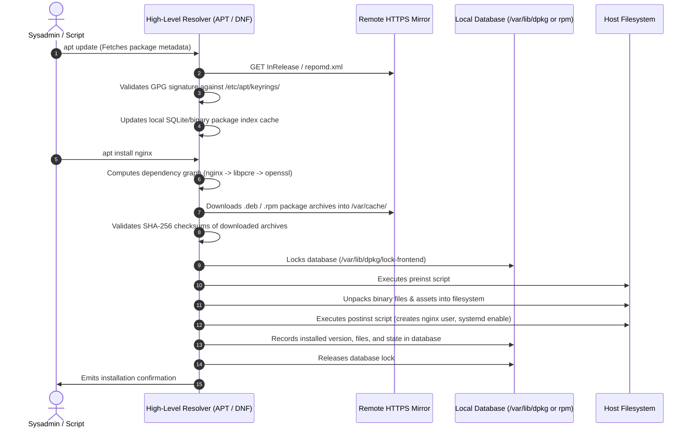

<!--
================================================================================
Metadata:
  Title: Package Management: APT, DNF & Enterprise Repositories
  Track: Linux & Systems Engineering / DevOps
  Difficulty: Intermediate
  Estimated Time: 55 minutes
  Prerequisites: 01-fundamentals/01-getting-started.md, 01-fundamentals/08-sudo-and-privilege.md
  Key Terminology: Package Manager, APT, DPKG, .deb, DNF, RPM, .rpm, GPG Signing Keys, Repository Mirror, Deb822 Format, Dependency Resolution, Package Pinning, Unattended Upgrades
================================================================================
-->

# Package Management: APT, DNF & Enterprise Repositories

[<- 02-job-control-and-nice.md](./02-job-control-and-nice.md) | [Back to Module Overview](./README.md) | [04-systemd-and-services.md ->](./04-systemd-and-services.md)

---

## Table of Contents
- [1. What & Why](#1-what--why)
- [2. Core Concepts](#2-core-concepts)
- [3. How It Works Internally](#3-how-it-works-internally)
- [4. Syntax & Usage](#4-syntax--usage)
- [5. Practical Examples](#5-practical-examples)
- [6. Best Practices](#6-best-practices)
- [7. Common Mistakes & Troubleshooting](#7-common-mistakes--troubleshooting)
- [8. Performance, Security & Cost Implications](#8-performance-security--cost-implications)
- [9. Comparison Table](#9-comparison-table)
- [10. Real-World Interview Questions](#10-real-world-interview-questions)
- [11. Practice Exercises](#11-practice-exercises)
- [12. Summary & Quick Reference Cheat Sheet](#12-summary--quick-reference-cheat-sheet)
- [13. Further Reading & Official Documentation](#13-further-reading--official-documentation)

---

## 1. What & Why

In enterprise Linux engineering, software is rarely compiled from source code on production servers. Instead, operating system distributions distribute pre-compiled binary payloads, shared libraries, systemd service units, and configuration templates packaged into cryptographically signed archives: **`.deb`** packages for Debian/Ubuntu, and **`.rpm`** packages for Red Hat/Rocky Linux/Fedora.

Modern systems engineers operate across both ecosystems:
- Deploying microservices and building container golden images requires installing runtimes, security patches, and monitoring agents reliably.
- Automated CI/CD runners must install dependencies deterministically without interactive prompts or unexpected dependency version upgrades.
- Production security compliance mandates configuring automated security updates (`unattended-upgrades` on Ubuntu, `dnf-automatic` on RHEL) while strictly preventing untrusted third-party repositories from overriding core system libraries.

Mastering both the high-level dependency resolvers (`apt`, `dnf`) and low-level archive managers (`dpkg`, `rpm`) is essential for reliable fleet maintenance.

---

## 2. Core Concepts

### High-Level vs. Low-Level Package Managers
In both primary Linux families, package management is partitioned into two distinct architectural layers:

```
+-------------------------------------------------------------------------+
| PACKAGE MANAGEMENT TWO-TIER ARCHITECTURAL STACK                         |
|                                                                         |
|  [ DEBIAN / UBUNTU ECOSYSTEM ]          [ RED HAT / ROCKY ECOSYSTEM ]   |
|                                                                         |
|  High-Level Dependency Resolver         High-Level Dependency Resolver  |
|  (Fetches mirrors, solves graph)        (Fetches mirrors, solves graph) |
|  ┌────────────────────────────┐         ┌────────────────────────────┐  |
|  │            APT             │         │            DNF             │  |
|  │ (/etc/apt/sources.list.d/) │         │   (/etc/yum.repos.d/)      │  |
|  └──────────────┬─────────────┘         └──────────────┬─────────────┘  |
|                 │ Invokes                              │ Invokes        |
|                 v                                      v                |
|  Low-Level Archive Engine               Low-Level Archive Engine        |
|  (Extracts files, runs scripts)         (Extracts files, runs scripts)  |
|  ┌────────────────────────────┐         ┌────────────────────────────┐  |
|  │            DPKG            │         │            RPM             │  |
|  │    (/var/lib/dpkg/status)  │         │    (/var/lib/rpm/)         │  |
|  └────────────────────────────┘         └────────────────────────────┘  |
+-------------------------------------------------------------------------+
```

1. **High-Level Managers (`apt`, `dnf`)**:
   - Communicate over HTTPS with remote software mirrors.
   - Maintain local package index metadata caches.
   - Verify cryptographic GPG signatures.
   - Solve complex Directed Acyclic Graph (DAG) dependencies, automatically installing prerequisites and handling conflicts.
2. **Low-Level Managers (`dpkg`, `rpm`)**:
   - Work with local package archive files on disk.
   - Unpack files directly into system root (`/usr/bin`, `/etc`, `/usr/lib`).
   - Execute lifecycle maintainer scripts (`preinst`, `postinst`, `prerm`, `postrm`).
   - Maintain the local installed package database (`/var/lib/dpkg/status` or `/var/lib/rpm/`).
   - **Do not resolve dependencies**: If a prerequisite package is missing, low-level managers fail immediately.

---

## 3. How It Works Internally

When you execute `sudo apt install nginx` or `sudo dnf install nginx`, the package manager executes an intricate verification and installation pipeline:



---

## 4. Syntax & Usage

### 1. Debian & Ubuntu (`apt` / `dpkg`)
```bash
# Update local repository metadata index
sudo apt update

# Upgrade all installed packages to latest available versions
sudo apt upgrade -y

# Full distribution upgrade (handles changing dependencies, removes obsolete packages)
sudo apt dist-upgrade -y

# Search for packages matching pattern
apt search prometheus-node-exporter

# Display detailed package metadata, dependencies, and origin
apt show nginx

# Install a specific package version
sudo apt install nginx=1.24.0-2ubuntu7

# Remove package (preserves configuration files in /etc)
sudo apt remove nginx

# Purge package (deletes binary AND all configuration files)
sudo apt purge nginx

# Remove orphaned packages that were installed as dependencies but are no longer needed
sudo apt autoremove --purge -y

# Low-level DPKG operations
dpkg -l                          # List all installed packages
dpkg -L nginx                    # List all files installed by nginx package
dpkg -S /usr/sbin/nginx          # Identify which package owns a specific file on disk
sudo dpkg -i package.deb         # Install local .deb file (fails if dependencies missing)
```

### 2. RHEL, Rocky Linux & Fedora (`dnf` / `rpm`)
```bash
# Check for and apply available package updates
sudo dnf upgrade -y

# Search for packages
dnf search nginx

# Show package metadata
dnf info nginx

# Install package or package group
sudo dnf install nginx
sudo dnf groupinstall "Development Tools"

# Transaction history (allows rolling back an update!)
sudo dnf history
sudo dnf history undo <transaction_id>

# Remove package and unused dependencies
sudo dnf remove nginx

# Low-level RPM operations
rpm -qa                          # Query all installed packages
rpm -ql nginx                    # List files installed by nginx
rpm -qf /usr/sbin/nginx          # Identify which package owns a file
rpm -qp --scripts package.rpm    # Inspect pre/post install scripts inside an RPM before installing!
```

---

## 5. Practical Examples

### 1. Basic: Finding Which Package Owns a Missing System Command
You attempt to run `dig` or `iostat` on a minimal server and receive "command not found":
```bash
# On Ubuntu/Debian:
apt-file search bin/dig
# Output: dnsutils: /usr/bin/dig (or bind9-dnsutils)

# On RHEL/Rocky:
dnf provides dig
# Output: bind-utils-32:9.16.23-14.el9.x86_64 : A collection of DNS utilities
```

### 2. Real-World: Modern GPG Keyring & Deb822 Repository Setup
In Ubuntu 24.04 and Debian 12, the legacy `apt-key add` command has been deprecated. Modern repositories must use dedicated keyrings and the Deb822 format:
```bash
#!/usr/bin/env bash
set -euo pipefail

# 1. Download official GPG key into isolated, unprivileged keyring
sudo mkdir -p /etc/apt/keyrings
curl -fsSL https://download.docker.com/linux/ubuntu/gpg | \
  sudo gpg --dearmor -o /etc/apt/keyrings/docker.gpg
sudo chmod a+r /etc/apt/keyrings/docker.gpg

# 2. Add repository definition using modern Deb822 format (/etc/apt/sources.list.d/docker.sources)
cat <<EOF | sudo tee /etc/apt/sources.list.d/docker.sources
Types: deb
URIs: https://download.docker.com/linux/ubuntu
Suites: $(. /etc/os-release && echo "$VERSION_CODENAME")
Components: stable
Signed-By: /etc/apt/keyrings/docker.gpg
EOF

# 3. Update and install
sudo apt update
sudo apt install -y docker-ce docker-ce-cli containerd.io
```

### 3. Edge Case: Recovering from Corrupted DPKG Locks
If a server reboots or an admin terminates an update mid-execution, the package manager database lock remains held:
```bash
# Symptoms:
# E: Could not get lock /var/lib/dpkg/lock-frontend - open (11: Resource temporarily unavailable)
# E: Unable to acquire the dpkg frontend lock, is another process using it?

# Triage & Recovery:
# 1. Check if an actual update process is running
sudo lsof /var/lib/dpkg/lock-frontend || true

# 2. If NO process is running (stale lock after crash):
sudo rm -f /var/lib/dpkg/lock-frontend
sudo rm -f /var/lib/dpkg/lock
sudo rm -f /var/lib/apt/lists/lock

# 3. Reconfigure broken partial packages
sudo dpkg --configure -a
sudo apt install -f # Fix broken dependencies
```

### 4. Failure Case: The Accidental Dependency Hell from Untrusted PPAs
Adding unverified personal package archives (PPAs) that overwrite core system libraries (like `glibc` or `systemd`):
```bash
# DANGEROUS: Adding untrusted PPA with conflicting library versions
sudo add-apt-repository ppa:untrusted-maintainer/custom-build
sudo apt upgrade
# Consequence: Critical system services fail to link against modified glibc!

# RECOVERY: Purge PPA and revert all packages back to official distro releases
sudo apt install -y ppa-purge
sudo ppa-purge ppa:untrusted-maintainer/custom-build
```

### 5. Production-Grade: Automated Security Patching Configuration
Configure Ubuntu servers to install critical security vulnerabilities automatically every morning at 04:00 without human intervention:
```bash
#!/usr/bin/env bash
set -euo pipefail

echo "[INFO] Configuring unattended security updates..."

sudo apt update
sudo apt install -y unattended-upgrades apt-listchanges

# Configure origins in /etc/apt/apt.conf.d/50unattended-upgrades
cat <<'EOF' | sudo tee /etc/apt/apt.conf.d/50unattended-upgrades
Unattended-Upgrade::Allowed-Origins {
    "${distro_id}:${distro_codename}-security";
};
Unattended-Upgrade::Package-Blacklist {
    // Hold back database packages from automatic restarts
    "postgresql.*";
    "mysql.*";
};
Unattended-Upgrade::AutoFixInterruptedDpkg "true";
Unattended-Upgrade::MinimalSteps "true";
Unattended-Upgrade::InstallOnShutdown "false";
Unattended-Upgrade::Remove-Unused-Kernel-Packages "true";
Unattended-Upgrade::Remove-Unused-Dependencies "true";
Unattended-Upgrade::Automatic-Reboot "false";
EOF

# Enable automatic timer in /etc/apt/apt.conf.d/20auto-upgrades
cat <<'EOF' | sudo tee /etc/apt/apt.conf.d/20auto-upgrades
APT::Periodic::Update-Package-Lists "1";
APT::Periodic::Unattended-Upgrade "1";
APT::Periodic::AutocleanInterval "7";
EOF

sudo systemctl restart unattended-upgrades
echo "[SUCCESS] Unattended security upgrades configured and active."
```

---

## 6. Best Practices

1. **Never Pipe GPG Keys into `apt-key add`**: `apt-key` is deprecated. Always store ASCII-armored keys in `/etc/apt/keyrings/<name>.gpg` and restrict repository trust via `Signed-By`.
2. **Pin Critical Packages in Production**: Prevent unintended upgrades of databases or Kubernetes binaries using `apt-mark hold <pkg>` or APT pinning (`/etc/apt/preferences.d/`).
3. **Use `-y` and `DEBIAN_FRONTEND=noninteractive` in Automation**: In Dockerfiles and CI/CD pipelines, prevent interactive prompts from freezing execution:
   ```bash
   DEBIAN_FRONTEND=noninteractive apt-get install -y --no-install-recommends nginx
   ```
4. **Use `--no-install-recommends` in Containers**: Slashes container image size by omitting optional documentation and peripheral tool packages.
5. **Clean Package Caches to Reclaim Storage**: Regularly clean downloaded archive caches:
   - Ubuntu: `sudo apt clean` (clears `/var/cache/apt/archives/`).
   - RHEL: `sudo dnf clean all`.

---

## 7. Common Mistakes & Troubleshooting

| Mistake / Antipattern | Underlying Cause | Consequence | Production Solution |
| :--- | :--- | :--- | :--- |
| `apt remove` leaving clutter | Standard remove leaves configuration files in `/etc/`. | Stale configs cause conflicts if package is reinstalled later. | Use `apt purge <pkg>` to remove all traces. |
| Forgetting `apt update` before install | Local package index is stale; remote mirror has moved old packages to archive. | `404 Not Found` errors when attempting to download `.deb` files. | Run `sudo apt update` immediately before installing. |
| Stale lockfiles freezing scripts | Previous apt run crashed or was killed via `kill -9`. | `Could not get lock /var/lib/dpkg/lock-frontend`. | Check `lsof`, verify no apt process is running, and run `dpkg --configure -a`. |
| Breaking changes from `apt-key add` | Key added to global trusted keyring `/etc/apt/trusted.gpg`. | PPA key can cryptographically sign and forge official OS packages! | Store in `/etc/apt/keyrings/` with `Signed-By` scoping. |
| Neglecting `autoremove` | Kernels and dependencies accumulate over years of patching. | `/boot` partition fills up; server crashes during subsequent upgrades. | Run `sudo apt autoremove --purge -y`. |
| Installing via low-level `dpkg -i` alone | `dpkg` cannot resolve or fetch remote dependencies. | Installation halts with broken dependency errors. | Run `sudo apt install -f` or use `apt install ./file.deb`. |

---

## 8. Performance, Security & Cost Implications

### Performance
- **Local Index Cache Tuning**: `apt update` scans multi-megabyte compressed index files. On build servers running hundreds of CI jobs, configuring an in-cluster APT caching proxy (e.g., `apt-cacher-ng` or Nexus repository manager) reduces download time from minutes to milliseconds.

### Security
- **Supply Chain Attacks via Third-Party Repositories**: If an attacker compromises a PPA or custom YUM repo, they can publish a package named `openssh-server` with version `9.9.999`. Without APT pinning, `apt upgrade` will eagerly install the attacker's backdoored package over the official Ubuntu version! Always scope repositories with explicit component restrictions.

### Cost
- In public cloud environments (AWS/GCP), uncleaned package caches in custom AMI images or container base images inflate snapshot storage costs across thousands of running instances.

---

## 9. Comparison Table

| Attribute | Debian / Ubuntu (`apt` / `dpkg`) | Red Hat / Rocky Linux (`dnf` / `rpm`) | Alpine Linux (`apk`) |
| :--- | :--- | :--- | :--- |
| **High-Level Tool** | `apt`, `apt-get` | `dnf` (v4/v5) | `apk` |
| **Low-Level Tool** | `dpkg` | `rpm` | `apk` (unified) |
| **Package Format** | `.deb` (ar archive) | `.rpm` (cpio archive) | `.apk` (tar.gz) |
| **Repo Config Path** | `/etc/apt/sources.list.d/*.sources` | `/etc/yum.repos.d/*.repo` | `/etc/apk/repositories` |
| **History / Rollback** | Third-party / complex | Native: `dnf history undo` | Minimal / Rollback tags |
| **Typical Binary Size**| Standard glibc | Standard glibc | Ultra-small (musl libc) |

---

## 10. Real-World Interview Questions

### Q1: What is the exact difference between `apt remove` and `apt purge`?
<details>
<summary>Answer</summary>
- **`apt remove <package>`**: Deletes all application binaries, libraries, and documentation installed by the package, but **preserves user configuration files** (typically located under `/etc/`). If the package is reinstalled later, user configurations are retained.
- **`apt purge <package>`**: Deletes the package binaries **and permanently wipes all associated configuration files** from the filesystem. It restores the system to a clean state as if the package had never been installed.
</details>

### Q2: What happens if `sudo dpkg -i app.deb` fails due to missing dependencies? How do you resolve it?
<details>
<summary>Answer</summary>
`dpkg` is a low-level archive installer; it has no network capabilities and cannot query remote mirrors to fetch missing dependencies. When dependencies are missing, `dpkg` leaves the package in an unconfigured, "broken" state in `/var/lib/dpkg/status`.
To resolve this:
```bash
sudo apt install -f
# (Or: sudo apt --fix-broken install)
```
This instructs `apt` to inspect the broken package state in the DPKG database, download the missing prerequisites from configured remote mirrors, install them, and complete the configuration of `app.deb`. Alternatively, modern APT allows installing local files directly: `sudo apt install ./app.deb`, which resolves dependencies automatically in a single step.
</details>

### Q3: Why has `apt-key add` been deprecated, and what is the secure replacement?
<details>
<summary>Answer</summary>
Historically, `apt-key add` stored all third-party GPG public keys in a single global keyring: `/etc/apt/trusted.gpg`.
**Vulnerability**: Any key in `/etc/apt/trusted.gpg` is trusted to sign **any package from any repository**. If you added a third-party PPA for a niche tool, that maintainer's key was cryptographically trusted to sign updates for core packages like `libc6` or `kernel`.
**Replacement**: Modern systems place third-party keys in `/etc/apt/keyrings/<name>.gpg` and restrict trust strictly to that specific repository using the `Signed-By` directive in the repository definition file.
</details>

### Q4: How does DNF package history and rollback work?
<details>
<summary>Answer</summary>
DNF tracks every package installation, upgrade, and removal in an internal SQLite transaction database.
- View history: `sudo dnf history list`
- Inspect a specific transaction: `sudo dnf history info <ID>`
- **Roll back a broken update**: `sudo dnf history undo <ID>`
DNF analyzes the transactions performed in step `<ID>` and automatically calculates the inverse operations (e.g., reinstalling the prior version from cache/mirror and removing newly added dependencies), restoring the system to its pre-update state.
</details>

### Q5: What is "Package Pinning" (APT Pinning), and when is it required?
<details>
<summary>Answer</summary>
Package Pinning allows system administrators to customize which version of a package is installed based on repository origin, suite, or priority numbers (0 to 1000+), configured in `/etc/apt/preferences` or `/etc/apt/preferences.d/`.
**Common Production Uses**:
1. Preventing automatic upgrades of critical software (e.g., pinning PostgreSQL to version 15.x when Ubuntu repositories publish version 16.x).
2. Forcing specific packages to be pulled from backports while keeping the rest of the OS on stable.
3. Completely blacklisting unstable or conflicting packages from secondary third-party mirrors.
</details>

### Q6: How do you prevent a package from being updated during `apt upgrade`?
<details>
<summary>Answer</summary>
Use `apt-mark hold`:
```bash
# Place on hold
sudo apt-mark hold kubelet kubeadm kubectl

# Verify held packages
apt-mark showhold

# Release hold when ready to upgrade
sudo apt-mark unhold kubelet kubeadm kubectl
```
A held package will be ignored by `apt upgrade` and `apt dist-upgrade` until explicitly unheld.
</details>

### Q7: What is the purpose of the Deb822 format in modern Debian and Ubuntu releases?
<details>
<summary>Answer</summary>
Deb822 is the modern RFC 822-style stanza format for APT repository sources, replacing the legacy one-line `/etc/apt/sources.list` format.
Instead of a single unreadable string:
`deb [signed-by=/key.gpg] https://repo.com stable main`
Deb822 uses structured key-value blocks in `.sources` files:
```text
Types: deb
URIs: https://repo.com
Suites: stable
Components: main
Signed-By: /key.gpg
```
It improves readability, supports multi-line values, and natively enforces modern security directives like `Signed-By`.
</details>

### Q8: How can you inspect the pre-installation and post-installation maintainer scripts inside a `.deb` or `.rpm` package before installing it?
<details>
<summary>Answer</summary>
- For **`.deb`**:
  ```bash
  dpkg -e package.deb /tmp/extracted_meta/
  cat /tmp/extracted_meta/preinst
  cat /tmp/extracted_meta/postinst
  ```
- For **`.rpm`**:
  ```bash
  rpm -qp --scripts package.rpm
  ```
This inspects the maintainer bash scripts before execution, ensuring the package contains no malicious commands, unexpected daemon restarts, or unsafe file overwrites.
</details>

---

## 11. Practice Exercises

### Exercise 1: Identify and Remove Orphaned Packages (Easy)
**Task**: Use `apt` to simulate the removal of all orphaned dependency packages without making changes, review the list, and then perform the cleanup with purge.

<details>
<summary>Solution</summary>

```bash
# Dry run simulation
sudo apt autoremove --purge --dry-run

# Actual execution
sudo apt autoremove --purge -y
```
</details>

### Exercise 2: Holding and Releasing Packages (Easy)
**Task**: Place the `nginx` package on hold to prevent upgrades. Verify with `apt-mark showhold`, simulate an upgrade, and then remove the hold.

<details>
<summary>Solution</summary>

```bash
# Hold
sudo apt-mark hold nginx
apt-mark showhold

# Test
sudo apt install --dry-run nginx

# Unhold
sudo apt-mark unhold nginx
```
</details>

### Exercise 3: File Ownership Lookup Across Distros (Medium)
**Task**: Write a shell script `find_owner.sh <file_path>` that detects the host distribution and executes the correct tool (`dpkg -S` on Debian/Ubuntu, `rpm -qf` on RHEL/Rocky) to report which installed package owns the file.

<details>
<summary>Solution</summary>

```bash
#!/usr/bin/env bash
set -euo pipefail

FILE="${1:?Usage: $0 <absolute_file_path>}"

if command -v dpkg > /dev/null 2>&1; then
  dpkg -S "$FILE"
elif command -v rpm > /dev/null 2>&1; then
  rpm -qf "$FILE"
else
  echo "[ERROR] Unsupported package manager." >&2
  exit 1
fi
```
</details>

### Exercise 4: Inspecting Deb Packages Offline (Medium)
**Task**: Download the `.deb` file for `curl` without installing it (`apt download curl`), extract its control metadata, and display its `postinst` script.

<details>
<summary>Solution</summary>

```bash
#!/usr/bin/env bash
set -euo pipefail

WORK_DIR=$(mktemp -d /tmp/deb_inspect.XXXXXX)
cd "$WORK_DIR"

apt download curl
DEB_FILE=$(ls curl*.deb)

# Extract control metadata into control/
dpkg -e "$DEB_FILE" control/

echo "[INFO] Inspecting control/postinst:"
if [[ -f control/postinst ]]; then
  cat control/postinst
else
  echo "No postinst script found in this package."
fi

# Clean up
cd /tmp && rm -rf "$WORK_DIR"
```
</details>

### Exercise 5: Building a Custom Local APT Repository (Hard)
**Task**: Set up a local directory `/var/packages/local`, create a dummy `.deb` package or download one, generate a `Packages.gz` index using `dpkg-scanpackages`, and configure a local APT source file to install from it.

<details>
<summary>Solution</summary>

```bash
#!/usr/bin/env bash
set -euo pipefail

sudo apt install -y dpkg-dev

LOCAL_REPO="/var/packages/local"
sudo mkdir -p "$LOCAL_REPO"

# Download a sample deb into local repo
cd "$LOCAL_REPO"
sudo apt download tree

# Generate Packages index
sudo dpkg-scanpackages . /dev/null | gzip -9c | sudo tee Packages.gz > /dev/null

# Configure local source (trusted=yes for local unauthenticated repository)
echo "deb [trusted=yes] file:$LOCAL_REPO ./" | sudo tee /etc/apt/sources.list.d/local_repo.list

sudo apt update
echo "[SUCCESS] Local repository configured and indexed."
```
</details>

### Exercise 6: Automated Security Audit & Package Drift Report (Hard)
**Task**: Author an audit script that checks for pending security updates on an Ubuntu system, compares currently installed packages against an approved baseline roster `baseline_packages.txt`, and generates an alert if unauthorized packages are detected.

<details>
<summary>Solution</summary>

```bash
#!/usr/bin/env bash
set -euo pipefail

REPORT_FILE="/tmp/package_audit_report.txt"
BASELINE="baseline_packages.txt"

echo "[INFO] Running package security and compliance audit..." > "$REPORT_FILE"

# 1. Check for pending security updates
sudo apt update > /dev/null 2>&1
SECURITY_UPDATES=$(apt list --upgradable 2>/dev/null | grep -i security || true)

echo -e "\n=== PENDING SECURITY UPDATES ===" >> "$REPORT_FILE"
if [[ -n "$SECURITY_UPDATES" ]]; then
  echo "$SECURITY_UPDATES" >> "$REPORT_FILE"
else
  echo "No pending security updates." >> "$REPORT_FILE"
fi

# 2. Check for unauthorized package drift
if [[ -f "$BASELINE" ]]; then
  echo -e "\n=== UNAUTHORIZED PACKAGES DETECTED ===" >> "$REPORT_FILE"
  dpkg-query -W -f='${Package}\n' | sort > /tmp/installed_pkgs.txt
  sort "$BASELINE" > /tmp/baseline_sorted.txt
  
  # Comm -23 shows lines only in installed, not in baseline
  comm -23 /tmp/installed_pkgs.txt /tmp/baseline_sorted.txt >> "$REPORT_FILE" || true
  rm -f /tmp/installed_pkgs.txt /tmp/baseline_sorted.txt
fi

cat "$REPORT_FILE"
```
</details>

---

## 12. Summary & Quick Reference Cheat Sheet

| Task | Debian / Ubuntu (`apt` / `dpkg`) | RHEL / Rocky Linux (`dnf` / `rpm`) |
| :--- | :--- | :--- |
| **Update Metadata Index** | `sudo apt update` | `sudo dnf check-update` |
| **Upgrade Packages** | `sudo apt upgrade -y` | `sudo dnf upgrade -y` |
| **Search Package** | `apt search <name>` | `dnf search <name>` |
| **Show Package Details** | `apt show <name>` | `dnf info <name>` |
| **Install Package** | `sudo apt install <name>` | `sudo dnf install <name>` |
| **Remove Package** | `sudo apt remove <name>` | `sudo dnf remove <name>` |
| **Purge (Wipe Configs)**| `sudo apt purge <name>` | N/A (Manual cleanup) |
| **Remove Orphans** | `sudo apt autoremove --purge` | `sudo dnf autoremove` |
| **Identify File Owner** | `dpkg -S /path/to/file` | `rpm -qf /path/to/file` |
| **List Installed Files** | `dpkg -L <package>` | `rpm -ql <package>` |
| **Rollback Transaction**| N/A | `sudo dnf history undo <ID>` |
| **Prevent Upgrade (Hold)**| `sudo apt-mark hold <pkg>` | `sudo dnf versionlock add <pkg>` |

---

## 13. Further Reading & Official Documentation

- [Debian Administrator's Handbook: Package Management with APT](https://www.debian.org/doc/manuals/debian-handbook/apt.en.html)
- [Ubuntu Documentation: Apt Configuration & Deb822 Format](https://ubuntu.com/server/docs/package-management)
- [Red Hat Enterprise Linux 9: Managing Software with DNF](https://access.redhat.com/documentation/en-us/red_hat_enterprise_linux/9/html/managing_software_with_the_dnf_tool/)
- [Fedora DNF5 Documentation](https://dnf5.readthedocs.io/en/latest/)
- [Debian Policy Manual: Maintainer Scripts](https://www.debian.org/doc/debian-policy/ch-maintainerscripts.html)

---

[<- 02-job-control-and-nice.md](./02-job-control-and-nice.md) | [Back to Module Overview](./README.md) | [04-systemd-and-services.md ->](./04-systemd-and-services.md)
