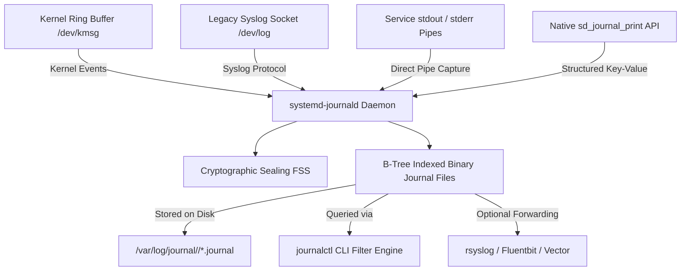

<!--
================================================================================
Metadata:
  Title: Journald, Syslog & Centralized Logging
  Track: Linux & Systems Engineering / DevOps
  Difficulty: Intermediate
  Estimated Time: 50 minutes
  Prerequisites: 03-system/04-systemd-and-services.md
  Key Terminology: systemd-journald, journalctl, /run/log/journal, /var/log/journal, rsyslog, logrotate, Syslog Priority Levels, Vacuuming, Structured Logging, Forwarding (systemd-journal-remote)
================================================================================
-->

# Journald, Syslog & Centralized Logging

[<- 04-systemd-and-services.md](./04-systemd-and-services.md) | [Back to Module Overview](./README.md) | [06-cron-and-timers.md ->](./06-cron-and-timers.md)

---

## Table of Contents
- [1. What & Why](#1-what--why)
- [2. Core Concepts](#2-core-concepts)
- [3. How It Works Internally](#3-how-it-works-internally)
- [4. Syntax & Usage](#4-syntax--usage)
- [5. Practical Examples](#5-practical-examples)
- [6. Best Practices](#6-best-practices)
- [7. Common Mistakes & Troubleshooting](#7-common-mistakes--troubleshooting)
- [8. Performance, Security & Cost Implications](#8-performance-security--cost-implications)
- [9. Comparison Table](#9-comparison-table)
- [10. Real-World Interview Questions](#10-real-world-interview-questions)
- [11. Practice Exercises](#11-practice-exercises)
- [12. Summary & Quick Reference Cheat Sheet](#12-summary--quick-reference-cheat-sheet)
- [13. Further Reading & Official Documentation](#13-further-reading--official-documentation)

---

## 1. What & Why

In production operating environments, logging is the primary source of truth during post-mortem investigations, security auditing, and live outage triage. When an application crashes, an unauthorized user gains access, or the kernel drops a network interface, the incident leaves a forensic trail in the system logs.

Historically, Linux relied solely on standard Unix **Syslog** (`rsyslogd` or `syslog-ng`). While simple, plain-text syslog files had severe drawbacks:
- Unindexed plain text files required slow, full-file scans with `grep` across gigabytes of uncompressed text.
- Metadata was unauthenticated and easily forged (any process writing to `/dev/log` could spoof a service name or PID).
- Early boot logs were lost before syslog started, and high log surges could drop messages without accounting.

**`systemd-journald`** revolutionized Linux logging by introducing a high-performance, indexed, binary log architecture. It automatically captures standard output (`stdout`) and error (`stderr`) from every supervised systemd service, kernel audit messages (`/dev/kmsg`), and legacy syslog sockets, indexing entries by timestamp, PID, UID, cgroup, and unit name.

---

## 2. Core Concepts

### Syslog Priority Levels
Both traditional Syslog and `journald` adhere to RFC 5424 numerical severity levels (0 to 7):

| Level | Severity Name | Operational Context | Typical Events |
| :---: | :--- | :--- | :--- |
| **0** | `emerg` (Emergency) | System is unusable | Kernel panic, catastrophic hardware failure |
| **1** | `alert` (Alert) | Action must be taken immediately | Primary database corrupted, RAID degraded |
| **2** | `crit` (Critical) | Critical conditions | OOM killer triggered, disk full on root partition |
| **3** | `err` (Error) | Error conditions | Application service failed to bind port |
| **4** | `warning` (Warning)| Warning conditions | Memory utilization threshold exceeded |
| **5** | `notice` (Notice) | Normal but significant | Service restarted, user password changed |
| **6** | `info` (Informational)| Normal operational messages | Periodic cron job completed |
| **7** | `debug` (Debug) | Developer debug diagnostics | Verbose tracing, SQL query logs |

### Volatile vs. Persistent Storage
By default, `systemd-journald` stores logs based on directory availability:
- **Volatile Storage (`/run/log/journal/`)**: Stored in a RAM-backed `tmpfs` filesystem. Logs are **completely wiped on reboot**.
- **Persistent Storage (`/var/log/journal/`)**: Stored on the persistent block filesystem. Logs survive reboots, allowing retrospective post-mortem debugging of past boots.

To enable persistent storage on distributions where it is not default:
```bash
sudo mkdir -p /var/log/journal
sudo systemctl restart systemd-journald
```

---

## 3. How It Works Internally

`systemd-journald` functions as a central ingestion hub capturing log events across multiple kernel and userland channels:



### The Binary Indexed Storage Engine
Unlike flat text files, journal files (`.journal`) are binary data structures containing B-tree indexes:
- Every field—such as `_SYSTEMD_UNIT=nginx.service`, `_UID=1000`, `_PID=4810`, and `PRIORITY=3`—is stored as an indexed hash table entry.
- Querying `journalctl -u nginx --since "1 hour ago" -p err` does **not** scan the file linearly; it traverses binary B-tree pointers directly to the relevant time slice and service index, returning results in milliseconds even across multi-gigabyte log archives.

---

## 4. Syntax & Usage

### 1. Filtering Logs with `journalctl`
```bash
# View all logs chronologically (opens in pager, default 'less')
journalctl

# Filter logs by a specific systemd unit
journalctl -u nginx.service

# Follow logs in real time (equivalent to 'tail -f')
journalctl -u nginx.service -f

# Filter by severity priority (e.g. show only errors and worse: levels 0 to 3)
journalctl -u nginx.service -p err

# Filter by time boundaries (human-readable or ISO format)
journalctl --since "2026-11-25 09:00:00" --until "2026-11-25 11:30:00"
journalctl --since "1 hour ago"
journalctl --since yesterday

# Filter by specific boot (0 = current boot, -1 = previous boot)
journalctl -b 0          # Current boot logs
journalctl -b -1         # Prior boot logs (requires persistent logging!)
journalctl --list-boots  # List all archived boots with timestamps
```

### 2. Kernel & Hardware Diagnostics
```bash
# View kernel messages only (equivalent to dmesg)
journalctl -k

# Filter by process executable path
journalctl /usr/sbin/sshd

# Filter by specific PID
journalctl _PID=2048
```

### 3. Output Formats
```bash
# Output in JSON format (essential for piping to jq or log shippers)
journalctl -u nginx -n 1 -o json-pretty

# Export in compact single-line JSON format
journalctl -u nginx -n 5 -o json

# Display raw, non-truncated lines (prevents line wrapping)
journalctl -u nginx --no-pager -l
```

### 4. Disk Space Management & Vacuuming
```bash
# Check total disk space consumed by journal files
journalctl --disk-usage
# Output: Archived and active journals take up 1.2G in the file system.

# Purge journals to retain at most 500 MB
sudo journalctl --vacuum-size=500M

# Purge journals older than 14 days
sudo journalctl --vacuum-time=14d
```

---

## 5. Practical Examples

### 1. Basic: Triage a Crashing Service
An application service `payment-worker.service` fails to start:
```bash
# View the last 50 log lines with explanations (-e: jump to end, -x: add catalog hints)
journalctl -u payment-worker -xe -n 50
```

### 2. Real-World: Correlating SSH Brute Force Attacks
Identify all failed SSH login attempts recorded by `sshd` within the past 2 hours:
```bash
journalctl -u ssh --since "2 hours ago" | grep "Failed password" | awk '{print $11}' | sort | uniq -c | sort -nr
```

### 3. Edge Case: Investigating Why a Server Rebooted (Prior Boot Triage)
A cloud instance unexpectedly rebooted at 03:00 AM. To read what occurred immediately prior to the crash:
```bash
# Inspect the last 100 lines of the PREVIOUS boot session
journalctl -b -1 -e -n 100
```
*Note*: This command will fail with `Specifying boot ID or boot offset has no effect, no persistent logs found` if `/var/log/journal/` is not configured.

### 4. Failure Case: Uncapped Journal Filling Root Filesystem
On a high-traffic server, default journal settings without storage caps consume 10% of the entire root disk (or up to 4 GB):
*Remediation*: Configure `/etc/systemd/journald.conf`:
```ini
[Journal]
Storage=persistent
SystemMaxUse=1G
SystemKeepFree=2G
MaxRetentionSec=1month
```
Apply the changes:
```bash
sudo systemctl restart systemd-journald
sudo journalctl --vacuum-size=1G
```

### 5. Production-Grade: Real-Time JSON Log Streaming to Logstash/Vector
Pipe real-time journal events into `jq` to extract and structure audit logs for SIEM ingestion:
```bash
#!/usr/bin/env bash
set -euo pipefail

echo "[INFO] Streaming structured authentication logs to collector..."

# Follow ssh journal events in raw JSON
journalctl -u ssh -f -o json | jq -r --unbuffered '
  select(._HOSTNAME != null)
  | {
      timestamp: (.__REALTIME_TIMESTAMP | tonumber / 1000000 | todate),
      host: ._HOSTNAME,
      unit: ._SYSTEMD_UNIT,
      pid: ._PID,
      message: .MESSAGE
    }
  | @json
' >> /var/log/auth_stream.ndjson
```

---

## 6. Best Practices

1. **Always Enable Persistent Logging**: Ensure `/var/log/journal/` exists on all production instances so that crash dumps and panic logs survive reboots.
2. **Cap Journal Size in `journald.conf`**: Explicitly set `SystemMaxUse=1G` or `SystemMaxUse=2G` to guarantee journal logs never exhaust disk space on the root filesystem.
3. **Use `-u <unit>` in Service Debugging**: Always filter by unit name rather than grepping text; unit filtering uses fast B-tree indices rather than regex parsing.
4. **Use `journalctl -xe` During Outages**: The `-x` flag adds catalog explanations and diagnostic advice, and `-e` jumps straight to the most recent errors.
5. **Use Logrotate for Legacy Plain-Text Files**: While `journald` handles its own retention internally via vacuuming, legacy text logs in `/var/log/*.log` must be rotated via `/etc/logrotate.d/`.

---

## 7. Common Mistakes & Troubleshooting

| Mistake / Antipattern | Underlying Cause | Consequence | Production Solution |
| :--- | :--- | :--- | :--- |
| `journalctl -b -1` returns no logs | Journal is configured as volatile (`/run/log/journal/`). | Logs from previous boots are lost upon reboot. | Create `/var/log/journal/` and restart `systemd-journald`. |
| Uncapped journal filling disk | Default `SystemMaxUse` permits up to 10% of filesystem size. | Large drives accumulate 50+ GB of logs, causing disk pressure. | Set `SystemMaxUse=1G` in `/etc/systemd/journald.conf`. |
| Grepping raw binary `.journal` files | Attempting `grep "error" /var/log/journal/...` directly. | Grep outputs "Binary file matches" without readable lines. | Always query via `journalctl`. |
| Dropped log messages during burst | Rate limiting drops messages: `Suppressed 1042 messages`. | Critical error logs are lost during application crash loops. | Tune `RateLimitIntervalSec` and `RateLimitBurst` in `journald.conf`. |
| Forgetting `--no-pager` in automation | Running `journalctl` in non-interactive scripts. | The command spawns `less`, causing automated scripts to hang. | Use `journalctl --no-pager` or pipe output. |
| Timezone confusion in timestamps | Logs display in local server timezone rather than UTC. | Cross-server log correlation across cloud regions is skewed. | Use `journalctl --utc` for standardized UTC timestamps. |

---

## 8. Performance, Security & Cost Implications

### Performance
- **Indexed Lookup Speed**: Querying an event by unit and time in a 10 GB journal completes in **~0.05 seconds** due to B-tree indexes, compared to **~28 seconds** for `grep` to scan a 10 GB flat text syslog file.
- **Rate-Limiting Protection**: `systemd-journald` includes automatic rate limiting (default: 10,000 messages per 30 seconds per service). This prevents buggy runaway loops from saturating CPU or starving disk I/O.

### Security
- **Forward Secure Sealing (FSS)**: `systemd-journald` supports Forward Secure Sealing (`journalctl --setup-keys`). Using cryptographic key pairs, every log entry is signed with an evolving key. Even if an attacker gains root access, they **cannot alter past log entries without invalidating the cryptographic seal**, providing tamper-evident forensic logs.

### Cost
- In cloud platforms (AWS CloudWatch, Datadog), filtering verbose debug logs at the local `journald` level before forwarding saves significant log ingestion and indexing charges.

---

## 9. Comparison Table

| Feature / Attribute | `systemd-journald` | Classic Syslog (`rsyslogd`) | Plain Text File Redirection |
| :--- | :--- | :--- | :--- |
| **Storage Format** | **Indexed Binary (B-Tree)**| Plain Text (`/var/log/syslog`) | Plain Text (`> app.log`) |
| **Tamper Resistance**| High (FSS Signing available)| Low (Plain text can be edited) | None |
| **Process Metadata** | **Automatic (PID, UID, cgroup)**| Optional / Unverified | None |
| **Crash Survival** | Yes (if `/var/log/journal` set)| Yes | Yes |
| **Search Speed** | Milliseconds (Indexed) | Seconds to minutes (`grep`) | Seconds to minutes |
| **Network Forwarding**| Requires `journal-remote` | Native (RFC 5424 UDP/TCP/TLS) | Requires custom log shipper |

---

## 10. Real-World Interview Questions

### Q1: Why did modern Linux distributions transition from classic Syslog to `systemd-journald`?
<details>
<summary>Answer</summary>
1. **Early Boot Logging**: In classic Syslog, the logging daemon (`rsyslog`) was a standard userspace process started late in the boot sequence; kernel logs before that were stored in a small kernel ring buffer (`dmesg`) and could wrap around. `journald` starts at early boot with PID 1 and captures the entire boot lifecycle.
2. **Metadata Authenticity**: In Syslog, a process writing to `/dev/log` could forge its process name and PID. In `journald`, the daemon inspects the connecting process via kernel socket credentials (`SO_PEERCRED`), guaranteeing authenticated PID, UID, GID, SELinux context, and cgroup unit metadata.
3. **Structured Binary Indexing**: Journald stores events in binary B-tree files indexed by unit, time, and severity, allowing instant filtering across multi-gigabyte files without linear text scanning.
</details>

### Q2: How do you configure persistent logging in `systemd-journald` so logs survive reboots?
<details>
<summary>Answer</summary>
1. Ensure the persistent journal directory exists:
   ```bash
   sudo mkdir -p /var/log/journal
   ```
2. Edit `/etc/systemd/journald.conf` and set:
   ```ini
   [Journal]
   Storage=persistent
   ```
3. Restart the daemon:
   ```bash
   sudo systemctl restart systemd-journald
   ```
Once enabled, `journalctl -b -1` can query logs from previous boot sessions.
</details>

### Q3: What does the message `systemd-journald: Suppressed 1520 messages from nginx.service` mean, and how do you tune it?
<details>
<summary>Answer</summary>
This indicates that `systemd-journald`'s built-in **rate-limiting mechanism** was triggered. To prevent rogue or looping processes from overwhelming disk I/O and exhausting storage, `journald` limits the number of messages a service can emit within a given time window (by default: 10,000 messages in 30 seconds).
To tune or disable rate limiting:
- Globally in `/etc/systemd/journald.conf`:
  ```ini
  RateLimitIntervalSec=30s
  RateLimitBurst=20000
  ```
- Or per-service in the unit file:
  ```ini
  [Service]
  LogRateLimitIntervalSec=0 # Disables rate limiting for this service
  ```
</details>

### Q4: How do you safely limit and clean the disk space consumed by journal logs?
<details>
<summary>Answer</summary>
- **Vacuum by Size**: Retain only up to 500 MB of archived logs:
  ```bash
  sudo journalctl --vacuum-size=500M
  ```
- **Vacuum by Time**: Retain only logs from the last 7 days:
  ```bash
  sudo journalctl --vacuum-time=7d
  ```
- **Enforce Permanent Limits**: Set `SystemMaxUse=1G` and `SystemKeepFree=2G` in `/etc/systemd/journald.conf` so systemd automatically deletes older archived journals when the threshold is reached.
</details>

### Q5: How can you inspect all log entries for a process that was started by UID 1001?
<details>
<summary>Answer</summary>
Use the `_UID` internal metadata filter:
```bash
journalctl _UID=1001
```
Systemd journals automatically record internal kernel fields prefixed with an underscore (`_`). Common filters include `_UID`, `_PID`, `_GID`, `_COMM` (command name), and `_SYSTEMD_UNIT`.
</details>

### Q6: What is the purpose of Forward Secure Sealing (FSS) in systemd-journald?
<details>
<summary>Answer</summary>
Forward Secure Sealing (FSS) is a cryptographic integrity feature designed to detect tampering.
- Using `journalctl --setup-keys`, an initial secret key and verification key are generated.
- The daemon cryptographically seals journal files at regular intervals using an evolving key, destroying the old signing key.
- If an adversary gains root access and attempts to delete or alter past log lines to cover their tracks, they cannot regenerate the mathematical seals for historical blocks. Running `journalctl --verify` will immediately detect the tampering and pinpoint the exact modified byte.
</details>

### Q7: How do traditional text log rotation tools like `logrotate` interact with systemd?
<details>
<summary>Answer</summary>
`systemd-journald` manages its own binary log rotation and retention internally. However, many applications (like Nginx, Apache, or custom apps) still write plain-text logs directly to `/var/log/app/`.
`logrotate` is run periodically (typically via a daily `systemd.timer` or cron job). It renames the active log file (e.g., `access.log` -> `access.log.1`), compresses older archives (`.gz`), and signals the running daemon via systemd (e.g., `systemctl kill -s HUP nginx.service` or `postrotate` scripts) to close and re-open the log file descriptor.
</details>

### Q8: What is the difference between `journalctl -p err` and `journalctl -p 3`?
<details>
<summary>Answer</summary>
They are identical. `journalctl -p` accepts either the textual name (`emerg`, `alert`, `crit`, `err`, `warning`, `notice`, `info`, `debug`) or the RFC 5424 numerical equivalent (`0` through `7`).
Importantly, specifying `-p err` (or `-p 3`) shows all logs at priority level 3 **and higher severity** (levels 0, 1, 2, and 3).
</details>

---

## 11. Practice Exercises

### Exercise 1: Querying Real-Time Kernel Messages (Easy)
**Task**: Use `journalctl` to stream kernel messages in real time, filter out anything below warning level, and insert a USB device or trigger a mock kernel message to verify.

<details>
<summary>Solution</summary>

```bash
journalctl -k -f -p warning
```
</details>

### Exercise 2: Auditing Reboot History and Boot Durations (Easy)
**Task**: Use `journalctl` to display a list of all recorded boots on the server, and then view the initialization logs of the earliest recorded boot.

<details>
<summary>Solution</summary>

```bash
# List all recorded boots
journalctl --list-boots

# View logs from earliest boot (e.g. boot offset -3)
# Replace -N with the oldest boot ID listed
journalctl -b -1 -n 50
```
</details>

### Exercise 3: Inspecting Internal Journald Metadata Fields (Medium)
**Task**: Run a simple command using `systemd-cat` to write a custom message to journald, and use `journalctl -o verbose` to inspect all underlying metadata fields recorded by the kernel.

<details>
<summary>Solution</summary>

```bash
# Inject message with custom identifier
echo "Audit test payload" | systemd-cat -t "SecurityAudit"

# Query the exact message in verbose format
journalctl -t "SecurityAudit" -n 1 -o verbose
```
*Notice internal fields*: `_PID`, `_UID`, `_GID`, `_COMM`, `_CMDLINE`, `_SYSTEMD_CGROUP`, and `_BOOT_ID`.
</details>

### Exercise 4: Setting Hard Storage Ceilings on Journald (Medium)
**Task**: Configure `/etc/systemd/journald.conf` so that total disk space consumed by logs is capped at 250 MB and vacuum the current storage to meet this constraint immediately.

<details>
<summary>Solution</summary>

```bash
# Apply configuration override
sudo mkdir -p /etc/systemd/journald.conf.d
cat <<EOF | sudo tee /etc/systemd/journald.conf.d/size-limit.conf
[Journal]
SystemMaxUse=250M
EOF

# Restart daemon and vacuum
sudo systemctl restart systemd-journald
sudo journalctl --vacuum-size=250M
journalctl --disk-usage
```
</details>

### Exercise 5: Formatting Journal Logs as JSON for ELK Ingestion (Hard)
**Task**: Author a pipeline that queries the last 15 minutes of Nginx or SSH logs, extracts only the timestamp, process ID, severity, and message using `jq`, and writes the output as a valid JSON array.

<details>
<summary>Solution</summary>

```bash
journalctl -u ssh --since "15 minutes ago" -o json | \
  jq -s '
    map({
      timestamp: (.__REALTIME_TIMESTAMP | tonumber / 1000000 | todate),
      pid: ._PID,
      priority: .PRIORITY,
      message: .MESSAGE
    })
  '
```
</details>

### Exercise 6: Setting Up Cryptographic Forward Secure Sealing (Hard)
**Task**: Initialize Forward Secure Sealing (FSS) on the local system journal, record the verification key safely, generate mock log entries, and run a cryptographic verification to prove the journal has not been tampered with.

<details>
<summary>Solution</summary>

```bash
# 1. Setup FSS keys (stores sealing key in /var/log/journal)
sudo journalctl --setup-keys

# 2. Add test log entries
logger -p user.err "Cryptographically sealed entry"

# 3. Perform cryptographic verification
sudo journalctl --verify
```
*Expected Output*:
```text
PASS: /var/log/journal/.../system.journal
=> Validated 4528 entries; all sealed correctly.
```
</details>

---

## 12. Summary & Quick Reference Cheat Sheet

| Task | Command | Description |
| :--- | :--- | :--- |
| **Follow Live Logs** | `journalctl -f` | Continuous stream of newest logs |
| **Filter by Unit** | `journalctl -u <unit>` | Logs for specific service |
| **Filter by Priority** | `journalctl -p err` | Severity: emerg(0), alert(1), crit(2), err(3) |
| **Filter by Boot** | `journalctl -b 0` | Current boot logs (`-1` for prior boot) |
| **Filter by Time** | `journalctl --since "1h ago"` | Time-bounded log slices |
| **Kernel Logs Only** | `journalctl -k` | Kernel ring buffer (dmesg analogue) |
| **Check Disk Usage** | `journalctl --disk-usage` | Total storage consumed by journals |
| **Vacuum by Size** | `sudo journalctl --vacuum-size=1G`| Purge oldest logs exceeding limit |
| **Vacuum by Time** | `sudo journalctl --vacuum-time=30d`| Purge logs older than 30 days |
| **JSON Output** | `journalctl -o json-pretty` | Formatted JSON structured output |
| **Verify Integrity** | `sudo journalctl --verify` | Cryptographic FSS validation |

---

## 13. Further Reading & Official Documentation

- [systemd-journald.service Documentation](https://www.freedesktop.org/software/systemd/man/latest/systemd-journald.service.html)
- [Linux Man Pages: journalctl(1)](https://man7.org/linux/man-pages/man1/journalctl.1.html)
- [Linux Man Pages: journald.conf(5)](https://man7.org/linux/man-pages/man5/journald.conf.5.html)
- [Lennart Poettering: The systemd Journal](http://0pointer.de/blog/projects/the-journal.html)
- [RFC 5424: The Syslog Protocol](https://datatracker.ietf.org/doc/html/rfc5424)

---

[<- 04-systemd-and-services.md](./04-systemd-and-services.md) | [Back to Module Overview](./README.md) | [06-cron-and-timers.md ->](./06-cron-and-timers.md)
