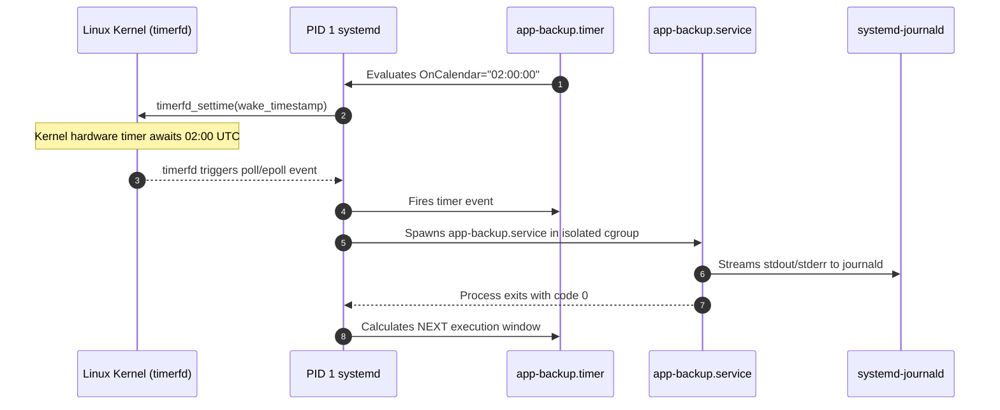

<!--
================================================================================
Metadata:
  Title: Automated Scheduling: Cron & Systemd Timers
  Track: Linux & Systems Engineering / DevOps
  Difficulty: Intermediate
  Estimated Time: 50 minutes
  Prerequisites: 03-system/04-systemd-and-services.md
  Key Terminology: Scheduling, Cron, Crontab (/etc/crontab, /var/spool/cron/), Anacron, systemd.timer, OnCalendar, Monotonic Timers (OnBootSec, OnUnitActiveSec), Persistent=true, RandomizedDelaySec, AccuracySec
================================================================================
-->

# Automated Scheduling: Cron & Systemd Timers

[<- 05-journald-and-logging.md](./05-journald-and-logging.md) | [Back to Module Overview](./README.md) | [07-storage-and-filesystems.md ->](./07-storage-and-filesystems.md)

---

## Table of Contents
- [1. What & Why](#1-what--why)
- [2. Core Concepts](#2-core-concepts)
- [3. How It Works Internally](#3-how-it-works-internally)
- [4. Syntax & Usage](#4-syntax--usage)
- [5. Practical Examples](#5-practical-examples)
- [6. Best Practices](#6-best-practices)
- [7. Common Mistakes & Troubleshooting](#7-common-mistakes--troubleshooting)
- [8. Performance, Security & Cost Implications](#8-performance-security--cost-implications)
- [9. Comparison Table](#9-comparison-table)
- [10. Real-World Interview Questions](#10-real-world-interview-questions)
- [11. Practice Exercises](#11-practice-exercises)
- [12. Summary & Quick Reference Cheat Sheet](#12-summary--quick-reference-cheat-sheet)
- [13. Further Reading & Official Documentation](#13-further-reading--official-documentation)

---

## 1. What & Why

Automated time-based execution is a cornerstone of systems engineering. In every production infrastructure, dozens of administrative tasks execute periodically: rotating database backups, syncing SSL certificates via Let's Encrypt, purging stale container images, generating financial reports, and re-indexing search clusters.

For decades, Unix environments relied on the classical **Cron** daemon (`cron` / `crond`). While simple, Cron exhibits notable limitations in production environments:
- Cron jobs lack structured logging (all output is dropped or funneled into local sendmail spools).
- If a server is powered down or sleeping when a cron job is scheduled to run, the job is **missed entirely**.
- Concurrent jobs starting at the exact same minute can create severe CPU and storage I/O thundering herds.
- Cron cannot express monotonic intervals relative to system boot (e.g., "run 15 minutes after boot").

**`systemd.timer` units** are the modern, production-grade standard for task scheduling in Linux. Systemd timers provide calendar-based scheduling, monotonic boot offsets, missed-run catchup (`Persistent=true`), randomized jitter (`RandomizedDelaySec`), cgroup resource throttling, and unified logging directly inside `journalctl`.

---

## 2. Core Concepts

### Classical Cron Architecture
Cron evaluates schedule specifications using a 5-field syntax representing minute, hour, day of month, month, and day of week:
```text
┌───────────── Minute (0 - 59)
│ ┌─────────── Hour (0 - 23)
│ │ ┌───────── Day of Month (1 - 31)
│ │ │ ┌─────── Month (1 - 12)
│ │ │ │ ┌───── Day of Week (0 - 6, 0 = Sunday)
│ │ │ │ │
* * * * * <command-to-execute>
```
Locations of cron definitions:
- User-specific crontabs: Managed via `crontab -e` (stored in `/var/spool/cron/crontabs/<user>`).
- System-wide crontabs: `/etc/crontab` and `/etc/cron.d/*` (includes an additional 6th field specifying the executing username).
- Periodic directories: `/etc/cron.daily/`, `/etc/cron.hourly/`, `/etc/cron.weekly/`.

### Systemd Timers: The Two-Unit Pattern
Unlike cron, which embeds the schedule and command in a single line, systemd uses a decoupled **Two-Unit Architecture**:
1. **The Service Unit (`app-backup.service`)**: Defines **what** to execute (binary, environment, working directory, cgroups).
2. **The Timer Unit (`app-backup.timer`)**: Defines **when** to execute the corresponding service.

```
+-------------------------------------------------------------------------+
| SYSTEMD TIMER TWO-UNIT DECOUPLED ARCHITECTURE                           |
|                                                                         |
|  [ app-backup.timer ]                                                   |
|  ├── OnCalendar=*-*-* 02:00:00 (Runs daily at 02:00 AM)                 |
|  ├── Persistent=true           (Catches up if server was offline)       |
|  └── RandomizedDelaySec=15m    (Prevents I/O spikes across fleet)       |
|            │                                                            |
|            │ Triggers event when timer fires                            |
|            v                                                            |
|  [ app-backup.service ]                                                 |
|  ├── ExecStart=/usr/local/bin/backup.sh                                 |
|  ├── User=backup-user                                                   |
|  ├── MemoryMax=2G (Cgroup throttling)                                   |
|  └── StandardOutput=journal (Direct logging to journald)                |
+-------------------------------------------------------------------------+
```

---

## 3. How It Works Internally

The Linux kernel provides high-resolution timer file descriptors via the `timerfd_create()` system call:



### Real-Time vs. Monotonic Timers
Systemd timers fall into two categories:
1. **Real-time Calendar Timers (`OnCalendar=`)**: Trigger on wall-clock calendar events (e.g., `OnCalendar=Mon *-*-* 04:00:00`). Handled using the kernel `CLOCK_REALTIME` clock.
2. **Monotonic Timers (`OnBootSec=`, `OnUnitActiveSec=`)**: Trigger relative to a moving monotonic time point (e.g., `OnBootSec=15min`, `OnUnitActiveSec=1h`). Handled using `CLOCK_MONOTONIC`, which is completely immune to wall-clock time jumps or NTP adjustments.

---

## 4. Syntax & Usage

### 1. Crontab Management
```bash
# Edit current user's crontab in default terminal editor
crontab -e

# List current user's crontab entries
crontab -l

# Remove current user's crontab completely
crontab -r

# Edit another user's crontab (requires root)
sudo crontab -u www-data -e
```

### 2. Common Cron Syntax Patterns
```text
# Run every day at 03:30 AM
30 3 * * * /usr/local/bin/backup.sh >/dev/null 2>&1

# Run every 15 minutes
*/15 * * * * /usr/bin/python3 /opt/scraper.py

# Run on the 1st of every month at midnight
0 0 1 * * /usr/local/bin/monthly_audit.sh

# Run Monday through Friday at 09:00 AM
0 9 * * 1-5 /usr/local/bin/standup_alert.sh

# Special shorthand strings:
@reboot        /usr/local/bin/startup_check.sh   # Run once at system boot
@daily         /usr/local/bin/daily_cleanup.sh   # Same as: 0 0 * * *
@hourly        /usr/local/bin/sync_clock.sh      # Same as: 0 * * * *
```

### 3. Systemd Timer Directives
In the `[Timer]` section of a `.timer` unit file:
```ini
[Timer]
# Calendar schedule (Year-Month-Day Hour:Minute:Second)
OnCalendar=*-*-* 03:00:00

# Monotonic: Run 10 minutes after machine boots up
OnBootSec=10min

# Monotonic: Run 1 hour after the service last completed execution
OnUnitActiveSec=1h

# Catch-up: Run immediately on boot if machine was powered off when event fired
Persistent=true

# Throttling: Add random jitter up to 15 minutes to prevent cluster stampedes
RandomizedDelaySec=15min

# Explicit service targeting (defaults to unit with matching name)
Unit=custom-backup.service
```

### 4. Managing Timers with `systemctl`
```bash
# List all active and pending timers with time remaining until next trigger
systemctl list-timers

# Show timers including inactive ones
systemctl list-timers --all

# Enable and start a timer
sudo systemctl enable --now app-backup.timer

# View timer status
systemctl status app-backup.timer
```

---

## 5. Practical Examples

### 1. Basic: Simple Monotonic Service Cleanup Timer
Run a disk cleanup service every 30 minutes, starting 5 minutes after machine boot:
1. Create `/etc/systemd/system/tmp-cleaner.service`:
```ini
[Unit]
Description=Temporary Directory Cleaner

[Service]
Type=oneshot
ExecStart=/usr/bin/find /tmp -type f -atime +7 -delete
```

2. Create `/etc/systemd/system/tmp-cleaner.timer`:
```ini
[Unit]
Description=Run temporary directory cleaner periodically

[Timer]
OnBootSec=5min
OnUnitActiveSec=30min

[Install]
WantedBy=timers.target
```

3. Activate:
```bash
sudo systemctl daemon-reload
sudo systemctl enable --now tmp-cleaner.timer
```

### 2. Real-World: Cluster-Safe Database Backup with Random Jitter
When backing up hundreds of database replicas across a cloud fleet to an S3 bucket, having all nodes fire at exactly 02:00:00 saturates the network and API rate limits:
```ini
# /etc/systemd/system/s3-db-backup.timer
[Unit]
Description=Nightly S3 Database Backup Timer

[Timer]
OnCalendar=*-*-* 02:00:00
# Randomize start time between 02:00 and 02:30 AM
RandomizedDelaySec=30min
Persistent=true

[Install]
WantedBy=timers.target
```

### 3. Edge Case: Validating Complex `OnCalendar` Strings with `systemd-analyze`
Before committing complex calendar expressions, validate them using `systemd-analyze`:
```bash
systemd-analyze calendar "Mon,Wed,Fri *-*-* 04:00:00"
```
**Output**:
```text
  Normalized form: Mon,Wed,Fri *-*-* 04:00:00
    Next elapse: Fri 2026-11-27 04:00:00 UTC
       From now: 19h left
```
You can also test calendar boundaries:
```bash
systemd-analyze calendar "*-*-~01" # Last day of every month!
```

### 4. Failure Case: The Cron Environment `$PATH` Trap
A common failure in cron: a script that works perfectly in the interactive terminal fails completely when executed by cron:
```text
/bin/sh: aws: command not found
```
*Why this fails*: Cron executes with a minimalist default `$PATH` (usually `/usr/bin:/bin`). If `aws` is installed in `/usr/local/bin` or `~/.local/bin`, cron cannot find it.  
*Remediation*:
1. In Cron: Define `$PATH` explicitly at the top of the crontab:
   ```text
   PATH=/usr/local/sbin:/usr/local/bin:/usr/sbin:/usr/bin:/sbin:/bin
   SHELL=/bin/bash
   ```
2. In Systemd: Systemd services declare explicit absolute paths (`ExecStart=/usr/local/bin/aws ...`) and can source environment files via `EnvironmentFile=`.

### 5. Production-Grade: Automated SSL Certbot Renewal Architecture
A hardened systemd timer and service configuration for automated TLS certificate renewal, including pre/post hooks to reload Nginx:
```ini
# /etc/systemd/system/certbot-renew.service
[Unit]
Description=Let's Encrypt Certbot Certificate Renewal
Documentation=https://certbot.eff.org/docs
After=network-online.target
Wants=network-online.target

[Service]
Type=oneshot
User=root
ExecStart=/usr/bin/certbot -q renew --post-hook "systemctl reload nginx"
PrivateTmp=true
ProtectSystem=full
```

```ini
# /etc/systemd/system/certbot-renew.timer
[Unit]
Description=Twice-Daily Certbot Renewal Timer

[Timer]
# Run twice daily at 03:15 and 15:15
OnCalendar=*-*-* 03,15:15:00
RandomizedDelaySec=1h
Persistent=true

[Install]
WantedBy=timers.target
```

---

## 6. Best Practices

1. **Prefer Systemd Timers over Cron in Modern Deployments**: Timers offer unified `journalctl` logging, missed-run catchup (`Persistent=true`), and cgroup resource isolation.
2. **Always Use Absolute Binary Paths in Cron**: Never write `python script.py`. Always write `/usr/bin/python3 /opt/scripts/script.py`.
3. **Always Add `RandomizedDelaySec` in Clustered Infrastructure**: In AWS or Kubernetes nodes, randomize timer execution to prevent fleet-wide I/O spikes.
4. **Always Set `Persistent=true` for Infrequent Jobs**: For weekly or monthly backups, `Persistent=true` guarantees that if a VM was shut down for maintenance during the scheduled time, the job will execute immediately upon boot.
5. **Always Test Calendar Syntax with `systemd-analyze calendar`**: Verify calendar parsing and review upcoming trigger timestamps prior to deployment.

---

## 7. Common Mistakes & Troubleshooting

| Mistake / Antipattern | Underlying Cause | Consequence | Production Solution |
| :--- | :--- | :--- | :--- |
| Missing `$PATH` in Crontab | Cron executes in a stripped environment (`/usr/bin:/bin`). | Script crashes with "command not found". | Define `PATH=...` at top of crontab, or use absolute paths. |
| Forgetting `systemctl daemon-reload` | Modified `.timer` or `.service` file without notifying PID 1. | Systemd schedules using old configuration. | Run `sudo systemctl daemon-reload`. |
| Starting `.service` instead of `.timer` | Running `systemctl enable --now app.service`. | Service executes immediately once; timer remains dormant. | Enable the timer: `systemctl enable --now app.timer`. |
| Unescaped `%` in Crontabs | Cron treats unescaped `%` characters as newlines! | Commands like `date +%F` fail with syntax errors. | Escape percent signs: `date +\%F`. |
| Overlapping Cron Executions | Previous run takes longer than the schedule interval. | Multiple instances run concurrently, causing race conditions. | Wrap in `flock -n /var/lock/app.lock cmd`. |
| Missing `timers.target` in `[Install]` | Setting `WantedBy=multi-user.target` on a timer. | Timer may start before timer subsystem is ready. | Use `WantedBy=timers.target`. |

---

## 8. Performance, Security & Cost Implications

### Performance
- **Kernel Wakeup Optimization**: Systemd groups timers using the `AccuracySec` directive (default: 1 minute). By coalescing multiple timers to wake up in the same CPU epoch, the kernel minimizes CPU wakeups and context switches, dramatically reducing energy and CPU overhead.

### Security
- **Crontab Security Risks**: Standard crontabs execute in the context of the user without sandboxing. A compromised script has full access to the user's home directory.
- **Systemd Sandboxing**: A service triggered by a systemd timer can enforce `ProtectSystem=strict`, `NoNewPrivileges=true`, and `PrivateTmp=true`, preventing an exploited cron job from tampering with system files.

### Cost
- In cloud computing, un-randomized cron jobs starting at midnight (00:00) create simultaneous network egress spikes across hundreds of VMs, triggering temporary bandwidth throttling or burst pricing fees. `RandomizedDelaySec` smooths out network curves.

---

## 9. Comparison Table

| Attribute | Classic Cron (`crond`) | Systemd Timers (`.timer`) | Anacron |
| :--- | :--- | :--- | :--- |
| **Log Storage** | Syslog / Local Mail | **Indexed binary `journalctl`** | Syslog / Local Mail |
| **Missed Job Recovery** | **No** (Missed completely) | **Yes (`Persistent=true`)** | Yes (Daily/Weekly only) |
| **Sub-Minute Granularity**| No (1 minute minimum) | **Yes (Microsecond precision)**| No (Days/Weeks) |
| **Cgroup Resource Limits**| None (Inherits user limit) | **Yes (`MemoryMax`, `CPUQuota`)**| None |
| **Jitter / Desynchronization**| Manual `sleep $((RANDOM%60))`| **Built-in (`RandomizedDelaySec`)**| Built-in (Fixed delay) |
| **Failure Notification** | Mail delivery | Native `OnFailure=` service hooks| Mail delivery |

---

## 10. Real-World Interview Questions

### Q1: What is the purpose of `Persistent=true` in a systemd timer?
<details>
<summary>Answer</summary>
When `Persistent=true` is enabled, systemd stores a timestamp file on disk in `/var/lib/systemd/timers/` recording the last time the service was successfully triggered.
If the system was turned off, sleeping, or down for maintenance when the timer was scheduled to fire (e.g., at 03:00 AM), systemd detects upon next boot that the scheduled trigger window was missed and **executes the service immediately**.
If `Persistent=false` (the default), any trigger that occurs while the system is powered off is completely lost until the next calendar interval.
</details>

### Q2: Why do scripts that run successfully in an interactive terminal often fail when run from Crontab?
<details>
<summary>Answer</summary>
1. **Minimalist `$PATH`**: Cron does not load `~/.bashrc` or `~/.profile`. Its default `$PATH` is typically restricted to `/usr/bin:/bin`. Utilities installed in `/usr/local/bin`, `/opt/bin`, or user paths fail with "command not found".
2. **Missing Environment Variables**: Custom variables (`DATABASE_URL`, `JAVA_HOME`, `AWS_REGION`) present in the user's interactive profile are absent in cron.
3. **No TTY / Interactive Prompt**: Commands that attempt to read input or allocate a terminal (curses) will fail.
4. **Current Working Directory**: Cron sets `PWD` to the user's `$HOME` directory by default. Relative paths like `./data.csv` resolve incorrectly.
</details>

### Q3: How do you prevent overlapping runs of a cron job without modifying the script?
<details>
<summary>Answer</summary>
Use the `flock` (file lock) utility directly in the crontab definition:
```text
*/10 * * * * flock -n /var/lock/backup.lock /usr/local/bin/backup.sh
```
- `flock -n`: Attempts to acquire a non-blocking lock on `/var/lock/backup.lock`.
- If the previous execution is still running, `flock` fails to acquire the lock and exits immediately with code 1, silently aborting the duplicate run without queuing or blocking.
</details>

### Q4: Explain the difference between `OnCalendar=` and `OnUnitActiveSec=` in a systemd timer.
<details>
<summary>Answer</summary>
- **`OnCalendar=` (Real-time Clock)**: Defines absolute wall-clock calendar trigger dates and times (e.g., `OnCalendar=*-*-* 02:00:00` for daily at 2 AM). It is governed by `CLOCK_REALTIME` and adapts to leap years, daylight saving time, and calendar boundaries.
- **`OnUnitActiveSec=` (Monotonic Clock)**: Defines an execution interval relative to the **last time the unit became active** (e.g., `OnUnitActiveSec=30min` runs 30 minutes after the previous run began). It is governed by `CLOCK_MONOTONIC`, which measures continuous hardware uptime and is immune to system clock adjustments.
</details>

### Q5: How do you inspect upcoming execution times for all systemd timers on a server?
<details>
<summary>Answer</summary>
Run:
```bash
systemctl list-timers
```
This produces a formatted table displaying:
- `NEXT`: The exact calendar time the timer will next fire.
- `LEFT`: The human-readable duration remaining (e.g., `2h 14min left`).
- `LAST`: When the timer last fired.
- `PASSED`: How long ago it fired.
- `UNIT`: The name of the `.timer` unit.
- `ACTIVATES`: The corresponding `.service` unit triggered by the timer.
</details>

### Q6: What does the percent sign `%` mean in a crontab command, and how must it be written?
<details>
<summary>Answer</summary>
In a crontab entry, the percent sign `%` is interpreted as a **newline character** unless escaped with a backslash (`\`), and all data after the first unescaped `%` is fed to the command as standard input.
Therefore, writing `30 2 * * * backup.sh $(date +%Y-%m-%d)` will fail.
It **must be escaped**:
```text
30 2 * * * backup.sh $(date +\%Y-\%m-\%d)
```
</details>

### Q7: How do you alert or execute remediation logic if a systemd timer's service fails?
<details>
<summary>Answer</summary>
In the corresponding `.service` unit file, configure the `OnFailure=` directive in the `[Unit]` section:
```ini
[Unit]
Description=Database Backup Service
OnFailure=backup-alert@%n.service
```
When the backup service fails (exits non-zero), systemd automatically triggers `backup-alert@app-backup.service`, which can send a Slack notification, PagerDuty alert, or trigger automated rollback procedures.
</details>

### Q8: What is `RandomizedDelaySec=` and why is it essential for fleet operations?
<details>
<summary>Answer</summary>
`RandomizedDelaySec=` adds a randomly generated delay (between 0 and the specified duration) to the timer's scheduled execution point.
In cloud infrastructure managing thousands of instances, if a daily security scan or telemetry report is scheduled for `00:00:00`, all 5,000 servers would query the backend API or S3 bucket at the exact same millisecond (the Thundering Herd problem). Configuring `RandomizedDelaySec=30min` distributes the load smoothly across a 30-minute window.
</details>

---

## 11. Practice Exercises

### Exercise 1: Validating Calendar Specs with Systemd-Analyze (Easy)
**Task**: Use `systemd-analyze calendar` to find the exact normalized format and upcoming trigger times for: "Every Tuesday and Thursday at 14:30".

<details>
<summary>Solution</summary>

```bash
systemd-analyze calendar "Tue,Thu *-*-* 14:30:00"
```
*Output reveals next elapse timestamps and verification status.*
</details>

### Exercise 2: Viewing System Timer Schedules (Easy)
**Task**: Use `systemctl` to list all currently active timers, filter by `.timer` suffix, and identify which timer activates `apt-daily.service`.

<details>
<summary>Solution</summary>

```bash
systemctl list-timers | grep "apt-daily"
```
</details>

### Exercise 3: Preventing Cron Overlap with Flock (Medium)
**Task**: Construct a crontab line that executes `/usr/local/bin/sync.sh` every 5 minutes, logging output to `/var/log/sync.log`, ensuring that if the script runs longer than 5 minutes, secondary runs are immediately skipped without blocking.

<details>
<summary>Solution</summary>

```text
*/5 * * * * /usr/bin/flock -n /var/run/sync.lock /usr/local/bin/sync.sh >> /var/log/sync.log 2>&1
```
</details>

### Exercise 4: Building a Monotonic Heartbeat Timer (Medium)
**Task**: Create a systemd timer `heartbeat.timer` that fires every 10 seconds, starting 15 seconds after boot, triggering `heartbeat.service` which logs a timestamp to journald using `logger`.

<details>
<summary>Solution</summary>

1. Create `/etc/systemd/system/heartbeat.service`:
```ini
[Unit]
Description=Heartbeat Logger

[Service]
Type=oneshot
ExecStart=/usr/bin/logger -t Heartbeat "System is alive at $(date)"
```

2. Create `/etc/systemd/system/heartbeat.timer`:
```ini
[Unit]
Description=Heartbeat Timer

[Timer]
OnBootSec=15s
OnUnitActiveSec=10s
AccuracySec=1s

[Install]
WantedBy=timers.target
```

3. Enable and test:
```bash
sudo systemctl daemon-reload
sudo systemctl enable --now heartbeat.timer
sleep 25
journalctl -t Heartbeat -n 3
```
</details>

### Exercise 5: Migrating a Legacy Crontab Entry to Systemd Timer (Hard)
**Task**: Take the following legacy crontab entry:
`0 4 * * 0 /opt/scripts/prune_docker.sh > /var/log/docker_prune.log 2>&1`
and migrate it into a fully hardened, sandboxed systemd service and timer unit pair with `Persistent=true` and memory constraints.

<details>
<summary>Solution</summary>

1. Service Unit `/etc/systemd/system/docker-prune.service`:
```ini
[Unit]
Description=Weekly Docker Prune Maintenance
After=docker.service
Requires=docker.service

[Service]
Type=oneshot
ExecStart=/opt/scripts/prune_docker.sh
StandardOutput=journal
StandardError=journal
MemoryMax=512M
ProtectSystem=strict
ReadWritePaths=/var/lib/docker
```

2. Timer Unit `/etc/systemd/system/docker-prune.timer`:
```ini
[Unit]
Description=Run Weekly Docker Prune on Sundays at 04:00

[Timer]
OnCalendar=Sun *-*-* 04:00:00
Persistent=true
RandomizedDelaySec=15min

[Install]
WantedBy=timers.target
```

3. Enable:
```bash
sudo systemctl daemon-reload
sudo systemctl enable --now docker-prune.timer
```
</details>

### Exercise 6: Automated Failure Alerting Hook (Hard)
**Task**: Create a failure notification service template `alert-failed@.service` that triggers whenever any systemd service fails, posting an incident summary containing unit name, exit status, and last 5 lines of journal logs to an alert sink.

<details>
<summary>Solution</summary>

1. Create alert handler `/etc/systemd/system/alert-failed@.service`:
```ini
[Unit]
Description=Failure Notification Dispatcher for %i

[Service]
Type=oneshot
ExecStart=/bin/sh -c 'printf "ALERT: Unit %i failed!\nLogs:\n%s\n" "$(journalctl -u %i -n 5 --no-pager)"'
```

2. Attach to target service:
In any target `.service` unit `[Unit]` section:
```ini
[Unit]
Description=Critical Database Backup
OnFailure=alert-failed@%n.service
```
When `app-backup.service` crashes, systemd automatically launches `alert-failed@app-backup.service.service`.
</details>

---

## 12. Summary & Quick Reference Cheat Sheet

| Task | Cron Syntax | Systemd Timer Equivalent |
| :--- | :--- | :--- |
| **Every hour** | `0 * * * *` | `OnCalendar=*-*-* *:00:00` |
| **Daily at midnight** | `0 0 * * *` | `OnCalendar=*-*-* 00:00:00` |
| **Every 15 minutes** | `*/15 * * * *` | `OnCalendar=*:0/15` |
| **10 min after boot** | `@reboot sleep 600; cmd` | `OnBootSec=10min` |
| **Run after completion**| N/A | `OnUnitActiveSec=30min` |
| **Missed run catchup** | Anacron (Daily only) | `Persistent=true` |
| **Thundering herd fix** | `sleep $((RANDOM%60))` | `RandomizedDelaySec=15min` |
| **Inspect Pending** | `crontab -l` | `systemctl list-timers` |
| **Validate Syntax** | External crontab linter | `systemd-analyze calendar "..."` |
| **View Logs** | Grep `/var/log/syslog` | `journalctl -u <unit>.service` |

---

## 13. Further Reading & Official Documentation

- [systemd.timer Documentation](https://www.freedesktop.org/software/systemd/man/latest/systemd.timer.html)
- [systemd.time (Calendar and Time Specifications)](https://www.freedesktop.org/software/systemd/man/latest/systemd.time.html)
- [Linux Man Pages: crontab(5)](https://man7.org/linux/man-pages/man5/crontab.5.html)
- [Linux Man Pages: flock(1)](https://man7.org/linux/man-pages/man1/flock.1.html)
- [ArchWiki: Systemd Timers as a Cron Replacement](https://wiki.archlinux.org/title/Systemd/Timers)

---

[<- 05-journald-and-logging.md](./05-journald-and-logging.md) | [Back to Module Overview](./README.md) | [07-storage-and-filesystems.md ->](./07-storage-and-filesystems.md)
