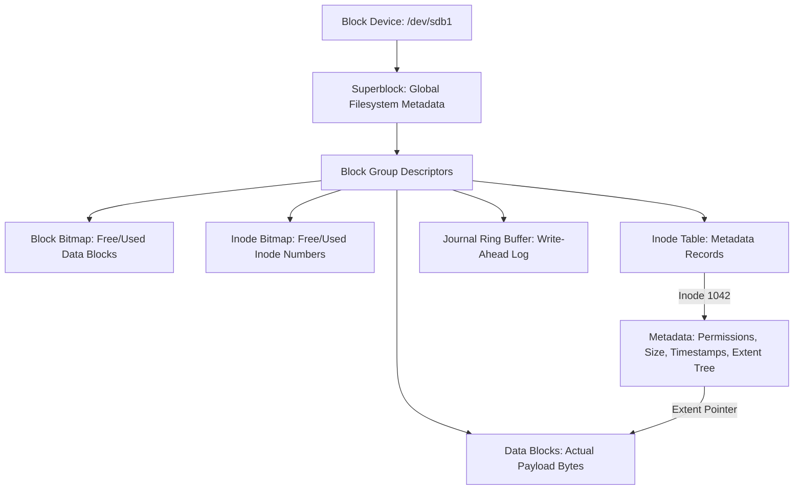

<!--
================================================================================
Metadata:
  Title: Storage, Filesystems & Block Devices
  Track: Linux & Systems Engineering / DevOps
  Difficulty: Intermediate
  Estimated Time: 60 minutes
  Prerequisites: 01-fundamentals/03-filesystem-hierarchy-and-navigation.md, 01-fundamentals/05-links-inodes-and-file-types.md
  Key Terminology: Block Device, Partition Table, MBR, GPT, fdisk, parted, lsblk, blkid, ext4, XFS, Btrfs, Inodes, Data Blocks, Superblock, Journaling, fsck, xfs_repair
================================================================================
-->

# Storage, Filesystems & Block Devices

[<- 06-cron-and-timers.md](./06-cron-and-timers.md) | [Back to Module Overview](./README.md) | [08-mounting-fstab-and-disks.md ->](./08-mounting-fstab-and-disks.md)

---

## Table of Contents
- [1. What & Why](#1-what--why)
- [2. Core Concepts](#2-core-concepts)
- [3. How It Works Internally](#3-how-it-works-internally)
- [4. Syntax & Usage](#4-syntax--usage)
- [5. Practical Examples](#5-practical-examples)
- [6. Best Practices](#6-best-practices)
- [7. Common Mistakes & Troubleshooting](#7-common-mistakes--troubleshooting)
- [8. Performance, Security & Cost Implications](#8-performance-security--cost-implications)
- [9. Comparison Table](#9-comparison-table)
- [10. Real-World Interview Questions](#10-real-world-interview-questions)
- [11. Practice Exercises](#11-practice-exercises)
- [12. Summary & Quick Reference Cheat Sheet](#12-summary--quick-reference-cheat-sheet)
- [13. Further Reading & Official Documentation](#13-further-reading--official-documentation)

---

## 1. What & Why

At the foundation of every operating system lies persistent storage. In cloud infrastructure and bare-metal servers, compute instances are transient, but storage stores the actual state: customer databases, transaction ledgers, container layers, and operational audit logs.

Understanding the Linux storage architecture is fundamental for systems engineers:
- Misinterpreting device naming (`/dev/sda` vs `/dev/nvme0n1` vs `/dev/vda`) leads to mounting the wrong drives or formatting active partitions.
- Failing to distinguish between block-level partition tables (GPT vs MBR) prevents utilizing drives larger than 2 Terabytes.
- Choosing the wrong filesystem architecture (`ext4` vs `XFS` vs `Btrfs`) can create performance bottlenecks for databases or prevent online storage expansion when disks fill up in production.

Mastering block devices, partition tables, filesystem data structures, and offline repair tools (`fsck`, `xfs_repair`) is critical for guaranteeing data durability.

---

## 2. Core Concepts

### The Linux Storage Stack
Storage in Linux is organized into a modular layered architecture from raw physical hardware up to user space file access:

```
+-------------------------------------------------------------------------+
| LINUX STORAGE HIERARCHICAL ARCHITECTURE                                 |
|                                                                         |
|  [ User Space Applications ] (Nginx, PostgreSQL, tar, touch)           |
|         │                                                               |
|         v (System Calls: open, read, write, fsync)                      |
|  [ Virtual File System (VFS) ] (Inodes, Dentries, File Objects)         |
|         │                                                               |
|         v (Filesystem Implementations)                                  |
|  [ Filesystem Layer ] ──> ext4 │ XFS │ Btrfs │ ZFS                      |
|         │                                                               |
|         v (Logical Block Abstraction)                                   |
|  [ Volume Management & Multi-Disk ] ──> LVM (Logical Volumes) │ mdadm   |
|         │                                                               |
|         v (Block Device Nodes)                                          |
|  [ Block Layer & I/O Scheduler ] (/dev/sda1, /dev/nvme0n1p1)            |
|         │                                                               |
|         v (Device Drivers & Bus Controllers)                            |
|  [ Hardware Controller Subsystem ] ──> NVMe │ SATA / SAS │ VirtIO / EBS |
|         │                                                               |
|         v (Physical Media)                                              |
|  [ Physical Silicon / Magnetic Media ] ──> NVMe NAND Flash │ HDD Spindle|
+-------------------------------------------------------------------------+
```

### Device Naming Conventions
Linux assigns names to block devices in `/dev/` based on their hardware bus and driver:
- **`/dev/sdX`** (e.g., `sda`, `sdb`): SCSI, SATA, SAS, and USB drives. Partitions are suffixed with integers: `/dev/sda1`, `/dev/sda2`.
- **`/dev/nvmeXn1`** (e.g., `nvme0n1`): Non-Volatile Memory Express (NVMe) PCIe solid-state drives. Partitions are suffixed with `p`: `/dev/nvme0n1p1`.
- **`/dev/vdX`** (e.g., `vda`, `vdb`): KVM/QEMU virtualized disks using high-performance VirtIO paravirtualized drivers.
- **`/dev/xvdX`**: Xen hypervisor paravirtualized block devices (common in legacy AWS EC2 instances).

### Partition Tables: MBR vs. GPT
Before a raw block device can host a filesystem, it must be partitioned:
1. **MBR (Master Boot Record)**:
   - Historical standard (1983). Stored in the very first 512-byte sector of the drive.
   - **Maximum Disk Size**: 2 Terabytes ($2^{32} \times 512$ bytes).
   - Maximum primary partitions: 4 (requires complex "extended" and "logical" partitions to exceed 4).
   - No redundancy: If sector 0 is corrupted, the partition table is permanently lost.
2. **GPT (GUID Partition Table)**:
   - Modern UEFI standard (part of UEFI specification).
   - **Maximum Disk Size**: 8 Zettabytes (9.4 billion Terabytes).
   - Supports up to 128 partitions by default without extended partition hacks.
   - **Redundant Backup**: Stores a secondary backup partition table at the very end of the physical disk for self-healing recovery.
   - Uses globally unique 128-bit UUIDs for every partition.

---

## 3. How It Works Internally

Inside modern filesystems (`ext4`, `XFS`), storage space is divided into metadata management structures and raw data payload blocks:



### The Role of the Journal (Journaling Filesystems)
Writing data to storage involves updating multiple independent disk sectors: the data block, the inode, and the free block allocation bitmap. If power is lost mid-write:
- Non-journaling filesystems (like old `ext2`) become corrupted, requiring a multi-hour offline scan (`fsck`) of every block on the drive.
- **Journaling Filesystems** (`ext4`, `XFS`) resolve this via **Write-Ahead Logging (WAL)**:
  1. The filesystem writes all intended metadata mutations into an isolated, circular on-disk **Journal** buffer.
  2. The journal commit block is written.
  3. The actual filesystem structures are updated (checkpointing).
  4. On unexpected reboot, the kernel replays the journal in milliseconds: transactions that completed in the journal are committed; incomplete transactions are rolled back. Zero full-disk scans required!

---

## 4. Syntax & Usage

### 1. Storage Inspection Utilities
```bash
# Display block device hierarchy with sizes, mount points, and types
lsblk

# Detailed view including filesystem type (FSTYPE) and filesystem UUIDs
lsblk -f

# Print block device attributes, UUIDs, and partition labels
sudo blkid

# Display mounted filesystems, total space, and free capacity (human-readable)
df -hT

# Check inode consumption (critical for catching "disk full" with free space!)
df -i
```

### 2. Partitioning Disks: `fdisk` and `parted`
- **`fdisk`**: Interactive partition manager. Supports MBR and GPT:
  ```bash
  sudo fdisk /dev/sdb
  # Key commands within fdisk:
  #   'g': Create a new empty GPT partition table
  #   'n': Add a new partition
  #   'p': Print the current partition table
  #   'w': Write table to disk and exit
  #   'q': Quit without saving
  ```
- **`parted`**: Scriptable command-line partitioner (ideal for automation):
  ```bash
  # Initialize disk with GPT partition table
  sudo parted -s /dev/sdb mklabel gpt

  # Create primary partition consuming 100% of available space
  sudo parted -s /dev/sdb mkpart primary ext4 0% 100%
  ```

### 3. Formatting Filesystems (`mkfs`)
```bash
# Format partition with ext4
sudo mkfs.ext4 -L "DATA_STORE" /dev/sdb1

# Format partition with XFS (Enterprise Linux standard)
sudo mkfs.xfs -L "DATA_STORE" /dev/sdb1

# Format with Btrfs (Advanced copy-on-write filesystem)
sudo mkfs.btrfs -L "BACKUPS" /dev/sdb1
```

### 4. Filesystem Integrity & Repair
Never run integrity checkers on **mounted** filesystems!
```bash
# Check and repair ext4 filesystem
sudo umount /mnt/data
sudo fsck.ext4 -fvy /dev/sdb1

# Check and repair XFS filesystem (XFS uses dedicated tool)
sudo umount /mnt/data
sudo xfs_repair /dev/sdb1
```

---

## 5. Practical Examples

### 1. Basic: End-to-End Formatting of a Fresh Secondary Cloud Drive
A new 100 GB EBS volume or virtual disk `/dev/sdb` is attached to a running server:
```bash
#!/usr/bin/env bash
set -euo pipefail

TARGET_DEV="/dev/sdb"

echo "[INFO] Initializing GPT partition table on $TARGET_DEV..."
sudo parted -s "$TARGET_DEV" mklabel gpt

echo "[INFO] Creating primary partition across entire disk..."
sudo parted -s "$TARGET_DEV" mkpart primary ext4 1MiB 100%

# Allow kernel partition table re-read
sudo partprobe "$TARGET_DEV"

echo "[INFO] Formatting /dev/sdb1 with ext4..."
sudo mkfs.ext4 -F -L "APP_STORAGE" "${TARGET_DEV}1"

echo "[SUCCESS] Block device partitioned and formatted."
lsblk -f "$TARGET_DEV"
```

### 2. Real-World: Diagnosing Inode Exhaustion
A production server emits `No space left on device` when trying to save an order receipt, yet `df -h` reports 50% disk space free:
```bash
# 1. Inspect block capacity
df -h /var/log
# Output: /dev/sda1  100G   50G   50G  50% /

# 2. Inspect INODE capacity
df -i /var/log
# Output: /dev/sda1  6.5M  6.5M     0 100% /
```
*Triage*: The disk has plenty of raw megabytes, but has allocated all available **Inodes** (typically caused by millions of tiny unpurged session files or email spools).  
*Locating the culprit directory*:
```bash
sudo find / -xdev -printf '%h\n' | sort | uniq -c | sort -nr | head -n 10
# Shows top directories containing the largest count of files!
```

### 3. Edge Case: Online Resizing of an Ext4 Filesystem
When an underlying cloud virtual disk is expanded from 100 GB to 200 GB while running:
```bash
# 1. Expand the partition table boundary using growpart
sudo growpart /dev/nvme0n1 1

# 2. Inform the kernel and grow the live, mounted ext4 filesystem online
sudo resize2fs /dev/nvme0n1p1

# 3. For XFS (requires mount point path, not device name!):
# sudo xfs_growfs /
```
*Note*: Ext4 and XFS support **online growing** (expanding while mounted and taking active traffic). However, neither supports shrinking while mounted!

### 4. Failure Case: The Accidental MBR Overwrite
Running `dd` with incorrect target parameters wipes the first sector of a storage drive:
```bash
# CATASTROPHIC MISTAKE:
sudo dd if=/dev/zero of=/dev/sdb bs=512 count=1
# Consequence: Destroys MBR and partition table! Partitions vanish!

# RECOVERY (If GPT was used):
# GPT maintains a backup partition table at the physical end of the disk!
sudo gdisk /dev/sdb
# In gdisk: Type 'r' (recovery mode), 'c' (copy backup GPT to main), 'w' (write).
# The entire partition layout is restored without data loss!
```

### 5. Production-Grade: Storage Sanity & Benchmark Inspector
A diagnostic script that audits block device topology, measures random 4K read/write latency using `fio`, and reports filesystem health:
```bash
#!/usr/bin/env bash
set -euo pipefail

MOUNT_POINT="/mnt/data"

echo "=============================================="
echo "  STORAGE SUBSYSTEM HEALTH AUDIT"
echo "=============================================="

# 1. Check filesystem state
DEV=$(df -P "$MOUNT_POINT" | awk 'NR==2 {print $1}')
FSTYPE=$(df -PT "$MOUNT_POINT" | awk 'NR==2 {print $2}')

echo "[INFO] Mount Point: $MOUNT_POINT"
echo "[INFO] Block Device: $DEV"
echo "[INFO] Filesystem Type: $FSTYPE"

# 2. Check Capacity & Inode Ratios
BLOCK_USAGE=$(df -h "$MOUNT_POINT" | awk 'NR==2 {print $5}')
INODE_USAGE=$(df -i "$MOUNT_POINT" | awk 'NR==2 {print $5}')

echo "[METRIC] Block Space Used: $BLOCK_USAGE"
echo "[METRIC] Inode Space Used: $INODE_USAGE"

# 3. Micro-benchmark Write Latency using dd (sync flag)
echo "[INFO] Testing synchronous write latency (100MB sync)..."
sudo dd if=/dev/zero of="${MOUNT_POINT}/.latency_test" bs=4k count=25000 conv=fdatasync 2>&1 | tail -n 1
sudo rm -f "${MOUNT_POINT}/.latency_test"

echo "[SUCCESS] Storage inspection complete."
```

---

## 6. Best Practices

1. **Always Use GPT for Modern Disks**: Never use MBR for new servers or cloud disks. GPT eliminates the 2 TB limit and provides backup partition table redundancy.
2. **Never Format Using Device Names in Automation**: Device names (`/dev/sdb`) can change on reboot if hardware buses enumerate differently. Always mount using **Filesystem UUIDs** (`UUID=...`).
3. **Tune Ext4 Reserved Blocks**: By default, `ext4` reserves **5% of disk space** for root (to prevent fragmentation and avoid locking out root when full). On a 2 TB storage disk, this wastes 100 GB! Lower it to 1%:
   ```bash
   sudo tune2fs -m 1 /dev/sdb1
   ```
4. **Use XFS for Large-File Data Workloads**: XFS excels at parallel I/O allocations, making it the preferred default on RHEL, Rocky Linux, and database workloads.
5. **Never Interrupt Filesystem Repair**: If `fsck` or `xfs_repair` is running, never reboot or disconnect power; doing so causes irreparable metadata fragmentation.

---

## 7. Common Mistakes & Troubleshooting

| Mistake / Antipattern | Underlying Cause | Consequence | Production Solution |
| :--- | :--- | :--- | :--- |
| "Disk full" with 50% free space | Exhaustion of filesystem Inodes (`df -i`). | System rejects new file creation despite ample megabytes. | Identify directory with millions of tiny files and purge them. |
| Formatting live mounted disk | Running `mkfs` on a device currently in use. | Severe kernel panics and instant data corruption. | Ensure unmounted: `umount /dev/sdb1` before formatting. |
| Running `fsck` on mounted disk | `fsck` mutates disk blocks while the kernel driver is reading/writing. | Massive filesystem corruption. | Unmount first, or boot into rescue mode with root mounted read-only (`mount -o remount,ro /`). |
| Using MBR on a 4 TB drive | MBR 32-bit sector addressing caps storage at 2 Terabytes. | Half the physical storage is completely unusable. | Re-partition with GPT: `parted mklabel gpt`. |
| Running `xfs_growfs` with device path | XFS expects the **mount point directory**, not the device file. | `xfs_growfs: /dev/sdb1 is not a mounted XFS filesystem`. | Run on mount path: `xfs_growfs /mnt/data`. |
| Hardcoding `/dev/sda1` in scripts | Cloud VM reboot shifts device letters (`sdb` becomes `sdc`). | Mounts wrong volume or fails to boot. | Use persistent identifiers: `UUID=...` from `blkid`. |

---

## 8. Performance, Security & Cost Implications

### Performance
- **Block Size Selection**: Standard Linux block size is **4 KB (4096 bytes)**. Storing a 50-byte text file still consumes 4 KB on disk. For databases with large 16KB pages (PostgreSQL, MySQL), aligning filesystem extents with database block sizes minimizes I/O write amplification.
- **`noatime` Mount Optimization**: By default, Linux updates a file's access timestamp (`atime`) every time it is read, generating a disk write for every read. Disabling this via the `noatime` mount option increases web server read throughput by 10%–25%.

### Security
- **Data Remanence after `rm`**: Standard `rm` merely unlinks the inode pointer; the raw bytes remain on physical NAND flash or magnetic platters until overwritten. For sensitive cryptographic keys or records, wipe blocks using `shred -u` or ATA secure erase.

### Cost
- In cloud providers (AWS EBS, GCP Persistent Disk), provisioning over-sized volumes to prevent disk exhaustion burns money. Using dynamic online resizing tools (`growpart` + `resize2fs`) allows teams to start with small volumes and expand dynamically.

---

## 9. Comparison Table

| Attribute | ext4 | XFS | Btrfs |
| :--- | :--- | :--- | :--- |
| **Default In** | Ubuntu / Debian | RHEL / Rocky / AlmaLinux | Fedora / openSUSE |
| **Max Filesystem Size** | 1 EiB (Exbibyte) | 8 EiB | 16 EiB |
| **Architecture** | Classical Inode / Extents | High-concurrency Allocation Groups | **Copy-on-Write (CoW)** |
| **Online Expansion** | **Yes (`resize2fs`)** | **Yes (`xfs_growfs`)** | **Yes (`btrfs filesystem resize`)**|
| **Online Shrinking** | No (Offline only) | **NO (Impossible)** | **Yes (Online shrinking supported)**|
| **Snapshots** | No (Requires LVM) | No (Requires LVM) | **Native Subvolume Snapshots** |
| **Data Checksumming** | Metadata only | Metadata only | **Full Data & Metadata CRC32** |

---

## 10. Real-World Interview Questions

### Q1: What is the exact difference between an Inode and a Data Block?
<details>
<summary>Answer</summary>
- **Inode (Index Node)**: A fixed-size data structure (typically 256 bytes) stored in the filesystem's inode table. It stores all metadata about a file: file type, permissions (mode bits), owner UID, group GID, file size, timestamps (`atime`, `mtime`, `ctime`), hard link count, and pointers (extents) to the data blocks where the actual file content resides. **An inode does NOT store the filename or file contents**.
- **Data Block**: The storage allocation unit (typically 4 KB) where the actual raw bytes of the file payload are written.
</details>

### Q2: Why can `df` report "No space left on device" when `df -h` shows gigabytes of available capacity?
<details>
<summary>Answer</summary>
Every filesystem is formatted with a finite number of **Inodes** calculated at creation time (in ext4, roughly 1 inode per 16 KB of capacity).
If an application generates millions of empty or tiny files (such as unpurged session files, caching tokens, or email queue fragments), the filesystem can **exhaust all available inodes** while consuming only a fraction of physical data block capacity.
When inodes reach 100% (`df -i`), the kernel rejects creating any new files, returning `ENOSPC` ("No space left on device").
</details>

### Q3: Explain why MBR cannot support disks larger than 2 Terabytes.
<details>
<summary>Answer</summary>
In the MBR partition table specification, sector addresses are stored as **32-bit unsigned integers**.
The standard physical sector size on hard drives is **512 bytes**.
The maximum addressable capacity is therefore:
$$2^{32} \text{ sectors} \times 512 \text{ bytes/sector} = 2,199,023,255,552 \text{ bytes} \approx 2.19 \text{ TB}$$
Any storage capacity beyond 2.19 TB cannot be addressed by an MBR partition table. GPT solves this by using **64-bit sector addressing**, accommodating disks up to 8 Zettabytes.
</details>

### Q4: What is the difference between `fsck` and `xfs_repair`?
<details>
<summary>Answer</summary>
- **`fsck` (Filesystem Consistency Check)**: A frontend wrapper that invokes filesystem-specific tools (e.g., `fsck.ext4`, `fsck.vfat`) to inspect and repair unmounted filesystems.
- **`xfs_repair`**: The dedicated offline repair utility for XFS filesystems. XFS does not use `fsck` during boot; instead, XFS relies on instant journal log replay during mount. If an XFS filesystem suffers severe on-disk corruption that log replay cannot fix, an administrator must unmount the volume and invoke `xfs_repair`.
</details>

### Q5: Can an XFS filesystem be shrunk (reduced in size)?
<details>
<summary>Answer</summary>
**No**. XFS architecture is fundamentally designed around independent, parallel Allocation Groups (AGs). Because internal data structures, B-trees, and freespace maps are distributed across the entire span of the device, the XFS designers deliberately omitted shrinking support. XFS can be expanded online (`xfs_growfs`), but it **can never be shrunk**. If shrinking is required, the data must be backed up, the filesystem recreated at a smaller size, and data restored.
</details>

### Q6: What does the command `partprobe` do?
<details>
<summary>Answer</summary>
When a partition table is modified on a live disk (e.g., via `fdisk` or `parted`), the changes are written to disk sectors, but the running Linux kernel may still retain the old partition layout in memory.
`partprobe` requests that the kernel re-read the partition table directly from disk and update its internal device structures (`/dev/sda1`, `/dev/sda2`) without requiring a system reboot.
</details>

### Q7: What is the purpose of the Superblock, and what happens if it is corrupted?
<details>
<summary>Answer</summary>
The **Superblock** is the master control record of a filesystem. It contains critical filesystem geometry and metadata: block size, total block count, total inode count, filesystem state (clean/dirty), mount count, and feature flags.
If the primary superblock at block 0 is corrupted, the kernel refuses to mount the filesystem.
**Recovery**: Journaling filesystems (like ext4) automatically distribute backup copies of the superblock across the disk at regular block group intervals. An administrator can locate and restore a backup superblock using `mke2fs -n` and `fsck.ext4 -b <backup_block_num>`.
</details>

### Q8: What is the difference between Write-Ahead Logging (WAL) in databases and Journaling in filesystems?
<details>
<summary>Answer</summary>
Conceptually, they are identical. Both enforce the fundamental atomicity rule: **never mutate the primary data structures until a sequential description of the change has been committed to non-volatile log storage**.
In filesystems, journaling protects structural metadata integrity against unexpected power loss. In database engines (PostgreSQL/MySQL), WAL protects tabular transactions and index consistency.
</details>

---

## 11. Practice Exercises

### Exercise 1: Identify Filesystem Types and UUIDs (Easy)
**Task**: Use `lsblk` and `blkid` to generate a report showing every storage device, its size, filesystem type, mount point, and UUID.

<details>
<summary>Solution</summary>

```bash
lsblk -o NAME,SIZE,FSTYPE,MOUNTPOINT,UUID
```
</details>

### Exercise 2: Checking Inode Usage across All Mounts (Easy)
**Task**: Run a command that prints only filesystems that are currently consuming more than 70% of their allocated Inodes.

<details>
<summary>Solution</summary>

```bash
df -i | awk 'NR==1 || $5+0 > 70'
```
</details>

### Exercise 3: Simulating Inode Depletion in a Test Image (Medium)
**Task**: Create a 20 MB virtual disk image file using `dd`, format it with ext4, mount it to `/mnt/test`, and write a loop that creates empty files until it fails with "No space left on device". Verify that `df -h` still shows free megabytes while `df -i` shows 100% full. Clean up afterwards.

<details>
<summary>Solution</summary>

```bash
#!/usr/bin/env bash
set -euo pipefail

# 1. Create 20MB loop image
dd if=/dev/zero of=/tmp/disk.img bs=1M count=20
mkfs.ext4 -F /tmp/disk.img

# 2. Mount
sudo mkdir -p /mnt/looptest
sudo mount -o loop /tmp/disk.img /mnt/looptest

# 3. Exhaust inodes with empty files
echo "[INFO] Creating empty files to exhaust inodes..."
COUNT=0
while sudo touch "/mnt/looptest/file_$COUNT" 2>/dev/null; do
  ((COUNT++))
done
echo "[RESULT] Created $COUNT files before hitting inode exhaustion."

# 4. Compare df -h vs df -i
echo -e "\nBlock capacity (Megabytes):"
df -h /mnt/looptest
echo -e "\nInode capacity (Inodes):"
df -i /mnt/looptest

# 5. Clean up
sudo umount /mnt/looptest
sudo rm -rf /mnt/looptest /tmp/disk.img
```
</details>

### Exercise 4: Backing Up and Restoring an MBR Partition Table (Medium)
**Task**: Use `sfdisk` to dump the partition table of a block device to a text file, and demonstrate how to restore it.

<details>
<summary>Solution</summary>

```bash
# Dump partition table to backup file
sudo sfdisk -d /dev/sdb > /tmp/sdb_partition_table.bak

# Restore partition table from backup file
# sudo sfdisk /dev/sdb < /tmp/sdb_partition_table.bak
```
</details>

### Exercise 5: Recovering an Ext4 Filesystem Using a Backup Superblock (Hard)
**Task**: Format a loopback image with ext4, deliberately corrupt its primary superblock with `dd`, demonstrate that mounting fails, locate a backup superblock, and repair it with `fsck`.

<details>
<summary>Solution</summary>

```bash
#!/usr/bin/env bash
set -euo pipefail

# 1. Create 50MB disk image
dd if=/dev/zero of=/tmp/corrupt.img bs=1M count=50
mkfs.ext4 -F /tmp/corrupt.img

# 2. Identify backup superblocks
# mke2fs -n displays where backup superblocks were placed
mke2fs -n /tmp/corrupt.img | grep "Superblock backups" -A 1

# 3. Intentionally wipe primary superblock (block 0, first 1024 bytes)
dd if=/dev/zero of=/tmp/corrupt.img bs=1024 count=2 conv=notrunc

# 4. Attempt to mount (Fails!)
sudo mkdir -p /mnt/broken
if sudo mount -o loop /tmp/corrupt.img /mnt/broken 2>/dev/null; then
  echo "Mount unexpectedly succeeded."
else
  echo "[EXPECTED] Mount failed due to corrupted primary superblock!"
fi

# 5. Restore from backup superblock (typically block 8193 or 32768)
sudo fsck.ext4 -b 32768 -y /tmp/corrupt.img || sudo fsck.ext4 -b 8193 -y /tmp/corrupt.img

# 6. Verify successful mount
sudo mount -o loop /tmp/corrupt.img /mnt/broken
echo "[SUCCESS] Filesystem restored and mounted successfully."

# Clean up
sudo umount /mnt/broken
sudo rm -rf /mnt/broken /tmp/corrupt.img
```
</details>

### Exercise 6: Automated Online Storage Expansion Script (Hard)
**Task**: Write an automation script that takes a target mount point (e.g., `/`), detects whether the underlying filesystem is `ext4` or `XFS`, detects the block device partition, invokes `growpart` to expand the partition, and executes the appropriate filesystem expander (`resize2fs` or `xfs_growfs`).

<details>
<summary>Solution</summary>

```bash
#!/usr/bin/env bash
set -euo pipefail

MOUNT_DIR="${1:-/}"

echo "[INFO] Inspecting filesystem on $MOUNT_DIR..."
DEV=$(df -P "$MOUNT_DIR" | awk 'NR==2 {print $1}')
FSTYPE=$(df -PT "$MOUNT_DIR" | awk 'NR==2 {print $2}')

# Extract parent disk and partition number (e.g. /dev/sda and 1)
# Works for /dev/sdXN and /dev/nvmeXn1pN
if [[ "$DEV" =~ ^(/dev/nvme[0-9]+n[0-9]+)p([0-9]+)$ ]]; then
  PARENT_DISK="${BASH_REMATCH[1]}"
  PART_NUM="${BASH_REMATCH[2]}"
elif [[ "$DEV" =~ ^(/dev/[a-z]+)([0-9]+)$ ]]; then
  PARENT_DISK="${BASH_REMATCH[1]}"
  PART_NUM="${BASH_REMATCH[2]}"
else
  echo "[ERROR] Unsupported block device format: $DEV" >&2
  exit 1
fi

echo "[INFO] Parent Disk: $PARENT_DISK | Partition: $PART_NUM | Type: $FSTYPE"

# 1. Expand partition
sudo growpart "$PARENT_DISK" "$PART_NUM" || true

# 2. Expand filesystem
if [[ "$FSTYPE" == "ext4" ]]; then
  echo "[INFO] Expanding ext4 filesystem online..."
  sudo resize2fs "$DEV"
elif [[ "$FSTYPE" == "xfs" ]]; then
  echo "[INFO] Expanding XFS filesystem online..."
  sudo xfs_growfs "$MOUNT_DIR"
else
  echo "[ERROR] Unsupported filesystem type: $FSTYPE" >&2
  exit 1
fi

echo "[SUCCESS] Storage expansion complete:"
df -h "$MOUNT_DIR"
```
</details>

---

## 12. Summary & Quick Reference Cheat Sheet

| Task | Command | Scope / Description |
| :--- | :--- | :--- |
| **Inspect Block Hierarchy** | `lsblk -f` | Shows drives, partitions, FSTYPE, UUID |
| **Inspect Device UUIDs** | `sudo blkid` | Displays UUID and PARTUUID tokens |
| **Check Disk Free Space** | `df -hT` | Megabytes and human sizes per mount |
| **Check Inode Space** | `df -i` | Free vs consumed Inode count |
| **Partition Disk (GPT)** | `sudo parted -s /dev/sdb mklabel gpt` | Initializes 64-bit GUID partition table |
| **Create Partition** | `sudo parted -s /dev/sdb mkpart primary 0% 100%` | Uses 100% of available space |
| **Re-read Partition Table**| `sudo partprobe` | Informs running kernel of disk changes |
| **Format Ext4** | `sudo mkfs.ext4 -L "NAME" /dev/sdb1` | Creates ext4 filesystem with volume label |
| **Format XFS** | `sudo mkfs.xfs -L "NAME" /dev/sdb1` | Creates XFS filesystem |
| **Online Grow Ext4** | `sudo resize2fs /dev/sdb1` | Expands mounted ext4 volume live |
| **Online Grow XFS** | `sudo xfs_growfs /mnt/data` | Expands mounted XFS volume (mount point!) |
| **Repair Ext4 (Offline)** | `sudo fsck.ext4 -fy /dev/sdb1` | Interactive filesystem check |
| **Repair XFS (Offline)** | `sudo xfs_repair /dev/sdb1` | Dedicated XFS integrity repair tool |

---

## 13. Further Reading & Official Documentation

- [Linux Kernel Documentation: Filesystems](https://docs.kernel.org/filesystems/index.html)
- [Linux Man Pages: fdisk(8)](https://man7.org/linux/man-pages/man8/fdisk.8.html)
- [Linux Man Pages: parted(8)](https://man7.org/linux/man-pages/man8/parted.8.html)
- [Ext4 Documentation & Disk Layout](https://ext4.wiki.kernel.org/index.php/Ext4_Disk_Layout)
- [XFS User Guide & Architecture](https://xfs.wiki.kernel.org/)

---

[<- 06-cron-and-timers.md](./06-cron-and-timers.md) | [Back to Module Overview](./README.md) | [08-mounting-fstab-and-disks.md ->](./08-mounting-fstab-and-disks.md)
