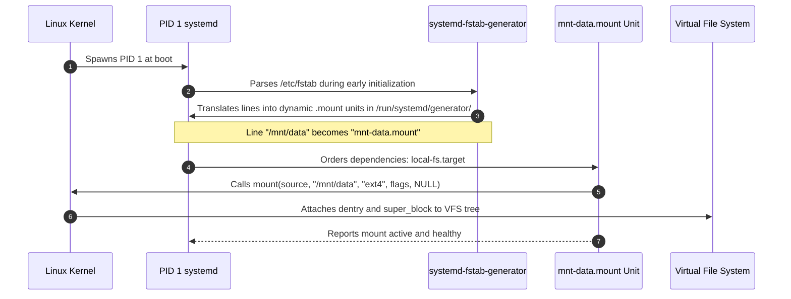

<!--
================================================================================
Metadata:
  Title: Mounting, /etc/fstab & Disk Quotas
  Track: Linux & Systems Engineering / DevOps
  Difficulty: Intermediate
  Estimated Time: 50 minutes
  Prerequisites: 03-system/07-storage-and-filesystems.md
  Key Terminology: mount, umount, Lazy Unmount (umount -l), /etc/fstab, UUID, PARTUUID, Mount Options (defaults, noatime, nodev, nosuid, noexec, ro, rw), findmnt, systemd.mount, Disk Quotas, quota
================================================================================
-->

# Mounting, /etc/fstab & Disk Quotas

[<- 07-storage-and-filesystems.md](./07-storage-and-filesystems.md) | [Back to Module Overview](./README.md) | [09-lvm-and-raid.md ->](./09-lvm-and-raid.md)

---

## Table of Contents
- [1. What & Why](#1-what--why)
- [2. Core Concepts](#2-core-concepts)
- [3. How It Works Internally](#3-how-it-works-internally)
- [4. Syntax & Usage](#4-syntax--usage)
- [5. Practical Examples](#5-practical-examples)
- [6. Best Practices](#6-best-practices)
- [7. Common Mistakes & Troubleshooting](#7-common-mistakes--troubleshooting)
- [8. Performance, Security & Cost Implications](#8-performance-security--cost-implications)
- [9. Comparison Table](#9-comparison-table)
- [10. Real-World Interview Questions](#10-real-world-interview-questions)
- [11. Practice Exercises](#11-practice-exercises)
- [12. Summary & Quick Reference Cheat Sheet](#12-summary--quick-reference-cheat-sheet)
- [13. Further Reading & Official Documentation](#13-further-reading--official-documentation)

---

## 1. What & Why

In Linux, storage devices and filesystems do not appear as isolated drive letters (such as `C:` or `D:` in Windows). Instead, the entire operating system presents a single, unified hierarchical directory tree rooted at **`/`**. Attaching an external SSD, a network NFS export, a Docker overlay volume, or a secondary database disk requires **Mounting**—grafting the filesystem of that storage device onto an existing directory node in the Virtual File System (VFS) tree.

Understanding mounting and persistent table management is crucial:
- A single syntax error in `/etc/fstab` can cause a server to fail to boot, dumping the cloud VM into an unbootable emergency rescue shell requiring serial console recovery.
- Choosing proper mount options (such as `noatime`, `nodev`, `nosuid`, and `noexec`) hardens servers against privilege escalation exploits and accelerates disk read throughput.
- When an administrator attempts to unmount a busy filesystem during maintenance (`device is busy`), understanding open file handles and lazy unmounting (`umount -l`) prevents service deadlocks.

---

## 2. Core Concepts

### The VFS Mount Point Grafting Model
When a storage device is mounted onto a directory (e.g., `/mnt/data`), the directory becomes a **Mount Point**:
- Any prior files existing inside `/mnt/data` become hidden (shadowed) until the device is unmounted.
- All filesystem reads and writes directed at `/mnt/data` are routed by the kernel VFS layer directly to the driver and block sectors of the newly mounted device.

```
+-------------------------------------------------------------------------+
| VFS MOUNT GRAFTING ARCHITECTURE                                         |
|                                                                         |
|  [ Root Filesystem (/) ] (/dev/nvme0n1p1)                               |
|  ├── /bin                                                               |
|  ├── /etc                                                               |
|  ├── /var                                                               |
|  └── /mnt                                                               |
|        └── /data  <==== [ MOUNT POINT GRAFT ]                           |
|               │                                                         |
|               └──────> [ Secondary Block Device ] (/dev/sdb1 - ext4)    |
|                        ├── /customer_records                            |
|                        └── /transaction_logs                            |
+-------------------------------------------------------------------------+
```

### The `/etc/fstab` File Structure
The `/etc/fstab` (File System Table) configuration file defines how disks and partitions are mounted automatically during system boot. Every line consists of exactly **6 fields**:

```text
# <file system>                           <mount point>   <type>  <options>       <dump>  <pass>
UUID=3c9b744e-128a-4d22-b519-5a1e2f9d8c7b  /mnt/data       ext4    defaults,noatime  0       2
```

1. **`<file system>`**: Device identifier. Modern standard is `UUID=<uuid>` or `LABEL=<label>`. (Avoid raw device nodes like `/dev/sdb1`).
2. **`<mount point>`**: The target directory where the filesystem will be attached.
3. **`<type>`**: Filesystem format (`ext4`, `xfs`, `btrfs`, `vfat`, `nfs`).
4. **`<options>`**: Comma-separated mount flags controlling performance and security.
5. **`<dump>`**: Used by legacy `dump` backup tool. Always set to **`0`** in modern systems.
6. **`<pass>`**: Used by `fsck` to determine filesystem check order on boot:
   - `1`: Root filesystem (`/`). Checked first.
   - `2`: Other local filesystems. Checked in order.
   - `0`: Disabled (used for swap, virtual filesystems, and XFS).

---

## 3. How It Works Internally

Systemd automatically translates `/etc/fstab` into native systemd units at boot time using an internal generator:



### Mount Namespaces
Under Linux namespaces, different processes can see completely different mount trees:
- Containers (Docker, Kubernetes) run in their own **Mount Namespaces** (`mnt`).
- A filesystem mounted inside a container's mount namespace is completely invisible to the host root mount namespace unless explicitly shared via **Shared Mount propagation** (`rshared`).

---

## 4. Syntax & Usage

### 1. Manual Mounting and Unmounting
```bash
# Mount a partition to a directory
sudo mount /dev/sdb1 /mnt/data

# Mount as read-only
sudo mount -o ro /dev/sdb1 /mnt/data

# Remount a mounted filesystem (e.g. toggle from read-only to read-write)
sudo mount -o remount,rw /mnt/data

# Bind mount: Mirror an existing directory to another location without formatting
sudo mount --bind /var/www /srv/backup_view

# Standard unmount
sudo umount /mnt/data

# Lazy unmount: Detaches filesystem immediately from namespace, cleaning up FDs once idle
sudo umount -l /mnt/data

# Force unmount: Useful for unreachable NFS mounts
sudo umount -f /mnt/nfs_share
```

### 2. Inspecting Active Mounts with `findmnt`
Avoid legacy `cat /etc/mtab` or raw `mount` outputs:
```bash
# Display visual tree of all active mounts
findmnt

# Check what is mounted at a specific path
findmnt /mnt/data

# Verify /etc/fstab definitions without mounting
findmnt --verify
```

### 3. Testing `/etc/fstab` Safely
**Crucial Rule**: Never reboot after editing `/etc/fstab` without testing!
```bash
# Mount all filesystems defined in /etc/fstab that are not yet mounted
sudo mount -a
```
If `mount -a` executes silently with zero output, your `/etc/fstab` syntax is valid. If it emits errors, fix them before rebooting!

---

## 5. Practical Examples

### 1. Basic: Adding a Persistent Secondary SSD to `/etc/fstab`
Add a newly formatted drive to `/etc/fstab` using persistent UUIDs:
```bash
#!/usr/bin/env bash
set -euo pipefail

DEV="/dev/sdb1"
MOUNT_DIR="/mnt/app_data"

# 1. Extract UUID
FS_UUID=$(sudo blkid -s UUID -o value "$DEV")
FSTYPE=$(sudo blkid -s TYPE -o value "$DEV")

# 2. Create mount point
sudo mkdir -p "$MOUNT_DIR"

# 3. Append to /etc/fstab safely
FSTAB_LINE="UUID=${FS_UUID}  ${MOUNT_DIR}  ${FSTYPE}  defaults,noatime,nodev  0  2"

echo "[INFO] Adding line to /etc/fstab: $FSTAB_LINE"
echo "$FSTAB_LINE" | sudo tee -a /etc/fstab

# 4. Verify syntax
sudo mount -a
echo "[SUCCESS] Volume mounted persistently."
findmnt "$MOUNT_DIR"
```

### 2. Real-World: Triaging `umount: target is busy`
Attempting to unmount a storage volume during maintenance fails:
```text
umount: /mnt/data: target is busy.
```
*Triage*:
```bash
# 1. Identify which processes have open file descriptors or CWD in /mnt/data
sudo lsof +f -- /mnt/data
# Or with fuser:
sudo fuser -vm /mnt/data
```
**Sample Output**:
```text
                     USER        PID ACCESS COMMAND
/mnt/data:           ubuntu     4812 ..c..  bash
                     app-user   5104 f....  node
```
*Resolution*:
- PID 4812 has their current working directory inside the mount (`..c..`). Ask the user to `cd` out, or kill the process: `sudo fuser -k /mnt/data`.
- Once processes release descriptors, `sudo umount /mnt/data` succeeds.

### 3. Edge Case: Handling Non-Critical External Drives with `nofail`
If an external USB backup drive or cloud EBS volume in `/etc/fstab` is detached and the server reboots:
- **Default Behavior**: Systemd waits 90 seconds attempting to find the device, fails, and drops into an emergency rescue shell, halting server boot!
- **Production Solution**: Add the **`nofail`** and **`x-systemd.device-timeout`** mount options:
```text
UUID=4a8f9b2c...  /mnt/external  ext4  defaults,nofail,x-systemd.device-timeout=5s  0  0
```
With `nofail`, if the device is missing, systemd logs a warning and proceeds with normal multi-user boot uninterrupted.

### 4. Failure Case: The Unbootable Trailing Syntax Error
A sysadmin accidentally leaves a typo or missing field in `/etc/fstab`:
```text
# BROKEN LINE: Missing pass parameter or invalid mount option
UUID=1234-ABCD  /mnt/data  ext4  defualts  0
```
*Consequence*: On reboot, `systemd-fstab-generator` crashes or fails to mount local filesystems, entering `emergency.target`.  
*Emergency Recovery*:
1. The root filesystem is mounted read-only in rescue mode. Remount as read-write:
   ```bash
   mount -o remount,rw /
   ```
2. Open `/etc/fstab` in `vim` or `nano` and comment out the offending line.
3. Type `systemctl reboot` to boot normally.

### 5. Production-Grade: Hardened Security Mount Options for Shared Directories
Secure world-writable partitions (like `/tmp`, `/var/tmp`, and `/dev/shm`) to prevent attackers from executing downloaded malware:
In `/etc/fstab`:
```text
# Mount /tmp in RAM with strict security restrictions
tmpfs  /tmp  tmpfs  rw,nosuid,nodev,noexec,size=2G  0  0
```
*Security Directives Explained*:
- **`nodev`**: Prohibits the creation or interpretation of block or character device nodes (prevents creating rogue `/dev/sda` nodes to bypass disk permissions).
- **`nosuid`**: Disables the SUID and SGID privilege escalation bits (prevents malicious `chmod u+s /tmp/bad_binary`).
- **`noexec`**: Prohibits execution of any binaries or scripts directly from this partition (blocks executing downloaded malware).

---

## 6. Best Practices

1. **Always Mount by UUID**: Never use device names like `/dev/sdb1` in `/etc/fstab`. Device letters change on cloud VMs whenever volumes are detached or hardware buses re-enumerate.
2. **Always Run `sudo mount -a` Before Rebooting**: Never reboot after editing `/etc/fstab` without validating syntax with `mount -a` and `findmnt --verify`.
3. **Always Add `noatime` on High-Throughput Volumes**: Eliminates unnecessary disk writes caused by reading files, boosting performance on SSDs and NVMe storage.
4. **Use `nofail` for Non-Root Secondary Drives**: Protect cloud instances from boot failures when optional or network-attached volumes are absent.
5. **Protect `/tmp` with `noexec,nosuid,nodev`**: Follow CIS benchmark standards to harden memory-backed and world-writable filesystems.

---

## 7. Common Mistakes & Troubleshooting

| Mistake / Antipattern | Underlying Cause | Consequence | Production Solution |
| :--- | :--- | :--- | :--- |
| Server boots into emergency rescue mode | Typo in `/etc/fstab` or missing drive without `nofail`. | Cloud instance becomes unreachable over network. | Remount root `mount -o remount,rw /` and fix `/etc/fstab`. |
| Unmounting fails: `device is busy` | Active processes have open file descriptors or CWD on mount. | Administrative maintenance is blocked. | Identify culprits with `lsof +f -- <path>` or use `umount -l`. |
| Using `/dev/sdb1` in `/etc/fstab` | Drive letters change when disks are attached or detached. | Mounts wrong disk or fails boot on hardware changes. | Use `UUID=...` from `blkid`. |
| Missing `noexec` on `/tmp` | Default tmp mount permits binary execution. | Attackers upload and execute reverse shells from `/tmp`. | Mount `/tmp` with `nosuid,nodev,noexec`. |
| Overwriting hidden files during mount | Mounting a volume on top of an existing directory with files. | Existing files become invisible until unmounted. | Ensure mount point directory is empty before mounting. |
| Forgetting to reload systemd after fstab edit | Systemd generates mount units from fstab only at boot or reload. | Systemd status does not reflect new fstab entries. | Run `sudo systemctl daemon-reload`. |

---

## 8. Performance, Security & Cost Implications

### Performance
- **The `noatime` vs `relatime` Trade-off**:
  - `atime`: Updates access time on *every single read*. High I/O overhead.
  - `relatime` (Linux default): Updates access time only if the previous `atime` was older than `mtime` or `ctime`, or older than 24 hours.
  - `noatime`: Completely disables access time updates. Yields optimal performance on web servers, caches, and high-read databases.

### Security
- **Defense-in-Depth Mount Restrictions**:
  - `nosuid`: Blocks privilege escalation exploits (e.g., GTFOBins SUID copies).
  - `nodev`: Blocks attackers from using `mknod` to bypass access controls.
  - `noexec`: Blocks executing ELF binaries directly from user-writable directories.

### Cost
- In cloud automation, an instance dropping into an emergency shell because a non-essential EBS volume is missing causes downtime, SLA breaches, and engineer on-call alerts. Adding `nofail` prevents these costly false-positive outages.

---

## 9. Comparison Table

| Mount Option | Meaning | Performance Impact | Security Benefit | Recommended Use |
| :--- | :--- | :--- | :--- | :--- |
| **`defaults`** | `rw, suid, dev, exec, auto, nouser, async` | Standard baseline | None | Generic root system partitions |
| **`noatime`** | Disables read access timestamp updates | **High positive boost (reduces disk writes)**| Neutral | Database, cache, and log volumes |
| **`nodev`** | Disallows block/character device files | None | **High (Prevents rogue mknod devices)**| All non-root partitions (`/home`, `/tmp`) |
| **`nosuid`** | Disallows SUID and SGID execution bits | None | **High (Prevents privilege escalation)**| All user-writable mounts (`/tmp`, `/var`) |
| **`noexec`** | Disallows executing binaries | None | **High (Prevents malware execution)**| `/tmp`, `/dev/shm`, `/var/tmp` |
| **`nofail`** | Boots cleanly even if device is missing | Prevents 90s timeout | Prevents boot lockout | External USBs, secondary EBS disks |
| **`ro`** | Mounts filesystem strictly read-only | Prevents all disk writes | **Absolute data immutability** | Immutable golden images, forensic triage |

---

## 10. Real-World Interview Questions

### Q1: What does `mount -o remount,rw /` do, and when is it required?
<details>
<summary>Answer</summary>
This command remounts the root filesystem (`/`) in read-write mode without unmounting it.
**When it is required**: During emergency maintenance or rescue mode boots. If `/etc/fstab` contains an error or filesystem corruption is detected during boot, systemd drops into an emergency rescue shell with the root partition mounted **strictly read-only** (`ro`) to prevent further damage. In this state, an administrator cannot edit `/etc/fstab` or fix files. Running `mount -o remount,rw /` switches the root mount to read-write mode, allowing configuration repairs before rebooting.
</details>

### Q2: Why should you use UUID instead of `/dev/sdX` in `/etc/fstab`?
<details>
<summary>Answer</summary>
Device node paths (like `/dev/sda`, `/dev/sdb`) are dynamically assigned by the Linux kernel during boot as device drivers detect hardware buses.
- If a hard drive is plugged into a different SATA port, if a PCIe NVMe card is added, or if cloud EBS volumes are detached and re-attached, the kernel enumeration order can change (`/dev/sdb` can become `/dev/sdc`).
- If device paths are hardcoded in `/etc/fstab`, the server may mount the wrong disk or fail to boot entirely.
- A **Filesystem UUID** (e.g., `UUID=4f3b...`) is an immutable 128-bit identifier written directly into the filesystem superblock at format time. It never changes regardless of which physical port or bus the disk is attached to.
</details>

### Q3: Explain what `umount -l` (Lazy Unmount) does and when it should be used.
<details>
<summary>Answer</summary>
When a filesystem cannot be unmounted normally because active processes have open file descriptors on it (`target is busy`), standard `umount` fails.
`umount -l` (Lazy Unmount):
1. **Immediately detaches** the filesystem from the directory tree hierarchy so no new processes can access it.
2. Allows existing processes that hold open file descriptors to finish reading/writing.
3. The kernel automatically cleans up and releases all resources and unmounts the volume as soon as the last open file descriptor is closed.
It should be used during graceful maintenance shutdowns when you want to prevent new traffic while allowing active jobs to drain.
</details>

### Q4: What do the 5th and 6th fields in an `/etc/fstab` line represent?
<details>
<summary>Answer</summary>
- **5th Field (`<dump>`)**: Used by the legacy `dump` backup command to determine if the filesystem should be backed up. A value of `1` indicates backup; `0` indicates ignore. In modern Linux engineering, `dump` is obsolete; this field is virtually always set to **`0`**.
- **6th Field (`<pass>`)**: Used by `fsck` during boot to determine the order of filesystem consistency checks:
  - `1`: The root filesystem (`/`). Must be checked first.
  - `2`: All other local filesystems requiring boot-time integrity checks.
  - `0`: Skips boot-time `fsck`. Used for swap space, network mounts (NFS), virtual filesystems (`tmpfs`, `proc`), and modern filesystems like XFS (which handle log replay natively).
</details>

### Q5: How does a Bind Mount differ from a Symlink?
<details>
<summary>Answer</summary>
- **Symlink (Symbolic Link)**: A small file containing a text string representing a target path. Resolved in user space. If a process is placed in a `chroot` or container namespace where the target path does not exist, the symlink breaks.
- **Bind Mount (`mount --bind /src /dst`)**: A kernel VFS operation that aliases an existing directory or file to a secondary location. Both directories point directly to the same underlying inode and dentry structures in kernel memory. Bind mounts work seamlessly across chroots and container boundaries (it is the foundation of Docker `-v /host:/container` volume mounts).
</details>

### Q6: What is the risk of mounting a filesystem with the `exec` option on a world-writable directory?
<details>
<summary>Answer</summary>
If a world-writable directory (such as `/tmp` or `/var/tmp`) allows execution (`exec`), an attacker or malicious script can write executable binaries or scripts to that directory and execute them directly, bypassing restrictions on the rest of the filesystem.
Hardening standards (CIS Benchmark) mandate mounting world-writable partitions with **`noexec,nosuid,nodev`**, preventing attackers from running downloaded exploits or setting SUID root backdoors.
</details>

### Q7: What is the purpose of `systemd.automount`?
<details>
<summary>Answer</summary>
`systemd.automount` units (or the `x-systemd.automount` option in `/etc/fstab`) create an on-demand mount point.
Instead of mounting the filesystem at boot time:
1. Systemd creates an active autofs mount trap on the target directory.
2. The actual underlying storage (such as a remote NFS share or secondary disk) remains unmounted.
3. The moment any process attempts to `cd` into or access a file in that directory, systemd pauses the process, mounts the storage volume transparently, and resumes the process.
4. It can also unmount automatically after an idle period (`x-systemd.idle-timeout=10m`).
</details>

### Q8: How can you check what options a filesystem was actually mounted with at runtime?
<details>
<summary>Answer</summary>
Inspect `/proc/mounts`:
```bash
findmnt -o TARGET,SOURCE,FSTYPE,OPTIONS /mnt/data
# Or:
grep "/mnt/data" /proc/mounts
```
`/proc/mounts` reflects the true live kernel state, showing all default options expanded (e.g., `rw,relatime,seclabel,attr2,inode64,noquota`), whereas `/etc/fstab` only reflects what was requested.
</details>

---

## 11. Practice Exercises

### Exercise 1: Validating /etc/fstab Syntax (Easy)
**Task**: Use `findmnt --verify` and `mount -a` to verify that the host's current `/etc/fstab` file contains no syntax errors or unreachable devices.

<details>
<summary>Solution</summary>

```bash
# Verify fstab syntax and target paths
sudo findmnt --verify

# Test mount activation
sudo mount -a
```
</details>

### Exercise 2: Mounting an ISO Image via Loopback (Easy)
**Task**: Create a temporary directory `/mnt/iso`, mount an ISO or disk image file to it in read-only mode using a loop device, view its contents, and unmount cleanly.

<details>
<summary>Solution</summary>

```bash
# Create dummy image
dd if=/dev/zero of=/tmp/sample.img bs=1M count=10
mkfs.ext4 -F /tmp/sample.img

# Mount via loop
sudo mkdir -p /mnt/loop
sudo mount -o loop,ro /tmp/sample.img /mnt/loop

# Verify read-only state
findmnt /mnt/loop
# sudo touch /mnt/loop/test -> Fails with "Read-only file system"

# Clean up
sudo umount /mnt/loop
sudo rm -rf /mnt/loop /tmp/sample.img
```
</details>

### Exercise 3: Setting Up a Secure In-Memory Tmpfs Mount (Medium)
**Task**: Create a temporary in-memory `tmpfs` filesystem mounted at `/mnt/secure_tmp` with a maximum size of 256 MB, hardened with `nosuid`, `nodev`, and `noexec`. Verify that compiling or executing a script inside it fails with "Permission denied".

<details>
<summary>Solution</summary>

```bash
#!/usr/bin/env bash
set -euo pipefail

MOUNT_DIR="/mnt/secure_tmp"
sudo mkdir -p "$MOUNT_DIR"

# Mount with security restrictions
sudo mount -t tmpfs -o size=256M,nosuid,nodev,noexec tmpfs "$MOUNT_DIR"

# Test execution prevention
cat <<'EOF' > /tmp/test.sh
#!/bin/sh
echo "Malware payload"
EOF
sudo cp /tmp/test.sh "${MOUNT_DIR}/test.sh"
sudo chmod +x "${MOUNT_DIR}/test.sh"

# Attempt execution (Fails!)
if "${MOUNT_DIR}/test.sh" 2>/dev/null; then
  echo "Execution succeeded (Insecure!)"
else
  echo "[SUCCESS] Execution blocked by noexec mount option!"
fi

# Clean up
sudo umount "$MOUNT_DIR"
sudo rm -rf "$MOUNT_DIR" /tmp/test.sh
```
</details>

### Exercise 4: Identifying Open Descriptors Blocking Unmount (Medium)
**Task**: Write a background script that holds a file open in `/mnt/data`. Demonstrate that `umount` fails with `target is busy`, use `lsof` and `fuser` to identify and terminate the holder, and complete the unmount.

<details>
<summary>Solution</summary>

```bash
#!/usr/bin/env bash
set -euo pipefail

# Setup test mount
dd if=/dev/zero of=/tmp/busy.img bs=1M count=20
mkfs.ext4 -F /tmp/busy.img
sudo mkdir -p /mnt/busy
sudo mount -o loop /tmp/busy.img /mnt/busy

# Start background process holding open descriptor
( exec 3> /mnt/busy/holding.lock; sleep 30 ) &
HOLDER_PID=$!

sleep 1
# Attempt unmount (Fails!)
if sudo umount /mnt/busy 2>/dev/null; then
  echo "Unmount succeeded"
else
  echo "[EXPECTED] Unmount failed: Target is busy."
fi

# Identify and kill blocking process
echo "[INFO] Finding blocking processes:"
sudo fuser -vm /mnt/busy
sudo fuser -k /mnt/busy

# Unmount succeeds
sleep 1
sudo umount /mnt/busy
echo "[SUCCESS] Unmounted successfully."

# Clean up
sudo rm -rf /mnt/busy /tmp/busy.img
```
</details>

### Exercise 5: Converting Legacy Fstab Lines to Systemd Mount Units (Hard)
**Task**: Take an `/etc/fstab` line for a data volume and write a native, persistent systemd unit `/etc/systemd/system/data-storage.mount` that replaces it, complete with directory auto-creation and security hardening.

<details>
<summary>Solution</summary>

Unit file name must match mount path: `/data/storage` -> `data-storage.mount`:
```ini
# /etc/systemd/system/data-storage.mount
[Unit]
Description=Application Data Storage Mount
Before=local-fs.target

[Mount]
What=/dev/disk/by-uuid/3c9b744e-128a-4d22-b519-5a1e2f9d8c7b
Where=/data/storage
Type=ext4
Options=defaults,noatime,nodev

[Install]
WantedBy=multi-user.target
```
*Activation*:
```bash
sudo systemctl daemon-reload
sudo systemctl enable --now data-storage.mount
```
</details>

### Exercise 6: User Disk Quota Enforcement (Hard)
**Task**: Configure disk quotas on an ext4 filesystem mounted at `/home`, turn on quota accounting, and assign a hard limit of 500 MB to user `testuser`. Demonstrate quota enforcement when writing a 600 MB file.

<details>
<summary>Solution</summary>

```bash
# 1. Enable quota mount option in fstab or mount command
# mount -o remount,usrquota /home

# 2. Initialize quota database files (aquota.user)
# sudo quotacheck -cum /home
# sudo quotaon -v /home

# 3. Set quota for testuser (Soft limit: 400MB, Hard limit: 500MB)
# sudo setquota -u testuser 400M 500M 0 0 /home

# 4. Inspect quota report
# sudo repquota -u /home

# 5. Writing > 500MB as testuser triggers:
# dd: error writing '/home/testuser/large.bin': Disk quota exceeded
```
</details>

---

## 12. Summary & Quick Reference Cheat Sheet

| Task | Command | Description |
| :--- | :--- | :--- |
| **Mount Device** | `sudo mount <dev> <dir>` | Grafts device onto directory tree |
| **Mount by UUID** | `sudo mount UUID="<uuid>" <dir>`| Persistent mounting syntax |
| **Mount Read-Only** | `sudo mount -o ro <dev> <dir>` | Protects disk from writes |
| **Remount Read-Write** | `sudo mount -o remount,rw <dir>` | Changes mount state live |
| **Bind Mount** | `sudo mount --bind <src> <dst>` | Mirrors directory tree |
| **Unmount** | `sudo umount <dir>` | Detaches filesystem |
| **Lazy Unmount** | `sudo umount -l <dir>` | Detaches instantly; cleans FDs when idle |
| **Force Unmount** | `sudo umount -f <dir>` | For dead network/NFS mounts |
| **Find Open Files** | `sudo lsof +f -- <dir>` | Lists processes blocking unmount |
| **Kill Blocking Processes**| `sudo fuser -k -m <dir>` | Sends SIGKILL to all processes using mount |
| **Verify /etc/fstab** | `sudo findmnt --verify` | Validates fstab configuration |
| **Mount All in Fstab** | `sudo mount -a` | Mounts all unmounted entries in fstab |

---

## 13. Further Reading & Official Documentation

- [Linux Man Pages: mount(8)](https://man7.org/linux/man-pages/man8/mount.8.html)
- [Linux Man Pages: fstab(5)](https://man7.org/linux/man-pages/man5/fstab.5.html)
- [Linux Man Pages: findmnt(8)](https://man7.org/linux/man-pages/man8/findmnt.8.html)
- [systemd.mount(5) Specification](https://www.freedesktop.org/software/systemd/man/latest/systemd.mount.html)
- [Red Hat Enterprise Linux 9: Storage Administration Guide](https://access.redhat.com/documentation/en-us/red_hat_enterprise_linux/9/html/managing_storage_devices/)

---

[<- 07-storage-and-filesystems.md](./07-storage-and-filesystems.md) | [Back to Module Overview](./README.md) | [09-lvm-and-raid.md ->](./09-lvm-and-raid.md)
