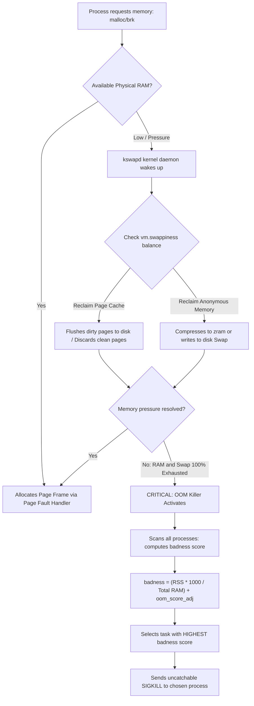

<!--
================================================================================
Metadata:
  Title: Memory Management, Swap & OOM Killer
  Track: Linux & Systems Engineering / DevOps
  Difficulty: Advanced
  Estimated Time: 55 minutes
  Prerequisites: 03-system/01-processes-and-signals.md, 03-system/07-storage-and-filesystems.md
  Key Terminology: Virtual Memory, Physical RAM, Page Cache, Anonymous Memory, Swap, zram, swapon, swapoff, vm.swappiness, vm.vfs_cache_pressure, OOM Killer, oom_score, oom_score_adj, Memory Overcommit
================================================================================
-->

# Memory Management, Swap & OOM Killer

[<- 09-lvm-and-raid.md](./09-lvm-and-raid.md) | [Back to Module Overview](./README.md) | [11-kernel-modules-and-sysctl.md ->](./11-kernel-modules-and-sysctl.md)

---

## Table of Contents
- [1. What & Why](#1-what--why)
- [2. Core Concepts](#2-core-concepts)
- [3. How It Works Internally](#3-how-it-works-internally)
- [4. Syntax & Usage](#4-syntax--usage)
- [5. Practical Examples](#5-practical-examples)
- [6. Best Practices](#6-best-practices)
- [7. Common Mistakes & Troubleshooting](#7-common-mistakes--troubleshooting)
- [8. Performance, Security & Cost Implications](#8-performance-security--cost-implications)
- [9. Comparison Table](#9-comparison-table)
- [10. Real-World Interview Questions](#10-real-world-interview-questions)
- [11. Practice Exercises](#11-practice-exercises)
- [12. Summary & Quick Reference Cheat Sheet](#12-summary--quick-reference-cheat-sheet)
- [13. Further Reading & Official Documentation](#13-further-reading--official-documentation)

---

## 1. What & Why

In systems engineering, physical memory (RAM) is often the most critical bottleneck. A sudden memory spike from a memory leak or traffic surge does not merely degrade application performance; it can trigger the Linux kernel's most aggressive self-defense mechanism: the **Out-Of-Memory (OOM) Killer**.

Understanding Linux memory management is essential for every SRE and backend architect:
- **The "Linux Ate My RAM" Fallacy**: Misinterpreting the kernel's **Page Cache** as "used memory" causes inexperienced engineers to panic when `free -h` shows 95% memory consumed.
- **Swap Architecture**: Sizing and tuning **Swap space** properly acts as a crucial safety cushion, absorbing temporary allocation spikes and allowing the kernel to page out dormant anonymous memory.
- **OOM Killer Defense**: When physical RAM and swap are completely exhausted, the OOM Killer terminates processes to prevent the kernel from crashing. Systems engineers must know how the kernel calculates OOM sacrifice scores (`oom_score`) and how to shield critical database engines (PostgreSQL, Redis) from kernel termination using `oom_score_adj`.

---

## 2. Core Concepts

### Virtual Memory and Memory Partitioning
In Linux, applications never touch physical RAM directly. Every process executes within a 64-bit **Virtual Address Space** managed by the CPU's Memory Management Unit (MMU) and the kernel page tables.

Physical memory is partitioned into distinct categories:

```
+-------------------------------------------------------------------------+
| LINUX PHYSICAL RAM PARTITIONING (free -m view)                          |
|                                                                         |
|  [ Total Physical RAM ]                                                 |
|  ┌───────────────────────┬───────────────────────────────────────────┐  |
|  │   Kernel & Driver     │              Userspace Allocations        │  |
|  │   Reserved Space      │                                           │  |
|  └───────────────────────┴───────────────────────────────────────────┘  |
|                                  │                                      |
|            ┌─────────────────────┴─────────────────────┐                |
|            v                                           v                |
|  [ Anonymous Memory ]                       [ Page Cache & Buffers ]    |
|  ├── Heap allocations (malloc)              ├── File-backed cache blocks|
|  ├── Process stack                          ├── Cached disk reads/writes|
|  └── Shared memory (shm, tmpfs)             └── Dentries and inodes     |
|  (CANNOT be discarded; must be              (CAN be reclaimed instantly |
|   paged out to SWAP if RAM full)             by dropping clean pages!)  |
+-------------------------------------------------------------------------+
```

### Free vs. Available Memory
- **`free`**: Raw unallocated physical memory pages. A healthy Linux server intentionally keeps `free` very low, because unused RAM is wasted RAM!
- **`available`**: The true metric of available capacity. It represents memory that can be immediately allocated to new or expanding processes without swapping (includes `free` plus reclaimable `buff/cache`).

### Swap: Files vs. Partitions vs. Zram
When anonymous memory cannot fit in physical RAM, the kernel pages inactive memory out to **Swap**:
1. **Swap Partition**: A dedicated block partition (`/dev/sda3`) formatted with `mkswap`. High performance, but inflexible to resize.
2. **Swap File**: A contiguous binary file on the root filesystem (`/swapfile`). Slower on legacy spinning disks, but effortless to resize online. Standard in Ubuntu and cloud VMs.
3. **Zram (Compressed RAM Swap)**: Creates a virtual block device in RAM that dynamically compresses swapped pages (using `zstd` or `lz4`). Allows storing 2x–3x more data in RAM without touching slow disk storage. Default in Fedora and modern container hosts.

---

## 3. How It Works Internally

When the kernel faces memory pressure, the **kswapd** daemon and the OOM killer evaluate reclamation options:



### The OOM Killer Badness Calculation
The kernel function `oom_badness()` assigns an integer score from **0 to 1000** to every running process:
$$\text{oom\_score} \approx \left(\frac{\text{Process RSS}}{\text{Total Available Memory}} \times 1000\right) + \text{oom\_score\_adj}$$
- A process consuming 60% of all system RAM starts with a baseline score of ~600.
- Short-lived worker processes are favored for termination over root daemons.
- The administrator can bias this calculation via `/proc/<PID>/oom_score_adj` (ranging from `-1000` to `+1000`).
- Setting `oom_score_adj = -1000` **completely immunizes** the process; the OOM killer will never terminate it.

---

## 4. Syntax & Usage

### 1. Inspecting Memory Metrics
```bash
# Display memory and swap summary (human-readable)
free -h

# Continuous memory monitoring every 2 seconds
free -h -s 2

# Comprehensive virtual memory statistics
vmstat -S M 1 5

# Deep memory breakdown from the kernel
cat /proc/meminfo
# Key fields: MemTotal, MemAvailable, MemFree, Buffers, Cached, AnonPages, SwapTotal, SwapFree
```

### 2. Creating and Activating a Swap File
```bash
# 1. Allocate 4 GB contiguous file using fallocate (or dd)
sudo fallocate -l 4G /swapfile

# 2. Enforce strict permissions (MANDATORY: must be read-write by root ONLY!)
sudo chmod 600 /swapfile

# 3. Format as Linux swap storage
sudo mkswap /swapfile

# 4. Activate swap file immediately
sudo swapon /swapfile

# 5. Verify active swap devices
swapon --show

# 6. Make persistent across reboots in /etc/fstab:
echo '/swapfile none swap sw 0 0' | sudo tee -a /etc/fstab
```

### 3. Tuning Memory Kernel Parameters via `sysctl`
```bash
# Check current swappiness (default: 60)
sysctl vm.swappiness

# Lower swappiness to 10 (biases kernel to keep anonymous memory in RAM)
sudo sysctl -w vm.swappiness=10

# Adjust VFS cache reclaim pressure (default: 100)
# Values > 100 cause kernel to aggressively reclaim directory and inode caches
sudo sysctl -w vm.vfs_cache_pressure=50

# Overcommit handling (0 = heuristic, 1 = always overcommit, 2 = strict no overcommit)
sysctl vm.overcommit_memory
```

### 4. Protecting Critical Daemons from OOM Killer
```bash
# Check current OOM score of a running database (PID 4810)
cat /proc/4810/oom_score

# Immunize process completely from OOM termination (-1000)
echo -1000 | sudo tee /proc/4810/oom_score_adj

# In a systemd service unit:
# [Service]
# OOMScoreAdjust=-1000
```

---

## 5. Practical Examples

### 1. Basic: Deciphering the `free -h` Output Correctly
Interpreting actual memory state:
```text
               total        used        free      shared  buff/cache   available
Mem:            15Gi       4.2Gi       1.1Gi       240Mi        10Gi        11Gi
Swap:          4.0Gi       120Mi       3.9Gi
```
*Analysis*:
- `total` (15 GB): Physical RAM installed.
- `used` (4.2 GB): Active anonymous application memory (heap, stacks, buffers that cannot be freed).
- `free` (1.1 GB): Completely unallocated memory pages.
- `buff/cache` (10 GB): Disk blocks cached in RAM to speed up read access.
- **`available` (11 GB)**: The real headroom! If an application suddenly requests 8 GB of RAM, the kernel will immediately discard 7 GB of cached files and allocate the memory without swapping!

### 2. Real-World: Protecting PostgreSQL from OOM Termination
Configure a systemd drop-in override to guarantee that if the server runs out of memory, background workers or web servers are sacrificed instead of the primary database:
```bash
sudo systemctl edit postgresql
```
Add:
```ini
[Service]
# Immunize PostgreSQL from OOM killer
OOMScoreAdjust=-900
```
Verify:
```bash
sudo systemctl restart postgresql
cat /proc/$(pgrep -f "postgres: master")/oom_score_adj
# Output: -900
```

### 3. Edge Case: Triaging Past OOM Killer Incidents in `journalctl`
When a service mysteriously disappears without leaving an application crash log:
```bash
# Search system journal for OOM killer invocations
sudo journalctl -k --grep="Out of memory"
# Or search dmesg
sudo dmesg -T | grep -i -E "oom[-_]killer|killed process"
```
**Sample Output**:
```text
[Wed Nov 25 14:22:10 2026] Out of memory: Killed process 18492 (node) total-vm:4298412kB, anon-rss:2048120kB, file-rss:0kB, shmem-rss:0kB, UID:1001 pgtables:8412kB oom_score_adj:0
```
*Finding*: The kernel explicitly killed PID 18492 (`node`) because it was consuming 2 GB of anonymous resident memory when RAM and swap hit 100%.

### 4. Failure Case: Insecure Permissions on Swap Files
Creating a swap file with default umask (`0644`):
```bash
# CATASTROPHIC SECURITY HOLE:
fallocate -l 2G /swapfile
mkswap /swapfile
swapon /swapfile
# Warning emitted by swapon:
# swapon: /swapfile: insecure permissions 0644, 0600 suggested.
```
*Why this is a severe vulnerability*: Any memory swapped out to disk—including unencrypted database passwords, private SSL keys, and user tokens—can now be read by **any unprivileged local user** on the system by simply running `strings /swapfile`!  
*Remediation*: Always enforce `chmod 600 /swapfile`.

### 5. Production-Grade: Automated OOM Early-Warning Monitor
A daemon script that monitors Memory Pressure Stalls (PSI) via `/proc/pressure/memory`, calculates available memory ratios, and alerts when memory saturation approaches the OOM threshold:
```bash
#!/usr/bin/env bash
set -euo pipefail

THRESHOLD_PERCENT=10

echo "[INFO] Monitoring Linux memory pressure..."

# Extract available memory and total memory in KB
MEM_AVAIL=$(awk '/MemAvailable:/ {print $2}' /proc/meminfo)
MEM_TOTAL=$(awk '/MemTotal:/ {print $2}' /proc/meminfo)

# Calculate percentage of memory available
PERCENT_AVAIL=$(( MEM_AVAIL * 100 / MEM_TOTAL ))

echo "[METRIC] Memory Available: ${PERCENT_AVAIL}% ($(( MEM_AVAIL / 1024 )) MB)"

if (( PERCENT_AVAIL < THRESHOLD_PERCENT )); then
  echo "[CRITICAL ALERT] Memory available is critically low (< ${THRESHOLD_PERCENT}%)!" >&2
  
  # Inspect top 3 memory consumers
  echo "--- Top Memory Consumers ---" >&2
  ps -eo pid,user,rss,oom_score,comm --sort=-rss | head -n 4 >&2
  
  # Dump kernel memory state
  echo "--- /proc/pressure/memory ---" >&2
  cat /proc/pressure/memory >&2
fi
```

---

## 6. Best Practices

1. **Always Configure Swap on Production VMs**: Even on servers with 64 GB of RAM, a small 4 GB swap file provides the kernel with an escape valve to page out idle memory and absorb temporary spikes without triggering an OOM crash.
2. **Tune `vm.swappiness` for Server Workloads**: Default swappiness is 60 (tuned for desktops). On servers, lower `vm.swappiness` to **10** (or **1** for latency-sensitive databases) to prioritize RAM retention for anonymous memory while maintaining the ability to swap during emergencies.
3. **Always Enforce `chmod 600` on Swap Files**: Never leave swap files world-readable; plaintext credentials from memory reside in swap.
4. **Use `OOMScoreAdjust=-900` for Mission-Critical Daemons**: Protect the SSH daemon (`sshd`), database masters, and monitoring agents from being selected by the OOM killer.
5. **Monitor `MemAvailable`, NOT `MemFree`**: Base all automated alerts, health checks, and dashboard metrics on `MemAvailable`.

---

## 7. Common Mistakes & Troubleshooting

| Mistake / Antipattern | Underlying Cause | Consequence | Production Solution |
| :--- | :--- | :--- | :--- |
| Disabling swap completely (`swapoff -a`) | Misunderstanding swap as "slow disk memory". | Minor memory spikes instantly trigger the OOM killer and terminate services. | Maintain at least a modest (2–4 GB) swap space. |
| Insecure swap file permissions (`0644`) | Omitting `chmod 600 /swapfile`. | Any local user can dump secrets and private keys from `/swapfile`. | Enforce `sudo chmod 600 /swapfile`. |
| Panicking over low `free` memory | Linux automatically allocates idle RAM to the Page Cache. | Unnecessary hardware upgrades or rebooting healthy systems. | Check `available` memory; page cache is reclaimed instantly. |
| Setting `vm.swappiness=0` on older kernels | On kernels $< 3.5$, swappiness 0 completely disabled swapping. | Immediate OOM kill during memory pressure. | Use `vm.swappiness=1` or `10` to keep swap available as fallback. |
| Swapping on high-latency network disks | Placing swap files on network-attached storage (NFS, slow EBS). | Server freezes completely ("swap thrashing") when swapping begins. | Place swap on fast local NVMe storage or use zram. |
| Immunizing all processes with `-1000` | Setting `OOMScoreAdjust=-1000` on too many services. | Kernel has no targets to sacrifice; triggers complete kernel panic! | Only immunize 1 or 2 essential core daemons (e.g. database and sshd). |

---

## 8. Performance, Security & Cost Implications

### Performance
- **Swap Thrashing**: If anonymous memory exceeds physical RAM and the system continuously reads and writes pages to disk swap, disk I/O queues saturate. The system enters **Thrashing**—spending 99% of CPU time waiting on swap I/O.
- **Zram vs Disk Swap**: Zram compresses memory at multi-gigabyte/sec speeds using negligible CPU. Using zram instead of disk swap on cloud VMs eliminates disk I/O thrashing during memory bursts.

### Security
- **Memory Overcommit Attacks**: By default, Linux allows **Memory Overcommit** (`vm.overcommit_memory=0`). The kernel grants `malloc()` requests assuming processes won't use all requested memory. A malicious actor can allocate gigabytes of virtual memory and suddenly touch all pages, inducing an immediate OOM panic.

### Cost
- Properly configured swap with `vm.swappiness=10` allows cloud workloads to run reliably on smaller instance sizes (e.g., `t4g.small` instead of `t4g.medium`), cutting cloud compute bills by up to 50%.

---

## 9. Comparison Table

| Attribute | Swap Partition | Swap File | Zram (Compressed RAM) |
| :--- | :--- | :--- | :--- |
| **Storage Medium** | Dedicated disk partition | Regular file on filesystem | **Compressed physical RAM** |
| **Throughput / Latency**| Disk speed (500MB/s - 3GB/s) | Disk speed (500MB/s - 3GB/s) | **Memory bus speed (15GB/s+)** |
| **Resizing Ease** | Difficult (Requires repartitioning)| **Instant (`swapoff; fallocate; swapon`)**| Instant (`zramctl`) |
| **Survives Reboot?** | Yes (via `/etc/fstab`) | Yes (via `/etc/fstab`) | Recreated on boot by service |
| **Best Suited For** | High-performance bare metal | Cloud VMs (AWS/GCP/Azure) | Containers, edge devices, desktops |

---

## 10. Real-World Interview Questions

### Q1: Why does a Linux server with 32 GB of RAM often show only 500 MB "free", and is this an emergency?
<details>
<summary>Answer</summary>
This is **completely normal and expected behavior**, not an emergency.
The Linux kernel operates on the principle that "unused RAM is wasted RAM". Any memory not actively consumed by running application processes (Anonymous memory) is automatically repurposed by the kernel as **Page Cache and Buffers** to store recently read disk blocks, inodes, and directories.
This dramatically accelerates filesystem read operations. If an application suddenly requests 10 GB of memory, the kernel **instantly and transparently discards** 10 GB of clean page cache blocks and hands the memory to the application in nanoseconds. The true metric of available capacity is **`MemAvailable`**, not `MemFree`.
</details>

### Q2: How does the kernel OOM Killer select which process to kill?
<details>
<summary>Answer</summary>
When both physical RAM and swap space are completely exhausted, the kernel invokes `out_of_memory()`, which calls `select_bad_process()`.
1. It iterates through all active processes and computes a badness score (0 to 1000) for each:
   $$\text{points} \approx \frac{\text{process\_rss}}{\text{total\_ram}} \times 1000$$
2. It adds the process's **`oom_score_adj`** value (-1000 to +1000).
3. Root-owned processes and processes performing raw hardware I/O receive minor score reductions.
4. The process with the **highest final badness score** is selected and sent an uncatchable **`SIGKILL`** (Signal 9) to immediately reclaim its memory pages.
</details>

### Q3: What does `vm.swappiness` configure?
<details>
<summary>Answer</summary>
`vm.swappiness` is an integer parameter (0 to 100 or 0 to 200 on newer kernels) that controls the kernel's relative preference between **reclaiming Page Cache** vs. **paging out Anonymous Memory to Swap**.
- **High values (e.g. 60–100)**: The kernel aggressively pages out inactive anonymous memory to swap to preserve a large page cache for disk I/O.
- **Low values (e.g. 1–10)**: The kernel avoids swapping anonymous memory unless absolutely necessary, preferring to reclaim page cache memory first.
- On servers, setting `vm.swappiness=10` is standard practice to prevent application heap memory from being swapped to disk during normal operations.
</details>

### Q4: What is Memory Overcommit (`vm.overcommit_memory`), and what are its modes?
<details>
<summary>Answer</summary>
Memory overcommit is the practice of allocating more virtual memory to processes than physically exists in RAM plus swap, based on the heuristic that processes rarely use all the memory they request.
Configured via `vm.overcommit_memory`:
- **`0` (Heuristic Overcommit - Default)**: The kernel allows reasonable overcommits. Obvious massive overcommit requests are rejected, but moderate ones are granted.
- **`1` (Always Overcommit)**: The kernel always grants all memory allocation requests without checking capacity. Required by software like Redis that relies on `fork()` for background snapshots.
- **`2` (Strict No Overcommit)**: The kernel refuses allocations that exceed:
  $$\text{Commit Limit} = \text{Swap} + (\text{RAM} \times \text{vm.overcommit\_ratio})$$
</details>

### Q5: How do you completely immunize a process from the OOM Killer?
<details>
<summary>Answer</summary>
Write `-1000` to the process's `oom_score_adj` file:
```bash
echo -1000 | sudo tee /proc/<PID>/oom_score_adj
```
In systemd service units, add:
```ini
[Service]
OOMScoreAdjust=-1000
```
A score of `-1000` tells the OOM badness algorithm to skip the process entirely during an out-of-memory event.
</details>

### Q6: What is the difference between Anonymous Memory and Page-Cache-Backed Memory?
<details>
<summary>Answer</summary>
- **Page-Cache-Backed Memory**: Memory pages associated with an underlying file on disk (e.g., executing binary code, shared libraries, or files read via `read()`). Because the data already exists on disk, the kernel can **drop (evict) clean pages instantly** without writing them anywhere.
- **Anonymous Memory**: Memory created dynamically by applications that has no backing file on the filesystem (e.g., process stack, heap memory allocated via `malloc()`). Anonymous memory **cannot be discarded**; if the kernel needs to reclaim the RAM it occupies, it **must write it to Swap**.
</details>

### Q7: What is Zram, and why is it superior to traditional disk swap in cloud containers?
<details>
<summary>Answer</summary>
Zram is a Linux kernel module that creates compressed block devices in physical RAM.
When pages are swapped to a zram device:
- The pages are compressed using high-speed algorithms (`zstd` or `lz4`) at speeds exceeding 15 GB/s.
- With typical 2:1 to 3:1 compression ratios, 4 GB of RAM can hold 8 GB to 12 GB of uncompressed data.
- It avoids slow disk I/O, prevents disk wear on SSDs, and eliminates the catastrophic system freezing caused by disk swap thrashing.
</details>

### Q8: How can you check if the kernel is currently dropping memory pages due to severe memory pressure?
<details>
<summary>Answer</summary>
Inspect the **Pressure Stall Information (PSI)** in `/proc/pressure/memory`:
```bash
cat /proc/pressure/memory
```
It reports the percentage of time tasks were stalled waiting for memory over the last 10, 60, and 300 seconds (`some` and `full`). Non-zero numbers in `full` indicate processes are actively blocked waiting for memory reclamation, signaling imminent OOM danger.
</details>

---

## 11. Practice Exercises

### Exercise 1: Inspecting Memory Health and Identifying Inactive Cache (Easy)
**Task**: Use `cat /proc/meminfo` and `free -h` to determine the total RAM, currently available RAM, active page cache, and anonymous memory pages.

<details>
<summary>Solution</summary>

```bash
free -h
grep -E "(MemTotal|MemAvailable|MemFree|Cached|AnonPages):" /proc/meminfo
```
</details>

### Exercise 2: Checking and Temporarily Altering Swappiness (Easy)
**Task**: Inspect the active `vm.swappiness` value, change it to `15` using `sysctl`, and verify that the change took effect immediately.

<details>
<summary>Solution</summary>

```bash
# Check current
sysctl vm.swappiness

# Change live
sudo sysctl -w vm.swappiness=15

# Verify
cat /proc/sys/vm/swappiness
```
</details>

### Exercise 3: Creating and Tearing Down a 1 GB Swap File (Medium)
**Task**: Build a complete, production-grade 1 GB swap file at `/tmp/test_swap`, enforce strict permissions, format it with `mkswap`, activate it, confirm with `swapon --show`, and then cleanly deactivate and remove it.

<details>
<summary>Solution</summary>

```bash
#!/usr/bin/env bash
set -euo pipefail

SWAP_PATH="/tmp/test_swap"

echo "[INFO] Creating 1GB swap file..."
sudo fallocate -l 1G "$SWAP_PATH"
sudo chmod 600 "$SWAP_PATH"
sudo mkswap "$SWAP_PATH"

echo "[INFO] Activating swap..."
sudo swapon "$SWAP_PATH"

# Verify active
swapon --show

echo "[INFO] Deactivating and cleaning up swap..."
sudo swapoff "$SWAP_PATH"
sudo rm -f "$SWAP_PATH"
echo "[SUCCESS] Swap test completed cleanly."
```
</details>

### Exercise 4: Inspecting and Sorting System OOM Scores (Medium)
**Task**: Write a shell command pipeline that iterates across all active processes on the system and prints the top 10 processes most likely to be killed by the OOM killer, showing PID, OOM score, memory RSS, and command name.

<details>
<summary>Solution</summary>

```bash
for pid in /proc/[0-9]*; do
  p="${pid##*/}"
  if [[ -f "/proc/$p/oom_score" && -r "/proc/$p/oom_score" ]]; then
    score=$(cat "/proc/$p/oom_score" 2>/dev/null || echo 0)
    comm=$(cat "/proc/$p/comm" 2>/dev/null || echo "unknown")
    rss=$(awk '/VmRSS:/ {print $2}' "/proc/$p/status" 2>/dev/null || echo 0)
    printf "%5d %-10s %-8s %s\n" "$score" "$p" "$(( rss / 1024 ))MB" "$comm"
  fi
done | sort -rn | head -n 10 | awk 'BEGIN {printf "%-5s %-10s %-8s %s\n", "SCORE", "PID", "RSS", "COMMAND"} {print}'
```
</details>

### Exercise 5: Triggering and Logging an In-Memory OOM Event (Hard)
**Task**: In an isolated test environment (or container), use Python or a C one-liner to allocate an expanding array until the kernel OOM killer triggers. Extract and parse the resulting OOM termination log from `dmesg`.

<details>
<summary>Solution</summary>

```bash
#!/usr/bin/env bash
# Run in an isolated container or VM with low memory limits!
# Allocates memory continuously
python3 -c '
data = []
while True:
    data.append(" " * (1024 * 1024 * 100)) # 100MB per iteration
' || true

echo "[INFO] Searching dmesg for OOM killer trace:"
sudo dmesg -T | grep -i -E "oom[-_]killer|Killed process" | tail -n 5
```
</details>

### Exercise 6: Automated OOM Immunization Daemon (Hard)
**Task**: Author an administration script that detects all active PIDs belonging to critical infrastructure services (`sshd`, `chrony`, `systemd-journald`, and `node_exporter`) and automatically sets their `oom_score_adj` to `-900` to prevent accidental termination during memory emergencies.

<details>
<summary>Solution</summary>

```bash
#!/usr/bin/env bash
set -euo pipefail

PROTECTED_SERVICES=("sshd" "chronyd" "systemd-journald" "node_exporter")

echo "[INFO] Applying OOM immunization to critical infrastructure daemons..."

for svc in "${PROTECTED_SERVICES[@]}"; do
  PIDS=$(pgrep -f "$svc" || true)
  if [[ -n "$PIDS" ]]; then
    for pid in $PIDS; do
      echo -900 | sudo tee "/proc/$pid/oom_score_adj" > /dev/null
      echo "[IMMUNIZED] Service '$svc' (PID: $pid) protected with oom_score_adj = -900"
    done
  fi
done
```
</details>

---

## 12. Summary & Quick Reference Cheat Sheet

| Task | Command | Description |
| :--- | :--- | :--- |
| **Inspect Memory** | `free -h` | Overview of RAM, Cache, and Swap |
| **Inspect Available Memory**| `awk '/MemAvailable/ {print $2}' /proc/meminfo`| True unallocated headroom |
| **Inspect Active Swap** | `swapon --show` | Active swap partitions and files |
| **Create Swap File** | `fallocate -l 2G /swapfile; chmod 600 /swapfile; mkswap /swapfile` | Provisions new swap file |
| **Activate Swap** | `sudo swapon /swapfile` | Turns on swap file |
| **Deactivate Swap** | `sudo swapoff -a` | Turns off all swap (migrates to RAM) |
| **Check Swappiness** | `sysctl vm.swappiness` | Kernel preference for swap vs cache |
| **Set Swappiness Live** | `sudo sysctl -w vm.swappiness=10` | Lowers swapping frequency |
| **Inspect OOM Score** | `cat /proc/<PID>/oom_score` | Likelihood of OOM termination (0–1000) |
| **Adjust OOM Score** | `echo -1000 \| sudo tee /proc/<PID>/oom_score_adj` | Immunizes process from OOM killer |
| **Trace OOM Incidents** | `journalctl -k --grep="Out of memory"` | Queries kernel logs for OOM events |
| **Check Memory Pressure**| `cat /proc/pressure/memory` | Linux kernel PSI memory stall metrics |

---

## 13. Further Reading & Official Documentation

- [Linux Kernel Documentation: Memory Management](https://docs.kernel.org/admin-guide/mm/index.html)
- [Linux Man Pages: swapon(8) & mkswap(8)](https://man7.org/linux/man-pages/man8/swapon.8.html)
- [Linux Man Pages: proc(5) - /proc/sys/vm/ and /proc/[pid]/oom_score](https://man7.org/linux/man-pages/man5/proc.5.html)
- [Brendan Gregg: Linux Memory Analysis & PSI](https://www.brendangregg.com/linuxperf.html)
- [Linux Kernel Documentation: Out of Memory Management](https://docs.kernel.org/admin-guide/mm/concepts.html#oom-killer)

---

[<- 09-lvm-and-raid.md](./09-lvm-and-raid.md) | [Back to Module Overview](./README.md) | [11-kernel-modules-and-sysctl.md ->](./11-kernel-modules-and-sysctl.md)
