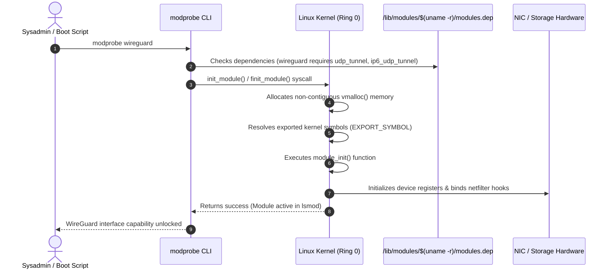

<!--
================================================================================
Metadata:
  Title: Kernel Modules & Sysctl Runtime Tuning
  Track: Linux & Systems Engineering / DevOps
  Difficulty: Advanced
  Estimated Time: 55 minutes
  Prerequisites: 01-fundamentals/02-linux-architecture.md, 03-system/01-processes-and-signals.md
  Key Terminology: Loadable Kernel Modules (LKM, .ko), lsmod, modprobe, rmmod, modinfo, /etc/modprobe.d/, sysctl, /proc/sys/, /etc/sysctl.d/, TCP Tuning (somaxconn, tcp_fin_timeout), File Handles (fs.file-max)
================================================================================
-->

# Kernel Modules & Sysctl Runtime Tuning

[<- 10-swap-and-memory-management.md](./10-swap-and-memory-management.md) | [Back to Module Overview](./README.md) | [12-time-and-ntp.md ->](./12-time-and-ntp.md)

---

## Table of Contents
- [1. What & Why](#1-what--why)
- [2. Core Concepts](#2-core-concepts)
- [3. How It Works Internally](#3-how-it-works-internally)
- [4. Syntax & Usage](#4-syntax--usage)
- [5. Practical Examples](#5-practical-examples)
- [6. Best Practices](#6-best-practices)
- [7. Common Mistakes & Troubleshooting](#7-common-mistakes--troubleshooting)
- [8. Performance, Security & Cost Implications](#8-performance-security--cost-implications)
- [9. Comparison Table](#9-comparison-table)
- [10. Real-World Interview Questions](#10-real-world-interview-questions)
- [11. Practice Exercises](#11-practice-exercises)
- [12. Summary & Quick Reference Cheat Sheet](#12-summary--quick-reference-cheat-sheet)
- [13. Further Reading & Official Documentation](#13-further-reading--official-documentation)

---

## 1. What & Why

The Linux operating system is built upon a **monolithic kernel architecture**: the core process scheduler, memory manager, virtual filesystem (VFS), and network protocol stack execute in a single unified address space in supervisor mode (Ring 0).

In a purely static monolithic design, adding hardware support or tuning a TCP parameter would require recompiling the entire kernel binary (`vmlinuz`) and rebooting the machine. Linux resolves this limitation through two dynamic runtime mechanisms:
1. **Loadable Kernel Modules (LKM)**: Compiled binary objects (`.ko`) that can be inserted into or removed from the running kernel on the fly without a reboot. Device drivers, network protocols (WireGuard), filesystem drivers (ZFS), and firewall filters are loaded dynamically as hardware or services require them.
2. **Kernel Runtime Parameters (`sysctl`)**: A standardized interface that exposes hundreds of live kernel configuration knobs through the virtual `/proc/sys/` directory, allowing systems engineers to tune TCP connection limits, virtual memory commit ratios, file handle caps, and security policies dynamically.

Mastering module management and sysctl tuning is fundamental for performance engineering and operating system hardening.

---

## 2. Core Concepts

### Loadable Kernel Modules (LKMs)
An LKM is an ELF relocatable object file with a `.ko` (Kernel Object) extension. Located in `/lib/modules/$(uname -r)/`, LKMs execute with full Ring 0 kernel privileges:
- **`modprobe`**: The modern, intelligent module manager. It resolves dependency trees (defined in `modules.dep`), downloading and inserting all prerequisite modules automatically.
- **`insmod`**: Low-level tool. Inserts a raw `.ko` file directly into memory; does **not** resolve dependencies.
- **`rmmod`**: Unloads a currently active module from the kernel (fails if the module is currently in use by a process or another module).
- **`lsmod`**: Displays all currently loaded modules, their memory footprint, and reference counts.

### The Sysctl Architecture
The `sysctl` utility provides a user-space CLI to read and modify kernel tunable variables:
- The parameters correspond directly to files inside the virtual filesystem **`/proc/sys/`**.
- The dot notation in sysctl mirrors directory paths:
  `net.ipv4.tcp_syncookies = 1` directly modifies `/proc/sys/net/ipv4/tcp_syncookies`.
- Runtime modifications made via `sysctl -w` take effect immediately in kernel memory, but are lost upon reboot unless saved in persistent drop-in files: `/etc/sysctl.d/*.conf`.

```
+-------------------------------------------------------------------------+
| SYSCTL & KERNEL RUNTIME TUNING ARCHITECTURE                             |
|                                                                         |
|  [ User Space CLI / Administrator ]                                     |
|  Command: sysctl -w net.core.somaxconn=4096                            |
|         │                                                               |
|         v (Writes string "4096" to virtual file)                        |
|  [ Virtual Filesystem: /proc/sys/net/core/somaxconn ]                   |
|         │                                                               |
|         v (Kernel VFS sysctl handler)                                   |
|  [ Linux Kernel Space (Ring 0) ]                                        |
|  Mutates live C integer variable: unsigned int sysctl_somaxconn;         |
|         │                                                               |
|         v (Takes effect IMMEDIATELY across all network sockets)          |
|  [ TCP Socket Accept Backlog Queue Expanded from 128 to 4096 ]          |
+-------------------------------------------------------------------------+
```

---

## 3. How It Works Internally

When a kernel module is loaded or a sysctl parameter is modified, the kernel coordinates system calls and memory mappings:



### Module Parameters and Blacklisting
- **Module Parameters**: When a module loads, options can be passed to adjust its behavior (e.g., buffer sizes, debug flags):
  `options e1000e InterruptThrottleRate=1,1` in `/etc/modprobe.d/*.conf`.
- **Blacklisting**: Prevents unwanted or buggy drivers from auto-loading during hardware discovery:
  `blacklist nouveau` (disables open-source Nvidia driver so proprietary driver can load).

---

## 4. Syntax & Usage

### 1. Kernel Module Management Commands
```bash
# List all currently loaded kernel modules
lsmod

# Display detailed metadata, author, license, and configurable parameters of a module
modinfo wireguard
modinfo overlay

# Load a module and its dependencies into the kernel
sudo modprobe wireguard

# Unload a module from the kernel
sudo modprobe -r wireguard

# Check which kernel functions/symbols are exported
cat /proc/kallsyms | grep "tcp_v4_connect"
```

### 2. Sysctl Querying and Modification
```bash
# View ALL configurable kernel parameters on the system (thousands of lines!)
sysctl -a

# Query a specific parameter
sysctl net.ipv4.ip_forward

# Temporarily modify a parameter at runtime (effective immediately)
sudo sysctl -w net.ipv4.ip_forward=1

# Load and apply all persistent configuration files from /etc/sysctl.d/
sudo sysctl --system
```

### 3. Persistent Configuration Locations
- Persistent sysctl files: `/etc/sysctl.d/*.conf` (e.g., `/etc/sysctl.d/99-network-tuning.conf`).
- Persistent module loading on boot: `/etc/modules-load.d/*.conf` (e.g., `/etc/modules-load.d/wireguard.conf`).
- Persistent module parameters and blacklists: `/etc/modprobe.d/*.conf`.

---

## 5. Practical Examples

### 1. Basic: Enabling IP Forwarding for Container / Router Nodes
By default, Linux drops packets destined for other IP addresses. To act as a Docker host, VPN gateway, or Kubernetes node, IP forwarding must be enabled:
```bash
# 1. Enable live in memory
sudo sysctl -w net.ipv4.ip_forward=1

# 2. Make persistent across reboots
echo "net.ipv4.ip_forward = 1" | sudo tee /etc/sysctl.d/99-ip-forward.conf

# 3. Reload
sudo sysctl --system
```

### 2. Real-World: High-Throughput Web Server Sysctl Tuning
Optimize a production Nginx reverse proxy handling 50,000+ concurrent connections:
```ini
# /etc/sysctl.d/99-high-concurrency.conf
# ==============================================================================
# Production High-Throughput Network & File Tuning
# ==============================================================================

# Increase max pending socket connections (SYN queue backlog)
net.core.somaxconn = 65535
net.ipv4.tcp_max_syn_backlog = 65535

# Increase ephemeral port range to prevent local port exhaustion
net.ipv4.ip_local_port_range = 10240 65535

# Fast recycling of dead TCP connections
net.ipv4.tcp_fin_timeout = 15

# Enable TCP SYN cookies to mitigate SYN flood DDoS attacks
net.ipv4.tcp_syncookies = 1

# Increase system-wide maximum open file descriptor limit
fs.file-max = 2097152

# Increase maximum memory buffers for network socket reads and writes
net.core.rmem_max = 16777216
net.core.wmem_max = 16777216
net.ipv4.tcp_rmem = 4096 87380 16777216
net.ipv4.tcp_wmem = 4096 65536 16777216

# Use modern BBR congestion control algorithm (requires Linux 4.9+)
net.core.default_qdisc = fq
net.ipv4.tcp_congestion_control = bbr
```
Apply:
```bash
sudo sysctl --system
```

### 3. Edge Case: Blacklisting Malicious / Unused Filesystem Drivers
Hardening a server by blacklisting uncommon legacy filesystem drivers (e.g., `cramfs`, `freevxfs`, `jffs2`, `hfs`) that have historic CVE vulnerabilities:
Create `/etc/modprobe.d/cis-blacklist.conf`:
```text
install cramfs /bin/true
install freevxfs /bin/true
install jffs2 /bin/true
install hfs /bin/true
install hfsplus /bin/true
blacklist cramfs
blacklist freevxfs
```
*Why `install <module> /bin/true` is used*: The `blacklist` directive only prevents *automatic* loading by udev hardware discovery. A user or script could still run `modprobe cramfs`. Setting `install cramfs /bin/true` overrides the loading command itself with a dummy no-op (`/bin/true`), making loading impossible!

### 4. Failure Case: Unloading an In-Use Kernel Module
Attempting to force-unload a module currently bound to an active network interface or mount:
```bash
sudo rmmod overlay
# Output:
# rmmod: ERROR: Module overlay is in use
```
*Triage*: Check what is holding the module:
```bash
lsmod | grep overlay
# Output: overlay 151552 24 (24 active mounts using overlay!)
```
You must stop all containers and unmount all overlay filesystems before `rmmod` will permit removal. Forcing module removal (`rmmod -f`) when compiled into debug kernels risks kernel memory corruption and immediate kernel panic!

### 5. Production-Grade: Automated Kernel Security Hardening Profile
A sysctl configuration enforcing Center for Internet Security (CIS) kernel security baselines:
```ini
# /etc/sysctl.d/99-security-hardening.conf
# ==============================================================================
# Linux Kernel Security Baseline Configuration
# ==============================================================================

# Restrict dmesg kernel buffer access to root only (prevents infoleaks)
kernel.dmesg_restrict = 1

# Hide exposed kernel pointers in /proc/kallsyms
kernel.kptr_restrict = 2

# Disable unprivileged eBPF to prevent speculative execution / side-channel leaks
kernel.unprivileged_bpf_disabled = 1

# Enable JIT hardening for eBPF
net.core.bpf_jit_harden = 2

# Disable Magic SysRq key combinations (except sync)
kernel.sysrq = 16

# Ignore all ICMP broadcast requests (prevents Smurf DDoS attacks)
net.ipv4.icmp_echo_ignore_broadcasts = 1

# Disable ICMP redirect acceptance (prevents MITM route poisoning)
net.ipv4.conf.all.accept_redirects = 0
net.ipv4.conf.default.accept_redirects = 0
net.ipv6.conf.all.accept_redirects = 0

# Enable reverse path filtering (spoofed IP protection)
net.ipv4.conf.all.rp_filter = 1
net.ipv4.conf.default.rp_filter = 1
```

---

## 6. Best Practices

1. **Always Use `modprobe` Instead of `insmod`**: `modprobe` automatically locates and loads all prerequisite dependent modules. `insmod` fails on any unresolved symbol.
2. **Never Edit `/proc/sys/` Directly in Shell Scripts**: While `echo 1 > /proc/sys/...` works, always prefer `sysctl -w key=val`. `sysctl` validates parameter existence and values, emitting clear error codes.
3. **Partition Sysctl Drops into `/etc/sysctl.d/`**: Never place all custom configuration in the root `/etc/sysctl.conf`. Use numbered modular files: `10-security.conf`, `50-network.conf`, `90-database.conf`.
4. **Inspect Modules with `modinfo` Before Loading**: Check the author, license, and configurable arguments of third-party modules before insertion into Ring 0.
5. **Always Verify Module Persistence**: If a service requires a module (e.g., `br_netfilter` for Kubernetes), ensure it is explicitly added to `/etc/modules-load.d/k8s.conf` so it loads on system reboot.

---

## 7. Common Mistakes & Troubleshooting

| Mistake / Antipattern | Underlying Cause | Consequence | Production Solution |
| :--- | :--- | :--- | :--- |
| Editing `/etc/sysctl.conf` without reloading | Sysctl files are only read on boot or explicit command. | Settings remain dormant until server is rebooted. | Execute `sudo sysctl --system` immediately. |
| Using `rmmod -f` on active modules | Forcibly unmapping kernel memory while kernel threads are executing within it. | Instant kernel panic / freeze. | Terminate consumers and unmount dependencies first. |
| Ephemeral sysctl tweaks via `echo > /proc` | Values written directly to `/proc/sys/` live only in memory. | Changes vanish on next server reboot. | Persist in `/etc/sysctl.d/*.conf`. |
| Blacklist bypassed by manual modprobe | `blacklist <mod>` only stops automatic udev hardware probes. | Running `modprobe <mod>` still loads the driver. | Use `install <mod> /bin/true` to disable execution. |
| Socket backlog bottleneck despite Nginx tuning | Nginx sets `backlog 4096`, but kernel `somaxconn` is default 128. | TCP connections are silently truncated to 128; drops connections. | Set `net.core.somaxconn = 65535` in sysctl. |
| Missing `modules.dep` index | Adding a custom compiled `.ko` file to `/lib/modules/` without indexing. | `modprobe: FATAL: Module not found`. | Run `sudo depmod -a` to rebuild dependency index. |

---

## 8. Performance, Security & Cost Implications

### Performance
- **Ephemeral Port Exhaustion**: A server making thousands of outbound API calls per second can exhaust ephemeral ports. Expanding `net.ipv4.ip_local_port_range = 10240 65535` expands available ports from 28,000 to over 55,000.
- **TCP BBR Congestion Control**: Switching congestion control from legacy Cubic to Google's BBR (`net.ipv4.tcp_congestion_control = bbr`) can increase network throughput by **20% to 50%** over lossy trans-continental or wireless networks.

### Security
- **Rootkit Injection via LKM**: Because LKMs execute in Ring 0, malicious kernel modules can alter system call tables, hide processes from `ps`, and bypass all userspace security tools.
  - *Hardening*: Enforce **Kernel Module Signature Verification** (`CONFIG_MODULE_SIG_FORCE=y`), which rejects any `.ko` file not signed by a trusted hardware cryptographic key.

### Cost
- In cloud infrastructure, properly tuned TCP buffers and socket queues allow a single VM instance to handle 4x more concurrent WebSocket or API connections, drastically reducing the number of VMs required in autoscaling groups.

---

## 9. Comparison Table

| Attribute | Loadable Kernel Module (LKM) | Sysctl Runtime Parameter | Kernel Boot Parameter (`/etc/default/grub`) |
| :--- | :--- | :--- | :--- |
| **Execution Domain** | Ring 0 Code Execution | Ring 0 Variable Configuration| Ring 0 Early Initialization |
| **Modification Timing**| At any time live | At any time live | **Requires Reboot** |
| **Scope** | Adds new drivers / protocols | Tunes existing kernel logic | Sets boot geometry, cgroups, IOMMU |
| **Configuration Path** | `/etc/modprobe.d/` | `/etc/sysctl.d/` | `/etc/default/grub` (`GRUB_CMDLINE_LINUX`)|
| **Inspection Tool** | `lsmod`, `modinfo` | `sysctl`, `cat /proc/sys/...` | `cat /proc/cmdline` |

---

## 10. Real-World Interview Questions

### Q1: What is the mechanical difference between `modprobe` and `insmod`?
<details>
<summary>Answer</summary>
- **`insmod`**: A basic, low-level binary utility. It takes an explicit filesystem path to a `.ko` file (e.g., `insmod /path/to/driver.ko`) and invokes the `finit_module()` system call. It has **no dependency resolution capabilities**. If the module requires functions exported by another module that is not yet loaded, `insmod` fails with `Unknown symbol in module`.
- **`modprobe`**: An intelligent, high-level module manager. It takes a module name (e.g., `modprobe wireguard`), searches `/lib/modules/$(uname -r)/modules.dep` for prerequisite dependencies, automatically loads all required modules in the correct order, and applies parameter options and blacklist rules configured in `/etc/modprobe.d/`.
</details>

### Q2: What does `sysctl --system` do?
<details>
<summary>Answer</summary>
`sysctl --system` reads and applies all persistent sysctl configuration files from all standard configuration directories in their defined order of overriding precedence:
1. `/etc/sysctl.d/*.conf`
2. `/run/sysctl.d/*.conf`
3. `/usr/local/lib/sysctl.d/*.conf`
4. `/usr/lib/sysctl.d/*.conf`
5. `/lib/sysctl.d/*.conf`
6. `/etc/sysctl.conf`
It is the standard command used by administrators and deployment scripts to reload all persistent kernel settings across the entire operating system.
</details>

### Q3: Why does high-traffic Nginx or HAProxy drop connections if `net.core.somaxconn` is left at default?
<details>
<summary>Answer</summary>
When a TCP server application calls `listen(socket_fd, backlog)`, the `backlog` argument specifies the maximum length of the queue of pending connections (the accept queue).
However, the Linux kernel enforces an upper ceiling: it silently caps the requested application backlog at **`net.core.somaxconn`** (which historically defaults to 128).
Even if Nginx configures `listen 80 backlog=4096;`, the kernel caps it at 128. During sudden traffic spikes, if the accept queue exceeds 128 before the application thread calls `accept()`, the kernel drops incoming SYN packets or sends resets (`RST`). Increasing `net.core.somaxconn = 65535` enables deep connection buffers.
</details>

### Q4: How do you prevent a specific kernel module from loading automatically or manually?
<details>
<summary>Answer</summary>
In `/etc/modprobe.d/<name>.conf`:
```text
install <module_name> /bin/true
blacklist <module_name>
```
- `blacklist <module_name>` stops `udev` and hardware probes from automatically loading the module when hardware is detected.
- `install <module_name> /bin/true` replaces the module insertion command with the shell utility `/bin/true`, which returns 0 without doing anything. This guarantees that even if a user or script explicitly executes `modprobe <module_name>`, the module will not load.
</details>

### Q5: What is the purpose of `kernel.dmesg_restrict`?
<details>
<summary>Answer</summary>
By default in legacy Linux, any unprivileged user can read the kernel log buffer via `dmesg`.
The kernel log buffer often contains sensitive system information: memory layout addresses, kernel pointers, device serial numbers, and occasionally unredacted passwords or credentials logged by crashing daemons.
Setting `kernel.dmesg_restrict = 1` restricts `dmesg` access strictly to users with the `CAP_SYSLOG` capability (root), preventing local information disclosure and side-channel exploits.
</details>

### Q6: How does the kernel know which modules are needed during boot before the root filesystem is mounted?
<details>
<summary>Answer</summary>
During boot, the kernel needs storage drivers (NVMe, SATA, SCSI) and filesystem drivers (ext4, XFS) to mount the root filesystem (`/`).
Because these drivers reside on the root filesystem in `/lib/modules/`, a bootstrap problem exists.
Linux resolves this using the **Initial RAM Filesystem (`initramfs`)**:
The bootloader (GRUB) loads both the kernel binary (`vmlinuz`) and `initramfs.img` into RAM. The `initramfs` is a small, compressed root filesystem containing essential kernel modules, device rules, and `modprobe`. The kernel mounts `initramfs`, loads the necessary storage and disk drivers, locates the real root disk, and executes `pivot_root` to transition to the permanent root filesystem.
</details>

### Q7: What does the command `depmod -a` do?
<details>
<summary>Answer</summary>
`depmod -a` (Dependency Module Generator) scans all kernel module binaries in `/lib/modules/$(uname -r)/`, inspects their exported symbols and requirements, and generates the dependency mapping files:
- `modules.dep` (and binary `modules.dep.bin`)
- `modules.alias`
- `modules.symbols`
It must be executed whenever a new kernel module is compiled and copied into `/lib/modules/` so that `modprobe` can recognize and resolve it.
</details>

### Q8: What is BBR, and how is it enabled in the Linux kernel?
<details>
<summary>Answer</summary>
BBR (Bottleneck Bandwidth and RTT) is a modern congestion control algorithm developed by Google. Unlike traditional loss-based congestion control algorithms (like Cubic or Reno) which interpret dropped packets as congestion and slash throughput, BBR builds an explicit model of network bottleneck bandwidth and round-trip time (RTT). It maximizes throughput while minimizing queue bufferbloat.
To enable BBR:
```bash
sudo modprobe tcp_bbr
echo "tcp_bbr" | sudo tee -a /etc/modules-load.d/modules.conf
sudo sysctl -w net.core.default_qdisc=fq
sudo sysctl -w net.ipv4.tcp_congestion_control=bbr
```
</details>

---

## 11. Practice Exercises

### Exercise 1: Querying Active Modules and Parameters (Easy)
**Task**: Use `lsmod` to find if the `overlay` or `ext4` module is loaded, and use `modinfo` to display its description, author, and license.

<details>
<summary>Solution</summary>

```bash
lsmod | grep -E "(ext4|overlay)"
modinfo ext4 | grep -E "(author|description|license|version):"
```
</details>

### Exercise 2: Real-time Sysctl Modification and Verification (Easy)
**Task**: Check the current value of `fs.file-max`, increase it by 10,000 using `sysctl -w`, verify in `/proc/sys/fs/file-max`, and reset it.

<details>
<summary>Solution</summary>

```bash
# Check current
ORIGINAL=$(sysctl -n fs.file-max)

# Modify
sudo sysctl -w fs.file-max=$(( ORIGINAL + 10000 ))

# Verify directly from virtual file
cat /proc/sys/fs/file-max

# Reset
sudo sysctl -w fs.file-max="$ORIGINAL"
```
</details>

### Exercise 3: Inspecting Module Parameters in `/sys/module/` (Medium)
**Task**: Inspect the kernel's runtime module directory `/sys/module/` to find what configurable parameters and refcounts exist for the `loop` or `e1000e` driver.

<details>
<summary>Solution</summary>

```bash
MODULE="loop"
if [[ -d "/sys/module/$MODULE" ]]; then
  echo "--- Parameters for $MODULE ---"
  ls -la "/sys/module/$MODULE/parameters/" 2>/dev/null || echo "No configurable parameters."
  echo "--- Refcount / State ---"
  cat "/sys/module/$MODULE/refcnt" 2>/dev/null || true
  cat "/sys/module/$MODULE/initstate"
fi
```
</details>

### Exercise 4: Testing Kernel Module Auto-loading on Boot (Medium)
**Task**: Configure the kernel module `dummy` (virtual network interface) to load automatically on boot using `/etc/modules-load.d/`, test loading without rebooting, and verify with `ip link`.

<details>
<summary>Solution</summary>

```bash
# 1. Configure persistent loading
echo "dummy" | sudo tee /etc/modules-load.d/dummy.conf

# 2. Test manual load
sudo modprobe dummy

# 3. Verify module is active and created dummy0 interface
lsmod | grep dummy
ip link show dummy0

# Clean up
sudo modprobe -r dummy
sudo rm -f /etc/modules-load.d/dummy.conf
```
</details>

### Exercise 5: Building a Complete Network Hardening Profile (Hard)
**Task**: Author an enterprise sysctl profile `/etc/sysctl.d/70-network-security.conf` that disables source routing, enables SYN cookies, logs martian packets (spoofed addresses), and disables ICMP echo broadcasts. Apply and test using `sysctl --system`.

<details>
<summary>Solution</summary>

```bash
#!/usr/bin/env bash
set -euo pipefail

cat <<EOF | sudo tee /etc/sysctl.d/70-network-security.conf
# Disable source routing
net.ipv4.conf.all.accept_source_route = 0
net.ipv4.conf.default.accept_source_route = 0

# Enable SYN cookies
net.ipv4.tcp_syncookies = 1

# Log packets with impossible source addresses (martians)
net.ipv4.conf.all.log_martians = 1
net.ipv4.conf.default.log_martians = 1

# Ignore ICMP echo broadcasts
net.ipv4.icmp_echo_ignore_broadcasts = 1
EOF

sudo sysctl --system
echo "[SUCCESS] Security sysctl profile applied and active."
```
</details>

### Exercise 6: Automated Dynamic Kernel Tuning Verification Script (Hard)
**Task**: Write an administrative script that checks 5 critical sysctl parameters (`net.core.somaxconn`, `vm.swappiness`, `fs.file-max`, `net.ipv4.ip_forward`, `kernel.dmesg_restrict`), compares them against approved production thresholds, and generates a compliance scorecard.

<details>
<summary>Solution</summary>

```bash
#!/usr/bin/env bash
set -euo pipefail

declare -A THRESHOLDS=(
  ["net.core.somaxconn"]="1024"       # Must be >= 1024
  ["vm.swappiness"]="20"              # Must be <= 20
  ["fs.file-max"]="65536"             # Must be >= 65536
  ["kernel.dmesg_restrict"]="1"       # Must be 1
)

echo "=================================================="
echo "  KERNEL SYSCTL COMPLIANCE SCORECARD"
echo "=================================================="

COMPLIANT=true

for param in "${!THRESHOLDS[@]}"; do
  EXPECTED="${THRESHOLDS[$param]}"
  ACTUAL=$(sysctl -n "$param" 2>/dev/null || echo "MISSING")
  
  if [[ "$param" == "vm.swappiness" ]]; then
    if (( ACTUAL <= EXPECTED )); then
      printf "[PASS] %-30s = %s (<= %s)\n" "$param" "$ACTUAL" "$EXPECTED"
    else
      printf "[FAIL] %-30s = %s (Expected <= %s)\n" "$param" "$ACTUAL" "$EXPECTED"
      COMPLIANT=false
    fi
  else
    if (( ACTUAL >= EXPECTED )); then
      printf "[PASS] %-30s = %s (>= %s)\n" "$param" "$ACTUAL" "$EXPECTED"
    else
      printf "[FAIL] %-30s = %s (Expected >= %s)\n" "$param" "$ACTUAL" "$EXPECTED"
      COMPLIANT=false
    fi
  fi
done

if [ "$COMPLIANT" = true ]; then
  echo -e "\n[SUCCESS] Host complies with kernel engineering baselines."
else
  echo -e "\n[WARNING] Host has non-compliant kernel parameters!"
fi
```
</details>

---

## 12. Summary & Quick Reference Cheat Sheet

| Task | Command | Description |
| :--- | :--- | :--- |
| **List Loaded Modules** | `lsmod` | Shows active LKMs and usage counts |
| **Inspect Module Info** | `modinfo <module>` | Authors, parameters, license, dependencies |
| **Load Module** | `sudo modprobe <module>` | Loads module and all dependencies |
| **Unload Module** | `sudo modprobe -r <module>` | Unloads module if not in use |
| **Query Sysctl** | `sysctl <param>` | Displays current parameter value |
| **Query All Sysctl** | `sysctl -a` | Dumps all tunable kernel variables |
| **Set Sysctl Live** | `sudo sysctl -w key=val` | Modifies parameter in RAM immediately |
| **Apply All Sysctl** | `sudo sysctl --system` | Reloads all `/etc/sysctl.d/*.conf` files |
| **Persistent Modules** | `/etc/modules-load.d/*.conf` | Modules to load at boot |
| **Module Blacklist** | `/etc/modprobe.d/*.conf` | `blacklist <mod>` or `install <mod> /bin/true`|
| **Rebuild Module Index**| `sudo depmod -a` | Rebuilds `modules.dep` |

---

## 13. Further Reading & Official Documentation

- [Linux Kernel Documentation: Sysctl Directory Reference](https://docs.kernel.org/admin-guide/sysctl/index.html)
- [Linux Man Pages: modprobe(8)](https://man7.org/linux/man-pages/man8/modprobe.8.html)
- [Linux Man Pages: sysctl(8) & sysctl.conf(5)](https://man7.org/linux/man-pages/man8/sysctl.8.html)
- [Brendan Gregg: Systems Performance - Tuning Kernel Parameters](https://www.brendangregg.com/)
- [The Linux Foundation: Kernel Module Programming Guide](https://sysprog21.github.io/lkmpg/)

---

[<- 10-swap-and-memory-management.md](./10-swap-and-memory-management.md) | [Back to Module Overview](./README.md) | [12-time-and-ntp.md ->](./12-time-and-ntp.md)
