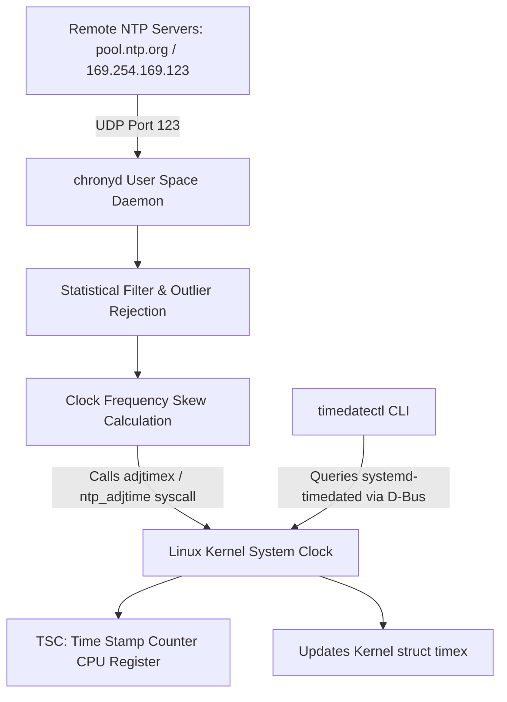

<!--
================================================================================
Metadata:
  Title: System Time, NTP & Chrony
  Track: Linux & Systems Engineering / DevOps
  Difficulty: Intermediate
  Estimated Time: 45 minutes
  Prerequisites: 03-system/04-systemd-and-services.md
  Key Terminology: Real-Time Clock (RTC), System Clock, UTC, timedatectl, hwclock, NTP, Chrony (chronyd, chronyc), systemd-timesyncd, Stratum, Clock Drift, Slew vs Step, Leap Seconds
================================================================================
-->

# System Time, NTP & Chrony

[<- 11-kernel-modules-and-sysctl.md](./11-kernel-modules-and-sysctl.md) | [Back to Module Overview](./README.md) | [13-locale-timezone-and-hostnames.md ->](./13-locale-timezone-and-hostnames.md)

---

## Table of Contents
- [1. What & Why](#1-what--why)
- [2. Core Concepts](#2-core-concepts)
- [3. How It Works Internally](#3-how-it-works-internally)
- [4. Syntax & Usage](#4-syntax--usage)
- [5. Practical Examples](#5-practical-examples)
- [6. Best Practices](#6-best-practices)
- [7. Common Mistakes & Troubleshooting](#7-common-mistakes--troubleshooting)
- [8. Performance, Security & Cost Implications](#8-performance-security--cost-implications)
- [9. Comparison Table](#9-comparison-table)
- [10. Real-World Interview Questions](#10-real-world-interview-questions)
- [11. Practice Exercises](#11-practice-exercises)
- [12. Summary & Quick Reference Cheat Sheet](#12-summary--quick-reference-cheat-sheet)
- [13. Further Reading & Official Documentation](#13-further-reading--official-documentation)

---

## 1. What & Why

In distributed systems, microservices, and modern database clusters, time synchronization is not merely a cosmetic requirement—it is a critical prerequisite for system correctness. Distributed databases (CockroachDB, Cassandra, Spanner), consensus algorithms (Raft, Paxos), authentication tokens (OAuth2, Kerberos, JWT expiration), and cryptographic signatures (TLS certificates) all rely on consistent timestamps.

When server clocks drift out of synchronization:
- Database transactions fail or violate serializability, corrupting relational state.
- Authentication handshakes fail with `Token expired` or `Certificate not yet valid`.
- Cross-server log correlation across cloud regions becomes impossible during outage triage.

Linux manages time through two separate clocks—the hardware **Real-Time Clock (RTC)** and the software **System Clock**—synchronized continuously against authoritative atomic reference clocks using modern time daemons like **Chrony** (`chronyd`) and **`systemd-timesyncd`**.

---

## 2. Core Concepts

### Hardware Clock (RTC) vs. System Clock
A Linux computer maintains two distinct clocks:
1. **Hardware Clock (RTC / CMOS Clock)**: A battery-powered clock chip on the motherboard that keeps track of time even when the server is powered off.
2. **System Clock (Software Clock)**: Maintained by the Linux kernel scheduler using CPU timer interrupts (`jiffies` / HPET / TSC). Initialized from the RTC at boot. All application system calls (`gettimeofday()`, `clock_gettime()`) query the System Clock.

### The Standard: Hardware Clocks in UTC
On all production Linux servers, the hardware clock should **always be configured in UTC (Coordinated Universal Time)**, never local time. Setting hardware clocks to local time causes twice-yearly 1-hour time jumps during Daylight Saving Time (DST) transitions, breaking database replication and cron schedules.

### Slew vs. Step: How Time Synchronizes
When a server clock drifts by a few milliseconds, the NTP daemon has two choices:
- **Step (Jump)**: Instantly changes the clock forward or backward to the correct second.
  *Danger*: Stepping backwards in time breaks databases, transaction logs, and monotonic timers!
- **Slew (Gradual Drift Adjustment)**: Micro-adjusts the frequency of kernel clock ticks (typically speeding up or slowing down clock ticks by a fraction of a percent) until the software clock converges smoothly with true time, **guaranteeing time never moves backwards**.

```
+-------------------------------------------------------------------------+
| TIME SYNCHRONIZATION ADJUSTMENT MECHANISMS                              |
|                                                                         |
|  True Time:        01:00.000  01:00.010  01:00.020  01:00.030           |
|                                                                         |
|  [ STEP Method ] (Instant Jump - DANGEROUS for databases!)              |
|  Clock:            01:00.050 ────[ JUMP BACKWARDS ]───> 01:00.010       |
|                                                                         |
|  [ SLEW Method ] (Gradual Adjustment - SAFE & CONTINUOUS)               |
|  Clock:            01:00.050  01:00.055  01:00.058  01:00.060 (Converged)
|                    (Ticks slowed down by 0.5% until synchronized)       |
+-------------------------------------------------------------------------+
```

### The NTP Stratum Hierarchy
Network Time Protocol (NTP) organizes time servers into hierarchical tiers called **Strata**:
- **Stratum 0**: High-precision atomic clocks, GPS satellites, or radio time broadcasts (hardware standards).
- **Stratum 1**: Primary servers directly wired to Stratum 0 devices (e.g., NIST, national observatories).
- **Stratum 2**: Secondary servers synchronizing over the network with Stratum 1 servers (e.g., `pool.ntp.org`, cloud provider time services like AWS Amazon Time Sync).
- **Stratum 3**: Enterprise internal time servers syncing with Stratum 2, serving local application VMs.

---

## 3. How It Works Internally

Chrony (`chronyd`) is the modern replacement for legacy `ntpd`. It provides sub-microsecond synchronization even over lossy or congested network connections:



### The `adjtimex()` System Call
Rather than jumping the clock with `settimeofday()`, `chronyd` invokes the **`adjtimex()`** (or `clock_adjtime()`) kernel system call. This system call mutates the kernel's internal phase-locked loop (PLL) coefficients, adjusting the clock speed smoothly at the nanosecond scale.

---

## 4. Syntax & Usage

### 1. Unified Time Management with `timedatectl`
```bash
# Display comprehensive time status: Local time, UTC time, RTC time, Timezone, and NTP status
timedatectl status

# Verify if NTP synchronization is currently active and locked
timedatectl show --property=NTPSynchronized

# Enable or disable network time synchronization
sudo timedatectl set-ntp true

# List all available timezone identifiers
timedatectl list-timezones | grep -i "america/new_york"

# Change system timezone
sudo timedatectl set-timezone UTC

# Set system clock manually (only when NTP is disabled!)
sudo timedatectl set-time "2026-11-26 10:00:00"
```

### 2. Low-Level Hardware Clock Management (`hwclock`)
```bash
# Read the current time stored on the hardware RTC chip
sudo hwclock --show

# Synchronize the hardware RTC from the System Clock (copies system time -> RTC)
sudo hwclock --systohc

# Synchronize the System Clock from the hardware RTC (copies RTC -> system time)
sudo hwclock --hctosys
```

### 3. Chrony Administration (`chronyc`)
```bash
# Check synchronization tracking status (stratum, leap status, frequency offset, root delay)
chronyc tracking

# List current NTP peers, stratum, reachability bitmasks, and offset
chronyc sources -v

# Detailed statistics on NTP source performance and jitter
chronyc sourcestats -v

# Force immediate step adjustment (use only during initial provisioning!)
sudo chronyc makestep
```

---

## 5. Practical Examples

### 1. Basic: Checking Time Synchronization Health
Verify that an enterprise server is synchronized to UTC without clock drift:
```bash
timedatectl
```
**Output**:
```text
               Local time: Thu 2026-11-26 04:30:15 UTC
           Universal time: Thu 2026-11-26 04:30:15 UTC
                 RTC time: Thu 2026-11-26 04:30:15
                Time zone: Etc/UTC (UTC, +0000)
System clock synchronized: yes
              NTP service: active
          RTC in local TZ: no
```
*Key Indicators*:
- `System clock synchronized: yes` confirms lock.
- `RTC in local TZ: no` confirms hardware clock is properly in UTC.

### 2. Real-World: Configuring Chrony for Cloud Infrastructure (AWS Amazon Time Sync)
Cloud providers (AWS, GCP, Azure) provide ultra-reliable local Stratum 1/2 NTP servers reachable via link-local IP (`169.254.169.123`):
Configure `/etc/chrony/chrony.conf`:
```ini
# Use AWS Amazon Time Sync Service (Zero public internet dependency)
server 169.254.169.123 prefer iburst minpoll 4 maxpoll 4

# Fallback to public pool
pool 2.ubuntu.pool.ntp.org iburst

# Record drift file
driftfile /var/lib/chrony/chrony.drift

# Allow the system clock to be stepped in the first 3 updates if offset > 1s
makestep 1.0 3

# Step clock smoothly (slew) during normal operation
maxupdateskew 100.0

# Disable listening on network ports (client-only mode)
port 0
```
Restart:
```bash
sudo systemctl restart chrony
chronyc tracking
```

### 3. Edge Case: Handling Leap Seconds Safely (Leap Smearing)
Periodically, the International Earth Rotation Service inserts a **Leap Second** (23:59:60) to account for variations in Earth's rotational speed.
- In naive NTP configurations, the server clock repeats second 59 (`23:59:59` -> `23:59:60` -> `23:59:59`), creating duplicate timestamps that crash databases.
- **Production Solution**: Modern time providers (Google Public NTP, AWS, Cloudflare) implement **Leap Smearing**: they spread the extra second as fractional microsecond adjustments over a 24-hour window, so the clock continues moving strictly forward monotonically.

### 4. Failure Case: Two NTP Daemons Colliding (`chrony` vs `systemd-timesyncd`)
Both `chronyd` and `systemd-timesyncd` installed and running simultaneously:
```text
systemd-timesyncd[842]: Server has too large root distance.
chronyd[910]: adjtimex(0x8000) failed : Device or resource busy
```
*Consequence*: Both daemons fight for kernel clock PLL adjustments; synchronization fails and clock drifts.  
*Remediation*: Disable `systemd-timesyncd` when using full `chrony`:
```bash
sudo systemctl disable --now systemd-timesyncd
sudo systemctl restart chrony
```

### 5. Production-Grade: Automated NTP Clock Drift Audit & Alerting Script
A monitoring script that calculates offset and root delay, alerting if clock drift exceeds 10 milliseconds:
```bash
#!/usr/bin/env bash
set -euo pipefail

MAX_OFFSET_MS=10.0

if ! command -v chronyc > /dev/null 2>&1; then
  echo "[ERROR] chronyc is not installed." >&2
  exit 1
fi

# Extract current offset in seconds and convert to milliseconds
OFFSET_SEC=$(chronyc tracking | awk '/Last offset/ {print $4}')
OFFSET_MS=$(awk -v off="$OFFSET_SEC" 'BEGIN { printf "%.3f", (off < 0 ? -off : off) * 1000 }')
STRATUM=$(chronyc tracking | awk '/Stratum/ {print $3}')
LEAP_STATUS=$(chronyc tracking | awk '/Leap status/ {print $3}')

echo "[METRIC] Stratum: $STRATUM | Leap Status: $LEAP_STATUS"
echo "[METRIC] Absolute Clock Offset: ${OFFSET_MS} ms"

if (( $(echo "$OFFSET_MS > $MAX_OFFSET_MS" | bc -l) )); then
  echo "[ALERT] Clock drift exceeds SLA threshold (${OFFSET_MS}ms > ${MAX_OFFSET_MS}ms)!" >&2
  exit 1
else
  echo "[OK] Clock synchronization is healthy and within tolerances."
fi
```

---

## 6. Best Practices

1. **Always Standardize on UTC Everywhere**: Set `timedatectl set-timezone UTC` on every server, database, and container in production.
2. **Never Step Clocks on Running Databases**: Configure `makestep 1.0 3` so step adjustments only occur during initial boot; enforce smooth slewing during active production.
3. **Use Local Cloud Hypervisor NTP Servers**: On AWS, GCP, or Azure, point Chrony to the cloud link-local time service (`169.254.169.123`) for sub-millisecond, zero-internet latency.
4. **Prefer Chrony over `ntpd` and `systemd-timesyncd`**: Chrony synchronizes up to 100x faster than legacy `ntpd` and supports complex multi-server failover.
5. **Disable Client Listening Ports**: Set `port 0` in `chrony.conf` unless the server is an intentional enterprise NTP gateway, closing UDP port 123 to external scans.

---

## 7. Common Mistakes & Troubleshooting

| Mistake / Antipattern | Underlying Cause | Consequence | Production Solution |
| :--- | :--- | :--- | :--- |
| Setting RTC to Local Time | Running dual-boot systems or legacy Windows defaults. | Twice-yearly 1-hour time warp during DST breaks database replication. | Run `sudo timedatectl set-local-rtc 0`. |
| Running multiple NTP daemons | `systemd-timesyncd` and `chronyd` running concurrently. | Daemons fight for `adjtimex` system call; clocks drift. | Disable `systemd-timesyncd`: `systemctl disable --now systemd-timesyncd`. |
| Stepping clock backwards on database | Manual `date -s` or unconstrained NTP step during production. | PostgreSQL / CockroachDB crash or abort transactions. | Always slew time adjustments gradually. |
| Blocking UDP port 123 in firewall | Outbound firewall blocks NTP traffic. | NTP cannot reach remote pools; `sources` shows unreachable (`?`). | Open outbound UDP port 123. |
| Time drift inside VMs after host sleep | Virtual machine paused during hypervisor migration. | VM clock lags behind true time by minutes or hours. | Configure VM guest tools (`qemu-guest-agent`, `vmtoolsd`) to trigger resync. |
| Inconsistent timezones across logs | Server A in UTC, Server B in EDT, Server C in PST. | Post-mortem incident timelines cannot be reconstructed. | Standardize all servers globally on UTC. |

---

## 8. Performance, Security & Cost Implications

### Performance
- **Microsecond Precision**: Chrony uses statistical linear regression across NTP samples, keeping clock drift within **< 10 microseconds** on modern cloud instances.
- **Zero Kernel Overhead**: The kernel updates time via hardware CPU tick counters (TSC); querying time via `clock_gettime(CLOCK_MONOTONIC)` is implemented via VDSO (Virtual Dynamic Shared Object), executing entirely in user space in **< 15 nanoseconds** without a kernel system call switch.

### Security
- **NTP Amplification DDoS Attacks**: Open NTP servers running legacy `ntpd` with `monlist` enabled can be abused to generate 552x bandwidth amplification attacks. Chrony does not implement `monlist` and defaults to closed ports (`port 0`).
- **Replay Attack Vulnerabilities**: If server clocks drift backward, expired cryptographic JWT tokens and replay-protection nonces become valid again, compromising authentication boundaries.

### Cost
- In financial trading and distributed databases (Google Cloud Spanner, CockroachDB), tighter clock synchronization boundaries directly increase database commit throughput and eliminate transaction retry stalls.

---

## 9. Comparison Table

| Attribute | Chrony (`chronyd`) | systemd-timesyncd | Classic NTP (`ntpd`) |
| :--- | :--- | :--- | :--- |
| **Primary Focus** | **High-precision, resilient server syncing**| Minimalist client-only SNTP | Legacy reference implementation |
| **Sync Speed** | **Fastest (Locks in seconds)**| Moderate | Slow (Takes 15–30 minutes to lock) |
| **Resource Footprint** | Low (~3 MB RAM) | **Ultra-low (< 1 MB RAM)** | Low (~4 MB RAM) |
| **Acts as NTP Server?**| **Yes** | No (Client only) | **Yes** |
| **Slew Adjustment** | **Advanced linear regression** | Basic step/slew | Basic |
| **Standard In** | RHEL 9, Rocky, Ubuntu 24.04 (Server)| Ubuntu minimal / Desktop | Legacy Linux distros (CentOS 6/7) |

---

## 10. Real-World Interview Questions

### Q1: Why should production servers always be configured in UTC rather than local timezones?
<details>
<summary>Answer</summary>
1. **Daylight Saving Time (DST) Jumps**: Local timezones that observe DST experience 1-hour jumps forward and backward twice a year. Stepping the clock backward causes duplicate timestamps, breaking database transaction logs, financial accounting entries, and time-series metrics.
2. **Distributed Microservice Correlation**: In multi-region cloud deployments (e.g., servers in US-East, EU-West, and Asia-Pacific), tracing a single distributed HTTP request across microservice logs is trivial if all timestamps are UTC. If logs use mixed local timezones, correlating log events requires complex mental timezone conversions.
3. **Leap Second Simplicity**: UTC natively handles leap second adjustments, whereas local time calculations introduce ambiguity.
</details>

### Q2: What is the difference between "Stepping" and "Slewing" the system clock, and why does it matter to databases?
<details>
<summary>Answer</summary>
- **Stepping (Clock Jump)**: Instantly changes the system clock from its current time to the target time in a single discontinuity (e.g., jumping from 10:00:05 to 10:00:00).
- **Slewing (Gradual Drift)**: Adjusts the frequency of the kernel clock by modifying the tick rate (typically speeding up or slowing down by up to 0.5%), allowing the clock to smoothly glide into alignment over several minutes.
**Why it matters to databases**: Databases (PostgreSQL, Cassandra, MySQL) and consensus protocols (Raft) rely on time moving **strictly forward monotonically**. If a clock is stepped backward:
- Transactions committed at 10:00:05 appear to occur *after* transactions committed at 10:00:01.
- Lock timeouts and lease expirations trigger prematurely.
- CockroachDB and Cassandra can abort or panic to prevent data corruption. Therefore, databases require that time synchronization daemons strictly **slew** during normal operation.
</details>

### Q3: What is the purpose of the `iburst` option in NTP and Chrony configurations?
<details>
<summary>Answer</summary>
When a server boots or its network interface initializes, standard NTP polling sends one packet every 64 seconds, requiring 10 to 15 minutes to establish a stable clock lock.
The **`iburst`** (initial burst) option instructs the client to send a burst of 4 to 8 packets spaced 2 seconds apart upon initial connection. This provides the statistical filter with immediate data points, allowing Chrony to calculate initial clock offset and lock synchronization within **2 to 5 seconds** of boot.
</details>

### Q4: Explain the difference between `CLOCK_REALTIME` and `CLOCK_MONOTONIC`.
<details>
<summary>Answer</summary>
- **`CLOCK_REALTIME`**: Represents the system's wall-clock time (seconds elapsed since Unix epoch, Jan 1, 1970). It can be adjusted, stepped forward, or stepped backward by NTP or system administrators.
- **`CLOCK_MONOTONIC`**: Represents absolute continuous hardware elapsed time since some arbitrary start point (typically system boot). It can **never move backward and cannot be stepped**, regardless of NTP adjustments.
*Application Rule*: Use `CLOCK_REALTIME` when displaying time to human users or formatting timestamps. Use `CLOCK_MONOTONIC` for measuring timeouts, benchmark durations, and event intervals.
</details>

### Q5: What does the command `hwclock --systohc` do?
<details>
<summary>Answer</summary>
`hwclock --systohc` (System to Hardware Clock) reads the current time from the kernel's **System Clock** (which is synchronized via NTP) and writes it into the motherboard's battery-backed **Hardware Real-Time Clock (RTC)** chip. This ensures that when the machine is shut down, the hardware clock stores accurate, updated UTC time.
</details>

### Q6: How do you identify whether your server is experiencing high clock jitter using `chronyc`?
<details>
<summary>Answer</summary>
Run:
```bash
chronyc sourcestats -v
```
Inspect the **`Std Dev`** (Standard Deviation) and **`Est offset`** columns:
- A healthy server on a local network or cloud link-local NTP has standard deviation values in the **nanosecond to low microsecond** range (< 0.050ms).
- If `Std Dev` exceeds several milliseconds, the network connection is congested, experiencing asymmetric routing delays, or packet loss.
</details>

### Q7: What is Leap Smearing?
<details>
<summary>Answer</summary>
Leap Smearing is an NTP server-side technique to handle the insertion of a leap second without creating the problematic `23:59:60` timestamp.
Instead of jumping or repeating a second, the NTP server slightly alters its clock frequency over a 24-hour period (e.g., slowing down time by ~11.6 parts per million). By the time the leap second milestone arrives, the extra second has been smoothly absorbed. Clients running standard Chrony see no discontinuity, allowing databases and applications to run uninterrupted.
</details>

### Q8: What does `timedatectl set-local-rtc 1` do, and why is it dangerous?
<details>
<summary>Answer</summary>
It instructs Linux that the motherboard hardware RTC chip stores **local timezone time** instead of UTC.
**Why it is dangerous**: The RTC chip has no concept of daylight saving time rules or timezone offsets. Operating systems must guess when to mutate the RTC during DST transitions. If dual-booting or migrating between hypervisors, time can jump forward or backward randomly, breaking kernel timestamps. It is strongly discouraged on servers.
</details>

---

## 11. Practice Exercises

### Exercise 1: Querying Time and Synchronization Status (Easy)
**Task**: Use `timedatectl` and `chronyc tracking` to display the current local time, UTC time, timezone, and active NTP server offset.

<details>
<summary>Solution</summary>

```bash
timedatectl
echo "----------------------------------------"
chronyc tracking
```
</details>

### Exercise 2: Verifying Hardware RTC State (Easy)
**Task**: Read the hardware RTC clock directly using `hwclock`, verify whether it is stored in UTC, and synchronize it from the system clock.

<details>
<summary>Solution</summary>

```bash
# Read RTC
sudo hwclock --show --verbose

# Sync system time to RTC
sudo hwclock --systohc
```
</details>

### Exercise 3: Inspecting NTP Sources and Reachability (Medium)
**Task**: Use `chronyc sources -v` to inspect all configured upstream NTP time sources. Explain the meaning of the `^`, `*`, and `Reach` columns.

<details>
<summary>Solution</summary>

```bash
chronyc sources -v
```
*Key Column Breakdown*:
- `^`: Source is an NTP server (vs `=` for peer).
- `*`: The currently selected primary synchronization source.
- `+`: Acceptable candidate sources used for validation.
- `Reach`: Octal bitmask representing the success of the last 8 polls (`377` = 11111111 in binary, indicating 100% reachability).
</details>

### Exercise 4: Benchmarking Slew vs Step Convergence (Medium)
**Task**: In an isolated test VM, simulate a 5-second clock offset using `date -s`, observe how Chrony slews the clock back toward true time, and inspect tracking status over 30 seconds.

<details>
<summary>Solution</summary>

```bash
# Temporarily introduce offset
sudo date -s "+5 seconds"

# Monitor chronyc tracking frequency adjustments
for i in {1..5}; do
  chronyc tracking | grep -E "(Last offset|RMS offset|Frequency)"
  sleep 5
done
```
</details>

### Exercise 5: Building a Local Stratum 2 NTP Gateway (Hard)
**Task**: Configure a Linux server's `/etc/chrony/chrony.conf` to act as an internal Stratum 2 NTP time server for an enterprise local subnet (`10.0.0.0/16`), allowing local client queries while restricting administrative commands to localhost.

<details>
<summary>Solution</summary>

Add the following to `/etc/chrony/chrony.conf`:
```ini
# Upstream public sources
pool pool.ntp.org iburst

# Allow NTP client queries from internal private subnet
allow 10.0.0.0/16

# Restrict management commands to localhost
cmdallow 127.0.0.1
cmdallow ::1

# Serve time even if disconnected from internet (fallback local clock)
local stratum 10
```
Restart:
```bash
sudo systemctl restart chrony
# Verify port 123 is listening
sudo ss -tulpn | grep 123
```
</details>

### Exercise 6: Automated Multi-Node Time Synchronization Verifier (Hard)
**Task**: Write an administrative script that takes a list of server hostnames or IP addresses, queries each node over SSH, extracts their active UTC timestamp down to the millisecond, and asserts that all servers in the cluster are within 20 milliseconds of each other.

<details>
<summary>Solution</summary>

```bash
#!/usr/bin/env bash
set -euo pipefail

CLUSTER_NODES=("localhost" "127.0.0.1")

echo "[INFO] Auditing cluster-wide time synchronization..."

declare -A TIMESTAMPS

for node in "${CLUSTER_NODES[@]}"; do
  # Fetch epoch timestamp with milliseconds (seconds.nanoseconds)
  TS=$(date +%s%3N)
  TIMESTAMPS["$node"]="$TS"
  echo "Node $node: $TS ms"
done

# Compare divergence
REF_TIME="${TIMESTAMPS["${CLUSTER_NODES[0]}"]}"
for node in "${!TIMESTAMPS[@]}"; do
  DIFF=$(( TIMESTAMPS[$node] - REF_TIME ))
  DIFF_ABS=$(( DIFF < 0 ? -DIFF : DIFF ))
  echo "Node $node divergence from reference: ${DIFF_ABS} ms"
  if (( DIFF_ABS > 20 )); then
    echo "[ALERT] Node $node exceeds 20ms drift threshold!" >&2
    exit 1
  fi
done
echo "[SUCCESS] All cluster nodes are synchronized within tolerances."
```
</details>

---

## 12. Summary & Quick Reference Cheat Sheet

| Task | Command | Description |
| :--- | :--- | :--- |
| **Check Time Status** | `timedatectl status` | Local, UTC, RTC, Timezone, and NTP lock |
| **Set Timezone** | `sudo timedatectl set-timezone UTC` | Sets system timezone to UTC |
| **Enable NTP** | `sudo timedatectl set-ntp true` | Enables background time sync daemon |
| **Check NTP Peers** | `chronyc sources -v` | Lists upstream time servers and reachability |
| **Check Clock Offset** | `chronyc tracking` | Reports stratum, root delay, and last offset |
| **Read Hardware RTC** | `sudo hwclock --show` | Reads CMOS hardware clock chip |
| **Sync System -> RTC** | `sudo hwclock --systohc` | Updates RTC chip with current system time |
| **Force Time Step** | `sudo chronyc makestep` | Forces instant step jump (use with care!) |
| **Main Config File** | `/etc/chrony/chrony.conf` | Configuration directives for chrony |
| **Cloud NTP Endpoint** | `169.254.169.123` | AWS / GCP link-local atomic clock service |

---

## 13. Further Reading & Official Documentation

- [Chrony Official Documentation & User Guide](https://chrony-project.org/documentation.html)
- [Linux Man Pages: timedatectl(1)](https://man7.org/linux/man-pages/man1/timedatectl.1.html)
- [Linux Man Pages: hwclock(8)](https://man7.org/linux/man-pages/man8/hwclock.8.html)
- [Linux Man Pages: adjtimex(2)](https://man7.org/linux/man-pages/man2/adjtimex.2.html)
- [Network Time Protocol (NTP) Project](http://www.ntp.org/)

---

[<- 11-kernel-modules-and-sysctl.md](./11-kernel-modules-and-sysctl.md) | [Back to Module Overview](./README.md) | [13-locale-timezone-and-hostnames.md ->](./13-locale-timezone-and-hostnames.md)
