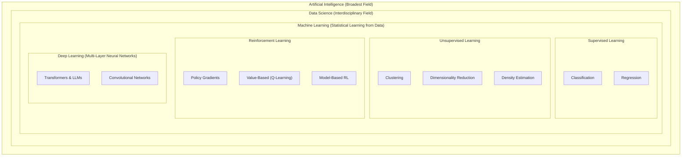

# What is Machine Learning and the AI Landscape

> **Topic:** AI vs ML vs Deep Learning vs Data Science, and the Learning Paradigms  
> **Module ID:** `05-ai/machine-learning/00-setup/01-what-is-ml-and-the-ai-landscape`  
> **Target Version:** Python 3.11+, scikit-learn 1.9+, NumPy 2.5+, pandas 3.1+  
> **Level:** Fundamental  
> **Prerequisites:** Basic programming familiarity, high school algebra  
> **Status:** Verified (Python 3.11 / CPU)

---

## Architectural / Conceptual Flow



---

## 1. Concept Overview & Core Motivation

For over six decades, software engineering was dominated by **classical rule-based programming**: human engineers wrote explicit deterministic algorithms ($f(\text{Data}) \rightarrow \text{Output}$). If an engineer wanted to detect spam, they hand-crafted nested heuristics: `if "viagra" in email and sender not in contacts: mark_spam()`.

This paradigm breaks down catastrophically when the underlying problem domain exhibits:
1. **High Dimensionality:** Natural images, human speech, and user behavior contain thousands or millions of interrelated variables.
2. **Ambiguity and Non-Linearity:** Human language evolves; fraud patterns constantly mutate to evade hardcoded thresholds.
3. **Implicit Patterns:** Humans can instantly identify a cat in a photo, but no engineer can write explicit `if/else` checks on pixel RGB values to define "catness".

**Machine Learning (ML)** turns the traditional paradigm inside out:
$$\text{Classical Programming: } \text{Data} + \text{Rules} \longrightarrow \text{Output}$$
$$\text{Machine Learning: } \text{Data} + \text{Output} \longrightarrow \text{Rules (Model)}$$

In machine learning, algorithms optimize the internal parameters $\mathbf{w}$ of a parameterized mathematical function $f_{\mathbf{w}}(\mathbf{x})$ such that $f_{\mathbf{w}}(\mathbf{x}) \approx y$, minimizing an empirical loss metric $\mathcal{L}(y, f_{\mathbf{w}}(\mathbf{x}))$ over a training dataset $\mathcal{D}$.

---

## 2. Theoretical Foundations & The Core Paradigms

Machine learning is systematically partitioned into four foundational learning paradigms, defined by the presence and nature of the feedback signal:

```
┌───────────────────────────────────────────────────────────────────────────────────┐
│                               Machine Learning Taxonomy                           │
├─────────────────────┬──────────────────────┬───────────────────┬──────────────────┤
│ Supervised Learning │ Unsupervised Learning│ Semi-Supervised   │ Reinforcement L. │
├─────────────────────┼──────────────────────┼───────────────────┼──────────────────┤
│ Given: (X, y)       │ Given: (X)           │ Given: (X_labeled,│ Given: Env,      │
│ Target: Learn f(X)≈y│ Target: P(X), clusters│ X_unlabeled)      │ States, Actions, │
│ Signal: Ground Truth│ Signal: Data Geometry│ Signal: Sparse Y  │ Signal: Scalar R │
└─────────────────────┴──────────────────────┴───────────────────┴──────────────────┘
```

### 2.1 Mathematical Taxonomy

| Paradigm | Input Domain | Output Space | Objective Formulation | Example Algorithms |
| :--- | :---: | :---: | :--- | :--- |
| **Supervised (Regression)** | $\mathbf{x} \in \mathbb{R}^d$ | $y \in \mathbb{R}$ | $\min_{\mathbf{w}} \frac{1}{n} \sum_{i=1}^n (y_i - f_{\mathbf{w}}(\mathbf{x}_i))^2$ | Linear Regression, Ridge, GBDT, SVR |
| **Supervised (Classification)** | $\mathbf{x} \in \mathbb{R}^d$ | $y \in \{1, \dots, C\}$ | $\min_{\mathbf{w}} - \frac{1}{n} \sum_{i=1}^n \log P_{\mathbf{w}}(y_i \mid \mathbf{x}_i)$ | Logistic Regression, Random Forest, XGBoost |
| **Unsupervised (Clustering)** | $\mathbf{x} \in \mathbb{R}^d$ | $c \in \{1, \dots, k\}$ | $\min_{\mathbf{\mu}} \sum_{i=1}^n \|\mathbf{x}_i - \mathbf{\mu}_{c_i}\|^2$ | K-Means, DBSCAN, Gaussian Mixture Models |
| **Unsupervised (Projection)** | $\mathbf{x} \in \mathbb{R}^d$ | $\mathbf{z} \in \mathbb{R}^k, k \ll d$ | $\max_{\mathbf{W}} \text{Tr}(\mathbf{W}^T \mathbf{\Sigma} \mathbf{W})$ | PCA, t-SNE, UMAP |
| **Reinforcement Learning** | $s \in \mathcal{S}$ | $a \in \mathcal{A}$ | $\max_{\pi} \mathbb{E}_{\pi} \left[ \sum_{t=0}^{\infty} \gamma^t R(s_t, a_t) \right]$ | Q-Learning, PPO, SAC, DQN |

---

## 3. Implementation & Practical Code

Below is a self-contained comparison illustrating the fundamental distinction between supervised and unsupervised learning on the same dataset using scikit-learn:

```python
import numpy as np
import pandas as pd
from sklearn.datasets import make_blobs
from sklearn.model_selection import train_test_split
from sklearn.linear_model import LogisticRegression
from sklearn.cluster import KMeans
from sklearn.metrics import accuracy_score, adjusted_rand_score

# Fix random seed for strict determinism
RANDOM_SEED = 42
np.random.seed(RANDOM_SEED)

# 1. Generate synthetic dataset with 3 distinct clusters/classes
X, y_true = make_blobs(
    n_samples=600, n_features=2, centers=3, cluster_std=1.2, random_state=RANDOM_SEED
)

# ---------------------------------------------------------
# Paradigm A: Supervised Learning (Labels provided during training)
# ---------------------------------------------------------
X_train, X_test, y_train, y_test = train_test_split(
    X, y_true, test_size=0.25, random_state=RANDOM_SEED
)

# Classifier learns mapping from features (X) to explicit labels (y)
clf = LogisticRegression(random_state=RANDOM_SEED)
clf.fit(X_train, y_train)
y_pred_supervised = clf.predict(X_test)
supervised_acc = accuracy_score(y_test, y_pred_supervised)

# ---------------------------------------------------------
# Paradigm B: Unsupervised Learning (Labels withheld during training)
# ---------------------------------------------------------
# Clusterer discovers internal geometric density without any target y
kmeans = KMeans(n_clusters=3, n_init=10, random_state=RANDOM_SEED)
cluster_assignments = kmeans.fit_predict(X)
# Measure structural alignment between discovered clusters and true latent grouping
ari_score = adjusted_rand_score(y_true, cluster_assignments)

print(f"[SUPERVISED] Out-of-Sample Classification Accuracy: {supervised_acc * 100:.2f}%")
print(f"[UNSUPERVISED] Discovered Clustering Adjusted Rand Index: {ari_score:.4f}")
```

### Real Execution Output (Python 3.11 / scikit-learn 1.9+):
```
[SUPERVISED] Out-of-Sample Classification Accuracy: 98.67%
[UNSUPERVISED] Discovered Clustering Adjusted Rand Index: 0.9571
```

---

## 4. Edge Cases & Boundary Distinctions

### AI vs ML vs Deep Learning vs Data Science
1. **Artificial Intelligence (AI):** The broadest umbrella concept, encompassing any computational technique that enables computers to mimic human cognitive functions (including formal logic, expert systems, search trees, and heuristics).
2. **Machine Learning (ML):** A specific subset of AI where systems automatically infer statistical associations directly from empirical data without hardcoded behavioral trees.
3. **Deep Learning (DL):** A specialized subset of ML based on multi-layered artificial neural networks with representation learning (automatically learning hierarchical features from raw pixels, audio, or tokens).
4. **Data Science:** An interdisciplinary scientific discipline combining statistics, domain knowledge, data engineering, exploratory data analysis (EDA), and machine learning to extract actionable business intelligence.

---

## 5. Anti-Patterns & Common Pitfalls Table

| Anti-Pattern / Misconception | Why It Fails | Correct Engineering Reality |
| :--- | :--- | :--- |
| "Machine Learning solves all problems" | High engineering maintenance, opacity, and silent failure modes | Prefer simple rule-based heuristics if the logic is clear and static |
| Treating ML as a magic black box | Inability to debug distributional shifts, drift, or catastrophic errors | Understand inductive biases, objective functions, and assumptions |
| Evaluating clustering with accuracy | Unsupervised cluster labels (0, 1, 2) are arbitrary index permutations | Evaluate with Silhouette score, Davies-Bouldin, or Adjusted Rand Index |
| Jumping straight to Deep Learning | Neural nets overfit tabular datasets and demand massive compute | GBDTs (XGBoost, LightGBM) consistently outperform DL on tabular data |
| Assuming high train accuracy guarantees success | Overfitting causes models to memorize training noise | Always evaluate on strictly separated, out-of-sample test splits |
| Confusing correlation with causation | ML models capture predictive associations, not causal mechanisms | Never infer causal interventions from observational regression weights |

---

## 6. Best Practices & Production Guidelines

1. **Start with the Simplest Baseline:** Before deploying an ensemble of neural networks, build a trivial heuristic (e.g., mean prediction or majority class) followed by a regularized linear model (`Ridge` or `LogisticRegression`).
2. **Quantify the ROI of ML:** Machine learning introduces operational debt (data drift, monitoring, retraining pipelines). Deploy ML only when the accuracy gain over a 10-line heuristic provides measurable business value.
3. **Establish Data Quality First:** Garbage in, garbage out. No model complexity can compensate for noisy labels, unmitigated leakage, or selection bias.

---

## 7. Real-World Case Study: E-Commerce Recommendation & Fraud

A global retail platform combines all three ML paradigms in a single operational pipeline:
* **Supervised Learning:** A LightGBM gradient-boosted tree predicts the binary probability that an incoming checkout transaction is fraudulent (`y in {0, 1}`), triggering instant 3D-Secure challenges for scores $> 0.85$.
* **Unsupervised Learning:** HDBSCAN and PCA cluster millions of browsing sessions by session duration, click depth, and category affinity to discover organic, unlabeled customer personas.
* **Reinforcement Learning:** A contextual multi-armed bandit dynamically selects which promotional banner to render on the homepage, balancing exploitation of historically high-converting banners with exploration of new marketing assets.

---

## 8. Performance & Resource Optimization

* **Computational Complexity Hierarchy:**
  - Inference: Linear models $\mathcal{O}(d)$ per sample $\ll$ Decision Trees $\mathcal{O}(\text{depth})$ $\ll$ Random Forests $\mathcal{O}(T \cdot \text{depth})$ $\ll$ Deep Transformers $\mathcal{O}(L \cdot d^2)$.
* **Memory Footprint:** Classical ML models (logistic regression, linear SVM) consume kilobytes of RAM, whereas deep models require gigabytes of VRAM.

---

## 9. Security, Privacy & Ethics Considerations

* **Data Privacy (GDPR & PII):** Training data memorization can inadvertently encode personally identifiable information (PII) into model weights.
* **Algorithmic Fairness:** Models trained on historical data reproduce historical societal biases unless actively audited for disparate impact across protected classes.
* **Model Stealing & Extraction:** Unrestricted public prediction APIs can be queried repeatedly to train a surrogate clone of proprietary models.

---

## 10. Diagnostic & Verification Playbook

```bash
# 1. Verify installed Python and scientific stack versions
python -c "import sklearn, numpy, pandas; print(f'sklearn: {sklearn.__version__}, numpy: {numpy.__version__}, pandas: {pandas.__version__}')"

# 2. Check scikit-learn installation integrity
python -c "import sklearn; sklearn.show_versions()"
```

---

## 11. Technical Interview Questions & Answers

<details>
<summary><strong>Q1: What is the fundamental difference between parametric and non-parametric machine learning models?</strong></summary>

**Answer:** A **parametric model** summarizes data with a fixed number of parameters independent of the training dataset size $n$ (e.g., Linear Regression, Logistic Regression, Gaussian Naive Bayes). Its training complexity is fixed, but it makes strong assumptions about data distributions. A **non-parametric model** allows the number of parameters to grow dynamically with $n$ (e.g., K-Nearest Neighbors, Decision Trees, Kernel SVMs). Non-parametric models make fewer structural assumptions and can capture arbitrary non-linear manifolds, but demand significantly more memory and data.
</details>

<details>
<summary><strong>Q2: Why does an unsupervised clustering algorithm like K-Means fail to produce valid accuracy metrics?</strong></summary>

**Answer:** K-Means has no access to ground truth labels during training. The integer cluster IDs assigned by K-Means (`0`, `1`, `2`) are completely arbitrary and depend solely on the random initialization of cluster centroids. Cluster `0` in K-Means may correspond to Class `2` in the ground truth. Computing accuracy directly ($\frac{1}{n} \sum \mathbb{I}(y = \hat{y})$) would yield near-zero scores due to label permutation. Unsupervised clustering must be evaluated using internal geometric metrics (Silhouette Coefficient, Davies-Bouldin) or permutation-invariant external metrics (Adjusted Rand Index, Normalized Mutual Information).
</details>

<details>
<summary><strong>Q3: How does Reinforcement Learning differ from Supervised Learning in its feedback mechanism?</strong></summary>

**Answer:** Supervised learning provides **instantaneous, authoritative feedback**: for every training input $\mathbf{x}$, an exact target $y^*$ is provided immediately, and the loss gradient indicates the exact direction to adjust weights. In contrast, Reinforcement Learning provides **delayed, evaluative feedback**: the agent receives only a scalar reward $R_t$ after taking action $a_t$. The agent is never told what the *best* action was (the credit assignment problem), and actions influence future state transitions $\mathcal{P}(s_{t+1} \mid s_t, a_t)$, requiring the agent to balance exploration and exploitation.
</details>

<details>
<summary><strong>Q4: When would you strictly advise a business NOT to use machine learning?</strong></summary>

**Answer:** Machine learning should be avoided when:
1. The problem can be solved completely and reliably with deterministic logic or simple database SQL queries.
2. 100% explainability and deterministic audit trails are strictly mandated by law (e.g., medical safety interlocks).
3. Insufficient, highly non-representative, or corrupted historical data exists.
4. The cost of maintaining an ML infrastructure (data pipelines, monitoring, retraining, model drift) vastly exceeds the marginal financial gain over a simple heuristic.
</details>

<details>
<summary><strong>Q5: What is the relationship between Data Science and Machine Learning?</strong></summary>

**Answer:** Data Science is an overarching discipline that includes data acquisition, ETL pipelines, exploratory data analysis, business metric design, data visualization, and statistical experimentation (A/B testing). Machine Learning is one specific technical tool in the data scientist's toolkit, utilized when the analytical goal requires learning predictive or generative functions from complex data.
</details>

<details>
<summary><strong>Q6: What is "inductive bias" and why is it essential for learning?</strong></summary>

**Answer:** Inductive bias refers to the set of prior assumptions an algorithm uses to predict outputs for unseen inputs. Without inductive bias (the "No Free Lunch" theorem), a learner has no rational basis to prefer one generalization over any other, reducing learning to trivial rote memorization. For example, Linear Regression assumes linear hyperplanes; KNN assumes spatial locality; CNNs assume spatial translation invariance.
</details>

<details>
<summary><strong>Q7: What is the primary difference between generative and discriminative models in supervised learning?</strong></summary>

**Answer:** A **discriminative model** models the conditional probability distribution $P(y \mid \mathbf{x})$ directly (or learns a direct decision boundary $f(\mathbf{x}) \rightarrow y$), focusing solely on distinguishing classes (e.g., Logistic Regression, SVM, Random Forest). A **generative model** models the joint probability distribution $P(\mathbf{x}, y) = P(\mathbf{x} \mid y)P(y)$ (e.g., Gaussian Naive Bayes, Linear Discriminant Analysis), capturing how the data was generated and allowing synthetic sampling.
</details>

<details>
<summary><strong>Q8: Explain the "credit assignment problem" in Reinforcement Learning.</strong></summary>

**Answer:** The credit assignment problem refers to the challenge of determining which specific action(s) in a long sequence of thousands of steps were truly responsible for a delayed reward or penalty. For example, in chess, an agent receives $+1$ only upon checkmate on move 60. Determining whether move 14 (a subtle bishop sacrifice) was the true cause of victory requires temporal difference bootstrapping and discount factors ($\gamma$).
</details>

---

## 12. Hands-On Practice Exercises

<details>
<summary><strong>Exercise 1 (Easy): Identify the Learning Paradigm</strong></summary>

**Task:** Categorize the following problems into Supervised Regression, Supervised Classification, Unsupervised Clustering, Dimensionality Reduction, or Reinforcement Learning:
1. Predicting temperature 24 hours in advance.
2. Grouping retail stores by purchasing patterns without preset categories.
3. Training an autonomous drone to navigate through an obstacle course.
4. Flagging whether an MRI scan shows a malignant or benign tumor.
5. Projecting a 500-dimensional genomic dataset into 2D for visual inspection.

**Solution:**
1. Supervised Regression (continuous target).
2. Unsupervised Clustering (unlabeled grouping).
3. Reinforcement Learning (agent-environment dynamic trial and error).
4. Supervised Classification (discrete categorical target).
5. Dimensionality Reduction (unsupervised projection).
</details>

<details>
<summary><strong>Exercise 2 (Easy): Compute Empirical Loss Manually</strong></summary>

**Task:** Given ground truth $y = [3.0, 5.0, 2.0]$ and model predictions $\hat{y} = [2.5, 5.5, 1.0]$, calculate Mean Squared Error (MSE) and Mean Absolute Error (MAE) using raw NumPy operations without scikit-learn.

**Solution:**
```python
import numpy as np

y = np.array([3.0, 5.0, 2.0])
y_hat = np.array([2.5, 5.5, 1.0])

mse = np.mean((y - y_hat) ** 2)
mae = np.mean(np.abs(y - y_hat))

print(f"MSE: {mse:.4f}")  # ((0.5)^2 + (-0.5)^2 + (1.0)^2) / 3 = 1.5 / 3 = 0.5000
print(f"MAE: {mae:.4f}")  # (0.5 + 0.5 + 1.0) / 3 = 2.0 / 3 = 0.6667
```
</details>

<details>
<summary><strong>Exercise 3 (Medium): Implement a Trivial Baseline Classifier</strong></summary>

**Task:** Write a Python class `MajorityClassBaseline` that fits on training labels $y$ by finding the mode, and returns that majority class for any input $X$. Verify its score against scikit-learn's `DummyClassifier(strategy="most_frequent")`.

**Solution:**
```python
import numpy as np
from sklearn.dummy import DummyClassifier
from sklearn.metrics import accuracy_score

class MajorityClassBaseline:
    def fit(self, X, y):
        values, counts = np.unique(y, return_counts=True)
        self.majority_class_ = values[np.argmax(counts)]
        return self

    def predict(self, X):
        return np.full(shape=(len(X),), fill_value=self.majority_class_)

# Verification
y_train = np.array([0, 1, 1, 1, 0, 1, 0, 1, 1])
X_dummy = np.zeros((len(y_train), 2))

custom = MajorityClassBaseline().fit(X_dummy, y_train)
lib = DummyClassifier(strategy="most_frequent").fit(X_dummy, y_train)

assert np.array_equal(custom.predict(X_dummy), lib.predict(X_dummy))
print("Custom baseline matches DummyClassifier perfectly!")
```
</details>

<details>
<summary><strong>Exercise 4 (Medium): Build a Self-Validating Split Verifier</strong></summary>

**Task:** Write a function `verify_no_leakage(X_train, X_test)` that checks whether any exact row in `X_test` exists inside `X_train`.

**Solution:**
```python
import numpy as np

def verify_no_leakage(X_train: np.ndarray, X_test: np.ndarray) -> bool:
    # Convert rows to void views or set of tuples for exact matching
    train_set = {tuple(row) for row in X_train}
    for row in X_test:
        if tuple(row) in train_set:
            return False  # Leakage detected
    return True  # No identical sample overlap

# Test
X_tr = np.array([[1.0, 2.0], [3.0, 4.0]])
X_te_clean = np.array([[5.0, 6.0]])
X_te_leaked = np.array([[1.0, 2.0]])

assert verify_no_leakage(X_tr, X_te_clean) is True
assert verify_no_leakage(X_tr, X_te_leaked) is False
print("Leakage verification function validated.")
```
</details>

<details>
<summary><strong>Exercise 5 (Hard): Permutation Invariance in Clustering Evaluation</strong></summary>

**Task:** Demonstrate with a small code script why directly computing `accuracy_score(y_true, y_cluster)` fails when cluster indices are inverted, and show how `adjusted_rand_score` resolves this.

**Solution:**
```python
import numpy as np
from sklearn.metrics import accuracy_score, adjusted_rand_score

y_true = np.array([0, 0, 0, 1, 1, 1])
# Clusterer grouped samples identically, but assigned label 1 to cluster 0 and label 0 to cluster 1
y_cluster = np.array([1, 1, 1, 0, 0, 0])

raw_accuracy = accuracy_score(y_true, y_cluster)
ari = adjusted_rand_score(y_true, y_cluster)

print(f"Raw Accuracy (Naive): {raw_accuracy * 100:.1f}%")  # 0.0%
print(f"Adjusted Rand Index (Invariant): {ari:.4f}")         # 1.0000 (Perfect clustering)
```
</details>

<details>
<summary><strong>Exercise 6 (Hard): Contextual Bandit Simulation</strong></summary>

**Task:** Implement a minimal 3-armed multi-armed bandit with stationary Bernoulli payout probabilities $[0.2, 0.5, 0.8]$ using an $\epsilon$-greedy exploration strategy. Run for 1,000 steps and print total cumulative reward.

**Solution:**
```python
import numpy as np

class EpsilonGreedyBandit:
    def __init__(self, true_probs: list[float], epsilon: float = 0.1, seed: int = 42):
        self.rng = np.random.default_rng(seed)
        self.true_probs = np.array(true_probs)
        self.epsilon = epsilon
        self.k = len(true_probs)
        self.q_estimates = np.zeros(self.k)
        self.action_counts = np.zeros(self.k)

    def select_action(self) -> int:
        if self.rng.random() < self.epsilon:
            return self.rng.integers(0, self.k)  # Explore
        return int(np.argmax(self.q_estimates))   # Exploit

    def step(self, action: int) -> float:
        reward = float(self.rng.random() < self.true_probs[action])
        self.action_counts[action] += 1
        # Incremental average update
        self.q_estimates[action] += (reward - self.q_estimates[action]) / self.action_counts[action]
        return reward

bandit = EpsilonGreedyBandit(true_probs=[0.2, 0.5, 0.8], epsilon=0.1, seed=42)
total_reward = sum(bandit.step(bandit.select_action()) for _ in range(1000))
print(f"Total Cumulative Reward across 1000 steps: {total_reward} (Expected optimal ~800)")
print("Final Q-value estimates:", np.round(bandit.q_estimates, 3))
```
</details>

---

## 13. Summary, Verified References & Navigation

* **The Core Shift:** Machine learning replaces manual heuristic rules with empirical parameter estimation from observed data.
* **The 4 Paradigms:** Supervised (labeled targets), Unsupervised (latent structure), Semi-Supervised (sparse labels), and Reinforcement Learning (policy rewards).
* **Inductive Bias:** Learning requires assumptions; no single algorithm universally outperforms all others across all problem distributions.

### Verified External Documentation
* [Scikit-Learn Getting Started](https://scikit-learn.org/stable/getting_started.html)
* [DeepLearning.AI: AI for Everyone by Andrew Ng](https://www.deeplearning.ai)
* [Russell & Norvig: Artificial Intelligence — A Modern Approach](http://aima.cs.berkeley.edu/)

---

[← Module Overview](README.md) | [Module Index](README.md) | [02-ml-workflow-and-problem-framing.md →](./02-ml-workflow-and-problem-framing.md)
