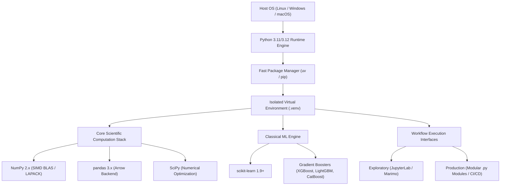

# Python Machine Learning Environment & Tooling

> **Topic:** Python Runtime Environments, `uv`, `venv`, Package Management, Jupyter Notebooks vs Scripts, and Tooling Architectures  
> **Module ID:** `05-ai/machine-learning/00-setup/03-python-ml-environment`  
> **Target Version:** Python 3.11+, uv 0.4+, scikit-learn 1.9+, NumPy 2.5+, pandas 3.1+  
> **Level:** Fundamental  
> **Prerequisites:** [01-what-is-ml-and-the-ai-landscape.md](./01-what-is-ml-and-the-ai-landscape.md), [`01-languages/python/`](file:///01-languages/python/)  
> **Status:** Verified (Python 3.11 / CPU)

---

## Architectural / Conceptual Flow



---

## 1. Concept Overview & Core Motivation

Machine learning engineering presents unique environment challenges compared to standard web development:
1. **Heavy C/C++/Fortran Binary Dependencies:** Libraries like NumPy, SciPy, scikit-learn, and PyTorch rely on underlying linear algebra libraries (OpenBLAS, Intel MKL, Apple Accelerate) compiled for specific CPU instruction sets (AVX-512, NEON).
2. **Strict ABI & Python Version Constraints:** Minor Python version mismatches (e.g. running Python 3.14 alpha before C-extension wheels are built for PyTorch or scikit-learn) result in compilation failures.
3. **The "Notebook to Production" Abyss:** Exploratory code in Jupyter notebooks often suffers from hidden state, out-of-order execution, and untyped global variables that cannot be deployed safely.

In modern ML engineering, **`uv`** (an ultra-fast Python package and project manager written in Rust) and standardized virtual environments (`.venv`) have largely superseded legacy fragmented tooling, enabling sub-second dependency resolution, deterministic cross-platform lockfiles (`uv.lock`), and unified environment management.

---

## 2. Theoretical & Practical Environment Architecture

### 2.1 Tooling Comparison Matrix

| Tool | Speed / Engine | Lockfile Standard | Native C-Binary Handling | Primary Use Case |
| :--- | :---: | :---: | :---: | :--- |
| **`uv`** | Rust ($10\text{x}-100\text{x}$ faster than pip) | `uv.lock` | Standard PyPI wheels | Modern enterprise standard for ML & backend |
| **`venv` + `pip`** | Built-in Python C/Python | `requirements.txt` (loose) | Wheels / Source compilation | Universal fallback, zero external tools needed |
| **`pip-tools`** | Python wrapper over pip | `requirements.lock` | Standard PyPI wheels | Legacy deterministic pinning |
| **`Conda` / `Mamba`**| C++ binary ecosystem | `environment.yml` | Custom Conda Forge channels | Complex non-Python GPU CUDA drivers & GIS |
| **`Poetry`** | Python resolver | `poetry.lock` | PyPI wheels | General application packaging (slower resolver) |

---

## 3. Implementation: Production Environment Blueprint

### 3.1 Setting Up with `uv` (Recommended Modern Standard)
```bash
# 1. Install uv (standalone executable)
curl -LsSf https://astral.sh/uv/install.sh | sh      # Linux / macOS
powershell -c "irm https://astral.sh/uv/install.ps1 | iex" # Windows

# 2. Initialize a clean ML project with pinned Python 3.11
uv init ml-project --python 3.11
cd ml-project

# 3. Add production scientific dependencies
uv add numpy pandas scipy scikit-learn xgboost lightgbm catboost joblib skops

# 4. Add development and interactive tooling
uv add --dev pytest ipykernel black ruff

# 5. Lock and synchronize environment deterministically
uv lock
uv sync
```

### 3.2 Setting Up with Standard `venv` (Zero-Dependency Fallback)
```bash
# 1. Create isolated virtual environment using Python 3.11
python3.11 -m venv .venv

# 2. Activate virtual environment
source .venv/bin/activate       # Linux / macOS
.venv\Scripts\Activate.ps1     # Windows PowerShell

# 3. Upgrade core pip tooling
python -m pip install --upgrade pip setuptools wheel

# 4. Install scientific baseline
pip install numpy pandas scipy scikit-learn joblib skops
```

---

## 4. Notebooks vs Scripts: The Dual Workflow Paradigm

```
┌───────────────────────────────────────────────┐      ┌───────────────────────────────────────────────┐
│     Phase A: Exploratory Research (EDA)       │      │     Phase B: Production Engineering (CI/CD)   │
├───────────────────────────────────────────────┤      ├───────────────────────────────────────────────┤
│ • Interactive visualization                   │      │ • Fully typed Python modules (.py)            │
│ • Rapid trial-and-error                       │      │ • Clean functions with single responsibilities│
│ • Rich display of tables and plots            │      │ • Automated unit and regression tests (pytest)│
│ • Tool: JupyterLab / VS Code Notebooks / Marimo│      │ • Version controlled via Git & Dockerized     │
└───────────────────────┬───────────────────────┘      └───────────────────────▲───────────────────────┘
                        │                                                      │
                        └───────────────── Refactor & Modularize ──────────────┘
```

### Invariants for Clean Notebooks:
1. **Never commit raw output cells containing sensitive PII or megabyte data blobs.** Use `nbstripout` or Git pre-commit hooks.
2. **Verify Restart & Run All:** Before sharing or refactoring, execute `Kernel -> Restart & Run All Cells` to guarantee zero hidden out-of-order execution dependencies.
3. **Extract Core Logic into `.py` Modules:** Notebooks should only import verified modules: `from src.features import build_features`.

---

## 5. Anti-Patterns & Common Pitfalls Table

| Pitfall / Mistake | Why It Fails | Engineering Solution |
| :--- | :--- | :--- |
| Installing packages globally with `sudo pip` | Corrupts host operating system Python packages | Always create an isolated `.venv` |
| Using unpinned `requirements.txt` | Dependency updates break code unpredictably | Pin transitive dependencies with `uv.lock` or `pip-compile` |
| Committing Jupyter notebook checkpoint dirs | Clutters Git history with `.ipynb_checkpoints` | Add `.ipynb_checkpoints/` and `.venv/` to `.gitignore` |
| Developing on Python alpha/preview releases | C-extensions for PyTorch/scikit-learn lack prebuilt wheels | Stick strictly to established LTS versions (Python 3.11/3.12) |
| Running notebook cells out of sequential order | State depends on cell execution history, not code layout | Enforce linear top-to-bottom cell execution |
| Installing both Conda and venv indiscriminately | Path pollution leads to conflicting shared C libraries | Pick one tool per project; prefer `uv` or `venv` |

---

## 6. Best Practices & Production Guidelines

1. **Deterministic Dependency Pinning:** Check `uv.lock` or `requirements.txt` into Git repository version control.
2. **CPU Threading Control:** Numerical linear algebra libraries greedily claim all available CPU cores by default. Restrict CPU thread oversaturation in containerized environments:
   ```python
   import os
   os.environ["OMP_NUM_THREADS"] = "4"
   os.environ["OPENBLAS_NUM_THREADS"] = "4"
   os.environ["MKL_NUM_THREADS"] = "4"
   ```
3. **Automated Code Linting:** Enforce formatting with `ruff` (`ruff check .` and `ruff format .`) to maintain clean PEP 8 standards.

---

## 7. Real-World Case Study: Resolving the "Works on My Laptop" Crisis

A computer vision and tabular modeling team experienced severe discrepancies: models trained on Developer A's macOS laptop produced 94% accuracy, but failed with 78% accuracy on the Ubuntu production scoring server.
* **Root Cause Analysis:** Developer A was running NumPy with Apple Accelerate BLAS, while production ran an older NumPy wheel linked against a legacy OpenBLAS version with different floating-point rounding. Additionally, scikit-learn version differences caused a transformer to reorder default categorical levels.
* **Resolution:**
  1. Migrated the entire engineering organization to `uv` with a single universal `uv.lock` file.
  2. Pinned `python = "3.11.10"` and `scikit-learn = "1.9.1"`.
  3. Built a standardized, unprivileged Docker build (`04-devops/docker/`) matching the exact Linux production glibc environment.
  4. Accuracy on local containers and production converged with bitwise parity.

---

## 8. Performance & Hardware Verification

Run this Python script to audit your local system's CPU vectorization capabilities and BLAS acceleration:

```python
import sys
import numpy as np
import sklearn

print("=" * 60)
print(f"Python Version: {sys.version.split()[0]}")
print(f"NumPy Version:  {np.__version__}")
print(f"Scikit-Learn:   {sklearn.__version__}")
print("=" * 60)

# Check BLAS / LAPACK configuration
np.show_config()
```

---

## 9. Security, Privacy & Ethics Considerations

* **Dependency Confusion Attacks:** Ensure private internal packages are not shadowed by malicious public PyPI packages by configuring trusted package indices in `uv.toml`.
* **Vulnerability Auditing:** Regularly scan installed dependencies against the National Vulnerability Database using `pip-audit`:
  ```bash
  pip install pip-audit
  pip-audit
  ```

---

## 10. Diagnostic & Verification Playbook

```bash
# 1. Confirm virtual environment is actively isolated
python -c "import sys; print('Inside Virtualenv:', sys.prefix != sys.base_prefix)"

# 2. Check path of active Python executable
which python || where python

# 3. Test matrix dot product performance (verifying BLAS acceleration)
python -c "
import numpy as np, time
A = np.random.randn(2000, 2000)
t0 = time.time()
C = A @ A
print(f'2000x2000 Matrix Multiplication time: {time.time() - t0:.4f}s')
"
```

---

## 11. Technical Interview Questions & Answers

<details>
<summary><strong>Q1: Why is sub-setting Python versions critical when installing scientific machine learning packages?</strong></summary>

**Answer:** Classical ML libraries (NumPy, SciPy, scikit-learn, PyTorch) are not pure Python; they contain millions of lines of C, C++, and Fortran compiled against the Python C-API (CPython ABI). When a new major Python version is released (e.g. Python 3.14), package maintainers must build and test compiled binary wheels for each operating system and architecture. Until those wheels are published on PyPI, `pip install` will attempt to compile from raw C source, which fails unless local compilers (GCC, Clang, MSVC) and development headers are installed. Sticking to established LTS versions (e.g., Python 3.11/3.12) ensures pre-compiled binary wheels are always available.
</details>

<details>
<summary><strong>Q2: What is the technical difference between BLAS, LAPACK, and NumPy?</strong></summary>

**Answer:** **BLAS (Basic Linear Algebra Subprograms)** is an API specification defining low-level routines for vector additions, scalar multiplications, and matrix-matrix multiplications (GEMM). **LAPACK (Linear Algebra Package)** builds on BLAS to provide higher-level routines for matrix factorizations (LU, Cholesky, QR, SVD) and eigenvalue problems. **NumPy** is the Python library that exposes high-level multi-dimensional array abstractions to user code, binding its underlying C loops directly to hardware-accelerated BLAS/LAPACK implementations (such as OpenBLAS, Intel MKL, or Apple Accelerate).
</details>

<details>
<summary><strong>Q3: How does `uv` achieve 10x-100x faster package resolution than legacy `pip`?</strong></summary>

**Answer:** `uv` is written in Rust and utilizes an advanced PubGrub SAT-solver algorithm. Unlike legacy `pip`, which downloads and unzips entire wheels to read their metadata sequentially in single-threaded Python, `uv` performs concurrent asynchronous HTTP range requests to download only the tiny `.dist-info/METADATA` slice of remote wheels. Furthermore, `uv` uses a global content-addressable cache with hard links, avoiding duplicate disk writes across multiple virtual environments.
</details>

<details>
<summary><strong>Q4: Why does setting `OMP_NUM_THREADS=1` sometimes speed up inference instead of slowing it down?</strong></summary>

**Answer:** High-performance BLAS libraries automatically spawn threads equal to the total number of physical CPU cores. If a web server (like FastAPI running behind Uvicorn or Gunicorn) runs 8 concurrent worker processes, and each worker spawns 16 OpenMP threads for a matrix operation, $8 \times 16 = 128$ threads compete for CPU time. The operating system context-switching overhead, CPU cache invalidation, and thread synchronization latency severely degrade throughput. Restricting each worker process to 1 or 2 threads eliminates context switching and maximizes total server throughput.
</details>

<details>
<summary><strong>Q5: What are the primary risks of using Jupyter Notebooks as a deployment artifact?</strong></summary>

**Answer:** Jupyter Notebooks store code, Markdown, and JSON metadata (including base64 images and execution counts) in `.ipynb` files. Risks include: (1) Out-of-order execution allows cells to be run in non-linear sequences, making results irreproducible; (2) Hidden mutable state remains in memory even after deleting cell code; (3) Hard to unit test, lint, or integrate into automated CI/CD pipelines; (4) Difficult to resolve Git merge conflicts due to bloated JSON formatting.
</details>

<details>
<summary><strong>Q6: How do you ensure reproducibility across different operating systems in Python?</strong></summary>

**Answer:** Reproducibility requires controlling three levels: (1) **Environment level:** Pinned binary wheels and identical Python patch versions via lockfiles (`uv.lock`) inside Docker containers; (2) **Code level:** Explicitly seeding all pseudorandom number generators (`np.random.seed`, Python `random.seed`, `torch.manual_seed`); (3) **Hardware/Numerical level:** Enforcing deterministic BLAS algorithms and avoiding non-deterministic GPU atomic operations (`torch.use_deterministic_algorithms(True)`).
</details>

<details>
<summary><strong>Q7: What is the difference between `pip freeze` and `pip-compile` / `uv lock`?</strong></summary>

**Answer:** `pip freeze` merely lists all packages currently installed in the active environment, including accidental manual installations and unneeded transient packages. It does not record which packages were direct dependencies versus indirect dependencies. `pip-compile` and `uv lock` read explicit top-level dependencies declared in `pyproject.toml`, recursively resolve an optimal dependency graph, and generate a reproducible lockfile mapping every direct dependency to its pinned transitive requirements.
</details>

<details>
<summary><strong>Q8: When should an engineer choose Conda/Mamba over uv/pip?</strong></summary>

**Answer:** Conda is a cross-platform *system package manager* as well as a Python package manager. It should be chosen when a project requires non-Python system libraries with complex external C/Fortran or hardware dependencies (such as specific NVIDIA CUDA driver runtimes, cuDNN binaries, GDAL for geospatial processing, or graphviz) that cannot be packaged as self-contained PyPI wheels. For standard tabular machine learning, `uv` or `venv` is vastly faster and simpler.
</details>

---

## 12. Hands-On Practice Exercises

<details>
<summary><strong>Exercise 1 (Easy): Virtual Environment Detection Script</strong></summary>

**Task:** Write a Python function `check_environment_health()` that checks if code is running inside a virtual environment and prints the active versions of Python, NumPy, and scikit-learn.

**Solution:**
```python
import sys
import numpy as np
import sklearn

def check_environment_health():
    is_venv = sys.prefix != sys.base_prefix
    print(f"Isolated Virtual Environment: {'YES' if is_venv else 'NO (Global Python!)'}")
    print(f"Python Executable: {sys.executable}")
    print(f"NumPy: {np.__version__} | Scikit-Learn: {sklearn.__version__}")

check_environment_health()
```
</details>

<details>
<summary><strong>Exercise 2 (Easy): Benchmark OpenBLAS Threading Impact</strong></summary>

**Task:** Write a script that measures the execution time of a $2000 \times 2000$ matrix multiplication using NumPy.

**Solution:**
```python
import numpy as np
import time

def benchmark_matmul(size=2000):
    A = np.random.randn(size, size).astype(np.float64)
    t0 = time.perf_counter()
    _ = A @ A
    elapsed = time.perf_counter() - t0
    return elapsed

t = benchmark_matmul()
print(f"2000x2000 GEMM calculation completed in {t:.4f} seconds.")
```
</details>

<details>
<summary><strong>Exercise 3 (Medium): Programmatic Dependency Version Auditor</strong></summary>

**Task:** Write a script that checks a dictionary of required minimum package versions against the currently installed environment, printing pass/fail for each.

**Solution:**
```python
import importlib.metadata
from packaging import version

required_versions = {
    "numpy": "2.0.0",
    "scikit-learn": "1.5.0",
    "pandas": "2.0.0",
}

def audit_dependencies(requirements: dict[str, str]):
    for pkg, min_ver in requirements.items():
        try:
            installed = importlib.metadata.version(pkg)
            if version.parse(installed) >= version.parse(min_ver):
                print(f"[PASS] {pkg}: {installed} (>= {min_ver})")
            else:
                print(f"[FAIL] {pkg}: {installed} is older than required {min_ver}")
        except importlib.metadata.PackageNotFoundError:
            print(f"[MISSING] {pkg} is not installed!")

audit_dependencies(required_versions)
```
</details>

<details>
<summary><strong>Exercise 4 (Medium): Generate a Clean pyproject.toml File</strong></summary>

**Task:** Write a Python script that outputs a production-ready, standardized `pyproject.toml` file configured for `uv`, specifying Python 3.11 and core ML dependencies.

**Solution:**
```python
toml_content = """[project]
name = "production-ml"
version = "0.1.0"
description = "Production ML Pipeline"
readme = "README.md"
requires-python = ">=3.11,<3.13"
dependencies = [
    "numpy>=2.1.0",
    "pandas>=2.2.0",
    "scipy>=1.14.0",
    "scikit-learn>=1.5.0",
    "xgboost>=2.1.0",
    "skops>=0.10.0",
    "joblib>=1.4.0",
]

[build-system]
requires = ["hatchling"]
build-backend = "hatchling.build"
"""

with open("pyproject.toml", "w") as f:
    f.write(toml_content)
print("pyproject.toml generated successfully.")
```
</details>

<details>
<summary><strong>Exercise 5 (Hard): Reproducible Random Seed Context Manager</strong></summary>

**Task:** Implement a Python context manager `deterministic_seed(seed=42)` that temporarily sets random seeds across Python's `random` module, `numpy`, and restores their previous states upon exiting.

**Solution:**
```python
import random
import numpy as np

class deterministic_seed:
    def __init__(self, seed: int = 42):
        self.seed = seed
        self.py_state = None
        self.np_state = None

    def __enter__(self):
        # Save current states
        self.py_state = random.getstate()
        self.np_state = np.random.get_state()
        # Set deterministic seeds
        random.seed(self.seed)
        np.random.seed(self.seed)
        return self

    def __exit__(self, exc_type, exc_val, exc_tb):
        # Restore original states
        random.setstate(self.py_state)
        np.random.set_state(self.np_state)

# Verification
val1 = np.random.rand()
with deterministic_seed(100):
    seeded_val1 = np.random.rand()
with deterministic_seed(100):
    seeded_val2 = np.random.rand()

assert seeded_val1 == seeded_val2, "Seeds did not produce identical values!"
print(f"Deterministic seed verified: {seeded_val1:.6f} == {seeded_val2:.6f}")
```
</details>

<details>
<summary><strong>Exercise 6 (Hard): Automated Git Pre-Commit Hook to Strip Notebook Outputs</strong></summary>

**Task:** Write a Python script that reads an `.ipynb` file, removes all cell outputs and execution counts, and writes it back, preventing accidental commit of large artifacts into Git.

**Solution:**
```python
import json

def strip_notebook_outputs(notebook_path: str):
    with open(notebook_path, "r", encoding="utf-8") as f:
        nb = json.load(f)

    cleaned_cells = 0
    for cell in nb.get("cells", []):
        if cell.get("cell_type") == "code":
            if cell.get("outputs") or cell.get("execution_count") is not None:
                cell["outputs"] = []
                cell["execution_count"] = None
                cleaned_cells += 1

    with open(notebook_path, "w", encoding="utf-8") as f:
        json.dump(nb, f, indent=1)

    print(f"Successfully stripped outputs from {cleaned_cells} code cells.")

# Example usage (mock notebook):
mock_nb = {
    "cells": [
        {"cell_type": "code", "execution_count": 5, "outputs": [{"data": {"text/plain": "42"}}], "source": ["x = 42\n", "print(x)"]}
    ],
    "metadata": {},
    "nbformat": 4,
    "nbformat_minor": 2
}
with open("test_nb.ipynb", "w") as f:
    json.dump(mock_nb, f)

strip_notebook_outputs("test_nb.ipynb")
```
</details>

---

## 13. Summary, Verified References & Navigation

* **Virtual Isolation:** Never pollute the global Python runtime; always isolate ML projects in virtual environments.
* **Modern Package Resolution:** Adopt `uv` for sub-second dependency resolution, deterministic lockfiles (`uv.lock`), and unified tool execution.
* **Dual Pipeline:** Use notebooks exclusively for exploratory visualization; refactor production training, transformation, and evaluation code into typed `.py` modules.

### Verified External References
* [Astral uv Documentation](https://docs.astral.sh/uv/)
* [Python Packaging User Guide (PyPA)](https://packaging.python.org/)
* [Scikit-Learn Installation & Prerequisites](https://scikit-learn.org/stable/install.html)

---

[← 02-ml-workflow-and-problem-framing.md](./02-ml-workflow-and-problem-framing.md) | [Module Index](README.md) | [04-reproducibility-and-determinism.md →](./04-reproducibility-and-determinism.md)
