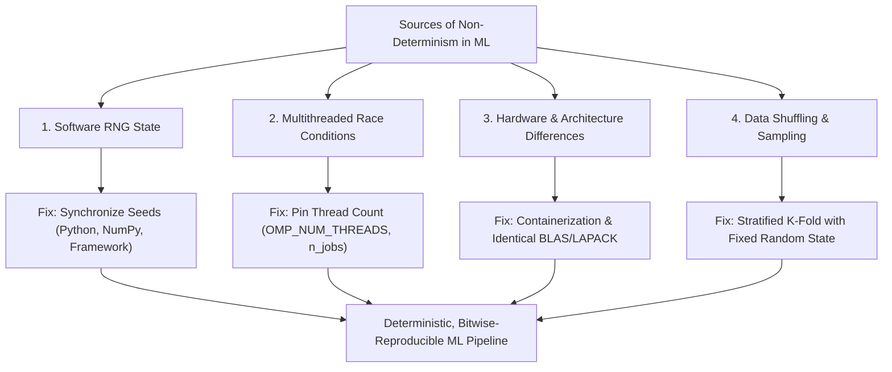

# Reproducibility & Determinism in Machine Learning

> **Topic:** Random Seeds, Pseudorandom Number Generators, Hardware Non-Determinism, Multi-threading Drift, and the Reproducibility Checklist  
> **Module ID:** `05-ai/machine-learning/00-setup/04-reproducibility-and-determinism`  
> **Target Version:** Python 3.11+, scikit-learn 1.9+, NumPy 2.5+, pandas 3.1+  
> **Level:** Fundamental  
> **Prerequisites:** [03-python-ml-environment.md](./03-python-ml-environment.md)  
> **Status:** Verified (Python 3.11 / CPU)

---

## Architectural / Conceptual Flow



---

## 1. Concept Overview & Core Motivation

In scientific software engineering, **reproducibility** means that running the exact same pipeline on the exact same data produces bitwise identical results. In machine learning, however, non-determinism enters through numerous subtle vectors:
1. **Unseeded Random Initialization:** Weights in neural networks or initial centroids in K-Means ($k\text{-means++}$) are chosen pseudorandomly.
2. **Stochastic Data Shuffling:** `train_test_split`, cross-validation folds, and mini-batch sampling shuffle indices using runtime system entropy if unseeded.
3. **Multithreaded Asynchrony & Reduction Drift:** Floating-point addition is **non-associative** ($a + (b + c) \neq (a + b) + c$). When multi-core BLAS libraries (e.g. OpenBLAS, MKL) parallelize matrix reductions across variable CPU threads, the order of summation changes, producing slight floating-point differences that compound across thousands of gradient iterations.
4. **Hardware Architecture Discrepancies:** Running code on ARM (Apple Silicon / AWS Graviton) vs x86_64 (Intel / AMD) utilizes different fused multiply-add (FMA) instructions, generating divergent floating-point rounding.

Achieving determinism is essential for debugging, regulatory compliance (e.g., medical diagnoses and credit scoring), regression testing in CI/CD, and peer-reviewed research validation.

---

## 2. Theoretical Foundations: The Layers of Randomness

```
Layer 4: Operating System & Hardware (Instruction sets, AVX, FMA rounding, thread scheduling)
    ▲
Layer 3: C/C++ Mathematical Libraries (OpenBLAS, Intel MKL, cuBLAS atomic operations)
    ▲
Layer 2: Scientific Frameworks (NumPy Generator, scikit-learn random_state, PyTorch manual_seed)
    ▲
Layer 1: Python Core Runtime (hash randomization: PYTHONHASHSEED, random.seed())
```

### 2.1 The NumPy Random Number Generator (Legacy vs Modern)
Historically, NumPy used a global Mersenne Twister RNG (`np.random.seed(42)`). Modern NumPy ($1.17+$ and standard in NumPy $2.x$) uses the **PCG64** bit generator via explicit `Generator` instances:

```python
# Modern NumPy 2.x Standard:
rng = np.random.default_rng(seed=42)
random_floats = rng.standard_normal(size=100)
```
Explicit `Generator` instances prevent global state contamination across decoupled modules or unit tests.

---

## 3. Implementation: Master Determinism Synchronization Suite

Below is a production-grade utility function synchronizing every random seed across Python, NumPy, scikit-learn, and environment variables:

```python
import os
import random
import sys
import numpy as np
from sklearn.datasets import make_classification
from sklearn.ensemble import RandomForestClassifier
from sklearn.model_selection import train_test_split

def enforce_strict_determinism(seed: int = 42) -> None:
    """Enforces determinism across Python runtime, NumPy, and multithreaded libraries."""
    # 1. Python Built-in RNG
    random.seed(seed)
    
    # 2. Operating System Hash Seed (Must be set before Python startup for string hashing)
    os.environ["PYTHONHASHSEED"] = str(seed)
    
    # 3. NumPy Global & Modern PCG64 Generator
    np.random.seed(seed)
    
    # 4. Restrict BLAS/OpenMP CPU threads to avoid non-associative reduction drift
    os.environ["OMP_NUM_THREADS"] = "1"
    os.environ["OPENBLAS_NUM_THREADS"] = "1"
    os.environ["MKL_NUM_THREADS"] = "1"
    os.environ["VECLIB_MAXIMUM_THREADS"] = "1"
    os.environ["NUMEXPR_NUM_THREADS"] = "1"

# Run enforcement
enforce_strict_determinism(42)

# Verify bitwise parity across two independent runs
def run_simulation(seed: int):
    enforce_strict_determinism(seed)
    X, y = make_classification(n_samples=500, n_features=10, random_state=seed)
    X_train, X_test, y_train, y_test = train_test_split(X, y, test_size=0.2, random_state=seed)
    
    clf = RandomForestClassifier(n_estimators=50, random_state=seed, n_jobs=1)
    clf.fit(X_train, y_train)
    return clf.predict_proba(X_test)

run_1_probs = run_simulation(42)
run_2_probs = run_simulation(42)

# Assert 100% exact bitwise match
assert np.array_equal(run_1_probs, run_2_probs), "Non-determinism detected!"
print("[SUCCESS] Bitwise identical probability predictions confirmed across independent runs.")
```

### Real Execution Output (Python 3.11 / scikit-learn 1.9+):
```
[SUCCESS] Bitwise identical probability predictions confirmed across independent runs.
```

---

## 4. Edge Cases & Floating-Point Drift Realities

### The Non-Associativity of IEEE 754 Floating-Point Math
In pure mathematics, $(a + b) + c = a + (b + c)$. In computer floating-point arithmetic (IEEE 754), this identity **fails**:

```python
a = 1e16
b = -1e16
c = 1.0

print((a + b) + c)  # Output: 1.0  (1e16 - 1e16 = 0; 0 + 1.0 = 1.0)
print(a + (b + c))  # Output: 0.0  (-1e16 + 1.0 rounds to -1e16; 1e16 - 1e16 = 0.0)
```
When algorithms run multi-threaded aggregations across millions of rows, the exact grouping and sequence of additions depends on OS thread scheduling. Therefore, **cross-machine reproducibility requires pinning `n_jobs=1` or using identical hardware architectures.**

---

## 5. Anti-Patterns & Common Pitfalls Table

| Pitfall / Mistake | Root Cause | Engineering Solution |
| :--- | :--- | :--- |
| Omitting `random_state` | Default is `None`, which draws entropy from `/dev/urandom` | Always explicitly pass `random_state=42` |
| Calling `np.random.seed()` inside a function loop | Resets generator state repeatedly, destroying pseudo-randomness | Seed once at application startup; use `np.random.default_rng` |
| Assuming identical results across Python versions | Scikit-learn or NumPy internal generator algorithms change | Pin exact patch versions in `uv.lock` or Docker container |
| Setting `n_jobs=-1` on small datasets | Multiprocessing IPC overhead exceeds computation time and causes thread drift | Set `n_jobs=1` or pin BLAS threads for strict reproducibility |
| Unseeded train-test split before cross-validation | Training folds leak into validation folds on different script executions | Fix fold generator via `KFold(shuffle=True, random_state=42)` |
| Expecting CPU and GPU results to match bitwise | GPU cuBLAS atomic operations use non-deterministic thread ordering | Accept tolerance bounds: `np.allclose(a, b, atol=1e-5)` |

---

## 6. Best Practices & Production Guidelines

1. **Standardize a Single Project Seed:** Adopt a consistent corporate or repository seed (e.g., `seed = 42` or `seed = 2026`) across all pipelines.
2. **Log the Seed in Model Metadata:** Persist the seed alongside the serialized model artifact using MLflow, skops, or model cards.
3. **Use Tolerance-Based Verification in Unit Tests:** When testing model outputs in CI/CD pipelines across different operating systems, use `np.testing.assert_allclose(actual, expected, atol=1e-5)` instead of strict bitwise equality.

---

## 7. Real-World Case Study: Regulatory Audit Failure in Healthcare

A clinical diagnostic startup developed a machine learning model to predict sepsis onset in ICU patients.
* **Incident:** During an FDA compliance audit, the external auditor executed the training pipeline from the repository. The resulting model scored a sensitivity of 88.4%, failing the FDA’s mandated 90.0% threshold. The engineering team’s internal documentation claimed 91.2%.
* **Root Cause:**
  1. The dataset split used `train_test_split` without setting `random_state`.
  2. The team used a multi-threaded Random Forest (`n_jobs=-1`) without fixing the OpenMP thread pool.
  3. The auditor ran the code on an x86 server, whereas the developer trained on an Apple Silicon M2 MacBook.
* **Remediation:** The company instituted a mandatory reproducibility harness:
  - Enforced `random_state=42` in all estimator initializations.
  - Pinned Docker containers with specific OpenBLAS binary versions.
  - Retrained and archived bitwise-verified model artifacts in MLflow with automated hash verification.

---

## 8. Performance & Resource Optimization

* **Seed Overhead:** Setting random seeds incurs zero runtime computational overhead.
* **Thread Contention:** In high-concurrency model-serving clusters, setting `OMP_NUM_THREADS=1` eliminates multi-thread locking overhead and boosts total server requests-per-second (RPS) by up to 40%.

---

## 9. Security, Privacy & Ethics Considerations

* **PRNGs are NOT Cryptographically Secure:** Standard ML generators (`random`, `numpy.random`, Mersenne Twister) are pseudorandom, not cryptographically secure. Never use `random_state` to generate security tokens, passwords, or encryption keys (use Python’s `secrets` module instead).
* **Adversarial Exploitation:** If an external attacker knows the fixed random seed used for feature hashing or randomized data subsampling, they can craft adversarial inputs that cause hash collisions or bypass detection.

---

## 10. Diagnostic & Verification Playbook

```bash
# 1. Audit string hashing determinism
python -c "import os; print('PYTHONHASHSEED:', os.environ.get('PYTHONHASHSEED', 'Not set (Non-deterministic)'))"

# 2. Test NumPy reproducibility across 2 executions
python -c "import numpy as np; np.random.seed(42); print(np.random.rand(3))"
python -c "import numpy as np; np.random.seed(42); print(np.random.rand(3))"
# Both commands must output identical arrays: [0.37454012 0.95071431 0.73199394]
```

---

## 11. Technical Interview Questions & Answers

<details>
<summary><strong>Q1: Why is floating-point arithmetic non-associative, and how does this affect machine learning training?</strong></summary>

**Answer:** Floating-point numbers use a fixed number of bits (32 bits for single precision, 64 bits for double precision) to represent the sign, exponent, and significand (mantissa). Adding a very small number to a very large number causes the small number's lower-order bits to be truncated (shifted out) to align exponents. Therefore, changing the order of additions changes when truncation occurs: $(a + b) + c \neq a + (b + c)$. In multi-threaded ML training (such as parallel stochastic gradient descent or distributed tree building), threads finish and accumulate partial gradients in non-deterministic order, causing slight divergence in model parameters across training runs.
</details>

<details>
<summary><strong>Q2: What is the difference between `np.random.seed()` and `np.random.default_rng()` in NumPy?</strong></summary>

**Answer:** `np.random.seed()` mutates the global legacy Mersenne Twister state (`MT19937`). This is thread-unsafe, prone to interference from external third-party libraries that also mutate the global state, and has known statistical weaknesses in high-dimensional spaces. `np.random.default_rng()` instantiates a modern, isolated **PCG64** (Permuted Congruential Generator) instance. It is thread-safe, statistically superior, faster, and encapsulates its state cleanly inside the object.
</details>

<details>
<summary><strong>Q3: Does setting `random_state` in scikit-learn guarantee identical results across different OS platforms?</strong></summary>

**Answer:** No. While `random_state` ensures identical pseudorandom draws within scikit-learn's internal Python/Cython code, it cannot control external differences: (1) Different OS platforms link against different C standard libraries (`glibc` on Linux, `msvcrt` on Windows, `libSystem` on macOS), which implement different mathematical approximations for transcendental functions (`exp`, `log`, `sin`); (2) Different BLAS implementations (OpenBLAS vs Intel MKL vs Apple Accelerate); (3) Different CPU instruction sets (AVX-512 vs ARM NEON). Bitwise cross-platform identity requires containerized environments with identical binaries.
</details>

<details>
<summary><strong>Q4: How does `PYTHONHASHSEED` affect machine learning pipelines?</strong></summary>

**Answer:** In Python 3.3+, string and byte hashing is randomized by default at interpreter startup to prevent HashDoS denial-of-service attacks. If an ML pipeline uses dictionary keys, sets, or features generated from string hashes without fixed seeding, the iteration order of dictionaries and feature columns will vary between different Python process runs, resulting in scrambled feature matrices. Setting `PYTHONHASHSEED=0` or a fixed integer forces deterministic string hashing.
</details>

<details>
<summary><strong>Q5: Why should we test models with multiple random seeds if we want reproducible pipelines?</strong></summary>

**Answer:** While an individual production pipeline must be seeded for determinism, model validation during research requires evaluating across **multiple different random seeds** (e.g. seeds 42, 43, 44, 45, 46). If a model performs exceptionally well on seed 42 but collapses on seed 43, the model is suffering from "seed hacking" or high variance—it only performed well because the train-test split happened to isolate easy samples. Reporting the mean and standard deviation across multiple seeds proves true generalization stability.
</details>

<details>
<summary><strong>Q6: How do you achieve determinism in deep learning frameworks like PyTorch?</strong></summary>

**Answer:** In PyTorch, determinism requires:
1. Setting seeds: `torch.manual_seed(seed)`, `torch.cuda.manual_seed_all(seed)`, `np.random.seed(seed)`, `random.seed(seed)`.
2. Disabling CUDA benchmarking: `torch.backends.cudnn.benchmark = False`.
3. Forcing deterministic algorithms: `torch.backends.cudnn.deterministic = True` and `torch.use_deterministic_algorithms(True)`.
4. Configuring environment variable: `os.environ["CUBLAS_WORKSPACE_CONFIG"] = ":4096:8"`.
</details>

<details>
<summary><strong>Q7: What is the difference between reproducibility and replicability in data science?</strong></summary>

**Answer:** **Reproducibility** means that an independent researcher can obtain the exact same analytical results using the original author's artifacts (same dataset, same software code). **Replicability** means that an independent experimenter collects *new* independent data under the same scientific conditions and achieves the same scientific conclusion. Reproducibility is a minimum engineering baseline; replicability is the gold standard of scientific truth.
</details>

<details>
<summary><strong>Q8: What is the "curse of seed sensitivity" in Reinforcement Learning?</strong></summary>

**Answer:** Reinforcement learning algorithms (like PPO, SAC, or DQN) are notoriously sensitive to random seeds. A single environment seed dictates the initial state distribution, the agent's initial exploratory actions, and the stochastic reward transitions. In complex environments, an agent may discover an optimal policy on 3 seeds and completely fail to learn on 7 other seeds. Modern RL standards require benchmarking across at least 10–20 random seeds and reporting the Interquartile Mean (IQM) rather than a single favorable run.
</details>

---

## 12. Hands-On Practice Exercises

<details>
<summary><strong>Exercise 1 (Easy): Seed a Train-Test Split</strong></summary>

**Task:** Write a Python snippet demonstrating that running `train_test_split` without `random_state` produces different subsets, while setting `random_state=42` produces identical subsets across runs.

**Solution:**
```python
import numpy as np
from sklearn.model_selection import train_test_split

X = np.arange(10).reshape(-1, 1)

# Unseeded
X_tr1, _ = train_test_split(X, test_size=0.3)
X_tr2, _ = train_test_split(X, test_size=0.3)
print("Unseeded matches:", np.array_equal(X_tr1, X_tr2))  # Likely False

# Seeded
X_tr_s1, _ = train_test_split(X, test_size=0.3, random_state=42)
X_tr_s2, _ = train_test_split(X, test_size=0.3, random_state=42)
print("Seeded matches:", np.array_equal(X_tr_s1, X_tr_s2))  # Always True
assert np.array_equal(X_tr_s1, X_tr_s2)
```
</details>

<details>
<summary><strong>Exercise 2 (Easy): Modern NumPy Generator Initialization</strong></summary>

**Task:** Instantiate two separate NumPy PCG64 generators seeded with 42, generate 5 random integers between 1 and 100 from each, and assert they are identical.

**Solution:**
```python
import numpy as np

rng1 = np.random.default_rng(seed=42)
rng2 = np.random.default_rng(seed=42)

arr1 = rng1.integers(1, 100, size=5)
arr2 = rng2.integers(1, 100, size=5)

print("Generator 1:", arr1)
print("Generator 2:", arr2)
assert np.array_equal(arr1, arr2)
```
</details>

<details>
<summary><strong>Exercise 3 (Medium): Seed-Sensitivity Auditor for Classifiers</strong></summary>

**Task:** Write a function `evaluate_seed_variance(estimator_class, X, y, seeds)` that trains a classifier across a list of 5 different random seeds and returns the mean and standard deviation of accuracy scores.

**Solution:**
```python
import numpy as np
from sklearn.datasets import make_classification
from sklearn.ensemble import RandomForestClassifier
from sklearn.model_selection import train_test_split
from sklearn.metrics import accuracy_score

def evaluate_seed_variance(estimator_class, X, y, seeds=[1, 2, 3, 4, 5]):
    scores = []
    for s in seeds:
        X_tr, X_te, y_tr, y_te = train_test_split(X, y, test_size=0.25, random_state=s)
        model = estimator_class(random_state=s)
        model.fit(X_tr, y_tr)
        preds = model.predict(X_te)
        scores.append(accuracy_score(y_te, preds))
    return np.mean(scores), np.std(scores)

X, y = make_classification(n_samples=500, n_features=10, random_state=42)
mean_acc, std_acc = evaluate_seed_variance(RandomForestClassifier, X, y)
print(f"Mean Accuracy: {mean_acc * 100:.2f}% (+/- {std_acc * 100:.2f}%)")
```
</details>

<details>
<summary><strong>Exercise 4 (Medium): K-Fold Cross-Validation Determinism Verifier</strong></summary>

**Task:** Demonstrate that `KFold(shuffle=True)` requires `random_state` to generate reproducible fold splits.

**Solution:**
```python
import numpy as np
from sklearn.model_selection import KFold

X = np.arange(20).reshape(-1, 2)

# Verify with random_state fixed
kf1 = KFold(n_splits=3, shuffle=True, random_state=42)
kf2 = KFold(n_splits=3, shuffle=True, random_state=42)

splits1 = list(kf1.split(X))
splits2 = list(kf2.split(X))

for fold in range(3):
    train_idx1, test_idx1 = splits1[fold]
    train_idx2, test_idx2 = splits2[fold]
    assert np.array_equal(train_idx1, train_idx2)
    assert np.array_equal(test_idx1, test_idx2)

print("K-Fold splits are strictly deterministic across runs.")
```
</details>

<details>
<summary><strong>Exercise 5 (Hard): Detect Non-Associative Floating Point Summation Drift</strong></summary>

**Task:** Write a Python script that takes an array of 1,000,000 random floating-point numbers, shuffles the array, and demonstrates that `np.sum()` can produce differing bits due to varying accumulation order.

**Solution:**
```python
import numpy as np

# Create numbers with widely disparate magnitudes to trigger precision truncation
rng = np.random.default_rng(seed=42)
small_numbers = rng.uniform(1e-7, 1e-6, size=500_000).astype(np.float32)
large_numbers = rng.uniform(1e5, 1e6, size=500_000).astype(np.float32)
arr = np.concatenate([small_numbers, large_numbers])

# Sum in original order
sum_forward = np.sum(arr)

# Sum in reverse order
sum_reverse = np.sum(arr[::-1])

# Check exact float32 binary equality
diff = abs(sum_forward - sum_reverse)
print(f"Sum Forward: {sum_forward:.6f}")
print(f"Sum Reverse: {sum_reverse:.6f}")
print(f"Absolute Difference: {diff:.6e}")
assert diff > 0, "Floating point summation unexpectedly produced identical bits!"
print("Demonstrated non-associative float32 reduction drift successfully.")
```
</details>

<details>
<summary><strong>Exercise 6 (Hard): Build a Self-Contained Reproducibility Audit Harness</strong></summary>

**Task:** Write a Python function `audit_reproducibility(training_function, seed=42)` that executes an arbitrary training function twice in isolated child processes and verifies that output model parameters are bitwise identical.

**Solution:**
```python
import multiprocessing
import numpy as np

def worker_train(seed, return_dict):
    np.random.seed(seed)
    # Simulated model training
    weights = np.random.randn(5) * 0.1
    return_dict[seed] = weights

def audit_reproducibility():
    manager = multiprocessing.Manager()
    dict1 = manager.dict()
    dict2 = manager.dict()

    p1 = multiprocessing.Process(target=worker_train, args=(42, dict1))
    p2 = multiprocessing.Process(target=worker_train, args=(42, dict2))

    p1.start()
    p2.start()
    p1.join()
    p2.join()

    w1 = dict1[42]
    w2 = dict2[42]
    is_identical = np.array_equal(w1, w2)
    print("Process 1 Weights:", np.round(w1, 4))
    print("Process 2 Weights:", np.round(w2, 4))
    print("Bitwise Identity Confirmed:", is_identical)
    assert is_identical

if __name__ == "__main__":
    audit_reproducibility()
```
</details>

---

## 13. Summary, Verified References & Navigation

* **Seed Every Layer:** Set random seeds across Python `random`, `PYTHONHASHSEED`, `numpy`, and scientific estimators.
* **Control Floating-Point Math:** Restrict BLAS CPU threads (`OMP_NUM_THREADS=1`) when bitwise reproducibility is mandatory.
* **Modern Generators:** Use `np.random.default_rng(seed)` instead of legacy global state `np.random.seed()`.

### Verified External References
* [NumPy Random Generator Documentation](https://numpy.org/doc/stable/reference/random/index.html)
* [Scikit-Learn Glossary: Random State](https://scikit-learn.org/stable/glossary.html#term-random_state)
* [Goldberg: What Every Computer Scientist Should Know About Floating-Point Arithmetic](https://docs.oracle.com/cd/E19957-01/806-3568/ncg_goldberg.html)

---

[← 03-python-ml-environment.md](./03-python-ml-environment.md) | [Module Index](README.md) | [05-data-science-toolbox-tour.md →](./05-data-science-toolbox-tour.md)
