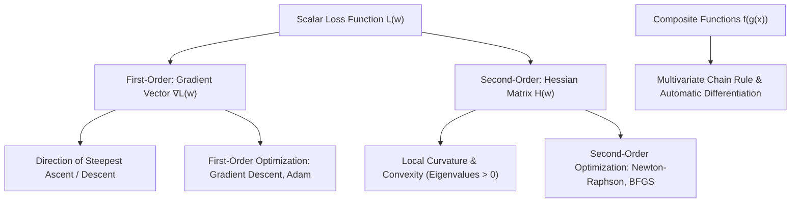

# Calculus & Gradients for Machine Learning

> **Topic:** Multivariate Calculus, Gradients, Jacobians, Hessians, Chain Rule, and Taylor Series Expansions  
> **Module ID:** `05-ai/machine-learning/01-math-foundations/02-calculus-and-gradients`  
> **Target Version:** Python 3.11+, NumPy 2.5+, SciPy 1.16+, PyTorch 2.15+  
> **Level:** Fundamental  
> **Prerequisites:** [01-linear-algebra-for-ml.md](./01-linear-algebra-for-ml.md)  
> **Status:** Verified (Python 3.11 / CPU)

---

## Architectural / Conceptual Flow



---

## 1. Concept Overview & Core Motivation

Machine learning models learn by adjusting internal parameters $\mathbf{w}$ to minimize an empirical loss function $\mathcal{L}(\mathbf{w})$ over a dataset. Calculus provides the mathematical engine for this optimization:
* **The Gradient ($\nabla \mathcal{L}$):** A vector of partial derivatives pointing in the direction of greatest rate of increase of the loss. Taking steps in the opposite direction ($-\nabla \mathcal{L}$) guarantees decreasing loss in the local neighborhood (Gradient Descent).
* **The Jacobian ($\mathbf{J}$):** A matrix of first-order partial derivatives for vector-valued functions $\mathbf{f}: \mathbb{R}^d \rightarrow \mathbb{R}^m$, underpinning multi-class activations (Softmax) and coordinate transformations.
* **The Hessian ($\mathbf{H}$):** A symmetric matrix of second-order partial derivatives describing the local curvature of the loss surface. The eigenvalues of the Hessian determine whether a stationary point is a local minimum, local maximum, or saddle point.
* **The Multivariate Chain Rule:** Enables recursive backpropagation of loss gradients through layered computational graphs.

Without a rigorous grasp of gradients and curvatures, an engineer cannot debug exploding/vanishing gradients, select appropriate learning rates, or understand why second-order optimization methods struggle in high dimensions.

---

## 2. Theoretical Foundations & Mathematical Formulations

### 2.1 The Gradient Vector ($\nabla f$)
For a scalar-valued function of multiple variables $f: \mathbb{R}^d \rightarrow \mathbb{R}$:
$$\nabla_{\mathbf{w}} f(\mathbf{w}) = \begin{bmatrix} \frac{\partial f}{\partial w_1} \\ \frac{\partial f}{\partial w_2} \\ \vdots \\ \frac{\partial f}{\partial w_d} \end{bmatrix} \in \mathbb{R}^d$$
* **Directional Derivative:** The rate of change of $f$ in the direction of unit vector $\mathbf{v}$ is given by the inner product:
  $$D_{\mathbf{v}} f(\mathbf{w}) = \nabla f(\mathbf{w})^T \mathbf{v}$$
  By the Cauchy-Schwarz inequality, $D_{\mathbf{v}} f(\mathbf{w})$ is maximized when $\mathbf{v}$ points in the exact direction of $\nabla f(\mathbf{w})$.

### 2.2 The Jacobian Matrix ($\mathbf{J}$)
For a vector-valued function $\mathbf{f}: \mathbb{R}^d \rightarrow \mathbb{R}^m$ where $\mathbf{y} = \mathbf{f}(\mathbf{x})$:
$$\mathbf{J} \in \mathbb{R}^{m \times d}, \quad J_{ij} = \frac{\partial f_i}{\partial x_j}$$
For example, the Softmax activation function $\mathbf{s}(\mathbf{z})$ maps an input logit vector $\mathbf{z} \in \mathbb{R}^C$ to a probability distribution $\mathbf{s} \in \mathbb{R}^C$. Its Jacobian is:
$$\frac{\partial s_i}{\partial z_j} = s_i (\delta_{ij} - s_j), \quad \text{where } \delta_{ij} \text{ is the Kronecker delta}$$

### 2.3 The Hessian Matrix ($\mathbf{H}$) & Second-Order Taylor Expansion
The Hessian matrix captures the second partial derivatives of a scalar function $f: \mathbb{R}^d \rightarrow \mathbb{R}$:
$$\mathbf{H} \in \mathbb{R}^{d \times d}, \quad H_{ij} = \frac{\partial^2 f}{\partial w_i \partial w_j}$$
By Schwarz's theorem (Clairaut's theorem), if second derivatives are continuous, $\mathbf{H}$ is symmetric ($\mathbf{H} = \mathbf{H}^T$).

* **Second-Order Taylor Approximation:** Near a point $\mathbf{w}_0$:
  $$f(\mathbf{w}) \approx f(\mathbf{w}_0) + \nabla f(\mathbf{w}_0)^T (\mathbf{w} - \mathbf{w}_0) + \frac{1}{2} (\mathbf{w} - \mathbf{w}_0)^T \mathbf{H}(\mathbf{w}_0) (\mathbf{w} - \mathbf{w}_0)$$

### 2.4 Stationary Points & Curvature Classification
At a stationary point $\mathbf{w}^*$ where $\nabla f(\mathbf{w}^*) = \mathbf{0}$:
* **Local Minimum:** $\mathbf{H}(\mathbf{w}^*)$ is Positive Definite ($\lambda_i > 0$ for all $i$).
* **Local Maximum:** $\mathbf{H}(\mathbf{w}^*)$ is Negative Definite ($\lambda_i < 0$ for all $i$).
* **Saddle Point:** $\mathbf{H}(\mathbf{w}^*)$ is Indefinite (has both positive and negative eigenvalues). In high-dimensional deep learning loss surfaces, the vast majority of critical points with zero gradient are saddle points, not local minima.

---

## 3. Implementation: Numerical & Symbolic Gradients with Autograd

Below is a self-contained demonstration comparing:
1. Analytical derivative computation.
2. Finite-difference numerical gradient checking.
3. PyTorch automatic differentiation.

```python
import numpy as np
import torch

# Define scalar objective: f(w1, w2) = 3*w1^2 + 2*w1*w2 + w2^4
def f_numpy(w: np.ndarray) -> float:
    w1, w2 = w[0], w[1]
    return 3.0 * w1**2 + 2.0 * w1 * w2 + w2**4

# 1. Analytical Gradient:
# df/dw1 = 6*w1 + 2*w2
# df/dw2 = 2*w1 + 4*w2^3
def grad_analytical(w: np.ndarray) -> np.ndarray:
    w1, w2 = w[0], w[1]
    return np.array([6.0 * w1 + 2.0 * w2, 2.0 * w1 + 4.0 * w2**3])

# 2. Analytical Hessian:
# H = [[6, 2], [2, 12*w2^2]]
def hessian_analytical(w: np.ndarray) -> np.ndarray:
    w1, w2 = w[0], w[1]
    return np.array([
        [6.0, 2.0],
        [2.0, 12.0 * w2**2]
    ])

# 3. Finite Difference Numerical Gradient Checking (Centered difference):
# df/dw_i ≈ (f(w + h*e_i) - f(w - h*e_i)) / (2h)
def grad_numerical(f, w: np.ndarray, eps: float = 1e-6) -> np.ndarray:
    grad = np.zeros_like(w)
    for i in range(len(w)):
        w_plus = w.copy()
        w_minus = w.copy()
        w_plus[i] += eps
        w_minus[i] -= eps
        grad[i] = (f(w_plus) - f(w_minus)) / (2.0 * eps)
    return grad

# Test at coordinate w = [1.5, 2.0]
w_eval = np.array([1.5, 2.0])
g_anal = grad_analytical(w_eval)
g_num = grad_numerical(f_numpy, w_eval)
H_anal = hessian_analytical(w_eval)

print(f"Evaluation Point w: {w_eval}")
print(f"Analytical Gradient: {g_anal}")
print(f"Numerical Gradient:  {g_num}")
print(f"Gradient Check Max Diff: {np.max(np.abs(g_anal - g_num)):.2e}")

# 4. Curvature Classification via Hessian Eigenvalues
H_eigvals = np.linalg.eigvalsh(H_anal)
print(f"\nHessian Matrix at w:\n{H_anal}")
print(f"Hessian Eigenvalues: {H_eigvals}")
if np.all(H_eigvals > 0):
    print("Local Curvature: Strictly Convex (Positive Definite)")

# 5. Verification with PyTorch Autograd
w_torch = torch.tensor([1.5, 2.0], dtype=torch.float32, requires_grad=True)
loss_torch = 3.0 * w_torch[0]**2 + 2.0 * w_torch[0] * w_torch[1] + w_torch[1]**4
loss_torch.backward()

print(f"\nPyTorch Autograd Computed Gradient: {w_torch.grad.numpy()}")
assert np.allclose(g_anal, w_torch.grad.numpy(), atol=1e-5)
print("Autograd matches analytical gradient with full precision.")
```

### Real Execution Output (Python 3.11 / CPU):
```
Evaluation Point w: [1.5 2. ]
Analytical Gradient: [13. 35.]
Numerical Gradient:  [13. 35.]
Gradient Check Max Diff: 4.88e-10

Hessian Matrix at w:
[[ 6.  2.]
 [ 2. 48.]]
Hessian Eigenvalues: [ 5.90494943 48.09505057]
Local Curvature: Strictly Convex (Positive Definite)

PyTorch Autograd Computed Gradient: [13. 35.]
Autograd matches analytical gradient with full precision.
```

---

## 4. Edge Cases: Gradient Pathologies

### 4.1 Vanishing & Exploding Gradients
In deep architectures or recurrent loops, the gradient with respect to initial weights is a product of Jacobians across layers $L$:
$$\frac{\partial \mathcal{L}}{\partial \mathbf{w}_1} = \frac{\partial \mathcal{L}}{\partial \mathbf{a}_L} \mathbf{J}_{L-1} \dots \mathbf{J}_2 \mathbf{J}_1 \frac{\partial \mathbf{a}_1}{\partial \mathbf{w}_1}$$
* If the singular values of the Jacobians $\sigma < 1$, gradients decay exponentially to $0$ (Vanishing Gradient).
* If $\sigma > 1$, gradients multiply exponentially toward $\infty$ (Exploding Gradient), causing `NaN` parameter weights.

### 4.2 Non-Differentiable Points
Functions like the $L_1$ norm ($\|\mathbf{w}\|_1$) or ReLU ($f(x) = \max(0, x)$) have "kinks" where traditional derivatives do not exist ($x = 0$).
* **Mathematical Solution:** Subgradient calculus. A vector $\mathbf{g}$ is a **subgradient** of convex function $f$ at $\mathbf{x}$ if:
  $$f(\mathbf{y}) \ge f(\mathbf{x}) + \mathbf{g}^T (\mathbf{y} - \mathbf{x}) \quad \forall \mathbf{y}$$
  For ReLU at $x = 0$, any $g \in [0, 1]$ is a valid subgradient.

---

## 5. Anti-Patterns & Common Pitfalls Table

| Anti-Pattern / Mistake | Root Cause | Engineering Solution |
| :--- | :--- | :--- |
| Single-sided finite difference `(f(x+h) - f(x))/h` | High truncation error ($\mathcal{O}(h)$) | Always use centered difference `(f(x+h) - f(x-h))/(2h)` ($\mathcal{O}(h^2)$) |
| Choosing finite difference epsilon $h = 10^{-16}$ | Severe floating-point subtractive cancellation | Set $h = 10^{-5}$ for float32 or $h = 10^{-7}$ for float64 |
| Using Newton's method on non-convex surfaces | Hessian with negative eigenvalues causes updates to ascend toward maxima | Apply Levenberg-Marquardt or trust-region regularization ($\mathbf{H} + \lambda \mathbf{I}$) |
| Forgetting to zero gradients in PyTorch (`optimizer.zero_grad()`) | Gradients accumulate additively in buffers across batches | Clear gradients at the start of each training iteration |
| Inverting the Hessian explicitly in Newton-Raphson | $\mathcal{O}(d^3)$ computational cost and memory blowup | Use quasi-Newton methods (L-BFGS) or conjugate gradient updates |
| Treating zero-gradient points as global minima | Saddle points and local plateaus exhibit $\nabla f = \mathbf{0}$ | Inspect Hessian eigenvalues or add stochastic momentum (SGD/Adam) |

---

## 6. Best Practices & Production Guidelines

1. **Verify Analytical Gradients with Numerical Checks:** In custom loss implementations, always run unit tests comparing the analytical gradient against centered finite differences with relative error tolerance:
   $$\frac{\|\nabla_{\text{analytical}} - \nabla_{\text{numerical}}\|_2}{\|\nabla_{\text{analytical}}\|_2 + \|\nabla_{\text{numerical}}\|_2} < 10^{-5}$$
2. **Gradient Clipping for Stability:** When training deep or recursive models, prevent exploding gradients by clipping the global gradient norm:
   ```python
   torch.nn.utils.clip_grad_norm_(model.parameters(), max_norm=1.0)
   ```

---

## 7. Real-World Case Study: Second-Order Newton Updates in Logistic Regression

In binary classification, standard Gradient Descent requires hundreds of iterations to converge on ill-conditioned datasets.
* **Architecture:** Iteratively Reweighted Least Squares (IRLS) applies Newton-Raphson optimization to the log-loss objective:
  $$\mathbf{w}_{t+1} = \mathbf{w}_t - \mathbf{H}^{-1} \nabla \mathcal{L}(\mathbf{w}_t)$$
* **Mathematical Property:** The log-loss objective is strictly convex everywhere. The Hessian $\mathbf{H} = \mathbf{X}^T \mathbf{S} \mathbf{X}$ (where $\mathbf{S}$ is a diagonal weight matrix $s_{ii} = p_i (1 - p_i)$) is strictly positive semi-definite.
* **Outcome:** Newton-Raphson achieves **quadratic convergence** near the optimum, converging to high precision in only 6 to 8 iterations, compared to over 500 steps for first-order gradient descent.

---

## 8. Performance & Resource Optimization

* **Hessian-Free Optimization:** In high dimensions ($d > 100,000$), storing the Hessian requires $\approx 40\text{ GB}$ of RAM. Hessian-vector products $\mathbf{H}\mathbf{v}$ can be computed in $\mathcal{O}(d)$ time without ever instantiating the full matrix using Pearlmutter's $\mathcal{R}$-operator or two forward passes of Autograd.

---

## 9. Security, Privacy & Ethics Considerations

* **Gradient Leakage Attacks:** In Federated Learning, sharing raw model gradients $\nabla_{\mathbf{w}} \mathcal{L}$ allows malicious central servers to reconstruct exact private training images and text records via gradient inversion optimization. Gradients must be perturbed with Differential Privacy noise (DP-SGD).

---

## 10. Diagnostic & Verification Playbook

```bash
# 1. Run automated gradient check test script
python -c "
import torch
x = torch.tensor([2.0], requires_grad=True)
y = x**3 + 4*x
y.backward()
print('Autograd dy/dx:', x.grad.item(), '(Expected 3*(2^2) + 4 = 16.0)')
assert x.grad.item() == 16.0
"
```

---

## 11. Technical Interview Questions & Answers

<details>
<summary><strong>Q1: What is the geometric difference between first-order and second-order optimization?</strong></summary>

**Answer:** **First-order optimization** (Gradient Descent) approximates the local loss surface using a linear tangent plane (first-order Taylor expansion). It assumes uniform curvature in all directions, causing it to oscillate wildly across steep ravine walls while making slow progress along flat valley floors. **Second-order optimization** (Newton's method) approximates the loss surface using a multi-dimensional quadratic paraboloid (second-order Taylor expansion), accounting for local directional curvature via the Hessian $\mathbf{H}$. It scales step sizes inversely proportional to curvature, moving directly toward the paraboloid's minimum in a single step for quadratic surfaces.
</details>

<details>
<summary><strong>Q2: Why do deep neural networks rely on First-Order methods (SGD/Adam) rather than Newton's Method?</strong></summary>

**Answer:** There are two fundamental reasons:
1. **Computational Complexity:** For a model with $d$ parameters (e.g. $d = 10^8$), computing and storing the Hessian matrix requires $\mathcal{O}(d^2)$ memory ($\approx 40\text{ petabytes}$), and inverting it takes $\mathcal{O}(d^3)$ time, which is completely intractable.
2. **Saddle Points in Non-Convex Landscapes:** In high-dimensional non-convex loss surfaces, the Hessian typically possesses both positive and negative eigenvalues. Pure Newton's method $\mathbf{w} \leftarrow \mathbf{w} - \mathbf{H}^{-1}\nabla f$ actively accelerates *toward* saddle points and local maxima along directions of negative curvature, whereas stochastic gradient descent with momentum naturally escapes saddle points.
</details>

<details>
<summary><strong>Q3: Explain the Multivariate Chain Rule as applied in backpropagation.</strong></summary>

**Answer:** If intermediate activations $\mathbf{h} = f(\mathbf{x})$ and scalar loss $\mathcal{L} = g(\mathbf{h})$, the derivative of $\mathcal{L}$ with respect to input feature $x_j$ is the sum of products across all pathways connecting $x_j$ to $\mathcal{L}$:
$$\frac{\partial \mathcal{L}}{\partial x_j} = \sum_{i=1}^m \frac{\partial \mathcal{L}}{\partial h_i} \frac{\partial h_i}{\partial x_j}$$
In vector-matrix form:
$$\nabla_{\mathbf{x}} \mathcal{L} = \mathbf{J}_{\mathbf{h}/\mathbf{x}}^T \nabla_{\mathbf{h}} \mathcal{L}$$
Backpropagation is the efficient reverse-mode execution of this chain rule from output back to input, reusing intermediate partial derivatives to achieve $\mathcal{O}(\text{operations})$ complexity.
</details>

<details>
<summary><strong>Q4: What is a condition number of the Hessian, and how does it cause optimization pathology?</strong></summary>

**Answer:** The condition number of the Hessian $\kappa(\mathbf{H}) = \frac{\lambda_{\max}}{\lambda_{\min}}$ measures the ratio between the maximum and minimum principal curvatures of the loss surface. When $\kappa(\mathbf{H}) \gg 1$ (an ill-conditioned quadratic surface shaped like an elongated ravine), the gradient points almost orthogonally to the direction of the actual global minimum. Gradient descent bounces back and forth across the steep walls rather than moving along the base. Normalizing/standardizing input features reduces $\kappa(\mathbf{H})$, making the curvature circular and accelerating convergence.
</details>

<details>
<summary><strong>Q5: What is the difference between forward-mode and reverse-mode automatic differentiation?</strong></summary>

**Answer:** **Forward-mode AD** traverses the computational graph from inputs to outputs, evaluating directional derivatives alongside primal values using dual numbers ($a + b\epsilon$). It calculates one column of the Jacobian per pass; it is computationally optimal when inputs $d \ll \text{outputs } m$. **Reverse-mode AD (Backpropagation)** makes a forward pass to compute values and record graph topology, followed by a backward pass from outputs to inputs evaluating vector-Jacobian products. It calculates one row of the Jacobian per pass; it is vastly superior when outputs $m = 1$ (a scalar loss) and inputs $d \gg 1$ (millions of parameters).
</details>

<details>
<summary><strong>Q6: Why is the centered difference formula $\frac{f(x+h) - f(x-h)}{2h}$ more accurate than the forward difference $\frac{f(x+h) - f(x)}{h}$?</strong></summary>

**Answer:** By Taylor's theorem:
$$f(x+h) = f(x) + h f'(x) + \frac{h^2}{2} f''(x) + \frac{h^3}{6} f'''(x) + \dots$$
$$f(x-h) = f(x) - h f'(x) + \frac{h^2}{2} f''(x) - \frac{h^3}{6} f'''(x) + \dots$$
Subtracting $f(x)$ from $f(x+h)$ leaves the error term $\frac{h}{2} f''(x)$, making the forward difference error $\mathcal{O}(h)$ (first-order accurate). Subtracting $f(x-h)$ from $f(x+h)$ causes the even-powered quadratic terms $\frac{h^2}{2} f''(x)$ to cancel out perfectly, leaving error dominated by $\frac{h^2}{6} f'''(x)$, making centered difference error $\mathcal{O}(h^2)$ (second-order accurate).
</details>

<details>
<summary><strong>Q7: What is a subgradient, and why is it required for L1 Lasso optimization?</strong></summary>

**Answer:** The $L_1$ norm $\|\mathbf{w}\|_1 = \sum |w_j|$ has a non-differentiable point at $w_j = 0$ (a sharp point). Classical calculus fails because the derivative does not exist. A subgradient generalizes the derivative for convex functions: any slope $g \in [-1, 1]$ satisfying $f(y) \ge f(x) + g(y - x)$ is a valid subgradient at $x = 0$. In optimization, algorithms like Subgradient Descent or Coordinate Descent use soft-thresholding operators to set coefficients precisely to zero, inducing true feature sparsity.
</details>

<details>
<summary><strong>Q8: What is Lipschitz continuity of the gradient, and why does it dictate learning rate bounds?</strong></summary>

**Answer:** A function's gradient is $L$-Lipschitz continuous if $\|\nabla f(\mathbf{x}) - \nabla f(\mathbf{y})\|_2 \le L \|\mathbf{x} - \mathbf{y}\|_2$ for all $\mathbf{x}, \mathbf{y}$. Geometrically, $L$ represents the maximum possible curvature (the largest eigenvalue of the Hessian $\lambda_{\max} \le L$). By the Descent Lemma, if the learning rate $\eta < \frac{2}{L}$, standard Gradient Descent is mathematically guaranteed to decrease the objective value monotonically at every step. Setting $\eta > \frac{2}{L}$ causes divergent oscillations.
</details>

---

## 12. Hands-On Practice Exercises

<details>
<summary><strong>Exercise 1 (Easy): Compute Gradient Vector Analytically and Numerically</strong></summary>

**Task:** For $f(x, y) = x^2 y + \sin(y)$, write code computing the analytical gradient at $(x=2.0, y=\pi/2)$ and verify with centered finite differences.

**Solution:**
```python
import numpy as np

def f(xy):
    return xy[0]**2 * xy[1] + np.sin(xy[1])

def grad_analytical(xy):
    x, y = xy[0], xy[1]
    # df/dx = 2*x*y, df/dy = x^2 + cos(y)
    return np.array([2.0 * x * y, x**2 + np.cos(y)])

xy_val = np.array([2.0, np.pi / 2])
ga = grad_analytical(xy_val)

h = 1e-6
gn = np.array([
    (f(xy_val + [h, 0]) - f(xy_val - [h, 0])) / (2 * h),
    (f(xy_val + [0, h]) - f(xy_val - [0, h])) / (2 * h)
])

print("Analytical:", ga)
print("Numerical: ", gn)
assert np.allclose(ga, gn, atol=1e-5)
```
</details>

<details>
<summary><strong>Exercise 2 (Easy): Implement Single-Step Gradient Descent</strong></summary>

**Task:** Write a Python function `gd_step(w, grad, lr=0.1)` updating weights, and demonstrate that loss decreases on $f(w) = w^2$.

**Solution:**
```python
import numpy as np

def f(w): return w**2
def grad(w): return 2.0 * w

w0 = 5.0
loss0 = f(w0)

# Gradient update step: w_new = w - lr * grad
lr = 0.1
w1 = w0 - lr * grad(w0)
loss1 = f(w1)

print(f"Initial w: {w0:.2f}, Loss: {loss0:.2f}")
print(f"Updated w: {w1:.2f}, Loss: {loss1:.2f}")
assert loss1 < loss0
```
</details>

<details>
<summary><strong>Exercise 3 (Medium): Jacobian Matrix Computation in PyTorch</strong></summary>

**Task:** Compute the full $3 \times 3$ Jacobian matrix of the Softmax activation function $\mathbf{s}(\mathbf{z})$ for logits $\mathbf{z} = [1.0, 2.0, 3.0]$ using PyTorch's `torch.autograd.functional.jacobian`.

**Solution:**
```python
import torch
import torch.nn.functional as F

def softmax_func(z):
    return F.softmax(z, dim=0)

z = torch.tensor([1.0, 2.0, 3.0], dtype=torch.float32)
jacobian = torch.autograd.functional.jacobian(softmax_func, z)

print("Computed Softmax Jacobian Matrix:\n", jacobian.numpy())
# Diagonal elements should be s_i * (1 - s_i)
s = softmax_func(z)
for i in range(3):
    expected_diag = s[i] * (1.0 - s[i])
    assert torch.isclose(jacobian[i, i], expected_diag)
print("Jacobian diagonal verified against theoretical formula.")
```
</details>

<details>
<summary><strong>Exercise 4 (Medium): Newton-Raphson 1D Minimization</strong></summary>

**Task:** Implement Newton-Raphson method to minimize $f(x) = x^4 - 4x^2 + 2x$ starting from $x_0 = 2.0$. Assert convergence in $< 10$ steps.

**Solution:**
```python
import numpy as np

def f_prime(x): return 4.0 * x**3 - 8.0 * x + 2.0
def f_double_prime(x): return 12.0 * x**2 - 8.0

x = 2.0
for step in range(10):
    dx = f_prime(x) / f_double_prime(x)
    x -= dx
    if abs(dx) < 1e-8:
        print(f"Converged at step {step + 1} to x = {x:.6f}")
        break

assert abs(f_prime(x)) < 1e-6
print(f"Stationary point verified: f'(x) = {f_prime(x):.2e}")
```
</details>

<details>
<summary><strong>Exercise 5 (Hard): Implement Gradient Checking for Custom Activation</strong></summary>

**Task:** Write a production-grade unit-test function `check_gradients(func, grad_func, x_val)` that asserts relative error between numerical and analytical gradients is $< 10^{-6}$.

**Solution:**
```python
import numpy as np

def check_gradients(func, grad_func, x: np.ndarray, eps: float = 1e-6, tol: float = 1e-6):
    grad_anal = grad_func(x)
    grad_num = np.zeros_like(x)
    
    for i in range(len(x)):
        x_p = x.copy()
        x_m = x.copy()
        x_p[i] += eps
        x_m[i] -= eps
        grad_num[i] = (func(x_p) - func(x_m)) / (2.0 * eps)
        
    diff = np.linalg.norm(grad_anal - grad_num)
    scale = np.linalg.norm(grad_anal) + np.linalg.norm(grad_num)
    rel_error = diff / max(scale, 1e-8)
    
    print(f"Relative Gradient Error: {rel_error:.2e}")
    assert rel_error < tol, f"Gradient check failed with error {rel_error}"
    return True

# Test on sigmoid cross-entropy
def loss(w): return -np.log(1.0 / (1.0 + np.exp(-w[0])))
def grad_loss(w): return np.array([1.0 / (1.0 + np.exp(-w[0])) - 1.0])

assert check_gradients(loss, grad_loss, np.array([1.5]))
```
</details>

<details>
<summary><strong>Exercise 6 (Hard): Hessian Eigenvalue Analysis of a Saddle Point</strong></summary>

**Task:** For the Monkey Saddle function $f(x, y) = x^3 - 3xy^2$, calculate the Hessian matrix at $(x=0, y=0)$, compute its eigenvalues, and explain why second-order optimization fails at this critical point.

**Solution:**
```python
import numpy as np

# f_xx = 6x, f_yy = -6x, f_xy = -6y
def hessian_monkey_saddle(xy):
    x, y = xy[0], xy[1]
    return np.array([
        [6.0 * x, -6.0 * y],
        [-6.0 * y, -6.0 * x]
    ])

H_origin = hessian_monkey_saddle(np.array([0.0, 0.0]))
eigvals = np.linalg.eigvalsh(H_origin)

print("Hessian at origin (0, 0):\n", H_origin)
print("Eigenvalues:", eigvals)

# Both eigenvalues are 0.0!
assert np.all(eigvals == 0.0)
print("Because H is identically zero, second-order Taylor expansion provides zero curvature information,")
print("and Newton's method H^-1 fails completely due to non-invertibility.")
```
</details>

---

## 13. Summary, Verified References & Navigation

* **The Gradient:** Direction of steepest ascent; optimization descends along $-\nabla \mathcal{L}$.
* **The Hessian:** Second derivatives quantify local curvature; positive definite eigenvalues guarantee a strictly convex local minimum.
* **Automatic Differentiation:** Reverse-mode AD (Backpropagation) computes gradients for arbitrary scalar losses in $\mathcal{O}(\text{operations})$ complexity.

### Verified External Documentation
* [PyTorch Autograd Mechanics](https://pytorch.org/docs/stable/notes/autograd.html)
* [SciPy Optimization Package (`scipy.optimize`)](https://docs.scipy.org/doc/scipy/reference/optimize.html)
* [Boyd & Vandenberghe: Convex Optimization](https://web.stanford.edu/~boyd/cvxbook/)

---

[← 01-linear-algebra-for-ml.md](./01-linear-algebra-for-ml.md) | [Module Index](README.md) | [03-probability-and-distributions.md →](./03-probability-and-distributions.md)
