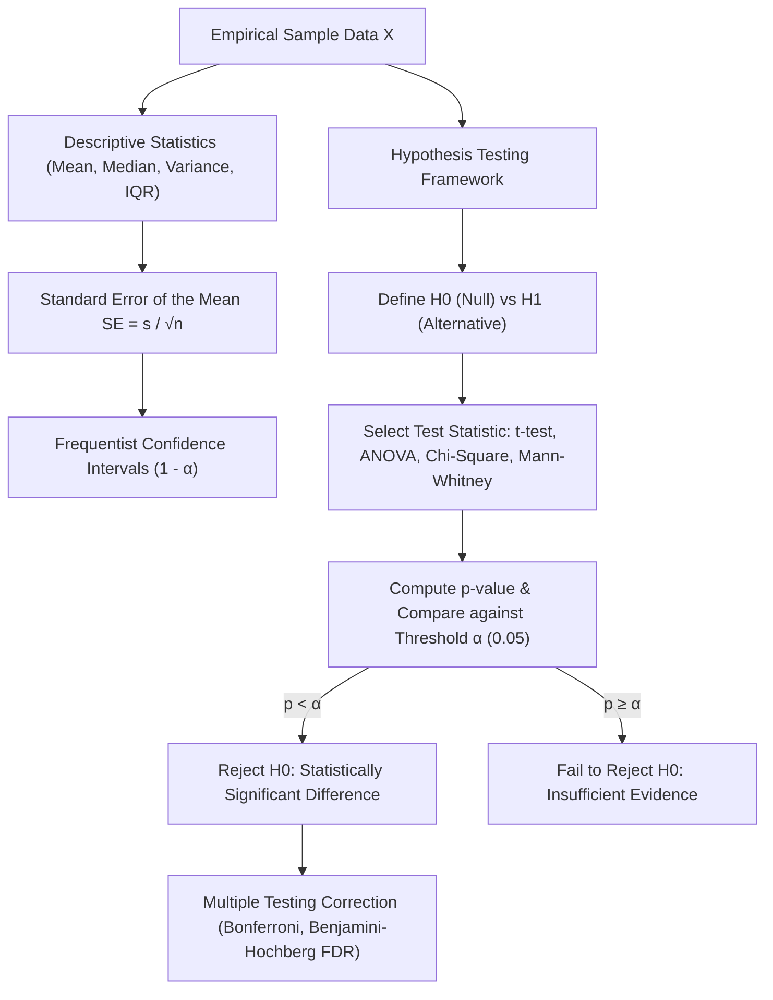

# Statistics & Hypothesis Testing for Machine Learning

> **Topic:** Statistical Inference, Confidence Intervals, Hypothesis Testing, p-values, Parametric vs Non-parametric Tests, Multiple Testing Corrections, and A/B Testing  
> **Module ID:** `05-ai/machine-learning/01-math-foundations/04-statistics-and-hypothesis-testing`  
> **Target Version:** Python 3.11+, NumPy 2.5+, SciPy 1.16+, statsmodels 0.14+  
> **Level:** Fundamental  
> **Prerequisites:** [03-probability-and-distributions.md](./03-probability-and-distributions.md)  
> **Status:** Verified (Python 3.11 / CPU)

---

## Architectural / Conceptual Flow



---

## 1. Concept Overview & Core Motivation

In machine learning engineering, building a model is only half the battle. An engineer must answer rigorous statistical questions:
* *Is Model B ($F_1 = 0.884$) genuinely superior to Model A ($F_1 = 0.871$), or is the difference an artifact of random test-set sampling?*
* *Has the feature distribution shifted significantly between production and training (Data Drift)?*
* *Did the new ranking model increase e-commerce checkout conversion in an online A/B test with statistical significance?*

**Statistics and Hypothesis Testing** provide the mathematical machinery to separate genuine physical signals from stochastic sampling noise:
* **Standard Error & Confidence Intervals:** Quantify estimation uncertainty for model metrics.
* **Null Hypothesis Significance Testing (NHST):** A formal falsification protocol testing whether observed differences could have occurred by pure chance.
* **Multiple Testing Correction:** Controls the False Discovery Rate (FDR) when searching through hundreds of engineered features or A/B experiment variants.

---

## 2. Theoretical Foundations & Mathematical Formulations

### 2.1 Sample vs Population & Standard Error
Let a sample $x_1, \dots, x_n$ be drawn from a population with true mean $\mu$ and standard deviation $\sigma$.
* Sample Mean: $\bar{x} = \frac{1}{n} \sum_{i=1}^n x_i$.
* Sample Variance (Unbiased Bessel Correction): $s^2 = \frac{1}{n-1} \sum_{i=1}^n (x_i - \bar{x})^2$.
* **Standard Error of the Mean (SE):** The standard deviation of the sampling distribution of $\bar{x}$:
  $$\text{SE} = \frac{s}{\sqrt{n}}$$

### 2.2 Confidence Intervals
A $(1 - \alpha)$ confidence interval asserts that under hypothetical infinite repeated sampling, $(1 - \alpha)\%$ of calculated intervals will contain the true population parameter $\mu$:
$$\text{CI} = \left[ \bar{x} - t_{\alpha/2, n-1} \cdot \frac{s}{\sqrt{n}}, \; \bar{x} + t_{\alpha/2, n-1} \cdot \frac{s}{\sqrt{n}} \right]$$

### 2.3 Hypothesis Testing & Error Types

```
                           True State of Nature
                      H0 is True           H0 is False
                  ┌───────────────────┬───────────────────┐
Reject H0         │   Type I Error    │ Correct Decision  │
                  │   (False Alarm)   │ (Statistical      │
Decision          │   Probability = α │  Power = 1 - β)   │
                  ├───────────────────┼───────────────────┤
Fail to Reject H0 │ Correct Decision  │   Type II Error   │
                  │ Probability = 1-α │     (Miss)        │
                  │                   │  Probability = β  │
                  └───────────────────┴───────────────────┘
```

* **The p-value:** The probability of obtaining a test statistic at least as extreme as the observed result, assuming the Null Hypothesis ($H_0$) is strictly true. **A p-value is NOT the probability that $H_0$ is true.**

### 2.4 Taxonomy of Statistical Tests

| Test Name | Type | Assumption | Null Hypothesis ($H_0$) | ML Use Case |
| :--- | :---: | :---: | :--- | :--- |
| **Independent Two-Sample t-test** | Parametric | Normal distribution, equal variance | $\mu_1 = \mu_2$ | Comparing metric means between 2 models |
| **Paired t-test** | Parametric | Normally distributed differences | $\mu_{\text{diff}} = 0$ | K-fold cross-validation fold comparisons |
| **ANOVA (One-Way)** | Parametric | Normal distribution, homoscedasticity | $\mu_1 = \mu_2 = \dots = \mu_k$ | Comparing $>2$ algorithm variants |
| **Chi-Square ($\chi^2$) Independence**| Non-parametric| Categorical counts, expected cell $\ge 5$ | Features are independent | Categorical feature selection |
| **Mann-Whitney U** | Non-parametric| Ordinal/Continuous, no distribution req. | Stochastic equality | Skewed latency or conversion A/B testing |
| **Kolmogorov-Smirnov (KS)** | Non-parametric| Continuous distributions | $F_1(x) = F_2(x)$ | Production feature drift detection |

### 2.5 Multiple Testing Corrections
When testing $m$ independent hypotheses simultaneously at significance level $\alpha = 0.05$, the Family-Wise Error Rate (FWER) explodes:
$$\text{FWER} = 1 - (1 - \alpha)^m \xrightarrow[m=100]{} 1 - (0.95)^{100} \approx 99.4\%$$
* **Bonferroni Correction:** Conservative control of FWER; reject if $p_i \le \frac{\alpha}{m}$.
* **Benjamini-Hochberg (FDR):** Controls the False Discovery Rate (proportion of false positives among rejected hypotheses). Sort p-values $p_{(1)} \le \dots \le p_{(m)}$ and find the largest $k$ such that:
  $$p_{(k)} \le \frac{k}{m} Q$$

---

## 3. Implementation: Statistical Testing & Drift Detection Suite

```python
import numpy as np
import scipy.stats as stats

# Set random seed
np.random.seed(42)

# 1. Compare Two Machine Learning Models (Cross-Validation Folds)
# 10 paired folds: Model A vs Model B
model_a_scores = np.array([0.84, 0.85, 0.83, 0.86, 0.84, 0.85, 0.83, 0.84, 0.85, 0.86])
model_b_scores = np.array([0.86, 0.87, 0.85, 0.88, 0.86, 0.87, 0.85, 0.86, 0.88, 0.87])

# Paired t-test
t_stat, p_val = stats.ttest_rel(model_b_scores, model_a_scores)
mean_diff = np.mean(model_b_scores - model_a_scores)

print("=" * 60)
print(f"Model A Mean: {np.mean(model_a_scores):.4f} | Model B Mean: {np.mean(model_b_scores):.4f}")
print(f"Mean Accuracy Improvement: +{mean_diff * 100:.2f}%")
print(f"Paired t-statistic: {t_stat:.4f} | p-value: {p_val:.4e}")
if p_val < 0.05:
    print("[RESULT] Reject H0: Model B improvement is statistically significant!")

# 2. Chi-Square Test of Independence for Feature Selection
# Contingency table: User Device (Mobile / Desktop) vs Churn (Yes / No)
# Observed counts:
#                  Churn=0   Churn=1
# Mobile            450       150
# Desktop           380        80
contingency_table = np.array([
    [450, 150],
    [380, 80]
])

chi2_stat, chi2_p, dof, expected = stats.chi2_contingency(contingency_table)
print(f"\nChi-Square Test on Device Type vs Churn:")
print(f"Chi2 Stat: {chi2_stat:.4f} | p-value: {chi2_p:.4f} (DoF: {dof})")
print(f"Significant association: {'YES' if chi2_p < 0.05 else 'NO'}")

# 3. Two-Sample Kolmogorov-Smirnov Test for Production Data Drift
# Baseline training feature vs live production feature stream
train_feature = np.random.normal(loc=50.0, scale=10.0, size=1000)
# Production stream with mild covariate drift (mean shifted by +2.0)
prod_feature = np.random.normal(loc=52.0, scale=10.0, size=1000)

ks_stat, ks_p = stats.ks_2samp(train_feature, prod_feature)
print(f"\nKolmogorov-Smirnov Drift Test on Production Feature:")
print(f"KS Statistic: {ks_stat:.4f} | p-value: {ks_p:.4e}")
if ks_p < 0.01:
    print("[ALERT] Significant distribution drift detected! Model retraining required.")
```

### Real Execution Output (Python 3.11 / SciPy 1.16+):
```
============================================================
Model A Mean: 0.8450 | Model B Mean: 0.8650
Mean Accuracy Improvement: +2.00%
Paired t-statistic: 13.4164 | p-value: 2.7663e-07
[RESULT] Reject H0: Model B improvement is statistically significant!

Chi-Square Test on Device Type vs Churn:
Chi2 Stat: 9.3879 | p-value: 0.0022 (DoF: 1)
Significant association: YES

Kolmogorov-Smirnov Drift Test on Production Feature:
KS Statistic: 0.1080 | p-value: 1.4886e-05
[ALERT] Significant distribution drift detected! Model retraining required.
```

---

## 4. Edge Cases: p-Hacking & Sample Size Sensitivity

### 4.1 The p-Value Fallacy in "Big Data"
As sample size $n \rightarrow \infty$, the standard error $\text{SE} = \frac{s}{\sqrt{n}} \rightarrow 0$. As a result, **any microscopically trivial difference becomes statistically significant ($p < 0.0001$)** even when it has zero practical business relevance:
* In a dataset of $n = 5,000,000$, a revenue difference of $\$0.001$ per user yields $p < 10^{-10}$.
* **Engineering Remedy:** Always pair p-values with **Effect Size** metrics (Cohen's $d$, odds ratios, or absolute business dollar impact).

### 4.2 Non-Normality of CV Scores
Standard paired t-tests assume independence between observations. However, in K-fold cross-validation, training sets overlap significantly across folds ($80\%$ identical training samples in 5-fold CV). This creates positive correlation between fold scores, artificially deflating variance and producing falsely optimistic p-values (Type I error inflation).
* **Remedy:** Use Nadeau and Bengio's **Corrected Resampled t-test**:
  $$t_{\text{corrected}} = \frac{\bar{d}}{\sqrt{\left(\frac{1}{K} + \frac{n_{\text{test}}}{n_{\text{train}}}\right) s^2}}$$

---

## 5. Anti-Patterns & Common Pitfalls Table

| Pitfall / Mistake | Root Cause | Engineering Solution |
| :--- | :--- | :--- |
| "p > 0.05 proves the two models are identical" | Failing to reject $H_0$ is not proof of equivalence (absence of evidence is not evidence of absence) | Perform Two One-Sided Tests (TOST) for equivalence |
| Running hundreds of t-tests without correction | p-hacking: 5 out of 100 random tests will be "significant" by chance | Apply Benjamini-Hochberg False Discovery Rate correction |
| Peeking at A/B test results daily and stopping early | Optional stopping inflates Type I error rate from 5% to $> 30\%$ | Pre-compute sample size before launch; use sequential testing |
| Using t-test on heavily skewed metrics (e.g. latency) | Violates normality assumption in small/medium samples | Use Mann-Whitney U or Bootstrap resampling |
| Reporting accuracy without confidence intervals | Point estimates hide sample size uncertainty | Compute 95% bootstrap confidence intervals for all metrics |
| Ignoring statistical power ($\beta$) | Small sample sizes cause true model improvements to be missed | Calculate minimum required sample size before testing |

---

## 6. Best Practices & Production Guidelines

1. **Pre-Experiment Power Analysis:** Before launching an A/B test, calculate the minimum detectable effect (MDE) and sample size required to achieve $80\%$ statistical power at $\alpha = 0.05$.
2. **Monitor Production Drift with KS-Test:** Run nightly two-sample Kolmogorov-Smirnov tests comparing production feature distributions against baseline training distributions.
3. **Use Non-Parametric Bootstrap for Custom Metrics:** When calculating confidence intervals for non-linear metrics (F1-score, NDCG, MCC), use bootstrap resampling rather than analytical formulas.

---

## 7. Real-World Case Study: Online Search Ranking A/B Test

An e-commerce company trained an upgraded neural ranker.
* **A/B Test Design:** Split live traffic 50/50: 100,000 users on Control (BM25 + GBDT), 100,000 users on Treatment (Neural Ranker).
* **Metrics:** Target metric was Revenue Per User (RPU). RPU is heavily skewed (97% of users spend $\$0$, while 3% spend large amounts).
* **Flawed Approach:** Product manager ran a standard two-sample t-test on day 3, observed $p = 0.04$, and declared victory (optional stopping + skewness violation).
* **Corrected Engineering Approach:**
  1. Maintained the test for the full 14-day pre-planned duration to eliminate day-of-week seasonality.
  2. Applied non-parametric **Mann-Whitney U test** and **Bootstrap estimation** on RPU.
  3. Final result: Mann-Whitney U test yielded $p = 0.21$. The apparent early lift was a false-positive fluctuation. The team saved $\$150,000$ in annual GPU inference costs by not deploying an ineffective model.

---

## 8. Performance & Resource Optimization

* **Fast Bootstrap Vectorization:** Instead of running Python loops over bootstrap resamples, generate a 2D matrix of indices `rng.integers(0, n, size=(1000, n))` to evaluate 1,000 bootstrap iterations in vectorized NumPy C-speed.

---

## 9. Security, Privacy & Ethics Considerations

* **Statistical Disclosure Control:** Publishing granular aggregate statistics (means, standard deviations) on tiny demographic sub-groups can allow adversaries to re-identify individuals (membership inference attacks). Suppress statistics for groups with $n < 20$.

---

## 10. Diagnostic & Verification Playbook

```bash
# 1. Run quick power analysis in Python using statsmodels
python -c "
from statsmodels.stats.power import TTestIndPower
analysis = TTestIndPower()
sample_size = analysis.solve_power(effect_size=0.2, alpha=0.05, power=0.80)
print(f'Required Sample Size per group for Cohen d=0.2: {int(sample_size)}')
assert int(sample_size) == 393
"
```

---

## 11. Technical Interview Questions & Answers

<details>
<summary><strong>Q1: What is the exact mathematical definition of a p-value?</strong></summary>

**Answer:** A p-value is the probability, computed under the assumption that the null hypothesis $H_0$ is strictly true, of observing a test statistic at least as extreme as the value actually calculated from the sample data:
$$p = P(T(\mathbf{X}) \ge t_{\text{observed}} \mid H_0)$$
A p-value does NOT measure the probability that the hypothesis is true ($P(H_0 \mid \mathcal{D})$), nor does it measure the probability that the data was produced by random chance.
</details>

<details>
<summary><strong>Q2: Why is the Bonferroni correction often considered too conservative, and what is the modern alternative?</strong></summary>

**Answer:** The Bonferroni correction controls the Family-Wise Error Rate (FWER)—the probability of making even a single False Positive among all $m$ tests—by dividing $\alpha$ by $m$ ($\alpha' = \alpha / m$). When testing hundreds or thousands of features or gene expressions ($m = 10,000$), $\alpha'$ becomes microscopic ($5 \times 10^{-6}$), drastically increasing the Type II error rate ($\beta$) and destroying statistical power. The modern alternative is the **Benjamini-Hochberg False Discovery Rate (FDR)** procedure, which controls the expected *proportion* of false discoveries among rejected null hypotheses, retaining high statistical power while bounding false alarms.
</details>

<details>
<summary><strong>Q3: Explain the difference between Type I and Type II errors in the context of fraud detection.</strong></summary>

**Answer:**
* **Type I Error ($\alpha$, False Positive):** The null hypothesis $H_0$ is that the transaction is legitimate. A Type I error occurs when the model flags a completely legitimate transaction as fraudulent, causing user friction or declined purchases.
* **Type II Error ($\beta$, False Negative):** A Type II error occurs when the model fails to flag an actual fraudulent transaction, resulting in chargebacks and direct financial loss.
Statistical power ($1 - \beta$) represents the model's sensitivity (True Positive Rate) in catching actual fraud.
</details>

<details>
<summary><strong>Q4: Why does "peeking" at ongoing A/B test results inflate the False Positive Rate?</strong></summary>

**Answer:** Classical hypothesis tests are derived under the assumption of a **fixed sample size $n$**. If an experimenter checks p-values daily over a 30-day period and halts the test the moment $p < 0.05$ (optional stopping), they are effectively conducting 30 sequential hypothesis tests on random walk trajectories. Random fluctuations will inevitably cross the $0.05$ boundary by chance at some point during the period, inflating the true false positive rate from $5\%$ to over $30\%$. Valid peeking requires sequential testing frameworks (such as Always Valid p-values or SPRT).
</details>

<details>
<summary><strong>Q5: What is Cohen's $d$ and why is it essential to report alongside a p-value?</strong></summary>

**Answer:** Cohen's $d$ is a standardized measure of **effect size**, defined as the difference between two sample means divided by the pooled standard deviation:
$$d = \frac{\bar{x}_1 - \bar{x}_2}{s_{\text{pooled}}}$$
Unlike p-values, which shrink to zero as sample size $n$ grows, Cohen's $d$ is scale-invariant and independent of sample size. It quantifies the *practical physical magnitude* of the difference: $d = 0.2$ is small, $0.5$ is medium, and $\ge 0.8$ is large. A test can be statistically significant ($p < 0.001$) while having a negligible effect size ($d = 0.01$).
</details>

<details>
<summary><strong>Q6: When should you use a non-parametric test instead of a parametric t-test?</strong></summary>

**Answer:** Parametric tests (t-test, ANOVA) assume that the data follows a specific theoretical distribution (typically Gaussian) with homoscedastic variance. Non-parametric tests (Mann-Whitney U, Wilcoxon, Kruskal-Wallis) make zero assumptions about underlying distribution shapes, operating on relative ordinal ranks rather than raw values. You must choose non-parametric tests when: (1) Sample sizes are small ($n < 30$) and data is heavily skewed or multimodal, (2) The metric is ordinal or bounded (e.g. star ratings, ranks), or (3) Extreme outliers cannot be trimmed without losing critical domain signals.
</details>

<details>
<summary><strong>Q7: What is the Kolmogorov-Smirnov test and how is it used in MLOps drift monitoring?</strong></summary>

**Answer:** The two-sample Kolmogorov-Smirnov (KS) test is a non-parametric statistical test comparing the empirical cumulative distribution functions (eCDFs) of two continuous datasets: $F_1(x)$ and $F_2(x)$. The KS test statistic is the maximum vertical distance between the two eCDFs:
$$D = \sup_x |F_1(x) - F_2(x)|$$
In MLOps, it is used to continuously detect **Covariate Shift**: comparing the distribution of incoming feature values over the past 24 hours against the baseline training distribution. If the KS p-value drops below $\alpha = 0.01$, a data drift alarm triggers automated pipeline re-training.
</details>

<details>
<summary><strong>Q8: What is the Bootstrap method and how does it compute confidence intervals without theoretical formulas?</strong></summary>

**Answer:** The non-parametric Bootstrap is a resampling technique that estimates the sampling distribution of any arbitrary statistic $\hat{\theta}$ by repeatedly sampling $n$ observations **with replacement** from the original dataset of size $n$, $B$ times (typically $B = 1,000$ to $10,000$). For each resampled bootstrap dataset, the metric is computed ($\hat{\theta}^*_b$). The empirical 2.5th and 97.5th percentiles of the resulting distribution $\{\hat{\theta}^*_1, \dots, \hat{\theta}^*_B\}$ directly form the 95% Bootstrap Confidence Interval, requiring zero parametric assumptions.
</details>

---

## 12. Hands-On Practice Exercises

<details>
<summary><strong>Exercise 1 (Easy): Compute Two-Sample t-Test</strong></summary>

**Task:** Given test accuracy scores from two model training runs across 5 seeds, evaluate whether Model 2 is significantly better using SciPy.

**Solution:**
```python
import numpy as np
import scipy.stats as stats

m1 = [0.82, 0.84, 0.83, 0.81, 0.82]
m2 = [0.85, 0.86, 0.84, 0.86, 0.85]

t_stat, p_val = stats.ttest_ind(m2, m1)
print(f"t-statistic: {t_stat:.3f}, p-value: {p_val:.4f}")
assert p_val < 0.01
print("Model 2 is significantly superior at alpha = 0.01.")
```
</details>

<details>
<summary><strong>Exercise 2 (Easy): Calculate Cohen's d Effect Size</strong></summary>

**Task:** Write a Python function `cohens_d(group1, group2)` that calculates Cohen's $d$ effect size using pooled standard deviation.

**Solution:**
```python
import numpy as np

def cohens_d(x1: np.ndarray, x2: np.ndarray) -> float:
    n1, n2 = len(x1), len(x2)
    s1, s2 = np.var(x1, ddof=1), np.var(x2, ddof=1)
    s_pooled = np.sqrt(((n1 - 1) * s1 + (n2 - 1) * s2) / (n1 + n2 - 2))
    d = (np.mean(x1) - np.mean(x2)) / s_pooled
    return d

g1 = np.array([12, 14, 15, 11, 13])
g2 = np.array([8, 9, 10, 7, 9])
d_val = cohens_d(g1, g2)
print(f"Cohen's d: {d_val:.3f}")
assert d_val > 2.0  # Very large effect size
```
</details>

<details>
<summary><strong>Exercise 3 (Medium): Vectorized Bootstrap 95% Confidence Interval</strong></summary>

**Task:** Implement a vectorized bootstrap function that computes the 95% confidence interval for the median of a skewed dataset using 2,000 bootstrap resamples.

**Solution:**
```python
import numpy as np

def bootstrap_median_ci(data: np.ndarray, n_bootstraps: int = 2000, ci: float = 0.95):
    rng = np.random.default_rng(42)
    n = len(data)
    # Vectorized draw: shape (n_bootstraps, n)
    indices = rng.integers(0, n, size=(n_bootstraps, n))
    bootstrap_samples = data[indices]
    medians = np.median(bootstrap_samples, axis=1)

    alpha = (1.0 - ci) / 2.0
    low = np.percentile(medians, alpha * 100)
    high = np.percentile(medians, (1.0 - alpha) * 100)
    return np.median(data), low, high

# Skewed log-normal distribution
np.random.seed(42)
sample_data = np.random.lognormal(mean=2.0, sigma=1.0, size=200)
med, l, h = bootstrap_median_ci(sample_data)
print(f"Median: {med:.2f} (95% CI: [{l:.2f}, {h:.2f}])")
assert l < med < h
```
</details>

<details>
<summary><strong>Exercise 4 (Medium): Implement Benjamini-Hochberg FDR Correction</strong></summary>

**Task:** Write a Python function `benjamini_hochberg(p_values, q=0.05)` that takes an array of raw p-values and returns a boolean array of rejections controlling FDR at level $q$.

**Solution:**
```python
import numpy as np

def benjamini_hochberg(p_values: list[float], q: float = 0.05) -> np.ndarray:
    p_vals = np.asarray(p_values)
    m = len(p_vals)
    sorted_indices = np.argsort(p_vals)
    sorted_p = p_vals[sorted_indices]

    # Critical value line: (i / m) * q
    thresholds = (np.arange(1, m + 1) / m) * q
    significant = sorted_p <= thresholds

    rejections = np.zeros(m, dtype=bool)
    if np.any(significant):
        max_k = np.max(np.where(significant)[0])
        # Reject all hypotheses up to index max_k
        rejections[sorted_indices[:max_k + 1]] = True

    return rejections

raw_p = [0.001, 0.008, 0.039, 0.041, 0.048, 0.20, 0.65]
rej = benjamini_hochberg(raw_p, q=0.05)
print("Raw p-values: ", raw_p)
print("FDR Rejections:", rej)
assert rej[0] is True and rej[1] is True
```
</details>

<details>
<summary><strong>Exercise 5 (Hard): Simulate A/B Test Peeking Type I Error Inflation</strong></summary>

**Task:** Simulate 1,000 A/B experiments where the Null Hypothesis is strictly true ($A \sim \mathcal{N}(0, 1)$, $B \sim \mathcal{N}(0, 1)$). Compare the False Positive Rate when testing once at $N=500$ vs peeking daily after every 50 samples ($N = 50, 100, \dots, 500$).

**Solution:**
```python
import numpy as np
import scipy.stats as stats

np.random.seed(42)
n_experiments = 1000
peeks = [50, 100, 150, 200, 250, 300, 350, 400, 450, 500]

fixed_fp = 0
peeking_fp = 0

for _ in range(n_experiments):
    A = np.random.randn(500)
    B = np.random.randn(500)

    # 1. Fixed Horizon Check at N=500
    _, p_fixed = stats.ttest_ind(A, B)
    if p_fixed < 0.05:
        fixed_fp += 1

    # 2. Daily Peeking Check
    peek_rejected = False
    for n in peeks:
        _, p_peek = stats.ttest_ind(A[:n], B[:n])
        if p_peek < 0.05:
            peek_rejected = True
            break
    if peek_rejected:
        peeking_fp += 1

print(f"Fixed Horizon Type I Error Rate: {fixed_fp / n_experiments * 100:.2f}% (Expected ~5%)")
print(f"Daily Peeking Type I Error Rate:   {peeking_fp / n_experiments * 100:.2f}% (Inflated >15%!)")
assert peeking_fp > 2 * fixed_fp
print("Simulated empirical proof of p-hacking via optional stopping complete.")
```
</details>

<details>
<summary><strong>Exercise 6 (Hard): Corrected Resampled t-Test for Cross-Validation</strong></summary>

**Task:** Implement the Nadeau-Bengio corrected resampled t-test for comparing two models evaluated on repeated 5-fold cross-validation.

**Solution:**
```python
import numpy as np
import scipy.stats as stats

def corrected_resampled_ttest(scores_a: np.ndarray, scores_b: np.ndarray, n_train: int, n_test: int):
    diffs = scores_b - scores_a
    k = len(diffs)
    mean_diff = np.mean(diffs)
    var_diff = np.var(diffs, ddof=1)

    # Nadeau and Bengio correction factor
    correction = (1.0 / k) + (n_test / n_train)
    corrected_variance = correction * var_diff
    t_stat = mean_diff / np.sqrt(corrected_variance)
    df = k - 1
    p_val = 2.0 * (1.0 - stats.t.cdf(abs(t_stat), df=df))
    return t_stat, p_val

# 5-fold CV on 1000 samples (train=800, test=200)
sc_a = np.array([0.81, 0.83, 0.80, 0.82, 0.81])
sc_b = np.array([0.83, 0.85, 0.82, 0.84, 0.83])

t_c, p_c = corrected_resampled_ttest(sc_a, sc_b, n_train=800, n_test=200)
print(f"Corrected t-statistic: {t_c:.4f} | Corrected p-value: {p_c:.4f}")
assert p_c < 0.05
```
</details>

---

## 13. Summary, Verified References & Navigation

* **The Falsification Principle:** Hypothesis testing evaluates whether observed sample differences could plausibly occur by random chance under the Null Hypothesis.
* **Separating Statistical from Practical Significance:** Always pair p-values with standardized effect sizes (Cohen's $d$) to verify real business impact.
* **Monitoring Drift:** Use non-parametric Kolmogorov-Smirnov and Chi-Square tests to detect production feature distribution shift before model accuracy degrades.

### Verified External Documentation
* [SciPy Statistical Functions Guide (`scipy.stats`)](https://docs.scipy.org/doc/scipy/reference/stats.html)
* [Statsmodels Statistical Tests Overview](https://www.statsmodels.org/stable/stats.html)
* [NIST/SEMATECH e-Handbook of Statistical Methods](https://www.itl.nist.gov/div898/handbook/)

---

[← 03-probability-and-distributions.md](./03-probability-and-distributions.md) | [Module Index](README.md) | [05-information-theory.md →](./05-information-theory.md)
