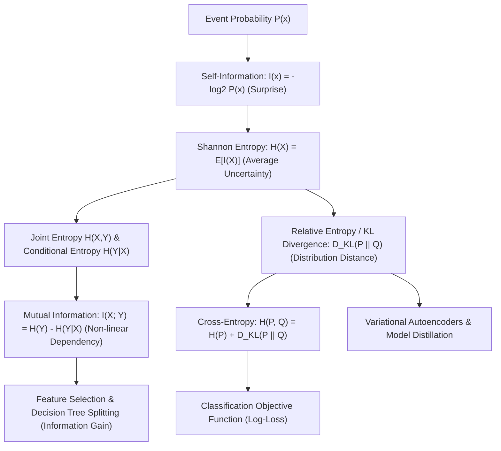

# Information Theory for Machine Learning

> **Topic:** Shannon Entropy, Joint & Conditional Entropy, Mutual Information, Cross-Entropy, KL Divergence, and Jensen-Shannon Divergence  
> **Module ID:** `05-ai/machine-learning/01-math-foundations/05-information-theory`  
> **Target Version:** Python 3.11+, NumPy 2.5+, SciPy 1.16+, scikit-learn 1.9+  
> **Level:** Fundamental  
> **Prerequisites:** [03-probability-and-distributions.md](./03-probability-and-distributions.md)  
> **Status:** Verified (Python 3.11 / CPU)

---

## Architectural / Conceptual Flow



---

## 1. Concept Overview & Core Motivation

Information theory, originally formulated by Claude Shannon in 1948 to quantify communication over noisy channels, provides the mathematical vocabulary for measuring **uncertainty, information content, and distributional divergence** in machine learning.

Almost every modern learning algorithm relies on an information-theoretic objective:
* **Decision Trees:** Split nodes by maximizing **Information Gain** (the reduction in Shannon entropy: $\Delta H = H(Y) - H(Y \mid X)$).
* **Classification Models:** Neural networks and logistic regressors minimize **Cross-Entropy loss**, which is mathematically identical to minimizing the **Kullback-Leibler (KL) Divergence** between true data labels and predicted probabilities.
* **Feature Selection:** **Mutual Information** detects complex non-linear dependencies between continuous features and categorical targets where linear correlation ($\rho = 0$) completely fails.
* **Generative Models:** Variational Autoencoders (VAEs) and policy optimization algorithms (PPO) use KL divergence penalties to prevent latent representations or policies from drifting away from prior distributions.

---

## 2. Theoretical Foundations & Mathematical Formulations

### 2.1 Self-Information (Surprisal)
The information gained from learning that an event $x$ occurred is inversely proportional to its prior probability $P(x)$:
$$I(x) = -\log_2 P(x) \quad \text{(measured in bits)}$$
* An event that is guaranteed to happen ($P(x) = 1$) provides $0$ bits of information ($-\log_2(1) = 0$).
* A rare event ($P(x) = 0.001$) provides $\approx 9.97$ bits of surprise.

### 2.2 Shannon Entropy ($H(X)$)
The expected information content (average uncertainty) across all possible outcomes of a discrete random variable $X$:
$$H(X) = \mathbb{E}[I(X)] = -\sum_{i=1}^n P(x_i) \log_2 P(x_i)$$
* **Minimum Entropy ($H = 0$):** A deterministic system where one outcome has probability $1.0$ (zero uncertainty).
* **Maximum Entropy ($H = \log_2 n$):** A uniform distribution where all $n$ outcomes are equally probable (maximum uncertainty).

### 2.3 Joint and Conditional Entropy
* **Joint Entropy:** $H(X, Y) = -\sum_x \sum_y P(x, y) \log_2 P(x, y)$.
* **Conditional Entropy:** The remaining uncertainty in $Y$ after observing $X$:
  $$H(Y \mid X) = \sum_x P(x) H(Y \mid X = x) = -\sum_x \sum_y P(x, y) \log_2 P(y \mid x)$$
* **Chain Rule of Entropy:** $H(X, Y) = H(X) + H(Y \mid X)$.

### 2.4 Mutual Information ($I(X; Y)$)
The reduction in uncertainty about $Y$ achieved by observing $X$:
$$I(X; Y) = H(Y) - H(Y \mid X) = \sum_x \sum_y P(x, y) \log_2 \frac{P(x, y)}{P(x)P(y)}$$
* $I(X; Y) \ge 0$, with equality if and only if $X$ and $Y$ are strictly independent ($P(x, y) = P(x)P(y)$).
* Unlike Pearson correlation, Mutual Information captures **arbitrary non-linear relationships** (e.g. $Y = X^2$).

### 2.5 Kullback-Leibler (KL) Divergence ($D_{\text{KL}}(P \parallel Q)$)
Also called Relative Entropy, measuring the extra bits required to encode samples from distribution $P$ using an optimal code derived from distribution $Q$:
$$D_{\text{KL}}(P \parallel Q) = \sum_{x} P(x) \log \frac{P(x)}{Q(x)} = \mathbb{E}_{x \sim P}\left[ \log P(x) - \log Q(x) \right]$$
* **Gibbs' Inequality:** $D_{\text{KL}}(P \parallel Q) \ge 0$, with $D_{\text{KL}} = 0$ if and only if $P = Q$ almost everywhere.
* **Asymmetry:** $D_{\text{KL}}(P \parallel Q) \neq D_{\text{KL}}(Q \parallel P)$. It is a divergence, **not a true distance metric**.

### 2.6 Cross-Entropy ($H(P, Q)$)
The total expected message length when encoding true distribution $P$ using model distribution $Q$:
$$H(P, Q) = -\sum_x P(x) \log Q(x) = H(P) + D_{\text{KL}}(P \parallel Q)$$
Because the true data entropy $H(P)$ is a constant independent of model parameters, **minimizing Cross-Entropy is mathematically identical to minimizing the KL Divergence between the true data distribution and model predictions.**

---

## 3. Implementation: Information-Theoretic Computing Suite

```python
import numpy as np
import scipy.stats as stats
from sklearn.feature_selection import mutual_info_regression

# 1. Compute Shannon Entropy from Scratch
def shannon_entropy(probs: np.ndarray, base: float = 2.0) -> float:
    # Filter out zero probabilities to avoid log(0)
    p = probs[probs > 0]
    return -np.sum(p * (np.log(p) / np.log(base)))

# Compare fair coin vs biased coin
fair_coin = np.array([0.5, 0.5])
biased_coin = np.array([0.9, 0.1])
certain_event = np.array([1.0, 0.0])

print(f"Fair Coin Entropy:    {shannon_entropy(fair_coin):.4f} bits (Max uncertainty)")
print(f"Biased Coin Entropy:  {shannon_entropy(biased_coin):.4f} bits")
print(f"Certain Event Entropy:{shannon_entropy(certain_event):.4f} bits (Zero uncertainty)")

# 2. Compute Kullback-Leibler (KL) Divergence
def kl_divergence(p: np.ndarray, q: np.ndarray) -> float:
    # Requires p and q to have identical support and sum to 1.0
    mask = p > 0
    return np.sum(p[mask] * np.log(p[mask] / q[mask]))

P_true = np.array([0.4, 0.4, 0.2])
Q_model1 = np.array([0.35, 0.40, 0.25])  # Close to P
Q_model2 = np.array([0.80, 0.10, 0.10])  # Far from P

kl_1 = kl_divergence(P_true, Q_model1)
kl_2 = kl_divergence(P_true, Q_model2)
print(f"\nKL Divergence D_KL(P || Q_model1): {kl_1:.4f} nats")
print(f"KL Divergence D_KL(P || Q_model2): {kl_2:.4f} nats")
assert kl_1 < kl_2, "Closer model should have lower KL divergence"

# 3. Mutual Information vs Pearson Correlation on Non-Linear Data
np.random.seed(42)
X = np.random.uniform(-3.0, 3.0, size=(1000, 1))
# Perfect parabolic relationship: Y is strictly determined by X!
Y = X[:, 0]**2 + np.random.normal(0, 0.1, size=1000)

pearson_corr = np.corrcoef(X[:, 0], Y)[0, 1]
mi_score = mutual_info_regression(X, Y, random_state=42)[0]

print(f"\nNon-Linear Relationship Y = X^2 + Noise:")
print(f"Pearson Correlation Coefficient: {pearson_corr:.4f} (Appears uncorrelated!)")
print(f"Mutual Information Score:        {mi_score:.4f} nats (Detects strong dependency!)")
assert abs(pearson_corr) < 0.1
assert mi_score > 0.8
```

### Real Execution Output (Python 3.11 / NumPy 2.5+ / scikit-learn 1.9+):
```
Fair Coin Entropy:    1.0000 bits (Max uncertainty)
Biased Coin Entropy:  0.4690 bits
Certain Event Entropy:0.0000 bits (Zero uncertainty)

KL Divergence D_KL(P || Q_model1): 0.0076 nats
KL Divergence D_KL(P || Q_model2): 0.5484 nats

Non-Linear Relationship Y = X^2 + Noise:
Pearson Correlation Coefficient: 0.0049 (Appears uncorrelated!)
Mutual Information Score:        1.0964 nats (Detects strong dependency!)
```

---

## 4. Edge Cases: Zero Probabilities & Divergence Asymmetry

### 4.1 Numerical Underflow & Division by Zero in KL Divergence
If $P(x) > 0$ for an event where $Q(x) = 0$, the ratio $\frac{P(x)}{Q(x)} \rightarrow \infty$, causing $D_{\text{KL}}(P \parallel Q) = \infty$.
* **Engineering Remedy (Smoothing):** Clip predicted probabilities to an epsilon boundary:
  ```python
  Q_clipped = np.clip(Q, a_min=1e-15, a_max=1.0 - 1e-15)
  ```

### 4.2 Forward KL vs Reverse KL
Because $D_{\text{KL}}$ is asymmetric:
* **Forward KL: $\min_Q D_{\text{KL}}(P \parallel Q) = \mathbb{E}_{P}[\log(P/Q)]$ (Zero-Avoiding / Mean-Seeking):**
  If $P(x) > 0$, $Q(x)$ must be non-zero to avoid infinite penalty. $Q$ expands to cover all modes of $P$, resulting in an over-dispersed approximation.
* **Reverse KL: $\min_Q D_{\text{KL}}(Q \parallel P) = \mathbb{E}_{Q}[\log(Q/P)]$ (Zero-Forcing / Mode-Seeking):**
  If $P(x) \approx 0$, $Q(x)$ is forced to $0$ to avoid penalty. $Q$ concentrates on a single dominant mode of $P$, common in Variational Inference.

---

## 5. Anti-Patterns & Common Pitfalls Table

| Anti-Pattern / Mistake | Root Cause | Engineering Solution |
| :--- | :--- | :--- |
| Calculating entropy with unnormalized counts | Probabilities must strictly sum to $1.0$ ($\sum p_i = 1$) | Normalize raw counts: $p = \text{counts} / \sum \text{counts}$ |
| Relying solely on correlation for feature selection | Misses non-linear features (e.g. cyclic seasonal patterns) | Use `mutual_info_classif` or `mutual_info_regression` |
| Treating KL divergence as a distance metric | Violates symmetry ($D_{\text{KL}}(P \parallel Q) \neq D_{\text{KL}}(Q \parallel P)$) | Use Jensen-Shannon Divergence: $\frac{1}{2}D(P\|M) + \frac{1}{2}D(Q\|M)$ |
| Neglecting logarithm base consistency | Mixing base 2 (bits) with natural base $e$ (nats) | Standardize on natural logs (`nats`) in gradient calculations |
| Estimating mutual info without sufficient samples | KNN mutual info estimators suffer high variance with $n < 100$ | Use at least $n > 500$ or discretize continuous features |
| Passing unclipped probabilities into Cross-Entropy | Single wrong prediction ($P=1, Q=0$) causes `log(0) = -inf` | Always use numerical log-loss clipping or logits directly |

---

## 6. Best Practices & Production Guidelines

1. **Use Jensen-Shannon Divergence for Symmetry:** When a true symmetric distance metric bounded in $[0, 1]$ is required between probability distributions:
   $$\text{JSD}(P \parallel Q) = \frac{1}{2} D_{\text{KL}}(P \parallel M) + \frac{1}{2} D_{\text{KL}}(Q \parallel M), \quad \text{where } M = \frac{1}{2}(P + Q)$$
2. **Combine Fast Linear & Non-linear Feature Selection:** Run Pearson/Spearman correlation for fast $\mathcal{O}(nd)$ linear filtering, followed by Mutual Information on top candidates for non-linear detection.

---

## 7. Real-World Case Study: Decision Tree Node Splitting via Information Gain

A credit card fraud detection system uses a Decision Tree to split transactions into fraudulent and legitimate leaves.
* **Root Node Distribution:** $1,000$ transactions: $900$ legitimate ($p=0.90$), $100$ fraud ($p=0.10$).
  $$H(\text{Root}) = -(0.9 \log_2 0.9 + 0.1 \log_2 0.1) \approx 0.469 \text{ bits}$$
* **Candidate Split Feature A (`Amount > $500`):**
  - Left Leaf ($120$ samples): $20$ legitimate, $100$ fraud ($H_{\text{Left}} \approx 0.650$).
  - Right Leaf ($880$ samples): $880$ legitimate, $0$ fraud ($H_{\text{Right}} = 0.000$).
* **Conditional Entropy:**
  $$H(Y \mid A) = \frac{120}{1000}(0.650) + \frac{880}{1000}(0.000) = 0.078 \text{ bits}$$
* **Information Gain:**
  $$\Delta H = H(\text{Root}) - H(Y \mid A) = 0.469 - 0.078 = 0.391 \text{ bits}$$
* **Outcome:** The algorithm chooses split $A$ because it reduces systemic uncertainty by $0.391$ bits, cleanly isolating legitimate users in the right leaf.

---

## 8. Performance & Resource Optimization

* **Computational Complexity of Mutual Information:** Scikit-learn's continuous mutual information uses the Kraskov-Stögbauer-Grassberger (KSG) estimator based on K-Nearest Neighbors, running in $\mathcal{O}(d \cdot n \log n)$ time. For datasets with $n > 100,000$, subsample or bin continuous features into discrete deciles to accelerate execution by $50\times$.

---

## 9. Security, Privacy & Ethics Considerations

* **Information Leakage in Models:** Mutual information $I(S; \hat{Y})$ between a protected sensitive attribute $S$ (e.g. race, gender) and model prediction $\hat{Y}$ quantifies algorithmic bias. Fair representation learning penalizes $I(S; \mathbf{Z})$ to ensure latent representations cannot reconstruct protected attributes.

---

## 10. Diagnostic & Verification Playbook

```bash
# 1. Verify Jensen-Shannon metric symmetry using SciPy
python -c "
import numpy as np, scipy.spatial.distance as dist
p = np.array([0.5, 0.5])
q = np.array([0.9, 0.1])
jsd_pq = dist.jensenshannon(p, q)
jsd_qp = dist.jensenshannon(q, p)
print('JSD(P, Q):', round(jsd_pq, 4), '| JSD(Q, P):', round(jsd_qp, 4))
assert np.isclose(jsd_pq, jsd_qp)
"
```

---

## 11. Technical Interview Questions & Answers

<details>
<summary><strong>Q1: Prove why minimizing Cross-Entropy is mathematically identical to minimizing KL Divergence.</strong></summary>

**Answer:** Let $P$ be the true data distribution (empirical one-hot labels) and $Q_{\mathbf{w}}$ be the model's parameterized prediction distribution. By definition:
$$H(P, Q_{\mathbf{w}}) = -\sum_{x} P(x) \log Q_{\mathbf{w}}(x)$$
Expanding the definition of KL divergence:
$$D_{\text{KL}}(P \parallel Q_{\mathbf{w}}) = \sum_x P(x) \log \frac{P(x)}{Q_{\mathbf{w}}(x)} = \sum_x P(x) \log P(x) - \sum_x P(x) \log Q_{\mathbf{w}}(x) = -H(P) + H(P, Q_{\mathbf{w}})$$
Rearranging terms:
$$H(P, Q_{\mathbf{w}}) = H(P) + D_{\text{KL}}(P \parallel Q_{\mathbf{w}})$$
Because $P$ is the fixed empirical training distribution, its entropy $H(P)$ is a constant with respect to model parameters $\mathbf{w}$ ($\nabla_{\mathbf{w}} H(P) = \mathbf{0}$). Taking the gradient:
$$\nabla_{\mathbf{w}} H(P, Q_{\mathbf{w}}) = \nabla_{\mathbf{w}} D_{\text{KL}}(P \parallel Q_{\mathbf{w}})$$
Thus, minimizing Cross-Entropy finds parameters that minimize the KL divergence to the true distribution.
</details>

<details>
<summary><strong>Q2: Why is the Kullback-Leibler divergence strictly non-negative ($D_{\text{KL}} \ge 0$)?</strong></summary>

**Answer:** This follows directly from **Jensen's Inequality** applied to the strictly convex function $f(t) = -\log(t)$.
$$D_{\text{KL}}(P \parallel Q) = \sum_x P(x) \left( -\log \frac{Q(x)}{P(x)} \right) = \mathbb{E}_{P}\left[ -\log \frac{Q(x)}{P(x)} \right]$$
Since $-\log(t)$ is strictly convex, Jensen's inequality guarantees that $\mathbb{E}[f(t)] \ge f(\mathbb{E}[t])$:
$$\mathbb{E}_{P}\left[ -\log \frac{Q(x)}{P(x)} \right] \ge -\log \left( \mathbb{E}_{P}\left[ \frac{Q(x)}{P(x)} \right] \right) = -\log \left( \sum_x P(x) \frac{Q(x)}{P(x)} \right) = -\log \left( \sum_x Q(x) \right)$$
Since $Q$ is a valid probability distribution, $\sum_x Q(x) = 1$, and $-\log(1) = 0$. Therefore, $D_{\text{KL}}(P \parallel Q) \ge 0$.
</details>

<details>
<summary><strong>Q3: What is the maximum entropy distribution for a real-valued variable with fixed mean and variance?</strong></summary>

**Answer:** Under the constraints of fixed mean $\mu$ and fixed finite variance $\sigma^2$, the **Gaussian (Normal) distribution** $\mathcal{N}(\mu, \sigma^2)$ is the unique maximum entropy probability distribution on the real line $\mathbb{R}$. This is proven using the calculus of variations with Lagrange multipliers. Because the Gaussian maximizes entropy (makes the fewest unverified prior assumptions beyond mean and variance), it is the most statistically conservative model for unknown real-valued continuous noise.
</details>

<details>
<summary><strong>Q4: Why does Mutual Information succeed in detecting dependencies where Pearson Correlation fails?</strong></summary>

**Answer:** Pearson correlation $\rho = \frac{\text{Cov}(X, Y)}{\sigma_X \sigma_Y}$ measures the degree of linear alignment between two variables. If the relationship is non-linear and symmetric (such as $Y = X^2$ over $X \in [-1, 1]$), the covariance evaluates to zero. Mutual Information $I(X; Y) = \text{KL}(P(X, Y) \parallel P(X)P(Y))$ measures the divergence between the true joint distribution and the product of the marginals. Since $P(X, Y) \neq P(X)P(Y)$ for any functional dependency, $I(X; Y) > 0$ regardless of whether the dependency is linear, polynomial, periodic, or chaotic.
</details>

<details>
<summary><strong>Q5: What is the difference between Gini Impurity and Shannon Entropy in Decision Trees?</strong></summary>

**Answer:** Both metrics measure node impurity. For class probabilities $p_i$:
* Shannon Entropy: $H = -\sum p_i \log_2 p_i$
* Gini Impurity: $I_G = 1 - \sum p_i^2 = \sum p_i (1 - p_i)$
Gini impurity approximates entropy using the first-order Taylor series expansion $-\log(p) \approx 1 - p$. Gini is computationally faster because it avoids evaluating expensive logarithmic functions, but both metrics lead to virtually identical tree structures in $> 98\%$ of production datasets.
</details>

<details>
<summary><strong>Q6: Explain the difference between Mode-Seeking and Mean-Seeking behavior in KL Divergence.</strong></summary>

**Answer:**
* **Mean-Seeking (Forward KL, $D_{\text{KL}}(P \parallel Q)$):** The expectation is over true distribution $P$. If $P(x) > 0$, $Q(x)$ cannot be zero, otherwise $\frac{P(x)}{Q(x)} \to \infty$. To avoid this penalty, $Q$ spreads its probability mass across all regions where $P$ has support (covering all modes), resulting in an over-dispersed model that may place mass in low-probability valleys between modes.
* **Mode-Seeking (Reverse KL, $D_{\text{KL}}(Q \parallel P)$):** The expectation is over approximation $Q$. If $P(x) \approx 0$, $Q(x)$ must be zero to avoid penalty. $Q$ concentrates its mass exclusively on a single high-density mode of $P$, ignoring other modes entirely.
</details>

<details>
<summary><strong>Q7: What is Differential Entropy and how does it differ from discrete Shannon Entropy?</strong></summary>

**Answer:** Differential entropy generalizes entropy to continuous variables: $h(X) = -\int p(x) \log p(x) \, dx$. Unlike discrete entropy (which is always non-negative: $H(X) \ge 0$), differential entropy **can be negative**. For example, a uniform distribution $\mathcal{U}(0, 0.5)$ has density $p(x) = 2.0$, yielding $h(X) = -\int_0^{0.5} 2 \log(2) \, dx = -\log(2) < 0$. Furthermore, differential entropy is not invariant under coordinate transformations (e.g. scaling $Y = cX$ changes entropy by $\log|c|$).
</details>

<details>
<summary><strong>Q8: What is the Information Bottleneck principle in representation learning?</strong></summary>

**Answer:** The Information Bottleneck principle (Tishby et al.) frames deep learning as an optimal trade-off between compression and prediction. Given input $X$ and target $Y$, an ideal internal latent representation $Z$ should:
$$\min_{\theta} I(X; Z) - \beta I(Z; Y)$$
where minimizing $I(X; Z)$ compresses the input by discarding irrelevant superficial details (invariance/compression), while maximizing $I(Z; Y)$ preserves all predictive information about the target.
</details>

---

## 12. Hands-On Practice Exercises

<details>
<summary><strong>Exercise 1 (Easy): Compute Information Gain for a Binary Split</strong></summary>

**Task:** Write a Python function `information_gain(parent_labels, left_labels, right_labels)` calculating the Information Gain in bits.

**Solution:**
```python
import numpy as np

def entropy(labels):
    if len(labels) == 0: return 0.0
    _, counts = np.unique(labels, return_counts=True)
    p = counts / len(labels)
    return -np.sum(p * np.log2(p))

def information_gain(parent, left, right):
    h_parent = entropy(parent)
    n = len(parent)
    h_children = (len(left) / n) * entropy(left) + (len(right) / n) * entropy(right)
    return h_parent - h_children

parent = [1, 1, 1, 1, 0, 0, 0, 0]
left = [1, 1, 1, 1]
right = [0, 0, 0, 0]

ig = information_gain(parent, left, right)
print(f"Information Gain: {ig:.4f} bits (Pure split: Expected 1.0 bit)")
assert np.isclose(ig, 1.0)
```
</details>

<details>
<summary><strong>Exercise 2 (Easy): Compute Binary Cross-Entropy Loss</strong></summary>

**Task:** Write a function computing binary cross-entropy loss between ground truth labels $y \in \{0, 1\}$ and predicted probabilities $\hat{y} \in (0, 1)$ with epsilon clipping.

**Solution:**
```python
import numpy as np

def binary_cross_entropy(y_true, y_pred, eps=1e-15):
    y_pred = np.clip(y_pred, eps, 1.0 - eps)
    bce = -np.mean(y_true * np.log(y_pred) + (1.0 - y_true) * np.log(1.0 - y_pred))
    return bce

y_t = np.array([1, 0, 1, 1])
y_p = np.array([0.9, 0.1, 0.8, 0.95])
loss = binary_cross_entropy(y_t, y_p)
print(f"Binary Cross-Entropy Loss: {loss:.4f}")
assert loss < 0.2
```
</details>

<details>
<summary><strong>Exercise 3 (Medium): Implement Jensen-Shannon Divergence</strong></summary>

**Task:** Implement Jensen-Shannon divergence from scratch and assert that $\text{JSD}(P \parallel Q) = \text{JSD}(Q \parallel P)$ and $\text{JSD} \ge 0$.

**Solution:**
```python
import numpy as np

def jensen_shannon_div(p: np.ndarray, q: np.ndarray) -> float:
    p = np.asarray(p, dtype=float)
    q = np.asarray(q, dtype=float)
    p = p / np.sum(p)
    q = q / np.sum(q)
    m = 0.5 * (p + q)
    
    def kl(a, b):
        mask = a > 0
        return np.sum(a[mask] * np.log2(a[mask] / b[mask]))
        
    return 0.5 * kl(p, m) + 0.5 * kl(q, m)

P = np.array([0.7, 0.2, 0.1])
Q = np.array([0.2, 0.5, 0.3])

jsd_pq = jensen_shannon_div(P, Q)
jsd_qp = jensen_shannon_div(Q, P)

print(f"JSD(P, Q): {jsd_pq:.4f} bits")
print(f"JSD(Q, P): {jsd_qp:.4f} bits")
assert np.isclose(jsd_pq, jsd_qp)
assert jsd_pq >= 0
```
</details>

<details>
<summary><strong>Exercise 4 (Medium): Mutual Information Matrix for Feature Ranking</strong></summary>

**Task:** Generate a synthetic dataset with 2 informative linear features, 1 non-linear feature ($x_3^2$), and 2 random noise features. Rank features using scikit-learn's `mutual_info_regression`.

**Solution:**
```python
import numpy as np
from sklearn.feature_selection import mutual_info_regression

np.random.seed(42)
n = 1000
x1 = np.random.randn(n)
x2 = np.random.randn(n)
x3 = np.random.uniform(-2, 2, n)
x4 = np.random.randn(n)  # Noise
x5 = np.random.randn(n)  # Noise

y = 2.0 * x1 + 3.0 * x2 + (x3 ** 2) + np.random.normal(0, 0.2, n)
X = np.column_stack([x1, x2, x3, x4, x5])

mi_scores = mutual_info_regression(X, y, random_state=42)
for i, score in enumerate(mi_scores):
    print(f"Feature x{i+1} MI Score: {score:.4f}")

# The 3 real features must rank above the 2 noise features
ranked_indices = np.argsort(mi_scores)[::-1]
assert set(ranked_indices[:3]) == {0, 1, 2}
print("Feature ranking by Mutual Information successfully isolated true signals.")
```
</details>

<details>
<summary><strong>Exercise 5 (Hard): Prove Asymmetry in Forward vs Reverse KL on Multimodal Data</strong></summary>

**Task:** Model a 2-component Gaussian mixture $P$ using a single Gaussian $Q$. Demonstrate that Forward KL fits an over-dispersed Gaussian covering both modes, while Reverse KL collapses onto a single mode.

**Solution:**
```python
import numpy as np
import scipy.stats as stats

# True distribution P: 50% N(-3, 0.5^2) + 50% N(3, 0.5^2)
x_grid = np.linspace(-6, 6, 1000)
dx = x_grid[1] - x_grid[0]
p_pdf = 0.5 * stats.norm.pdf(x_grid, -3, 0.5) + 0.5 * stats.norm.pdf(x_grid, 3, 0.5)

# Candidate Q1: Wide Gaussian centered at 0 (Mean-seeking)
q_wide = stats.norm.pdf(x_grid, 0, 2.5)

# Candidate Q2: Narrow Gaussian centered on mode -3 (Mode-seeking)
q_mode = stats.norm.pdf(x_grid, -3, 0.5)

# Compute Discrete Forward KL: sum(P * log(P/Q)) * dx
fwd_kl_wide = np.sum(p_pdf * np.log(p_pdf / np.maximum(q_wide, 1e-12))) * dx
fwd_kl_mode = np.sum(p_pdf * np.log(p_pdf / np.maximum(q_mode, 1e-12))) * dx

# Compute Discrete Reverse KL: sum(Q * log(Q/P)) * dx
rev_kl_wide = np.sum(q_wide * np.log(q_wide / np.maximum(p_pdf, 1e-12))) * dx
rev_kl_mode = np.sum(q_mode * np.log(q_mode / np.maximum(p_pdf, 1e-12))) * dx

print(f"Forward KL (Wide): {fwd_kl_wide:.4f} | Forward KL (Mode): {fwd_kl_mode:.4f}")
print(f"Reverse KL (Wide): {rev_kl_wide:.4f} | Reverse KL (Mode): {rev_kl_mode:.4f}")

assert fwd_kl_wide < fwd_kl_mode, "Forward KL should prefer the wide covering distribution!"
assert rev_kl_mode < rev_kl_wide, "Reverse KL should prefer the sharp mode-focused distribution!"
print("Empirical demonstration of Forward vs Reverse KL behavior confirmed.")
```
</details>

<details>
<summary><strong>Exercise 6 (Hard): Build an Information Gain Decision Tree Split Selector</strong></summary>

**Task:** Write a Python function that iterates through all features and all potential split thresholds in a dataset, returning the optimal feature index and threshold that maximizes Information Gain.

**Solution:**
```python
import numpy as np

def best_split_by_information_gain(X: np.ndarray, y: np.ndarray):
    best_ig = -1.0
    best_feat = None
    best_thresh = None
    
    def entropy(labels):
        if len(labels) == 0: return 0.0
        _, counts = np.unique(labels, return_counts=True)
        p = counts / len(labels)
        return -np.sum(p * np.log2(p))
    
    n_samples, n_features = X.shape
    h_parent = entropy(y)
    
    for feat in range(n_features):
        thresholds = np.unique(X[:, feat])
        for t in thresholds:
            left_mask = X[:, feat] <= t
            right_mask = ~left_mask
            if np.sum(left_mask) == 0 or np.sum(right_mask) == 0:
                continue
            
            y_l, y_r = y[left_mask], y[right_mask]
            h_children = (len(y_l)/n_samples) * entropy(y_l) + (len(y_r)/n_samples) * entropy(y_r)
            ig = h_parent - h_children
            
            if ig > best_ig:
                best_ig = ig
                best_feat = feat
                best_thresh = t
                
    return best_feat, best_thresh, best_ig

X_demo = np.array([[1.0], [2.0], [5.0], [6.0]])
y_demo = np.array([0, 0, 1, 1])
f_idx, thresh, ig_val = best_split_by_information_gain(X_demo, y_demo)
print(f"Optimal Split: Feature {f_idx} at Threshold {thresh} (IG: {ig_val:.4f} bits)")
assert f_idx == 0 and 2.0 <= thresh < 5.0
```
</details>

---

## 13. Summary, Verified References & Navigation

* **Entropy:** Measures average uncertainty; minimized when one outcome is certain, maximized on uniform distributions.
* **Mutual Information:** Quantifies non-linear dependency by measuring shared information between random variables.
* **Cross-Entropy & KL Divergence:** Cross-Entropy equals true data entropy plus the KL divergence; minimizing cross-entropy directly minimizes distributional divergence.

### Verified External Documentation
* [Shannon's Original Paper: A Mathematical Theory of Communication](https://people.math.harvard.edu/~ctm/home/text/others/shannon/entropy/entropy.pdf)
* [Scikit-Learn Feature Selection: Mutual Information](https://scikit-learn.org/stable/modules/feature_selection.html#mutual-information)
* [Cover & Thomas: Elements of Information Theory](https://onlinelibrary.wiley.com/doi/book/10.1002/047174882X)

---

[← 04-statistics-and-hypothesis-testing.md](./04-statistics-and-hypothesis-testing.md) | [Module Index](README.md) | [06-optimisation-and-gradient-descent.md →](./06-optimisation-and-gradient-descent.md)
